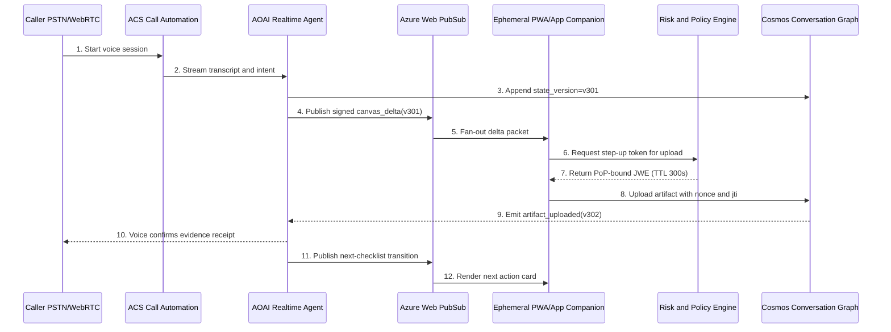
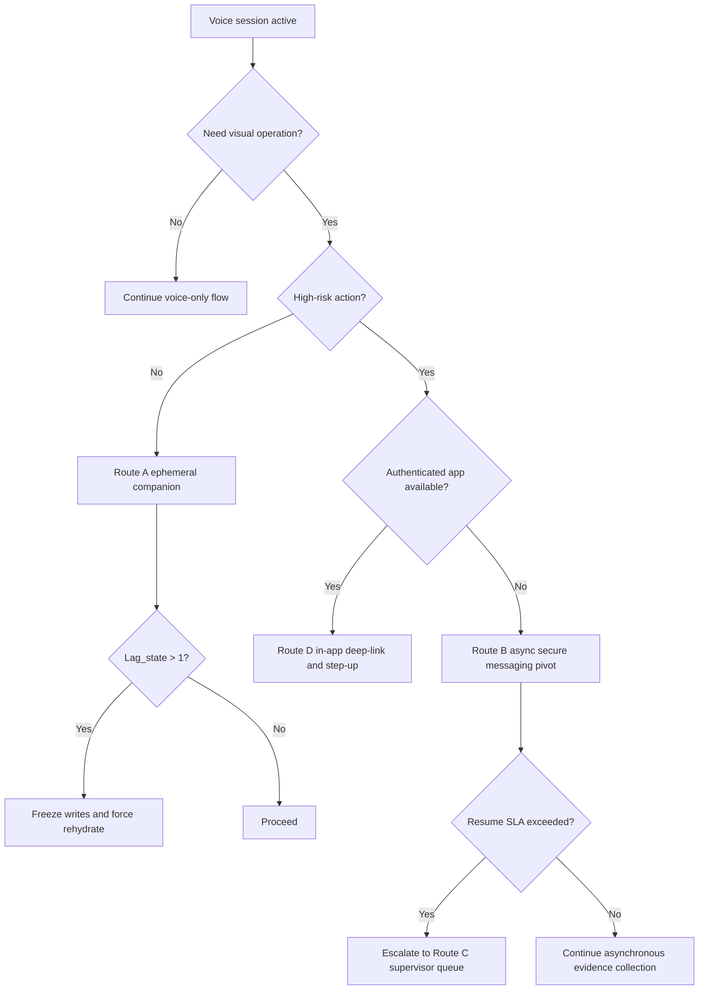

# Enterprise omnichannel session-continuity selection FAQ: cryptographically bound mid-journey pivots across voice, visual companion, and async messaging
> **Audience**: Cloud & AI Solution Architects, contact-center platform engineers, security architects, compliance teams, and channel operations leads.
> **Objective**: enable safe cross-modal handoffs between `PSTN/WebRTC voice`, `web or app companion canvas`, and `WhatsApp/RCS asynchronous steps` without dropping the call, losing state, or opening link-hijack attack surfaces.
> **Scope**: Route A (live voice + ephemeral companion), Route B (async rich messaging resume), Route C (D365 Contact Center suite), Route D (high-assurance in-app deep-link with zero SMS execution surface).

## 1. Executive Summary
Most omnichannel failures are not caused by poor UI design; they are caused by identity discontinuity and state-version drift between channels.
A caller can stay on voice while uploading photos, reviewing comparison tables, or approving high-risk actions, but only if all channels share one cryptographically verifiable conversation graph.
Route A is best when real-time continuity matters and teams can run strict `<150 ms` delta synchronization with short-lived proof-of-possession tokens.
Route B is best when journeys naturally span `24h–72h`, such as document collection, claim evidence gathering, and delayed approvals.
Route C is best when the organization prioritizes an integrated first-party operations stack with supervisor tooling and standardized case handling.
Route D is best for regulated financial and wealth workflows where SMS or PSTN-delivered executable links are prohibited for high-risk actions.
A common anti-pattern is sending a generic SMS URL during a live call and assuming conversational continuity survives; this fails under SIM swap, replay, and tenant-boundary confusion.

## 2. The Core Architecture Problem
Voice channels are linear and low-bandwidth for structured evidence.
Visual channels are stateful and high-bandwidth for artifacts, approvals, and forms.
Asynchronous messaging channels are durable but disorder-prone under retries and late delivery.
An enterprise architecture must preserve one truth across all three modalities:
1. **Who** is allowed to continue this exact journey.
2. **Which state version** they are allowed to mutate.
3. **How** each mutation is replayable, attributable, and auditable.
If those three conditions are not guaranteed, cross-channel continuity becomes probabilistic rather than deterministic.

## 3. Threat Model and Failure Boundaries
### 3.1 Threats
- **SIM-swap and number takeover**: attacker receives OTP or link intended for the real caller.
- **Link replay**: intercepted deep-link is reused within token TTL.
- **Cross-tenant confusion**: shared gateway accepts events with ambiguous tenant context.
- **Session fixation**: stale companion page keeps mutating a newer voice session.
- **Human-factor race**: customer submits evidence from multiple devices simultaneously.

### 3.2 Failure boundaries
- Voice continuity SLO breach (`call drop`, `audio freeze`, `handoff timeout`).
- State divergence (`voice state v201`, companion state v198).
- Policy bypass (`step-up required`, but action accepted without challenge).
- Evidence integrity drift (artifact uploaded to wrong case key).
- Audit gap (approval happened but immutable trail missing).

## 4. Route A — Live Voice + Cryptographically Bound Ephemeral Companion
Route A keeps voice as the primary channel while launching an ephemeral visual companion.
`Azure Communication Services Call Automation` and `AOAI Realtime` handle the voice loop.
`Azure Web PubSub` broadcasts signed incremental state deltas.
Companion access is guarded by a short-lived `JWE` bound to a proof-of-possession key and optional passkey step-up.
Each mutation references `(tenant_id, conversation_id, channel_epoch, state_version)`.
`Cosmos DB` stores one append-only conversation event graph used by both voice and visual channels.
Recommended controls include one-time nonce, `jti` deny-listing, and strict token audience checks.
This route is the strongest fit for synchronous insurance, healthcare intake, and guided troubleshooting journeys.

## 5. Route B — Asynchronous Rich Messaging Pivot and Multi-Hour Resume
Route B intentionally shifts from real-time continuity to durable continuity.
`ACS Advanced Messaging` (WhatsApp Flows / RCS cards) carries asynchronous interactions.
`Durable Functions` orchestrates checkpoint hydration and resume logic.
`Cosmos DB TTL` enforces lifecycle boundaries for temporary artifacts and pending tasks.
Each resume action validates that `resume_token`, `state_version`, and `channel_epoch` still match the active session branch.
This route reduces live agent occupancy and improves customer convenience for long-tail document workflows.
The trade-off is higher orchestration complexity for retries, deduplication, and out-of-order event handling.

## 6. Route C — Dynamics 365 Contact Center + Copilot Studio
Route C offers turnkey first-party omnichannel operations.
It centralizes routing, supervisor barge-in, case records, and workforce controls.
For organizations already standardized on D365 operations, this route shortens delivery time and lowers integration sprawl.
It also provides strong governance and operational consistency across business units.
The primary trade-off is reduced low-level protocol flexibility compared with deeply customized Route A or B implementations.
If teams require highly specialized cryptographic bindings, additional extensions may still be needed.

## 7. Route D — High-Assurance In-App Deep-Link with PII-Masked Co-Browse
Route D removes executable SMS/PSTN link surface for high-risk actions.
Users are redirected into an authenticated mobile app context through Universal Links or equivalent mechanisms.
Step-up authentication (passkey, device binding, phishing-resistant MFA) is enforced before sensitive operations.
Co-browse telemetry is PII-masked, with semantic field classes transmitted instead of raw sensitive values.
Voice agents and supervisors receive controlled state summaries, not unrestricted raw customer data.
This route is often required in regulated banking, wealth, and high-value dispute flows.
It has the highest implementation burden but the strongest security posture against link hijacking and replay.

## 8. Route Selection Thresholds and Decision Policy
Use measurable thresholds before selecting architecture:
1. `P95 real-time delta sync <= 200 ms` strongly favors Route A.
2. `Expected evidence collection > 8 minutes` or `P95 > 20 minutes` favors Route B.
3. `Need immediate integrated supervisor stack` favors Route C.
4. `Policy forbids SMS-based high-risk confirmation` requires Route D.
In practice, enterprise deployments often combine routes:
- `A + B` for synchronous triage plus asynchronous completion.
- `A + D` for real-time guidance with in-app high-assurance approvals.
- `C + D` for regulated contact-center operations at scale.

## 9. Quantitative Invariants and Governing Equations
### 9.1 Session fork probability
`P_fork(L) = 1 - ∏_{t=1}^{L}(1 - p_desync,t)`
Where `p_desync,t` captures channel lag, retry race, and out-of-order delivery at step `t`.

### 9.2 Replay window
`W_replay = max(0, TTL_token - T_revocation_propagation)`
Security objective is minimizing `W_replay` while preserving usability.

### 9.3 Tenant confusion risk
`R_confuse = P(key_collision) * P(missing_tenant_fence)`
Hardened claim signing and tenant-bound partition keys drive the second term toward zero.

### 9.4 Voice continuity reliability
`S_voice = 1 - N_drop / N_call`
High-assurance programs usually enforce `S_voice >= 99.95%`.

### 9.5 End-to-end mutation latency
`T_total = T_ingest + T_policy + T_sync + T_render`
Design for `P95(T_total)` under business SLA and `P99` under incident guardrail.

### 9.6 State lag bound
`Lag_state = version_voice - version_companion`
Mutating operations should be blocked when `|Lag_state| > 1`.

## 10. Mermaid — End-to-end dual-channel state synchronization sequence


## 11. Mermaid — Failure and step-up decision topology


## 12. Twelve-dimension comparison matrix
| Dimension | Route A: Live Voice + Ephemeral Companion | Route B: Async WhatsApp/RCS Resume | Route C: D365 Contact Center Suite | Route D: In-App Deep-Link Zero-SMS |
|---|---|---|---|---|
| Real-time continuity | High | Medium | Medium-high | High |
| Voice interruption risk | Low | Low-medium during pivot | Low | Low |
| Visual interaction richness | High | Medium-high | Medium | High |
| Link hijack exposure | Medium (mitigated by PoP) | Medium | Medium | Low |
| Replay-defense complexity | Medium | High | Medium | Low-medium |
| Tenant-boundary assurance | High | Medium-high | Medium | High |
| Orchestration flexibility | High | High | Medium | Medium-high |
| Time-to-deliver | Medium | Medium | High | Medium-low |
| Operational complexity | Medium-high | High | Medium | High |
| Compliance audit depth | High | High | High | High |
| Three-year blended TCO | Medium | Medium-high | Medium-high | High |
| Best-fit profile | Synchronous guided journeys | Multi-hour evidence workflows | Standardized enterprise ops | Regulated high-value approvals |

## 13. Q1 — What should the real-time sync budget be?
**Question**: What is the practical state-sync threshold while keeping voice natural?
**Answer**: Start with `P95(T_sync) <= 150 ms` and hard-guard at `300 ms`.
Equation:
`T_sync = T_hub_ingress + T_fanout + T_client_apply`.
When threshold is exceeded, switch companion to read-only and suppress mutating operations until rehydration completes.
This prevents hidden fork accumulation during transient congestion.

## 14. Q2 — How should PoP token TTL be chosen?
**Question**: Is `5 minutes` always safe for companion links?
**Answer**: No. TTL must be bounded by operation context:
`TTL_token <= T_user_step + T_network_jitter + T_retry_cap`.
Replay window:
`W_replay = TTL_token - T_revocation_propagation`.
For high-risk approvals, many programs target `TTL <= 180s` plus one-time nonce and `jti` revocation.

## 15. Q3 — How do we quantify SIM-swap impact?
**Question**: How do we decide whether SMS-based pivots are acceptable?
**Answer**: Use a loss-weighted risk model:
`R_sim = P(sim_swap) * P(no_step_up) * Loss_per_event`.
Route D reduces `P(no_step_up)` by forcing app-bound strong authentication.
Where `Loss_per_event` is large (wire disputes, payout approvals), SMS execution links should be disabled.

## 16. Q4 — How is cross-tenant confusion prevented?
**Question**: How do we prevent events landing in the wrong tenant session?
**Answer**: Validate signed tuple `(tenant_id, conversation_id, channel_epoch)` for every mutation.
Reject condition:
`hash(tuple) != signed_claim`.
Enforce tenant in partition keys and in APIM policy claims to avoid mixed key-space acceptance.
Track and alert on rejected writes for forensic transparency.

## 17. Q5 — When should we choose async resume over live companion?
**Question**: Where is the break-even point between Route A and Route B?
**Answer**: Prefer Route B when collection duration exceeds live-call economics.
Heuristic:
`T_collect_p50 > 8 min` or `T_collect_p95 > 20 min`.
At that point, forcing synchronous completion increases occupancy cost and customer fatigue.
Async resume preserves continuity while offloading long-tail tasks.

## 18. Q6 — When does D365 suite ROI dominate custom orchestration?
**Question**: How do we justify Route C license and platform coupling?
**Answer**: Use three-year net value:
`ROI_3y = Saved_AHT + Saved_Training + Saved_Integration - License_and_Customization`.
If `ROI_3y > 0` and delivery target is under two quarters, Route C often wins.
If deep protocol control and custom crypto binding are mandatory, Route A/B may still be superior.

## 19. Production implementation block A — Python PoP session binding and replay guard
```python
from __future__ import annotations
from dataclasses import dataclass
from datetime import datetime, timedelta, timezone
import hashlib
import hmac
import secrets

@dataclass(frozen=True)
class SessionBinding:
    tenant_id: str
    conversation_id: str
    channel_epoch: int
    state_version: int
    expires_at: datetime
    jti: str

def issue_binding(
    tenant_id: str,
    conversation_id: str,
    channel_epoch: int,
    state_version: int,
    ttl_seconds: int = 300,
) -> SessionBinding:
    now = datetime.now(timezone.utc)
    return SessionBinding(
        tenant_id=tenant_id,
        conversation_id=conversation_id,
        channel_epoch=channel_epoch,
        state_version=state_version,
        expires_at=now + timedelta(seconds=ttl_seconds),
        jti=secrets.token_hex(16),
    )

def sign_binding(binding: SessionBinding, secret: bytes) -> str:
    material = (
        f"{binding.tenant_id}|{binding.conversation_id}|"
        f"{binding.channel_epoch}|{binding.state_version}|{binding.jti}"
    ).encode("utf-8")
    return hmac.new(secret, material, hashlib.sha256).hexdigest()

def binding_is_live(binding: SessionBinding, now: datetime) -> bool:
    return now <= binding.expires_at
```

## 20. Production implementation block B — TypeScript Web PubSub delta publisher with idempotency fencing
```typescript
type DeltaEvent = {
  tenantId: string;
  conversationId: string;
  channelEpoch: number;
  stateVersion: number;
  eventType: "canvas_delta" | "artifact_uploaded" | "approval_step_up";
  payload: Record<string, unknown>;
};

function idempotencyKey(e: DeltaEvent): string {
  return [
    e.tenantId,
    e.conversationId,
    String(e.channelEpoch),
    String(e.stateVersion),
    e.eventType,
  ].join(":");
}

async function publishDelta(
  webPubSubClient: { sendToGroup: (group: string, message: unknown) => Promise<void> },
  e: DeltaEvent
): Promise<void> {
  await webPubSubClient.sendToGroup(`conv-${e.conversationId}`, {
    ...e,
    idempotencyKey: idempotencyKey(e),
    emittedAtUtc: new Date().toISOString(),
  });
}
```

## 21. Production implementation block C — APIM claim constraints and Cosmos TTL policy
```xml
<policies>
  <inbound>
    <base />
    <validate-jwt header-name="Authorization" failed-validation-httpcode="401">
      <openid-config url="https://login.microsoftonline.com/<tenant>/v2.0/.well-known/openid-configuration" />
      <required-claims>
        <claim name="tenant_id" />
        <claim name="conversation_id" />
        <claim name="channel_epoch" />
      </required-claims>
    </validate-jwt>
    <rate-limit-by-key calls="30" renewal-period="60" counter-key="@(context.Request.Headers.GetValueOrDefault(\"x-conversation-id\",\"na\"))" />
  </inbound>
</policies>
```

```json
{
  "container": "conversation-events",
  "partitionKey": ["/tenantId", "/conversationId"],
  "defaultTtl": 259200,
  "analyticalTtl": -1,
  "indexingPolicy": {
    "automatic": true,
    "includedPaths": [{"path": "/*"}],
    "excludedPaths": [{"path": "/payload/rawText/?"}]
  }
}
```

## 22. Enterprise scenario 1 — Auto insurance FNOL roadside journey
A driver starts a live voice claim on the roadside.
The agent launches Route A companion to collect damage photos, license snapshots, and tow-location metadata during the same call.
The platform writes each artifact upload as an immutable event and confirms progression back on voice.
Repair quote negotiation and shop-slot confirmation often exceed live-call tolerance, so Route B takes over asynchronous completion.
For payout authorization, the journey pivots to Route D in-app step-up confirmation.
This combination preserves empathy and speed while enforcing high-assurance approvals.

## 23. Enterprise scenario 2 — Retail and private banking wire-dispute escalation
A client disputes an international wire transfer while on voice.
Policy requires no executable SMS link for high-risk actions.
The architecture shifts from voice guidance to Route D authenticated mobile-app deep-link.
A supervisor can barge in through Route C tooling while sharing one unified conversation ledger.
All challenge outcomes, approvals, and evidence pointers are immutable and replayable for compliance review.

## 24. Three-year TCO model (illustrative baseline)
| Cost category | Route A | Route B | Route C | Route D |
|---|---:|---:|---:|---:|
| Initial platform build (USD) | 420,000 | 360,000 | 310,000 | 510,000 |
| Integration and compliance engineering (USD) | 280,000 | 320,000 | 260,000 | 380,000 |
| Annual run cost (USD/year) | 240,000 | 210,000 | 290,000 | 260,000 |
| Three-year TCO (USD) | 1,420,000 | 1,310,000 | 1,440,000 | 1,670,000 |
| Agent occupancy reduction potential | High | Medium-high | Medium | Medium |
| Risk-loss avoidance potential | High | Medium | Medium-high | Highest |

## 25. Day-0 / Day-1 / Day-2 go-live checklist
### Day-0 architecture and security baseline
- Standardize `(tenant_id, conversation_id, channel_epoch, state_version)` contract fields.
- Define token TTL, nonce policy, `jti` revocation handling, and replay rejection rules.
- Classify high-risk actions and bind each to mandatory step-up policy.
- Configure managed identities and least-privilege RBAC for ACS, Web PubSub, APIM, and Cosmos.

### Day-1 launch and capacity validation
- Load-test `P95 sync latency`, `P99 mutation latency`, and voice continuity SLO.
- Fault-inject out-of-order delivery, delayed resume, duplicate submit, and expired token paths.
- Validate supervisor and audit views against immutable event records.
- Measure revocation propagation and tune TTL to maintain risk windows within policy.

### Day-2 operations and continuous governance
- Track `Lag_state`, `W_replay`, and `R_confuse` as first-class operational risk indicators.
- Run weekly post-incident replay sessions on failed cross-channel transitions.
- Recalibrate risk thresholds monthly with fraud and compliance teams.
- Execute quarterly red-team drills for SIM swap, replay, and tenant-confusion attempts.

## 26. Good fit versus not for
**Good fit**
- Journeys requiring seamless movement between voice, visual evidence, and delayed messaging.
- Programs that require deterministic auditability for each cross-channel mutation.
- Multi-tenant services where identity and state boundaries must remain mathematically enforceable.

**Not for**
- Single-channel FAQ bots with no evidence collection and no high-risk approval.
- Teams unwilling to run event-sourced state machines and token-governance operations.
- Organizations requiring zero-SMS high-assurance actions but lacking authenticated mobile channel capabilities.

## 27. Implementation guardrails
Never allow implicit overwrite of current state; every mutation must be an explicit append-only event.
Require `state_version` and `channel_epoch` on all sensitive actions to block stale-page submissions.
Never expose unsigned mutable conversation pointers in plain URL parameters.
Automatically switch to read-only mode when lag or signature mismatch exceeds threshold.
Persist denial decisions and policy reasons for forensics and regulator-ready evidence.

## 28. Authoritative references
- Azure Communication Services Call Automation documentation.
- Azure Communication Services Advanced Messaging (WhatsApp and RCS) documentation.
- Azure Web PubSub documentation and reliability guidance.
- Azure Cosmos DB partitioning and TTL design guidance.
- Dynamics 365 Contact Center and Copilot Studio documentation.
- Microsoft Entra phishing-resistant MFA and passkey architecture guidance.

## 29. Final SA recommendation
For most enterprises, start with Route A as the real-time backbone and Route B as the long-tail completion layer.
Add Route C where operational standardization and supervisor efficiency are primary goals.
Mandate Route D for high-risk regulated actions where SMS-based execution links are unacceptable.
The winning pattern is not a single route; it is a composable architecture anchored by one signed identity plane and one versioned conversation graph.
