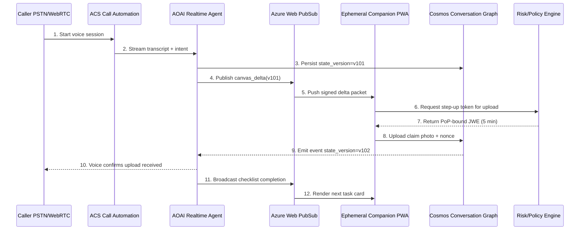
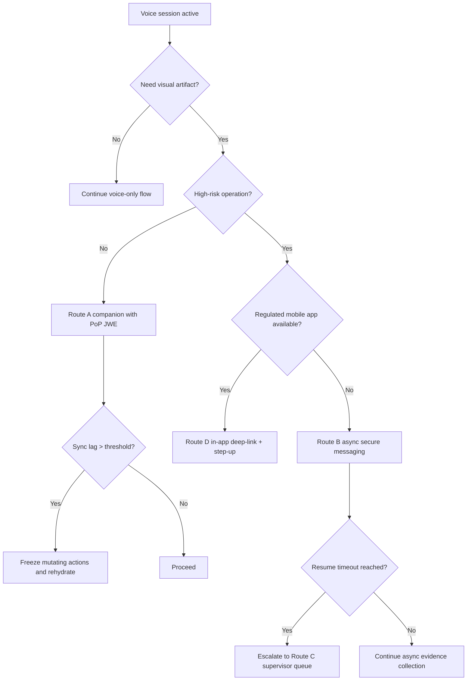

# 企业全渠道会话连续性选型 FAQ：语音、网页伴随画布与异步消息的加密绑定中途切换
> **适用对象**：Cloud & AI Solution Architect、联络中心平台团队、渠道运营、企业安全与合规团队。
> **目标**：在不中断语音会话、不丢失上下文、不暴露短信劫持面前提下，实现 `PSTN/WebRTC` 与 Web/App Companion、WhatsApp/RCS、D365 工单协同的可审计切换。
> **范围**：Route A（Voice + Ephemeral PWA）、Route B（Async Messaging Resume）、Route C（D365 Contact Center Suite）、Route D（Regulated In-App Deep-Link Zero-SMS）。

## 1. Executive Summary
跨模态会话连续性的核心，不是“把消息发到另一个渠道”，而是保证同一业务事务在切换前后拥有同一安全主体、同一状态版本、同一审计链。
如果语音客服与视觉交互分属两套会话标识，任何中途上传图片、签署授权或高风险确认都会触发上下文漂移与责任边界断裂。
Route A 适合实时协作密集场景，强调 `<150 ms` 状态同步和 `5 min` PoP 令牌短有效期。
Route B 适合 `24h–72h` 资料收集链路，把“即时联机”改成“可恢复异步任务”。
Route C 适合希望快速获得一体化座席与主管能力的大型组织，代价是平台耦合与扩展边界受限。
Route D 适合强监管金融、财富管理与高净值业务，把深链接切换放到已认证 App 内，直接移除 SMS/PSTN 链接劫持面。
反模式是“短信发一个普通 URL + 语音继续讲”，这种设计在 SIM swap、链接重放、跨租户混淆下会失去可证明安全性。

## 2. Core Architectural Problem
企业希望在同一通电话里完成多步骤任务：拍照、比价、文档核验、风险确认、电子签名。
语音链路天然是线性流，而视觉链路天然是状态图；如果两者没有统一版本控制，系统就会出现“电话在 A 步，页面在 C 步”的分叉。
安全上最常见三类威胁是：
1. **SIM-swap / 呼叫转移欺骗**：攻击者截获短信链接后接管伴随页面。
2. **Link Replay**：截获一次性链接后在有效期内重复提交状态突变请求。
3. **Cross-Tenant Channel Confusion**：多租户共享网关错误复用会话键，导致消息进入错误租户轨道。
连续性设计必须同时回答三个问题：谁可以继续会话、可以继续到哪一步、每一步是否可回放与可追责。

## 3. Route A — Live Voice + Cryptographically Bound Ephemeral Companion
Route A 以语音通道为主轨，配套短时 PWA 伴随画布。
`ACS Call Automation + AOAI Realtime` 负责实时语音对话，`Azure Web PubSub` 负责事件增量广播。
伴随画布不直接信任短信链接，而是要求 `PoP/Passkey` 绑定的短期 `JWE` 会话票据。
票据建议 5 分钟有效、一次性 nonce、单设备公钥绑定，防止转发与重放。
会话主状态存于 `Cosmos DB` 会话图（conversation graph），语音轨与视觉轨共享同一 `conversation_id + state_version`。
所有工具调用均写入不可变事件流：`voice_turn`, `canvas_delta`, `approval_step_up`, `artifact_upload`。
当用户上传图片或文档时，语音轨不会暂停，而是收到“状态已推进到 v+n”的结构化事件确认。

## 4. Route B — Asynchronous Messaging Pivot + Multi-Hour Resume
Route B 适合“电话先建单，后续异步补件”。
`ACS Advanced Messaging`（WhatsApp Flows / RCS Rich Cards）承接异步交互，Durable Functions 维护长周期任务状态。
Cosmos TTL 用于会话片段与临时证明材料生命周期治理，常见窗口 `24h`, `48h`, `72h`。
优点是用户可脱离实时语音环境完成操作，座席占用下降。
风险在于异步链路更长，重试、幂等与跨渠道回执一致性更难。
因此必须在每个回执事件携带 `resume_token`, `state_version`, `channel_epoch`，并做严格顺序校验。

## 5. Route C — Dynamics 365 Contact Center + Copilot Studio
Route C 以一体化座席平台换取交付速度。
D365 Contact Center 统一会话记录、技能路由、主管插入（barge-in）与工单衔接。
Copilot Studio 用于规则化 bot/agent 编排，减少自建编排层复杂度。
优势是流程标准化、治理模型成熟、业务线落地速度快。
代价是对外部模型路由、自定义加密绑定和低层协议控制灵活度低于自建 A/B 路线。
如果组织已经采用 D365 客服体系且强调运营一致性，Route C 往往是务实路径。

## 6. Route D — High-Assurance In-App Deep-Link + PII-Masked Co-Browse
Route D 针对高合规行业：不在短信中发送可执行业务链接。
系统只发送“唤醒提示”，真正业务跳转在已登录银行 App 内通过 Universal Link 完成。
跳转后触发设备绑定二次认证（Passkey / FIDO2 / Device Binding），再进入 PII-Masked 协作视图。
DOM 遥测采用掩码策略：敏感字段只传类别不传值，如 `account_number -> TOKENIZED_FIELD`.
语音座席看到的是同步状态卡片而非完整原文，满足最小暴露原则。
该路线实现成本更高，但能显著降低短信劫持与截屏泄露风险。

## 7. Route Selection Thresholds
建议先用四个阈值做初筛：
1. `P95 sync latency target <= 200 ms`：倾向 Route A。
2. `Document collection window >= 24h`：倾向 Route B。
3. `Need unified supervisor tooling immediately`：倾向 Route C。
4. `Regulatory policy forbids SMS deep-link for high-risk actions`：倾向 Route D。
若组织同时满足 1 与 4，常见组合是 `A + D`：语音实时协作 + App 内高风险确认。

## 8. Quantitative Invariants and Formulas
为了避免“看起来能跑”的脆弱方案，建议把连续性治理写成可验证公式。
1. **状态分叉概率**
`P_fork(L) = 1 - ∏_{t=1}^{L}(1 - p_desync,t)`
其中 `p_desync,t` 与网络抖动、跨渠道重试、乱序回执有关。
2. **重放攻击成功窗口**
`W_replay = max(0, TTL_token - T_revocation_propagation)`
目标是把 `W_replay` 压到分钟级甚至秒级。
3. **跨租户混淆风险**
`R_confuse = P(key_collision) * P(missing_tenant_fence)`
通过分区键与签名 claim 可将后项逼近 0。
4. **语音不中断约束**
`S_voice = 1 - (N_drop / N_call)`，生产 SLO 常设为 `>= 99.95%`。
5. **链路总时延预算**
`T_total = T_ingest + T_policy + T_sync + T_render`，并要求 `P95(T_total)` 在业务阈值内。
6. **会话一致性滞后**
`Lag_state = version_voice - version_canvas`，目标常设 `|Lag_state| <= 1`。

## 9. Mermaid — 双通道状态同步时序


## 10. Mermaid — 失败与升阶决策拓扑


## 11. 12-Dimension Comparison Matrix
| 维度 | Route A：Voice + Ephemeral PWA | Route B：WhatsApp/RCS Async Resume | Route C：D365 Contact Center Suite | Route D：In-App Deep-Link Zero-SMS |
|---|---|---|---|---|
| 会话连续性实时性 | 高（毫秒级） | 中（分钟级） | 中高（平台内一致） | 高（App 内一致） |
| 语音中断风险 | 低 | 低（但异步切换时有等待） | 低 | 低 |
| 视觉交互丰富度 | 高 | 中高 | 中 | 高 |
| 链接劫持暴露面 | 中（需强绑定） | 中（外部消息链路） | 中 | 低 |
| 重放防护难度 | 中 | 高 | 中 | 低中 |
| 多租户隔离控制 | 高（自建可细化） | 中高 | 中 | 高 |
| 编排灵活度 | 高 | 高 | 中 | 中高 |
| 交付速度 | 中 | 中 | 高 | 中低 |
| 运维复杂度 | 中高 | 高 | 中 | 高 |
| 合规审计可追溯 | 高 | 高 | 高 | 高 |
| 三年 TCO（综合） | 中 | 中高 | 中高 | 高 |
| 推荐场景 | 实时协作型服务 | 长周期补件流程 | 标准化联络中心 | 高监管高价值交易 |

## 12. Q1 — 如何设定 Web PubSub 同步预算？
**问题**：在语音不中断条件下，状态更新的 `P95` 应控制在多少？
**答案**：建议 `P95(T_sync) <= 150 ms`，并设总预算：
`T_sync = T_hub_ingress + T_fanout + T_client_apply`。
如果 `T_sync` 超过阈值，系统必须禁止高风险状态突变（只读模式），直到追平版本。
实践中可设置两级阈值：`150 ms` 警戒，`300 ms` 熔断。
这比单看平均延迟更可靠，因为用户感知通常由尾延迟决定。

## 13. Q2 — PoP 令牌 TTL 应如何计算？
**问题**：5 分钟 TTL 是否总是安全？
**答案**：不是固定值，需满足：
`TTL_token <= T_user_step + T_network_jitter + T_retry_cap`
且重放窗口 `W_replay = TTL_token - T_revocation_propagation` 要尽量小。
对高风险确认建议 `TTL_token <= 180s`，普通上传可放宽到 `300s`。
若撤销传播慢于 60 秒，必须加入 nonce 一次性约束和 `jti` 黑名单。

## 14. Q3 — 如何度量 SIM-swap 风险对流程的影响？
**问题**：电话真实用户与链接打开者不一致时如何量化风险？
**答案**：可定义：
`R_sim = P(sim_swap) * P(no_step_up) * Loss_per_event`。
通过 App 内 step-up 将 `P(no_step_up)` 降低一个数量级以上。
若业务损失单次高于阈值（如电汇争议、理赔付款），应强制 Route D。
在电话轨上可增加 challenge phrase 与 device possession 校验降低误放行。

## 15. Q4 — 跨租户渠道混淆怎么防？
**问题**：共享网关下，如何避免会话写入错误租户？
**答案**：必须在每个事件写入前做三元校验：
`tenant_id`, `conversation_id`, `channel_epoch`。
可定义拒绝条件：
`Reject if hash(tenant_id|conversation_id|epoch) != signed_claim`.
此外 Cosmos 分区键应包含租户维度，避免同键空间碰撞。
审计上保留拒绝日志，便于后续法务取证。

## 16. Q5 — 何时选择异步补件而非实时伴随？
**问题**：什么时候 Route B 明显优于 Route A？
**答案**：当证据采集平均耗时超过实时通话容忍窗口时。
可用阈值：
`T_collect_p50 > 8 min` 或 `T_collect_p95 > 20 min` 时优先异步。
此时强行保持实时通话会导致坐席占用成本上升与用户体验下降。
Route B 通过可恢复任务把长尾操作转移到非实时通道，降低单位案件服务成本。

## 17. Q6 — D365 一体化何时值得？
**问题**：Route C 的平台耦合成本何时可接受？
**答案**：当组织目标是快速标准化并且已有 D365 资产。
可用 ROI 判定：
`ROI_3y = (Saved_AHT + Saved_Training + Saved_Integration) - License_and_Customization_Cost`.
若 `ROI_3y > 0` 且上线周期目标小于 2 个季度，Route C 往往更优。
若强依赖底层协议可编程性或多模型网关自定义，A/B 组合更灵活。

## 18. Production Implementation A — Python 会话绑定与 JWE PoP 校验
```python
from __future__ import annotations
from dataclasses import dataclass
from datetime import datetime, timedelta, timezone
import hashlib
import hmac
import secrets

@dataclass(frozen=True)
class SessionBinding:
    tenant_id: str
    conversation_id: str
    channel_epoch: int
    state_version: int
    expires_at: datetime
    jti: str

def build_binding_signature(binding: SessionBinding, secret: bytes) -> str:
    material = (
        f"{binding.tenant_id}|{binding.conversation_id}|"
        f"{binding.channel_epoch}|{binding.state_version}|{binding.jti}"
    ).encode("utf-8")
    return hmac.new(secret, material, hashlib.sha256).hexdigest()

def issue_short_lived_binding(
    tenant_id: str,
    conversation_id: str,
    channel_epoch: int,
    state_version: int,
    ttl_seconds: int = 300,
) -> SessionBinding:
    now = datetime.now(timezone.utc)
    return SessionBinding(
        tenant_id=tenant_id,
        conversation_id=conversation_id,
        channel_epoch=channel_epoch,
        state_version=state_version,
        expires_at=now + timedelta(seconds=ttl_seconds),
        jti=secrets.token_hex(16),
    )

def is_binding_valid(binding: SessionBinding, now: datetime) -> bool:
    return now <= binding.expires_at
```

## 19. Production Implementation B — TypeScript Web PubSub Delta Publisher（含幂等键）
```typescript
type ConversationDelta = {
  tenantId: string;
  conversationId: string;
  stateVersion: number;
  channelEpoch: number;
  eventType: "canvas_delta" | "approval_step_up" | "artifact_uploaded";
  idempotencyKey: string;
  payload: Record<string, unknown>;
};

function makeIdempotencyKey(delta: ConversationDelta): string {
  return [
    delta.tenantId,
    delta.conversationId,
    delta.channelEpoch.toString(),
    delta.stateVersion.toString(),
    delta.eventType,
  ].join(":");
}

async function publishDelta(client: { sendToGroup: Function }, delta: ConversationDelta) {
  const key = makeIdempotencyKey(delta);
  await client.sendToGroup(`conv-${delta.conversationId}`, {
    ...delta,
    idempotencyKey: key,
    emittedAtUtc: new Date().toISOString(),
  });
}
```

## 20. Production Implementation C — APIM 令牌约束与 Cosmos TTL 建议
```xml
<policies>
  <inbound>
    <base />
    <validate-jwt header-name="Authorization" failed-validation-httpcode="401">
      <openid-config url="https://login.microsoftonline.com/<tenant>/v2.0/.well-known/openid-configuration" />
      <required-claims>
        <claim name="conversation_id" />
        <claim name="tenant_id" />
        <claim name="channel_epoch" />
      </required-claims>
    </validate-jwt>
    <rate-limit-by-key calls="30" renewal-period="60" counter-key="@(context.Request.Headers.GetValueOrDefault(\"x-conversation-id\",\"na\"))" />
  </inbound>
</policies>
```

```json
{
  "container": "conversation-events",
  "partitionKey": ["/tenantId", "/conversationId"],
  "defaultTtl": 259200,
  "analyticalTtl": -1,
  "indexingPolicy": {
    "automatic": true,
    "includedPaths": [{"path": "/*"}],
    "excludedPaths": [{"path": "/payload/rawText/?"}]
  }
}
```

## 21. Enterprise Scenario 1 — 车险 FNOL 路边事故全渠道协同
驾驶员拨打语音报案后，需要上传现场照片、证件和第三方车辆信息。
Route A 在通话持续期间推送伴随画布，用户边听边拍并实时回传。
若修理厂报价与拖车预约无法在一次通话内完成，流程自动切换 Route B 做异步补件。
高风险理赔支付确认通过 Route D 在保险 App 内完成二次认证。
该组合可同时满足“快速建单”“实时安抚”“高风险动作强认证”三目标。

## 22. Enterprise Scenario 2 — 零售银行电汇争议与身份核验
客户在电话中发起跨境电汇争议，需要提交转账截图、对账单与补充声明。
银行策略要求：高风险操作禁止短信业务链接。
系统采用 Route D 进行 App 内深链接，语音轨只保留解释与确认。
主管可在 Route C 座席界面实时介入，查看同一会话图上的证据链。
所有证据事件保留不可变审计标记，满足内控与监管抽检需求。

## 23. 3-Year TCO Model（示例）
| 成本项 | Route A | Route B | Route C | Route D |
|---|---:|---:|---:|---:|
| 初始平台建设（USD） | 420,000 | 360,000 | 310,000 | 510,000 |
| 集成与合规工程（USD） | 280,000 | 320,000 | 260,000 | 380,000 |
| 年度运行成本（USD/年） | 240,000 | 210,000 | 290,000 | 260,000 |
| 三年总拥有成本（USD） | 1,420,000 | 1,310,000 | 1,440,000 | 1,670,000 |
| 坐席占用节约潜力 | 高 | 中高 | 中 | 中 |
| 风险事件损失避免潜力 | 高 | 中 | 中高 | 最高 |

## 24. Day-0 / Day-1 / Day-2 Go-Live Checklist
### Day-0（架构与安全基线）
- 定义统一 `conversation_id`、`tenant_id`、`channel_epoch` 规范并固化到契约。
- 明确每条渠道消息的签名字段、TTL、nonce 与幂等键算法。
- 建立“高风险动作必须 step-up”的策略矩阵（金额、账户类型、地区）。
- 配置 Web PubSub、Cosmos、APIM、ACS 的最小权限托管身份。

### Day-1（上线与容量）
- 压测 `P95 sync latency` 与 `voice continuity`，确认阈值内运行。
- 验证异步补件恢复链路：断网、超时、重放、乱序四类故障注入。
- 打通坐席、主管、审计三角色可视化看板。
- 对 PoP 令牌撤销传播时间做实测，并校准 TTL。

### Day-2（运营与持续治理）
- 持续监控 `Lag_state`, `W_replay`, `R_confuse` 三组核心风险指标。
- 每周回放失败会话样本，分析跨渠道切换失败根因。
- 每月复核高风险策略阈值，更新 step-up 触发规则。
- 每季度执行红队演练：SIM-swap、链接重放、跨租户伪造事件。

## 25. Good Fit vs Not For
**Good Fit**
- 需要在同一客户旅程里跨语音、视觉、异步消息连续推进复杂流程。
- 需要将会话切换行为纳入可审计、可回放、可归责的合规控制。
- 需要在多租户环境保持严格的身份边界和状态边界。

**Not For**
- 单一渠道、短会话、无补件流程的轻量 FAQ 场景。
- 不愿维护事件驱动状态机与签名令牌治理的团队。
- 无法提供移动 App 认证能力却要求零 SMS 风险面的业务。

## 26. Implementation Guardrails
所有跨渠道状态突变必须是“显式事件”，禁止隐式覆盖当前态。
任何高风险操作必须绑定 `state_version` 与 `channel_epoch`，防止旧页面提交新状态。
禁止把会话标识放在可猜测 URL 参数里，必须加签并限制生命周期。
当系统检测到版本漂移时，应立即进入只读并触发重新水化。

## 27. Authoritative References
- Azure Communication Services Call Automation documentation（语音与呼叫编排能力）。
- Azure Communication Services Advanced Messaging（WhatsApp/RCS 企业消息能力）。
- Azure Web PubSub documentation（低时延实时状态广播）。
- Azure Cosmos DB partitioning and TTL guidance（会话图分区与生命周期治理）。
- Dynamics 365 Contact Center and Copilot Studio architecture docs（座席与监督一体化能力）。
- Microsoft Entra Passkeys and phishing-resistant MFA guidance（高风险 step-up 认证策略）。

## 28. Final SA Recommendation
默认建议以 Route A 作为实时主干、Route B 作为长尾补件扩展。
若组织已沉淀 D365 客服体系，可引入 Route C 统一运营与监管视图。
对强监管高风险动作，Route D 应作为强制能力而非可选增强。
目标架构不是四选一，而是在统一会话图和统一安全主体上实现可证明的组合式编排。
