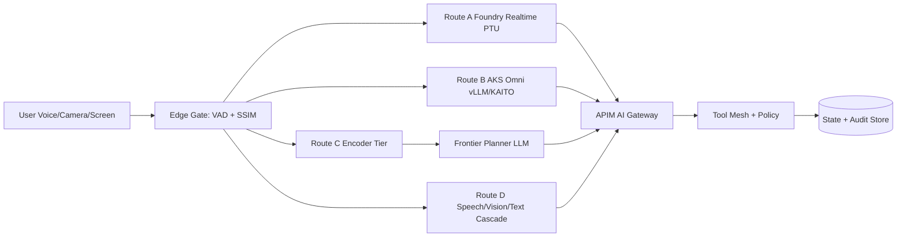
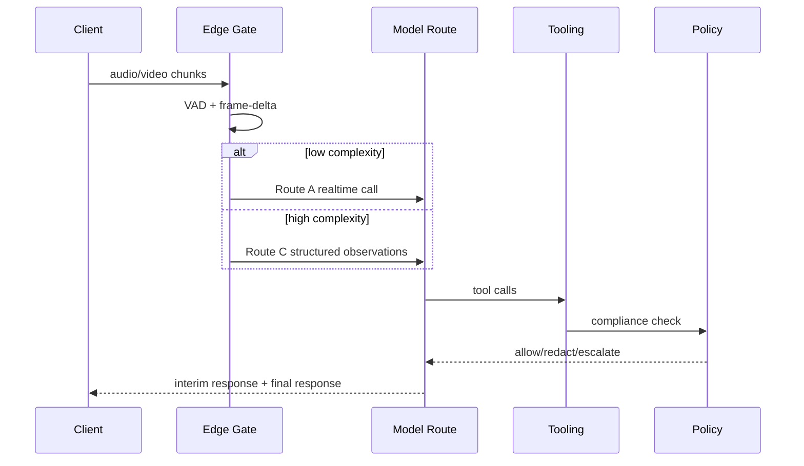

# Omni-Modal Audio+Video Agent Serving Selection FAQ: Foundry Omni/PTU vs AKS Open-Weight Omni Backbone vs Disaggregated Encoder+Planner vs Multi-Service Cognitive Cascade

> **Audience**: Cloud and AI Solution Architects, platform engineering leads, realtime media engineering teams, security and compliance architects, and FinOps operators.
> **Decision scope**: selecting and sizing enterprise architectures for simultaneous voice, live camera/screen streams, and tool-calling workloads without runaway token cost, latency collapse, or cross-modal grounding drift.

---

## 1) Executive summary: define routing economics before model preferences

Most failed omni-modal programs do not fail because the model is weak.
They fail because every session is forced through the most expensive path.

A production strategy should separate:

- realtime conversational loops,
- deep planning loops,
- compliance-heavy audit loops,
- and residency-constrained loops.

Default route posture:

- **Route A** (Managed Native Omni Realtime on Foundry/PTU): primary route for interactive low-latency conversations.
- **Route B** (AKS-hosted open-weight omni backbone): primary route for high-duty-cycle, residency-constrained streams.
- **Route C** (Disaggregated modality encoders + frontier reasoning planner): primary route for high tool-schema complexity.
- **Route D** (Speech + Vision + Text cascade with APIM governance): primary route for explicit audit and compliance chains.

Recommended hard gates:

- `P95 voice-to-voice <= 900 ms`
- `P95 frame-to-insight <= 1.8 s`
- `Session unit cost C_session <= 12% of per-session gross margin target`
- `Cross-tenant misrouting rate < 0.1%`
- `PII redaction miss rate < 0.5%`

Anti-patterns to avoid:

1. Sending every raw frame to the highest-cost omni endpoint.
2. No VAD or frame-delta gate, so silent and duplicate segments still consume inference budget.
3. Serializing realtime response and deep planning paths into one blocking pipeline.
4. Keeping only final text output without structured intermediate evidence.

---

## 2) Problem model and enterprise constraints

Reference enterprise workloads:

- field-service live troubleshooting (voice + cabinet camera + ticket tools),
- insurance tele-inspection (voice guidance + video evidence + fraud workflow),
- smart retail kiosks (voice dialogue + shelf recognition + pricing tools),
- clinical bedside documentation (speech stream + visual cues + structured EHR output).

Constraints that matter in production:

- continuous media streams create multiplicative token and bandwidth pressure,
- video streams are highly redundant and need perceptual delta gating,
- conversational experience is sensitive to interruption and turn-handoff latency,
- compliance requires explainable traces, deletion controls, and policy checkpoints.

---

## 3) Route definitions (A/B/C/D)

### Route A — Managed native omni-modal realtime serving (Foundry Omni/PTU + Global Standard spillover)

Design characteristics:

- hosted realtime omni model path for coherent conversational behavior,
- PTU-backed capacity for predictable tail latency,
- controlled overflow into Global Standard for surge handling,
- client or edge-side VAD and SSIM-based frame-delta gating.

Best fit:

- premium voice assistants, remote support, and high-engagement customer workflows.

### Route B — Self-hosted open-weight omni backbone on AKS (Phi-4-Multimodal / Qwen2.5-Omni on vLLM or KAITO)

Design characteristics:

- full control of model versioning, runtime, and scheduling behavior,
- strong residency and sovereignty control for regulated jurisdictions,
- efficient economics for high-duty-cycle always-on media traffic.

Best fit:

- manufacturing, energy, public sector, and sovereign deployments.

### Route C — Disaggregated modality encoder tier + frontier planner model

Design characteristics:

- streaming STT and keyframe extraction produce compact observations,
- only high-information observations reach frontier reasoning models,
- stronger fit for complex planning across large tool schemas.

Best fit:

- deep procedural workflows with many tool constraints and high decision depth.

### Route D — Managed multi-service cognitive cascade (Speech + Vision/Content Understanding + Text LLM via APIM)

Design characteristics:

- explicit intermediate text/JSON audit trail,
- straightforward insertion points for PII redaction and policy checks,
- operationally clear governance boundaries.

Best fit:

- heavily regulated environments requiring granular auditability.

---

## 4) Twelve-dimension comparison matrix

| Dimension | Route A Managed Omni/PTU | Route B AKS Open-Weight Omni | Route C Disaggregated Encoders + Frontier Planner | Route D Multi-Service Cascade |
|---|---|---|---|---|
| Realtime conversational coherence | Very high | High | Medium | Medium |
| Cross-frame visual grounding continuity | High | High | Medium-high (encoder quality dependent) | Medium |
| Complex tool-graph planning capability | Medium-high | Medium | Very high | Medium-high |
| P95 latency predictability | High (PTU) | Medium (cluster variance) | Medium-high | Medium |
| Cost elasticity | Medium | High | High | Medium-high |
| Data residency control | Medium | Very high | High | High |
| Operational complexity | Low-medium | High | Medium-high | Medium |
| Audit explainability | Medium | Medium | High | Very high |
| Compliance redaction insertion ease | Medium | Medium-high | High | Very high |
| Vendor lock-in exposure | Medium-high | Low | Medium | Medium |
| Multi-region expansion path | High | Medium-high | High | High |
| Recommended usage posture | Core interactive route | Residency/control route | Complex reasoning route | Regulated audit route |

---

## 5) Capacity and cost baseline formulas

### 5.1 Session token burn model

`T_session = R_audio * D_speak + R_frame * F_delta * D_call + T_tool_context`

Where:

- `R_audio`: audio token rate per second,
- `D_speak`: active speech seconds,
- `R_frame`: effective visual token cost per frame,
- `F_delta`: keyframe delta frequency sent to inference,
- `D_call`: call duration in seconds,
- `T_tool_context`: tool invocation context token overhead.

### 5.2 PTU concurrency estimation

`N_ptu = ceil((Q_peak * T_turn) / U_target)`

Where:

- `Q_peak`: peak request concurrency,
- `T_turn`: average service time per turn in seconds,
- `U_target`: target utilization (recommended 0.55 to 0.70).

### 5.3 Frame gating efficiency

`Savings_frame = 1 - (F_delta / F_raw)`

At `F_raw=8 fps` and `F_delta=0.8 fps`, effective visual-token intake drops by about 90%.

---

## 6) Quantitative Q1: continuous token burn and PTU sizing

Assume:

- `R_audio = 22 token/s`,
- `R_frame = 180 token/frame`,
- `F_delta = 0.6 frame/s`,
- `D_speak = 240 s`,
- `D_call = 420 s`,
- `T_tool_context = 2,800 token`.

Then:

`T_session = 22*240 + 180*0.6*420 + 2800 = 53,440 token`

If `Q_peak=180`, average service turn `T_turn=8s`, and `U_target=0.65`:

`N_ptu = ceil((180*8)/0.65) = 2,216` (mapped to available PTU tier units by SKU policy).

Architectural implication:

- Route A should run as a protected core pool with explicit spillover policy.
- Routes C and D should absorb complexity-driven bursts to avoid Route A pool collapse.

---

## 7) Quantitative Q2: end-to-end P95 latency decomposition

Voice-to-voice budget:

`L_total = L_capture + L_vad + L_uplink + L_infer + L_tool + L_tts + L_downlink`

Recommended targets:

- `L_total(P95) <= 900 ms`
- `L_infer(P95) <= 420 ms`
- `L_tool(P95) <= 180 ms`

Frame-to-insight budget:

`L_visual = L_frame_gate + L_encode + L_reason + L_post`

Target:

- `L_visual(P95) <= 1.8 s`

Operational tactics:

- run conversational response path and tool path in parallel when safe,
- emit explainable interim responses on tool timeout, then patch with final answer.

---

## 8) Quantitative Q3: cascade error compounding versus native cross-modal attention

Approximate cascade chain error:

`E_chain = 1 - (1 - E_stt) * (1 - E_ocr) * (1 - E_nlu)`

Example:

- `E_stt=0.08`,
- `E_ocr=0.12`,
- `E_nlu=0.06`.

Then:

`E_chain = 1 - 0.92*0.88*0.94 = 0.239`

Interpretation:

- Route D has superior evidence transparency but needs active mitigation for cumulative extraction errors.
- Route A may preserve better cross-modal continuity when native attention reduces handoff loss.

---

## 9) Quantitative Q4: archival economics for raw media versus structured evidence

Three-year archival cost model:

`C_3y = C_hot + C_cool + C_access + C_redaction`

With transcript-plus-keyframe evidence policy, storage footprint typically drops to `18%~35%` of full raw media retention (workload dependent).

Compliance outcome:

- fewer objects to redact and erase,
- lower legal hold complexity,
- tighter retention policy enforcement.

Policy guidance:

- retain full media selectively for high-risk or disputed sessions,
- retain structured summaries and evidence hashes by default.

---

## 10) Quantitative Q5: handoff threshold from omni talker to frontier planner

Define a composite complexity score:

`S_complex = w1*N_tool + w2*N_constraint + w3*Risk_level + w4*History_span`

Switch to Route C when `S_complex >= θ`.

Reference threshold:

- `θ = 0.68`,
- route escalation preferred when `N_tool >= 12` and risk is medium or above.

Practical benefit:

- avoids universal heavy-planner invocation,
- improves tool-selection fidelity for complex tasks,
- protects route-level cost targets.

---

## 11) Quantitative Q6: GPU VRAM packing and bursty keyframe skew

Packing constraint:

`VRAM_used = B_audio*M_audio + B_video*M_video + B_ctx*M_ctx + M_overhead`

If `VRAM_used > VRAM_cap * 0.82`, trigger:

1. adaptive frame-rate downgrade,
2. context-window compaction,
3. route spillover to C or D based on policy.

Burst mitigation:

- apply quality scoring and dedup clustering to candidate keyframes,
- cap max accepted keyframes per second per session,
- prevent synchronized burst amplification across tenants.

---

## 12) Mermaid: omni-modal enterprise topology with route fan-out



---

## 13) Mermaid: latency-aware branch and downgrade control flow



---

## 14) Production implementation block 1: Python route gate using VAD + SSIM + policy score

```python
from dataclasses import dataclass

@dataclass
class TurnSignal:
    voice_energy: float
    ssim_delta: float
    tool_count: int
    risk_score: float

def choose_route(sig: TurnSignal) -> str:
    speech_active = sig.voice_energy >= 0.12
    visual_delta = sig.ssim_delta >= 0.09
    complex_task = sig.tool_count >= 12 or sig.risk_score >= 0.68

    if speech_active and visual_delta and not complex_task:
        return "route_a_realtime_ptu"
    if complex_task:
        return "route_c_disaggregated_encoder_frontier"
    if sig.risk_score >= 0.55:
        return "route_d_auditable_cascade"
    return "route_b_aks_omni"
```

---

## 15) Production implementation block 2: AKS deployment sketch for open-weight omni serving

```yaml
apiVersion: apps/v1
kind: Deployment
metadata:
  name: omni-serving
  labels:
    app: omni-serving
spec:
  replicas: 3
  selector:
    matchLabels:
      app: omni-serving
  template:
    metadata:
      labels:
        app: omni-serving
    spec:
      nodeSelector:
        accelerator: nvidia-h100
      containers:
        - name: vllm-omni
          image: ghcr.io/example/vllm-omni:stable
          args:
            - "--model=qwen2.5-omni"
            - "--max-num-seqs=64"
            - "--gpu-memory-utilization=0.82"
            - "--enable-chunked-prefill"
          resources:
            limits:
              nvidia.com/gpu: "1"
          env:
            - name: ROUTE_CLASS
              value: "route_b"
```

---

## 16) Enterprise scenario A: utility/telecom field technician live repair assistant

Workflow:

1. technician narrates alarm and observed symptom by voice,
2. camera points to cabinet labels and board modules,
3. tools query historical incidents, part stock, and repair SOP,
4. system proposes execution steps and writes back to ticketing.

Recommended route blend:

- Route A for conversational loop stability,
- Route C for high-complexity fault reasoning branches,
- Route D for audit-governed write actions.

Operational objective:

- reduce first-time fix cycle time without sacrificing traceability.

---

## 17) Enterprise scenario B: auto-insurance live video claims adjustment with compliance archive

Workflow:

1. claimant starts phone call and enters guided video capture flow,
2. system requests specific angle and detail keyframes,
3. risk tools evaluate policy, prior claims, and fraud signals,
4. draft decision enters human approval queue with structured evidence bundle.

Recommended route blend:

- Route A for smooth claimant guidance,
- Route D for explicit redaction and evidence-chain controls,
- selective high-risk raw segment retention policy for legal disputes.

Business objective:

- shorten claim cycle while preserving defensible compliance posture.

---

## 18) Three-year TCO comparison table (illustrative planning model)

| Cost category | Route A | Route B | Route C | Route D |
|---|---:|---:|---:|---:|
| Inference/service cost (3y) | $3.9M | $3.1M | $3.3M | $3.5M |
| Platform operations (3y) | $0.7M | $1.4M | $1.1M | $0.9M |
| Compliance and audit operations (3y) | $0.6M | $0.8M | $0.7M | $0.6M |
| Failure and rework overhead (3y) | $0.5M | $0.7M | $0.5M | $0.6M |
| **Total 3y cost** | **$5.7M** | **$6.0M** | **$5.6M** | **$5.6M** |

Interpretation:

- Route A is often not the cheapest line item, but can maximize value in interaction-heavy premium flows.
- Route B can dominate economics for always-on media workloads where control and utilization matter.
- Routes C and D often win in governance and tool-complexity-adjusted quality outcomes.

---

## 19) Day-0 / Day-1 / Day-2 implementation checklist

### Day-0 (architecture and policy baseline)

- define route admission and fallback criteria,
- publish latency/cost/compliance SLOs,
- codify minimum evidence retention and deletion policy.

### Day-1 (pilot and controlled rollout)

- enable VAD + frame-delta gate and route telemetry,
- publish session cost dashboards and alert thresholds,
- enforce policy checkpoints for high-risk write actions.

### Day-2 (scale optimization and governance hardening)

- retrain route threshold calibration from observed traffic distributions,
- optimize multi-region PTU and AKS capacity placement,
- review misrouting and redaction misses in monthly architecture governance.

---

## 20) Five-step route selection playbook (Good fit vs Not for)

1. **Classify sessions** into realtime interaction, deep planning, strict audit, and residency-controlled classes.
2. **Set hard thresholds** for latency, cost, risk score, and tool-schema complexity.
3. **Map thresholds to A/B/C/D routes** instead of forcing one universal path.
4. **Run gated rollout and calibration** using live workload distributions.
5. **Close the governance loop** by feeding route outcomes into periodic architecture review.

**Good fit**:

- enterprises running simultaneous voice, live video, and tool workflows at scale,
- teams willing to operate policy-driven route orchestration rather than one-path serving.

**Not for**:

- simple text-only bots with no realtime media streams,
- organizations expecting strict compliance outcomes without telemetry and policy operations.

---

## 21) Final recommendation

If your top priority is realtime conversation quality with stable operations, start with **Route A** and add **C/D** for complexity and governance lanes.
If your top priority is sovereignty and cost control under high-duty-cycle traffic, lead with **Route B** and add **C/D** to improve reasoning and compliance.
The durable enterprise pattern is not choosing a single route; it is operating a measurable, policy-driven multi-route serving fabric.

