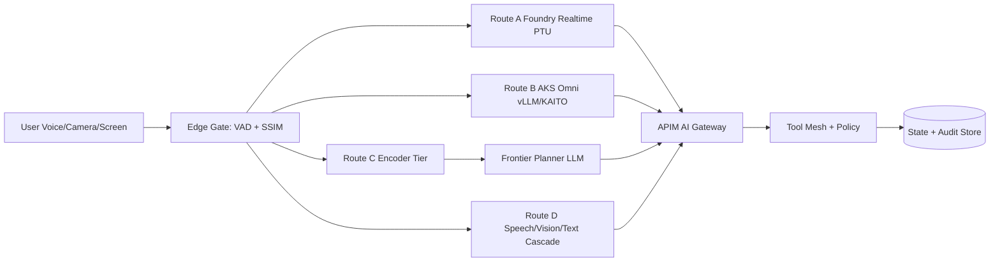
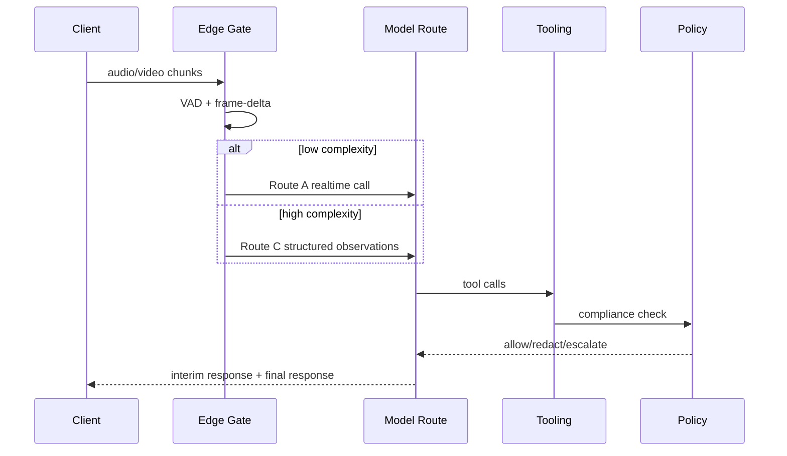

# 全模态音视频智能体托管选型 FAQ：Foundry Omni/PTU vs AKS 开源 Omni 主干 vs 编码器解耦级联 vs 多服务认知级联

> **适用对象**：Cloud & AI Solution Architect、平台工程团队、实时音视频团队、模型平台团队、合规与 FinOps 团队。
> **核心问题**：如何在“连续音频 + 实时视频/屏幕 + 工具调用”并行场景下，控制时延、成本与合规风险，同时保持跨模态语义一致性与生产可运维性。

---

## 1. 执行摘要（先定路由边界，再谈模型能力）

企业在全模态智能体落地时，最常见失败不是模型本身，而是将“所有会话都走最贵最全能力路径”。
正确做法是先定义会话分层与降级策略，再选择托管路线。

推荐默认策略：

- **Route A（Foundry Omni + PTU）**：用于“低时延强交互 + 语音连贯性敏感”的核心会话。
- **Route B（AKS 开源 Omni）**：用于“高占空比持续流 + 数据驻留严格”的专有场景。
- **Route C（编码器解耦 + 前沿推理）**：用于“工具链复杂度高、推理深度高”的知识密集场景。
- **Route D（多服务认知级联）**：用于“审计链条刚性、逐步可解释输出”优先场景。

建议硬门槛：

- `P95 voice-to-voice <= 900 ms`
- `P95 frame-to-insight <= 1.8 s`
- `会话单位成本 C_session <= 目标业务毛利上限的 12%`
- `多租户跨会话误路由率 < 0.1%`
- `合规脱敏漏检率 < 0.5%`

反模式：

1. 将全部摄像头帧都送入高价全模态推理端点。
2. 缺少 VAD/帧差门禁，导致空白片段也持续计费。
3. 不区分“实时对话链路”与“深推理链路”，把全部请求串行化。
4. 仅保留最终回答，不保留结构化中间证据，导致合规审计不可复盘。

---

## 2. 问题建模与约束条件

典型业务：

- 外勤检修：语音描述故障 + 摄像头对准设备铭牌 + 工单系统写回。
- 车险视频查勘：电话引导 + 视频采样 + 反欺诈规则触发 + 理赔草案。
- 零售导购终端：顾客语音问答 + 货架视觉识别 + 价格与库存工具查询。
- 临床床旁记录：医生口述 + 局部影像观察 + EHR 结构化字段填充。

架构约束：

- 连续媒体流导致 token 成本与带宽成本耦合增长。
- 视频帧存在高冗余，必须做感知增量抽取。
- 语音端对“轮次切换延迟”和“打断恢复延迟”极敏感。
- 企业要求“可审计、可解释、可删除、可分级授权”。

---

## 3. 四条路线定义（A/B/C/D）

### Route A：托管原生 Omni Realtime（Foundry Omni/PTU + Global Standard 溢出）

关键能力：

- 使用托管实时模型保持端到端语音一致性。
- 基于 PTU 保障稳定并发与尾延迟。
- 高峰通过 Global Standard 溢出兜底。
- 客户端/边缘侧执行 VAD 与 SSIM 帧差门禁。

适用：

- 客服、远程指导、语音助手等高交互密度场景。

### Route B：AKS 自托管开源 Omni 主干（Phi-4-Multimodal / Qwen2.5-Omni + vLLM/KAITO）

关键能力：

- GPU 资源与模型版本完全可控。
- 可满足强数据主权与区域合规要求。
- 支持高占空比持续流场景的成本优化。

适用：

- 制造、能源、政企等对驻留与可控性要求极高的业务。

### Route C：模态编码器解耦 + 前沿推理模型

关键能力：

- 音频链路与视觉链路先做结构化提取。
- 仅将关键 observation 送入高推理模型。
- 对 20+ 工具 schema 的复杂决策更友好。

适用：

- 深推理、复杂流程编排、工具图谱重的企业场景。

### Route D：多服务认知级联（Speech + Vision/Content Understanding + Text LLM）

关键能力：

- 中间文本/JSON 全链可审计。
- 易插入 PII 脱敏、策略拦截与人工复核节点。
- 易与 APIM 治理策略融合。

适用：

- 金融、医疗、保险等“审计与解释优先”的监管场景。

---

## 4. 12 维对比矩阵（含推荐结论）

| 维度 | Route A 托管 Omni/PTU | Route B AKS 开源 Omni | Route C 编码器解耦 + 前沿推理 | Route D 多服务级联 |
|---|---|---|---|---|
| 实时语音连贯性 | 高 | 中高 | 中 | 中 |
| 视觉跨帧理解一致性 | 高 | 中高 | 中高（依赖提取质量） | 中 |
| 工具调用复杂编排 | 中高 | 中 | 高 | 中高 |
| P95 时延可预测性 | 高（PTU） | 中（受集群波动） | 中高 | 中 |
| 成本弹性 | 中 | 高 | 高 | 中高 |
| 数据驻留可控性 | 中 | 高 | 高 | 高 |
| 运维复杂度 | 低中 | 高 | 中高 | 中 |
| 审计可解释性 | 中 | 中 | 高 | 高 |
| 合规脱敏嵌入难度 | 中 | 中高 | 高 | 高 |
| 供应商锁定风险 | 中高 | 低 | 中 | 中 |
| 扩展到多区域 | 高 | 中高 | 高 | 高 |
| 适配推荐等级 | 核心交互首选 | 驻留可控首选 | 复杂推理首选 | 强审计首选 |

---

## 5. 核心容量与成本公式

### 5.1 连续会话 token 消耗模型

`T_session = R_audio * D_speak + R_frame * F_delta * D_call + T_tool_context`

说明：

- `R_audio`：每秒音频 token 速率。
- `D_speak`：有效说话时长（秒）。
- `R_frame`：每帧视觉 token 等效开销。
- `F_delta`：每秒送入模型的“增量关键帧”频率。
- `D_call`：通话总时长（秒）。

### 5.2 PTU 并发估算

`N_ptu = ceil((Q_peak * T_turn) / U_target)`

其中：

- `Q_peak`：峰值每秒会话请求数。
- `T_turn`：单轮平均处理时长（秒）。
- `U_target`：目标利用率（建议 0.55~0.7）。

### 5.3 视觉抽帧收益

`Savings_frame = 1 - (F_delta / F_raw)`

当 `F_raw=8fps`，`F_delta=0.8fps` 时，视觉 token 输入下降约 90%。

---

## 6. 定量 Q1：连续音视频 token burn 与 PTU 规模

已知：

- `R_audio=22 token/s`
- `R_frame=180 token/frame`
- `F_delta=0.6 frame/s`
- `D_speak=240s`
- `D_call=420s`
- `T_tool_context=2800 token`

则：

`T_session = 22*240 + 180*0.6*420 + 2800 = 53,440 token`

若峰值并发会话 `Q_peak=180`，平均每 8 秒一次关键响应，`U_target=0.65`：

`N_ptu = ceil((180*8)/0.65) = 2216（按平台能力映射为对应 PTU 档位）`

架构建议：

- Route A 采用“核心 PTU + 溢出池”双池。
- Route C/D 通过中间编码层削峰，降低主推理池压力。

---

## 7. 定量 Q2：端到端 P95 时延拆解与预算分配

语音到语音：

`L_total = L_capture + L_vad + L_uplink + L_infer + L_tool + L_tts + L_downlink`

目标：

- `L_total(P95) <= 900 ms`
- 其中 `L_infer(P95) <= 420 ms`
- `L_tool(P95) <= 180 ms`

视觉到洞察：

`L_visual = L_frame_gate + L_encode + L_reason + L_post`

目标：

- `L_visual(P95) <= 1.8 s`

治理动作：

- 语音回路与工具回路并行，不串行阻塞。
- 工具超时时先给可解释降级答复，再异步补全。

---

## 8. 定量 Q3：级联误差传播（WER/OCR）与跨模态一致性

级联链路近似误差：

`E_chain = 1 - (1 - E_stt) * (1 - E_ocr) * (1 - E_nlu)`

示例：

- `E_stt=0.08`
- `E_ocr=0.12`
- `E_nlu=0.06`

则：

`E_chain = 1 - 0.92*0.88*0.94 = 0.239`

结论：

- Route D 的可审计性高，但误差叠加风险需通过重打分与回看机制控制。
- Route A 的原生跨模态注意力可减少部分链式误差。

---

## 9. 定量 Q4：原始媒体归档 vs 文本证据归档成本

三年归档成本：

`C_3y = C_hot + C_cool + C_access + C_redaction`

若仅保留文本与关键帧摘要：

- 存储体量可从 `100%` 降至 `18%~35%`（取决于关键帧策略）。
- 合规删除成本显著下降（删除对象数量更小）。

策略建议：

- 高频会话只留结构化摘要与关键证据帧。
- 争议会话按策略升阶保留原始片段并设置 TTL。

---

## 10. 定量 Q5：Omni Talker + Frontier Planner 何时切换

定义复杂度评分：

`S_complex = w1*N_tool + w2*N_constraint + w3*Risk_level + w4*History_span`

若 `S_complex >= θ` 切换到 Route C 的前沿推理规划链路。

参考阈值：

- `θ = 0.68`
- `N_tool >= 12` 且 `Risk_level >= 中` 时优先切换。

收益：

- 避免将所有会话默认送入重推理高成本路径。
- 在复杂任务上提高工具选择正确率。

---

## 11. 定量 Q6：GPU 显存装箱与突发关键帧偏斜

装箱约束：

`VRAM_used = B_audio * M_audio + B_video * M_video + B_ctx * M_ctx + M_overhead`

若 `VRAM_used > VRAM_cap * 0.82`，触发：

1. 动态降帧。
2. 工具上下文裁剪。
3. 会话分流到 Route C/D。

在突发关键帧场景，建议：

- 先执行帧质量评分与聚类去重。
- 限制同秒可进入主推理端的关键帧数量上限。

---

## 12. Mermaid：全模态生产拓扑（A/B/C/D 并行）



---

## 13. Mermaid：语音与视觉时延分解与降级分叉



---

## 14. 生产实现片段 1：Python VAD + SSIM 门禁与路由建议

```python
from dataclasses import dataclass

@dataclass
class TurnSignal:
    voice_energy: float
    ssim_delta: float
    tool_count: int
    risk_score: float

def choose_route(sig: TurnSignal) -> str:
    speech_active = sig.voice_energy >= 0.12
    visual_delta = sig.ssim_delta >= 0.09
    complex_task = sig.tool_count >= 12 or sig.risk_score >= 0.68

    if speech_active and visual_delta and not complex_task:
        return "route_a_realtime_ptu"
    if complex_task:
        return "route_c_disaggregated_encoder_frontier"
    if sig.risk_score >= 0.55:
        return "route_d_auditable_cascade"
    return "route_b_aks_omni"
```

---

## 15. 生产实现片段 2：AKS 开源 Omni 推理工作负载示例

```yaml
apiVersion: apps/v1
kind: Deployment
metadata:
  name: omni-serving
  labels:
    app: omni-serving
spec:
  replicas: 3
  selector:
    matchLabels:
      app: omni-serving
  template:
    metadata:
      labels:
        app: omni-serving
    spec:
      nodeSelector:
        accelerator: nvidia-h100
      containers:
        - name: vllm-omni
          image: ghcr.io/example/vllm-omni:stable
          args:
            - "--model=qwen2.5-omni"
            - "--max-num-seqs=64"
            - "--gpu-memory-utilization=0.82"
            - "--enable-chunked-prefill"
          resources:
            limits:
              nvidia.com/gpu: "1"
          env:
            - name: ROUTE_CLASS
              value: "route_b"
```

---

## 16. 企业场景 A：公用事业/电信外勤检修实时助手

流程：

1. 技师语音描述告警码与现场现象。
2. 摄像头对准机柜与标签，系统提取关键部件信息。
3. 工具链查询历史工单、备件库存、SOP 指引。
4. 生成可执行维修步骤并回写 CMMS。

建议：

- 现场对话回路使用 Route A 保障交互。
- 高复杂诊断分支切 Route C。
- 合规要求高的回写动作经 Route D 审计链。

---

## 17. 企业场景 B：车险视频查勘与反欺诈归档

流程：

1. 客户电话报案并切入视频取证。
2. 系统引导拍摄固定角度关键帧。
3. 多工具校验保单、历史出险、风险规则。
4. 生成理赔建议并给人工复核队列。

建议：

- Route A 用于实时引导与对话连贯。
- Route D 保留结构化审计链与脱敏记录。
- 高争议案件原始片段按策略升阶归档。

---

## 18. 三年 TCO 对比（示例建模）

| 成本项 | Route A | Route B | Route C | Route D |
|---|---:|---:|---:|---:|
| 推理/服务成本（3y） | $3.9M | $3.1M | $3.3M | $3.5M |
| 平台运维成本（3y） | $0.7M | $1.4M | $1.1M | $0.9M |
| 合规与审计成本（3y） | $0.6M | $0.8M | $0.7M | $0.6M |
| 失败/返工隐性成本（3y） | $0.5M | $0.7M | $0.5M | $0.6M |
| **总计（3y）** | **$5.7M** | **$6.0M** | **$5.6M** | **$5.6M** |

解读：

- Route A 成本不一定最低，但在高交互价值场景下业务收益通常更高。
- Route B 在高占空比常开流场景可能具备更强成本可控性。
- Route C/D 的优势在于“可解释治理 + 工具复杂度适配”。

---

## 19. Day-0 / Day-1 / Day-2 落地清单

### Day-0（架构与治理定版）

- 定义四路线准入条件与回退条件。
- 明确 P95 时延、成本、合规三类 SLO。
- 定义证据留存最小集与删除策略。

### Day-1（灰度上线）

- 上线 VAD + 帧差门禁与路由观测。
- 建立会话成本看板与异常告警。
- 对高风险动作接入策略审计与人工兜底。

### Day-2（规模化优化）

- 依据真实分布重训路由阈值。
- 细化多区域 PTU/AKS 容量编排。
- 定期复盘误路由与合规漏检样本。

---

## 20. 五步选型指南（Good fit vs Not for）

1. **定义会话分层**：实时强交互、复杂推理、强审计、驻留可控四类。
2. **建立门槛阈值**：时延、成本、风险分值、工具复杂度。
3. **按阈值映射路线**：A/B/C/D 并存，不做单路线全覆盖。
4. **执行灰度校准**：以真实会话数据调优阈值与容量。
5. **闭环治理与审计**：路线选择结果纳入月度架构评审。

**Good fit**：

- 需要并发支持语音/视频/工具调用并保持稳定体验的企业。
- 可接受按业务价值分层调度而非“一刀切”全量高规格推理。

**Not for**：

- 仅文本机器人且无实时媒体输入的轻量场景。
- 无法维护基础观测与治理策略、却要求极高合规证明的团队。

---

## 21. 最终建议

- 若你优先追求“实时体验 + 稳定运营”，先落 Route A，再引入 C/D 分流。
- 若你优先追求“主权可控 + 高占空比成本可预期”，优先 Route B，并用 C/D 补足推理与审计。
- 真正可持续的企业方案不是“选一条路”，而是“建立分层路由与可证明治理”。

