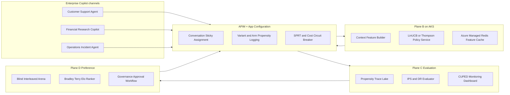
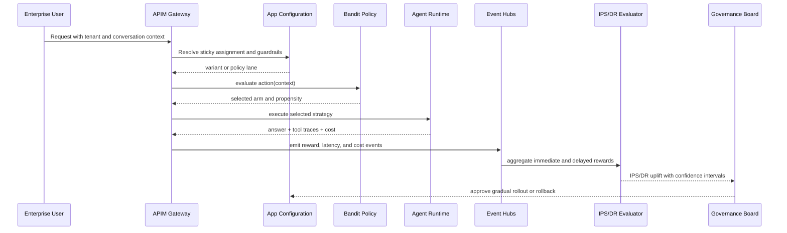

# Enterprise Online Multi-Agent Experimentation FAQ: App Configuration A/B Guardrails vs Redis+LinUCB Bandit vs IPS/DR Counterfactual Evaluation vs Human Preference Arena
> 🌐 **Language Switch**: [中文](online-agent-ab-experimentation-contextual-bandit-appconfig-vs-redis-linucb-vs-ips-eval-selection-faq.md) | **English (current)**
> Intended readers: Cloud & AI Solution Architects, platform engineering leaders, LLMOps/SRE teams, data scientists, and enterprise governance boards.  
> Primary scope: production-grade online experimentation for agent systems where quality, latency, and cost must be optimized together.  
> Deliverables: four-plane architecture, 12-dimension trade-off matrix, production snippets, quantitative FAQ, rollout path, and Day-0/Day-2 checklist.
## 1. Executive summary and recommended migration path
In enterprise production systems, online experimentation is not a toggle; it is a governed operating model.  
A simple random 50/50 split is insufficient because multi-turn agent sessions can switch variants mid-thread and invalidate inference.  
Pure offline replay is also insufficient because harmful policies can still leak into production when release pressure rises.  
Bandits alone are insufficient because delayed business rewards often diverge from immediate click-based signals.  
Human preference voting alone is insufficient because “liked” responses can be operationally expensive or non-compliant.  
The recommended approach is a four-plane architecture with explicit separation of concerns.  
**Plane A** uses App Configuration Feature Manager with Application Insights for conversation-sticky assignment, CUPED variance reduction, and sequential SPRT guardrails.  
**Plane B** runs contextual multi-armed bandits on AKS with Redis features and Event Hubs delayed-reward feedback loops.  
**Plane C** performs counterfactual IPS/DR evaluation on Databricks or Fabric using APIM propensity-logged traces.  
**Plane D** provides blind interleaved human preference arenas with Bradley-Terry Elo calibration for high-stakes workflows.  
Execution sequencing is pragmatic: A first, B with constrained blast radius, C throughout, D mandatory for high-consequence domains.  
If the team lacks online learning capability, stabilize A and C before introducing adaptive policies in B.  
If regulation is strict, keep D as an approval gate rather than a retrospective quality audit.  
If multi-tenant noise is severe, prioritize B with tenant-aware budget constraints and fairness boundaries.  
If delivery bandwidth is constrained, preserve the three essentials: rollbackability, explainability, and cost accountability.  
## 2. Business boundaries, non-goals, and success criteria
This guide focuses on enterprise online experimentation infrastructure, not foundational model training pipelines.  
It assumes the platform already has baseline tracing, gateway governance, and policy versioning capabilities.  
It assumes multi-turn conversations where policy switching inside a session is unacceptable.  
It targets text and tool-calling agents, not edge-only disconnected deployment topologies.  
### 2.1 Success criteria (production accountability)
- Task resolution uplift remains statistically significant and stable above 2.0%.  
- p95 latency does not degrade by more than 8%, and p99 remains inside SLO boundaries.  
- Token cost improves by at least 10% at equal quality, or remains cost-neutral with measurable quality gains.  
- High-risk tenant failures rollback to stable policy lanes within five seconds.  
- Session-level assignment remains sticky, and attribution chains remain auditable end-to-end.  
### 2.2 Explicit non-goals (scope containment)
- Do not redesign all prompt assets and tool schemas in the same cycle.  
- Do not combine model retirement migrations with experimentation framework migrations in one blast window.  
- Do not delegate unresolved business KPI disputes to algorithmic auto-selection.  
- Do not open large exploration budgets without governance approval and budget controls.  
- Do not treat offline OPE signals as unconditional production rollout approval.  
## 3. Four-way architecture comparison (A/B/C/D)
| Plane | Core problem solved | Main services | Primary outputs | Typical failure mode | Safety fallback |
|---|---|---|---|---|---|
| A | Reliable online comparisons | App Configuration, App Insights, APIM | Sticky assignment, CUPED/SPRT metrics | Session arm switching | Forced sticky + rollback |
| B | Context-aware online policy selection | AKS, Redis, Event Hubs | LinUCB/TS arm decisions | Over-exploration under drift | Exploration cap + downgrade |
| C | Pre-rollout safety estimates | Databricks/Fabric, ADX, Lakehouse | IPS/DR uplift with confidence | Missing propensity logs | Gateway logging enforcement |
| D | High-stakes preference adjudication | Copilot UI Arena, human review, Elo | Blind preference ranking | Click-noise bias | Reviewer calibration + tie-break |
Plane A answers whether comparisons are trustworthy.  
Plane B answers whether policy selection can adapt to context in real time.  
Plane C answers whether a new policy is safe to deploy before broad exposure.  
Plane D answers who has decision authority for high-consequence scenarios.  
## 4. End-to-end reference architecture (Mermaid)

The topology keeps adaptive learning, governance, and economics in one observable control loop.  
It avoids the two extremes of uncontrolled algorithmic drift and purely manual subjective governance.  
It also creates an auditable lineage from request context to policy decision to realized business outcome.  
## 5. Option A: App Configuration sticky experimentation with CUPED and SPRT
Option A upgrades experimentation from random splitting into governed comparative inference.  
First, assignment keys must bind to conversation-level identity, not per-request randomness.  
Second, once assigned, a session must remain on the same arm until explicit session closure.  
Third, release gates must evaluate quality, latency, and cost simultaneously.  
Fourth, sequential testing should terminate losing variants early without waiting for full fixed-horizon samples.  
### 5.1 Sticky assignment design
- Compute deterministic hash on tenant_id + conversation_id + experiment_key.  
- Map the hash into predeclared variant buckets with explicit rollout budgets.  
- Freeze assignment at conversation creation time and persist it in metadata.  
- Apply configuration updates to new sessions only.  
- Preserve existing assignments for in-flight sessions until timeout or completion.  
### 5.2 CUPED and SPRT in practice
- CUPED uses pre-period covariates to reduce estimator variance in noisy operational metrics.  
- SPRT enables early stop decisions for clearly losing variants under bounded false-positive risk.  
- Cost and latency boundaries are evaluated in parallel to avoid quality-only optimization traps.  
- Sequential boundaries should be reviewed by statistics owners, not inferred ad hoc by feature teams.  
- Final decision artifacts must include thresholds, priors, and policy version identifiers.  
## 6. Option B: contextual bandit with Redis features and delayed rewards
Bandits should complement A/B governance rather than replace it.  
Static policies decay when intent complexity, tenant mix, and tool availability shift daily.  
LinUCB offers transparent confidence-bounded selection for regulated settings.  
Thompson Sampling handles uncertainty gracefully when reward distributions are unstable.  
Many enterprises deploy LinUCB as the primary lane and reserve TS for bounded exploration cohorts.  
Event Hubs carries delayed reward events, while Redis provides low-latency contextual feature retrieval.  
### 6.1 Recommended context feature families
- Intent complexity tier from classifier outputs and historical tool path depth.  
- Tool readiness score with transient dependency health and timeout telemetry.  
- Tenant SLA tier, budget headroom, and contractual risk profile.  
- Session historical failure signatures and fallback frequency vectors.  
- Governance sensitivity class and mandatory review requirement markers.  
### 6.2 Delayed reward handling strategy
- Immediate reward examples: successful completion, no retries, no escalations.  
- Delayed reward examples: ticket closure, analyst adoption, approval acceptance.  
- Separate short-horizon and long-horizon reward channels for policy updates.  
- Keep online updates conservative and push large corrections through offline recalibration.  
- Use event-time watermarking to prevent temporal leakage and reward skew.  
## 7. Option C: counterfactual OPE with IPS and Doubly Robust estimators
Production systems cannot safely trial every new policy directly on full user traffic.  
Counterfactual OPE estimates expected uplift from historical traces before exposing users to new policies.  
Its statistical validity depends on logged behavior propensities p0(a|x), captured at decision time.  
Without propensity, IPS and DR lose their unbiased foundation and become decision theater.  
Therefore Plane C starts with logging contract quality, not with model sophistication.  
### 7.1 IPS and DR role split
- IPS is simple, interpretable, and useful for first-pass elimination of poor candidate policies.  
- DR is more robust to model misspecification and preferred for near-rollout governance reviews.  
- Both must report confidence intervals and effective sample size, not point estimates alone.  
- Weight clipping is acceptable if bias implications are transparently documented.  
- If support overlap is weak, the result should be “insufficient evidence,” not forced rollout.  
### 7.2 Minimum logging contract fields
- request_id, conversation_id, tenant_id, and timestamp with event-time semantics.  
- context feature snapshot hash and schema version identifier.  
- selected action, arm id, and policy_version.  
- propensity value, exploration parameter, and confidence score if available.  
- reward events, latency, token cost, and terminal outcome labels.  
## 8. Option D: interleaved human preference arena with Bradley-Terry Elo
In legal, financial, and compliance-heavy workflows, click behavior is an incomplete quality proxy.  
Blind side-by-side comparisons reduce anchoring bias and model-brand bias.  
Interleaving output order controls presentation effects in preference collection.  
Bradley-Terry/Elo transforms pairwise judgments into calibrated and comparable rankings.  
When Elo gains conflict with cost guardrails, governance boards can make explicit trade-offs with evidence.  
### 8.1 Review workflow recommendations
- Stratify samples by risk class, tenant criticality, and known failure archetypes.  
- Evaluate correctness, executability, traceability, and policy compliance dimensions.  
- Track reviewer consistency and calibrate reviewers before broad scoring use.  
- Route disputed comparisons into second-pass adjudication with rationale capture.  
- Treat human preference as a strong gate for high-stakes domains, not a universal override.  
## 9. 12-dimension architecture matrix
| Dimension | A AppConfig + CUPED/SPRT | B Redis + LinUCB/TS | C IPS/DR OPE | D Arena + Elo |
|---|---|---|---|---|
| Primary objective | Reliable controlled experiments | Real-time adaptive selection | Offline safety estimation | High-stakes preference adjudication |
| Rollout speed | Medium | High | Medium | Low |
| Implementation complexity | Medium | High | Medium-high | Medium |
| Explainability | High | Medium | High | Medium |
| Data dependency | Medium | High | High | Medium |
| Application intrusion | Low | Medium | Low | Medium |
| Cost governance strength | High | Medium | High | Medium |
| Latency overhead | Low | Medium | Low | Low |
| Compliance audit value | High | Medium | High | High |
| Rollback difficulty | Low | Medium | Low | Low |
| Multi-tenant readiness | High | High | High | Medium |
| Recommended sequencing | First | Second | Continuous | Parallel for high risk |
## 10. Governance controls and operating cadence
These controls should be codified into release governance rather than documented as informal guidance.  
Control 1: every experiment change must include policy version, logging schema version, and approver metadata.  
Control 2: no production rollout is permitted without conversation-level sticky assignment verification.  
Control 3: cost guardrail breach must trigger automatic downgrade to stable policy lane.  
Control 4: exploration budgets must be bounded by tenant tier and contractual constraints.  
Control 5: traces without propensity are excluded from primary OPE conclusions.  
Control 6: arena reviewers must not see model identity or deployment labels.  
Control 7: compliance alerts pause exploration and preserve complete evidence artifacts.  
Control 8: rollout approvals must include explicit owner and expiry date.  
Control 9: weekly reviews inspect trends, monthly reviews inspect realized value, quarterly reviews inspect architecture debt.  
Control 10: policies that cannot be explained are not allowed as long-term defaults.  
## 11. Experimentation and evaluation feedback loop (Mermaid)

The flow creates continuous alignment across real-time decisioning, offline verification, and governance approval.  
It also ensures each policy decision remains auditable across model, prompt, and tool orchestration layers.  
## 12. Production snippet A: conversation-sticky assignment (App Configuration + Python)
```python
import hashlib
from dataclasses import dataclass
@dataclass
class VariantDecision:
    tenant_id: str
    conversation_id: str
    experiment_key: str
    variant: str
def stable_bucket(tenant_id: str, conversation_id: str, experiment_key: str) -> int:
    payload = f"{tenant_id}:{conversation_id}:{experiment_key}".encode("utf-8")
    digest = hashlib.sha256(payload).hexdigest()
    return int(digest[:8], 16) % 10000
def assign_variant(bucket: int) -> str:
    if bucket < 4000:
        return "control"
    if bucket < 7000:
        return "prompt_v2"
    if bucket < 9000:
        return "tool_policy_v2"
    return "hybrid_v3"
def decide(tenant_id: str, conversation_id: str, experiment_key: str) -> VariantDecision:
    b = stable_bucket(tenant_id, conversation_id, experiment_key)
    return VariantDecision(tenant_id, conversation_id, experiment_key, assign_variant(b))
```
```json
{
  "feature_flags": {
    "agent-routing-exp-2026q4": {
      "enabled": true,
      "sticky_key": "conversation_id",
      "variants": [
        {"name": "control", "weight": 40},
        {"name": "prompt_v2", "weight": 30},
        {"name": "tool_policy_v2", "weight": 20},
        {"name": "hybrid_v3", "weight": 10}
      ],
      "guardrails": {
        "max_p95_latency_ms": 2400,
        "max_cost_per_session_usd": 0.045,
        "sprt_alpha": 0.05,
        "sprt_beta": 0.20
      }
    }
  }
}
```
## 13. Production snippet B: LinUCB policy, DR estimator, and ADX CUPED query
```python
import numpy as np
class LinUCBPolicy:
    def __init__(self, d: int, alpha: float, arms: list[str]):
        self.alpha = alpha
        self.arms = arms
        self.A = {a: np.eye(d) for a in arms}
        self.b = {a: np.zeros((d, 1)) for a in arms}
    def select(self, x: np.ndarray) -> tuple[str, dict]:
        scores = {}
        for a in self.arms:
            A_inv = np.linalg.inv(self.A[a])
            theta = A_inv @ self.b[a]
            mean = float(theta.T @ x)
            bonus = self.alpha * float(np.sqrt(x.T @ A_inv @ x))
            scores[a] = mean + bonus
        chosen = max(scores, key=scores.get)
        propensity = 0.90 if chosen == "control" else 0.10 / (len(self.arms) - 1)
        return chosen, {"scores": scores, "propensity": propensity}
def doubly_robust(records):
    # each record includes reward, propensity, target_prob, q_hat
    output = []
    for r in records:
        w = r["target_prob"] / max(r["propensity"], 1e-6)
        ips = w * r["reward"]
        dr = r["q_hat"] + w * (r["reward"] - r["q_hat"])
        output.append({"ips": ips, "dr": dr})
    return output
```
```kusto
let baseline =
    AgentExperimentEvents
    | where Timestamp between (ago(14d) .. ago(1d))
    | summarize pre_mean = avg(TaskResolved), pre_cost = avg(SessionCostUsd) by TenantId;
AgentExperimentEvents
| where Timestamp > ago(1d)
| join kind=leftouter baseline on TenantId
| extend cuped_outcome = TaskResolved - 0.62 * (pre_mean - avg(pre_mean))
| summarize
    sessions = count(),
    resolved = avg(TaskResolved),
    cuped_resolved = avg(cuped_outcome),
    p95_latency = percentile(LatencyMs, 95),
    avg_cost = avg(SessionCostUsd)
    by Arm, TenantTier
| order by TenantTier asc, Arm asc
```
## 14. FinOps experimentation economics and enterprise scenarios
### 14.1 Three-year TCO model (USD $k)
| Cost category | Plane A | Plane B | Plane C | Plane D | Total |
|---|---:|---:|---:|---:|---:|
| Platform and service baseline | 210 | 380 | 260 | 140 | 990 |
| Runtime and storage costs | 320 | 470 | 410 | 120 | 1,320 |
| Engineering and governance labor | 290 | 360 | 280 | 240 | 1,170 |
| Audit and assurance overhead | 90 | 80 | 110 | 130 | 410 |
| Three-year total | 910 | 1,290 | 1,060 | 630 | 3,890 |
A+B without C may look cheaper in early quarters but often increases incident-driven losses later.  
Without D, high-consequence workflows accumulate hidden quality risk and expensive rework cycles.  
A pragmatic enterprise baseline is A+C mandatory, with B and D scaled by risk profile and value density.  
### 14.2 Scenario A: global e-commerce support agents (2.5M daily sessions)
The organization operates customer support and post-sales agents across 18 regions.  
It needs to compare four tool orchestration variants and three prompt bundles under heavy load.  
Plane A establishes sticky A/B assignment and identifies one high-cost underperforming variant within three weeks.  
Plane B then routes by intent complexity and tenant tier, reducing misuse of expensive model lanes.  
Plane C DR estimates show a 4.8% uplift on complex ticket resolution before broad exposure.  
Plane D reviews refund-dispute responses and blocks an unsafe auto-escalation behavior.  
Quarterly outcome: +3.1% task resolution with -12.4% token cost per resolved case.  
### 14.3 Scenario B: enterprise financial research copilot (delayed rewards)
Rewards are delayed because acceptance happens when analysts and committees consume final outputs.  
Reward delays span hours to days, making click-through metrics unreliable as optimization targets.  
The platform streams delayed acceptance events through Event Hubs and updates OPE in event-time windows.  
Bandit adaptation is limited to low-risk summarization lanes while recommendation lanes require human review.  
Arena interleaving shows the top-Elo arm is not the most expensive model lane.  
The governance board adopts joint quality-cost gates and avoids one-dimensional optimization traps.  
Quarterly outcome: +2.6% analyst acceptance and -19% downstream review rework.  
## 15. Quantitative FAQ, rollout playbook, and Day-0/Day-2 checklist
### 15.1 Quantitative FAQ (8 questions)
**Q1: Why is conversation-sticky assignment mandatory for multi-turn agents?**  
Mid-session arm switching breaks context continuity and contaminates statistical attribution.  
It also causes operational inconsistency when tool side effects differ across strategy lanes.  
Sticky assignment is therefore a validity requirement, not a cosmetic optimization.  
**Q2: What variance reduction should teams expect from CUPED?**  
A typical observed range is 15% to 35%, depending on covariate quality and stationarity.  
High-correlation pre-period covariates deliver the largest benefit.  
Weak or drifting covariates can introduce bias and should be rejected.  
**Q3: Why use SPRT instead of fixed-horizon tests only?**  
SPRT can stop clearly losing variants earlier, reducing blast radius and opportunity cost.  
It preserves statistical error controls while improving operational responsiveness.  
For high-traffic environments this directly translates into safer experimentation velocity.  
**Q4: How should teams choose between LinUCB and Thompson Sampling?**  
LinUCB is typically preferred in regulated environments due to stronger interpretability.  
Thompson Sampling can outperform under uncertain reward distributions but is harder to explain.  
A common enterprise pattern is LinUCB primary lanes with bounded TS exploration cohorts.  
**Q5: When do IPS and DR become unreliable?**  
They degrade when propensity logging is missing, mis-specified, or support overlap is weak.  
Variance can explode under tiny propensities without clipping and diagnostics.  
In that case, the right conclusion is “insufficient evidence,” not forced rollout.  
**Q6: Why keep human preference arenas for high-risk workflows?**  
Implicit click telemetry does not encode accountability, legal phrasing, or execution risk.  
Blind human adjudication captures nuanced quality dimensions that telemetry alone misses.  
Human review is a governance complement, not an anti-automation stance.  
**Q7: How can teams balance quality gains against cost growth?**  
Adopt a joint gate such as “+1% quality allows at most +0.3% cost increase.”  
If cost exceeds the envelope, route the policy to optimization rather than broad rollout.  
This keeps experimentation aligned with enterprise budget accountability.  
**Q8: What indicates experimentation maturity has been reached?**  
Two consecutive billing cycles without major rollback events is a practical threshold.  
Offline and online conclusions should remain directionally consistent and explainable.  
Critical tenants should report no sustained negative trend after controlled rollouts.  
### 15.2 Five-step rollout sequence (0-180 days)
1. **Step 1 (days 0-30)**: finalize experiment contract, sticky keying, logging schema, and rollback rehearsal.  
2. **Step 2 (days 31-60)**: operationalize CUPED/SPRT dashboards and stabilize baseline A/B governance.  
3. **Step 3 (days 61-100)**: introduce constrained LinUCB exploration for low-risk traffic segments.  
4. **Step 4 (days 101-140)**: enable IPS/DR pre-rollout evidence gates on historical traces.  
5. **Step 5 (days 141-180)**: enforce human arena and Elo governance on high-consequence workflows.  
### 15.3 Day-0 and Day-2 checklist (12 items)
- [ ] Conversation-level sticky keying is enabled and validated in production telemetry.  
- [ ] APIM traces include arm_id, policy_version, propensity, and request lineage fields.  
- [ ] CUPED covariates are quality-checked, versioned, and drift-monitored.  
- [ ] SPRT alpha/beta and stopping boundaries are approved by statistics owners.  
- [ ] Exploration rates are bounded by tenant-tier budget and contractual constraints.  
- [ ] Delayed reward pipelines support deduplication and out-of-order event handling.  
- [ ] IPS/DR reports include confidence intervals and clipping diagnostics.  
- [ ] High-risk workflows include mandatory human-review gates with owner assignment.  
- [ ] Cost guardrail breaches trigger automated downgrade and alerting.  
- [ ] Weekly review cadence publishes trend, risk, and action snapshots.  
- [ ] Monthly governance review includes strategy debt and deprecation plans.  
- [ ] Quarterly executive review evaluates value, resilience, and compliance outcomes together.  
### 15.4 Good fit and Not for
**Good fit**  
- High session volume where static policy gains have plateaued.  
- Existing gateway and telemetry governance foundations are already in place.  
- Teams are prepared to invest in long-lived experimentation operations rather than one-off trials.  
**Not for**  
- No unified trace contract, making attribution and rollback accountability impossible.  
- Tool and prompt schemas are still changing too rapidly for comparable measurement.  
- The organization rejects governance overhead and seeks short-term uncontrolled gains.  
### 15.5 Closing note
The purpose of enterprise experimentation is not to chase algorithm novelty for its own sake.  
Its purpose is to evolve multi-agent decision systems under bounded risk and explicit accountability.  
When A/B governance, adaptive bandits, counterfactual evaluation, and human preference review operate together,  
the platform transitions from episodic optimization to repeatable production capability.  
That transition is the real threshold between an agent prototype and an enterprise operating asset.  
