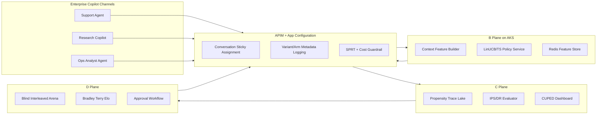
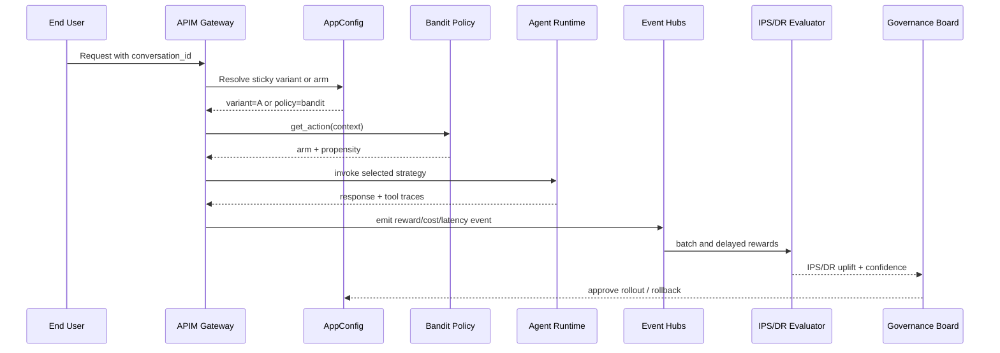

# 企业级在线多智能体实验选型 FAQ：App Configuration A/B Guardrails vs Redis+LinUCB Bandit vs IPS/DR 反事实评估 vs 人审偏好 Arena
> 🌐 **Language Switch**: **中文（当前）** | [English](online-agent-ab-experimentation-contextual-bandit-appconfig-vs-redis-linucb-vs-ips-eval-selection-faq.en.md)
> 目标读者：Cloud & AI Solution Architect、平台工程负责人、LLMOps、数据科学与企业治理团队。  
> 适用问题：多智能体系统需要在不扩大生产风险的前提下，持续优化任务成功率、时延和 token 成本。  
> 交付形态：四平面实验体系、12 维选型矩阵、可运行片段、量化 FAQ 与上线检查清单。
## 1. 执行摘要与推荐路径
在企业生产环境里，在线实验不是一个按钮，而是一条可审计的工程流水线。  
如果只做“随机 50/50 分流”，多轮会话会在中途切臂，结果统计失真，客服与风控都无法接受。  
如果只做离线回放，不做在线门禁，坏策略仍会在高峰时段被误放量。  
如果只做 Bandit，不做反事实评估，长期奖励会被短期点击率绑架。  
如果只做偏好投票，不做成本护栏，系统会向“昂贵但讨喜”的策略漂移。  
建议采用四平面并行架构，职责清晰且可分别演进。  
**Plane A**：App Configuration Feature Manager + Application Insights，提供会话粘性分流、CUPED 降方差和 SPRT 顺序检验护栏。  
**Plane B**：AKS 上运行 LinUCB / Thompson Sampling，结合 Redis 特征与 Event Hubs 延迟奖励，做在线探索与利用。  
**Plane C**：Databricks/Fabric 上执行 IPS/DR 反事实评估，利用 APIM 记录的 propensity 做离线安全评估。  
**Plane D**：企业 Copilot UI 人审 Arena，采用盲评交错呈现并用 Bradley-Terry Elo 做偏好标定。  
落地顺序建议是 A 先行、B 小流量并行、C 全程伴随、D 用于高风险场景裁决。  
当团队缺少在线学习工程能力时，先把 A+C 做稳，再逐步引入 B。  
当业务处于强监管阶段时，把 D 设为强制审批层，不允许自动提权放量。  
当多租户噪声邻居严重时，B 的上下文分层与租户预算约束应优先。  
当研发效率受限时，优先保住“可回滚、可解释、可计费”三条底线。  
## 2. 业务边界、非目标与成功标准
本指南只讨论企业在线实验体系，不讨论底座预训练或 RLHF 数据采集。  
本指南假定系统已经具备基础日志、Tracing 与统一网关治理能力。  
本指南默认存在多轮会话语境，且会话内响应策略不能随机跳变。  
本指南覆盖文本型与工具调用型 Agent，不扩展到端侧离线模型调度。  
### 2.1 成功标准（生产口径）
- 任务完成率 uplift 在统计显著后稳定超过 2.0%。  
- p95 延迟不恶化超过 8%，且 P99 未触发 SLO 红线。  
- token 成本在同等质量前提下下降 10% 或保持不增。  
- 高风险租户实验失败时，5 秒内回滚到稳定策略。  
- 会话切臂率接近 0，且实验归因链路完整可追溯。  
### 2.2 非目标（避免范围蔓延）
- 不在本轮改造所有提示词资产与工具 schema。  
- 不在同一窗口同步升级模型版本与实验框架版本。  
- 不把业务 KPI 争议转嫁为“算法自动决定”。  
- 不在缺少治理审批时开启大规模探索流量。  
- 不把离线评估结果直接当成线上放量许可。  
## 3. 四路径架构总览（A/B/C/D）
| 平面 | 关键问题 | 主组件 | 主要产出 | 典型失败模式 | 兜底 |
|---|---|---|---|---|---|
| A | 会话粘性 A/B 与统计护栏 | App Configuration, App Insights, APIM | 稳定分流、SPRT 判决、CUPED 修正 | 会话中途切臂、样本污染 | 强制 sticky + 熔断回退 |
| B | 上下文感知在线决策 | AKS, Redis, Event Hubs | LinUCB/TS 策略、实时 arm 选择 | 过度探索、奖励延迟偏差 | 探索上限 + 冷启动降级 |
| C | 离线反事实安全评估 | Databricks/Fabric, ADX, Lakehouse | IPS/DR uplift 估计、置信区间 | propensity 日志缺失 | APIM 强制埋点 |
| D | 高风险偏好裁决 | Copilot UI Arena, Human Review, Elo | 人审排名、偏好阈值 | 点击噪声误导 | 盲评 + 评审分层 |
A 平面解决“能不能可信比较”。  
B 平面解决“如何动态选择更优臂”。  
C 平面解决“上线前是否值得冒险”。  
D 平面解决“高风险领域由谁最终拍板”。  
## 4. 端到端参考架构（Mermaid）

该架构让策略迭代、风险控制和财务约束在同一数据闭环内协作。  
它避免了“算法自转”与“业务拍脑袋”两端极化。  
它也为审计提供了从请求到决策再到收益的可追溯路径。  
## 5. Option A：App Configuration 会话粘性实验 + CUPED/SPRT 护栏
Option A 的价值在于让实验从“随机分流”升级为“可治理分流”。  
首先，实验分配键必须绑定 conversation_id 或 thread_id。  
其次，多轮对话期间不得切换 variant。  
再次，所有实验判决必须同时看效果、成本与稳定性。  
最后，统计判定采用顺序检验而不是固定样本一次性结论。  
### 5.1 会话粘性策略
- 以 tenant_id + conversation_id 计算稳定哈希。  
- 哈希结果映射到固定 variant 桶位。  
- variant 只在会话新建时决定，不在回合中变更。  
- 若策略配置更新，仅对新会话生效。  
- 旧会话保留原 arm 直至超时关闭。  
### 5.2 CUPED 与 SPRT 组合
- CUPED 使用历史基线变量降低方差。  
- SPRT 在早期即可识别明显劣化 arm。  
- 同时设定延迟和成本护栏，防止“高分高价”误胜。  
- 通过序贯边界避免等待无谓样本。  
- 统计结果写入审计表，保留阈值与决策版本。  
## 6. Option B：Redis + LinUCB/TS 在线 Contextual Bandit
Bandit 不是替代 A/B，而是建立在 A/B 治理之上的在线优化层。  
当意图复杂度、租户等级、工具可用性发生变化时，静态策略无法持续最优。  
LinUCB 适合线性可解释场景，Thompson Sampling 适合不确定奖励分布。  
在企业场景中，常见做法是 LinUCB 作为主策略，TS 作为探索旁路。  
Event Hubs 负责回传延迟奖励，Redis 存储短期上下文特征。  
### 6.1 上下文特征建议
- 用户意图复杂度分档。  
- 工具链路可用性评分。  
- 当前租户预算余量与 SLA 等级。  
- 会话历史失败类型向量。  
- 监管敏感级别标签。  
### 6.2 延迟奖励处理
- 立即奖励：点击继续、工具执行成功、无重试。  
- 延迟奖励：工单关闭、分析报告被采纳、审阅通过。  
- 将奖励拆分短期与长期两层。  
- 在线策略优先使用短期奖励，离线再做长期修正。  
- 对跨天奖励按事件时间回填，不按处理时间混算。  
## 7. Option C：IPS/DR 反事实离线评估平面
生产环境不能把新策略直接扔给全部用户试错。  
反事实评估允许在历史日志上估计新策略收益，降低线上爆炸半径。  
核心前提是 APIM 必须记录行为策略 propensity，即 p0(a|x)。  
若没有 propensity，IPS 与 DR 将失去无偏性基础。  
因此 C 平面的第一任务不是建模，而是补齐日志契约。  
### 7.1 IPS 与 DR 分工
- IPS 简洁透明，适合快速筛除明显差策略。  
- DR 对模型误差更稳健，适合进入放量前评审。  
- 两者都应输出置信区间，而非单点 uplift。  
- 当权重方差过大时，需做 clipping 并报告偏差。  
- 当样本覆盖不足时，明确“不具备上线证据”。  
### 7.2 日志契约最小字段
- request_id / conversation_id / tenant_id。  
- context 特征快照版本。  
- action 选择、arm 标识、policy_version。  
- propensity 数值与采样温度。  
- reward 事件、成本、时延和终态标签。  
## 8. Option D：企业 Copilot 人审 Arena + Bradley-Terry Elo
在法务、投研、财务审批等高风险任务中，点击率不能代表真实价值。  
需要引入盲评并排展示，让专家只看结果质量，不看模型身份。  
Arena 采用交错顺序，减少位置偏差。  
评分结果通过 Bradley-Terry/Elo 校准，形成可比较等级。  
当 Elo 提升与成本上升冲突时，交由治理委员会做显式取舍。  
### 8.1 人审流程建议
- 抽样覆盖高价值租户与异常场景。  
- 评审维度至少包含正确性、可执行性、可审计性。  
- 设定评审员一致性门槛，避免主观噪声失控。  
- 对争议案例执行二次复核并存档。  
- 人审结论作为放量门禁之一，不作为唯一依据。  
## 9. 12 维架构选型矩阵
| 维度 | A AppConfig + CUPED/SPRT | B Redis + LinUCB/TS | C IPS/DR OPE | D Arena + Elo |
|---|---|---|---|---|
| 核心目标 | 稳定对照实验 | 在线动态优化 | 离线风险评估 | 高风险偏好裁决 |
| 放量速度 | 中 | 高 | 中 | 低 |
| 实施复杂度 | 中 | 高 | 中高 | 中 |
| 解释性 | 高 | 中 | 高 | 中 |
| 数据依赖 | 中 | 高 | 高 | 中 |
| 对业务侵入 | 低 | 中 | 低 | 中 |
| 成本控制力 | 高 | 中 | 高 | 中 |
| 延迟影响 | 低 | 中 | 低 | 低 |
| 合规审计价值 | 高 | 中 | 高 | 高 |
| 回滚难度 | 低 | 中 | 低 | 低 |
| 多租户适配 | 高 | 高 | 高 | 中 |
| 推荐先后顺序 | 第一步 | 第二步 | 全程并行 | 高风险并行 |
## 10. 治理护栏与运营节奏
以下治理规则建议固化在变更流程中。  
规则一：任何实验必须绑定策略版本、日志版本和审批记录。  
规则二：未配置会话粘性时，不得进入生产流量。  
规则三：成本护栏触发后，自动降级到稳定 arm。  
规则四：Bandit 探索率不得突破租户预算上限。  
规则五：propensity 缺失样本不得参与 OPE 主结论。  
规则六：人审 Arena 必须隐藏模型身份与排序来源。  
规则七：出现合规告警时，立即暂停探索并保留证据。  
规则八：所有放量决策应记录负责人与有效期。  
规则九：周会看趋势，月会看收益，季度看架构债务。  
规则十：任何“无法解释但效果好”的策略不得长期留存。  
## 11. 实验与评估闭环流程（Mermaid）

该流程体现了“在线决策、离线复核、人审兜底”的三层协作。  
它也天然支持审计追责，因为每一步都有策略与数据版本。  
## 12. 生产片段 A：会话粘性分流（App Configuration + Python）
```python
import hashlib
from dataclasses import dataclass
@dataclass
class VariantDecision:
    tenant_id: str
    conversation_id: str
    experiment_key: str
    variant: str
def stable_bucket(tenant_id: str, conversation_id: str, experiment_key: str) -> int:
    seed = f"{tenant_id}:{conversation_id}:{experiment_key}".encode("utf-8")
    digest = hashlib.sha256(seed).hexdigest()
    return int(digest[:8], 16) % 10000
def assign_variant(bucket: int) -> str:
    if bucket < 4000:
        return "control"
    if bucket < 7000:
        return "prompt_v2"
    if bucket < 9000:
        return "tool_policy_v2"
    return "hybrid_v3"
def decide(tenant_id: str, conversation_id: str, experiment_key: str) -> VariantDecision:
    b = stable_bucket(tenant_id, conversation_id, experiment_key)
    return VariantDecision(tenant_id, conversation_id, experiment_key, assign_variant(b))
```
```json
{
  "feature_flags": {
    "agent-routing-exp-2026q4": {
      "enabled": true,
      "sticky_key": "conversation_id",
      "variants": [
        {"name": "control", "weight": 40},
        {"name": "prompt_v2", "weight": 30},
        {"name": "tool_policy_v2", "weight": 20},
        {"name": "hybrid_v3", "weight": 10}
      ],
      "guardrails": {
        "max_p95_latency_ms": 2400,
        "max_cost_per_session_usd": 0.045,
        "sprt_alpha": 0.05,
        "sprt_beta": 0.2
      }
    }
  }
}
```
## 13. 生产片段 B：LinUCB + DR 评估 + ADX CUPED 查询
```python
import numpy as np
class LinUCBPolicy:
    def __init__(self, d: int, alpha: float, arms: list[str]):
        self.alpha = alpha
        self.arms = arms
        self.A = {a: np.eye(d) for a in arms}
        self.b = {a: np.zeros((d, 1)) for a in arms}
    def select(self, x: np.ndarray) -> tuple[str, dict]:
        scores = {}
        for a in self.arms:
            A_inv = np.linalg.inv(self.A[a])
            theta = A_inv @ self.b[a]
            mean = float(theta.T @ x)
            bonus = self.alpha * float(np.sqrt(x.T @ A_inv @ x))
            scores[a] = mean + bonus
        arm = max(scores, key=scores.get)
        propensity = 0.90 if arm == "control" else 0.10 / (len(self.arms) - 1)
        return arm, {"scores": scores, "propensity": propensity}
def doubly_robust(records):
    # record: reward, propensity, target_prob, q_hat
    out = []
    for r in records:
        ips = (r["target_prob"] / max(r["propensity"], 1e-6)) * r["reward"]
        dr = r["q_hat"] + (r["target_prob"] / max(r["propensity"], 1e-6)) * (r["reward"] - r["q_hat"])
        out.append({"ips": ips, "dr": dr})
    return out
```
```kusto
let baseline =
    AgentExperimentEvents
    | where Timestamp between (ago(14d) .. ago(1d))
    | summarize pre_mean = avg(TaskResolved), pre_cost = avg(SessionCostUsd) by TenantId;
AgentExperimentEvents
| where Timestamp > ago(1d)
| join kind=leftouter baseline on TenantId
| extend cuped_outcome = TaskResolved - 0.62 * (pre_mean - avg(pre_mean))
| summarize
    sessions = count(),
    resolved = avg(TaskResolved),
    cuped_resolved = avg(cuped_outcome),
    p95_latency = percentile(LatencyMs, 95),
    avg_cost = avg(SessionCostUsd)
    by Arm, TenantTier
| order by TenantTier asc, Arm asc
```
## 14. FinOps 实验成本模型与企业场景
### 14.1 三年 TCO（USD $k）
| 成本项 | A 平面 | B 平面 | C 平面 | D 平面 | 合计 |
|---|---:|---:|---:|---:|---:|
| 平台与服务固定成本 | 210 | 380 | 260 | 140 | 990 |
| 运行与存储成本 | 320 | 470 | 410 | 120 | 1,320 |
| 人员与治理成本 | 290 | 360 | 280 | 240 | 1,170 |
| 审计与合规成本 | 90 | 80 | 110 | 130 | 410 |
| 三年总成本 | 910 | 1,290 | 1,060 | 630 | 3,890 |
若只做 A+B 不做 C，短期看便宜，长期事故成本会显著抬升。  
若缺失 D，在高风险场景中可能因主观投诉造成返工潮。  
典型建议是 A+C 为底座，B 与 D 按行业风险分层部署。  
### 14.2 场景 A：全球电商客服 Agent（2.5M 日会话）
客户在 18 个区域运行客服与售后智能体。  
他们需要比较 4 种工具编排策略与 3 套提示词方案。  
上线前先用 A 平面做会话粘性 A/B，三周内发现一条高成本 arm。  
随后引入 B 平面，按意图复杂度动态选择 SLM/LLM 路由。  
C 平面用 DR 评估显示新策略对复杂工单提升 4.8%。  
D 平面对退款争议类任务执行人审，阻止了高风险自动放量。  
最终结果是任务完成率提升 3.1%，token 成本下降 12.4%。  
### 14.3 场景 B：金融投研 Copilot（延迟奖励）
客户的奖励并非即时点击，而是分析师采纳与投委会通过。  
延迟奖励跨度可达数小时到两天，纯在线指标会误导决策。  
他们采用 Event Hubs 回填延迟事件，并在 C 平面做跨天 DR 校正。  
Bandit 仅在低风险研究摘要环节开放，核心建议环节需人审。  
Arena 盲评后，Elo 最高 arm 并非成本最高 arm。  
治理委员会据此设定“双目标门禁”，避免单指标最优陷阱。  
季度复盘显示报告采纳率提升 2.6%，审核返工率下降 19%。  
## 15. 定量 FAQ、落地步骤与 12 项检查清单
### 15.1 定量 FAQ（8 题）
**Q1：为什么多轮 Agent 必须做会话粘性分流？**  
会话中切臂会破坏上下文连续性，统计上也会导致样本污染。  
在复杂工具链中，切臂还会引发状态不一致和重复执行。  
粘性分流是实验可信性的前提，不是可选优化项。  
**Q2：CUPED 在真实业务里通常能降多少方差？**  
不同场景差异很大，常见区间是 15% 到 35%。  
若基线变量与目标指标相关性较高，收益会更明显。  
若基线变量噪声大，盲目使用反而会引入偏差。  
**Q3：SPRT 的价值是什么？**  
它能在样本未满时提前终止明显失败策略。  
这对高流量平台意味着更低机会成本与更小风险窗口。  
同时它保留统计显著性控制，不是拍脑袋停实验。  
**Q4：LinUCB 与 Thompson Sampling 如何取舍？**  
LinUCB 更可解释，适合监管和审计要求高的行业。  
TS 对不确定分布更灵活，但解释与复现成本更高。  
很多企业采用 LinUCB 主策略 + TS 探索旁路的混合方案。  
**Q5：IPS 和 DR 何时会失效？**  
当 propensity 记录缺失或严重失真时会失效。  
当新策略与历史行为重叠不足时，估计方差会爆炸。  
遇到该情况应先补日志与样本覆盖，再谈放量。  
**Q6：高风险场景为什么还要保留人审 Arena？**  
因为隐式点击并不等价于“可承担责任的正确”。  
人审可以捕捉语义细节、合规措辞和执行风险。  
它不是否定算法，而是补齐高后果决策的治理层。  
**Q7：如何平衡质量提升与成本上升？**  
建议设置“收益-成本联合门禁”。  
例如每提升 1% 质量，允许的成本上升不得超过 0.3%。  
若超标则进入优化队列而不是直接放量。  
**Q8：何时可认定实验体系成熟？**  
连续两个结算周期无重大回滚。  
离线与在线结论长期一致且可解释。  
关键租户对实验变更无明显负反馈。  
### 15.2 五步落地路径（0–180 天）
1. **第 1 步（0–30 天）**：完成实验契约、日志字段、sticky 分流与回滚演练。  
2. **第 2 步（31–60 天）**：建立 CUPED/SPRT 仪表盘并收敛基础 A/B 流程。  
3. **第 3 步（61–100 天）**：引入 LinUCB 小流量探索，限制在低风险任务。  
4. **第 4 步（101–140 天）**：上线 IPS/DR 反事实评估，形成上线前评审门禁。  
5. **第 5 步（141–180 天）**：在高风险业务启用 Arena 人审与 Elo 排名治理。  
### 15.3 Day-0 / Day-2 检查清单（12 项）
- [ ] 已启用 conversation 级 sticky key，且会话中不切臂。  
- [ ] APIM 日志已记录 arm、policy_version 与 propensity。  
- [ ] CUPED 基线变量来源稳定并通过质量校验。  
- [ ] SPRT 边界参数已备案并经统计评审确认。  
- [ ] Bandit 探索率与租户预算上限已联动。  
- [ ] 延迟奖励事件链路具备去重与乱序处理。  
- [ ] IPS/DR 管道有置信区间与权重裁剪报告。  
- [ ] 高风险任务已定义人审门禁与升级责任人。  
- [ ] 成本护栏触发后有自动降级与告警通知。  
- [ ] 每周有实验审查会并输出风险与收益快照。  
- [ ] 每月完成策略债务清单与淘汰计划。  
- [ ] 每季度复盘“收益、稳定性、合规”三维结果。  
### 15.4 Good fit / Not for
**Good fit**  
- 日活会话规模大，静态策略已触达收益天花板。  
- 业务具备统一网关与日志治理能力。  
- 团队愿意把统计与治理当作产品能力长期建设。  
**Not for**  
- 没有统一日志与实验契约，策略无法追溯。  
- 业务仍在高频改 schema 阶段，样本不可比。  
- 团队只追求短期提升且不接受治理开销。  
### 15.5 结语
在线实验体系的目标不是“更聪明的算法”本身。  
真正目标是让企业在可控风险内持续进化多智能体决策。  
当 A/B、Bandit、OPE 与人审形成闭环，系统会从偶发优化变为可运营能力。  
这也是企业级 Agent 平台从“实验室玩具”走向“生产资产”的关键分水岭。  
