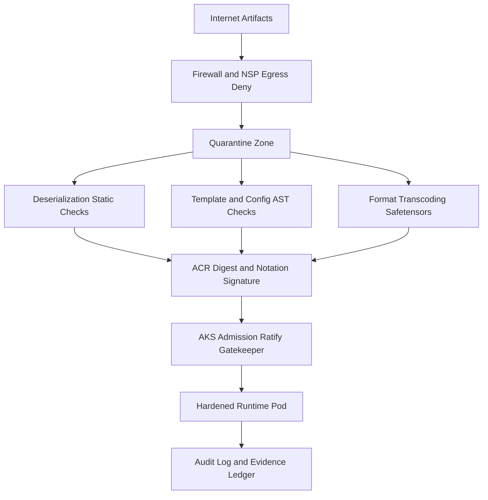

# Enterprise Open-Weight Model and LoRA Artifact Zero-Trust Supply-Chain Selection FAQ (Quarantine+Signing Admission vs Foundry Catalog vs Enterprise Proxy)
> Topic ID: #466
> Section: 3.6 Zero-Trust Identity, Private Networking, and Regulated Security Compliance
> Audience: platform security teams, MLOps teams, AKS platform owners, and model-governance reviewers
> Goal: reduce open-weight supply-chain risk to a verifiable, auditable, rollback-safe boundary without killing onboarding speed

## 1) Production problem: container image security is not model artifact security
Most enterprises already enforce `Defender for Containers`, `Trivy`, SBOM checks, and CVE gates on images.
Those controls are effective for OS packages and runtime dependencies.
They are largely blind to runtime-downloaded model weights, LoRA adapters, tokenizer configs, and template payloads.
When a GPU pod pulls `20–400GB` artifacts at runtime, the trust boundary shifts from scanned image to opaque file stream.
This shift is often hidden in development because paths are short and permissions are broad.
In production, a pod with Managed Identity plus Private Link data-plane access dramatically increases blast radius.
The key failure mode is not only degraded quality.
The critical failure mode is malicious artifacts gaining execution capability inside privileged inference pods.

## 2) Why standard scanners miss deserialization and template injection risks
`pickle`/`torch.load` object deserialization can execute attacker-controlled code paths.
A repository that appears to host only “weights” can still carry executable payload vectors through wrappers and side files.
`trust_remote_code=True` imports custom Python modules from model repos into serving processes.
`chat_template` in `tokenizer_config.json` can open Jinja SSTI surfaces if AST rules are not constrained.
Inside privileged GPU pods, this can expose mounted volumes, caches, temporary tokens, and internal endpoints.
Model supply-chain governance must therefore combine software, data, and runtime execution controls.

## 3) Four architecture paths
Pattern A: isolated quarantine transcoding plus `ACR ORAS`, `Notation` signing, and `Ratify/Gatekeeper` admission for custom open weights and LoRAs.
Pattern B: `Azure AI Foundry` curated catalog plus `Azure Policy` deployment allowlist for standardized managed models.
Pattern C: enterprise artifact proxy (`Artifactory/Nexus`) for controlled upstream Hugging Face caching, then promotion into trusted paths.
Pattern D: anti-pattern (runtime public downloads, `trust_remote_code=True`, unsigned shared model mounts).

## 4) Twelve-dimension comparison matrix
| Dimension | Pattern A (quarantine+signing admission) | Pattern B (Foundry catalog) | Pattern C (enterprise proxy) | Pattern D (anti-pattern) |
|---|---|---|---|---|
| `pickle`/deserialization RCE elimination | High | High | Medium | Low |
| `trust_remote_code` risk reduction | High | High | Medium | Low |
| `chat_template` SSTI control | High | Medium-high | Medium | Low |
| Production zero-public-egress compliance | High | High | Medium-high | Low |
| Cryptographic digest immutability | High | Medium-high | Medium | Low |
| AKS admission closed-loop | High | Medium | Medium | Low |
| Custom LoRA onboarding velocity | Medium-high | Low | Medium-high | High but unsafe |
| False-negative blast-radius control | Medium-high | High | Medium | Low |
| Operational complexity | High | Low | Medium | Low but fragile |
| Audit traceability | High | High | Medium | Low |
| Three-year SecOps TCO control | Medium-high | High | Medium | Low |
| Enterprise recommendation | Primary for regulated custom models | Primary for standard models | R&D buffer option | Disallow |

## 5) Pattern A: isolated quarantine, signing, and admission (primary for custom models)
First, block production AKS egress to `huggingface.co`, third-party object stores, and anonymous registries.
Force every new model and LoRA through an isolated quarantine environment with no production identity reuse.
Run three control families in quarantine: binary/deserialization checks, template/config static analysis, and deterministic format conversion checks.
Reject `pickle`, `.pt/.bin`, executable sidecars, and opaque archives by default.
Allow promotion only after safetensors conversion and parity checks pass.
Publish model artifacts into `ACR` via `ORAS` and sign immutable `@sha256:...` digests with `Notation`.
Configure production AKS to admit only signed artifacts from trusted enterprise registries.
This path provides the strongest control but requires deliberate platform engineering investment.

## 6) Pattern B: Foundry curated catalog and Azure Policy allowlist (primary for standard managed models)
For mainstream assistant workloads, Foundry curated models reduce self-managed supply-chain complexity.
Runtime isolation and model lifecycle validation are mostly handled by the managed platform.
`Azure Policy` can constrain deployment to approved model sets and regions.
This model provides strong governance and low operational burden.
The trade-off is slower adoption for niche checkpoints, custom architecture forks, and internal LoRA stacks.
In practice, many enterprises combine Pattern B for broad workloads and Pattern A for differentiated workloads.

## 7) Pattern C: enterprise artifact proxy for upstream caching (buffer path)
Many organizations use enterprise proxies to centralize internet model access and credentials.
This improves observability and narrows uncontrolled direct pulls from developer tools.
But proxy centralization alone does not close execution-risk paths.
If proxied artifacts still enter serving nodes as `.pt/.bin`, risk remains.
If `trust_remote_code` remains enabled, unverified code can still execute in production.
Pattern C is useful as a controlled intake layer, not a sufficient production trust boundary.
Production promotion should still flow through signing and admission controls.

## 8) Pattern D: anti-pattern checklist
Runtime model downloads in production using mutable refs such as `revision="main"`.
`trust_remote_code=True` enabled in production inference services.
Shared unsigned model directories mounted across namespaces without digest verification.
Image CVE scanning used as the only model-security control.
These patterns optimize short-term speed while maximizing long-term incident probability.

## 9) Mermaid: air-gapped quarantine to production admission pipeline

```mermaid
flowchart LR
  U[Pinned Upstream Commit] --> Q[Ephemeral Quarantine Sandbox]
  Q --> S1[Fickling and ModelScan]
  S1 --> S2[Safetensors Conversion and Tensor Parity Check]
  S2 --> S3[Jinja Template AST Audit]
  S3 --> R[ACR ORAS Push]
  R --> N[Notation Sign with AKV HSM]
  N --> A[Ratify plus Gatekeeper Admission]
  A --> P[ReadOnly GPU Pod trust_remote_code false]
```


## 10) Mermaid: deserialization and runtime defense-in-depth map


## 11) Quantitative Q1-Q6 formulas and thresholds
Q1: deserialization RCE risk approximation.
`P(RCE_deser) ~= P(untrusted_pickle) * P(execution_path_open)`.
With safetensors-only and remote-code disabled, the second factor approaches `0`.
Q2: signing-admission latency budget.
`T_admission = T_fetch_referrer + T_verify_sig + T_cache_lookup`, with P95 target `< 45ms`.
Q3: conversion parity constraint.
`max_abs(W_pt - W_safe) == 0` plus full shard digest match before promotion.
Q4: template-rule coverage.
`Coverage_ast = blocked_dangerous_nodes / total_dangerous_nodes`, target `100%`.
Q5: LoRA anomaly threshold.
`R = ||BA||_F / ||W0||_F`; if `R > r_max` or drift is abnormal, require manual review.
Q6: promotion lead-time SLA.
`T_promote = T_scan + T_convert + T_sign + T_admit_test`; `70B` target `< 25 min`.

## 12) Production code block 1: quarantine gate (Python)
```python
import hashlib
import json
from pathlib import Path

FORBIDDEN_SUFFIX = {".pt", ".bin", ".pkl", ".pickle"}
FORBIDDEN_JINJA_TOKENS = {"__subclasses__", "__mro__", "cycler", "joiner", "namespace"}

def sha256_file(path: Path) -> str:
    h = hashlib.sha256()
    with path.open("rb") as f:
        for chunk in iter(lambda: f.read(1024 * 1024), b""):
            h.update(chunk)
    return h.hexdigest()

def enforce_safetensors_only(model_dir: Path) -> None:
    for p in model_dir.rglob("*"):
        if p.is_file() and p.suffix.lower() in FORBIDDEN_SUFFIX:
            raise RuntimeError(f"blocked unsafe artifact: {p.name}")

def validate_chat_template(tokenizer_config: Path) -> None:
    cfg = json.loads(tokenizer_config.read_text(encoding="utf-8"))
    template = cfg.get("chat_template", "")
    for token in FORBIDDEN_JINJA_TOKENS:
        if token in template:
            raise RuntimeError(f"blocked template token: {token}")

def verify_tensor_parity(pt_digest: str, safe_digest: str) -> None:
    if pt_digest != safe_digest:
        raise RuntimeError("tensor parity mismatch between source and safetensors output")
```

## 13) Production code block 2: ORAS plus Notation signing workflow
```bash
set -euo pipefail

MODEL_REF="contosoacr.azurecr.io/models/qwen2.5-72b-instruct-safe:2026.11.27"
MODEL_DIR="./dist/qwen2.5-72b-safetensors"

oras push "${MODEL_REF}" \
  --artifact-type application/vnd.contoso.model.safetensors \
  "${MODEL_DIR}/model-00001-of-00020.safetensors:application/octet-stream" \
  "${MODEL_DIR}/model.safetensors.index.json:application/json" \
  "${MODEL_DIR}/tokenizer.json:application/json"

DIGEST="$(oras manifest fetch "${MODEL_REF}" --descriptor | jq -r .digest)"

notation sign "${MODEL_REF%@*}@${DIGEST}" \
  --plugin azure-kv \
  --id "https://contoso-kv.vault.azure.net/keys/model-signing-hsm"

notation verify "${MODEL_REF%@*}@${DIGEST}" --plugin azure-kv
```

## 14) Production code block 3: Ratify/Gatekeeper and hardened serving pod
```yaml
apiVersion: config.ratify.deislabs.io/v1beta1
kind: Verifier
metadata:
  name: notation-verifier
spec:
  name: notation
  artifactTypes:
    application/vnd.contoso.model.safetensors: {}
---
apiVersion: templates.gatekeeper.sh/v1beta1
kind: ConstraintTemplate
metadata:
  name: k8srequiredmodelsignature
spec:
  crd:
    spec:
      names:
        kind: K8sRequiredModelSignature
  targets:
    - target: admission.k8s.gatekeeper.sh
      rego: |
        package k8srequiredmodelsignature
        violation[{"msg": msg}] {
          input.review.kind.kind == "Pod"
          not input.review.object.metadata.annotations["ratify.signature.verified"]
          msg := "model artifact signature verification missing"
        }
---
apiVersion: v1
kind: Pod
metadata:
  name: vllm-serving
spec:
  containers:
    - name: runtime
      image: contoso.azurecr.io/runtime/vllm:secure
      args: ["--model=/models/qwen", "--trust-remote-code=false"]
      securityContext:
        readOnlyRootFilesystem: true
        allowPrivilegeEscalation: false
        seccompProfile:
          type: RuntimeDefault
```

## 15) Enterprise scenarios and three-tier three-year TCO
### 15.1 Scenario A: tier-1 investment bank with multi-model and LoRA onboarding
The platform onboarded `Qwen/DeepSeek/Llama` families plus internal audit-oriented LoRA adapters.
Legacy process depended on manual checklist reviews and usually required `2–3` weeks.
After moving to Pattern A, every model entered quarantine for scan, conversion, signing, and admission tests.
A third-party LoRA benchmark repository containing a malicious `pickle __reduce__` payload was blocked in quarantine.
The organization reduced approval lead-time to about `22` minutes while preserving regulator-grade evidence.
### 15.2 Scenario B: sovereign telecom dual-track model governance
The enterprise placed general-assistant traffic on Foundry curated catalog (Pattern B).
Regional-dialect SLM and custom LoRA workloads ran on AKS plus ACR plus Ratify (Pattern A).
Azure Policy constrained deployment sources and production network enforced zero-public-egress.
Audit trails linked every deployment to commit, digest, signature, and admission proof.
The program passed `NIS2` and `ISO 42001` supply-chain checks with continuous release cadence.
### 15.3 Three-tier TCO
| Tier | Model and adapter scale | Recommended combination | Three-year blended TCO |
|---|---:|---|---:|
| Tier-1 | 20 models / 30 LoRAs | B primary + A small custom lane | `$2.8M` |
| Tier-2 | 60 models / 120 LoRAs | A + B dual-track | `$7.9M` |
| Tier-3 | 140 models / 400 LoRAs | A primary + B standard + C buffer lane | `$18.6M` |
### 15.4 Fine-grained architecture implementation points
Define model-intake ownership and promotion authority up front so quarantine cannot be bypassed by ad-hoc uploads.
Make production egress-deny controls immutable by default, and treat temporary outbound exceptions as expiring break-glass actions.
Require immutable digest references instead of mutable tags to keep evidence integrity intact.
Store signing keys in HSM-backed services with strict separation of duties and short-lived pipeline identities.
Version template-AST policies so each policy change is auditable, testable, and reversible.
Enforce `trust_remote_code=false` as a platform default, not an optional team-level toggle.
Separate model, LoRA, and cache storage tiers by trust level to prevent cross-contamination.
Keep safety verification and quality verification as independent gates so one metric cannot hide the other.
Require pre-production namespace admission rehearsals before production namespace promotion.
Persist scan results, signature proofs, and admission logs into tamper-resistant evidence stores.
Track quarantine compute, signing infrastructure, and evidence-retention cost separately from serving cost.
Add structured diff reviews for model upgrades, LoRA swaps, and template edits.
Predefine runbooks for signature failures, false positives, and conversion failures with clear escalation paths.
Maintain a repository trust profile so high-risk sources automatically require manual approval.
Validate signature metadata replication in cross-region copy paths before enabling regional failover.
Freeze Ratify and Gatekeeper policy versions during peak windows to avoid control-plane drift incidents.
Map each technical control to explicit compliance clauses for faster audit defense.
Provide local pre-check tooling so data scientists can catch policy failures before submission.
Track rejection rate, false-rejection rate, promotion time, and post-release incident rate together.
Run monthly incident retrospectives and convert findings into policy and template updates.
Retain decision timelines and accountability artifacts for high-impact events.
Include model-supply-chain controls in shared platform training across MLOps, security, and business teams.
Rebalance A/B/C strategy quarterly based on catalog coverage and custom-model demand.
Define explicit interfaces: security owns controls, platform owns enforcement, business owns quality regression sign-off.
### 15.5 Day-0 / Day-1 / Day-2 engineering runbook (18 actions)
Day-0: define model-intake tiers (catalog model, custom weight, LoRA adapter).
Day-0: define production egress baseline and quarantine-only outbound policy.
Day-0: enforce safetensors-only and `trust_remote_code=false` platform baseline.
Day-0: establish signing key custody, rotation, and separation-of-duty workflow.
Day-0: publish AST and deserialization policy packs with false-positive appeal path.
Day-0: define ACR digest and admission policy templates.
Day-1: launch quarantine pipeline and run first production-like onboarding drills.
Day-1: enable Notation signing and Ratify verification in AKS admission.
Day-1: enable Gatekeeper constraints with operator-readable denial reasons.
Day-1: publish unified dashboard for scan, signature, and admission evidence.
Day-1: execute failure drills for signature mismatch, conversion failure, and policy false-positive.
Day-1: verify rollback path for failed production admission.
Day-2: review weekly rejection events and tune policy precision.
Day-2: run weekly digest/signature consistency sampling.
Day-2: review monthly promotion lead-time and developer wait-time.
Day-2: review monthly false-rejection cost versus blocked-risk benefit.
Day-2: refresh quarterly compliance evidence packages and policy mappings.
Day-2: rebalance quarterly A/B/C deployment mix and budget allocation.

Sources (fetched 2026-11-27):
- Safetensors format: https://github.com/huggingface/safetensors
- ModelScan: https://github.com/protectai/modelscan
- Fickling: https://github.com/trailofbits/fickling
- ORAS OCI artifacts: https://oras.land/
- Azure Container Registry Notary/Notation guidance: https://learn.microsoft.com/azure/container-registry/
- Ratify project: https://github.com/deislabs/ratify
- Gatekeeper project: https://github.com/open-policy-agent/gatekeeper
- Azure AI Foundry model catalog docs: https://learn.microsoft.com/azure/ai-foundry/
