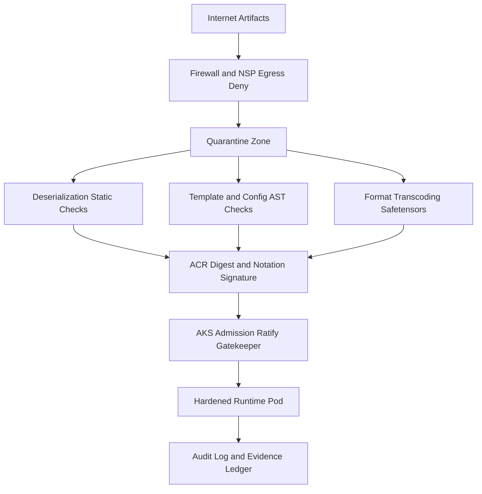

# 企业开源权重模型与 LoRA 产物零信任供应链选型 FAQ（隔离检疫签名准入 vs Foundry 目录 vs 企业代理）
> Topic ID: #466
> Section: 3.6 零信任身份、私有网络隔离与强监管数据合规
> Audience: 平台安全团队、MLOps 团队、AKS 平台团队、模型治理与合规审计团队
> Goal: 在不牺牲模型迭代速度的前提下，把开源权重供应链风险收敛到可验证、可审计、可回滚边界

## 1）生产问题：容器镜像安全并不等于模型产物安全
很多企业已经对容器镜像执行 `Defender for Containers`、`Trivy`、SBOM 与 CVE 门禁。
这些能力可以发现操作系统包、运行时组件和常见库漏洞。
但它们对运行时下载的模型权重、LoRA 适配器、tokenizer 配置和模板脚本几乎不可见。
一旦 GPU Pod 在运行中从外部仓库拉取 `20–400GB` 权重，供应链边界就从“可扫描镜像”漂移到“不可见文件流”。
这类漂移在开发环境通常不明显，因为默认信任路径短且权限较高。
进入生产后，如果 Pod 绑定 Managed Identity 并可访问 Private Link 数据面，风险影响面会急剧放大。
最典型的问题不是“模型效果下降”，而是“产物被武器化后获取执行能力”。

## 2）为何传统扫描会漏掉模型反序列化与模板注入风险
`pickle`/`torch.load` 支持对象反序列化，本质上可触发 Python 代码路径。
即使仓库声明“仅权重文件”，也可能通过 polyglot 包装、分片组合、辅助脚本引入执行面。
`trust_remote_code=True` 会把模型仓库中的自定义 Python 模块带入推理进程。
`tokenizer_config.json` 中的 `chat_template` 若未做 AST 白名单，也可能形成 Jinja SSTI 风险。
当这些路径进入特权 GPU Pod，攻击者可以借进程权限访问挂载卷、缓存、临时凭据或内部服务。
因此，模型供应链必须被当作“软件供应链 + 数据供应链 + 执行供应链”的叠加问题处理。

## 3）四类架构路径总览
Pattern A：隔离检疫转码 + `ACR ORAS` + `Notation` 签名 + `Ratify/Gatekeeper` 准入，适合自定义开源权重与 LoRA 主路径。
Pattern B：`Azure AI Foundry` 官方目录 + `Azure Policy` 允许名单，适合标准化托管模型主路径。
Pattern C：企业制品代理（`Artifactory/Nexus`）缓存 Hugging Face，上游拉取可控但需要补齐签名与准入闭环。
Pattern D：反模式（生产运行时直连公网拉权重、`trust_remote_code=True`、未签名共享目录挂载）。

## 4）十二维对比矩阵
| 维度 | Pattern A（检疫+签名准入） | Pattern B（Foundry 目录） | Pattern C（企业代理） | Pattern D（反模式） |
|---|---|---|---|---|
| `pickle`/反序列化 RCE 消除能力 | 高 | 高 | 中 | 低 |
| `trust_remote_code` 风险收敛 | 高 | 高 | 中 | 低 |
| `chat_template` SSTI 防护 | 高 | 中高 | 中 | 低 |
| 生产零公网出口合规 | 高 | 高 | 中高 | 低 |
| 签名与摘要不可篡改 | 高 | 中高 | 中 | 低 |
| AKS 准入门禁闭环 | 高 | 中 | 中 | 低 |
| 自定义 LoRA 迭代速度 | 中高 | 低 | 中高 | 高（但不安全） |
| 误报/漏报可治理性 | 中高 | 高 | 中 | 低 |
| 运维复杂度 | 高 | 低 | 中 | 低（但脆弱） |
| 审计可追溯性 | 高 | 高 | 中 | 低 |
| 三年 SecOps TCO 可控性 | 中高 | 高 | 中 | 低 |
| 企业推荐结论 | 监管与自定义并重首选 | 标准模型首选 | 研发缓冲可选 | 禁用 |

## 5）Pattern A：隔离检疫转码 + 签名 + 准入（自定义权重主路径）
在网络边界上，先把生产 AKS VNet 对 `huggingface.co`、第三方对象存储与匿名镜像源的出口全部阻断。
所有新模型与 LoRA 产物必须先进入独立检疫环境，检疫环境与生产身份隔离，且不共享凭据。
检疫阶段执行三类检查：二进制与序列化风险扫描、模板与配置静态分析、结构化格式转码验证。
对 `pickle`、`.pt/.bin`、可执行脚本与不透明压缩包采用“默认拒绝”，仅允许经过 Safetensors 转码且哈希一致的产物晋级。
产物晋级后以 `ORAS` 方式推送到 `ACR`，并对不可变摘要 `@sha256:...` 进行 `Notation` 签名。
生产集群只允许拉取来自企业 ACR 且签名通过的模型产物，任何未签名或签名不匹配产物在准入前即被拒绝。
该模式把“模型可用性”与“模型可信性”绑定，代价是前期流程设计与平台工程投入更高。

## 6）Pattern B：Foundry 官方目录 + Azure Policy 允许名单（标准化主路径）
对于通用企业问答、摘要、翻译与标准 Copilot 场景，Foundry 官方目录可显著降低自建供应链复杂度。
模型版本发布、兼容性与运行时隔离由平台托管，客户侧主要做配额、访问控制与策略治理。
通过 `Azure Policy` 约束部署来源，可把“随意选模型”收敛为“批准列表内模型”。
这种模式对安全与审计最友好，但对“新社区 checkpoint 立即试用”支持较慢。
如果业务强依赖私有 LoRA、领域词表或模型结构改造，Pattern B 通常需要与 Pattern A 组合使用。

## 7）Pattern C：企业制品代理（Artifactory/Nexus）+ 上游缓存（研发缓冲路径）
很多组织希望先用企业代理隔离公网访问，再把代理作为唯一下载入口。
这可以提升审计可见性，并降低开发团队直连上游仓库的离散风险。
但“有代理”不等于“有安全闭环”，代理只解决入口统一，未必解决产物可执行风险。
若代理后的文件仍以 `.pt/.bin` 直接进入推理节点，或者未禁用 `trust_remote_code`，风险仍会传导到生产。
因此 Pattern C 适合研发和灰度缓冲层，最终生产仍应落到 Pattern A 的签名与准入链路。

## 8）Pattern D：反模式清单
生产 Pod 运行时动态下载 `revision="main"` 的模型仓库。
在生产环境启用 `trust_remote_code=True` 并放宽容器权限。
把未扫描模型放在共享 `Blob/ANF/PVC` 目录，让多个命名空间直接挂载。
仅做镜像漏洞扫描却不做模型产物扫描与签名验证。
这类做法上线快，但任何一次供应链污染都可能直接转化为执行面事件。

## 9）Mermaid：隔离检疫到生产准入流水线

```mermaid
flowchart LR
  U[Pinned Upstream Commit] --> Q[Ephemeral Quarantine Sandbox]
  Q --> S1[Fickling and ModelScan]
  S1 --> S2[Safetensors Conversion and Tensor Parity Check]
  S2 --> S3[Jinja Template AST Audit]
  S3 --> R[ACR ORAS Push]
  R --> N[Notation Sign with AKV HSM]
  N --> A[Ratify plus Gatekeeper Admission]
  A --> P[ReadOnly GPU Pod trust_remote_code false]
```


## 10）Mermaid：反序列化与运行时防线分层图


## 11）Q1-Q6 量化公式与阈值
Q1：反序列化 RCE 风险近似。
`P(RCE_deser) ~= P(untrusted_pickle) * P(execution_path_open)`。
当仅允许 Safetensors 且禁用远程代码时，第二项逼近 `0`。
Q2：签名准入时延预算。
`T_admission = T_fetch_referrer + T_verify_sig + T_cache_lookup`，P95 目标 `< 45ms`。
Q3：转码一致性约束。
`max_abs(W_pt - W_safe) == 0` 且分片哈希全量一致，才允许晋级。
Q4：模板安全规则覆盖率。
`Coverage_ast = blocked_dangerous_nodes / total_dangerous_nodes`，目标 `100%`。
Q5：LoRA 异常筛查边界。
`R = ||BA||_F / ||W0||_F`，若 `R > r_max` 或分布漂移异常则进入人工复核。
Q6：晋级 SLA。
`T_promote = T_scan + T_convert + T_sign + T_admit_test`，`70B` 模型目标 `< 25 min`。

## 12）生产代码块 1：检疫门禁（Python）
```python
import hashlib
import json
from pathlib import Path

FORBIDDEN_SUFFIX = {".pt", ".bin", ".pkl", ".pickle"}
FORBIDDEN_JINJA_TOKENS = {"__subclasses__", "__mro__", "cycler", "joiner", "namespace"}

def sha256_file(path: Path) -> str:
    h = hashlib.sha256()
    with path.open("rb") as f:
        for chunk in iter(lambda: f.read(1024 * 1024), b""):
            h.update(chunk)
    return h.hexdigest()

def enforce_safetensors_only(model_dir: Path) -> None:
    for p in model_dir.rglob("*"):
        if p.is_file() and p.suffix.lower() in FORBIDDEN_SUFFIX:
            raise RuntimeError(f"blocked unsafe artifact: {p.name}")

def validate_chat_template(tokenizer_config: Path) -> None:
    cfg = json.loads(tokenizer_config.read_text(encoding="utf-8"))
    template = cfg.get("chat_template", "")
    for token in FORBIDDEN_JINJA_TOKENS:
        if token in template:
            raise RuntimeError(f"blocked template token: {token}")

def verify_tensor_parity(pt_digest: str, safe_digest: str) -> None:
    if pt_digest != safe_digest:
        raise RuntimeError("tensor parity mismatch between source and safetensors output")
```

## 13）生产代码块 2：ORAS + Notation 签名流水线
```bash
set -euo pipefail

MODEL_REF="contosoacr.azurecr.io/models/qwen2.5-72b-instruct-safe:2026.11.27"
MODEL_DIR="./dist/qwen2.5-72b-safetensors"

oras push "${MODEL_REF}" \
  --artifact-type application/vnd.contoso.model.safetensors \
  "${MODEL_DIR}/model-00001-of-00020.safetensors:application/octet-stream" \
  "${MODEL_DIR}/model.safetensors.index.json:application/json" \
  "${MODEL_DIR}/tokenizer.json:application/json"

DIGEST="$(oras manifest fetch "${MODEL_REF}" --descriptor | jq -r .digest)"

notation sign "${MODEL_REF%@*}@${DIGEST}" \
  --plugin azure-kv \
  --id "https://contoso-kv.vault.azure.net/keys/model-signing-hsm"

notation verify "${MODEL_REF%@*}@${DIGEST}" --plugin azure-kv
```

## 14）生产代码块 3：Ratify/Gatekeeper 与运行时加固
```yaml
apiVersion: config.ratify.deislabs.io/v1beta1
kind: Verifier
metadata:
  name: notation-verifier
spec:
  name: notation
  artifactTypes:
    application/vnd.contoso.model.safetensors: {}
---
apiVersion: templates.gatekeeper.sh/v1beta1
kind: ConstraintTemplate
metadata:
  name: k8srequiredmodelsignature
spec:
  crd:
    spec:
      names:
        kind: K8sRequiredModelSignature
  targets:
    - target: admission.k8s.gatekeeper.sh
      rego: |
        package k8srequiredmodelsignature
        violation[{"msg": msg}] {
          input.review.kind.kind == "Pod"
          not input.review.object.metadata.annotations["ratify.signature.verified"]
          msg := "model artifact signature verification missing"
        }
---
apiVersion: v1
kind: Pod
metadata:
  name: vllm-serving
spec:
  containers:
    - name: runtime
      image: contoso.azurecr.io/runtime/vllm:secure
      args: ["--model=/models/qwen", "--trust-remote-code=false"]
      securityContext:
        readOnlyRootFilesystem: true
        allowPrivilegeEscalation: false
        seccompProfile:
          type: RuntimeDefault
```

## 15）企业场景与三档三年 TCO
### 15.1 场景 A：一级投行多模型与 LoRA 生产引入
该机构同时引入 `Qwen/DeepSeek/Llama` 系列以及内部代码审计 LoRA。
历史流程依赖人工清单审阅，模型上线通常要 `2–3` 周。
切换到 Pattern A 后，新增模型统一进入检疫沙箱并执行自动化转码、签名与准入测试。
一次第三方 LoRA 基准仓库中嵌入的 `pickle __reduce__` 载荷在检疫阶段被拦截，未进入生产。
在不降低审计要求前提下，模型批准周期从周级降到 `22` 分钟级自动流水线。
### 15.2 场景 B：欧洲主权电信双轨模型治理
该企业将通用客服与办公助手流量放在 Foundry 目录（Pattern B）。
将区域方言 SLM 与自研 LoRA 放在 AKS + ACR + Ratify 路径（Pattern A）。
策略层通过 Azure Policy 限定可部署模型来源，网络层执行零公网出口。
审计报告可回溯到每次模型引入的 commit、摘要、签名与准入记录。
在 `NIS2` 与 `ISO 42001` 检查中实现“可证明供应链完整性”，并保持业务连续迭代。
### 15.3 三档三年 TCO
| 档位 | 模型与适配器规模 | 推荐组合 | 三年综合 TCO |
|---|---:|---|---:|
| Tier-1 | 20 模型 / 30 LoRA | B 为主 + A 小规模 | `$2.8M` |
| Tier-2 | 60 模型 / 120 LoRA | A + B 双轨 | `$7.9M` |
| Tier-3 | 140 模型 / 400 LoRA | A 主路径 + B 标准流量 + C 缓冲层 | `$18.6M` |
### 15.4 架构落地细粒度工程要点
在组织治理层，应先定义“谁有权引入新模型”与“谁有权批准晋级”，避免检疫流程上线后仍被旁路上传绕开。
在网络治理层，应把生产集群的公网出口策略写成不可变基线，禁止临时白名单常态化，防止应急措施演变成长期风险。
在制品治理层，应强制模型引用使用不可变摘要而非标签，避免“同标签不同内容”导致审计证据失真。
在签名治理层，应将签名密钥托管在 HSM 并执行最小权限分离，防止流水线凭据泄露后伪造可信产物。
在模板治理层，应把 `chat_template` AST 规则版本化，确保规则变更可追踪、可回滚、可解释，不随代码散落。
在运行时治理层，应统一关闭 `trust_remote_code`，并把容器加固项纳入平台准入默认模板，杜绝项目组自行放宽。
在数据面治理层，应把模型目录、LoRA 目录、缓存目录分级隔离，不允许同一共享卷承载不同信任级别产物。
在测试治理层，应建立“检疫通过不等于质量通过”的双门禁，分别验证安全完整性与任务效果，防止单指标驱动。
在灰度治理层，应要求每个模型版本在预发布命名空间完成签名验证演练，再进入生产命名空间。
在证据治理层，应把扫描报告、签名证明、准入日志统一写入不可篡改审计库，形成季度审计包自动导出链路。
在成本治理层，应分别核算检疫算力、签名基础设施与审计存储成本，避免把安全成本混入推理成本导致决策偏差。
在变更治理层，应对模型升级、LoRA 替换、模板变更设置差异审计，确保“谁改了什么、为什么改、风险如何控”可回答。
在应急治理层，应预定义“签名验证失败”“扫描规则误杀”“转码失败”三类事件剧本，减少故障时人工判断时间。
在生态治理层，应将常见开源仓库风险画像沉淀成内部信誉分层，用于决定是否允许自动晋级或必须人工复核。
在区域治理层，应评估跨区域复制时的签名元数据一致性，避免模型文件复制成功但签名链丢失导致准入失败。
在平台治理层，应对 Ratify 与 Gatekeeper 策略设置版本冻结窗口，避免高峰期策略漂移引发生产震荡。
在合规治理层，应把供应链控制映射到监管条款编号，形成“技术控制—法规条款—证据材料”的一一对应关系。
在研发协同层，应提供本地检疫模拟工具，让数据科学家在提交前就能发现产物不合规问题，减少反复返工。
在指标治理层，应同时跟踪“安全拒绝率”“误拒率”“晋级时长”“上线失败率”，防止单纯追求速度或单纯追求拦截。
在持续改进层，应每月复盘一次高风险模型引入案例，将结论固化为规则与模板，而不是依赖个人经验。
在审计复盘层，应保留关键决策时间线与责任归属，保证重大事件后能快速形成对外可披露材料。
在能力建设层，应把模型供应链安全纳入平台培训体系，使 MLOps、安全、业务团队拥有共同术语与判据。
在战略规划层，应每季度评估 Foundry 目录覆盖度与自定义模型占比，动态调整 A/B/C 组合比例与预算重心。
在跨团队接口层，应明确安全团队定义规则、平台团队实现门禁、业务团队承担模型效果回归，避免责任漂移。
### 15.5 Day-0 / Day-1 / Day-2 工程运行清单（18 项）
Day-0：定义模型引入分级标准（目录模型、自定义权重、LoRA）。
Day-0：定义生产零公网出口与检疫专用出口策略。
Day-0：落地 Safetensors-only 与 `trust_remote_code=false` 基线。
Day-0：确定签名密钥托管、轮换与权限分离模型。
Day-0：建立 AST 规则、反序列化规则与误杀申诉流程。
Day-0：设计 ACR 摘要引用与准入策略模板。
Day-1：上线检疫流水线并执行首批模型演练。
Day-1：上线 Notation 签名与 Ratify 验签准入。
Day-1：上线 Gatekeeper 约束并联调失败提示。
Day-1：建立扫描报告、签名证明、准入日志统一看板。
Day-1：完成一轮“签名失败/规则误杀/转码失败”故障演练。
Day-1：完成业务灰度发布与回滚通道联调。
Day-2：每周复盘拒绝事件并优化规则精度。
Day-2：每周抽样校验签名链与摘要一致性。
Day-2：每月复盘检疫时长与研发等待时间。
Day-2：每月复盘误拒成本与真实拦截收益。
Day-2：季度更新监管映射与审计证据包。
Day-2：季度评估 A/B/C 组合与预算结构。

来源（抓取日期 2026-11-27）：
- Safetensors format: https://github.com/huggingface/safetensors
- ModelScan: https://github.com/protectai/modelscan
- Fickling: https://github.com/trailofbits/fickling
- ORAS OCI artifacts: https://oras.land/
- Azure Container Registry Notary/Notation guidance: https://learn.microsoft.com/azure/container-registry/
- Ratify project: https://github.com/deislabs/ratify
- Gatekeeper project: https://github.com/open-policy-agent/gatekeeper
- Azure AI Foundry model catalog docs: https://learn.microsoft.com/azure/ai-foundry/
