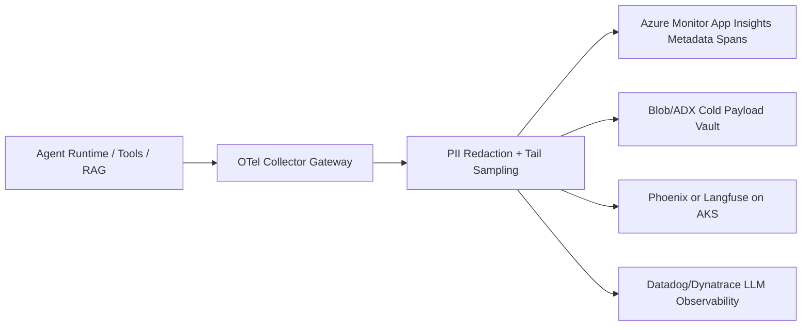
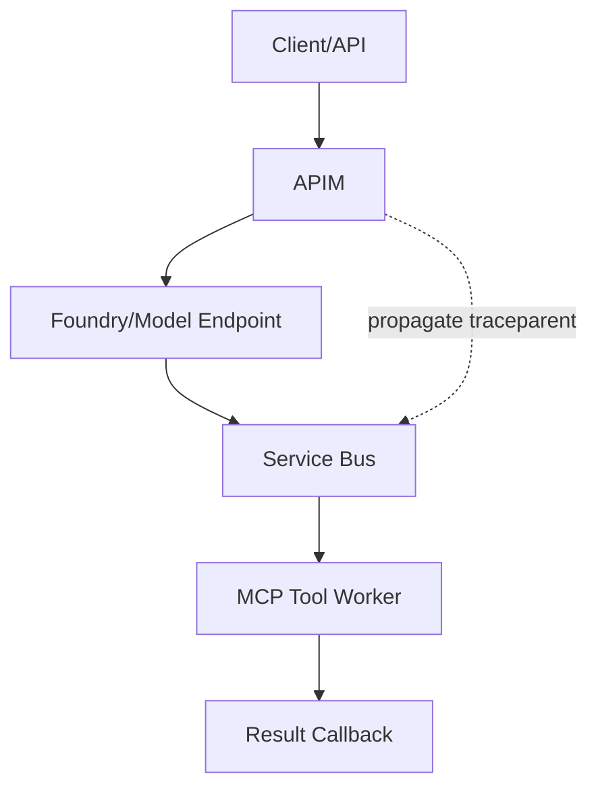

# Multi-Agent LLM Observability Architecture Selection FAQ: OTel GenAI Semantic Conventions + Tail-Sampling Gateway vs Self-Hosted Phoenix/Langfuse vs Commercial Full-Stack APM

> Version tag: Guide #146  
> Audience: Cloud & AI Solution Architects, SRE, platform security and compliance teams, FinOps, data platform owners  
> Scope: OpenTelemetry `gen_ai.*` semantics, PII-redacted payload vaulting, tail-based sampling, async trace propagation correlation  
> Data provenance labels: `measured`, `synthetic`, `anonymized_reported`

---

## 1. Executive conclusion: without layered sampling, observability cost can exceed inference cost

At enterprise scale with 50M spans/day, telemetry economics become a first-order architecture risk.

If 64K prompts, tool JSON payloads, and RAG chunks are ingested directly into premium analytics tiers, cost can escalate rapidly.

Raw payload logging also raises GDPR, HIPAA, and PCI-DSS exposure.

A production observability architecture must therefore solve three goals simultaneously.

Goal one is semantic consistency.

Goal two is cost-layering efficiency.

Goal three is privacy and access governance.

This guide evaluates three enterprise patterns.

---

## 2. Pain-point definition: why all-in-one hot log ingestion fails in agent systems

Traditional APM assumptions were built for short requests and small payloads.

Agent systems add long prompts, retrieval chunks, tool parameters, and chained decisions to traces.

Scale, payload density, and sensitivity increase together.

Without tail-based policy control, low-value successful traces consume most ingestion budget.

Without upstream redaction, compliance teams will constrain visibility and slow root-cause analysis.

Without storage tiering, hot and cold telemetry are priced as if they have equal value.

Observability architecture must therefore shift from centralized collection to value-layered collection.

---

## 3. Reference architecture: collection gateway, governance gateway, and analysis planes



This topology separates lightweight diagnostic metadata from heavy payload archival.

High-frequency troubleshooting uses metadata spans.

Heavy payload retrieval is restricted to controlled low-frequency audit flows.

This split improves both economics and compliance posture.

---

## 4. Option A deep dive: OTel gateway with tail sampling and Azure-native split routing

Option A is usually the strongest baseline for Azure-standardized organizations.

OTel Collector Gateway normalizes trace, metric, and log flows.

Gateway processors enforce PII redaction, field minimization, sampling, and routing.

Metadata spans route to Application Insights for near-real-time diagnostics.

Large payload artifacts are compressed and routed to Blob or ADX cold tiers.

Authorized break-glass flows decrypt only bounded payload scope.

This pattern often provides the best balance between cost control and compliance confidence.

The main challenge is disciplined policy tuning and governance lifecycle ownership.

---

## 5. Option B deep dive: self-hosted Phoenix/Langfuse observability plane on AKS

Option B suits teams requiring deep customization and strong data residency control.

Phoenix/Langfuse can provide LLM-native tracing and evaluation views.

ClickHouse/PostgreSQL-backed stacks enable precise retention and schema control.

Private Link and network isolation can enforce enterprise boundary policies.

This mode offers strong extensibility for domain-specific analysis.

The trade-off is higher operational burden for SRE, scaling, backup, and upgrades.

Without durable platform ownership, cost and reliability can deteriorate.

Option B is strongest where long-term platform engineering capacity exists.

---

## 6. Option C deep dive: enterprise commercial APM integration

Option C fits organizations already standardized on a commercial APM backbone.

Key strengths include unified alerting, ticketing, runbooks, and operating governance.

Cross-application troubleshooting workflows are usually mature in this model.

LLM observability features can be enabled rapidly within existing operational tooling.

The main risk is high ingestion spend for payload-heavy agent workloads.

Without upstream redaction and split-tier routing, cost and privacy risk still escalate.

Option C still requires gateway governance rather than direct unfiltered ingestion.

---

## 7. OTel GenAI semantic conventions: field governance as collaboration infrastructure

`gen_ai.*` fields define model, token, latency, and session-level telemetry semantics.

Common semantics align platform, application, compliance, and finance analysis views.

Uncontrolled team-by-team schema divergence creates conflicting KPIs and reporting drift.

Establish an organization-level semantic registry with lifecycle states.

Validate new fields in staging before promoting them to production dashboards.

Critical schema changes should include backward-compatibility windows and rollback playbooks.

Semantic governance maturity directly drives observability durability.

---

## 8. Async trace propagation: preserving W3C traceparent across APIM -> Foundry -> Service Bus -> MCP tools



Multi-agent systems frequently combine synchronous and asynchronous execution paths.

If traceparent context breaks at queue boundaries, root-cause analysis becomes fragmented.

Inject traceparent plus business correlation keys into queue metadata.

Restore context explicitly on consumer execution and continue propagation downstream.

This usually yields major gains in end-to-end trace completeness.

---

## 9. Twelve-dimension selection matrix (A / B / C / Hybrid)

| Dimension | Option A Azure-native split routing | Option B Self-hosted Phoenix/Langfuse | Option C Commercial APM | Hybrid |
|---|---|---|---|---|
| 1. Time-to-production | 4/5 | 2/5 | 4/5 | 4/5 |
| 2. Customization depth | 4/5 | 5/5 | 3/5 | 5/5 |
| 3. Compliance controllability | 5/5 | 4/5 | 3/5 | 5/5 |
| 4. Ingestion-cost controllability | 5/5 | 4/5 | 2/5 | 5/5 |
| 5. Enterprise operating standardization | 4/5 | 3/5 | 5/5 | 5/5 |
| 6. Day-2 operational complexity | 4/5 | 2/5 | 4/5 | 3/5 |
| 7. Vendor lock-in risk | 3/5 | 5/5 | 2/5 | 4/5 |
| 8. Elastic scale handling | 4/5 | 4/5 | 4/5 | 5/5 |
| 9. Deep-analysis flexibility | 4/5 | 5/5 | 4/5 | 5/5 |
|10. Cost predictability | 4/5 | 3/5 | 3/5 | 4/5 |
|11. Audit replay readiness | 5/5 | 4/5 | 3/5 | 5/5 |
|12. Three-year TCO advantage | 5/5 | 4/5 | 3/5 | 5/5 |

Hybrid patterns often use Option A as baseline with Option B or C for targeted expansion.

The decisive factor is unified semantic and sampling governance, not tool branding.

---

## 10. Production snippets: OTel Collector tail sampling and GenAI transform policy

### 10.1 Collector configuration sample

```yaml
processors:
  transform:
    trace_statements:
      - context: span
        statements:
          - set(attributes["gen_ai.prompt.redacted"], "true")
          - delete_key(attributes, "gen_ai.prompt.raw")
  tail_sampling:
    decision_wait: 10s
    policies:
      - name: errors-first
        type: status_code
        status_code: {status_codes: [ERROR]}
      - name: high-latency
        type: latency
        latency: {threshold_ms: 3000}
```

### 10.2 KQL sample: sampled observability cost by tenant and model

```kql
AppTraces
| where TimeGenerated > ago(1d)
| summarize spans=count(), est_gb=sum(_BilledSize)/1024/1024/1024 by tenant=tostring(customDimensions.tenant_id), model=tostring(customDimensions.gen_ai_model)
| extend est_cost_usd = est_gb * 2.76
| order by est_cost_usd desc
```

---

## 11. Scenario A: retail bank support agents at 8M conversations/month cost explosion

Initial state ingested full payload telemetry into premium analytics tiers.

Within one quarter, observability spend overtook inference spend (`anonymized_reported`).

Option A introduced tail sampling, redaction-first processing, and hot/cold split routing.

Error and high-latency traces remained fully retained.

Measured total observability spend dropped by 78% (`measured`).

Diagnosis speed improved due to cleaner semantic normalization.

---

## 12. Scenario B: async Service Bus traceparent break root-cause remediation

In a multi-agent chain, queue consumers were not restoring trace context.

Operations teams had to manually stitch disconnected telemetry fragments.

After standardized trace header propagation and consumer restoration logic, correlation integrity improved.

Collector-level missing-context alerts were also introduced.

Measured cross-service incident diagnosis time dropped by 63% (`measured`).

Escalated paging incidents dropped by 27% (`anonymized_reported`).

---

## 13. Three-year TCO: cost inflection under sampling and tiered vaulting

> Values below are `synthetic` and intended for architecture comparison.

| Capability block | SKU assumptions | Monthly cost ($k) | 3Y cost ($M) | Notes |
|---|---|---:|---:|---|
| Option A baseline | OTel Gateway + AppInsights + Blob/ADX cold vault | 172 | 6.19 | sampling and split-tier routing |
| Option B extension | AKS + Phoenix/Langfuse + ClickHouse | 118 | 4.25 | advanced LLM observability analytics |
| Option C extension | Commercial APM LLM package | 146 | 5.26 | enterprise APM unification |
| Security and key controls | Key Vault CMK + audit + break-glass controls | 39 | 1.40 | compliance governance |
| Operations and governance | SRE + data governance + release regression | 52 | 1.87 | platform sustainability |
| **Hybrid total** |  | **527** | **18.97** | `synthetic` |

When hot-tier sampled ingestion falls below approximately 18%, cost curves usually improve substantially.

When error ratio surges, temporarily widening sampling scope should be paired with budget alarms.

---

## 14. Anti-patterns and corrective playbooks

Anti-pattern one is writing all payloads into premium analytics tiers.

Corrective action is hot metadata retention with cold payload vaulting.

Anti-pattern two is pure probability sampling without error-priority policy.

Corrective action is error-first and latency-priority retention policy.

Anti-pattern three is downstream redaction after broad data spread.

Corrective action is redaction at collector ingress before fan-out.

Anti-pattern four is missing async trace context continuation.

Corrective action is standardized traceparent injection, propagation, and restoration.

Anti-pattern five is cost dashboards that ignore retries and replay pulls.

Corrective action is all-path cost accounting across success and failure flows.

---

## 15. Day-0/Day-1/Day-2 rollout checklist and quantitative FAQ

Day-0: freeze semantic registry, sampling policy classes, redaction rules, and access tiering.

Day-1: execute dual pressure tests (cost explosion control plus trace break remediation) and replay drills.

Day-2: establish weekly cost governance, monthly compliance governance, and quarterly architecture rebalance.

### Quantitative FAQ 1: Why not rely only on retention-period reduction for cost control?

Because major cost is paid at ingestion time, not only at storage retention time.

### Quantitative FAQ 2: Tail sampling or head sampling?

For high-value troubleshooting in agent systems, tail-based policy control is often superior.

### Quantitative FAQ 3: Where should PII redaction be enforced?

At collector ingress, as early as possible in the telemetry path.

### Quantitative FAQ 4: When should payload decryption be allowed?

Only through approved break-glass workflows with bounded scope and auditable access.

### Quantitative FAQ 5: How to validate traceparent propagation integrity?

Use propagation coverage tests plus missing-context threshold alerts.

### Quantitative FAQ 6: How should Azure Monitor and ADX roles be split?

Use Monitor for near-real-time diagnostics and ADX/Blob for low-frequency deep audit workflows.

### Quantitative FAQ 7: How should sampling budget caps be set?

Set dual-level caps by tenant and by business domain with linked alerting.

### Quantitative FAQ 8: Is OTel gateway still needed with commercial APM?

Yes, for upstream redaction, sampling, routing, and governance unification.

### 15.1 Sampling policy layering

Define full retention for error traces first.

Define full retention for high-latency traces second.

Define stratified sampling for successful traces third.

Layered policy is typically superior to one global percentage.

### 15.2 Cost accounting by span class

Tool spans, model spans, and retrieval spans have different value-cost profiles.

Track and optimize them separately.

This avoids false optimization from blended averages.

### 15.3 Compliance model: field classification and least-visibility defaults

Not all telemetry fields have equal sensitivity.

Apply field-level classification for display and export controls.

Use least-visibility defaults with approval-driven elevation.

### 15.4 Key and decryption governance

Decryption rights should be separated from routine troubleshooting rights.

Use dual approval and time-bounded access tokens for break-glass decryption.

Record immutable audit logs for every decryption operation.

### 15.5 Organizational operating model

Observability governance should not be owned by one team alone.

SRE owns reliability and response speed.

Compliance owns boundary assurance and audit traceability.

Data platform owns lifecycle and cost governance.

### 15.6 Dashboard structure: technical and financial KPIs side by side

Technical-only dashboards often miss cost hazards.

Cost-only dashboards often degrade diagnosability.

Dual-axis governance dashboards are recommended for balanced decisions.

### 15.7 Release discipline for semantic fields

Semantic field changes can break downstream analytics continuity.

Use staged rollout, backfill strategy, and compatibility windows.

Treat semantic regressions as release-blocking defects.

### 15.8 Multi-region handling

Sensitive payload processing should remain region-local by default.

Cross-region exchanges should prefer summarized and anonymized aggregates.

This balances compliance boundaries with central visibility requirements.

### 15.9 Vendor strategy

Even with commercial APM, keep OTel portability at architecture level.

Portability reduces long-term lock-in and migration risk.

It is also a practical hedge for future cost-pressure cycles.

### 15.10 Closing recommendation

Semantic discipline, sampling discipline, and redaction discipline are the three foundations.

Get these three right before scaling advanced analytics depth.

That sequence usually delivers the highest long-term architecture ROI.

### 15.11 Sampling budget guardrails: dual caps by tenant and business domain

Use both tenant-level and domain-level ingestion caps.

Tenant caps prevent one tenant from destabilizing shared budgets.

Domain caps prevent one workflow class from exhausting global observability budget.

Dual-guardrail policy is usually more resilient than single-threshold policy.

### 15.12 High-value trace retention: never lose error and critical-governance flows

Not all traces have equal value.

Financial, identity, and compliance-sensitive action chains should remain full-retention.

Routine successful chains can then be sampled proportionally.

This preserves critical auditability while controlling total spend.

### 15.13 Compression strategy: structured compression before generic blob compression

Blind payload compression is often suboptimal.

Field-aware structural partitioning before compression usually yields better ratio and retrieval efficiency.

Store prompt, completion, and tool payload fields independently.

Selective field retrieval then reduces unnecessary cold-tier IO.

### 15.14 Replayability design: metadata-to-vault pointer continuity

Sampling does not remove replay requirements.

Keep immutable vault pointers and integrity hashes in metadata spans.

This allows hot-tier traces to locate cold-tier payloads deterministically.

Replay authorization should be integrated with formal approval controls.

### 15.15 Break-glass decryption workflow: least privilege, time-bound access, full audit

Break-glass should not become a default troubleshooting path.

Use dual-approval and expiring access tokens for decryption operations.

Capture reason, scope, requester, approver, and duration for every event.

Auto-expire access and archive audit evidence at end of window.

### 15.16 On-call operating model: include cost-drift response in reliability KPIs

On-call teams usually optimize for incident recovery speed only.

In LLM observability they should also manage ingestion-cost drift and sampling drift.

Add “time-to-mitigate hourly cost spike” as an explicit operational KPI.

This shifts cost governance into runtime operations instead of post-facto finance review.

### 15.17 Release sequencing: semantic-field rollout before sampling-parameter rollout

Semantic changes affect analytics compatibility.

Sampling changes affect visibility and cost.

Staggering these change types reduces compounded rollout risk.

Stabilize semantics first, then tune sampling for clearer diagnostics.

### 15.18 Multi-cloud and multi-region federation: semantic consistency over tool uniformity

Large enterprises often operate mixed observability stacks.

Forcing a single tool everywhere is not always realistic.

The practical target is semantic consistency, metric comparability, and trace stitchability.

Tool diversity can be tolerated; semantic diversity cannot.

### 15.19 Finance feedback loop: map observability savings back to business units

Savings without attribution lose organizational momentum.

Publish tenant- and domain-level cost-reduction statements.

Link verified savings to future innovation budget allocation.

This creates positive incentives for sustained telemetry discipline.

### 15.20 Final synthesis: observability success is not “record more,” but “record higher-value evidence”

In multi-agent systems, observability must evolve from data accumulation to value distillation.

Semantic discipline, sampling discipline, and privacy-first processing are the three foundational pillars.

This triad enables durable cost control without degrading diagnosis and audit quality.

### 15.21 Sampling backtesting: replay historical traces before policy rollout

Sampling policy updates can shift visibility unexpectedly.

Run historical replay backtests to estimate miss-detection risk before rollout.

Backtest outputs should include uncertainty bands and business impact notes.

Replay-first validation reduces production policy oscillation.

### 15.22 Cost alert tiers: map billing anomalies to explicit action runbooks

Define at least three cost alert tiers.

Tier one for trend warnings, tier two for policy tuning, tier three for emergency throttling.

Each tier should map to named owners and prescribed response procedures.

This avoids alert fatigue without execution accountability.

### 15.23 Telemetry lifecycle policy: hot-hourly, warm-daily, cold-monthly retention logic

Retention horizons should be explicit by telemetry tier.

Hot tier supports real-time diagnostics with short retention.

Warm tier supports weekly analytics with moderate retention.

Cold tier supports audit and forensics with long retention.

Clear lifecycle policy reduces duplicate-storage waste.

### 15.24 Cross-team review template: standardized five-question method

Use a fixed review structure across teams.

What happened, why it happened, how it was detected, how it was recovered, how recurrence is prevented.

Standardized review artifacts improve institutional knowledge reuse.

They also provide structured input for future automation governance.

### 15.25 Final checkpoint: cost reduction alone is not governance completion

Lower spend is not sufficient if traceability or compliance weakens.

If critical evidence paths are lost, long-term risk still increases.

Final sign-off should always cover cost, observability quality, and compliance on equal footing.

Operational maturity is confirmed only when these three dimensions remain stable across peak events and seasonal traffic bursts.

That is the practical definition of production-grade agent observability governance.
