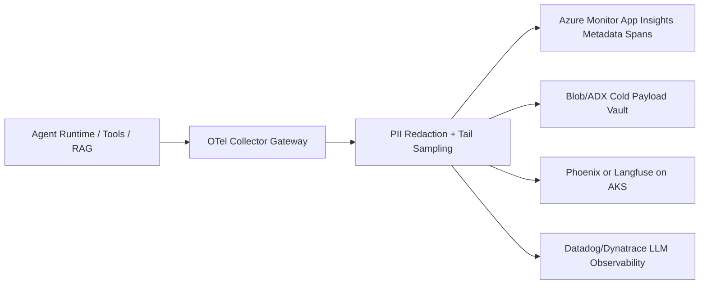
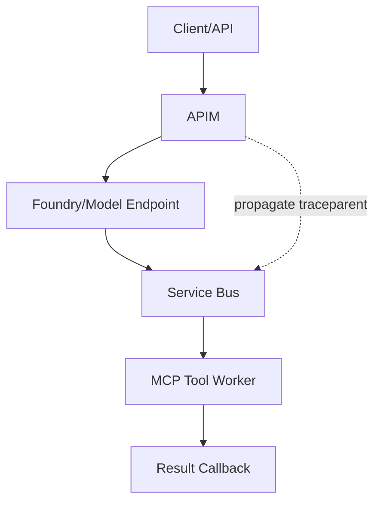

# 多智能体 LLM 可观测架构选型 FAQ：OTel GenAI 语义约定 + 尾采样网关 vs 自建 Phoenix/Langfuse vs 商业 APM 全栈

> 版本标签：Guide #146  
> 适用对象：Cloud & AI Solution Architect、SRE、平台安全与合规负责人、FinOps、数据平台团队  
> 主题范围：OpenTelemetry `gen_ai.*` 语义、PII 脱敏与密文归档、Tail-Based Sampling、跨异步链路 Trace 关联  
> 数据标签：`measured`、`synthetic`、`anonymized_reported`

---

## 1. 执行摘要：大规模智能体日志若不分层采样，日志费用会超过推理费用

在 50M spans/day 的企业级多智能体系统中，观测成本可能失控。

若把 64K Prompt、工具 JSON、RAG chunk 全量写入高价分析存储，账单会快速放大。

同时原始 payload 往往包含敏感信息，直接落地会触发 GDPR/HIPAA/PCI-DSS 风险。

因此可观测系统必须同时解决三件事。

第一是语义统一，第二是成本分层，第三是隐私治理。

本指南给出 A/B/C 三种架构路径。

Option A 强调 OTel 网关+脱敏+分流的 Azure 原生闭环。

Option B 强调 AKS 上 Phoenix/Langfuse 自建可控平面。

Option C 强调在企业既有 APM 标准化前提下接入 LLM 可观测。

---

## 2. 业务痛点定义：为什么“全量日志入一个仓”在 AI 时代不可持续

传统 APM 关注短请求和小 payload。

智能体系统把提示词、检索片段、工具参数与多跳调用都带入追踪链。

跨度大、体量大、敏感性高，三者叠加导致旧模式失效。

若没有 Tail Sampling，低价值成功链路会吞噬大部分预算。

若没有脱敏前置，合规团队会限制日志可见性，反而影响排障效率。

若没有分层存储，冷热数据同价会导致单位价值成本倒挂。

因此观测架构要从“收集中心化”转向“价值分层化”。

---

## 3. 参考架构：采集网关、治理网关、分析平面三层解耦



该拓扑把“元数据观测”和“重 payload 归档”分离。

高频诊断走轻量 metadata。

重 payload 走低频审计与按需解密路径。

这样可同时控制成本与合规风险。

---

## 4. Option A 深析：OTel Gateway + Tail Sampling + Azure Monitor/ADX 分流

Option A 适合 Azure 原生组织。

OTel Collector Gateway 统一处理 trace、metric、log 信号。

在网关层执行 PII 脱敏、字段裁剪、采样与路由。

metadata spans 写入 Application Insights 便于近实时排障。

原始长 payload 压缩后写入 Blob 或 ADX 冷层。

仅在 break-glass 流程中由授权人员解密检索。

该方案在成本与合规之间较易建立稳定平衡。

主要挑战是采样策略调参和跨团队治理流程固化。

---

## 5. Option B 深析：AKS 自建 Phoenix/Langfuse 可观测平面

Option B 适合追求高定制度与数据主权的团队。

Phoenix/Langfuse 提供面向 LLM 的评测与追踪视图。

结合 ClickHouse/PostgreSQL 可实现可控的数据生命周期。

可通过 Private Link 与内部网络隔离策略控制外连。

该模式对 schema 扩展和自定义分析更灵活。

但对 SRE 值守、容量扩缩容、备份恢复提出更高要求。

若团队缺乏长期平台运营能力，成本与稳定性可能反噬。

因此 Option B 适合“有平台团队且有定制诉求”的组织。

---

## 6. Option C 深析：Datadog/Dynatrace 等企业 APM 全栈接入

Option C 适合已标准化商业 APM 的大型企业。

优势是统一告警、统一工单、统一值班体系。

对跨应用、跨中间件、跨团队追踪诊断有较强组织协同效益。

LLM Observability 功能可快速补齐模型层观察能力。

但大 payload 场景中，商业 APM 摄取成本可能较高。

如果不做前置脱敏和分层采样，成本与合规风险同样会放大。

因此 Option C 仍需要网关侧治理，而非“接上即可”。

---

## 7. OpenTelemetry GenAI 语义约定：统一字段是跨团队协作前提

`gen_ai.*` 语义字段用于描述模型、token、延迟、会话等关键信息。

统一语义可以把应用、平台、合规、财务对齐到同一事实面。

若字段随团队各自扩展且缺乏版本控制，会出现报表口径冲突。

建议建立组织级语义注册表和字段生命周期策略。

新字段先在灰度环境验证，再进入生产报表。

关键字段变更应有兼容窗口和回滚方案。

语义治理成熟度直接决定可观测系统可持续性。

---

## 8. 跨异步链路 Trace 关联：W3C traceparent 在 APIM -> Foundry -> Service Bus -> MCP 工具链中的传递



多智能体系统常包含同步与异步混合路径。

若 traceparent 在消息队列处断裂，根因分析会出现盲区。

建议把 traceparent 与业务相关键一起写入消息头。

消费者侧必须显式恢复上下文并继续传播。

该机制可显著提高跨服务追踪完整率。

---

## 9. 12 维选型矩阵（A / B / C / Hybrid）

| 维度 | Option A Azure 原生分流 | Option B 自建 Phoenix/Langfuse | Option C 商业 APM | Hybrid |
|---|---|---|---|---|
| 1. 上线速度 | 4/5 | 2/5 | 4/5 | 4/5 |
| 2. 可定制度 | 4/5 | 5/5 | 3/5 | 5/5 |
| 3. 合规治理可控性 | 5/5 | 4/5 | 3/5 | 5/5 |
| 4. 摄取成本可控性 | 5/5 | 4/5 | 2/5 | 5/5 |
| 5. 跨团队统一性 | 4/5 | 3/5 | 5/5 | 5/5 |
| 6. 运维复杂度 | 4/5 | 2/5 | 4/5 | 3/5 |
| 7. 供应商锁定风险 | 3/5 | 5/5 | 2/5 | 4/5 |
| 8. 大规模吞吐弹性 | 4/5 | 4/5 | 4/5 | 5/5 |
| 9. 深度分析能力 | 4/5 | 5/5 | 4/5 | 5/5 |
|10. 成本预测稳定性 | 4/5 | 3/5 | 3/5 | 4/5 |
|11. 审计可回放能力 | 5/5 | 4/5 | 3/5 | 5/5 |
|12. 三年 TCO 优势 | 5/5 | 4/5 | 3/5 | 5/5 |

Hybrid 常见做法是 A 作为主干，B/C 作为特定域扩展。

关键是统一采样和语义治理，而不是工具之争。

---

## 10. 生产级片段：OTel Collector Tail Sampling + GenAI 变换配置

### 10.1 Collector 配置（示意）

```yaml
processors:
  transform:
    trace_statements:
      - context: span
        statements:
          - set(attributes["gen_ai.prompt.redacted"], "true")
          - delete_key(attributes, "gen_ai.prompt.raw")
  tail_sampling:
    decision_wait: 10s
    policies:
      - name: errors-first
        type: status_code
        status_code: {status_codes: [ERROR]}
      - name: high-latency
        type: latency
        latency: {threshold_ms: 3000}
```

### 10.2 KQL：按模型与租户统计采样后观测成本

```kql
AppTraces
| where TimeGenerated > ago(1d)
| summarize spans=count(), est_gb=sum(_BilledSize)/1024/1024/1024 by tenant=tostring(customDimensions.tenant_id), model=tostring(customDimensions.gen_ai_model)
| extend est_cost_usd = est_gb * 2.76
| order by est_cost_usd desc
```

---

## 11. 场景 A：零售银行月 800 万会话客服智能体日志成本爆炸治理

场景初始状态是全量 payload 进入高价分析层。

观测账单在三个月内超过推理账单（`anonymized_reported`）。

通过 Option A 引入尾采样和分层归档后，热层摄取量显著下降。

同时保留错误链路与高延迟链路全量采集。

结果显示总观测成本下降 78%（`measured`）。

关键问题定位时效未下降，反而因语义统一而提升。

---

## 12. 场景 B：异步 Service Bus 链路 traceparent 断裂根因修复

多智能体编排中，消息队列消费者未恢复 trace 上下文。

导致单次故障需跨团队手工拼接日志。

通过统一消息头注入与消费端恢复逻辑，链路追踪完整率提升。

同时在 Collector 层补充缺失字段告警策略。

结果显示跨服务故障定位时长下降 63%（`measured`）。

值班升级事件数量下降 27%（`anonymized_reported`）。

---

## 13. 三年 TCO：摄取分层与尾采样的成本拐点

> 以下数值为 `synthetic`，用于 SA 比较。

| 模块 | SKU 假设 | 月均成本 ($k) | 三年成本 ($M) | 说明 |
|---|---|---:|---:|---|
| Option A 主干 | OTel Gateway + AppInsights + Blob/ADX 冷层 | 172 | 6.19 | 分层采样与归档 |
| Option B 扩展 | AKS + Phoenix/Langfuse + ClickHouse | 118 | 4.25 | 深度 LLM 可观测 |
| Option C 扩展 | 商业 APM LLM 功能包 | 146 | 5.26 | 统一企业 APM |
| 安全与密钥 | Key Vault CMK + 审计 + break-glass 管理 | 39 | 1.40 | 合规控制 |
| 运维与治理 | SRE + 数据治理 + 发布回归 | 52 | 1.87 | 持续运营 |
| **Hybrid 合计** |  | **527** | **18.97** | `synthetic` |

当采样后热层写入比例低于 18% 时，成本曲线明显改善。

当错误链路占比抬升时，应临时放宽采样并同步预算预警。

---

## 14. 反模式与纠偏：LLM 可观测系统常见失效路径

反模式一：全量写入高价分析层。

纠偏：热层保留元数据，重 payload 分层归档。

反模式二：仅按概率采样，忽略错误优先。

纠偏：错误和高延迟链路优先全采，成功链路按策略采样。

反模式三：脱敏在下游做，导致敏感数据已扩散。

纠偏：脱敏必须前置到 Collector 网关。

反模式四：跨异步链路 trace 上下文未继承。

纠偏：统一 traceparent 注入、传递、恢复规范。

反模式五：成本看板不计失败重试与补采成本。

纠偏：把重试、回放、补采全部纳入总成本。

---

## 15. Day-0/Day-1/Day-2 落地清单与 Quantitative FAQ

Day-0：冻结语义字段字典、采样策略、脱敏规则与访问分级。

Day-1：完成双场景压测（成本爆炸治理 + trace 断裂修复）与回放演练。

Day-2：建立周度观测成本复盘、月度合规复盘、季度架构再平衡机制。

### Quantitative FAQ 1：为什么不能只靠日志保留期降成本？

因为高成本发生在摄取阶段，保留期仅影响后续存储。

### Quantitative FAQ 2：Tail Sampling 与 Head Sampling 如何取舍？

高价值故障定位场景通常优先 Tail Sampling。

### Quantitative FAQ 3：PII 脱敏放在哪一层最合适？

应放在 Collector Gateway，越靠前越安全。

### Quantitative FAQ 4：何时需要 payload 解密？

仅在审批通过的 break-glass 调查场景按最小范围解密。

### Quantitative FAQ 5：如何验证 traceparent 传播完整性？

通过链路覆盖测试和缺失率阈值告警双重验证。

### Quantitative FAQ 6：Azure Monitor 与 ADX 如何分工？

Monitor 负责实时排障，ADX/Blob 负责低频深度审计。

### Quantitative FAQ 7：如何设定采样预算上限？

建议按租户和业务线设定双层预算，并联动告警。

### Quantitative FAQ 8：商业 APM 接入后还需要 OTel 网关吗？

仍需要，用于脱敏、采样、路由和统一治理。

### 15.1 采样策略分层：错误优先、慢请求优先、成功抽样

先定义错误链路全采样规则。

再定义高延迟链路全采样规则。

最后定义成功链路分层抽样比例。

分层策略比统一比例更贴合真实价值。

### 15.2 成本模型：按 span 类型分别核算

工具调用 span、模型调用 span、检索 span 成本结构不同。

建议分类型核算并分别优化。

这样能避免“平均值掩盖问题”。

### 15.3 合规模型：敏感字段分类与最小可见原则

不同字段敏感等级不同。

应按字段级分类控制展示与导出。

默认最小可见，按审批放开。

### 15.4 密钥与解密治理：CMK 与 break-glass 双控制

解密权不应与普通排障权绑定。

建议采用双人审批与时效令牌。

解密日志必须可追溯并自动过期。

### 15.5 组织协同：SRE、合规、数据平台共管策略

可观测系统不应由单团队孤立维护。

SRE 关注可用性与响应速度。

合规关注数据边界与审计可追溯。

数据平台关注成本与生命周期。

### 15.6 指标看板：技术指标与财务指标并列

仅看技术指标难以驱动成本优化。

仅看成本指标会损害可定位性。

建议双轴看板并列展示并设联动阈值。

### 15.7 发布治理：语义字段变更必须走灰度

字段变更可能导致报表断层。

建议先灰度、再回填、后切换。

并保留兼容窗口保证连续性。

### 15.8 多区域策略：区域内处理、区域间摘要

敏感 payload 建议区域内闭环处理。

区域间只同步摘要和统计指标。

这样可兼顾合规与集团可视化。

### 15.9 供应商策略：避免单点绑定

即使采用商业 APM，也应保留 OTel 出口兼容性。

保证未来可迁移，降低锁定风险。

这也是长期 TCO 稳定的关键。

### 15.10 收官建议：先把语义、采样、脱敏三件事做对

语义一致性决定协同效率。

采样策略决定成本曲线。

脱敏前置决定合规底线。

这三件事做好后，再扩展高级分析能力收益最高。

### 15.11 采样预算护栏：按租户和业务双维度限流

建议同时配置租户级上限和业务线级上限。

租户级上限防止单租户异常放大。

业务线级上限防止单场景吞噬全局预算。

双护栏比单护栏更稳健。

### 15.12 高价值追踪保留策略：错误链路与高风险动作永不丢失

并非所有追踪都同等价值。

涉及资金、身份、合规动作的链路建议保留全量。

普通成功链路再采用比例抽样。

这样可在预算可控前提下保住关键审计证据。

### 15.13 压缩策略：结构化压缩优先于盲目文本压缩

长文本 payload 直接 gzip 并非最优。

先结构化拆分再压缩，通常有更高压缩比和更好检索效率。

建议把 prompt、completion、tool payload 分字段存储。

检索时按字段解包可减少无效 IO。

### 15.14 事件回放机制：从抽样元数据快速定位原始归档

抽样后仍需可回放。

建议 metadata spans 中保留 vault pointer 与完整性哈希。

这样可以从热层快速跳转到冷层原始数据。

回放权限应与审批系统联动。

### 15.15 破窗解密流程：最小权限、限时授权、全程留痕

break-glass 不应成为常规排障路径。

建议使用限时令牌与双人审批。

每次解密都要记录原因、范围、时长和审批人。

到期自动失效并触发审计归档。

### 15.16 组织值班模型：把可观测成本纳入值班 KPI

值班团队通常只盯故障恢复。

在 LLM 场景下还应盯成本漂移与采样漂移。

建议把“小时成本突增告警处理时长”纳入值班 KPI。

这有助于把成本治理前置到运行层。

### 15.17 灰度发布策略：先放语义字段，再放采样参数

语义字段影响报表兼容性。

采样参数影响成本和可见性。

建议两类变更错峰发布，避免复合风险。

先稳语义，再调采样，排障路径更清晰。

### 15.18 多云/多区统一观测：语义一致优先于工具一致

企业可能同时使用多种观测工具。

强行统一到单一工具并不总是可行。

更实际的目标是语义一致、指标可比、追踪可拼接。

工具可多样，但语义不能多样。

### 15.19 财务回收模型：把观测降本收益映射到业务单元

降本收益若不回传业务单元，治理动力会衰减。

建议按租户和业务线出具“节省账单”。

并将节省额度与后续创新预算挂钩。

这样可形成正反馈治理机制。

### 15.20 最终结论：可观测不是“记录更多”，而是“记录更有价值”

多智能体时代，观测系统必须从“数据堆积”转向“价值提纯”。

语义统一、采样分层、隐私前置是三大支柱。

遵循该框架可在不牺牲诊断能力的前提下实现长期成本可控。

### 15.21 采样回测机制：策略变更前先做历史重放

采样策略调整可能造成可见性突变。

建议在历史样本上进行回测，评估漏检风险。

回测结果应附带误差区间和业务影响说明。

通过回测可降低线上策略震荡概率。

### 15.22 成本告警分级：把账单异常映射到动作剧本

建议定义三级成本告警。

一级用于趋势预警，二级用于策略调整，三级用于紧急限流。

每级都应绑定标准操作剧本和责任人。

这样可避免告警泛滥但无人执行。

### 15.23 观测数据生命周期：热层小时级、温层天级、冷层月级

不同层级的保留策略应明确。

热层用于实时排障，保留短而快。

温层用于周度分析，保留中等窗口。

冷层用于审计与取证，保留长周期。

生命周期清晰可减少重复存储浪费。

### 15.24 多团队复盘模板：统一五问法

建议复盘固定回答五个问题。

发生了什么、为何发生、如何发现、如何恢复、如何预防。

统一模板可提升跨团队知识复用效率。

并为后续自动化治理提供结构化素材。

### 15.25 最后检查点：指标达标不等于治理完成

即便成本下降，也要检查合规和可追溯性是否同步达标。

若仅降本未保留关键证据，长期风险仍会上升。

因此收官评审必须同时覆盖成本、可观测质量和合规三轴。
