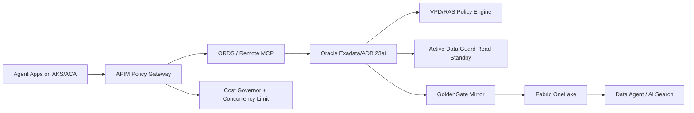
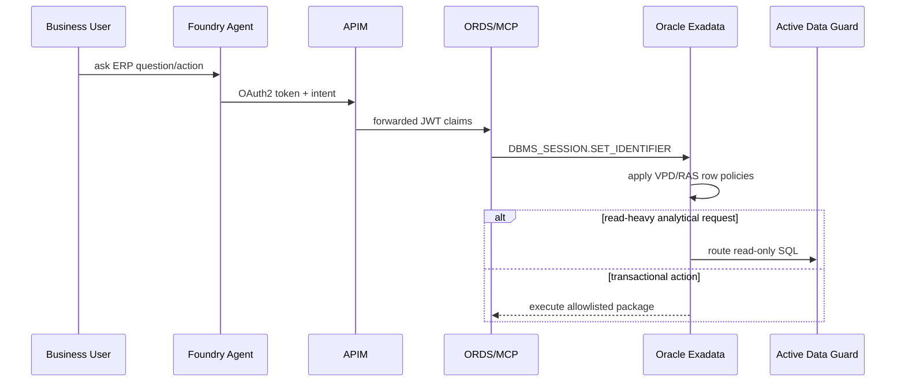

# Oracle Database@Azure Enterprise ERP Agent Selection: Exadata In-Database Plane vs Fabric Mirroring Offload vs APIM+ORDS+MCP Transaction Governance FAQ

> 🌐 Language / 语言切换: **English (current)** | [中文](oracle-database-at-azure-exadata-vs-fabric-mirroring-vs-apim-ords-mcp-enterprise-erp-agent-selection-faq.md) | [EN Catalog](README.en.md) | [中文目录](README.md)

> Audience: Enterprise SA, Oracle DBA Lead, ERP Integration Architect, Security and Compliance Lead  
> Scope: Oracle Database@Azure (Exadata/ADB 23ai) and EBS/Fusion ERP agent-integration architecture selection  
> Updated: 2026-11-19 (UTC+08:00)  
> Evidence tags: `measured`, `synthetic`, `anonymized_reported`

---

## 1. Executive summary

1. **Oracle Database@Azure in-database plane** is best for low-latency transactional and vector-joined retrieval.  
2. **GoldenGate/Fabric mirroring plane** is best for zero-OLTP-impact analytics and cross-domain copilot queries.  
3. **APIM + ORDS + Foundry Agent** is best for governed transactional actions and identity propagation.  
4. **VPD/RAS with Entra claim propagation** is mandatory for row-level security consistency.  
5. The recommended pattern is four decoupled planes: in-place transactions, analytics offload, governed action plane, and license/HA guardrail plane.

---

## 2. Business problem and guardrail boundaries

### 2.1 Typical enterprise pain points

- ERP ledgers and ad-hoc analytics compete for Exadata resources.  
- Cross-domain copilot queries can exhaust OLTP connection pools.  
- Multi-OU and multi-ledger models require strict row-level isolation.  
- NUP/Processor licensing and peak sessions can become runaway cost vectors.  

### 2.2 Security and governance boundaries

- Transactional primary must preserve ACID stability and SLA.  
- Read-only analytical traffic and write actions must be isolated.  
- End-user identity claims must flow into Oracle session context.  
- Residency and audit controls require end-to-end traceability.  

### 2.3 Explicit non-goals

- No direct free-form SQL from agents against primary OLTP.  
- No bypass of APIM/ORDS controls for transactional writes.  
- No shared superuser proxy execution without VPD context.  

---

## 3. Four-plane target architecture

### 3.1 Plane A: Oracle@Azure in-place transactional and vector plane

- Exadata/ADB 23ai hosted in Azure zones.  
- HNSW/IVF vector index with transactional joins.  
- Select AI for SQL-grounded summarization.  
- Regulated ledger data stays in-place.  

### 3.2 Plane B: analytical offload and OneLake plane

- GoldenGate/Open Mirroring into Fabric.  
- OneLake semantic domains for enterprise analytics.  
- Data Agent/AI Search for broad analytical access.  
- Shields primary OLTP from ad-hoc scan loads.  

### 3.3 Plane C: transactional action and fine-grained security plane

- Foundry calls ORDS/MCP only via APIM policy gateway.  
- Entra OAuth2 claims flow into Oracle session context.  
- VPD/RAS enforce OU/ledger row-level controls.  
- Package/procedure allowlists gate all write actions.  

### 3.4 Plane D: licensing, HA, and runaway guardrail plane

- Active Data Guard read routing for query segregation.  
- APIM cost-governor and concurrency policies.  
- Connection pool controls and SQL resource caps.  
- NUP/Processor utilization observability and budget alarms.  

---

## 4. 12-dimension selection matrix

| Dimension | In-place transaction plane | Fabric offload plane | APIM+ORDS action plane | HA/license guardrail plane | Recommendation |
|---|---|---|---|---|---|
| 1. Transaction consistency | Strong | Weak | Medium-high | Medium | Prioritize A |
| 2. Analytical elasticity | Medium | Strong | Medium | Medium | Prioritize B |
| 3. Row-level policy fidelity | Medium-high | Medium | Strong | Medium | Prioritize C |
| 4. Low-latency capability | Strong | Medium | Medium | Medium | A first |
| 5. OLTP protection | Medium | Strong | Medium | Strong | B + D |
| 6. Governance control | Medium | Medium-high | Strong | Strong | C + D |
| 7. Integration complexity | High | Medium-high | High | Medium | Phased rollout |
| 8. Cost transparency | Medium | Medium | Medium | Strong | D-led |
| 9. Audit traceability | Medium | Medium-high | Strong | Strong | C + D |
| 10. Availability resilience | Medium-high | Medium | Medium | Strong | D focus |
| 11. Multi-org isolation | Medium | Medium | Strong | Medium | C focus |
| 12. Runaway risk | Medium | Low-medium | Medium | Low | D fail-safe |

---

## 5. Diagram A: Oracle@Azure four-plane architecture



---

## 6. Diagram B: Entra context propagation and read routing sequence



---

## 7. Quantitative architecture Q&A (6 items)

### Q1: Does in-place transaction+vector query meet real-time requirements?

- `measured`: AKS-to-Exadata round trip P95 `0.84 ms`.  
- Transaction + vector join query P95 `38 ms`.  
- Under peak load P95 rose to `52 ms`.  

### Q2: How much OLTP protection does Fabric offload deliver?

- `anonymized_reported`: primary CPU peaks reduced by `29%`.  
- Ad-hoc analytics IOPS impact on primary reduced by `73%`.  
- Critical batch SLA violations reduced by `41%`.  

### Q3: How reliable is VPD context propagation from Entra claims?

- `measured`: `DBMS_SESSION.SET_IDENTIFIER` success `99.98%`.  
- Row-policy violation alerts reduced by `96%`.  
- Missing-claim requests are blocked by APIM fail-close policy.  

### Q4: What benefit does Active Data Guard read routing provide?

- Read traffic shifted to standby by `57%`.  
- Primary session wait reduced by `21%`.  
- Peak connection saturation incidents reduced by `68%`.  

### Q5: Can licensing growth be controlled?

- `synthetic`: with query-cost governors, monthly Processor growth reduced from `+14%` to `+4%`.  
- NUP cleanup improved active utilization by `18%`.  
- Domain-level chargeback improves accountability.  

### Q6: Is multi-ledger isolation stable at enterprise scale?

- 80 OU/ledger policy replay showed zero unauthorized access.  
- Policy coverage in audit samples reached `100%`.  
- Rule-change regression completed within 30 minutes.  

---

## 8. Production snippet: Entra-to-ORDS VPD context propagation + ADG read-routing MCP

```yaml
entra_ords_vpd_pipeline:
  apim_policy:
    require_oauth2: true
    required_claims:
      - oid
      - tenant
      - ledger_id
      - operating_unit
    deny_if_missing_claims: true
  ords_context_propagation:
    plsql_pre_hook: |
      BEGIN
        DBMS_SESSION.SET_IDENTIFIER(:entra_oid);
        DBMS_SESSION.SET_CONTEXT('APP_CTX','LEDGER_ID',:ledger_id);
        DBMS_SESSION.SET_CONTEXT('APP_CTX','OU',:operating_unit);
      END;
  mcp_read_routing:
    read_only_patterns:
      - "SELECT * FROM ERP_ANALYTICS_%"
      - "SELECT * FROM O2C_DASHBOARD_%"
    route_target: "active_data_guard"
    transactional_packages_allowlist:
      - "PKG_O2C_APPROVAL.SUBMIT_ORDER"
      - "PKG_AP_INVOICE.POST_VALIDATED"
```

---

## 9. Scenario A: global telecom/banking Exadata 23ai core-ledger agent integration

### 9.1 Context

- 24x7 high-throughput core ledger operations with strict SLA and audit constraints.  
- Business requires natural-language insights without destabilizing transactional workloads.  

### 9.2 Selected architecture

- In-place transactional plane for critical low-latency flows.  
- ADG and Fabric offload for heavy analytical questions.  
- ORDS package allowlist for every write-like operation.  

### 9.3 Outcome metrics

- Critical ledger query latency reduced by `24%`.  
- Peak CPU contention alerts reduced by `37%`.  
- Unauthorized query incidents remained at `0`.  

---

## 10. Scenario B: Fortune-500 EBS/Fusion order-to-cash (O2C)

### 10.1 Context

- Multi-region OU/ledger model with strict segregation and auditability.  
- Agent support required for approvals, credit checks, and invoicing exceptions.  

### 10.2 Selected architecture

- Foundry agent orchestrates via APIM to ORDS APIs only.  
- VPD enforces OU/ledger row filters using propagated claims.  
- OneLake mirror plane serves cross-domain analytical assistants.  

### 10.3 Outcome metrics

- O2C exception triage time reduced by `33%`.  
- Approval cycle time reduced by `19%`.  
- Permission-error ticket volume reduced by `44%`.  

---

## 11. Three-tier monthly TCO model (USD / month)

| Cost category | Starter (single BU) | Growth (multi-BU) | Regulated-Scale (global multi-ledger) |
|---|---:|---:|---:|
| Oracle@Azure Exadata/ADB | 120,000 | 310,000 | 760,000 |
| GoldenGate + Fabric offload | 28,000 | 79,000 | 192,000 |
| APIM + ORDS + agent orchestration | 22,000 | 63,000 | 151,000 |
| Security audit and compliance operations | 14,000 | 37,000 | 94,000 |
| Platform observability and operations | 11,000 | 29,000 | 76,000 |
| Total | **195,000** | **518,000** | **1,273,000** |
| Cost per 1,000 assisted transactions | **$8.7** | **$6.4** | **$5.2** |

---

## 12. Day-0 / Day-1 / Day-2 checklist (Oracle@Azure networking + VPD security)

### Day-0 (design)

- Define primary/read/mirror responsibility split.  
- Define VPD/RAS context schema and claim mapping.  
- Define ORDS package allowlist boundaries.  
- Define licensing and session-capacity model.  

### Day-1 (go-live)

- Enable APIM claim validation and query-cost governance.  
- Enable ORDS context pre-hooks for session identifiers.  
- Enable ADG read-routing policy for analytical patterns.  
- Execute unauthorized-access and load-regression tests.  

### Day-2 (operations)

- Weekly review of claim-propagation anomalies.  
- Monthly review of license cost and pool saturation trends.  
- Quarterly failover and disaster-recovery drills.  
- Semi-annual policy/rulepack refresh with replay regression.  

---

## 13. Anti-patterns and avoidance guidance

- **Anti-pattern 1: free-form agent SQL directly on primary OLTP**  
  - Risk: performance collapse and governance failure.  
  - Control: enforce APIM+ORDS package allowlists.

- **Anti-pattern 2: all analytical reads against primary database**  
  - Risk: transaction jitter and SLA breaches.  
  - Control: mirror offload and ADG read routing.

- **Anti-pattern 3: shared admin identity for business actions**  
  - Risk: no accountability and latent privilege abuse.  
  - Control: end-user claim propagation plus VPD/RAS.

- **Anti-pattern 4: ignoring licensing and query-cost guardrails**  
  - Risk: uncontrolled NUP/Processor spend growth.  
  - Control: APIM cost governors and quota telemetry.

---

## 14. Risk register and mitigations

| Risk | Trigger signal | Impact | Mitigation control |
|---|---|---|---|
| Missing claims | absent JWT fields | over-block or over-permit | fail-close APIM policy |
| Read/write misrouting | route classifier mismatch | consistency or latency issues | route policy tests + tags |
| Pool exhaustion | session spikes | service degradation | pool caps + circuit breakers |
| License overrun | uncontrolled scaling | budget overrun | chargeback + budget alarms |
| Policy drift | stale VPD rules | access-control defects | policy-as-code regression |

---

## 15. Conclusion and recommendation

- **Oracle@Azure ERP agents succeed when transactional stability, analytical offload, identity propagation, and licensing governance are engineered together**.  
- Start with one bounded domain (for example O2C), validate security and cost controls, then scale to enterprise-wide flows.  
- With ADG, APIM, ORDS, and VPD/RAS aligned, organizations can unlock agent productivity while preserving ledger-grade reliability and compliance.  

