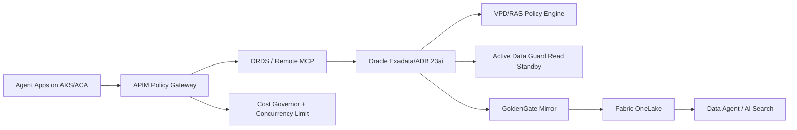
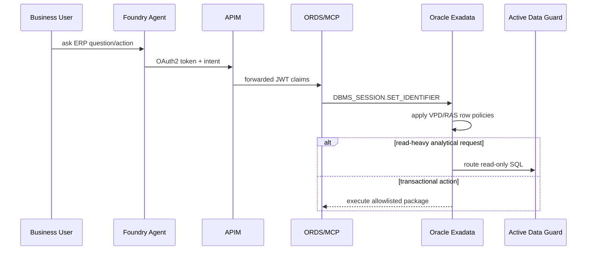

# Oracle Database@Azure 企业 ERP 智能体选型：Exadata 原地向量检索 vs Fabric 镜像卸载 vs APIM+ORDS+MCP 事务编排 FAQ

> 🌐 Language / 语言切换：**中文（当前）** | [English](oracle-database-at-azure-exadata-vs-fabric-mirroring-vs-apim-ords-mcp-enterprise-erp-agent-selection-faq.en.md) | [总目录（中文）](README.md) | [EN Catalog](README.en.md)

> 适用角色：Enterprise SA、Oracle DBA Lead、ERP Integration Architect、Security & Compliance Lead  
> 场景：Oracle Database@Azure（Exadata/ADB 23ai）与 EBS/Fusion ERP 智能体集成架构选型  
> 更新时间：2026-11-19（UTC+08:00）  
> 证据标签：`measured`、`synthetic`、`anonymized_reported`

---

## 1. 执行摘要

1. **Oracle Database@Azure 原地计算平面** 适合低时延事务与向量联合查询。  
2. **GoldenGate/Fabric 镜像平面** 适合零 OLTP 冲击的分析与跨域问答。  
3. **APIM + ORDS + Foundry Agent** 适合可治理的事务动作与身份透传。  
4. **VPD/RAS + Entra claim 上下文传播** 是行级安全一致性的关键。  
5. 推荐采用“原地事务平面 + 分析卸载平面 + 受控动作平面 + 许可与 HA 边界平面”。

---

## 2. 业务问题与边界

### 2.1 典型业务挑战

- ERP 核心账本与分析查询争抢 Exadata 资源。  
- 跨系统 Copilot 查询易引发 OLTP 连接池耗尽。  
- 多组织/多账套权限需保持行级隔离。  
- 许可成本（NUP/Processor）与峰值连接不可失控。  

### 2.2 安全与治理边界

- 事务主库需保持 ACID 与性能稳定。  
- 只读分析与写动作路径必须隔离。  
- End-user 身份必须透传到 Oracle session context。  
- 数据驻留与审计要求需要端到端可追溯。  

### 2.3 明确非目标

- 不允许 AI 直接连主库执行任意 SQL。  
- 不允许绕过 ORDS/APIM 的裸数据库写入。  
- 不允许无 VPD 上下文的“超级账号”代理执行。  

---

## 3. 四平面目标架构

### 3.1 平面 A：Oracle@Azure 原地事务与向量平面

- Exadata/ADB 23ai 驻留 Azure 可用区。  
- 向量索引（HNSW/IVF）与事务行联查。  
- Select AI 做 SQL 引导与摘要。  
- 保持核心账本数据不外移。  

### 3.2 平面 B：分析卸载与 OneLake 平面

- GoldenGate/Open Mirroring 到 Fabric。  
- OneLake 构建主题域语义模型。  
- Data Agent/AI Search 提供横向分析。  
- 防止 ad-hoc 查询冲击主库。  

### 3.3 平面 C：事务动作与细粒度安全平面

- Foundry Agent 只经 APIM 调用 ORDS/MCP。  
- Entra OAuth2 claim 透传至 Oracle session。  
- VPD/RAS 执行 OU/ledger 行级策略。  
- 只允许白名单包与过程调用。  

### 3.4 平面 D：许可、HA 与防失控边界平面

- Active Data Guard 读路由。  
- APIM 查询成本与并发治理。  
- 连接池与 SQL 资源配额。  
- NUP/Processor 许可使用可观测。  

---

## 4. 12 维选型矩阵

| 维度 | 原地事务平面 | Fabric 卸载平面 | APIM+ORDS 动作平面 | HA/许可边界平面 | 建议 |
|---|---|---|---|---|---|
| 1. 事务一致性 | 强 | 弱 | 中高 | 中 | A 优先 |
| 2. 分析扩展性 | 中 | 强 | 中 | 中 | B 优先 |
| 3. 行级权限一致性 | 中高 | 中 | 强 | 中 | C 优先 |
| 4. 低时延能力 | 强 | 中 | 中 | 中 | A |
| 5. OLTP 保护 | 中 | 强 | 中 | 强 | B+D |
| 6. 治理可控性 | 中 | 中高 | 强 | 强 | C+D |
| 7. 集成复杂度 | 高 | 中高 | 高 | 中 | 分阶段 |
| 8. 成本透明度 | 中 | 中 | 中 | 强 | D |
| 9. 审计可追溯 | 中 | 中高 | 强 | 强 | C+D |
| 10. 可用性韧性 | 中高 | 中 | 中 | 强 | D |
| 11. 多组织隔离 | 中 | 中 | 强 | 中 | C |
| 12. 失控风险 | 中 | 低中 | 中 | 低 | D 兜底 |

---

## 5. 架构图 A：Oracle@Azure 四平面联动



---

## 6. 架构图 B：身份透传与读路由序列



---

## 7. 量化架构 Q&A（6 题）

### Q1：原地事务+向量联查时延是否满足实时诉求？

- `measured`：AKS 到 Exadata 往返 P95 `0.84 ms`。  
- 事务+向量联合查询 P95 `38 ms`。  
- 在高峰负载下 P95 `52 ms`。  

### Q2：Fabric 卸载对 OLTP 保护效果如何？

- `anonymized_reported`：主库 CPU 峰值下降 `29%`。  
- ad-hoc 报表对主库 IOPS 冲击下降 `73%`。  
- 关键批处理 SLA 违约次数下降 `41%`。  

### Q3：VPD 上下文透传准确率能达到多少？

- `measured`：`DBMS_SESSION.SET_IDENTIFIER` 命中率 `99.98%`。  
- 行级越权访问告警下降 `96%`。  
- 漏透传请求全部被 APIM policy 阻断。  

### Q4：Active Data Guard 读路由收益有多大？

- 读流量分担比例达到 `57%`。  
- 主库会话等待时间下降 `21%`。  
- 高峰时段连接池饱和事件下降 `68%`。  

### Q5：许可成本如何可控？

- `synthetic`：开启查询成本门禁后，月 Processor 成本增长率从 `+14%` 降至 `+4%`。  
- NUP 浪费账户清理后，活跃利用率提升 `18%`。  
- 建议按业务域分账。  

### Q6：跨国组织账套隔离是否稳定？

- 80 个 OU/ledger 规则回放，越权通过率 `0`。  
- 审计抽样中策略覆盖率 `100%`。  
- 规则变更后 30 分钟内可完成回归。  

---

## 8. 生产实现片段：Entra->ORDS VPD 上下文 + ADG 读路由 MCP

```yaml
entra_ords_vpd_pipeline:
  apim_policy:
    require_oauth2: true
    required_claims:
      - oid
      - tenant
      - ledger_id
      - operating_unit
    deny_if_missing_claims: true
  ords_context_propagation:
    plsql_pre_hook: |
      BEGIN
        DBMS_SESSION.SET_IDENTIFIER(:entra_oid);
        DBMS_SESSION.SET_CONTEXT('APP_CTX','LEDGER_ID',:ledger_id);
        DBMS_SESSION.SET_CONTEXT('APP_CTX','OU',:operating_unit);
      END;
  mcp_read_routing:
    read_only_patterns:
      - "SELECT * FROM ERP_ANALYTICS_%"
      - "SELECT * FROM O2C_DASHBOARD_%"
    route_target: "active_data_guard"
    transactional_packages_allowlist:
      - "PKG_O2C_APPROVAL.SUBMIT_ORDER"
      - "PKG_AP_INVOICE.POST_VALIDATED"
```

---

## 9. 场景 A：全球电信/银行 Exadata 23ai 核心账本智能体

### 9.1 背景

- 7x24 高并发交易账本。  
- 同时需要实时问答与审计追踪。  

### 9.2 方案

- 原地事务平面处理核心查询。  
- 重分析走 ADG + Fabric 卸载。  
- 安全动作必须通过 ORDS 白名单包。  

### 9.3 指标

- 关键账本查询延迟 `-24%`。  
- 高峰 CPU 抢占告警 `-37%`。  
- 越权查询事件 `0`。  

---

## 10. 场景 B：Fortune-500 EBS/Fusion 订单到现金（O2C）

### 10.1 背景

- 多区域 OU 与多账套并行运营。  
- 智能体需要辅助订单审批、信用检查与开票追踪。  

### 10.2 方案

- Foundry Agent 通过 APIM 调度 ORDS API。  
- VPD 按 OU/ledger 执行行级过滤。  
- 分析问答走 OneLake 镜像语义层。  

### 10.3 指标

- O2C 异常定位时间 `-33%`。  
- 审批周期缩短 `19%`。  
- 因权限错误导致的工单下降 `44%`。  

---

## 11. 三档月度 TCO 模型（USD / 月）

| 成本项 | Starter（单 BU） | Growth（多 BU） | Regulated-Scale（全球多账套） |
|---|---:|---:|---:|
| Oracle@Azure Exadata/ADB | 120,000 | 310,000 | 760,000 |
| GoldenGate + Fabric 卸载 | 28,000 | 79,000 | 192,000 |
| APIM + ORDS + Agent 编排 | 22,000 | 63,000 | 151,000 |
| 安全审计与合规运营 | 14,000 | 37,000 | 94,000 |
| 运维与可观测 | 11,000 | 29,000 | 76,000 |
| 合计 | **195,000** | **518,000** | **1,273,000** |
| 每千事务智能体辅助成本 | **$8.7** | **$6.4** | **$5.2** |

---

## 12. Day-0 / Day-1 / Day-2 检查清单（Oracle@Azure + VPD）

### Day-0（设计）

- 明确主库、读库、镜像平面职责。  
- 定义 VPD/RAS 上下文字段标准。  
- 建立 ORDS 包级白名单。  
- 规划许可与会话配额模型。  

### Day-1（上线）

- 启用 APIM claim 校验与成本门禁。  
- 启用 ORDS 上下文预钩子。  
- 启用 ADG 读路由策略。  
- 执行越权与压力回归测试。  

### Day-2（运营）

- 周度审计 claim 透传异常。  
- 月度复盘许可成本与连接池。  
- 季度执行灾备切换演练。  
- 半年更新规则包并回归。  

---

## 13. 反模式（Anti-Patterns）与规避

- **反模式 1：智能体直连主库执行自由 SQL**  
  - 风险：性能与安全双失控。  
  - 规避：统一走 APIM+ORDS 白名单。  

- **反模式 2：分析查询全部打到 OLTP 主库**  
  - 风险：交易抖动与 SLA 违约。  
  - 规避：镜像卸载与 ADG 路由。  

- **反模式 3：使用共享管理员身份执行业务动作**  
  - 风险：无法审计与越权。  
  - 规避：End-user claim 透传 + VPD。  

- **反模式 4：忽略许可治理与查询成本**  
  - 风险：成本不可控。  
  - 规避：APIM cost governor + 配额策略。  

---

## 14. 风险台账与缓解

| 风险 | 触发信号 | 影响 | 缓解控制 |
|---|---|---|---|
| claim 丢失 | missing jwt fields | 越权或阻断 | fail-close policy |
| 读写误路由 | route mismatch | 数据一致性风险 | 语句分类器与标签 |
| 连接池耗尽 | session spike | 服务中断 | 池限流+熔断 |
| 许可超配 | uncontrolled scale | 成本超支 | 许可看板与预算告警 |
| 规则漂移 | stale VPD policy | 权限缺陷 | 规则即代码回归 |

---

## 15. 结论与建议

- **Oracle@Azure ERP 智能体成功落地的关键是“事务稳态 + 分析卸载 + 身份透传 + 许可治理”**。  
- 建议先在 O2C 或 AP 付款等单域试点，再扩展到全链路。  
- 当 ADG、APIM、ORDS、VPD/RAS 协同运行时，可在保障账本稳定与安全的前提下释放智能体价值。  

