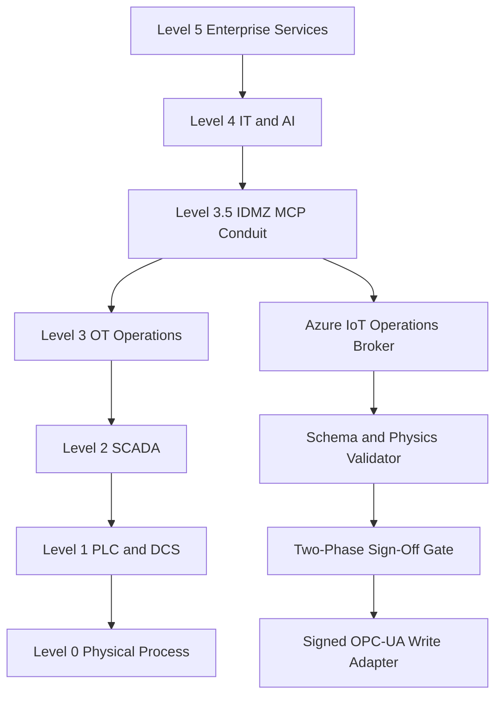
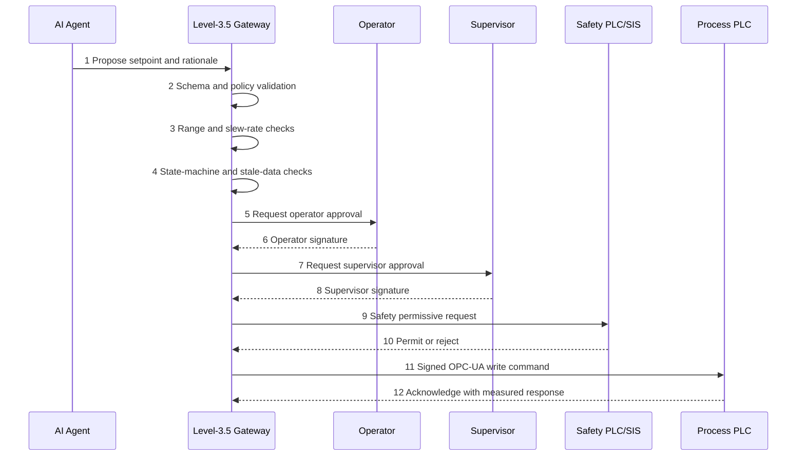
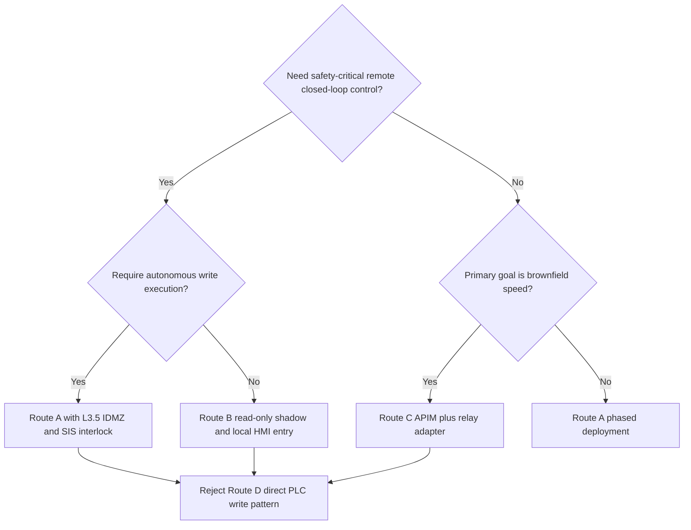

# Industrial OT/IT MCP gateway selection FAQ: IEC 62443 level-3.5 OPC-UA conduit vs data diode shadow vs direct adapter vs unsafe PLC write
> **Audience**: industrial CIO/CTO teams, OT cyber-security leads, plant automation architects, and Cloud & AI Solution Architects.
> **Decision focus**: enabling AI-agent observability and controlled actuation without violating OT safety, compliance, and deterministic control constraints.

## 1. Executive Summary
In industrial environments, the dominant risk is remote actuation error, not read-only analytics.
Once an AI agent can write setpoints, architecture must enforce physical process constraints before model confidence.
Route A combines IEC 62443-aligned level-3.5 IDMZ segmentation, protocol breakpoints, two-phase sign-off, and hardware interlocks.
Route B uses unidirectional hardware transfer with read-only digital twins, maximizing safety while minimizing closed-loop automation.
Route C accelerates brownfield integration for non-critical systems, but lacks deterministic write-safety controls.
Route D is an anti-pattern: direct cloud-to-PLC write paths violate segmentation, expand ransomware blast radius, and undermine compliance.
For safety-critical closed-loop operations, Route A should be default and Route B should remain the conservative fallback baseline.

## 2. Problem Definition: Purdue Boundary Integrity and AI Actuation
The Purdue model is valuable because it isolates failure domains between enterprise IT and deterministic control systems.
If level-4 or cloud services directly issue writes to level-1/2 controllers, software defects can become physical incidents.
LLM-generated recommendations can be semantically coherent yet physically unsafe for process dynamics.
Without explicit envelope constraints, slew-rate limits, and equipment state guards, setpoint suggestions can induce oscillation or overshoot.
Therefore industrial AI architecture must implement enforceable physics-aware gates, not only API authentication and authorization.

## 3. Route A Deep Dive: IEC 62443 SL-3 Level-3.5 IDMZ Brokered MCP Conduit
Route A prevents direct IT-to-PLC control by forcing all command intents through a level-3.5 IDMZ gateway.
Dual-firewall termination ensures cloud and enterprise zones never open inbound direct sessions to level-2 or level-1 assets.
Azure IoT Operations edge brokers provide MQTT/OPC-UA mediation with mutually authenticated TLS 1.3 sessions.
The MCP gateway accepts structured command envelopes and validates JSON schema plus physical safety constraints.
Validation covers min/max bounds, `|Δu/Δt|` slew-rate envelopes, stale-telemetry rejection, and equipment-state permissions.
A two-phase operator sign-off gate separates business approval from shift-supervisor operational approval.
Final actuation occurs via signed OPC-UA writes, while IEC 61511 SIS retains ultimate physical override authority.
Route A introduces higher implementation effort but delivers the strongest balance of automation value and risk control.

## 4. Route B Deep Dive: Unidirectional Data Diode and Read-Only Twin Shadow
Route B physically enforces one-way transfer from OT into IT and cloud analytics planes.
OPC-UA PubSub streams and historian replicas feed Azure Eventhouse and Azure Digital Twins for root-cause diagnostics.
Advisory outputs are delivered to operators, who manually enter approved setpoints at local HMI stations.
This model almost eliminates remote write risk and is favored in high-hazard process industries.
The trade-off is reduced automation velocity and dependence on operator response latency.

## 5. Route C Deep Dive: APIM plus Relay/Hybrid Direct Request-Response Adapter
Route C leverages APIM policy governance with cloud-to-site adapters for rapid brownfield onboarding.
It is often acceptable for non-safety-critical building-management and auxiliary utility workloads.
However Route C does not provide level-3.5 protocol demarcation or deterministic physical interlock enforcement by default.
Using Route C for hazardous continuous process loops typically fails stringent safety and compliance objectives.

## 6. Route D Anti-Pattern: Flat VLAN Bridging and Direct Modbus/OPC Writes
Route D exposes PLC endpoints directly to IT/cloud pathways through flat networking or weakly governed sessions.
Deterministic controllers with 1-10ms scan cycles are vulnerable to burst traffic and command flooding.
The approach also enables lateral ransomware movement from IT footholds into OT process-control assets.
Most regulated sectors cannot justify this pattern under IEC 62443 SL-2/SL-3 expectations.

## 7. Architecture Principles and Quantitative Safety Formulas
Industrial AI control must formalize safety limits as executable constraints instead of narrative guidelines.
The following formulas should be implemented at the level-3.5 enforcement point:
1. Slew-rate envelope: `|û_t - u_{t-1}| <= R_max * Δt`.
2. PLC polling headroom: `U_comm = (N_tags * T_req) / T_scan <= 0.20`.
3. Closed-loop staleness guard: `t_now - t_telemetry <= τ_stale`.
4. Multi-signature commit validity: `sig_operator && sig_supervisor && state_guard`.
These constraints must be auditable, replayable, and immutable across change windows.

## 8. Purdue L1-L5 plus L3.5 IDMZ MCP Architecture


## 9. Twelve-Step Validation and Interlock Sequence


## 10. Selection Decision Tree


## 11. Twelve-Dimension A/B/C/D Comparison Matrix
| Dimension | Route A | Route B | Route C | Route D |
|---|---|---|---|---|
| IEC 62443 segmentation compliance | High | High | Medium-low | Low |
| Zero inbound IT-to-OT exposure | High | High | Medium | Low |
| Remote closed-loop execution ability | High | Low | Medium | High and unsafe |
| Deterministic slew-rate enforcement | High | Low | Medium-low | Low |
| PLC scan-cycle protection | High | High | Medium | Low |
| Ransomware lateral-movement resistance | High | High | Medium | Low |
| Operational complexity | Medium-high | Medium | Medium | Low apparent and high hidden |
| Audit replay fidelity | High | Medium-high | Medium | Low |
| Multi-plant scalability | Medium-high | Medium | High | Medium |
| Incident shutdown risk | Low | Low | Medium | High |
| Compliance pass probability | High | High | Medium-low | Low |
| Three-year total economic value | High | Medium | Medium | Low |

## 12. Python Production Reference: Setpoint Airlock Validator
```python
from __future__ import annotations
from dataclasses import dataclass
from datetime import datetime, timezone

@dataclass
class Constraint:
    min_value: float
    max_value: float
    max_slew_per_sec: float
    stale_seconds: float

def validate_setpoint(proposed: float, previous: float, dt_sec: float, telemetry_ts: datetime, c: Constraint) -> tuple[bool, str]:
    if not (c.min_value <= proposed <= c.max_value):
        return False, 'range_violation'
    slew = abs(proposed - previous) / max(dt_sec, 1e-6)
    if slew > c.max_slew_per_sec:
        return False, 'slew_violation'
    staleness = (datetime.now(timezone.utc) - telemetry_ts).total_seconds()
    if staleness > c.stale_seconds:
        return False, 'stale_telemetry'
    return True, 'ok'
```

## 13. YAML Production Reference: IoT Operations and IDMZ MCP Policy
```yaml
iotOperations:
  broker:
    tls:
      mode: mutual
      minVersion: TLS1_3
mcpGateway:
  zone: level3_5_idmz
  writePolicy:
    requireTwoPhaseSignoff: true
    enforceSchema: true
    enforcePhysicalEnvelope: true
    staleTelemetrySeconds: 8
    maxSlewPerSecond: 0.15
opcua:
  outboundOnlySession: true
  signedWriteRequired: true
```

### Q1: How should `|Δu/Δt|` limits be tuned for reactor and kiln loops
Start from stable historical operating windows and derive conservative slope envelopes per equipment family.
Then validate those bounds with staged field trials under normal and upset conditions.
Static global limits are usually too coarse; plant-specific parameterization is required for safety and yield.
In Route A, both gateway policy and SIS permissive logic should enforce the final limits.

### Q2: Why do 1-10ms PLC scan cycles degrade under cloud burst traffic
Controller scan cycles prioritize deterministic logic execution, and communication contention steals deterministic budget.
When `U_comm` exceeds safe headroom, control response jitter and delayed actuation become measurable.
Direct write paths in Route D are particularly vulnerable to uncontrolled request bursts.
Route A and Route B reduce this risk with protocol decoupling and controlled mediation.

### Q3: Why Route A is preferred over Route C for hazardous continuous processes
Route A provides level-3.5 protocol segmentation, deterministic write gating, dual sign-off, and hardware override continuity.
Route C can be efficient for integration velocity, but does not inherently enforce equivalent physical safety constraints.
In high-consequence plants, integration speed does not offset risk amplification from missing deterministic controls.
Therefore Route C should be limited to non-critical auxiliary utility domains.

### Q4: How read-only diode architectures still deliver business value
Route B enables high-quality anomaly analytics, root-cause diagnostics, and optimization advisories without remote write risk.
Digital twin and historian replay workloads remain highly valuable for reliability and energy efficiency programs.
Operators execute approved actions locally, preserving human accountability and physical context.
This is often the fastest path to regulatory acceptance in highly sensitive operations.

### Q5: How two-phase sign-off avoids becoming a paper process
Signatures must bind to exact command payloads, asset state snapshots, timing windows, and evidence hashes.
Every approval should be non-repudiable and replayable with full context in incident retrospectives.
If approvals store only binary decisions without context, governance quality decays rapidly.
Organizations should track approval quality metrics, not only approval throughput.

### Q6: How to quantify safety gains during multi-plant rollout
Measure incident-rate reduction, mis-operation frequency, out-of-envelope alarms, and unplanned downtime trends.
Pair safety indicators with human-AI collaboration metrics such as advisory adoption and confirmation latency.
Expand autonomous scope only after stable safety gains across representative production windows.
Route A usually scales better where governance consistency and audit replay are contractual requirements.

## 14. Enterprise Scenario A: Continuous Chemical Reactor and Kiln Optimization
This scenario involves thermal and pressure-sensitive loops where excursions can trigger severe safety events and quality loss.
Route A is recommended as the primary architecture, with Route B as conservative fallback for exceptional operating modes.
Autonomous actions should start with narrow bounded loops before wider closed-loop coverage.
Critical actuators must always remain subordinate to SIS hard-interlock authority.

## 15. Enterprise Scenario B: Multi-Plant Semiconductor Utility and Chiller Fleet
Fab utility systems include chillers, vacuum, gases, and ultrapure-water domains with heterogeneous control interfaces.
A practical path is Route B/C for diagnostics first, followed by Route A in low-risk closed-loop segments.
Cross-plant scale requires rigorous tag taxonomy normalization and state-machine model harmonization.
Site-specific constraints should be calibrated jointly by process and automation engineering teams.

## 16. Three-Year TCO and Risk-Adjusted Economics
| Route | Three-Year Platform Cost | Risk Exposure Cost | Net Value Outlook |
|---|---:|---:|---:|
| Route A | `$3.2M-$4.6M` | Low | High |
| Route B | `$2.6M-$3.8M` | Low | Medium |
| Route C | `$2.1M-$3.2M` | Medium | Medium |
| Route D | `$1.4M-$2.2M` | High | Low |
After including downtime risk and compliance penalties, Route A commonly outperforms Route C and Route D over a three-year horizon.

## 17. Go-Live Acceptance Checklist
1. Complete Purdue-level asset inventory and allowed flow mapping.
2. Baseline dual-firewall level-3.5 rules with strict least-port policy.
3. Validate range, slew-rate, staleness, and state-machine constraints for all writable tags.
4. Verify two-phase sign-off and evidence-hash replay integrity.
5. Verify SIS override and fail-safe fallback paths.
6. Execute resilience drills for jitter, stale data, and rejected unsafe writes.
7. Establish weekly review and monthly threshold-retuning governance.

## 18. Day-2 Operations and Drift Management
Post go-live risk shifts from design flaws to policy drift, operational shortcuts, and exception creep.
Threshold and policy changes should be versioned, peer-reviewed, and tied to replay-based evidence.
For multi-plant deployments, core safety templates should remain standardized while local parameters vary by process conditions.
When manual rejection rates increase, improve recommendation quality before relaxing safety gates.
When communication saturation appears, optimize sampling and buffering before adding direct write pathways.

## 19. Compliance and Standards Mapping
IEC 62443-3-3 control intent strongly favors segmented conduits and explicit trust boundaries, aligning with Route A and Route B.
NIST SP 800-82 Rev.3 emphasizes constrained OT connectivity and robust monitoring of remote access pathways.
OPC 10000-14 PubSub supports controlled data dissemination patterns suitable for read-mostly diagnostics topologies.
IEC 61511 reinforces that SIS protections must remain authoritative over any software automation layer.

## 20. Authoritative References
- IEC 62443-3-3, security requirements and security levels for industrial automation and control systems.
- OPC 10000-14, OPC UA Part 14 PubSub specification.
- NIST SP 800-82 Rev. 3, Guide to Operational Technology Security.
- Azure IoT Operations official documentation for Arc-enabled edge data and broker operations.
- Microsoft industrial security guidance for OT/IT segmentation and zero-trust architecture.

## 21. Final Recommendation
Choose Route A when remote closed-loop value is required and safety/compliance cannot be compromised.
Choose Route B when hazard exposure is high and read-only diagnostics provide sufficient value.
Use Route C only for non-safety-critical utility domains with explicit boundary limitations.
Do not deploy Route D in production industrial environments.
In OT modernization, physical safety correctness must always outrank algorithmic convenience.
