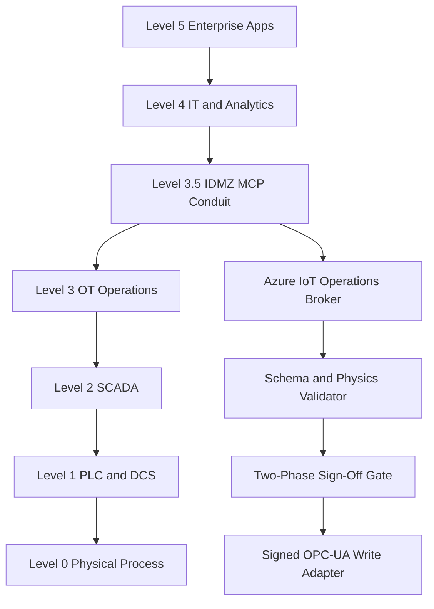
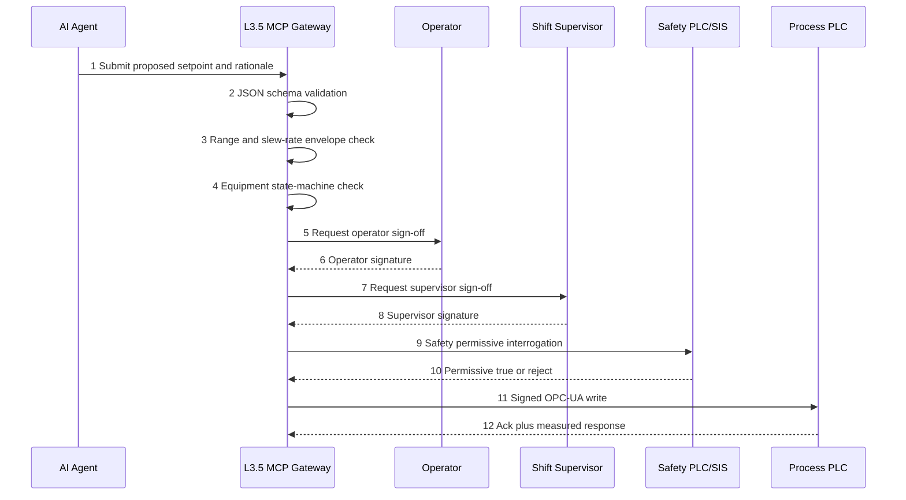
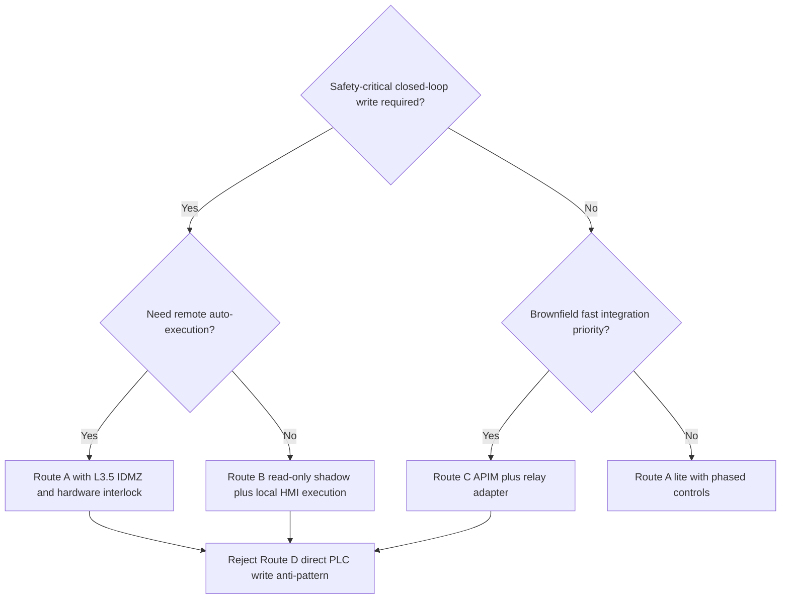

# 工业 OT/IT 智能体网关选型 FAQ：IEC 62443 L3.5 IDMZ MCP Conduit vs 数据二极管只读影子 vs 云直连适配 vs 直写 PLC 反模式
> **适用对象**：工业数字化 CTO、工业网络安全负责人、OT 架构师、Cloud & AI Solution Architect。
> **核心决策**：在保持生产安全与合规的前提下，如何让 AI Agent 对 OT 数据“可观测、可建议、可受控执行”。

## 1. Executive Summary
工业现场的真实风险来自“闭环写入”，而不是只读分析。
当智能体开始提出或执行 setpoint 写入时，架构必须优先保证物理安全边界。
Route A 通过 IEC 62443 Level 3.5 IDMZ Conduit + 两阶段签核 + 硬件联锁形成生产级闭环。
Route B 用单向数据二极管把风险降到最低，适合高危装置的只读诊断与建议。
Route C 适合非安全关键设施的快速改造，但不满足高危工艺的强隔离要求。
Route D 属于反模式，会把 IT 与 L1/L2 PLC 暴露在横向攻击与异常写入风险中。
建议以 Route A 为默认工业闭环控制架构，以 Route B 作为高危工艺保守基线。

## 2. Problem Definition: OT/IT Boundary Violations
Purdue 分层的核心价值在于把业务系统与控制系统按失效域隔离。
一旦 L4/L5 直接对 L1/L2 发起写入，风险会从软件错误扩展为物理过程事故。
LLM 产生“语义正确但物理不安全”的 setpoint 在工业场景并不少见。
如果缺少范围约束、斜率约束与状态机约束，控制回路会出现震荡或超调。
因此工业 AI 架构不能只做 API 鉴权，必须做物理过程守门。

## 3. Architecture A Deep Dive: IEC 62443 SL-3 IDMZ Brokered MCP Conduit
A 的原则是 IT 不直接触碰 PLC，所有写入都经 L3.5 IDMZ 代理与规则引擎。
L3.5 通过双防火墙终结会话，仅允许 OT 向 IT 发起受控上行会话。
Azure IoT Operations 在边缘承载 MQTT/OPC-UA 代理，形成协议断点与审计断点。
MCP 工具网关只接受结构化请求，并执行 JSON Schema 与物理包络双重校验。
写入前必须满足 min/max、`|Δu/Δt|`、设备状态机许可和工单签核条件。
通过两阶段签核，第一阶段确认业务意图，第二阶段确认现场可执行窗口。
最终写入由受控 OPC-UA Call/Write 发往 L2，且安全 PLC/SIS 具备硬件覆盖权。
A 的运营复杂度较高，但最能兼顾闭环价值与合规要求。

## 4. Architecture B Deep Dive: Data Diode + Read-Only Digital Twin Shadow
B 使用光隔离单向通道，只允许 OT 数据复制到 IT 分析面。
通过 OPC-UA PubSub 或 historian 复制，Azure Eventhouse 与 Digital Twins 构建影子模型。
所有建议仅输出到操作员界面，由人手工在本地 HMI 输入设定值。
该方案几乎消除远程写入风险，适合化工、制药、核电等高风险工艺。
代价是自动闭环收益受限，优化动作速度依赖班组执行效率。

## 5. Architecture C Deep Dive: APIM + Relay/Hybrid Connection Direct Adapter
C 通过云侧 APIM 和站点连接器快速接入已有 SCADA API。
对 HVAC、公辅系统等非安全关键资产，该路径具备较好改造性价比。
但 C 缺少 L3.5 协议断层与硬件联锁，无法替代 A 在高危装置的安全保障。
若把 C 用在高风险连续工艺，会在合规审计中暴露系统性短板。

## 6. Architecture D Anti-Pattern: Flat VLAN + Direct Modbus/OPC Write
D 让云端 Agent 直连端口 502 或未经鉴权的 OPC-UA 写通道。
该模式把 PLC scan cycle 暴露给突发流量，易造成轮询饥饿和控制异常。
同时它破坏 IEC 62443 分区分域原则，放大勒索软件横向移动路径。
在多数行业监管框架下，D 都无法通过 SL-2/SL-3 的关键控制项。

## 7. Industrial Safety Design Principles and Quantitative Guards
工业智能体执行前应先满足可验证的物理约束，再讨论模型置信度。
建议将安全门禁固化为数学不等式，避免自由文本策略漂移。
关键守护公式如下：
1. Slew-Rate Envelope：`|û_t - u_{t-1}| <= R_max * Δt`。
2. PLC Polling Headroom：`U_comm = (N_tags * T_req) / T_scan <= 0.20`。
3. Staleness Guard：`t_now - t_telemetry <= τ_stale`。
4. Two-Phase Commit Validity：`sig_operator && sig_supervisor && state_guard == true`。
上述约束必须在 L3.5 网关可执行，并可被审计系统复放。

## 8. Purdue L1-L5 with L3.5 IDMZ MCP Architecture


## 9. 12-Step Two-Phase Validation and Interlock Sequence


## 10. Decision Tree for Route A/B/C/D


## 11. 12-Dimension Comparison Matrix
| 维度 | Route A | Route B | Route C | Route D |
|---|---|---|---|---|
| IEC 62443 分区分域符合度 | 高 | 高 | 中低 | 低 |
| OT 零入站暴露 | 高 | 高 | 中 | 低 |
| 远程闭环执行能力 | 高 | 低 | 中 | 高但危险 |
| `|Δu/Δt|` 约束可执行性 | 高 | 低 | 中低 | 低 |
| PLC 扫描周期友好度 | 高 | 高 | 中 | 低 |
| 勒索横向移动抑制 | 高 | 高 | 中 | 低 |
| 运维复杂度 | 中高 | 中 | 中 | 低表面/高事故 |
| 变更审计可回放 | 高 | 中高 | 中 | 低 |
| 多厂站扩展性 | 中高 | 中 | 高 | 中 |
| 事故停机风险 | 低 | 低 | 中 | 高 |
| 合规审计通过概率 | 高 | 高 | 中低 | 低 |
| 三年 TCO 综合收益 | 高 | 中 | 中 | 低 |

## 12. Python Reference: OPC-UA Setpoint Envelope and Slew-Rate Airlock Validator
```python
from __future__ import annotations
from dataclasses import dataclass
from datetime import datetime, timezone

@dataclass
class Constraint:
    min_value: float
    max_value: float
    max_slew_per_sec: float
    stale_seconds: float

def validate_setpoint(proposed: float, previous: float, dt_sec: float, telemetry_ts: datetime, c: Constraint) -> tuple[bool, str]:
    if not (c.min_value <= proposed <= c.max_value):
        return False, 'range_violation'
    slew = abs(proposed - previous) / max(dt_sec, 1e-6)
    if slew > c.max_slew_per_sec:
        return False, 'slew_violation'
    staleness = (datetime.now(timezone.utc) - telemetry_ts).total_seconds()
    if staleness > c.stale_seconds:
        return False, 'stale_telemetry'
    return True, 'ok'
```

## 13. YAML Reference: Azure IoT Operations and IDMZ MCP Policy
```yaml
iotOperations:
  broker:
    tls:
      mode: mutual
      minVersion: TLS1_3
mcpGateway:
  zone: level3_5_idmz
  writePolicy:
    requireTwoPhaseSignoff: true
    enforceSchema: true
    enforcePhysicalEnvelope: true
    staleTelemetrySeconds: 8
    maxSlewPerSecond: 0.15
opcua:
  outboundOnlySession: true
  signedWriteRequired: true
```

### Q1: 如何设置 `|Δu/Δt|` 门限避免反应釜温控回路振荡
建议先基于历史稳定工况估算每个设备的可接受斜率上界。
再将上界与班次操作窗口结合，分设备族设置分层阈值。
阈值不应只来自仿真，还要通过现场小步变更验证。
在 A 架构中，斜率门限应由网关和 SIS 双重执行。

### Q2: PLC `1-10ms` 扫描周期为何怕云侧突发请求
PLC 扫描优先保障控制逻辑，通信占用过高会挤压控制周期。
当 `U_comm` 超过 0.20，常见现象是控制抖动与响应延迟上升。
Route D 直写模式往往在异常流量下触发此类饥饿。
A/B 通过网关削峰与协议断层可显著降低风险。

### Q3: 为什么 `A` 比 `C` 更适合连续化工闭环
A 提供 L3.5 协议断层、双签核与硬件联锁，能控制执行失效域。
C 的优势在于集成速度，但缺少确定性物理守门与安全覆盖链。
在高危工艺里，速度收益无法抵消事故暴露成本。
因此 C 更适用于非安全关键公辅系统。

### Q4: 数据二极管只读模式如何实现可用价值
B 可将 OT 数据连续复制到云端构建数字孪生与根因分析。
模型可输出操作建议、异常归因与能效优化方案。
最终执行仍由现场人员在本地 HMI 完成，避免远程写入风险。
在审计要求极高行业，B 常是首选基线。

### Q5: 两阶段签核如何避免沦为形式主义
签核必须绑定具体 setpoint、设备态、时窗和证据快照哈希。
每次签核都要生成不可抵赖日志并可回放上下文。
若签核只记录“同意/拒绝”而无上下文，治理价值会迅速下降。
推荐把签核质量指标纳入班组 KPI。

### Q6: 如何评估跨厂站 rollout 的安全收益
应对比事故率、误操作率、超限告警与停机时长等指标。
同时量化人机协同效率，例如建议采纳率与确认时延。
当安全指标改善且产线波动受控时，才适合扩大闭环范围。
A 架构通常在多厂复制时具备更稳定的治理一致性。

## 14. Enterprise Scenario A: Continuous Chemical Reactor / Kiln
该场景关注高温高压连续过程，任何超限都可能导致重大安全事故。
推荐 A 作为默认路径，B 作为保守回退模式。
在夜间与低负荷窗口可逐步放开自动执行范围。
对关键阀位、燃烧比、循环流量必须保留 SIS 硬件主导权。

## 15. Enterprise Scenario B: Multi-Plant Semiconductor Utility Fleet
半导体厂务系统涵盖冷机、真空、气体与超纯水等多类设备。
该场景更适合先用 B/C 做诊断，再在局部低风险单元引入 A。
跨厂复制时应优先标准化设备标签与状态机字典。
多站点差异参数需由现场工程团队联合校准。

## 16. 3-Year TCO Model
| 路线 | 三年平台成本 | 风险暴露成本 | 预计净收益 |
|---|---:|---:|---:|
| Route A | `$3.2M-$4.6M` | 低 | 高 |
| Route B | `$2.6M-$3.8M` | 低 | 中 |
| Route C | `$2.1M-$3.2M` | 中 | 中 |
| Route D | `$1.4M-$2.2M` | 高 | 低 |
若把停机损失与合规处罚纳入，A 的综合经济性通常优于 C/D。

## 17. Go-Live Acceptance Checklist
1. 完成 Purdue 分层资产映射与数据流白名单。
2. 完成 L3.5 双防火墙规则基线与最小端口策略。
3. 验证所有写入节点的 min/max、斜率、状态机门禁。
4. 验证两阶段签核与证据哈希可追溯性。
5. 验证 SIS 覆盖与故障回退路径。
6. 完成应急演练：网络抖动、数据延迟、异常写入拒绝。
7. 建立周度复盘与月度阈值调优机制。

## 18. Day-2 Operations and Drift Governance
上线后风险并不会消失，而是转化为策略漂移和边界放松风险。
建议将策略版本、阈值变更与事故后追溯统一纳入变更管理。
对于多厂部署，需保证核心安全策略模板一致，参数按站点差异化。
当出现高频人工驳回时，应优先分析模型建议质量而非放松门禁。
若出现通信饱和，应先优化采样与聚合，再评估扩容。

## 19. Compliance Mapping Notes
IEC 62443-3-3 强调区域和通道治理，A/B 明显优于 C/D。
NIST SP 800-82 Rev.3 建议 ICS 与企业网络保持最小互通。
OPC 10000-14 PubSub 为受控数据分发提供了标准化机制。
在功能安全链路上，IEC 61511 SIS 仍需保留最终物理否决能力。

## 20. Authoritative References
- IEC 62443-3-3: Security requirements for IACS system security levels.
- OPC 10000-14: OPC UA Part 14 PubSub specification.
- NIST SP 800-82 Rev. 3: Guide to Operational Technology Security.
- Azure IoT Operations official documentation (Arc-enabled edge operations).
- Microsoft guidance for industrial IoT security, DMZ segmentation, and zero-trust edge.

## 21. Final Recommendation
对需要远程闭环写入的工业现场，优先选择 A 并把 SIS 作为最后硬件防线。
对高危且保守场景，优先选择 B，确保“先可见、后可控、再自动”。
C 仅适用于低风险设施的快速接入，不应替代工业安全边界设计。
D 不应进入任何生产级 OT 场景。
将 AI 能力引入 OT 的前提是“物理安全先于算法效率”。
