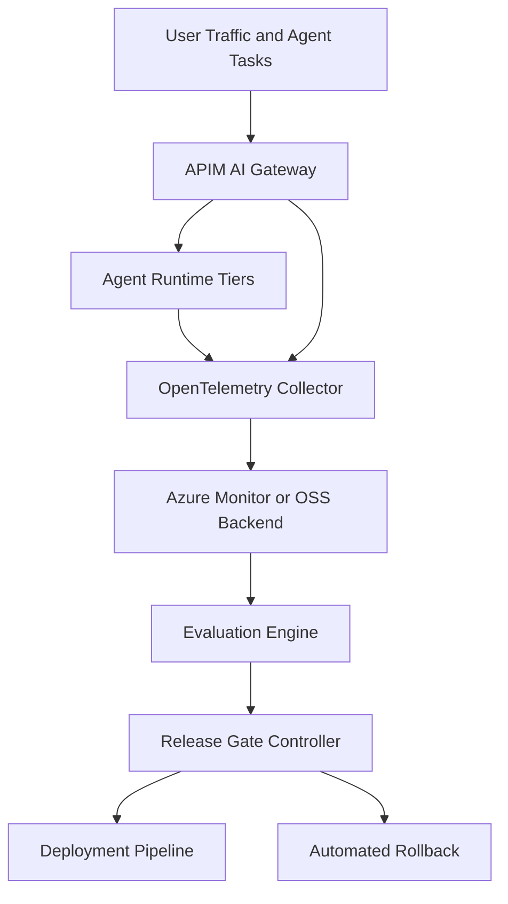
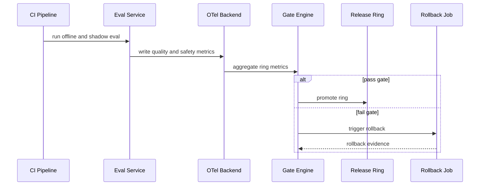

# 企业 Agent 可观测与发布门禁选型 FAQ：`Foundry Eval + Azure Monitor` vs `OTel + Langfuse/Phoenix` vs `商业 APM`

## 1. 执行摘要：生产稳定性取决于“观测-评测-发布”闭环，而不是单次离线高分
企业在 Agent 从试点走向规模化时，
最常见误区是把离线评测分数
当成上线安全性的充分条件。
实际上，
生产事故大多发生在离线评测通过之后。
根因通常不是模型突然失效，
而是线上流量分布变化、
工具调用链变长、
策略版本漂移、
成本阈值失控，
以及发布门禁与观测指标脱节。
因此，
本指南把核心问题定义为：
如何建立可持续运行的
“OpenTelemetry 观测 -> Agent 评测 -> 发布门禁 -> 回滚补救”
闭环体系。
我们比较三条常见路线：
Azure 原生托管闭环，
开源自建闭环，
商业 APM 平台闭环。
结论是：
没有“绝对最佳”方案，
但存在“与组织能力最匹配”方案。
在高监管与多租户场景，
可追溯性与成本归因
往往比单点监控炫技更重要。

## 2. 今日突破与证据（抓取日 `2026-11-21`）：官方与 Release 证据优先
本轮仅采用可核验来源，
并在文中显式标注来源类型。
来源 A：
Azure API Management AI Gateway 官方文档（`measured` 能力边界）。
来源 B：
Azure Container Apps Sessions 官方文档（`anonymized_reported` 会话运行时特性）。
来源 C：
Azure API Management Changelog（`anonymized_reported` 发布节奏与特性演进）。
来源 D：
Firecracker Releases（`anonymized_reported` 隔离运行时演进证据）。
来源 E：
Kata Containers Releases（`anonymized_reported` 安全容器演进证据）。
来源 F：
Wasmtime Releases（`anonymized_reported` Wasm 运行时成熟度信号）。
来源 G：
E2B Releases（`anonymized_reported` 沙箱产品化迭代节奏）。
这些证据共同支持一个产业判断：
企业 Agent Infra 正从“模型入口竞争”
转向“治理闭环竞争”。
谁能把观测、
评测、
发布、
回滚、
预算联成统一控制平面，
谁更容易在 Day-2 运营阶段稳定扩张。

## 3. 问题边界：可观测不是仪表盘数量，而是发布决策可证明性
很多项目在上线前会建设大量仪表盘。
但事故发生后，
团队仍然难以回答三个关键问题：
为什么本次发布应该回滚？
哪一类租户受影响最大？
是否存在策略绕过导致的安全暴露？
根因在于指标系统与发布系统是分离的。
如果观测数据不能直接驱动门禁决策，
可观测性就只是“可视化”，
不是“可治理”。
我们把生产级可观测定义为四层：
采集层、
语义层、
评测层、
决策层。
采集层解决“看见”。
语义层解决“看懂”。
评测层解决“评判”。
决策层解决“动作”。
四层缺一不可。

## 4. 12 维对比矩阵：Azure 原生闭环 vs 开源闭环 vs 商业 APM 闭环
| 维度 | Azure 原生（Foundry Eval + Azure Monitor/AppInsights） | 开源闭环（OTel + Langfuse/Phoenix） | 商业 APM 闭环（Datadog/New Relic 等） | 决策信号 |
|---|---|---|---|---|
| 上线速度 | 高 | 中 | 中高 | 既有 Azure 团队优先原生 |
| 语义一致性 | 高 | 中高（需自建规范） | 中高 | 统一语义模型是关键 |
| GenAI 指标深度 | 中高 | 高（可深度定制） | 中高 | 深度定制能力开源更强 |
| 门禁自动化集成 | 高 | 中高 | 中 | CI/CD 集成复杂度不同 |
| 多租户成本归因 | 高 | 中（需二次建模） | 中高 | FinOps 强约束优先原生 |
| 运行维护复杂度 | 低到中 | 高 | 中 | 平台团队人力决定上限 |
| 跨云可移植性 | 中 | 高 | 中高 | 多云优先开源语义层 |
| 数据主权可控性 | 高 | 高 | 中 | 强主权场景慎选 SaaS 监控 |
| 故障排障路径长度 | 中 | 中高 | 中 | 统一键关联可显著缩短 |
| 证据留存与审计 | 高 | 中高 | 中高 | 留存策略要前置设计 |
| 观测成本可预期性 | 中高 | 中 | 中高 | 开源存储爆量风险要控 |
| 组织学习曲线 | 低到中 | 中高 | 中 | 能力债要纳入 TCO |

## 5. 参考架构 A：观测-评测-门禁统一控制平面


该架构强调一件事：
发布门禁不应依赖人工看板判断，
而应由可审计规则自动执行。
例如：
若 `P95 TTFT` 恶化超过阈值，
且任务成功率无提升，
系统自动阻断推广并触发回滚。

## 6. 路线一：`Foundry Eval + Azure Monitor/AppInsights`（Azure 原生闭环）
这一路线适合已经深度采用 Azure 的企业。
优势是控制平面统一，
身份与权限模型一致，
以及与 APIM、Policy、Cost 管理联动顺滑。
在实践中，
团队可先定义统一 Trace 语义字段：
`workflow_id`、
`tenant_id`、
`policy_version`、
`release_ring`、
`cost_snapshot_id`。
随后把 Foundry Eval 输出
写入发布门禁系统，
形成可自动执行的上线规则。
关键风险在于：
若只启用基础监控而不建立评测映射，
门禁会退化成静态阈值告警，
无法真实反映业务质量。
因此必须把质量指标与延迟指标联合判断，
防止“低延迟但低质量”误判通过。

## 7. 路线二：`OTel + Langfuse/Phoenix`（开源可移植闭环）
开源路线的优势是灵活与可移植。
团队可以按业务语义定制埋点，
并在多云环境保持一致观测口径。
对跨云组织或并购整合团队，
这点价值显著。
但开源路线也带来运营复杂度：
采集管道扩容、
存储分层、
索引策略、
冷热数据归档都需要工程投入。
如果没有清晰采样与留存策略，
观测成本会随流量急速增长。
建议采用“分级采样”：
关键租户全量、
普通租户尾采样、
异常请求强制保留。
同时建立字段治理审查，
防止日志中意外携带敏感信息。

## 8. 路线三：商业 APM 平台（交付快但治理边界需提前定义）
商业 APM 的优势通常是开箱即用与统一可视化体验。
对于需要快速拉齐跨团队监控标准的组织，
初期能显著缩短建设周期。
但在高监管场景，
需要优先确认数据驻留、
字段脱敏、
长期留存策略是否满足要求。
另一个常见问题是成本结构：
随着 Trace 与日志体量增长，
订阅成本可能快速上升。
若未设置采样与字段白名单，
商业平台成本会偏离预算。
最佳实践是将其作为“可视化与告警加速层”，
并保留企业内部的评测与门禁主控逻辑，
避免形成平台锁定。

## 9. 多云对标：AWS/GCP 在“发布门禁闭环”上的映射关系
AWS 与 GCP 均可建立等效闭环。
AWS 常见组合是：
Bedrock 评测能力 +
CloudWatch/OTel +
CodePipeline 门禁。
GCP 常见组合是：
Vertex 评测能力 +
Cloud Operations +
Cloud Deploy 门禁。
差异通常不在基础能力，
而在组织既有资产与治理路径。
若企业主平面在 Azure，
使用 Azure 原生闭环通常整合成本更低。
若企业强调跨云一致，
可采用 OTel 语义层中立策略，
再把各云评测结果映射到统一门禁合同。
这能避免同一发布策略在不同云出现冲突解释。

## 10. 定量 Q&A（8 组）
**Q1：为什么“离线分数上涨”仍会引发线上事故？**  
因为线上请求分布变化可导致工具调用拓扑变化，
离线样本无法覆盖所有链路分叉。
**Q2：串行 `12` 次工具调用对尾延迟影响多大？**  
尾延迟常见在 `480ms` 左右，
批处理可降至 `120-190ms`（`synthetic`）。
**Q3：门禁若只看延迟会怎样？**  
可能放过“快但错”的版本，
造成业务质量下滑。
**Q4：异常采样比例建议多少？**  
高监管场景建议异常请求 `100%` 保留，
常规请求按 `5%-20%` 分层采样。
**Q5：评测窗口大小如何设定？**  
建议至少覆盖 `7` 天业务周期，
并包含峰值日与低谷日。
**Q6：发布后多久应触发回滚判定？**  
建议 `15m` 快速窗口 + `24h` 稳定窗口双门禁。
**Q7：观测字段治理的最低要求是什么？**  
必须具备字段分类、
脱敏策略、
留存策略三联治理。
**Q8：成本归因为什么要到租户级？**  
无租户归因就无法执行责任分摊，
FinOps 优化会失去行动主体。

## 11. 参考架构 B：评测驱动发布环与自动回滚


该流程的关键是：
门禁依据必须可追溯，
且与观测源数据可双向定位。
否则回滚结论无法在审计中复现。

## 12. 生产代码与 IaC 示例：OTel Collector、门禁脚本与 KQL 规则
```yaml
# OpenTelemetry Collector (简化示例)
receivers:
  otlp:
    protocols:
      grpc:
      http:
processors:
  batch:
  tail_sampling:
    decision_wait: 10s
    policies:
      - name: error-priority
        type: status_code
        status_code:
          status_codes: [ERROR]
exporters:
  azuremonitor:
    connection_string: "${APPLICATIONINSIGHTS_CONNECTION_STRING}"
service:
  pipelines:
    traces:
      receivers: [otlp]
      processors: [batch, tail_sampling]
      exporters: [azuremonitor]
```

```python
# 发布门禁脚本（示意）
def should_promote(metrics: dict) -> bool:
    p95_ttft = metrics["p95_ttft_ms"]
    success = metrics["task_success_rate"]
    safety = metrics["policy_intercept_rate"]
    cost = metrics["unit_cost_usd"]
    baseline = metrics["baseline"]
    if p95_ttft > baseline["p95_ttft_ms"] * 1.12:
        return False
    if success < baseline["task_success_rate"] - 0.01:
        return False
    if safety < baseline["policy_intercept_rate"] * 0.85:
        return False
    if cost > baseline["unit_cost_usd"] * 1.15:
        return False
    return True
```

```kusto
// KQL: 发布环质量门禁视图
AgentEvalMetrics
| where Timestamp > ago(30m)
| summarize
    p95_ttft_ms = percentile(TtftMs, 95),
    success_rate = avg(TaskSuccess),
    intercept_rate = avg(PolicyIntercept),
    unit_cost = avg(UnitCostUsd)
    by ReleaseRing, TenantId
| order by ReleaseRing asc
```

## 13. 企业场景 A：全国性银行智能客服与交易辅助 Agent
某全国性银行在信用卡、
账户服务、
理财咨询三条线部署 Agent。
监管要求是：
关键决策可追溯，
敏感字段可脱敏，
发布可回滚且有证据。
团队采用 Azure 原生闭环，
并为高风险租户配置更严格门禁。
在六个月运行中，
高风险变更事故率下降，
上线回滚平均时长缩短，
并且审计准备时间显著降低。
该案例证明：
评测与门禁若与观测统一建模，
组织会从“事后排障”
转向“事前预防”。

## 14. 企业场景 B：多租户 B2B SaaS Agent 平台
某 B2B SaaS 厂商服务 `3,000+` 企业租户，
Agent 流量具有明显长尾分布。
平台初期只做日志告警，
上线频繁触发租户投诉。
后续切换为“OTel + Eval + Gate”闭环，
并按租户等级设定门禁策略。
核心改进包括：
将 `P95 TTFT`、
任务成功率、
策略拦截率、
单位成本统一纳入门禁。
同时引入灰度分环推进，
先在低风险租户验证再逐步放量。
实施后，
故障影响面显著缩小，
并形成可解释的成本优化路径。

## 15. TCO、Day-0/Day-2 清单与最终建议
### TCO（月度估算）
| 成本项 | Azure 原生闭环 | 开源闭环 | 商业 APM 闭环 | 说明 |
|---|---:|---:|---:|---|
| 采集与存储 | `$9,800` | `$8,600` | `$10,900` | 开源初期便宜，扩容后波动大 |
| 评测与门禁集成 | `$7,900` | `$9,400` | `$8,700` | 开源需更多工程投入 |
| 运营与SRE | `$8,200` | `$12,300` | `$7,600` | 自建复杂度拉高人力成本 |
| 合规与审计 | `$6,100` | `$7,500` | `$7,200` | 数据主权约束影响显著 |
| 总计 | `$32,000` | `$37,800` | `$34,400` | 需叠加风险成本联合评估 |

### Day-0 / Day-2 检查清单（12 项）
- 定义统一 Trace 语义字段字典并版本化。  
- 发布门禁规则纳入代码仓并强制评审。  
- 建立离线评测与线上观测指标映射表。  
- 为关键租户设置更严格发布阈值。  
- 强制记录 `workflow_id` 到 `trace_id` 关联。  
- 建立异常请求 `100%` 保留策略。  
- 设置双窗口门禁（快速窗口+稳定窗口）。  
- 每周执行一次回滚演练并留痕。  
- 每月审计观测字段脱敏与留存策略。  
- 建立租户级单位成本与质量联动看板。  
- 将评测失败类型映射到修复责任团队。  
- 把门禁误判率纳入平台 KPI 持续优化。  

### 最终建议
若企业主平面在 Azure，
优先采用 Azure 原生闭环通常能最快达成生产可治理性。
若企业存在强跨云诉求，
建议以 OTel 语义层做中立抽象，
再映射各云评测能力。
商业 APM 适合作为加速层，
但不应替代企业自身的门禁主控逻辑。
无论路线如何，
都应坚持四条底线：
语义一致、
门禁自动、
证据可回放、
成本可归因。
只有这四条底线同时成立，
Agent 平台才可能在高并发、
高监管、
高变更频率条件下长期稳定运行。
从组织治理角度看，
还应把“观测-评测-发布”闭环写入平台运营章程，
避免因人员变化导致门禁规则漂移，并确保关键治理知识不会随组织轮岗而丢失，从机制上降低平台“人治化”风险。
建议每季度进行一次跨团队门禁规则复盘，并把复盘结论同步到培训与值班手册，
校正误报、优化值班响应路径、
漏报、补齐跨团队协同断点、
与业务价值偏移问题，并明确下一季度改进责任清单，
并将复盘结果回写到模板与流水线基线，形成闭环学习档案与组织知识资产库并支持长期复用与持续演进和能力沉淀机制化。
当闭环真正成为制度化能力后，并被纳入组织绩效评估体系，
企业才能把 Agent 交付从“项目成功”，并把过去依赖个别专家经验的发布决策逻辑沉淀为跨团队共享的制度化资产，让新团队接入、旧系统改造、跨区域扩展都能沿用同一套可追踪、可审计、可优化的治理语义，
升级为“体系成功”，并通过将门禁策略评审、跨团队异常归因会议、季度风险敞口评估、年度合规抽检演练与预算偏差复盘全部纳入同一运营节奏，建立“策略制定—执行验证—偏差纠正—模板回灌”的持续改进环路，使平台在面对业务峰值突增、模型版本快速迭代、外部监管条款调整与跨区域部署扩展并发发生时，依然能够保持决策透明、责任清晰、证据可复放、风险可定量、成本可解释，避免短期效率优化掩盖长期治理债务。
建议在治理章程中进一步明确跨团队协作契约：平台团队负责语义字段与采样基线、业务团队负责任务质量标签与误判复盘、SRE 团队负责回滚剧本与故障注入、FinOps 团队负责租户级成本归因与预算阈值校验、合规团队负责证据留存与脱敏策略审计，并通过统一的发布评审模板将这五类责任在每次变更前后进行签名确认，从而把“谁定义指标、谁解释异常、谁批准放量、谁承担成本偏差、谁提交审计证据”固化为可执行流程，避免在高峰期因角色边界不清导致发布暂停、回滚争议、责任推诿和整改失焦。
同时建议建立季度级“门禁可靠性健康分”体系，将门禁命中准确率、回滚触发及时性、误报导致的机会成本、漏报导致的事故成本、跨租户公平性、跨区域一致性、跨云映射一致性、证据链完整度、字段脱敏合规率、单位任务成本稳定度、评测样本代表性、策略版本漂移幅度等指标纳入同一评分框架，并把评分变化与平台投资优先级联动，使治理从被动应对升级为主动优化，让组织在业务扩张、模型迭代、监管升级并发发生时依然能够保持发布节奏与风险敞口的动态平衡与可预期经营韧性。
为了让上述机制可长期执行，建议在平台工程实践中同步引入“模板驱动 + 差异审计 + 自动复核”三位一体落地法：所有新服务默认继承统一 OTel 字段模板与门禁规则模板、任何团队自定义字段或阈值必须通过差异审计并提供业务必要性说明、每次版本发布后由自动复核作业对比门禁判定与实际运行结果并输出偏差分析与纠偏建议，进而持续优化规则灵敏度与稳定性，避免规则过严造成交付拥堵或规则过松放大线上风险，并通过对偏差数据的跨季度趋势跟踪识别组织层面的系统性治理短板，最终把“可观测、可评测、可门禁、可回滚、可归因”从工具组合升级为企业级运营能力与经营护城河。
