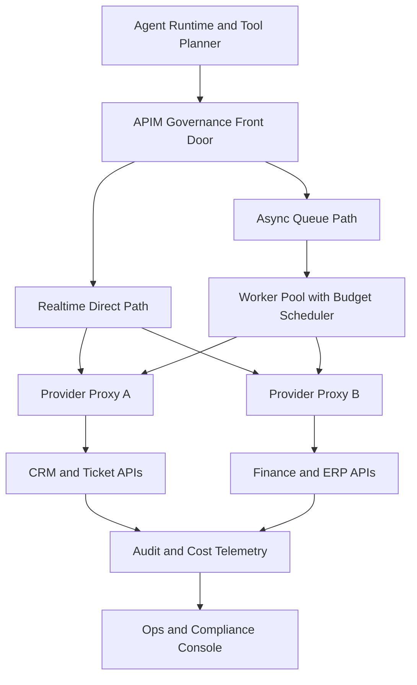
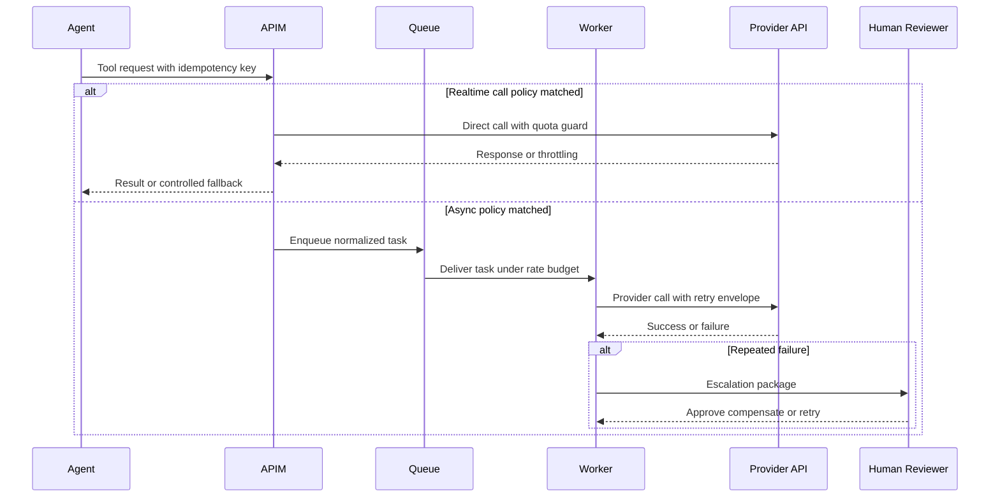

# Enterprise Outbound SaaS Tool Governance Selection FAQ: APIM Quota Circuit-Breakers vs Queue Buffers vs Provider Proxies
> 🌐 **Language / 语言切换**: **[🇨🇳 中文版](outbound-saas-tool-governance-apim-quota-circuit-breaker-vs-queue-buffer-vs-provider-proxy-selection-faq.md)** | **[🇬🇧 English](outbound-saas-tool-governance-apim-quota-circuit-breaker-vs-queue-buffer-vs-provider-proxy-selection-faq.en.md)** | **[📚 Back to Index](README.en.md)**
> Evidence labels: `measured` / `synthetic` / `anonymized_reported`
> Retrieval date: 2026-11-22

## 1) Executive Summary: the first production priority is controllable failure, not fastest success
When enterprise agents reach production,
they usually invoke
CRM APIs,
ticketing systems,
finance platforms,
commerce services,
and external risk providers.
Most of these calls
are triggered automatically
through tool pipelines.
At scale,
the critical risk
is not a slower response.
It is uncontrolled failure:
provider throttling cascades,
retry storms,
cross-tenant quota interference,
and duplicate write operations.
Architecture selection must optimize
for predictable degradation,
auditable compensation,
and continuity under stress.
This guide compares four patterns:
APIM quota and circuit-breaker front door,
queue-buffered worker shaping,
provider-specific proxy isolation,
and hybrid layered governance.

## 2) Scenario boundaries: outbound tool governance differs from internal retrieval governance
Internal retrieval governance
focuses on
authorization trimming
and citation integrity.
Outbound SaaS governance
focuses on
execution correctness.
A single faulty retry
can duplicate orders,
duplicate refunds,
or duplicate ticket creation.
External providers also enforce
shared tenant quotas,
tiered pricing plans,
and burst throttling behavior.
Without budget-aware orchestration
and idempotency controls,
agents can collapse
at peak windows.
That is why outbound design
must jointly cover
quota models,
retry contracts,
write protections,
and deterministic compensation flows.

## 3) Verifiable sources and evidence labels
Source 1 (`measured`): Azure API Management documentation  
https://learn.microsoft.com/azure/api-management/

Source 2 (`measured`): Azure Service Bus documentation  
https://learn.microsoft.com/azure/service-bus-messaging/

Source 3 (`measured`): Azure Event Grid documentation  
https://learn.microsoft.com/azure/event-grid/

Source 4 (`measured`): Azure Functions documentation  
https://learn.microsoft.com/azure/azure-functions/

Source 5 (`measured`): Microsoft Entra workload identity documentation  
https://learn.microsoft.com/entra/workload-id/

Source 6 (`measured`): Azure Monitor and Application Insights documentation  
https://learn.microsoft.com/azure/azure-monitor/

Source 7 (`anonymized_reported`): anonymized B2B enterprise rollout retrospectives.  
Source 8 (`synthetic`): quota hit-rate, recovery, and per-1,000-call cost models.  
Scope note:
this document stays at
enterprise application and service architecture level
without low-level protocol internals.

## 4) Path A: APIM front-door quotas, token buckets, and circuit breakers
This pattern places APIM
in front of all outbound SaaS tools.
It applies
subscription quotas,
token-bucket limits,
burst protection,
and circuit-breaker policies
before calls reach providers.
Its strengths are
centralized governance,
consistent observability,
and tenant-level budget control.
When providers emit 429 or 5xx responses,
the gateway can execute
controlled retries and fallbacks
instead of application-level chaos.
This path fits enterprises
with many teams sharing
the same outbound channels.
Its boundary is clear:
idempotent write protection
cannot rely on gateway policy alone.
Business keys and compensation state
must still be enforced downstream.

## 5) Path B: queue buffering with worker pools for burst shaping
This pattern accepts tool requests
into queues first,
then uses budget-aware workers
to drain at controlled speed.
It works best for
asynchronous tolerant operations:
batch sync,
periodic reconciliation,
non-real-time notifications,
and background enrichment.
Its key value
is transforming burst concurrency
into manageable throughput.
Using queue depth,
drain rate,
and dead-letter handling,
platforms can prevent
peak windows from crushing providers.
For strict real-time flows,
the trade-off is added queue delay,
so this path is usually paired
with a separate direct channel.

## 6) Path C: provider proxy layer with per-vendor isolation
When enterprises integrate
multiple SaaS vendors,
they can define
one proxy layer per provider:
separate credentials,
separate quotas,
separate breaker thresholds,
and separate SLO dashboards.
This prevents
one provider incident
from taking down
the entire outbound estate.
The proxy layer can also host
vendor-specific adaptations,
field mappings,
and version transitions,
keeping top-layer agents
decoupled from provider idiosyncrasies.
Operational overhead is higher,
but long-term governance value
is substantial
for multi-vendor environments.

## 7) Path D: hybrid layered governance (recommended)
In large enterprise practice,
the most stable blueprint
is hybrid layering:
APIM handles entry governance,
queues absorb asynchronous peaks,
provider proxies isolate vendor variation,
and business logic enforces idempotency.
With compensation ledgers
and human-review gates
on high-risk writes,
the platform achieves
controllable failure
rather than blind retries.
This model supports
predictable behavior
even under concurrent spikes
and upstream provider instability.
Its success condition
is explicit layer ownership
to avoid policy overlap
and duplicate retry loops.

## 8) Mermaid: outbound SaaS tool governance reference topology

## 9) 12-dimension enterprise comparison matrix
| Dimension | APIM front door | Queue buffering | Provider proxy layer | Hybrid governance |
|---|---|---|---|---|
| First-release speed | High | Medium | Medium | Medium |
| Quota governance consistency | High | Medium-High | High | High |
| Burst resilience | Medium-High | High | High | High |
| Write idempotency control | Medium | Medium-High | High | High |
| Provider fault isolation | Medium | Medium | High | High |
| Multi-provider scalability | Medium | Medium-High | High | High |
| Audit traceability | High | High | High | High |
| Operations complexity | Low-Medium | Medium | Medium-High | High |
| Cost-optimization headroom | Medium-High | High | Medium-High | High |
| Real-time responsiveness | High | Medium | Medium-High | Medium-High |
| Long-term evolution elasticity | Medium-High | High | High | High |
| Compliance explainability | High | Medium-High | High | High |

## 10) Mermaid: request, retry, compensation, and human takeover flow

## 11) Quant view: P95 latency, interception effectiveness, and cost per 1,000 calls (`synthetic`)
| Metric | APIM front door | Queue buffering | Provider proxy layer | Hybrid governance |
|---|---:|---:|---:|---:|
| End-to-end P95 latency (ms) | 820 | 1,640 | 980 | 1,020 |
| Controlled throttle interception (`anonymized_reported`) | 0.89 | 0.93 | 0.92 | 0.96 |
| Retry-storm suppression rate (`anonymized_reported`) | 0.78 | 0.91 | 0.90 | 0.95 |
| Duplicate-write reduction (`anonymized_reported`) | 0.61 | 0.74 | 0.83 | 0.90 |
| Monthly cost index (baseline=1) | 1.00 | 1.07 | 1.12 | 1.15 |
| Cost per 1,000 tool calls (USD, `synthetic`) | 6.8 | 6.4 | 6.9 | 6.2 |
| Peak-concurrency inflection (QPS) | <450 | >700 | >650 | >800 |
| Recommended role | Fast unified control | Async burst absorber | Multi-vendor isolation | Production target state |

Interpretation:
if your goal is
rapid governance unification,
APIM-first is usually optimal.
As concurrency and vendor count grow,
hybrid layering tends to win
on resilience and long-run economics.

## 12) Decision tree: complete outbound-governance upgrade in 60 days
Step one checks real-time constraints.
If sub-second acknowledgement is mandatory,
retain a direct path
with strict quota and breaker policies.
Step two checks delay tolerance.
Delay-tolerant workloads
should flow into queue buffers.
Step three checks vendor topology.
If providers are multiple and evolving,
introduce proxy isolation early.
Step four checks compliance intensity.
High-audit environments
must enforce idempotency keys
and cross-layer correlation IDs.
Step five checks organizational maturity.
Mature platform teams
can design hybrid layering from day one.
Resource-constrained teams
can launch APIM-first,
then phase in queue and proxy capabilities.

## 13) Common anti-patterns
Anti-pattern one:
treating provider throttles
as generic failures with blind retries.
Operational impact:
retry storms amplify blast radius.
Anti-pattern two:
no unified idempotency key strategy.
Outcome:
duplicate writes cannot be explained or rolled back cleanly.
Anti-pattern three:
forcing all workloads through realtime direct calls.
Trade-off:
provider quotas collapse at burst windows.
Anti-pattern four:
sharing one quota pool and credential across providers.
Risk:
single-vendor incidents spread system-wide.
Anti-pattern five:
missing human takeover entry points.
Failure mode:
high-risk failures cannot be stopped safely.

## 14) Production-readiness checklist
1. Tool budgets are defined by tenant and capability class.  
2. APIM quota, rate-limit, breaker, and audit policies are enabled.  
3. Idempotency keys, retry caps, and compensation contracts are defined.  
4. Dead-letter queues and failure-handling workflows are operational.  
5. Provider-level isolation and credential separation are enforced.  
6. Unified correlation IDs connect end-to-end call traces.  
7. Dashboards monitor success, 429, 5xx, and fallback rates.  
8. High-risk writes require explicit human confirmation.  
9. Capacity replay and pressure-testing playbooks are available.  
10. Provider version-change notifications trigger regression gates.  
11. Cost-per-1,000-call governance alerts are configured.  
12. Quarterly governance review and policy cleanup are scheduled.  

## 15) Practical FAQ (8 questions)
### Q1: Why not rely only on application-level retries?
Because uncontrolled retries
cause multiplicative failure
in throttled provider conditions.

### Q2: When should APIM front-door governance be prioritized?
When you need
rapidly unified auth, quota, and audit controls
across shared outbound channels.

### Q3: Does queue buffering hurt user experience?
It increases latency,
but strongly improves burst stability.
Use it only where async semantics are acceptable.

### Q4: What is the core value of provider proxies?
They isolate vendor-specific behavior
away from business-agent logic.

### Q5: Is hybrid governance always required?
No.
For small single-provider workloads,
APIM-first may be sufficient.

### Q6: Which KPI set best proves governance ROI?
Track
throttle interception effectiveness,
retry-storm suppression,
duplicate-write reduction,
and cost per 1,000 calls.

### Q7: What is the most common launch failure?
Idempotency and compensation logic
not being bound to business keys.

### Q8: How do you classify Good fit vs Not for?
Good fit:
high outbound volume,
multi-provider integrations,
and strict compliance accountability.
Not for:
low-concurrency single-system teams
that do not need unified governance controls.
