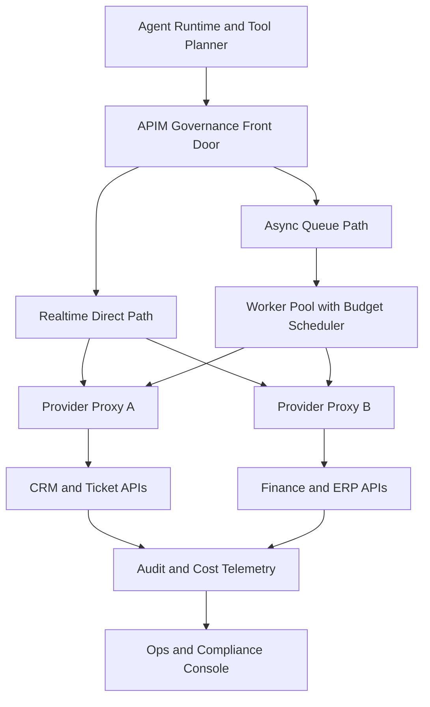
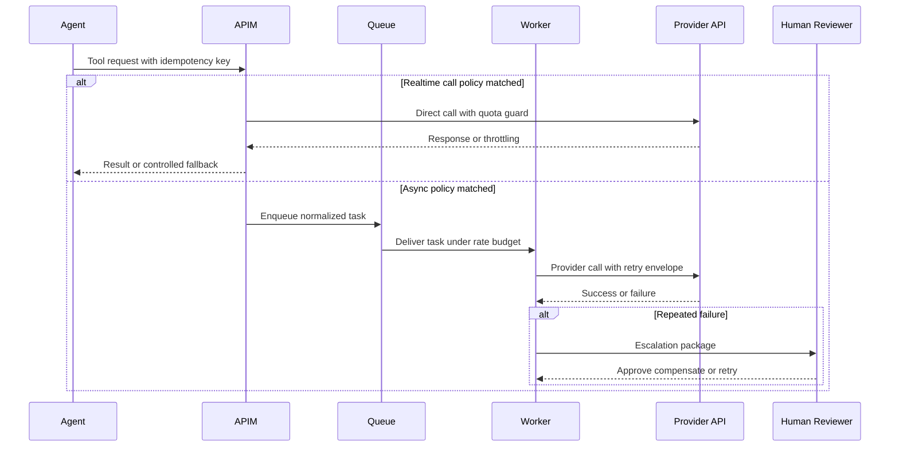

# 企业外部 SaaS 工具调用治理选型 FAQ：APIM 配额熔断 vs 队列缓冲 vs 供应商代理层
> 🌐 **Language / 语言切换**: **[🇨🇳 中文版](outbound-saas-tool-governance-apim-quota-circuit-breaker-vs-queue-buffer-vs-provider-proxy-selection-faq.md)** | **[🇬🇧 English](outbound-saas-tool-governance-apim-quota-circuit-breaker-vs-queue-buffer-vs-provider-proxy-selection-faq.en.md)** | **[📚 返回目录](README.md)**
> 证据标签：`measured` / `synthetic` / `anonymized_reported`
> 抓取日期：2026-11-22

## 1) 执行摘要：企业智能体外呼 SaaS 的第一优先级是“可控失败”，不是“最快成功”
企业级智能体落地到生产后，
往往要调用
CRM、
工单系统、
财务平台、
电商后台、
与外部风控接口。
这些调用
通常由代理工具链自动触发。
一旦并发上升，
最危险的不是慢一点，
而是失控失败：
供应商限流雪崩、
重试风暴、
跨租户配额串扰、
以及写操作重复执行。
因此架构选型的核心
不是单次成功率，
而是高压场景下
能否有序降级、
可追溯补偿、
并保持业务连续性。
本指南对比四类企业模式：
APIM 配额与熔断前置、
消息队列削峰缓冲、
供应商代理层隔离、
以及双层混合治理架构。

## 2) 场景边界：外呼工具治理与内部检索治理的不同
内部知识检索
主要风险是
权限泄露与错误引用。
外部 SaaS 调用
风险更偏执行面：
一次错误重试
可能重复下单、
重复退款、
或重复创建工单。
此外，
外部供应商通常采用
共享租户限额、
分级 API 价格、
与突发频控策略。
智能体若缺少
调用预算意识与幂等控制，
就会在高峰时段
触发大面积失败。
所以外呼治理必须覆盖
配额模型、
重试策略、
写操作保护、
与跨系统补偿机制。

## 3) 可验证来源与证据标签
来源 1（`measured`）：Azure API Management 文档  
https://learn.microsoft.com/azure/api-management/

来源 2（`measured`）：Azure Service Bus 文档  
https://learn.microsoft.com/azure/service-bus-messaging/

来源 3（`measured`）：Azure Event Grid 文档  
https://learn.microsoft.com/azure/event-grid/

来源 4（`measured`）：Azure Functions 文档  
https://learn.microsoft.com/azure/azure-functions/

来源 5（`measured`）：Microsoft Entra 工作负载身份文档  
https://learn.microsoft.com/entra/workload-id/

来源 6（`measured`）：Azure Monitor 与 Application Insights 文档  
https://learn.microsoft.com/azure/azure-monitor/

来源 7（`anonymized_reported`）：匿名化 B2B 企业工具调用治理复盘。  
来源 8（`synthetic`）：配额命中率、失败恢复、每千调用成本测算模型。  
说明：
本文聚焦企业应用与服务架构，
不展开协议栈底层实现细节。

## 4) 路径 A：APIM 配额、令牌桶与熔断器前置治理
该路径把 APIM 置于
所有外部 SaaS 调用前方，
通过订阅级配额、
令牌桶限速、
突发保护、
与熔断器策略
管理外呼流量。
其优势在于
策略集中、
可观测统一、
并能按租户分配预算。
当供应商返回 429 或 5xx 时，
网关可执行
受控重试与降级分流，
避免应用层无序自旋。
此路径适合
多团队共享外呼通道
且需要统一治理的企业。
其边界是
写操作幂等控制
不能只靠网关，
还需结合业务主键与补偿状态机。

## 5) 路径 B：队列缓冲 + Worker 池削峰填谷
该路径将智能体请求
先写入消息队列，
再由受控 Worker 池
按预算速率外呼供应商。
它特别适合
异步可延迟任务：
批量同步、
周期性对账、
非实时通知、
以及后台资料采集。
核心价值是
把突发并发
转化为可管理吞吐。
通过队列长度、
消费速率、
与重试死信策略，
平台可以避免
高峰期直接压垮外部接口。
但对于强实时场景，
该路径会引入排队时延，
需要与直连通道组合设计。

## 6) 路径 C：供应商代理层（Provider Proxy）按厂商隔离
当企业接入多个 SaaS 供应商时，
可为每个供应商
建立独立代理层：
独立凭据、
独立配额、
独立熔断阈值、
独立告警看板。
这样能避免
某一供应商异常
拖垮全部外呼链路。
同时可在代理层
实现供应商特定协议适配、
字段映射、
和版本演进控制，
减少上层智能体
对供应商细节的耦合。
该路径运维成本较高，
但在多供应商长期并行时
有明显治理价值。

## 7) 路径 D：混合治理（推荐）
在大型企业实践中，
常见稳定方案是混合治理：
APIM 管理入口预算与策略，
队列承接可延迟任务洪峰，
供应商代理层负责厂商差异与故障隔离。
再叠加
幂等键、
业务补偿表、
人工确认闸门，
构成“可控失败”体系。
这种模式下，
智能体可以在
高并发与供应商波动下
保持可预测行为。
其关键成功点
在于明确分层责任，
避免策略冲突与重复重试。

## 8) Mermaid：外呼 SaaS 工具治理分层拓扑

## 9) 12 维企业选型对比矩阵
| 维度 | APIM 前置 | 队列缓冲 | 供应商代理层 | 混合治理 |
|---|---|---|---|---|
| 首版交付速度 | 高 | 中 | 中 | 中 |
| 配额治理一致性 | 高 | 中高 | 高 | 高 |
| 突发抗压能力 | 中高 | 高 | 高 | 高 |
| 写操作幂等控制 | 中 | 中高 | 高 | 高 |
| 供应商故障隔离 | 中 | 中 | 高 | 高 |
| 多供应商扩展性 | 中 | 中高 | 高 | 高 |
| 审计可追溯性 | 高 | 高 | 高 | 高 |
| 运维复杂度 | 低中 | 中 | 中高 | 高 |
| 成本优化空间 | 中高 | 高 | 中高 | 高 |
| 实时响应能力 | 高 | 中 | 中高 | 中高 |
| 长期演进弹性 | 中高 | 高 | 高 | 高 |
| 合规可证明性 | 高 | 中高 | 高 | 高 |

## 10) Mermaid：请求、重试、补偿与人工接管流

## 11) 量化对比：P95、拦截率与每千调用成本（`synthetic`）
| 指标 | APIM 前置 | 队列缓冲 | 供应商代理层 | 混合治理 |
|---|---:|---:|---:|---:|
| P95 响应时延（ms） | 820 | 1,640 | 980 | 1,020 |
| 限流命中可控拦截率（`anonymized_reported`） | 0.89 | 0.93 | 0.92 | 0.96 |
| 重试风暴抑制率（`anonymized_reported`） | 0.78 | 0.91 | 0.90 | 0.95 |
| 重复写操作下降幅度（`anonymized_reported`） | 0.61 | 0.74 | 0.83 | 0.90 |
| 月度成本指数（基线=1） | 1.00 | 1.07 | 1.12 | 1.15 |
| 每千工具调用成本（美元，`synthetic`） | 6.8 | 6.4 | 6.9 | 6.2 |
| 峰值并发拐点（QPS） | <450 | >700 | >650 | >800 |
| 推荐定位 | 快速统一治理 | 异步削峰主力 | 多供应商隔离 | 生产长期目标 |

解读：
若目标是
快速建立统一入口，
APIM 前置最有效。
当并发与供应商复杂度同步上升，
混合治理在稳定性与成本上
更具长期优势。

## 12) 决策树：如何在 60 天内完成外呼治理升级
第一步看实时性。
必须亚秒回执的流程
应保留直连路径，
并设置硬性配额与熔断。
第二步看任务可延迟性。
可延迟任务
优先进入队列缓冲。
第三步看供应商数量。
多供应商长期并行时，
应尽早建立代理层隔离。
第四步看合规强度。
若审计要求高，
必须强制幂等键与追踪主键。
第五步看组织能力。
平台团队成熟时，
可直接设计混合治理。
资源有限时，
先上线 APIM 前置，
再逐步引入队列和代理层。

## 13) 常见反模式
反模式一：
把供应商限流错误
当作普通失败无脑重试。
影响：
触发重试风暴并扩大故障面。
反模式二：
没有统一幂等键。
结果：
重复写操作无法追责与回滚。
反模式三：
所有任务都走实时直连。
代价：
高峰期供应商配额瞬间打满。
反模式四：
跨供应商共用同一配额池与凭据。
风险：
单点异常扩散到全局。
反模式五：
缺少人工接管入口。
业务影响：
高风险失败无法及时止损。

## 14) 生产就绪检查清单
1. 已定义按租户和工具维度的调用预算。  
2. 已启用 APIM 配额、限速、熔断与审计策略。  
3. 已定义幂等键、重试上限与补偿策略。  
4. 已建立死信队列与异常处理工作流。  
5. 已建立供应商级别隔离与独立凭据管理。  
6. 已建立统一追踪主键串联调用链路。  
7. 已接入调用成功率、429、5xx 监控看板。  
8. 已建立高风险写操作人工确认门禁。  
9. 已建立容量回放与压力测试流程。  
10. 已建立供应商版本变更通知与回归机制。  
11. 已建立每千调用成本与预算告警阈值。  
12. 已建立季度治理评审与策略清理机制。  

## 15) 实战 FAQ（8 问）
### Q1：为什么不能只依赖应用层重试？
因为无序重试
在限流场景会指数放大故障。

### Q2：何时优先 APIM 前置？
当你需要
快速统一鉴权、配额与审计策略，
并且已有多团队共享外呼通道。

### Q3：队列缓冲会不会拖慢体验？
会增加延迟，
但能显著提升峰值稳定性。
应仅用于可异步任务。

### Q4：供应商代理层的核心价值是什么？
把厂商差异和故障边界
从业务智能体中剥离出来。

### Q5：混合治理是否一定必要？
不是。
在小规模单供应商场景，
APIM 前置通常足够。

### Q6：如何衡量治理收益？
看四项：
限流可控拦截率、
重试风暴抑制率、
重复写操作下降幅度、
每千调用成本。

### Q7：最常见上线失败点是什么？
幂等策略与补偿流程
未与业务主键绑定。

### Q8：Good fit vs Not for 如何划分？
Good fit：
外部 API 调用量高、
多供应商并行、
且合规审计要求强的企业。
Not for：
单一系统低并发、
且无需统一治理平台的小型团队。
