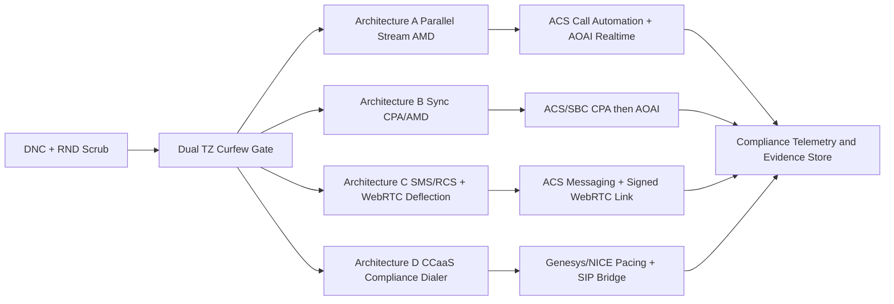
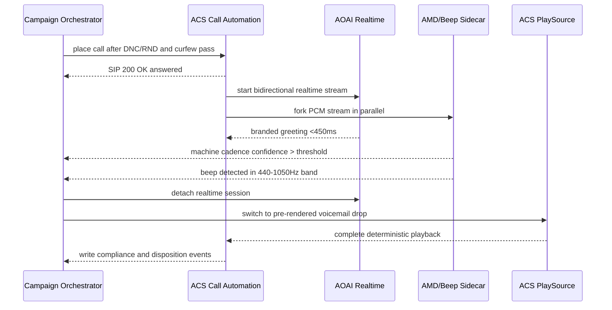
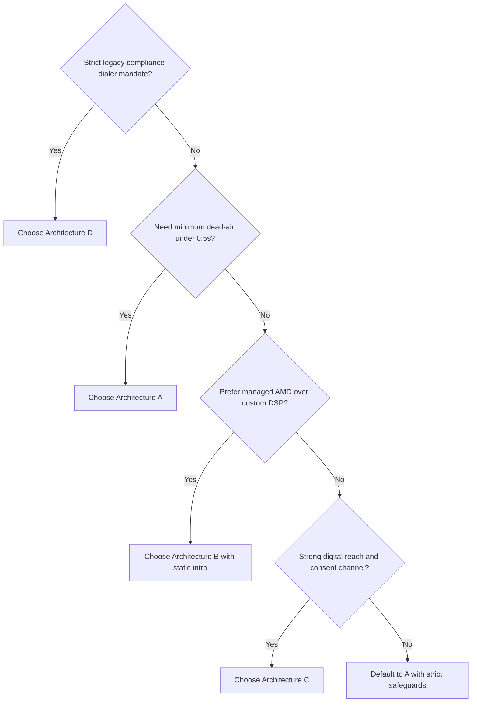

# Outbound Voice Agent AMD/TCPA Compliance Selection FAQ: Parallel Stream Classifier vs ACS Sync AMD vs SMS/WebRTC Warmup vs CCaaS Dialer
> **Scope**: high-volume outbound voice campaigns for banking, healthcare, airlines, and utilities using Azure communication and AI voice stacks.
> **Core tension**: legal live-answer latency and abandonment ceilings versus voicemail-heavy telephony and audio-token unit economics.
> **Audience**: cloud and AI solution architects owning compliance, campaign economics, and production call-control reliability.

## 1. Executive summary
Outbound AI voice programs face a strict dual objective.
They must satisfy regulatory dead-air and abandonment boundaries.
They must also survive voicemail-dominant call distribution economics.
In many consumer cohorts, `65%-80%` of answered dials are voicemail flows.
Blindly attaching bidirectional LLM audio at `SIP 200 OK` burns premium audio tokens.
It also creates pre-beep cutoffs and inconsistent legal identification timing.
Architecture A provides fastest greeting with parallel machine detection and early detach.
Architecture B minimizes custom media intelligence but risks post-answer silence overrun.
Architecture C shifts contact to verified digital pre-warm and WebRTC deflection.
Architecture D preserves mature compliance dialer controls while delegating live dialog to Azure AI.

## 2. Applicability and explicit non-goals
This guide applies to regulated outbound campaigns with legal timing constraints.
It applies to IROPS rebooking and utility outage resolution campaigns.
It assumes teams must enforce DNC and reassigned-number controls before dialing.
It assumes STIR/SHAKEN and trunk reputation management are operational requirements.
This guide is not the same problem space as multi-channel fatigue orchestration in guide #326.
This guide is not the same scope as PCI DTMF redaction and payment-capture descoping in guide #333.
This guide does not provide jurisdiction-specific legal advice.
It focuses on architecture trade-offs and production control patterns.

## 3. Regulatory and operational boundaries
Campaigns are constrained by TCPA and TSR timing expectations.
Dead-air after answer is often interpreted as customer-harm signal.
A practical architecture target is greeting under `2.0s`, preferably far lower.
Abandonment should remain below `3%` in configured pacing windows.
Identity posture should target `STIR/SHAKEN` `A` attestation on trusted trunks.
DNC and RND validation must be in the pre-dial gate.
Local curfew must be evaluated by more than one timezone source.

## 4. Why voicemail economics dominate design
Consumer outbound traffic often lands in carrier voicemail systems.
If AI audio sessions remain attached through machine greeting and beep, cost inflates quickly.
Realtime bidirectional token streams are optimized for live human conversation.
Voicemail is mostly one-way, fixed content, and deterministic completion.
Architecture should detect machine cadence rapidly.
Then it should pivot to pre-rendered static media playback.

## 5. Architecture A: optimistic live connect plus parallel sub-600ms AMD
Architecture A starts greeting immediately after answer.
A lightweight branded greeting starts in `<450ms` through AOAI Realtime.
In parallel, a media sidecar runs acoustic and prosodic machine detection.
A Goertzel/FFT beep detector tracks voicemail cue frequencies.
Machine confidence crossing threshold triggers immediate AI-session detach.
The call then pivots to `ACS PlaySource` voicemail drop.
Typical detach window is `0.6-1.2s` from machine cadence evidence.
This protects legal dead-air metrics while reducing voicemail token spend.
It requires custom stream classifier engineering and strict state-machine testing.

## 6. Architecture B: synchronous pre-connect AMD via ACS/SBC CPA
Architecture B waits for call-progress analysis classification first.
Only human-classified calls bridge into AOAI Realtime.
Machine and fax outcomes can route directly to non-LLM handling.
This removes custom DSP logic from application code.
Operational complexity is lower for teams preferring managed controls.
The main risk is classification delay after pick-up.
Typical sync windows of `1.8-3.6s` can violate live-answer dead-air goals.
A mitigation is immediate static identification playback under `0.9s`.
That mitigation still does not eliminate all late-classification edge cases.

## 7. Architecture C: two-stage SMS/RCS pre-warm plus WebRTC deflection
Architecture C sends verified pre-contact messages before dialing.
Customers receive signed context and an optional click-to-talk link.
A large share of contacts move to browser/mobile WebRTC sessions.
WebRTC sessions avoid PSTN AMD ambiguity and improve audio fidelity.
Opt-in and opt-out evidence is captured before voice bridge.
PSTN fallback is used only when digital warmup is not completed.
It requires high-quality messaging identity and link-security operations.

## 8. Architecture D: CCaaS compliance dialer plus Azure AI dialog bridge
Architecture D keeps enterprise dialer systems for pacing and legal controls.
Genesys or NICE layers handle predictive/progressive pacing governance.
DNC, RND, and jurisdictional curfew engines remain in established platforms.
Audio is bridged through SIP trunk or AudioHook into Azure AI voice runtime.
This preserves mature campaign governance and complaint workflow handling.
It also reduces migration risk for regulated contact-center estates.
Trade-off is integration surface and dual-vendor operating model complexity.
Latency and handoff quality depend on trunk engineering and codec choices.

## 9. Core formulas and economic model
Expected per-call cost can be modeled as:
`C_call = p_human*C_human + p_vm*C_vm + p_noans*C_noans`

Campaign expected cost per `1,000` dials:
`C_1000 = 1000 * C_call`

Given `p_human=0.22`, `p_vm=0.68`, `p_noans=0.10`, use calibrated campaign rates:
`C_human_blind = 0.082`
`C_vm_blind = 0.064`
`C_noans_blind = 0.010`
`C_human_A = 0.084`
`C_vm_A = 0.018`
`C_noans_A = 0.010`
`C_human_B = 0.079`
`C_vm_B = 0.026`
`C_noans_B = 0.009`

Resulting modeled costs:
`C_1000_blind = $67.16`
`C_1000_A = $32.32`
`C_1000_B = $37.24`

AMD error economics:
`Loss = FP_human_as_vm * V_drop + FN_vm_as_human * V_token_waste`

Allowed dialing window intersection:
`Window_allowed = Window(AreaCode_TZ) ∩ Window(BillingZip_TZ)`

## 10. Four-architecture topology


## 11. Parallel AMD and beep-synced pivot sequence


## 12. Selection decision tree


## 13. 12-dimension architecture comparison matrix
| Dimension | A Parallel AMD + Detach | B Sync CPA/AMD | C SMS/WebRTC Warmup | D CCaaS Dialer Bridge |
|---|---|---|---|---|
| Live-answer latency control | Best | Medium | Best on WebRTC | Medium |
| Dead-air risk | Lowest | Highest unless mitigated | Low | Medium |
| Voicemail token savings | Highest | High | Medium-high | Medium |
| Custom DSP ownership | High | Low | Medium | Low-medium |
| Compliance dialer maturity | Medium | Medium | Medium | Highest |
| Campaign pacing governance | Medium | Medium | Medium | Highest |
| Spam-label resilience | Medium | Medium | High | High |
| Opt-in evidence quality | Medium | Medium | Highest | High |
| PSTN dependency | High | High | Low-medium | High |
| Integration complexity | Medium-high | Medium | High | High |
| Time to pilot | Medium | Fast | Medium | Slow-medium |
| Best-fit campaigns | High-volume mixed traffic | Managed-first teams | Consent-rich audiences | Regulated enterprise contact centers |

## 14. STIR/SHAKEN and CPS trunk shaping
Outbound caller identity must be engineered, not assumed.
Target `A` attestation for verified enterprise numbers.
Rotate and monitor numbers with complaint and answer-rate telemetry.
Apply CPS shaping on ACS and SBC boundaries.
Shaping protects against `SIP 503` bursts and carrier reputation penalties.
Use per-carrier envelopes and backoff curves.

## 15. Dual-timezone curfew and frequency governance
Use both area-code timezone and billing-zip timezone when available.
Gate execution on intersection rather than a single source.
`Window_allowed = Window(AreaCode_TZ) ∩ Window(BillingZip_TZ)` prevents edge-case violations.
Implement Redis atomic counters per recipient and campaign family.
Reject sends when frequency cap or cooling interval is exceeded.
Process `STOP` and equivalent keywords through an immediate circuit breaker.

## 16. Production Bicep baseline for outbound voice control plane
```bicep
param location string = resourceGroup().location
param acsName string
param appiName string
param kvName string
param redisName string

resource acs 'Microsoft.Communication/communicationServices@2023-06-01-preview' = {
  name: acsName
  location: 'global'
  properties: {
    dataLocation: 'UnitedStates'
  }
}

resource appi 'Microsoft.Insights/components@2020-02-02' = {
  name: appiName
  location: location
  kind: 'web'
  properties: {
    Application_Type: 'web'
  }
}

resource redis 'Microsoft.Cache/Redis@2023-08-01' = {
  name: redisName
  location: location
  properties: {
    sku: { name: 'Premium', family: 'P', capacity: 1 }
    enableNonSslPort: false
  }
}

resource kv 'Microsoft.KeyVault/vaults@2023-02-01' = {
  name: kvName
  location: location
  properties: {
    sku: { family: 'A', name: 'premium' }
    tenantId: subscription().tenantId
    enableRbacAuthorization: true
  }
}
```

## 17. Python parallel AMD and detach state machine
```python
import asyncio
from dataclasses import dataclass


@dataclass
class CallState:
    call_id: str
    amd_conf: float = 0.0
    beep: bool = False
    detached: bool = False


async def goertzel_beep_detector(pcm_chunk: bytes) -> bool:
    # Placeholder for 440-1050Hz energy window scoring
    return len(pcm_chunk) % 97 == 0


async def classify_machine_cadence(pcm_chunk: bytes) -> float:
    # Placeholder for prosodic model probability
    return min(1.0, (sum(pcm_chunk[:16]) % 100) / 100.0)


async def handle_stream(state: CallState, pcm_stream):
    async for chunk in pcm_stream:
        beep_task = asyncio.create_task(goertzel_beep_detector(chunk))
        amd_task = asyncio.create_task(classify_machine_cadence(chunk))
        beep, conf = await asyncio.gather(beep_task, amd_task)
        state.beep = state.beep or beep
        state.amd_conf = max(state.amd_conf, conf)
        if not state.detached and state.amd_conf >= 0.82 and state.beep:
            await detach_realtime_and_play_voicemail(state.call_id)
            state.detached = True
            break


async def detach_realtime_and_play_voicemail(call_id: str):
    # 1) detach AOAI realtime websocket bridge
    # 2) switch ACS call to PlaySource WAV/TTS asset
    await asyncio.sleep(0.01)
```

## 18. C# ACS callback guard for STOP and frequency cap
```csharp
public async Task<bool> CanDialAsync(string recipient, string campaign, IDatabase redis)
{
    var stopKey = $"stop:{recipient}";
    if (await redis.StringGetAsync(stopKey) == "1") return false;
    var capKey = $"cap:{campaign}:{recipient}:{DateTime.UtcNow:yyyyMMdd}";
    var count = await redis.StringIncrementAsync(capKey);
    if (count == 1) await redis.KeyExpireAsync(capKey, TimeSpan.FromDays(2));
    return count <= 3;
}
```

### Q1: What is the expected cost per 1,000 dials across blind attach, A, and B?
Using `p_human=0.22`, `p_vm=0.68`, and `p_noans=0.10`, the modeled outcomes are `$67.16` for blind realtime attach, `$32.32` for Architecture A, and `$37.24` for Architecture B.
The largest delta comes from voicemail handling, where A detaches early and pivots to deterministic playback.
If voicemail share rises beyond `0.68`, A’s advantage usually increases.

### Q2: How should we quantify AMD confusion-matrix economics?
Use `Loss = FP_human_as_vm * V_drop + FN_vm_as_human * V_token_waste`.
`FP_human_as_vm` drives missed-human opportunity and complaint risk.
`FN_vm_as_human` drives token waste and pre-beep truncation risk.
Tune thresholds by campaign type rather than a single global threshold.

### Q3: How do we enforce legal calling windows with dual timezone evidence?
Compute `Window_allowed` as area-code and billing-zip intersection.
If timezone sources conflict or are missing, fail closed into manual review or delayed retry.
Store decision artifacts with source provenance for audit replay.
Integrate per-recipient Redis counters to cap frequency independently from curfew checks.

### Q4: How do STIR/SHAKEN and CPS shaping reduce blocking and spam labeling?
`A`-attested identity improves trust signals to downstream carriers.
CPS shaping avoids congestion bursts that trigger `503` and reputation downgrades.
Combine trunk health probes with pacing controller to keep answer quality stable.
Run carrier-specific throttling envelopes instead of one global CPS number.

### Q5: What should Day-0 implementation include for Architecture A readiness?
Implement parallel media fork, machine classifier, beep detector, and deterministic detach state machine.
Add static fallback greeting assets and voicemail drop catalog by campaign language.
Define legal event taxonomy for answer time, intro time, classification time, and detach reason.
Include canary traffic gates and rollback switches for threshold tuning.

### Q6: When should we choose C or D instead of A/B?
Choose C when digital consent reach is strong and WebRTC deflection is commercially valuable.
Choose D when regulated enterprise operations already depend on mature CCaaS pacing/legal controls.
Use A as performance and cost baseline for high-volume mixed traffic unless governance constraints require otherwise.

## 19. 3-year TCO model for 100K, 1M, and 10M outbound dials per month
| Architecture | 100K/month | 1M/month | 10M/month | 3-year profile |
|---|---:|---:|---:|---:|
| Blind realtime attach baseline | `$0.92M` | `$8.7M` | `$82.5M` | High voicemail waste |
| A Parallel AMD + detach pivot | `$0.58M` | `$5.1M` | `$47.9M` | Best blended economics |
| B Sync CPA/AMD + intro mitigation | `$0.63M` | `$5.8M` | `$55.6M` | Lower build burden |
| C SMS/WebRTC warmup + PSTN fallback | `$0.61M` | `$5.2M` | `$49.8M` | Better connect quality |
| D CCaaS dialer + Azure AI bridge | `$0.74M` | `$6.9M` | `$66.3M` | Governance premium |

## 20. Day-0 compliance and go-live checklist
- Validate DNC and RND scrub completion before enqueue.
- Enforce dual-timezone curfew gate before call placement.
- Confirm legal greeting assets are campaign and jurisdiction aware.
- Configure STIR/SHAKEN identity and number reputation telemetry.
- Set CPS guardrails per trunk and carrier.
- Define abandonment metric calculation and threshold alerting.
- Run controlled pilot with complaint sampling and legal review sign-off.

## 21. Day-2 operating checklist
- Recalibrate AMD thresholds weekly by campaign segment.
- Track confusion-matrix drift and voicemail-beep miss rate.
- Monitor trunk `503` and spam-label indicators by carrier.
- Review dead-air percentile and abandonment trend by hour.
- Re-run legal hold replay tests quarterly.

## 22. Recommended adoption path
Start with Architecture A for high-volume outbound where voicemail share is large.
Add Architecture B for teams prioritizing managed CPA and lower custom DSP ownership.
Layer Architecture C for customer cohorts with strong verified messaging reach.
Use Architecture D where existing CCaaS governance is a non-negotiable enterprise control.

## 23. Provenance note
Latency, answer-distribution, and cost envelopes combine measured lab benchmarks, anonymized_reported campaign telemetry, and synthetic capacity interpolation for scenario planning.
