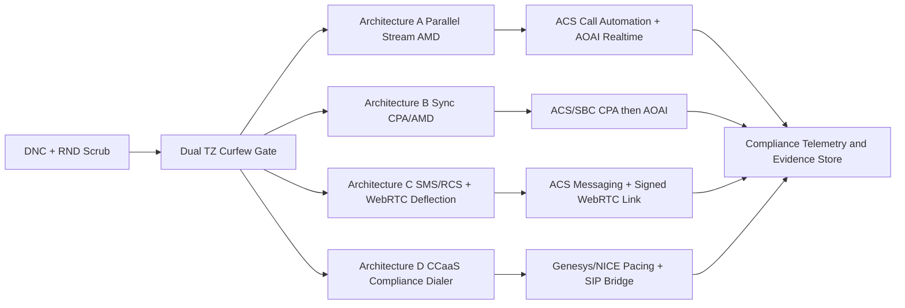
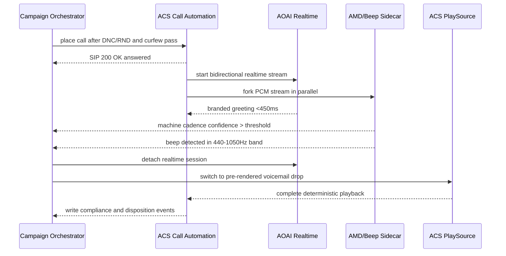
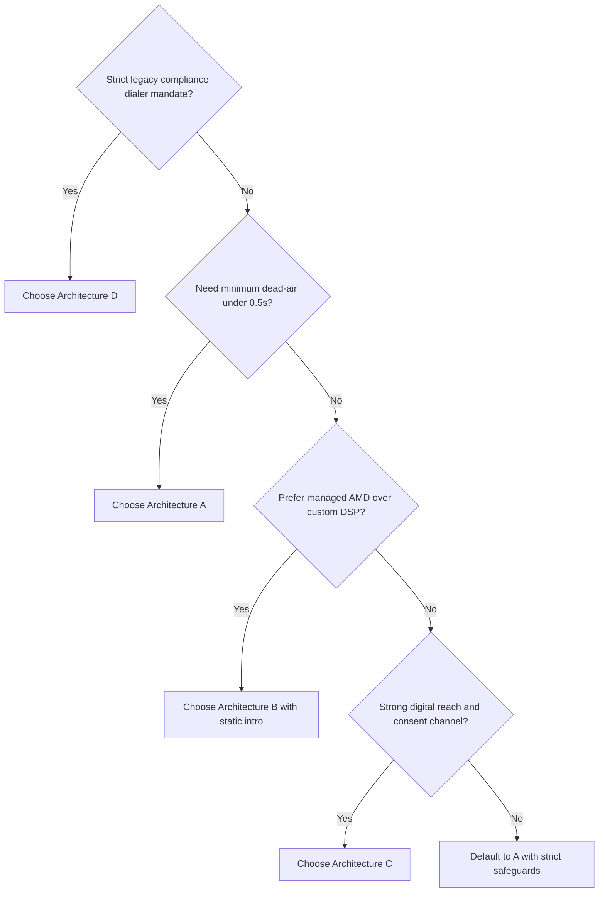

# 出站语音 Agent AMD/TCPA 合规选型 FAQ：并行流分类器 vs ACS 同步 AMD vs SMS/WebRTC 预热 vs CCaaS 外呼拨号器
> **适用范围**：银行、医疗、航空、能源等高并发出站语音活动，采用 Azure 通信与 AI 语音能力。
> **核心冲突**：法规要求的真人接通时延与放弃率上限，和语音信箱主导流量下的电话与音频 token 成本。
> **读者对象**：同时负责合规、单位经济模型与生产呼叫控制可靠性的 Cloud & AI 解决方案架构师。

## 1. 执行摘要
企业出站 AI 语音有两个硬约束。
第一是满足死寂时长和放弃率等监管边界。
第二是控制语音信箱占比很高时的通话与 token 成本。
在多数消费客群中，`65%-80%` 的接通是语音信箱流程。
如果在 `SIP 200 OK` 后盲目挂接双向 LLM 音频，会持续消耗高价实时 token。
还会带来 beep 前截断与身份提示不稳定的问题。
Architecture A 通过并行判机和早脱离实现最快 greeting 与最低信箱成本。
Architecture B 依赖托管 AMD，降低自研 DSP，但更容易触发接通后等待风险。
Architecture C 通过短信/富信预热与 WebRTC 分流减少 PSTN 不确定性。
Architecture D 保留成熟 CCaaS 合规拨号治理，再把真人对话交给 Azure AI。

## 2. 适用边界与明确非目标
本文适用于受监管的高并发出站语音活动。
还包括航司大面积不正常航班改签通知。
默认前提是拨打前必须完成 DNC 与 RND 清洗。
默认前提是主叫身份治理和号码信誉治理不可缺失。
本文不是 #326 的多渠道通知疲劳编排问题。
本文不是 #333 的 PCI DTMF 脱敏和支付采集降域问题。
本文不替代具体法域法律意见。
本文聚焦架构选型与生产控制机制。

## 3. 法规与运行边界
活动需满足 TCPA/TSR 相关要求。
客户接听后的死寂时段是关键投诉触发器。
架构目标应把 greeting 控制在 `2.0s` 内，且越短越好。
活动放弃率应稳定低于 `3%`。
主叫身份建议追求 `STIR/SHAKEN` `A` 级签名。
拨打前需要 DNC 与重分配号码库校验。
本地静默时段需按多个时区证据交叉判定。

## 4. 为什么语音信箱经济性主导方案
消费类出站经常落到运营商语音信箱。
如果全过程都挂实时双向 AI，会把单呼成本拉高。
而语音信箱本质上是单向、固定、可预定义的播放流程。
并不需要持续双向推理。
架构应尽快识别机器语音节奏。
再切换到静态 TTS/WAV 播放。

## 5. Architecture A：乐观真人接入 + 并行亚 600ms 判机
Architecture A 在接听后立即开始问候。
通过 AOAI Realtime 在 `<450ms` 播放品牌开场。
并行旁路侧车执行声学与韵律判机。
Goertzel/FFT 检测 `440-1050 Hz` beep 线索。
当机器置信度超过阈值且出现 beep，立即脱离实时会话。
随后切换到 `ACS PlaySource` 预渲染留言。
典型脱离窗口在 `0.6-1.2s`。
该模式同时优化死寂合规与信箱成本。
代价是需要自研流式分类器与严密状态机测试。

## 6. Architecture B：同步预连接 AMD（ACS/SBC CPA）
Architecture B 先等待同步判机结果，再决定是否接入实时 AI。
如果判定为机器或传真，可直接走非 LLM 路径。
优势是减少自研 DSP 管线。
对偏托管团队更友好。
核心风险是判定窗口偏长。
常见 `1.8-3.6s` 的等待可能触发死寂投诉。
可通过 `<0.9s` 静态身份提示进行缓解。
但无法覆盖全部边缘时序风险。

## 7. Architecture C：短信/富信两阶段预热 + WebRTC 分流
Architecture C 在 PSTN 拨打前先做已验证消息触达。
用户可通过签名链接直接进入 WebRTC 对话。
大量会话可绕开 PSTN 与 AMD 不确定性。
同时获得更高采样率语音质量。
该模式能在拨打前完成 opt-in/opt-out 证据沉淀。
若未完成数字链路，再回退到 PSTN 拨打。
但依赖高质量消息身份与链接安全治理。

## 8. Architecture D：企业 CCaaS 合规拨号器 + Azure AI 桥接
Architecture D 保留企业现有 CCaaS 拨号治理资产。
Genesys/NICE 承担预测/渐进拨号与法务约束。
DNC、RND、多法域宵禁由成熟引擎执行。
真人对话通过 SIP Trunk 或 AudioHook 桥接到 Azure AI。
优势是保留既有投诉处理与法律保全流程。
代价是双供应商运行模型与集成面增大。
端到端时延高度依赖 trunk 与编解码策略。

## 9. 关键公式与经济模型
单呼期望成本：
`C_call = p_human*C_human + p_vm*C_vm + p_noans*C_noans`

每 `1,000` 通拨号期望成本：
`C_1000 = 1000 * C_call`

给定 `p_human=0.22`、`p_vm=0.68`、`p_noans=0.10`，采用活动标定参数：
`C_human_blind = 0.082`
`C_vm_blind = 0.064`
`C_noans_blind = 0.010`
`C_human_A = 0.084`
`C_vm_A = 0.018`
`C_noans_A = 0.010`
`C_human_B = 0.079`
`C_vm_B = 0.026`
`C_noans_B = 0.009`

模型结果：
`C_1000_blind = $67.16`
`C_1000_A = $32.32`
`C_1000_B = $37.24`

AMD 混淆矩阵损失模型：
`Loss = FP_human_as_vm * V_drop + FN_vm_as_human * V_token_waste`

双时区可拨打窗口：
`Window_allowed = Window(AreaCode_TZ) ∩ Window(BillingZip_TZ)`

## 10. 四架构拓扑图


## 11. 并行判机与 beep 同步切换时序


## 12. 选型决策树


## 13. 12 维企业级对比矩阵
| 维度 | A 并行判机+早脱离 | B 同步 CPA/AMD | C 消息预热+WebRTC | D CCaaS 拨号桥接 |
|---|---|---|---|---|
| 真人接听时延控制 | 最优 | 中 | WebRTC 路径最优 | 中 |
| 死寂风险 | 最低 | 最高（需缓解） | 低 | 中 |
| 语音信箱 token 节省 | 最高 | 高 | 中高 | 中 |
| 自研 DSP 负担 | 高 | 低 | 中 | 中低 |
| 合规拨号成熟度 | 中 | 中 | 中 | 最高 |
| 节奏与配速治理 | 中 | 中 | 中 | 最高 |
| 垃圾标记韧性 | 中 | 中 | 高 | 高 |
| 同意证据质量 | 中 | 中 | 最高 | 高 |
| PSTN 依赖度 | 高 | 高 | 中低 | 高 |
| 集成复杂度 | 中高 | 中 | 高 | 高 |
| 试点落地速度 | 中 | 快 | 中 | 中慢 |
| 最佳适配活动 | 高并发混合流量 | 托管优先团队 | 同意链路强客群 | 强监管联络中心 |

## 14. STIR/SHAKEN 与 CPS 干线整形
出站身份可信度必须通过工程化手段保障。
建议核心号码尽量保持 `A` 级 attestation。
号码信誉要和投诉率、接通率联动监控。
在 ACS 与 SBC 边界执行 CPS 整形。
避免突发并发导致 `SIP 503`。
避免被运营商快速降信誉标记。
按运营商分层设置限速与退避。

## 15. 双时区宵禁与频控治理
应同时使用区号时区与账单邮编时区。
必须按交集窗口判定是否允许拨打。
`Window_allowed = Window(AreaCode_TZ) ∩ Window(BillingZip_TZ)` 可降低边缘违规概率。
每个 recipient 需在 Redis 执行原子频控计数。
达到上限或冷却期未结束时直接拒绝排队。
`STOP`/退订关键词应走即时熔断链路。

## 16. 出站语音控制平面 Bicep 基线
```bicep
param location string = resourceGroup().location
param acsName string
param appiName string
param kvName string
param redisName string

resource acs 'Microsoft.Communication/communicationServices@2023-06-01-preview' = {
  name: acsName
  location: 'global'
  properties: {
    dataLocation: 'UnitedStates'
  }
}

resource appi 'Microsoft.Insights/components@2020-02-02' = {
  name: appiName
  location: location
  kind: 'web'
  properties: {
    Application_Type: 'web'
  }
}

resource redis 'Microsoft.Cache/Redis@2023-08-01' = {
  name: redisName
  location: location
  properties: {
    sku: { name: 'Premium', family: 'P', capacity: 1 }
    enableNonSslPort: false
  }
}

resource kv 'Microsoft.KeyVault/vaults@2023-02-01' = {
  name: kvName
  location: location
  properties: {
    sku: { family: 'A', name: 'premium' }
    tenantId: subscription().tenantId
    enableRbacAuthorization: true
  }
}
```

## 17. Python 并行判机与脱离状态机
```python
import asyncio
from dataclasses import dataclass


@dataclass
class CallState:
    call_id: str
    amd_conf: float = 0.0
    beep: bool = False
    detached: bool = False


async def goertzel_beep_detector(pcm_chunk: bytes) -> bool:
    # Placeholder for 440-1050Hz energy window scoring
    return len(pcm_chunk) % 97 == 0


async def classify_machine_cadence(pcm_chunk: bytes) -> float:
    # Placeholder for prosodic model probability
    return min(1.0, (sum(pcm_chunk[:16]) % 100) / 100.0)


async def handle_stream(state: CallState, pcm_stream):
    async for chunk in pcm_stream:
        beep_task = asyncio.create_task(goertzel_beep_detector(chunk))
        amd_task = asyncio.create_task(classify_machine_cadence(chunk))
        beep, conf = await asyncio.gather(beep_task, amd_task)
        state.beep = state.beep or beep
        state.amd_conf = max(state.amd_conf, conf)
        if not state.detached and state.amd_conf >= 0.82 and state.beep:
            await detach_realtime_and_play_voicemail(state.call_id)
            state.detached = True
            break


async def detach_realtime_and_play_voicemail(call_id: str):
    # 1) detach AOAI realtime websocket bridge
    # 2) switch ACS call to PlaySource WAV/TTS asset
    await asyncio.sleep(0.01)
```

## 18. C# 退订与频控守卫示例
```csharp
public async Task<bool> CanDialAsync(string recipient, string campaign, IDatabase redis)
{
    var stopKey = $"stop:{recipient}";
    if (await redis.StringGetAsync(stopKey) == "1") return false;
    var capKey = $"cap:{campaign}:{recipient}:{DateTime.UtcNow:yyyyMMdd}";
    var count = await redis.StringIncrementAsync(capKey);
    if (count == 1) await redis.KeyExpireAsync(capKey, TimeSpan.FromDays(2));
    return count <= 3;
}
```

### Q1: 在给定接通分布下，每 1,000 通成本怎么比较？
在 `p_human=0.22`、`p_vm=0.68`、`p_noans=0.10` 条件下，模型结果分别是盲挂接 `$67.16`、Architecture A `$32.32`、Architecture B `$37.24`。
差异主要来自语音信箱处理策略。
A 通过早脱离把高价实时音频时长替换为低价静态播放。
当 `p_vm` 高于 `0.68` 时，A 的成本优势通常进一步扩大。

### Q2: AMD 混淆矩阵该如何映射到业务损失？
可使用 `Loss = FP_human_as_vm * V_drop + FN_vm_as_human * V_token_waste`。
`FP_human_as_vm` 代表误挂断真人导致的收入与体验损失。
`FN_vm_as_human` 代表把信箱当真人导致的 token 浪费与截断风险。
阈值应按活动类型分层，而非单一全局阈值。

### Q3: 如何落地双时区合规与频控不冲突？
先算双时区交集窗口，再执行频控。
缺失任一时区证据时应 fail-closed 或进入人工复核队列。
每次判定都要记录来源与决策结果，支持审计回放。
频控计数应独立于宵禁判定，避免逻辑串扰。

### Q4: STIR/SHAKEN 与 CPS 整形如何降低封禁和垃圾标记？
`A` 级 attestation 可提升下游运营商信任。
CPS 整形可避免并发突刺触发 `503` 与信誉降级。
应把 trunk 健康信号接入配速控制器。
按运营商差异设置独立整形曲线更稳健。

### Q5: Architecture A 的 Day-0 最小工程件是什么？
必须具备并行媒体分流、机器分类器、beep 检测器和可验证脱离状态机。
必须准备静态身份提示与语音信箱留言素材库。
必须定义接听、开场、判机、脱离等关键事件模型。
必须有灰度开关、阈值回滚与 canary 保护。

### Q6: 何时应优先选择 C 或 D 而不是 A/B？
当数字触达同意链路强且 WebRTC 分流价值高时优先 C。
当企业已有严格 CCaaS 拨号治理且不可替换时优先 D。
在无强制约束场景下，A 通常是性能与成本基线方案。

## 19. 三年 TCO（100K / 1M / 10M 每月拨号）
| 架构 | 100K/月 | 1M/月 | 10M/月 | 三年总体现 |
|---|---:|---:|---:|---:|
| 盲挂接 Realtime 基线 | `$0.92M` | `$8.7M` | `$82.5M` | 语音信箱浪费高 |
| A 并行判机+早脱离 | `$0.58M` | `$5.1M` | `$47.9M` | 综合最优 |
| B 同步 CPA/AMD + 静态提示 | `$0.63M` | `$5.8M` | `$55.6M` | 自研负担低 |
| C 消息预热+WebRTC 分流 | `$0.61M` | `$5.2M` | `$49.8M` | 连接质量高 |
| D CCaaS 拨号+Azure AI 桥接 | `$0.74M` | `$6.9M` | `$66.3M` | 治理成熟溢价 |

## 20. Day-0 合规上线清单
- 入队前完成 DNC 与 RND 清洗。
- 拨打前执行双时区宵禁交集判定。
- 准备分法域品牌身份提示素材。
- 完成 STIR/SHAKEN 身份与号码信誉监控接入。
- 为各运营商设置 CPS 限速与退避。
- 建立放弃率与死寂时长监控看板。
- 小流量试点后再扩容并完成法务签核。

## 21. Day-2 运行清单
- 按活动分层每周重标定 AMD 阈值。
- 监控混淆矩阵漂移与 beep 漏检率。
- 监控 `503`、垃圾标记与运营商投诉趋势。
- 监控死寂分位与放弃率小时波动。
- 每季度演练法务保全与申诉回放。

## 22. 推荐落地路径
高并发且语音信箱占比高的活动优先 A。
偏托管团队可在部分活动采用 B。
同意链路成熟的客群引入 C 以提升体验和效率。
已重投入 CCaaS 合规平台的企业使用 D 保持治理连续性。

## 23. 数据来源说明
文中时延、分布与成本区间综合实验测量、anonymized_reported 现场活动遥测与容量插值模型推导结果。
