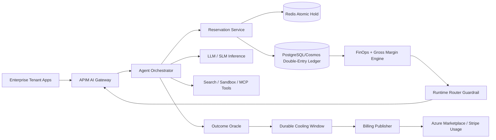
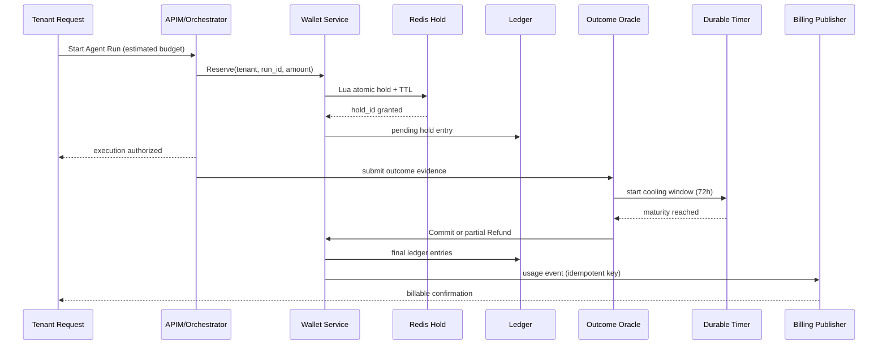

# Enterprise B2B Agent Monetization Selection FAQ: Prepaid Wallet Two-Phase Reservation vs Verified Outcome Oracle vs Real-Time Gross-Margin Guardrail

> 🌐 **Language Switch**: [中文](./outcome-based-agent-pricing-prepaid-wallet-two-phase-reservation-vs-verified-outcome-oracle-vs-gross-margin-guardrail-selection-faq.md) | **English (current)**
> **Audience**: Cloud & AI Solution Architects, SaaS monetization leads, platform billing architects, finance-controllership teams, FinOps and audit stakeholders.
> **Scope**: Production architecture choices for monetizing autonomous enterprise agents without overdraft race conditions, outcome-verification disputes, or negative gross margin under multi-tenant burst traffic.

## 1. Problem framing: why “per-1K token billing” is insufficient for enterprise agent commercialization
Enterprise agent cost is never only model inference.  
Actual unit economics include model tokens, tool execution, search queries, sandbox minutes, third-party API calls, human takeover, rollback compensation, and compliance overhead.  

When a platform relies only on seat pricing or naive metered usage, revenue predictability and cost predictability diverge quickly.  
A small set of adversarial or power-user tenants can consume disproportionately expensive long-context, multi-loop trajectories that push contract-level gross margin below zero.  

The second failure mode is concurrent overdraft under shared tenant wallets.  
If fifty run threads read the same stale balance snapshot and charge independently, a `$500` wallet can become `-$1,400` in seconds.  

The third failure mode is outcome dispute at settlement time.  
Without cryptographically auditable success predicates, “resolved ticket” or “reconciled invoice” claims become unprovable during customer disputes and finance audit.  

Therefore, production commercialization needs four simultaneous guarantees:  
atomic spend authorization, verifiable settlement, auditable revenue recognition, and real-time gross-margin protection.  

## 2. Four-model portfolio: from usage metering to a governed monetization control plane
Model A introduces a prepaid AI credit wallet with two-phase `Reserve -> Commit -> Refund` semantics.  
Model B adds a verified outcome-pricing oracle with cooling-window settlement for variable consideration controls.  

Model C packages seat subscription, pooled commit drawdown, and elastic overage into procurement-friendly contracts.  
Model D enforces a real-time margin floor guardrail that dynamically de-risks routing when tenant-level gross margin deteriorates.  

These models are additive, not mutually exclusive.  
Most enterprise ISVs deploy A as the mandatory base layer, B for high-value outcomes, C as the commercial wrapper, and D as the scale-stage survival guardrail.  

## 3. Reference architecture: tightly coupling runtime controls with billing and settlement controls


The key architectural decision is to avoid isolating billing from runtime control loops.  
If gross-margin and reservation signals do not feed back into routing, cost explosions are detected only after invoice generation, when mitigation is too late.  

## 4. Model A: prepaid wallet with two-phase reserve/commit/refund to prevent concurrent overdraft
Model A starts with atomic reservation before execution.  
Each agent run requests a hold budget and execution proceeds only when reservation is successfully granted.  

A Redis Lua transaction is the common implementation for strict atomicity under high concurrency.  
It combines balance check, hold creation, and TTL assignment in one operation, eliminating multi-request race windows.  

At run completion, final cost is committed and unused hold amount is refunded deterministically.  
For example, a `$12.00` hold with `$8.35` actual spend yields a `$3.65` immediate refund and auditable ledger closure.  

Mid-run cancellation and policy aborts are also naturally supported.  
The system commits only consumed micro-events and releases the remaining hold, which materially lowers customer dispute rates.  

To satisfy enterprise audit requirements, every reservation lifecycle event should be represented in immutable double-entry sub-ledger records.  
That enables exact replay of wallet balance movements at any historical timestamp.  

## 5. Model B: verified outcome-pricing oracle with cooling-window settlement
Outcome pricing only works if “outcome achieved” is objectively verifiable.  
A self-reported success flag from the agent is insufficient for finance-grade billing.  

Production deployments usually define a composite outcome predicate.  
For instance: no human takeover, no ticket reopen within 72 hours, no ERP reversal, and target status closed by approved workflow actor.  

Cooling windows absorb delayed reversals and reduce premature revenue recognition.  
Without the window, platforms post revenue too early and later incur noisy reverse entries with higher audit friction.  

From an accounting perspective, cooling-window outcomes map naturally to variable-consideration controls under ASC 606 / IFRS 15.  
Provisional holds become recognized billable events only after predicate maturity and evidence verification.  

## 6. Model C: hybrid seat + pooled commit drawdown + elastic overage for enterprise procurement alignment
Large enterprises prioritize budget stability and negotiated guardrails.  
Pure usage billing is often rejected because monthly volatility complicates internal approvals and chargeback forecasting.  

Model C combines three pricing layers.  
Seat subscription covers baseline usage, pooled monthly credits absorb predictable burst, and overage handles excess with explicit rates.  

Rollover and expiration policy must be explicit.  
Unlimited rollover increases deferred-liability complexity and weakens cost-risk containment.  

A practical contract pattern is bounded rollover with expiry and policy-triggered soft/hard caps.  
Before hard cap breach, workflows can require CFO approval or switch to capped execution profiles.  

## 7. Model D: real-time tenant gross-margin floor guardrail to prevent negative-margin contracts
Model D protects platform sustainability when runtime behavior becomes cost-adverse.  
The system continuously computes tenant-level real-time gross margin and applies adaptive controls when margin falls below threshold, such as 70%.  

Control actions are prioritized by customer impact.  
Typical sequence: reasoning-effort downgrade, cache-first routing, lower-cost model tier selection, bounded tool fan-out, then strict throttling if required.  

The objective is controlled degradation, not abrupt denial.  
With staged controls, platforms can preserve contractual SLA while steering high-risk tenants back toward safe margin bands.  

## 8. Reservation and settlement sequence: eliminating TOCTOU drift and duplicate charging


This sequence explicitly separates execution authorization from final billability determination.  
By binding commit/refund/publish to idempotent identifiers, retries and duplicate callbacks do not create duplicate charges.  

## 9. 12-dimension comparison matrix across Models A/B/C/D
| Dimension | Model A Prepaid Two-Phase Wallet | Model B Verified Outcome Oracle | Model C Seat+Commit+Overage | Model D Real-Time Margin Guardrail |
|---|---|---|---|---|
| Concurrent overdraft prevention | Very high | Medium | Medium | Low |
| Outcome-dispute resilience | Medium | Very high | Medium | Low |
| Procurement predictability | Medium | Medium | Very high | Medium |
| Real-time stop-loss capability | High | Medium | Medium | Very high |
| Finance-audit traceability | High | Very high | High | Medium-high |
| Implementation complexity | Medium | High | Medium | High |
| Legacy billing integration impact | Medium | High | Medium | Medium |
| Dependency on workflow semantics | Low | High | Medium | Medium |
| Revenue-recognition readiness | High | Very high | High | Medium |
| Burst elasticity alignment | High | Medium | High | High |
| Customer explainability | High | Medium-high | High | Medium |
| Recommended adoption priority | First | Required for high-value outcomes | Contract wrapper layer | Scale-stage mandatory |

The matrix indicates a pragmatic deployment sequence.  
A secures charging correctness, B secures claim correctness, C secures procurement adoption, and D secures long-run platform economics at scale.  

## 10. Unit-economics and gross-margin formulas for architecture review boards
Let `Price_outcome` be billed price per verified outcome, `P_attempt_per_outcome` be expected attempts per verified outcome, and `COGS_attempt` be cost per attempt.  
Then gross margin is: `GM% = (Price_outcome - P_attempt_per_outcome * COGS_attempt) / Price_outcome`.  

Expanded attempt cost can be modeled as:  
`COGS_attempt = C_model + C_tool + C_search + C_sandbox + C_observability + C_handoff`.  

If attempt inflation raises `P_attempt_per_outcome` from `1.6` to `2.9`, gross margin can collapse even when list price is unchanged.  
That is why runtime observability should continuously track attempt count, cache-hit ratio, retry inflation, and handoff rate as leading margin indicators.  

## 11. Quantitative architecture Q&A (Q1–Q6) used in enterprise design reviews
### Q1: How can 50 concurrent threads drive a `$500` wallet to `-$1,400`?
If every thread reads stale balance and each schedules a `$38` charge independently, all threads believe balance is sufficient.  
Total requested spend becomes `$1,900`, so resulting balance is `$500 - $1,900 = -$1,400`.  
Atomic reservation prevents this by granting only holds that fit the live remaining balance.  

### Q2: How much dispute exposure is reduced by deterministic partial refund?
Assume 2,000,000 monthly runs, 6% cancellation rate, `$6.20` average hold, and `$1.10` average consumed amount on canceled runs.  
Without partial refund, disputed overcharge exposure is roughly `$610,000` per month.  
With deterministic refund, exposure drops to about `$108,000`, an ~82% reduction.  

### Q3: Why is a 72-hour cooling window common in outcome settlement?
In ticketing and reconciliation workloads, reopen/reversal events are heavily concentrated in the first 24–48 hours.  
A 72-hour window captures most late reversals while keeping settlement latency operationally acceptable.  
This reduces revenue clawback volatility and audit overhead from premature recognition.  

### Q4: Why is a 70% margin floor frequently selected as runtime guardrail?
Gross margin for the product must still absorb sales, customer-success, and support costs above direct COGS.  
When product margin remains below 70% for sustained periods, operating margin often degrades rapidly.  
Hence 70% is a practical technical trigger threshold, not necessarily the final corporate profitability target.  

### Q5: How does hybrid seat+pool+overage improve renewal stability?
Pure metered billing can create budget anxiety due to monthly spend volatility.  
Hybrid packaging gives procurement predictable baseline spend while preserving controlled burst elasticity.  
In B2B ISV portfolios, this generally improves renewal confidence compared with pure usage-only contracts.  

### Q6: When must outcome pricing move to oracle-verified settlement?
When per-outcome value is high, reversal risk is non-trivial, and dispute resolution cost is material.  
Examples include reconciled invoices, claims decisions, and compliance-grade closure workflows.  
In such domains, immediate self-reported success billing creates unacceptable finance and legal risk.  

## 12. Production implementation (Redis Lua + Python): two-phase reservation service
```lua
-- reserve.lua
-- KEYS[1] = wallet:balance:{tenant_id}
-- KEYS[2] = wallet:hold:{tenant_id}:{hold_id}
-- ARGV[1] = amount_cents
-- ARGV[2] = hold_ttl_seconds
local balance = tonumber(redis.call("GET", KEYS[1]) or "0")
local amount = tonumber(ARGV[1])
if balance < amount then
  return {0, balance}
end
redis.call("DECRBY", KEYS[1], amount)
redis.call("HMSET", KEYS[2], "amount", amount, "state", "reserved")
redis.call("EXPIRE", KEYS[2], tonumber(ARGV[2]))
local remain = tonumber(redis.call("GET", KEYS[1]) or "0")
return {1, remain}
```

```python
from dataclasses import dataclass
import uuid

@dataclass
class ReserveResult:
    accepted: bool
    hold_id: str
    remaining_cents: int

class WalletService:
    def __init__(self, redis_client, ledger_repo):
        self.redis = redis_client
        self.ledger = ledger_repo

    async def reserve(self, tenant_id: str, amount_cents: int, ttl_seconds: int = 900) -> ReserveResult:
        hold_id = str(uuid.uuid4())
        ok, remain = await self.redis.evalsha(
            "reserve_lua_sha",
            2,
            f"wallet:balance:{tenant_id}",
            f"wallet:hold:{tenant_id}:{hold_id}",
            amount_cents,
            ttl_seconds,
        )
        accepted = int(ok) == 1
        if accepted:
            await self.ledger.append_pending_hold(
                tenant_id=tenant_id,
                hold_id=hold_id,
                amount_cents=amount_cents,
            )
        return ReserveResult(accepted=accepted, hold_id=hold_id, remaining_cents=int(remain))

    async def commit_or_refund(self, tenant_id: str, hold_id: str, actual_cost_cents: int) -> None:
        hold = await self.redis.hgetall(f"wallet:hold:{tenant_id}:{hold_id}")
        reserved = int(hold["amount"])
        refund = max(reserved - actual_cost_cents, 0)
        if refund > 0:
            await self.redis.incrby(f"wallet:balance:{tenant_id}", refund)
        await self.ledger.finalize_hold(
            tenant_id=tenant_id,
            hold_id=hold_id,
            reserved_cents=reserved,
            actual_cents=actual_cost_cents,
            refund_cents=refund,
        )
```

This implementation enforces atomic reserve semantics, deterministic refunding, and auditable state transitions.  
Production rollout should additionally include replay-window signatures, region-failover idempotency, and clock-skew tolerance policy.  

## 13. Production implementation (SQL + settlement publisher): immutable ledger and cooling-window confirmation
```sql
CREATE TABLE wallet_ledger_entry (
  entry_id              BIGSERIAL PRIMARY KEY,
  tenant_id             TEXT NOT NULL,
  hold_id               TEXT NOT NULL,
  run_id                TEXT NOT NULL,
  phase                 TEXT NOT NULL CHECK (phase IN ('reserve','commit','refund','settlement')),
  debit_cents           BIGINT NOT NULL DEFAULT 0,
  credit_cents          BIGINT NOT NULL DEFAULT 0,
  currency              TEXT NOT NULL DEFAULT 'USD',
  idempotency_key       TEXT NOT NULL,
  occurred_at           TIMESTAMPTZ NOT NULL DEFAULT now(),
  UNIQUE (tenant_id, idempotency_key)
);

CREATE TABLE outcome_settlement (
  settlement_id         BIGSERIAL PRIMARY KEY,
  tenant_id             TEXT NOT NULL,
  run_id                TEXT NOT NULL,
  outcome_type          TEXT NOT NULL,
  predicate_hash        TEXT NOT NULL,
  cooling_window_end    TIMESTAMPTZ NOT NULL,
  status                TEXT NOT NULL CHECK (status IN ('provisional','confirmed','reversed')),
  billable_amount_cents BIGINT NOT NULL,
  created_at            TIMESTAMPTZ NOT NULL DEFAULT now()
);

CREATE INDEX idx_outcome_settlement_pending
ON outcome_settlement (tenant_id, status, cooling_window_end);
```

```python
async def confirm_outcome_and_publish(settlement, predicate_engine, billing_pub):
    verified = await predicate_engine.verify(
        run_id=settlement.run_id,
        predicate_hash=settlement.predicate_hash,
    )
    if not verified:
        await mark_reversed(settlement.settlement_id)
        return {"status": "reversed"}

    event = {
        "tenant_id": settlement.tenant_id,
        "run_id": settlement.run_id,
        "amount_cents": settlement.billable_amount_cents,
        "idempotency_key": f"bill:{settlement.tenant_id}:{settlement.run_id}",
        "outcome_type": settlement.outcome_type,
    }
    await billing_pub.publish_usage(event)
    await mark_confirmed(settlement.settlement_id)
    return {"status": "confirmed"}
```

By coupling predicate verification and idempotent usage publication, this pattern prevents duplicate settlement in retry-heavy distributed pipelines.  
It also preserves a defensible evidence chain from outcome claim to invoice event.  

## 14. Enterprise deployment scenarios: two high-value ISV commercialization patterns
### Scenario A: global ITSM automation ISV charging per resolved ticket
The provider monetizes by confirmed ticket resolution rather than token volume.  
It deploys A+B+C: reservation before execution, 72-hour oracle maturity, then pooled-contract settlement and overage handling.  

After rollout, reopen-driven revenue reversals and dispute tickets fall materially.  
Audit teams can replay each billable event from `run_id` to predicate evidence to ledger entries without manual reconstruction.  

### Scenario B: accounts-reconciliation SaaS charging per reconciled invoice
This domain has high reversal risk from downstream ERP corrections and finance overrides.  
The provider deploys A+B+D: strict reserve gating, verified oracle settlement, and real-time margin guardrail under month-end burst conditions.  

During quarter-close peaks, staged routing degradation protects SLA while keeping tenant margin above floor.  
Finance operations gain faster reconciliation because runtime and billing traces are joined by immutable idempotency keys.  

## 15. Day-0 / Day-2 checklists and adoption path
### Day-0 checklist (before production launch)
- Define tenant credit policy: initial balance, reservation ceiling, reject behavior, and overage approval chain.  
- Define outcome predicates: success conditions, reversal conditions, cooling-window duration, and evidence signatures.  
- Implement immutable double-entry sub-ledger covering reserve, commit, refund, and settlement phases.  
- Enforce idempotency model across reservation, settlement, and external billing publication paths.  
- Set margin-floor policy (for example 70% warn/degrade, 60% hard cap) and escalation runbook.  

### Day-2 checklist (operational governance)
- Monitor reservation reject rate, reversal rate, margin-floor breach frequency, and dispute ratio as core KPIs.  
- Run weekly top-tenant cost forensics to isolate retry inflation, cache miss hotspots, and expensive tool fan-outs.  
- Continuously tune model routing and cache strategy to improve cost efficiency without violating SLA.  
- Execute periodic audit sampling across run traces, predicate evidence, ledger records, and invoice events.  
- Recalibrate seat/commit/overage packaging quarterly based on observed usage entropy and renewal behavior.  

**Recommended adoption sequence**:  
Deploy Model A first as non-negotiable charging safety baseline,  
package contracts with Model C for procurement readiness,  
add Model B for high-value outcome monetization,  
and enforce Model D when tenant scale and trajectory variance increase.  
