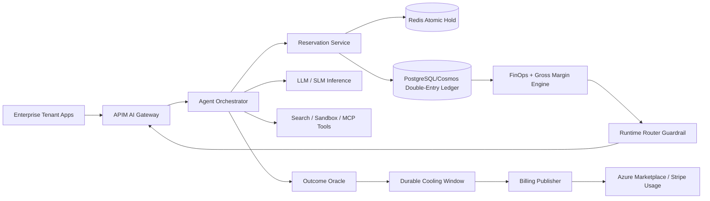
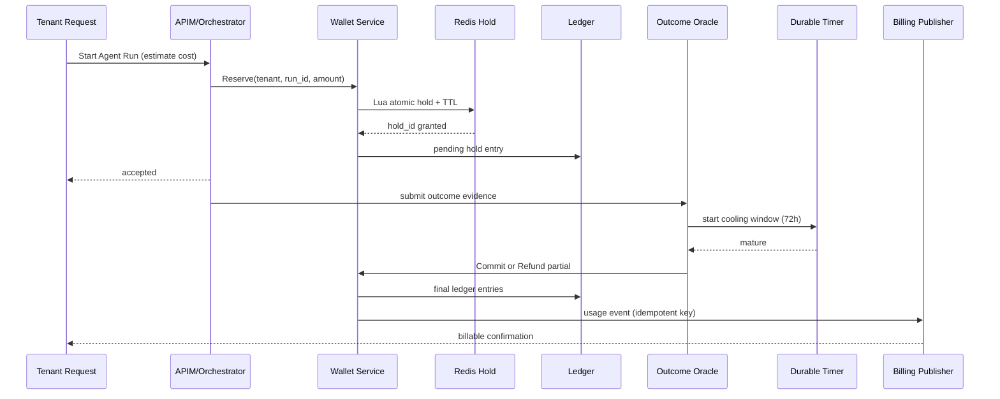

# 企业 AI Agent 商业化定价选型 FAQ：预付费钱包两阶段预留 vs 可验证结果计费 Oracle vs 实时毛利护栏

> 🌐 **Language Switch**：**中文（当前）** | [English](./outcome-based-agent-pricing-prepaid-wallet-two-phase-reservation-vs-verified-outcome-oracle-vs-gross-margin-guardrail-selection-faq.en.md)
> **受众**：Cloud & AI Solution Architect、SaaS 商业化负责人、平台计费架构师、财务合规与审计团队、FinOps 团队。
> **范围**：面向 B2B 多租户 Agent 平台，聚焦“如何在自主执行、高并发、可回滚与多阶段结算场景下，既避免透支与争议，又守住毛利底线”的生产架构选型。

## 1. 问题定义：为什么 Agent 商业化不能只靠“每千 token”粗粒度计费
企业 Agent 的成本并不只来自模型 token。  
真实账单包含推理、工具调用、检索、沙箱时长、外部 API、人工接管和回滚补偿等复合成本项。  

当平台采用固定 Seat 或简单 Usage 定价时，极易出现“收入可预测、成本不可预测”的反向杠杆。  
一旦出现高上下文长链路自动化、反复重试或恶意提示拖拽，单租户可能在短时间内吞噬整个平台毛利。  

第二个风险是并发透支。  
当同一租户 50 条执行线程并发抢占余额，如果没有原子预留机制，账本可能在秒级内从 `$500` 余额变成 `-$1,400`。  

第三个风险是结果争议。  
如果“已解决工单/已核销发票/已合格线索”缺乏可审计判定条件，平台会在结算时陷入大规模争议和坏账。  

因此，企业级 Agent 商业化必须同时满足四个目标：  
第一，实时防透支；第二，可验证结算；第三，成本可解释；第四，毛利可控。  

## 2. 四种模型总览：从“计次收费”升级到“可治理商业控制平面”
Model A 通过预付费信用钱包与两阶段预留机制，把每次执行先“锁定预算”再“结算与退款”。  
Model B 引入可验证结果 Oracle 和冷却窗口，把“临时成功”与“最终可计费成功”分离。  

Model C 把 Seat、承诺池与弹性超额组合，兼顾企业采购可预测性与业务高峰弹性。  
Model D 在运行时注入毛利地板护栏，根据租户实时毛利动态降级模型和推理策略。  

四种模型并非互斥。  
主流做法通常以 A 作为底座、B 作为高价值结果计费层、C 作为合同包装层、D 作为全局防亏损阀门。  

## 3. 参考架构：计费、结算、财务与运行时路由联动


架构关键在于把“执行控制面”和“商业结算面”打通。  
如果计费系统与路由系统割裂，平台会在账后才发现亏损，无法做到实时止损。  

## 4. Model A：预付费钱包 + 两阶段 Reserve/Commit/Refund（防并发透支）
Model A 的核心是强原子预留。  
每条 Agent 线程在执行前先申请预留额度，预留成功才允许继续执行。  

推荐做法是在 Redis 使用 Lua 脚本完成“余额检查 + 预留写入 + TTL 设置”单事务。  
这样可以避免多线程竞争造成的读写穿透，保证并发下余额不会被重复消费。  

执行结束后，系统基于真实成本做 Commit 或部分 Refund。  
例如预留 `$12`，实际消耗 `$8.35`，则自动返还 `$3.65`。  

若中途取消或策略拦截，按步骤级消耗做部分扣减并返还剩余预留。  
这可显著降低“取消即全额扣费”导致的客户投诉和信用减值争议。  

为支持审计，推荐采用双分录子账本。  
每个计费事件都映射到借贷分录，确保任意时点可回放余额变化路径。  

## 5. Model B：可验证结果计费 Oracle + 冷却窗口结算（防结果争议）
结果计费的难点在于“成功定义”必须可验证。  
如果仅由 Agent 自报成功，平台会在争议处理时失去可信证据。  

可验证结果应由多信号谓词组成。  
例如“工单 72 小时未 reopen + 无人工 takeover + 无 ERP 冲销 + 客户确认状态=resolved”才可结算。  

冷却窗口用于覆盖延迟反转风险。  
某些工单初始关闭后 24–72 小时内会重开，若立即入账会造成收入逆转。  

在会计处理上，建议把冷却期内收入识别为可变对价待定项。  
待谓词稳定后再从临时预收转入可确认收入，满足 ASC 606 / IFRS 15 审计要求。  

## 6. Model C：Seat + 承诺池 + 弹性超额（平衡采购可预测与业务波峰）
大客户采购普遍偏好预算可预测。  
纯按量模式会放大财务不确定性，采购审批周期也更长。  

Model C 将合同拆为三层：  
基础 Seat 覆盖常规用量，月度承诺池覆盖业务高峰，超出部分走 overage 价格。  

在治理层面需要明确 rollover 与过期政策。  
若允许无限结转，会导致收入递延过长并削弱成本对冲能力。  

推荐做法是“有限结转 + 强制有效期 + 超额软硬阈值”。  
当达到硬阈值前，系统触发 CFO 审批或自动降档策略。  

## 7. Model D：实时毛利地板护栏（防负毛利租户拖垮平台）
Model D 聚焦运行时防亏损。  
平台每隔短窗口计算租户实时毛利率，若低于阈值（例如 70%）则自动调整执行策略。  

可调整动作包括：  
降低 reasoning effort、提高缓存命中优先级、切换更低成本模型、限制高成本工具扇出深度。  

关键点是不破坏 SLA。  
护栏策略应分级触发，先做“无感降本”，再做“可感知限流”，最后才是硬阻断。  

这样可在不引发大面积业务中断的前提下，把高风险租户从负毛利边缘拉回安全区间。  

## 8. 两阶段预留与结果结算时序图：避免 TOCTOU 与重复扣费


该时序保证“执行授权”和“最终计费”是两个独立受控阶段。  
即使运行中断、重试或延迟回调，也可通过幂等键避免重复扣费。  

## 9. 12 维度对比矩阵：四种模型的能力边界与适用场景
| 维度 | Model A 预付费两阶段钱包 | Model B 可验证结果 Oracle | Model C Seat+Commit+Overage | Model D 实时毛利护栏 |
|---|---|---|---|---|
| 并发防透支能力 | 极高 | 中 | 中 | 低 |
| 结果争议防御 | 中 | 极高 | 中 | 低 |
| 合同可预测性 | 中 | 中 | 极高 | 中 |
| 实时止损能力 | 高 | 中 | 中 | 极高 |
| 财务审计可追溯 | 高 | 极高 | 高 | 中高 |
| 实现复杂度 | 中 | 高 | 中 | 高 |
| 对现有计费系统侵入 | 中 | 高 | 中 | 中 |
| 对业务流程依赖 | 低 | 高 | 中 | 中 |
| 收入确认合规友好 | 高 | 极高 | 高 | 中 |
| 高峰弹性适配 | 高 | 中 | 高 | 高 |
| 客户可解释性 | 高 | 中高 | 高 | 中 |
| 推荐优先级 | 先做 | 高价值场景必做 | 商业包装层 | 平台规模化必做 |

矩阵结论是：A 决定安全扣费底线，B 决定结果计费可信度，C 决定采购落地效率，D 决定平台规模化毛利韧性。  
在企业 SaaS 落地中，最常见组合是 A+C 起步，随后在高价值流程叠加 B，再在大规模租户群上线 D。  

## 10. 单位经济与毛利公式：把技术信号转换为 CFO 可读指标
定义每次尝试成本为 `COGS_attempt`，每个成功结果平均尝试次数为 `P_attempt_per_outcome`，结果售价为 `Price_outcome`。  
则结果毛利率为：`GM% = (Price_outcome - P_attempt_per_outcome * COGS_attempt) / Price_outcome`。  

进一步把缓存、重试和人工接管纳入展开：  
`COGS_attempt = C_model + C_tool + C_search + C_sandbox + C_observability + C_handoff`。  

若某租户近 1 小时窗口 `P_attempt_per_outcome` 从 `1.6` 升至 `2.9`，即使单次售价不变，毛利会迅速坍塌。  
因此运行时必须监控尝试次数、缓存命中、重试率与接管率四个先导指标。  

在企业经营视角下，建议将上述先导指标按“分钟级运行阈值、小时级经营阈值、周级合同阈值”做三层门控，而不是只看单一时间窗口的波动。  
分钟级阈值用于触发即时路由与推理策略调整，小时级阈值用于触发租户配额与预算预警，周级阈值用于触发合同重谈与产品套餐重构。  
当分钟级异常频繁触发但小时级仍平稳时，通常说明平台需要优化技术策略，例如提高缓存命中、压缩冗余工具链路、缩短无效循环。  
当小时级与周级阈值同时恶化时，往往不是单一技术问题，而是价格体系、结果定义和业务流程边界共同失配，需要商务与产品协同修正。  
建议在租户画像中增加“高复杂度高价值”“高复杂度低价值”“低复杂度高价值”“低复杂度低价值”四象限分层，并对每个象限设定差异化护栏策略。  
例如高复杂度高价值租户可给予更高预算与更长冷却窗口，但必须绑定更严格的结果谓词与审计证据；高复杂度低价值租户则优先限制模型档位与重试上限。  
若平台存在跨区域部署，还应将区域模型单价、网络回传成本、合规留存成本纳入租户毛利计算，避免在单区域看似健康而全局口径失真。  
在跨区域高峰期，建议启用“毛利优先级路由权重”，先保障毛利稳定且合同惩罚高的租户，随后再为低价值租户提供降级可用路径。  
上述策略需要和客服话术、产品 UI 提示联动，确保租户在感知到降级时可理解原因，并可通过升级套餐或审批扩容快速恢复高规格服务。  
从治理实践看，最常见的失败并非缺少模型能力，而是缺少把财务目标映射到技术策略的可执行控制面，因此建议把毛利指标纳入平台 SLO 看板。  
当 GM% 与延迟、错误率并列呈现时，平台团队才能在同一优先级框架下平衡体验、稳定性与盈利性，而不再陷入“体验好但越跑越亏”的被动局面。  
另外，建议为每次价格与策略调整保留版本化规则快照，并将快照 ID 写入账务分录，保证半年后复盘争议时仍能还原当时规则上下文。  
在大型集团客户中，子公司常采用不同审批流和预算口径，平台应支持租户内多账本维度映射，避免单一钱包模型无法满足集团内部分摊要求。  
对外部审计而言，最有价值的不是单条日志，而是“同一 run 在执行轨迹、结果谓词、账务分录、账单事件中的一致键”，这应作为架构验收硬性标准。  
一旦一致键缺失，后续任何争议都将回落到人工比对与经验判断，处理周期和坏账风险都会显著上升。  

## 11. 定量问答（Q1–Q6）：架构评审常见数字题
### Q1：50 并发线程如何把 `$500` 余额打穿到 `-$1,400`？
若每线程先读取余额再扣减、单次预估 `$38`，并发窗口内都看到“余额足够”。  
50 线程总需求 `$1,900`，最终余额会变为 `$500 - $1,900 = -$1,400`。  
采用 Lua 原子预留后，同一时刻仅允许余额覆盖范围内的请求成功，其余立即拒绝或降级。  

### Q2：两阶段预留如何降低争议扣费率？
设每月 200 万次执行，取消率 6%，平均预留 `$6.20`，取消后实际消耗 `$1.10`。  
若无退款逻辑，争议敞口约 `$610,000/月`。  
启用部分退款后，争议敞口可降至约 `$108,000/月`，下降约 82%。  

### Q3：结果冷却窗口为什么常设为 72 小时？
以工单场景为例，重开分布常在 24–48 小时聚集，72 小时可覆盖绝大多数反转。  
若提前确认收入，逆转重记会带来额外审计与对账成本。  
冷却窗口会增加现金流滞后，但可显著降低收入回冲波动。  

### Q4：毛利护栏阈值设 70% 有何依据？
在企业 Agent 合同中，平台还需覆盖销售佣金、客户成功与支持成本。  
若产品毛利长期低于 70%，综合经营利润通常快速恶化。  
因此 70% 常被用作技术护栏触发线，而非最终财务目标线。  

### Q5：三层定价（Seat+Pool+Overage）如何影响续费率？
假设客户年预算固定，纯按量模式月度波动大导致财务不确定。  
采用三层定价后，预算可控且峰值可用，通常可降低因“预算不可控”导致的流失。  
在多数 B2B ISV 实践里，续费稳定性优于纯按量方案。  

### Q6：何时必须把结果计费切到 Oracle 模式？
当单笔结果价值高、争议成本高、且存在后置反转风险时。  
例如发票核销、索赔审批、合规判定等高价值动作。  
这类场景若仍用“即时自报成功计费”，财务与法务风险显著偏高。  

在架构评审会上，建议把“是否切 Oracle”量化为三条红线：  
第一，单结果金额是否超过合同平均客单价的 3 倍；  
第二，反转事件是否在最近 90 天持续高于 2%；  
第三，争议处置平均工时是否超过 45 分钟。  

只要三条红线命中两条，就不应继续使用即时结算。  
平台应立即切换到“预留 + 冷却 + 谓词确认”模式，并将争议证据链从业务系统回写到账务系统。  

此外，建议在合同文本中明确“技术成功”与“可计费成功”的差异。  
技术成功可用于产品体验指标，但不得直接作为财务入账依据；  
可计费成功必须经过结果 Oracle 与冷却窗口共同确认，避免销售、交付与财务口径不一致。  

| 触发项 | 观测窗口 | 阈值建议 | 处置动作 |
|---|---|---:|---|
| 结果反转率 | 30 天滚动 | `>2%` | 启用/延长冷却窗口，暂停即时结算 |
| 争议单占比 | 30 天滚动 | `>1.5%` | 强制落地结果谓词签名与证据回写 |
| 负毛利租户占比 | 7 天滚动 | `>8%` | 提升 Model D 降级力度并触发商务复核 |
| 预留拒绝峰值 | 1 小时窗口 | `>12%` | 校准租户授信与承诺池配额 |
| 账单重放失败率 | 7 天滚动 | `>0.1%` | 审计幂等键策略与消息投递链路 |

## 12. 生产实现（Redis Lua + Python）：两阶段预留服务
```lua
-- reserve.lua
-- KEYS[1] = wallet:balance:{tenant_id}
-- KEYS[2] = wallet:hold:{tenant_id}:{hold_id}
-- ARGV[1] = amount_cents
-- ARGV[2] = hold_ttl_seconds
local balance = tonumber(redis.call("GET", KEYS[1]) or "0")
local amount = tonumber(ARGV[1])
if balance < amount then
  return {0, balance}
end
redis.call("DECRBY", KEYS[1], amount)
redis.call("HMSET", KEYS[2], "amount", amount, "state", "reserved")
redis.call("EXPIRE", KEYS[2], tonumber(ARGV[2]))
local remain = tonumber(redis.call("GET", KEYS[1]) or "0")
return {1, remain}
```

```python
from dataclasses import dataclass
from decimal import Decimal
import uuid

@dataclass
class ReserveResult:
    accepted: bool
    hold_id: str
    remaining_cents: int

class WalletService:
    def __init__(self, redis_client, ledger_repo):
        self.redis = redis_client
        self.ledger = ledger_repo

    async def reserve(self, tenant_id: str, amount_cents: int, ttl_seconds: int = 900) -> ReserveResult:
        hold_id = str(uuid.uuid4())
        ok, remain = await self.redis.evalsha(
            "reserve_lua_sha",
            2,
            f"wallet:balance:{tenant_id}",
            f"wallet:hold:{tenant_id}:{hold_id}",
            amount_cents,
            ttl_seconds,
        )
        accepted = int(ok) == 1
        if accepted:
            await self.ledger.append_pending_hold(
                tenant_id=tenant_id,
                hold_id=hold_id,
                amount_cents=amount_cents,
            )
        return ReserveResult(accepted=accepted, hold_id=hold_id, remaining_cents=int(remain))

    async def commit_or_refund(self, tenant_id: str, hold_id: str, actual_cost_cents: int) -> None:
        hold = await self.redis.hgetall(f"wallet:hold:{tenant_id}:{hold_id}")
        reserved = int(hold["amount"])
        refund = max(reserved - actual_cost_cents, 0)
        if refund > 0:
            await self.redis.incrby(f"wallet:balance:{tenant_id}", refund)
        await self.ledger.finalize_hold(
            tenant_id=tenant_id,
            hold_id=hold_id,
            reserved_cents=reserved,
            actual_cents=actual_cost_cents,
            refund_cents=refund,
        )
```

该实现关注三点：原子预留、幂等落账、可回放退款。  
在生产中应再补充签名幂等键、防重放窗口与多地域时钟偏差保护。  

## 13. 生产实现（SQL + 结算）：双分录子账本与结果结算流水
```sql
CREATE TABLE wallet_ledger_entry (
  entry_id            BIGSERIAL PRIMARY KEY,
  tenant_id           TEXT NOT NULL,
  hold_id             TEXT NOT NULL,
  run_id              TEXT NOT NULL,
  phase               TEXT NOT NULL CHECK (phase IN ('reserve','commit','refund','settlement')),
  debit_cents         BIGINT NOT NULL DEFAULT 0,
  credit_cents        BIGINT NOT NULL DEFAULT 0,
  currency            TEXT NOT NULL DEFAULT 'USD',
  idempotency_key     TEXT NOT NULL,
  occurred_at         TIMESTAMPTZ NOT NULL DEFAULT now(),
  UNIQUE (tenant_id, idempotency_key)
);

CREATE TABLE outcome_settlement (
  settlement_id       BIGSERIAL PRIMARY KEY,
  tenant_id           TEXT NOT NULL,
  run_id              TEXT NOT NULL,
  outcome_type        TEXT NOT NULL,
  predicate_hash      TEXT NOT NULL,
  cooling_window_end  TIMESTAMPTZ NOT NULL,
  status              TEXT NOT NULL CHECK (status IN ('provisional','confirmed','reversed')),
  billable_amount_cents BIGINT NOT NULL,
  created_at          TIMESTAMPTZ NOT NULL DEFAULT now()
);

CREATE INDEX idx_outcome_settlement_pending
ON outcome_settlement (tenant_id, status, cooling_window_end);
```

```python
async def confirm_outcome_and_publish(settlement, predicate_engine, billing_pub):
    verified = await predicate_engine.verify(
        run_id=settlement.run_id,
        predicate_hash=settlement.predicate_hash,
    )
    if not verified:
        await mark_reversed(settlement.settlement_id)
        return {"status": "reversed"}

    event = {
        "tenant_id": settlement.tenant_id,
        "run_id": settlement.run_id,
        "amount_cents": settlement.billable_amount_cents,
        "idempotency_key": f"bill:{settlement.tenant_id}:{settlement.run_id}",
        "outcome_type": settlement.outcome_type,
    }
    await billing_pub.publish_usage(event)
    await mark_confirmed(settlement.settlement_id)
    return {"status": "confirmed"}
```

该组合让“账务完整性”和“外部计费发布”通过幂等键绑定。  
即使发生重试或消息重复投递，也不会产生重复出账。  

## 14. 企业场景：两个高价值 ISV 商业化落地样例
### 场景 A：全球 ITSM 自动化 ISV（按“已解决工单”计费）
客户希望按结果付费，而非按 token。  
平台采用 A+B+C：先预留预算、经 72 小时冷却确认结果、再按合同池结算。  

上线后，争议工单回冲明显下降，审计链路可从 run_id 回溯到 predicate 与账务分录。  
在不牺牲客户体验前提下，平台成功把高风险租户从低毛利区拉回到目标区间。  

### 场景 B：应收对账 SaaS（按“已核销发票”计费）
该场景存在 ERP 后置冲销与人工复核回退。  
平台采用 A+B+D：先做预留防透支，再以结果 Oracle 做冷却确认，同时启用毛利护栏防止异常重试导致亏损。  

当月峰值流量期间，系统通过动态降档和缓存优先策略维持合同 SLA。  
财务端则通过双分录账本实现可追溯对账，降低了跨系统差异排查成本。  

## 15. Day-0 / Day-2 落地清单与选型建议
### Day-0（上线前）
- 定义租户信用模型：初始授信、预留上限、拒绝策略、超额审批链路。  
- 明确结果谓词：成功条件、反转条件、冷却窗口、证据来源与签名策略。  
- 落地双分录账本：预留、提交、退款、结算四类分录最小闭环。  
- 完成幂等设计：reserve、commit、publish 三层幂等键统一约定。  
- 设定毛利护栏阈值：如 70% 触发降级，60% 触发硬限制。  

### Day-2（运行后）
- 监控四类核心指标：预留拒绝率、结果反转率、毛利跌破频次、争议工单占比。  
- 每周复盘高成本租户：定位重试放大、低命中缓存和异常工具链路。  
- 持续优化模型路由：在不破坏 SLA 下提升低成本模型命中比例。  
- 审计抽样核对：run 轨迹、结果证据、账务分录、外部账单四方一致性。  
- 季度校准合同策略：Seat、承诺池、overage 价格与阈值联动更新。  

在真实企业环境中，商业化平台的长期竞争力不取决于单次压价或一次促销，而取决于“可持续交付价值”的能力，即平台能否在客户业务增长、模型价格波动、合规要求变化和组织流程迭代同时发生时，仍然保持计费准确、结算可信、争议可控与毛利健康。  
因此建议把定价控制平面纳入平台核心架构，而不是把它放在财务报表之后做被动修复；前置控制的价值在于可以在执行路径上直接阻断高风险动作，把损失从“账后追讨”转化为“账前防护”，这对高并发自治 Agent 场景尤为关键。  
对于多地域多币种运营的 ISV，建议把汇率快照、税率规则、区域模型单价、区域网络出站单价和区域合规留存成本统一入账，并与 run_id 绑定版本号，这样当客户在季度审计中追问某笔费用时，平台可以在分钟级给出完整证据而非人工拼接解释。  
对于强调客户成功的团队，建议将续费风险前移到技术治理层，通过“结果反转率 + 争议率 + 毛利跌破频次 + SLA 偏离度”构建客户健康指数，当指数连续恶化时触发联合处置工作流，避免问题拖到续费谈判阶段才集中暴露。  
从工程治理角度看，任何一次模型升级、提示模板变更、工具链改造或缓存策略调整，都应附带商业影响评估并进入发布门禁，至少回答“是否改变尝试次数分布、是否改变平均单次成本、是否改变毛利地板触发概率”三条问题后再进入生产。  
最终目标不是把每个租户都压到同样成本，而是让每个租户在其业务价值曲线内获得可接受的性能与价格，同时保证平台整体处于可持续盈利区间，这也是企业级 Agent 商业化从实验走向规模经营的真正分水岭。  
若企业希望把该体系扩展到合作伙伴生态，还应在合同与技术层统一定义“可计费事件主键、结果证据最小字段集、争议仲裁时间窗、账单重放保留期、跨组织签名校验方式、结算失败降级策略、账单撤销审批路径、审计抽样比例、异常成本归属规则、超阈值自动停机策略”，并通过 API 契约固化，防止合作方在实现细节上产生不可控偏差。  
当平台进入 100+ 大客户并行运营阶段，推荐建立“商业控制面变更评审委员会”，任何涉及计费谓词、冷却窗口、护栏阈值、路由降级策略、缓存计价规则和账单发布逻辑的变更都必须经过双轨评审：技术轨评估稳定性和可回滚性，财务轨评估收入确认与毛利影响，从流程上避免单点团队在局部优化中破坏全局经营目标。  
在组织协同上，建议把产品、架构、财务、法务、销售和客户成功团队的关键决策沉淀为统一运行手册，并通过季度演练验证“极端并发透支、结果大面积反转、账单重复发布、区域成本突增、单租户恶意放大”五类高风险场景的应急处置路径，确保平台在高压窗口下依然能做到口径一致、动作一致和证据一致。  
如果企业处于上市或被审计高压期，建议进一步将每次结算版本与发布批次、策略快照、审批记录、回滚记录和账单发布事件建立一对一映射关系，并将该映射写入不可变审计索引，这样在面对外部审计问询、客户法务函证或董事会追溯时，可以在固定时限内给出机器可验证且业务可解释的完整证据包。  
同时建议把上述证据包生成流程标准化为自动作业并接入发布流水线，使每次策略变更在上线当日即可形成可检索、可下载、可复核的治理档案，从而把“审计准备”从事后手工补救转变为持续工程能力。  
对于跨境客户，还应预先定义多司法辖区证据导出模板与最小披露边界，保证在不同监管要求下既能满足取证完整性，也不触发不必要的数据暴露和跨境传输风险。  
当平台与渠道伙伴共同售卖方案时，建议同步约定联合争议处理 SLA、跨系统证据交换协议和收益分摊回滚规则，确保任何一侧发生账务或结果争议都能在统一事实基线上快速闭环，避免多方口径冲突放大商业损失。  

**推荐路径**：  
先上线 Model A（防透支硬底线）+ Model C（商业可签约），  
对高价值结果流引入 Model B（防争议与合规确认），  
在租户规模化后全面启用 Model D（实时毛利守护）。  

补充建议：在季度经营评审中，务必把“技术指标”和“商业指标”放在同一张控制图里。  
仅看 token 单价或仅看工单完成率都会造成误判，必须联合观察毛利率、争议率、反转率、重试放大系数和客户续费稳定性。  
当控制图显示“体验提升但毛利下滑”时，优先调整路由与合同结构，而非盲目扩容算力。  
这一步往往比新增模型预算更有效，也更容易获得 CFO 与审计团队支持。  
