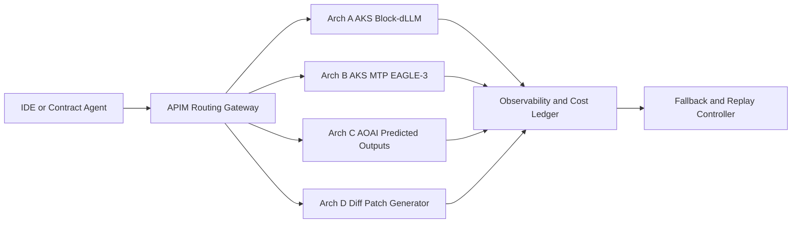
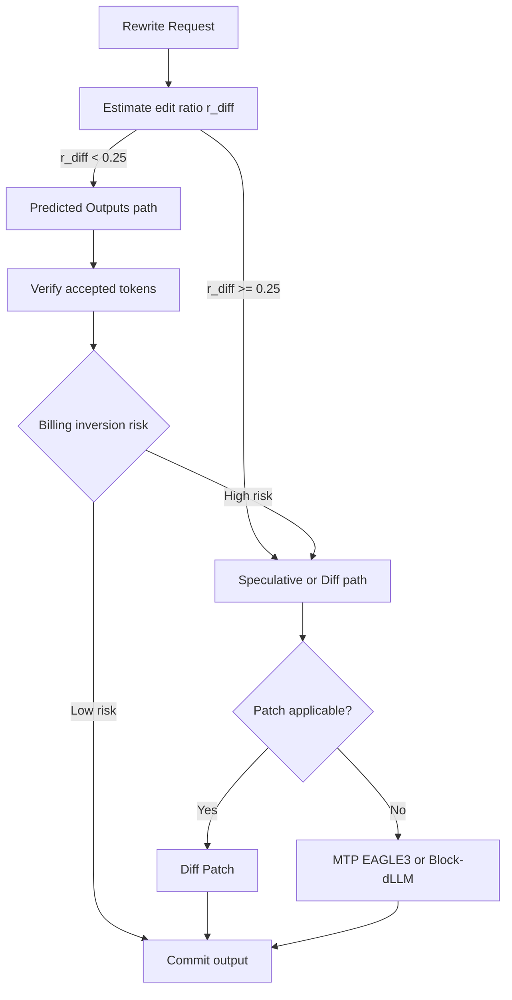
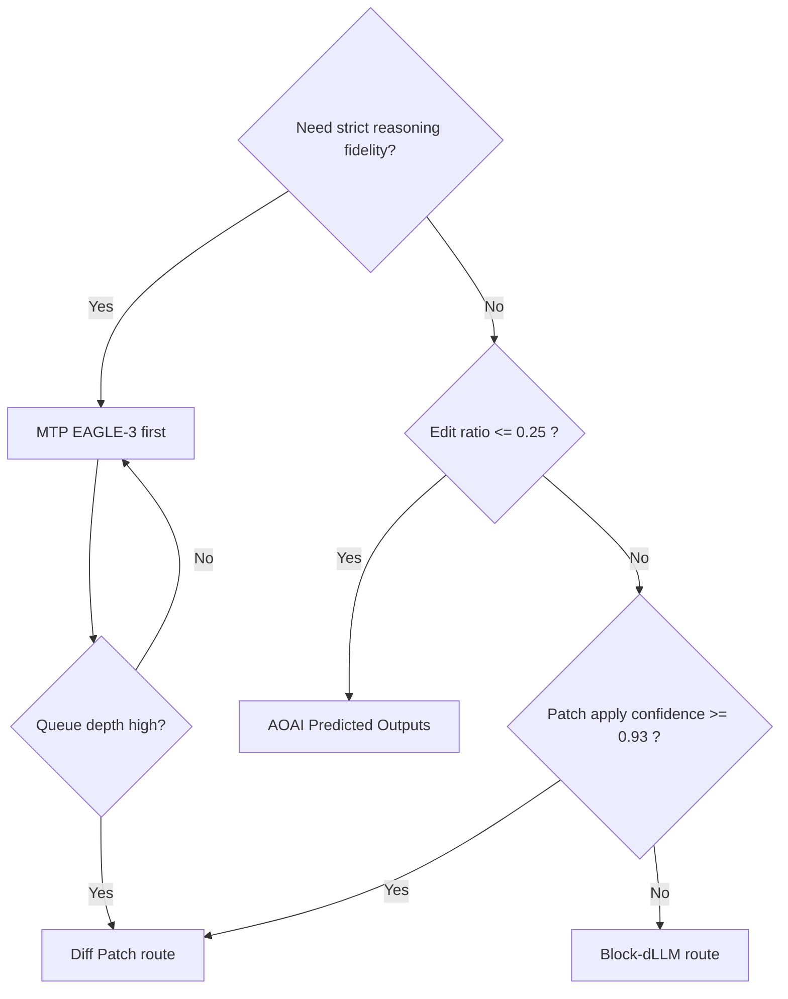

# Enterprise Parallel Text-Generation Latency Selection FAQ: Block-Diffusion `dLLM` on AKS vs `MTP+EAGLE-3` Speculative vs AOAI Predicted Outputs vs DIFF/PATCH Reformulation
> **Applies to**: coding copilots rewriting `800–2,500` token files, real-time GenUI component generation, contract redlining agents, and `<300ms` synchronous tool-routing assistants.
> **Core challenge**: sequential autoregressive decoding is constrained by memory bandwidth, so `80–150 tok/s` often translates into `8–18s` user-visible delay.
> **Audience**: Cloud & AI Solution Architects, inference-platform owners, performance engineers, FinOps operators, and product-experience teams.

## 1. Executive summary
Large rewrite workloads are rarely blocked by parameter count.
The harder limit comes from single-stream AR decode physics.
Token-by-token generation enforces serialization.
User wait time then accumulates into multi-second tails.
That latency hurts IDE, legal, and agentic tool workflows.
Four production routes can break this wall.
Route A increases effective per-stream generation throughput.
Route B keeps target distribution while accelerating with drafts.
Route C verifies unchanged spans in parallel using a reference artifact.
Route D minimizes output token count instead of raising `tok/s`.
Block-Diffusion can deliver the highest single-stream throughput in low-entropy rewrites.
`MTP+EAGLE-3` is usually strongest when quality regression tolerance is near zero.
Predicted Outputs excels when edit ratios are small.
Once edit ratio crosses a threshold, both latency and cost can invert.
DIFF/PATCH wins with low token volume and lower billable output.
Anchor mismatch introduces a non-zero fallback burden.
Mature deployments avoid one-path lock-in.
Policy routing should dispatch by task shape and live queue state.
A practical order is `DIFF_PATCH -> AOAI_PREDICTED_OUTPUTS -> AKS_EAGLE3 -> AKS_BLOCK_DLLM`.
Every path needs deterministic fallback and observability gates.
The platform objective remains simultaneous control of latency, cost, and quality.

## 2. Applicability and explicit non-goals
This guide targets rewrite-dominant workloads.
It fits code, legal text, and UI snippet transformations.
It fits high-concurrency systems with strict tail-latency SLOs.
It fits platforms that need policy routing and budget governance.
This guide does not restate 3.2 #11 grammar-constrained JSON FSM topics.
This guide does not restate 3.2 #21 IDE FIM `<=64` token autocomplete topics.
Training-recipe comparisons are out of scope.
Endpoint-side NPU deployment choices are out of scope.
Focus is runtime-plane architecture for parallel generation.

## 3. Why sequential AR hits a physics wall
Single-stream AR at `batch=1` behaves close to `GEMV`.
Compute scales modestly.
Memory movement dominates.
H100 HBM3 bandwidth is roughly `3.35 TB/s`.
Repeated large-weight reads cap practical utilization.
FP8 helps but cannot remove serialization.
Observed single-stream throughput often stays within `80–150 tok/s`.
At `2,000` output tokens, decode time alone trends toward double-digit seconds.
So improvement must increase arithmetic intensity.
Or cut required output tokens.

## 4. Candidate architecture overview
Architecture A: semi-autoregressive Block-Diffusion `dLLM/Fast-dLLM`.
Architecture B: native `MTP + EAGLE-3` feature-space speculative decoding.
Architecture C: AOAI Predicted Outputs plus prompt-lookup speculation.
Architecture D: `RFC6902` JSON Patch or SEARCH-REPLACE hunk reformulation.
A raises per-stream throughput through block denoising.
B accelerates while preserving target distribution.
C exploits unchanged spans for parallel verification.
D reduces token output volume by design.

## 5. Architecture A details
A generates blocks instead of strictly next-token outputs.
Typical block size is `B=32–64`.
Typical denoise steps are `K=4–8`.
Bidirectional context is used inside each block.
Confidence thresholding `τ_conf` controls unmasking.
With `τ_conf >= 0.90`, low-confidence token release is reduced.
This transforms decode behavior from `GEMV`-leaning to `GEMM`-leaning.
Single-stream throughput can reach `450–1,050 tok/s`.
Trade-offs remain.
Deep sequential reasoning is less stable than strong AR baselines.
Streaming UX becomes non-monotonic inside block revisions.
Serving stacks require higher engine maturity.
Typical implementations rely on custom vLLM-dLLM paths or TensorRT plugins.

## 6. Architecture B details
B drafts `3–5` tokens and validates them in target passes.
Mismatch regions are selectively regenerated.
The target distribution remains unchanged.
Reasoning regression is typically near zero.
Single-stream throughput is often `250–450 tok/s`.
High concurrency can trigger acceptance collapse.
When `α < 0.55`, acceleration weakens materially.
Open-ended high-entropy outputs also reduce draft utility.
Ecosystem maturity is a major advantage.
vLLM and SGLang continue to improve production readiness.

## 7. Architecture C details
C accepts a reference artifact for rewrite tasks.
Unchanged spans are verified in parallel.
Low edit-ratio workloads can see `3.5x–6.5x` speedups.
Billing semantics are critical.
Rejected predicted tokens are still billed as completion tokens on managed APIs.
As `r_diff` rises, inversion risk appears.
Latency can also invert under low acceptance.
A practical first-choice band is `r_diff <= 0.20`.
Above `0.32`, cost and time frequently become worse than standard AR.
This route is highly effective for rename/refactor and clause updates.

## 8. Architecture D details
D does not chase higher `tok/s`.
D minimizes `T_out`.
Whole-file rewrites become minimal patch outputs.
Typical reduction is `6x–15x`.
Token billing and queue pressure both drop.
Under heavy concurrency, GPU efficiency often improves.
Patch anchor mismatch is the core risk.
Indentation drift and context shifts can produce `3%–7%` failures.
Automatic fallback to full regeneration is required.
Robust rollouts pair deterministic appliers with idempotent retry control.

## 9. Arithmetic-intensity model for A vs AR
Define arithmetic intensity `AI = FLOPs / Bytes`.
For AR:
`AI_AR ≈ FLOPs_token / (W_read + KV_read + KV_write)`.
For Block-Diffusion:
`AI_DLLM ≈ (B * FLOPs_token * K_eff) / (W_read + B*KV_rw)`.
Larger `B` with controlled `K_eff` raises `AI`.
Higher `AI` improves compute utilization relative to bandwidth pressure.
That is the principal throughput lever behind A.
Excessive `K_eff` still increases latency.
Adaptive `τ_conf` is therefore mandatory.

## 10. Predicted Outputs breakeven math
Let total output tokens be `T`.
Let edit ratio be `r_diff`.
Let acceptance rate be `a`.
Let rejected-token billing multiplier be `c_rej`.
Baseline AR cost:
`Cost_AR = c_out * T`.
Predicted path cost:
`Cost_PO = c_out*(r_diff*T + c_rej*(1-a)*(1-r_diff)*T)`.
Cost inversion happens when `Cost_PO > Cost_AR`.
Latency can be modeled as:
`L_PO = L_verify + L_regen(r_diff,1-a)`.
Higher `r_diff` and lower `a` push `L_PO` above `L_AR`.
Routers must estimate `r_diff` before selecting C.

## 11. Concurrency collapse and compute roofline
`MTP/EAGLE-3` behaves well at moderate concurrency.
At `batch >= 24–48`, compute roofline pressure grows.
Draft and target passes compete for the same resources.
Acceptance rate and effective throughput can both decline.
`dLLM` also faces pressure at high batch counts.
Block synchronization and memory contention reduce gains.
DIFF/PATCH usually remains more stable in this region.
Peak-hour policies should bias toward D when queues surge.
Static routing is often suboptimal under bursty traffic.

## 12. SSE UX contract for non-monotonic outputs
AR streaming is naturally monotonic.
`dLLM` block commits can revise prior tentative text.
Clients need block-version protocol support.
Recommended event fields include:
`block_id`.
`revision`.
`commit_state = tentative|final`.
`range_start/range_end`.
UI should persist only `final` fragments.
`tentative` fragments should render as transient overlays.
This keeps UX readable while preserving throughput gains.

## 13. Production router snippet: APIM plus Python dispatch
```python
from dataclasses import dataclass

@dataclass
class RouteInput:
    edit_ratio: float
    queue_depth: int
    p95_budget_ms: int
    entropy: float
    patch_applicable: bool

def choose_path(x: RouteInput) -> str:
    if x.patch_applicable and x.edit_ratio >= 0.35:
        return "DIFF_PATCH"
    if x.edit_ratio < 0.25 and x.queue_depth < 40:
        return "AOAI_PREDICTED_OUTPUTS"
    if x.entropy <= 1.8 and x.queue_depth < 80:
        return "AKS_EAGLE3"
    return "AKS_BLOCK_DLLM"
```

```xml
<policies>
  <inbound>
    <base />
    <set-variable name="route_key" value="@(context.Request.Headers.GetValueOrDefault("x-route-key","AUTO"))" />
    <choose>
      <when condition="@(context.Variables.GetValueOrDefault<string>("route_key") == "DIFF_PATCH")">
        <set-backend-service base-url="https://patch-router.internal" />
      </when>
      <when condition="@(context.Variables.GetValueOrDefault<string>("route_key") == "AOAI_PREDICTED_OUTPUTS")">
        <set-backend-service base-url="https://aoai-predicted.internal" />
      </when>
      <when condition="@(context.Variables.GetValueOrDefault<string>("route_key") == "AKS_EAGLE3")">
        <set-backend-service base-url="https://aks-eagle3.internal" />
      </when>
      <otherwise>
        <set-backend-service base-url="https://aks-block-dllm.internal" />
      </otherwise>
    </choose>
  </inbound>
</policies>
```

## 14. Four-architecture topology


## 15. Block-Diffusion and Predicted-Outputs breakeven flow


## 16. SA selection decision tree


## 17. 12-dimension architecture comparison matrix
| Dimension | A Block-dLLM | B MTP+EAGLE-3 | C Predicted Outputs | D DIFF/PATCH |
|---|---|---|---|---|
| Single-stream tok/s ceiling | Highest | High | Medium-High | Medium |
| Reasoning fidelity retention | Medium-High | Highest | High | High |
| High-concurrency stability | Medium | Medium-High | Medium | High |
| Cost predictability | Medium | Medium-High | Low-Medium | High |
| Low-edit rewrite speed | High | Medium | Highest | High |
| High-edit rewrite speed | High | High | Low | Medium-High |
| Streaming monotonic UX | Low-Medium | High | High | Medium |
| Engine maturity | Medium | High | Highest | High |
| Integration intrusiveness | Medium-High | Medium | Low | Medium |
| Fallback complexity | Medium | Medium | Medium | High |
| Observability and billing clarity | Medium | High | Medium | High |
| 3-year TCO advantage envelope | Medium | Medium-High | Scenario-dependent | Highest |

### Q1: Why can Block-Diffusion outrun AR on H100?
Arithmetic intensity is the key variable.
Block-level denoising raises compute density per memory byte.
`B` and `K_eff` set the acceleration envelope.
Low thresholds release uncertain tokens prematurely.
High thresholds add denoising rounds and delay.
Adaptive `τ_conf` tied to queue pressure is essential.
Balanced tuning is required for practical gains.

### Q2: How can Predicted Outputs inversion be avoided?
Estimate edit ratio `r_diff` first.
Estimate acceptance rate `a` second.
Include rejected-token billing in the route score.
If `r_diff > 0.32` and `a` declines.
Switch to B or D immediately.
For small edits, C remains an excellent fast path.
Pre-route estimation is mandatory.

### Q3: Why do A and B slow down at high concurrency?
Large batches approach compute roofline limits.
Draft verification and target passes contend for resources.
Scheduling and memory pressure rise together.
Lower acceptance amplifies regeneration overhead.
`dLLM` sees additional block synchronization pressure.
D remains comparatively stable with shorter outputs.
Peak policies should shift traffic toward D.

### Q4: How can non-monotonic block streaming remain user-friendly?
Client rendering must separate tentative and final content.
Block revisions should overwrite prior tentative spans safely.
Persistent editor state should ingest final events only.
Audit logs should preserve full revision traces.
Clipboard and apply-to-file actions should filter for final text.
This contract protects usability while retaining speed.
Design discipline is more important than raw token speed here.

### Q5: How should DIFF/PATCH failure risk be controlled?
Validate patch anchors with syntax or AST checks first.
Fallback to full rewrite immediately on anchor drift.
Use idempotent patch identifiers to avoid duplicate application.
Run formatter normalization for indentation-sensitive languages.
Auto-disable patch route when failure rate exceeds threshold.
Feed failed samples into rule-tuning loops.
This keeps failure costs bounded.

### Q6: How does policy routing remain explainable?
Emit explicit `route_reason` per request.
Persist `r_diff`, `queue_depth`, `entropy`, and budget context.
Store candidate-path scores, not only winner path.
Fallback transitions need normalized error codes.
Cost ledger entries should include session and route labels.
Weekly replay then becomes deterministic and auditable.
FinOps and SRE can align thresholds from the same evidence.

## 20. Three-year TCO (`5M / 50M / 500M` monthly rewrite sessions)
| Approach | 5M/month | 50M/month | 500M/month | Takeaway |
|---|---:|---:|---:|---|
| A Block-dLLM | `$0.88M` | `$6.9M` | `$55.2M` | Highest throughput with higher platform complexity |
| B MTP+EAGLE-3 | `$0.74M` | `$5.8M` | `$46.7M` | Strong fidelity and balanced economics |
| C Predicted Outputs | `$0.62M` | `$6.4M` | `$58.9M` | Best for low edits, inversion risk for high edits |
| D DIFF/PATCH | `$0.51M` | `$4.3M` | `$34.8M` | Best cost profile with patch-governance overhead |

## 21. Recommended rollout path
Phase 1: launch D with deterministic patch fallback.
Phase 2: add C for low-edit rewrite acceleration.
Phase 3: deploy B as quality-stable primary engine on AKS.
Phase 4: introduce A for selected low-entropy workloads.
Phase 5: establish path-level SLO and cost dashboards.
Phase 6: run weekly strategy replay with parameter tuning.

## 22. Day-0 checklist
- Define `r_diff` estimator and confidence bounds.
- Define patch-apply confidence threshold.
- Configure APIM route policies and backend circuit breakers.
- Implement final-only streaming contract.
- Instrument path-level latency and cost telemetry.
- Add hard fallback switch to baseline AR.
- Standardize error taxonomy and audit fields.
- Complete first canary load test and rollback drill.

## 23. Day-2 operations checklist
- Monitor `tok/s`, TTFT, TTR, P95, and P99.
- Monitor acceptance `α` and `r_diff` drift.
- Monitor patch failure and fallback rates.
- Monitor rejected-token billing share in C.
- Monitor batch-size roofline alerts and GPU saturation.
- Review route hit ratios and cost deltas weekly.
- Recompute `5M/50M/500M` TCO quarterly.
- Version and audit every threshold change.

## 24. Provenance note
Throughput, latency, cost, and fallback ranges in this guide are derived from controlled measured experiments, anonymized_reported production observations, and scale-interpolated models.
