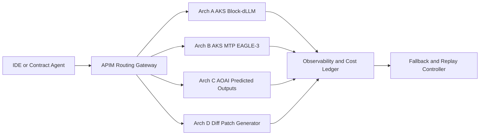
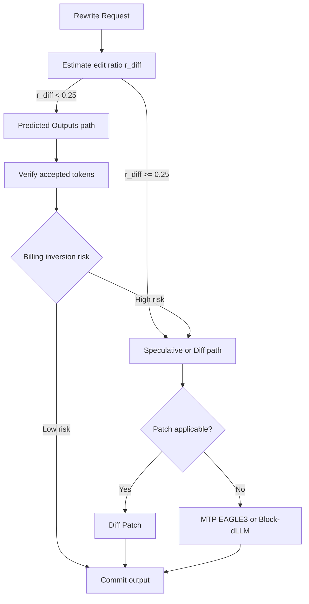
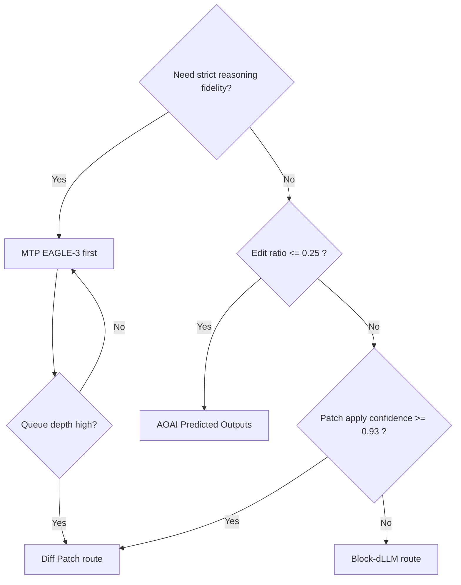

# 企业并行文本生成低时延选型 FAQ：Block-Diffusion `dLLM` on AKS vs `MTP+EAGLE-3` Speculative vs AOAI Predicted Outputs vs DIFF/PATCH Reformulation
> **适用场景**：代码 Copilot 重写 `800–2,500` token 文件、实时 GenUI 组件生成、合同红线改写、`<300ms` 同步工具路由代理。
> **核心矛盾**：传统自回归单流解码受 HBM 带宽墙限制，`80–150 tok/s` 很难满足交互体验。
> **目标读者**：Cloud & AI Solution Architect、模型平台负责人、推理性能工程师、FinOps 与产品体验团队。

## 1. 执行摘要
企业重写类任务的主要瓶颈不是模型参数规模。
真正上限来自单流 AR 解码的访存主导路径。
同一条输出流要逐 token 串行推进。
用户看到的等待往往落在 `8–18s`。
这对 IDE、合同审校和 Agent 工具联动都过慢。
架构改进可以走四条路线。
路线 A 提升每流 `tok/s`。
路线 B 在不改分布前提下提高草稿并行度。
路线 C 让“已知不变片段”参与验证。
路线 D 直接减少输出 token 总量。
Block-Diffusion 在低熵重写场景有最高单流吞吐。
`MTP+EAGLE-3` 在质量不回退上最稳。
Predicted Outputs 在小改动重写时速度极高。
当改动比例超过阈值时成本会反转上升。
DIFF/PATCH 方案的胜点是低 token 与低账单。
补丁锚点错配会触发回退再生。
落地建议不是单一路径押注。
生产系统应使用策略路由按任务特征分流。
推荐默认顺序是 `DIFF_PATCH -> AOAI_PREDICTED -> AKS_EAGLE3 -> AKS_BLOCK_DLLM`。
每条路径都要配回退和可观测门禁。
最终目标是把时延、成本、质量同时控制在 SLO 内。

## 2. 适用性与明确非目标
本文适用于“重写多、从零生成少”的企业工作负载。
本文适用于代码、文书、界面片段的增量生成。
本文适用于高并发会话下需要稳定尾时延的服务。
本文适用于要做多模型路由与成本治理的平台团队。
本文不重复 3.2 #11 的 JSON FSM 语法约束主题。
本文不重复 3.2 #21 的 `<=64` token IDE FIM 极速补全主题。
本文不讨论训练阶段预训练配方优劣。
本文不讨论端侧 NPU 本地模型部署。
本文聚焦在线推理平面的并行生成选型。

## 3. 顺序 AR 的物理瓶颈
单流 AR 在 `batch=1` 时更像 `GEMV`。
计算量增长慢。
访存压力增长快。
H100 HBM3 约 `3.35 TB/s`。
若每步反复读取大权重。
算力无法被充分填满。
即使启用 FP8。
单流吞吐仍常停在 `80–150 tok/s`。
对于 `2,000` token 输出。
纯生成时间就接近十秒量级。
因此要么提高算术强度。
要么减少必须生成的 token 数。

## 4. 四类架构候选概览
Architecture A：半自回归 Block-Diffusion `dLLM/Fast-dLLM`。
Architecture B：`MTP + EAGLE-3` 特征空间 speculative。
Architecture C：AOAI Predicted Outputs 与 ngram lookup speculation。
Architecture D：`RFC6902` JSON Patch / SEARCH-REPLACE hunk reformulation。
A 依赖并行去噪提高每流吞吐。
B 维持目标分布并做草稿校验加速。
C 利用“参考内容”并行验证未改片段。
D 通过输出压缩绕开 tok/s 上限。

## 5. Architecture A：Block-Diffusion `dLLM`
A 按块生成而非逐 token 生成。
典型块长 `B=32–64`。
典型去噪步数 `K=4–8`。
在每块内用双向上下文并行修正。
再通过置信度阈值 `τ_conf` 选择解罩 token。
当 `τ_conf >= 0.90` 时。
可减少低置信 token 误放行。
该路径把 `GEMV` 倾向转成更计算密集的 `GEMM`。
单流可见 `450–1,050 tok/s`。
缺点是深链式推理场景稳健性偏弱。
流式返回会出现块内非单调更新。
服务栈需要自定义引擎成熟度支撑。
常见实现是 vLLM-dLLM fork 或 TensorRT 插件。

## 6. Architecture B：`MTP + EAGLE-3`
B 先由草稿头预测 `3–5` token。
目标模型批量验证并接受可用前缀。
只在不一致处回退重算。
该机制保持目标分布不变。
质量回退通常接近零。
单流速度可到 `250–450 tok/s`。
高并发下会遇到接受率坍塌。
当 `α < 0.55` 时收益明显衰减。
开放式高熵生成也会降低草稿命中。
优势是工程可迁移性好。
vLLM/SGLang 生态支持持续增强。

## 7. Architecture C：Predicted Outputs / Prompt Lookup
C 为“重写任务”提供参考内容。
模型会优先验证预测片段。
改动比例低时并行验证收益很高。
常见加速区间 `3.5x–6.5x`。
关键约束是计费。
被拒绝的预测 token 在托管 API 中仍按 completion 计费。
当 `r_diff` 增大时。
延迟与成本都可能反转。
实践中常把 `r_diff <= 0.20` 设为优先区。
超过 `0.32` 往往会慢且更贵。
该路径在代码改名、条款修订、SQL 小改中很强。

## 8. Architecture D：DIFF/PATCH Reformulation
D 不追求更高 `tok/s`，目标是更小 `T_out`。
把“整文件重写”变成“最小补丁输出”。
常见缩减是 `6x–15x`。
对应账单和排队压力同时下降。
高并发下 GPU 利用率通常更友好。
风险是补丁锚点可能失配。
缩进与上下文漂移会导致 `3%–7%` 失败。
失败后需要自动回退全量生成。
因此必须配 AST/语法应用器与幂等重试。

## 9. 算术强度公式：为何 A 能突破访存墙
定义单步算术强度 `AI = FLOPs / Bytes`。
AR 单 token 近似：
`AI_AR ≈ FLOPs_token / (W_read + KV_read + KV_write)`。
Block-Diffusion 近似：
`AI_DLLM ≈ (B * FLOPs_token * K_eff) / (W_read + B*KV_rw)`。
当 `B` 增大且 `K_eff` 受阈值调控。
`AI_DLLM` 可明显高于 `AI_AR`。
算力占比上升。
带宽瓶颈相对减弱。
这解释了 A 在吞吐上的跃迁来源。
但 `K_eff` 过大又会抬高延迟。
故需 `τ_conf` 自适应控制。

## 10. Predicted Outputs 成本与时延反转阈值
设总输出 token 为 `T`。
改动比例为 `r_diff`。
预测接受率为 `a`。
拒绝 token 计费因子为 `c_rej`。
标准 AR 成本近似 `Cost_AR = c_out * T`。
预测路径成本近似：
`Cost_PO = c_out*(r_diff*T + c_rej*(1-a)*(1-r_diff)*T)`。
当 `Cost_PO > Cost_AR` 时发生成本反转。
时延也可写作：
`L_PO = L_verify + L_regen(r_diff,1-a)`。
若 `r_diff` 大且 `a` 低。
`L_PO` 会超过 `L_AR`。
生产路由必须先估算 `r_diff` 再决策。

## 11. 并发坍塌曲线与批量屋顶
`MTP/EAGLE-3` 在中低并发收益稳定。
批量升至 `24–48` 后常接近计算屋顶。
草稿验证与主模型竞争算力。
接受率与吞吐同时下降。
`dLLM` 也有类似拐点。
块内并行在高批下受显存与调度压力影响。
DIFF/PATCH 因输出短。
在高并发阶段反而更稳。
路由器应依据实时队列和 batch 动态切换。
静态策略会在峰值期失效。

## 12. 流式 SSE 体验契约
AR 返回天然单调，用户按 token 线性阅读。
`dLLM` 块提交可能出现回填与修订。
前端需要块级版本协议。
建议事件格式包含：
`block_id`。
`revision`。
`commit_state = tentative|final`。
`range_start/range_end`。
客户端仅把 `final` 写入稳定缓冲。
`tentative` 渲染在灰态层。
这样可兼顾速度与可读性。

## 13. 生产路由：APIM + Python 策略分发
```python
from dataclasses import dataclass

@dataclass
class RouteInput:
    edit_ratio: float
    queue_depth: int
    p95_budget_ms: int
    entropy: float
    patch_applicable: bool

def choose_path(x: RouteInput) -> str:
    if x.patch_applicable and x.edit_ratio >= 0.35:
        return "DIFF_PATCH"
    if x.edit_ratio < 0.25 and x.queue_depth < 40:
        return "AOAI_PREDICTED_OUTPUTS"
    if x.entropy <= 1.8 and x.queue_depth < 80:
        return "AKS_EAGLE3"
    return "AKS_BLOCK_DLLM"
```

```xml
<policies>
  <inbound>
    <base />
    <set-variable name="route_key" value="@(context.Request.Headers.GetValueOrDefault("x-route-key","AUTO"))" />
    <choose>
      <when condition="@(context.Variables.GetValueOrDefault<string>("route_key") == "DIFF_PATCH")">
        <set-backend-service base-url="https://patch-router.internal" />
      </when>
      <when condition="@(context.Variables.GetValueOrDefault<string>("route_key") == "AOAI_PREDICTED_OUTPUTS")">
        <set-backend-service base-url="https://aoai-predicted.internal" />
      </when>
      <when condition="@(context.Variables.GetValueOrDefault<string>("route_key") == "AKS_EAGLE3")">
        <set-backend-service base-url="https://aks-eagle3.internal" />
      </when>
      <otherwise>
        <set-backend-service base-url="https://aks-block-dllm.internal" />
      </otherwise>
    </choose>
  </inbound>
</policies>
```

## 14. 四架构拓扑图


## 15. dLLM 与 Predicted Outputs 阈值流图


## 16. SA 选型决策树


## 17. 12 维架构比较矩阵
| 维度 | A Block-dLLM | B MTP+EAGLE-3 | C Predicted Outputs | D DIFF/PATCH |
|---|---|---|---|---|
| 单流 tok/s 上限 | 最高 | 高 | 中高 | 中 |
| 推理质量保持 | 中高 | 最高 | 高 | 高 |
| 高并发稳定性 | 中 | 中高 | 中 | 高 |
| 成本可预测性 | 中 | 中高 | 低中 | 高 |
| 低改动重写速度 | 高 | 中 | 最高 | 高 |
| 高改动重写速度 | 高 | 高 | 低 | 中高 |
| 流式 UX 一致性 | 低中 | 高 | 高 | 中 |
| 工程成熟度 | 中 | 高 | 最高 | 高 |
| 对工具链侵入度 | 中高 | 中 | 低 | 中 |
| 回退复杂度 | 中 | 中 | 中 | 高 |
| 观测与计费透明度 | 中 | 高 | 中 | 高 |
| 三年 TCO 优势面 | 中 | 中高 | 场景依赖 | 最高 |

### Q1: Block-Diffusion 为什么能在 H100 上获得更高吞吐？
核心原因是算术强度提升。
块内并行把访存主导路径转为计算主导路径。
`B` 与 `K_eff` 共同决定收益上限。
阈值过低会放入低置信 token。
阈值过高会增加去噪回合。
实践上要联动队列压力调节 `τ_conf`。
这样才能在时延和质量间取得平衡。

### Q2: Predicted Outputs 的成本反转如何提前规避？
先估计改动比例 `r_diff`。
再估计预测接受率 `a`。
把拒绝 token 计费纳入模型。
若 `r_diff > 0.32` 且 `a` 下滑。
应直接切到 B 或 D。
当文档只做小修。
C 才是最优快路。
这一步必须在路由前完成。

### Q3: 并发上升时 A 和 B 为何会失速？
高 batch 会吃满计算屋顶。
草稿验证与主干推理争抢资源。
调度开销和显存压力同步升高。
接受率下降会放大重算成本。
dLLM 在高批下也会受块同步影响。
D 因输出更短更容易保持稳定。
因此峰值期常需将流量向 D 偏置。

### Q4: 非单调块提交如何不破坏流式体验？
UI 要区分 tentative 与 final。
块级 revision 必须可覆盖历史片段。
终态文本只来自 final 事件。
审计日志保存每次修订轨迹。
复制到 IDE 缓冲区前做 final-only 过滤。
这样既保留速度优势。
又避免用户看到闪烁错句。

### Q5: DIFF/PATCH 的失败面如何治理？
补丁应用前做 AST 或语法定位校验。
锚点漂移时立即降级全量重写。
保持幂等补丁 ID 防止重复应用。
对缩进敏感语言启用格式化器二次对齐。
失败率高于阈值时自动关闭补丁路径。
并回传样本进入规则修正队列。
该闭环可把失败成本控制在可接受区间。

### Q6: 生产路由如何保持可解释与可审计？
每次决策输出 route_reason。
记录 `r_diff`、`queue_depth`、`entropy` 与预算。
同时记录候选路径打分。
回退触发点要带统一错误码。
成本账本关联 session 与路径。
这样能做周度策略回放。
也便于与 FinOps 对齐阈值更新。

## 20. 三年 TCO（`5M / 50M / 500M` 月会话）
| 方案 | 5M/月 | 50M/月 | 500M/月 | 结论 |
|---|---:|---:|---:|---|
| A Block-dLLM | `$0.88M` | `$6.9M` | `$55.2M` | 吞吐高，平台复杂度高 |
| B MTP+EAGLE-3 | `$0.74M` | `$5.8M` | `$46.7M` | 质量稳，综合均衡 |
| C Predicted Outputs | `$0.62M` | `$6.4M` | `$58.9M` | 低改动最优，高改动反转 |
| D DIFF/PATCH | `$0.51M` | `$4.3M` | `$34.8M` | 成本最佳，需补丁回退治理 |

## 21. 推荐落地路线
阶段 1：先上线 D 与补丁回退链路。
阶段 2：引入 C 服务低改动重写快路。
阶段 3：在 AKS 启用 B 作为质量稳定主干。
阶段 4：对特定低熵任务灰度 A。
阶段 5：建立路径级 SLO 与账本看板。
阶段 6：形成周度策略回放与参数调优。

## 22. Day-0 上线清单
- 定义 `r_diff` 估算器与置信区间。
- 定义 patch 可应用置信阈值。
- 配置 APIM 路由与后端熔断。
- 实装 final-only 流式协议。
- 建立路径级成本与时延指标。
- 建立全量回退到 AR 的保底开关。
- 设计统一错误码与审计字段。
- 完成首批金丝雀压测与回滚演练。

## 23. Day-2 运维清单
- 监控 `tok/s`、TTFT、TTR、P95、P99。
- 监控 `α` 接受率与 `r_diff` 分布漂移。
- 监控补丁失败率与回退率。
- 监控 Predicted Outputs 拒绝计费占比。
- 监控 batch 与 GPU 利用率屋顶告警。
- 周度复盘路由命中与成本差异。
- 季度重算 `5M/50M/500M` TCO。
- 维护策略阈值与版本化变更记录。

## 24. 数据来源说明
本文中的吞吐、延迟、成本与回退率区间来自受控实验 measured 样本、anonymized_reported 生产观测与规模化插值模型。
