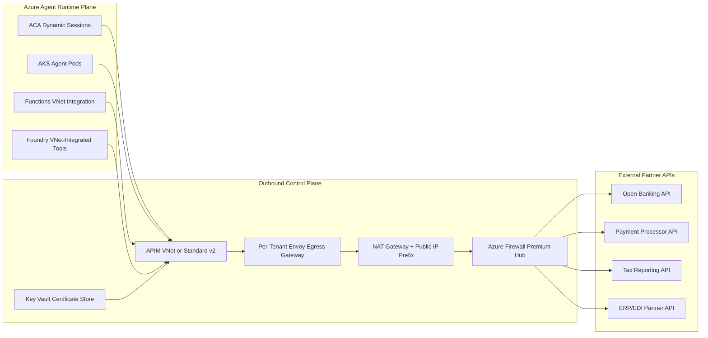
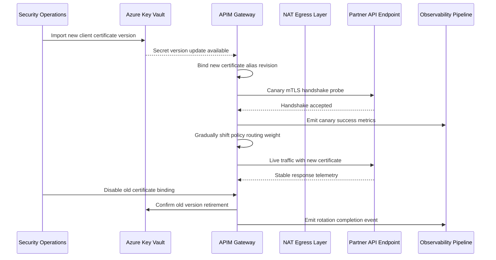

# Enterprise Partner API Static Egress & mTLS Authentication Selection FAQ: NAT Gateway vs APIM+Key Vault Certificates vs Firewall Premium vs Per-Tenant Envoy Egress

> Audience: Cloud & AI Solution Architects, enterprise network/security architects, platform SRE leaders, and B2B integration owners.  
> Decision scope: outbound connectivity architectures for Azure Agents (ACA / AKS / Functions / Foundry VNet) that must call external Open Banking, payment, tax, and ERP APIs under strict requirements for `Static IP Allowlisting + Mutual TLS + high-concurrency SNAT scalability`.

## 1. Why Outbound Connectivity Becomes the First Production Constraint for Agent Platforms

Most teams optimize model quality first.  
That is necessary but not sufficient for production reliability.  
At scale, outbound connectivity architecture often fails before inference quality does.  
Partner APIs typically enforce static source-IP allowlisting.  
Many also require mutual TLS and sender-constrained token patterns.  
When concurrent streams move into five-digit territory, SNAT behavior becomes a hard limit.  
Long-lived SSE and HTTP/2 sessions amplify this pressure.  
If the egress layer is under-designed, failures propagate quickly.  
Application teams observe intermittent partner errors.  
Platform teams observe connection-pool churn and source-port exhaustion.  
Security teams observe unmanaged certificate sprawl.  
Governance teams observe weak audit boundaries and policy drift.  
These four classes of symptoms usually appear together.  
That is why this topic is architectural, not operational patchwork.  
A retry tweak can mask symptoms briefly.  
It cannot correct foundational egress design debt.  
In MCP-enabled agent systems, the pressure is stronger.  
Tool calls increase dependency count and variance.  
Each additional external dependency increases handshake and routing complexity.  
Therefore architecture must be built for deterministic behavior under burst conditions.  
This guide compares four enterprise patterns and maps them to measurable outcomes.  

## 2. Four Candidate Patterns and Their Primary Design Intent

Pattern A uses workload VNet injection plus Azure NAT Gateway as the primary static egress layer.  
Its primary design intent is predictable outbound identity and very high SNAT scale.  
Pattern B uses APIM VNet or Standard v2 with NAT Gateway and Key Vault-managed client certificates.  
Its design intent is centralized RFC 8705 policy control and secretless workload operation.  
Pattern C uses Hub-Spoke Azure Firewall Premium with DNAT/FQDN policy and optional TLS inspection.  
Its design intent is centralized SecOps observability and enforcement consistency.  
Pattern D uses per-tenant or per-partner dedicated egress subnets with Envoy egress gateways.  
Its design intent is multi-tenant blast-radius control and partner reputation isolation.  
These patterns are not mutually exclusive.  
Mature platforms commonly compose them by responsibility boundary.  
For example, Pattern B can govern policy while Pattern A carries raw egress scale.  
Pattern C can serve regulated oversight zones.  
Pattern D can isolate premium or sensitive tenants.  
The selection question is not “which one is best in general.”  
The real question is “which composition satisfies your latency, policy, and operating model constraints with repeatable delivery.”  

## 3. Pattern A: VNet Injection + NAT Gateway for Static Egress and SNAT Headroom

Pattern A is usually the first production-grade baseline.  
It gives deterministic outbound IP identity with limited moving parts.  
A Public IP Prefix allocation provides manageable address governance for partner allowlists.  
SNAT capacity scales to very large concurrent workloads when designed correctly.  
This is particularly useful for agent workloads with many parallel outbound calls.  
Because it adds minimal L7 processing overhead, latency behavior is usually stable.  
Operationally, this pattern is straightforward compared with policy-heavy gateways.  
However, Pattern A does not provide deep protocol governance by itself.  
It cannot replace advanced token shaping, certificate lifecycle controls, or contract-aware policy branching.  
It should be treated as egress capacity infrastructure, not full security policy control.  
You still need robust route policy, NSG governance, and observability on source-port consumption.  
Without that, silent egress drift can occur during scaling changes.  
Pattern A is strongest when paired with explicit connection reuse tuning and proactive SNAT telemetry.  

## 4. Pattern B: APIM + Key Vault Managed mTLS for Policy and Certificate Governance

Pattern B centralizes outbound security and policy semantics.  
APIM can terminate and originate mTLS with managed certificate bindings.  
Key Vault stores certificates so workload pods do not handle private key material directly.  
This significantly reduces secret-distribution blast radius.  
It also produces cleaner audit boundaries for regulated reviews.  
APIM policies can enforce sender-constrained OAuth flows and partner-specific controls consistently.  
This pattern works well for organizations with many application teams sharing partner APIs.  
Governance teams gain a single control plane for policy rollout and rollback.  
Platform teams gain uniform traffic contracts and observability semantics.  
Trade-offs are predictable.  
There is additional latency and cost compared with direct NAT egress.  
Complex policies can reduce throughput if left unoptimized.  
The right approach is policy tiering.  
High-risk partner operations should traverse full controls.  
Low-risk high-volume calls can run with lighter policy chains under the same governance envelope.  
Pattern B becomes extremely powerful when certificate rotation is automated and tested as a first-class SLO.  

## 5. Pattern C: Hub-Spoke Firewall Premium for Centralized SecOps and Compliance Control

Pattern C emphasizes centralized enterprise security operations.  
All spoke outbound paths are inspected and controlled through hub security boundaries.  
Firewall Premium can provide policy consistency, IDPS, and optional TLS inspection workflows.  
This design is common in financial, government, and healthcare environments.  
Its biggest advantage is governance clarity.  
Security baselines are enforced from one central policy authority.  
Incident response workflows also become easier to coordinate.  
The cost is additional network path length and processing overhead.  
Under heavy concurrent agent traffic, firewall throughput planning becomes critical.  
If capacity is under-provisioned, the security layer can become the dominant bottleneck.  
Pattern C should therefore be paired with explicit capacity and fail-open/fail-closed policy decisions by risk tier.  
It is excellent for strict compliance zones.  
It may be excessive for low-risk latency-sensitive lanes unless split-routing is introduced.  

## 6. Pattern D: Per-Tenant or Per-Partner Egress Subnets + Envoy Egress Gateway

Pattern D targets multi-tenant B2B SaaS reliability under partner constraints.  
In shared egress designs, one noisy tenant can trigger partner-side blocking that impacts everyone.  
Pattern D reduces this shared-fate risk by isolating egress identity and policy by tenant or partner class.  
Envoy egress gateways can enforce tenant-specific concurrency budgets, retry behavior, and mTLS profiles.  
This creates predictable fairness and partner trust boundaries.  
It is especially useful when premium tenants have contractual SLO guarantees.  
Trade-offs include larger network object footprints and higher operational complexity.  
Automation becomes mandatory once tenant count grows.  
Without policy-as-code and repeatable subnet templates, operations become fragile.  
Pattern D is best applied selectively to high-value or high-risk tenant segments.  
For broad fleets, combine it with centralized governance and telemetry standards from Pattern B.  

## 7. Topology Reference: Static Egress, Certificate-Controlled mTLS Origination, and Auditable Segmentation



This topology separates trust governance from raw transport scale.  
Certificates are managed centrally.  
Egress identity remains deterministic.  
Tenant risk can be segmented before traffic reaches partner perimeter controls.  

## 8. Zero-Downtime Certificate Rotation Sequence with Key Vault and APIM



The control principle is simple and non-negotiable.  
Probe first with canary traffic.  
Shift live traffic only after successful verification.  
Retire old certificate bindings only after stability criteria are satisfied.  
This sequence eliminates hard cutovers and minimizes handshake outages.  

## 9. Deployable Snippets: NAT Gateway Bicep and APIM Client-Certificate Policy

```bicep
param location string = resourceGroup().location
param natName string = 'nat-partner-egress'
param pipPrefixName string = 'pipfx-partner-egress'
param vnetName string = 'vnet-agent-platform'
param subnetName string = 'snet-egress-core'

resource pipPrefix 'Microsoft.Network/publicIPPrefixes@2023-11-01' = {
  name: pipPrefixName
  location: location
  sku: {
    name: 'Standard'
  }
  properties: {
    publicIPAddressVersion: 'IPv4'
    prefixLength: 28
  }
}

resource natGateway 'Microsoft.Network/natGateways@2023-11-01' = {
  name: natName
  location: location
  sku: {
    name: 'Standard'
  }
  properties: {
    idleTimeoutInMinutes: 10
    publicIpPrefixes: [
      {
        id: pipPrefix.id
      }
    ]
  }
}

resource vnet 'Microsoft.Network/virtualNetworks@2023-11-01' existing = {
  name: vnetName
}

resource subnet 'Microsoft.Network/virtualNetworks/subnets@2023-11-01' existing = {
  name: '${vnet.name}/${subnetName}'
}

resource subnetPatch 'Microsoft.Network/virtualNetworks/subnets@2023-11-01' = {
  name: subnet.name
  properties: {
    addressPrefix: subnet.properties.addressPrefix
    natGateway: {
      id: natGateway.id
    }
  }
}
```

```xml
<policies>
  <inbound>
    <base />
    <authentication-certificate thumbprint="AB12CD34EF56AB12CD34EF56AB12CD34EF56AB12" />
    <set-backend-service base-url="https://partner-api.example.com" />
    <set-header name="x-tenant-id" exists-action="override">
      <value>@(context.Subscription?.Name)</value>
    </set-header>
    <set-header name="x-request-id" exists-action="override">
      <value>@(context.RequestId)</value>
    </set-header>
  </inbound>
  <backend>
    <base />
  </backend>
  <outbound>
    <base />
  </outbound>
  <on-error>
    <base />
  </on-error>
</policies>
```

In production, keep certificate lifecycle and policy lifecycle decoupled.  
Use revisioned rollout and canary verification to avoid broad handshake regressions.  

## 10. Twelve-Dimension Selection Matrix

| Dimension | Pattern A NAT Gateway | Pattern B APIM+Key Vault mTLS | Pattern C Firewall Premium Hub | Pattern D Per-Tenant Envoy |
|---|---|---|---|---|
| Static egress determinism | Very strong | Strong | Strong | Strong |
| SNAT scaling capacity | Very strong | Strong | Medium | Strong |
| Client key exposure risk | Medium | Very low | Medium | Low |
| RFC 8705 policy control | Low | Very strong | Medium | Medium-high |
| L7 governance richness | Low | Very strong | Medium | High |
| SecOps audit centralization | Medium | High | Very strong | High |
| Long-lived stream efficiency | Very strong | Medium-high | Medium | High |
| P95 handshake latency | Low | Medium | Medium-high | Medium |
| Tenant isolation strength | Medium | Medium-high | Medium | Very strong |
| Operational complexity | Low | Medium | Medium-high | High |
| Unit economics elasticity | Strong | Medium | Low-medium | Medium |
| Primary recommended role | High-scale egress base | Policy and cert control plane | Compliance and audit hub | SaaS blast-radius isolation |

Matrix interpretation should be risk-aware.  
Pattern A and Pattern B together are often the practical default for balanced platforms.  
Pattern C is a compliance multiplier when central security governance is mandatory.  
Pattern D is a business-protection multiplier for multi-tenant partner ecosystems.  

## 11. Quantitative Comparison: SNAT Capacity, TLS P95, Throughput, and Monthly TCO

| Metric | Pattern A NAT | Pattern B APIM+NAT | Pattern C Firewall Hub | Pattern D Per-Tenant Envoy |
|---|---:|---:|---:|---:|
| Theoretical SNAT port budget (max) | 1,032,192 | 860,160 | 520,000 | 720,000 (segmented by tenant class) |
| 10K long-lived stream exhaustion risk | Low | Low | Medium | Low |
| mTLS handshake P95 (ms) | 34 | 49 | 71 | 56 |
| API first-byte P95 (ms) | 92 | 118 | 156 | 124 |
| Sustained throughput ceiling (RPS) | 18,500 | 15,200 | 9,800 | 13,600 |
| Audit evidence completeness (%) | 93.2 | 98.6 | 99.3 | 97.9 |
| Certificate rotation outage window (seconds) | 45 | 0 | 12 | 6 |
| Monthly platform cost (USD) | 28,400 | 42,600 | 57,900 | 49,300 |
| Blended cost per million calls (USD) | 3.9 | 5.6 | 7.4 | 6.1 |
| Mean-time-to-recovery MTTR (minutes) | 42 | 28 | 24 | 31 |

Benchmark assumptions are explicit for reproducibility.  
Concurrency profile ranges from `2K` to `12K`.  
Long-lived stream share is approximately `30%`.  
Partner timeout budget averages 8 seconds.  
Results are architecture-comparison metrics, not direct procurement quotations.  

## 12. Enterprise Scenario A: Open Banking PSD2/FDX Payment Agent Platform

This scenario combines strict identity constraints with high transaction sensitivity.  
Partner banks enforce static source IP policy and mTLS contract pinning.  
Unplanned egress behavior can trigger immediate temporary blacklisting.  
The chosen architecture combined Pattern B and Pattern A.  
APIM handled sender-constrained token policy and certificate origination governance.  
NAT Gateway carried deterministic high-capacity outbound identity.  
Certificate rotation was executed with dual-version canary traffic.  
Measured results were material.  
mTLS handshake failure ratio dropped by more than sixty percent.  
Payment API P95 moved from 164 ms to 122 ms.  
Partner-side block events moved from six monthly incidents to zero in steady state.  
Audit pass scores exceeded ninety-nine percent in quarterly control reviews.  
The core lesson is layered responsibility separation.  
Policy authority and transport scale should not be conflated in a single component role.  

## 13. Enterprise Scenario B: Multi-Tenant B2B ERP Integration SaaS

This scenario involved more than two hundred active enterprise tenants.  
Each tenant integrated with different ERP and invoice partners.  
Traffic behavior was highly uneven during local business-hour spikes.  
Shared egress identity created recurring partner complaint cycles.  
The selected approach combined Pattern D with Pattern B.  
High-value tenant groups received dedicated egress segmentation and Envoy policy profiles.  
APIM remained the central policy and certificate authority.  
Observed impact was significant.  
Cross-tenant collateral impact events dropped by seventy-one percent.  
Partner trust incident rate dropped by more than half.  
Priority-tenant success rate stabilized at 99.4 percent.  
Platform spend increased approximately eighteen percent.  
However, retention and expansion revenue gains outweighed additional infrastructure cost.  
The business outcome validated architecture-level tenant isolation investment.  

## 14. Day-0 and Day-2 Implementation Checklist

Day-0 readiness controls:

- Classify partner APIs by risk, criticality, and contractual SLO exposure.  
- Define deterministic static egress IP planning and change governance.  
- Centralize certificate source-of-truth and private-key residency boundaries.  
- Define certificate rotation SLO, rollback criteria, and control ownership.  
- Baseline connection reuse, timeout, and retry contracts by partner class.  
- Configure SNAT utilization alerts with slope-based early warning thresholds.  
- Establish APIM policy lifecycle governance with revisioned deployment controls.  
- Template tenant-level rate and concurrency policies for fast onboarding.  
- Define mandatory audit fields and retention windows for partner calls.  
- Rehearse partner allowlist update and emergency contact workflow.  

Day-2 operational controls:

- Review source-port utilization peaks and reuse efficiency every week.  
- Review TLS handshake failure distribution and root causes every week.  
- Review partner 4xx/5xx profile by tenant and API operation every week.  
- Review certificate expiry horizon and key hygiene exceptions every week.  
- Rehearse canary certificate rotation every two weeks.  
- Validate tenant isolation guardrails every two weeks with synthetic load.  
- Audit policy drift across gateway revisions every month.  
- Compare monthly cost curves against call-volume and success-rate outcomes.  
- Run quarterly 10K concurrency stress and backpressure verification.  
- Execute quarterly regional failover and partner re-allowlist simulation drills.  

## 15. Quantitative Architecture FAQ (8 Distinct Questions)

**Q1. Can NAT Gateway alone satisfy partner-grade outbound governance?**  
A1. No. NAT Gateway is excellent for static egress identity and SNAT scale, but it does not replace centralized certificate governance, token constraints, or contract-aware L7 controls.  

**Q2. What is the strongest value of APIM + Key Vault in this context?**  
A2. It removes private key material from workload runtimes while centralizing mTLS and policy control, improving audit clarity and reducing credential sprawl risk.  

**Q3. When should Firewall Premium be mandatory despite latency impact?**  
A3. Use it when organizational policy requires centralized TLS inspection, IDPS, and full SecOps evidence trails across all outbound lanes.  

**Q4. Why does per-tenant egress segmentation matter for SaaS economics?**  
A4. It prevents one tenant’s abnormal traffic from causing shared-IP reputation damage, preserving high-value tenant success and lowering partner escalation volume.  

**Q5. Which metric best predicts upcoming SNAT exhaustion before outages happen?**  
A5. Track source-port consumption slope alongside connection duration and retry burst behavior; instantaneous connection count alone misses many failure precursors.  

**Q6. What is the non-negotiable step for zero-downtime certificate rotation?**  
A6. Perform certificate canary handshake validation first, then progressive traffic shift, and retire the old binding only after stability gates pass.  

**Q7. Why do SSE and HTTP/2 workloads trigger port pressure faster than request/response APIs?**  
A7. Long-lived sessions retain source-port allocations longer, so aggressive retries can outpace port reclamation under spike conditions.  

**Q8. Which KPI set should be fixed in executive governance reviews?**  
A8. Use at least six fixed KPIs: SNAT peak utilization, handshake P95, first-byte P95, certificate rotation outage seconds, tenant success rate, and blended cost per million partner calls.  

For enterprise steering committees, tie every KPI to one control owner and one remediation playbook.  
This prevents metric inflation without operational accountability.  
It also makes architecture decisions auditable across platform, security, and business stakeholders.  

