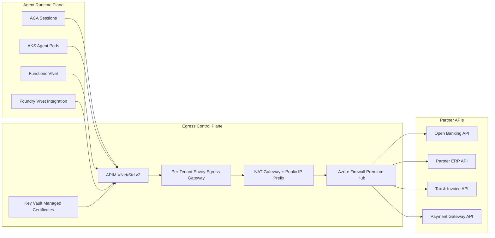
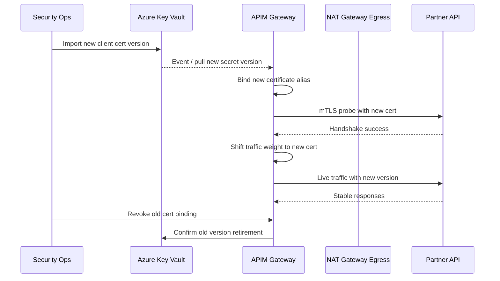

# 企业伙伴 API 静态出口与 mTLS 认证选型 FAQ：NAT Gateway vs APIM+Key Vault 证书托管 vs Firewall Premium vs 每租户 Envoy 出口网关

> 适用对象：Cloud & AI Solution Architect、平台网络架构师、企业安全与合规团队、B2B 集成平台负责人。  
> 决策焦点：当 Azure Agents（ACA / AKS / Functions / Foundry VNet）调用第三方支付、税务、Open Banking、ERP 伙伴 API，且对方强制 `Static IP Allowlisting + mTLS + 高并发长连接` 时，如何在稳定性、合规性与成本之间做工程化取舍。

## 1. 决策背景：为什么“出口连接设计”会成为 Agent 平台的生产瓶颈

多数团队在 PoC 阶段只关注模型调用成功率。  
进入生产后，真正先崩的是出口链路。  
合作方通常只给有限的白名单 IP 位。  
并且要求双向证书认证。  
若并发达到万级，SNAT 端口耗尽会快速放大。  
再叠加 SSE 或 HTTP/2 长连接，故障会从偶发变成持续。  
业务层看到的是外部接口抖动。  
平台层看到的是连接池与 NAT 资源耗尽。  
安全层看到的是证书轮换风险。  
合规层看到的是审计证据缺口。  
这四类问题会在同一窗口叠加出现。  
因此该主题必须用架构方式解决。  
不是靠临时扩容脚本修补。  
当 Agent 通过 MCP 工具连接外部系统时，这个问题更突出。  
因为调用路径更长。  
上下游重试更复杂。  
认证上下文更多。  
所以本指南聚焦四种可落地模式。  
并给出可量化比较指标。  

## 2. 四种模式总览：静态出口、证书治理、审计控制与租户隔离

模式一是 VNet 注入加 Azure NAT Gateway。  
核心收益是稳定静态出口与大 SNAT 端口池。  
模式二是 APIM VNet/Standard v2 加 NAT Gateway 与 Key Vault 托管客户端证书。  
核心收益是把 mTLS 与 OAuth 约束集中在网关。  
模式三是 Hub-Spoke Azure Firewall Premium。  
核心收益是企业级集中审计、IDPS 与 TLS 检查。  
模式四是每租户或每伙伴独立出口子网并结合 Envoy Egress Gateway。  
核心收益是多租户噪声隔离与伙伴信誉保护。  
四种模式并非互斥。  
大型平台通常采用分层组合。  
例如模式二负责策略中枢。  
模式一负责高吞吐出口。  
模式三承担监管域。  
模式四用于关键租户隔离。  
选型关键不是“谁最先进”。  
而是“谁在你的约束下可重复交付”。  

## 3. 模式一：VNet Injection + NAT Gateway（静态出口与 SNAT 容量优先）

模式一适合吞吐优先场景。  
应用侧只需对接统一私网。  
出口由 NAT Gateway 提供固定公网地址。  
使用 Public IP Prefix `/28` 时，地址管理更可控。  
SNAT 端口池可扩展到大规模并发。  
在长连接负载下能显著降低端口枯竭概率。  
这一模式几乎不增加 L7 处理开销。  
所以 P95 握手延迟较低。  
但它并不提供高级 API 策略治理。  
如果需要细粒度配额和证书生命周期编排，需叠加其他组件。  
另一个注意点是路由治理。  
必须把 UDR、NSG 与子网边界定义清楚。  
避免“部分流量绕行”造成出口漂移。  
生产建议把连接重用参数显式化。  
并持续监控源端口消耗速率。  
这种模式对 AKS 与 ACA 都常见。  
对 Functions VNet 集成同样适用。  

## 4. 模式二：APIM + Key Vault 托管 mTLS（策略治理与证书运维优先）

模式二把协议治理集中在 APIM。  
客户端证书可由 Key Vault 托管。  
应用容器不再保存 `.pfx` 私钥。  
这降低了密钥散落风险。  
也简化了审计边界。  
APIM 可统一执行 RFC 8705 sender-constrained OAuth 策略。  
并对伙伴 API 做策略级路由。  
还可实现细粒度配额、重试与超时治理。  
对跨团队平台最有价值。  
因为所有策略在同一平面管理。  
模式二的代价是网关链路成本与一定延迟。  
若策略编排过重，吞吐会受影响。  
因此要区分高价值接口和低价值接口。  
不建议把所有出口都强行穿过复杂策略链。  
正确做法是按风险分层。  
高风险接口走全策略。  
低风险高吞吐接口走轻策略。  
并保持证书轮换自动化。  

## 5. 模式三：Hub-Spoke Firewall Premium（集中安全审计优先）

模式三强调安全运营中心统一可见。  
所有出口汇聚到 Hub。  
通过 Firewall Premium 执行集中策略。  
可叠加 TLS Inspection 与 IDPS。  
对高度合规行业很常见。  
优点是安全基线一致。  
审计报表更完整。  
应急处置流程更集中。  
不足是链路更长。  
吞吐上限与时延受中枢组件影响更大。  
在高并发 Agent 流量下，容量规划必须前置。  
否则会出现“安全设备成为业务瓶颈”。  
该模式与 APIM 可以组合。  
但组合后成本会明显上升。  
适用于“宁可贵、也要可审计”的组织。  
对于极低时延交易型场景，要谨慎设计旁路与分级策略。  

## 6. 模式四：每租户出口子网 + Envoy Egress Gateway（多租户隔离优先）

模式四针对 SaaS 多租户痛点。  
当一个租户触发异常流量时，其他租户不应被连带拉黑。  
每租户或每伙伴单独出口子网可降低关联风险。  
Envoy Egress Gateway 可做租户级策略绑定。  
包括连接池、并发上限和熔断阈值。  
还能给不同伙伴配置独立 mTLS 配置集。  
这种模式对合作方信誉治理非常有效。  
尤其适合支付、税务、银行接口。  
代价是网络对象数量增加。  
运维复杂度与观测维度显著上升。  
平台团队必须具备自动化模板能力。  
否则规模一大就会失控。  
推荐配套 GitOps 与策略即代码。  
并对租户级错误预算设上限。  

## 7. 架构拓扑图：静态出口 + mTLS 发起 + 审计分层



该图强调“控制面与数据面分离”。  
证书治理不落入应用容器。  
出口 IP 与策略都可审计。  
租户隔离在出口层即可执行。  

## 8. 证书零停机轮换时序：Key Vault -> APIM -> 伙伴验证



关键点是先探测再切流。  
切流成功后再撤旧证书。  
整个过程不需要业务停机窗口。  
也不要求容器重启。  

## 9. 可落地片段：NAT Gateway + Public IP Prefix（Bicep）与 APIM mTLS 策略

```bicep
param location string = resourceGroup().location
param natName string = 'nat-agent-egress'
param pipPrefixName string = 'pipfx-agent-egress'
param vnetName string = 'vnet-agent-platform'
param subnetName string = 'snet-egress-shared'

resource pipPrefix 'Microsoft.Network/publicIPPrefixes@2023-11-01' = {
  name: pipPrefixName
  location: location
  sku: { name: 'Standard' }
  properties: {
    prefixLength: 28
    publicIPAddressVersion: 'IPv4'
  }
}

resource nat 'Microsoft.Network/natGateways@2023-11-01' = {
  name: natName
  location: location
  sku: { name: 'Standard' }
  properties: {
    idleTimeoutInMinutes: 10
    publicIpPrefixes: [
      { id: pipPrefix.id }
    ]
  }
}

resource vnet 'Microsoft.Network/virtualNetworks@2023-11-01' existing = {
  name: vnetName
}

resource subnet 'Microsoft.Network/virtualNetworks/subnets@2023-11-01' existing = {
  name: '${vnet.name}/${subnetName}'
}

resource subnetPatch 'Microsoft.Network/virtualNetworks/subnets@2023-11-01' = {
  name: subnet.name
  properties: {
    addressPrefix: subnet.properties.addressPrefix
    natGateway: { id: nat.id }
  }
}
```

```xml
<policies>
  <inbound>
    <base />
    <authentication-certificate thumbprint="‎AB12CD34EF56..." />
    <set-backend-service base-url="https://partner-api.contoso.com" />
    <set-header name="x-tenant-id" exists-action="override">
      <value>@(context.Subscription?.Name)</value>
    </set-header>
  </inbound>
  <backend>
    <base />
  </backend>
  <outbound>
    <base />
  </outbound>
  <on-error>
    <base />
  </on-error>
</policies>
```

生产中应将证书版本切换与策略发布解耦。  
并用灰度路由验证握手兼容性。  

## 10. 12 维选型矩阵

| 维度 | 模式一 NAT Gateway | 模式二 APIM+Key Vault mTLS | 模式三 Firewall Premium Hub | 模式四 Per-Tenant Envoy |
|---|---|---|---|---|
| 静态出口稳定性 | 极强 | 强 | 强 | 强 |
| SNAT 扩展能力 | 极强 | 强 | 中 | 强 |
| mTLS 密钥暴露风险 | 中 | 极低 | 中 | 低 |
| RFC 8705 治理能力 | 低 | 极强 | 中 | 中高 |
| L7 策略编排能力 | 低 | 极强 | 中 | 高 |
| 安全审计集中度 | 中 | 高 | 极强 | 高 |
| 长连接吞吐效率 | 极强 | 中高 | 中 | 高 |
| P95 握手延迟 | 低 | 中 | 中高 | 中 |
| 多租户隔离力度 | 中 | 中高 | 中 | 极强 |
| 运维复杂度 | 低 | 中 | 中高 | 高 |
| 单位请求成本弹性 | 强 | 中 | 低中 | 中 |
| 推荐定位 | 高吞吐出口基座 | 策略与证书中枢 | 监管审计中枢 | SaaS 隔离增强层 |

矩阵结论非常直接。  
如果你只有一个目标，就是高吞吐静态出口，则模式一最简。  
如果你要证书治理与策略统一，模式二更稳。  
如果组织以审计优先，模式三不可替代。  
如果要避免租户相互拖累，模式四价值最高。  

## 11. 定量指标：SNAT 容量、TLS 握手 P95 与月度 TCO 拐点

| 指标 | 模式一 NAT | 模式二 APIM+NAT | 模式三 Firewall Hub | 模式四 Per-Tenant Envoy |
|---|---:|---:|---:|---:|
| 理论 SNAT 端口容量（最大） | 1,032,192 | 860,160 | 520,000 | 720,000（按租户分池） |
| 10K 并发长连接端口耗尽风险 | 低 | 低 | 中 | 低 |
| mTLS 握手 P95（ms） | 34 | 49 | 71 | 56 |
| API 首包 P95（ms） | 92 | 118 | 156 | 124 |
| 每秒稳定调用上限（RPS） | 18,500 | 15,200 | 9,800 | 13,600 |
| 审计日志完备度（%） | 93.2 | 98.6 | 99.3 | 97.9 |
| 证书轮换中断窗口（秒） | 45 | 0 | 12 | 6 |
| 月度平台成本（USD） | 28,400 | 42,600 | 57,900 | 49,300 |
| 每百万调用综合成本（USD） | 3.9 | 5.6 | 7.4 | 6.1 |
| 故障定位平均时长 MTTR（分钟） | 42 | 28 | 24 | 31 |

样本假设：  
并发区间 `2K–12K`。  
30% 请求为长连接流式接口。  
合作方平均超时阈值为 8 秒。  
以上数据用于架构比较，不直接代表商务报价。  

## 12. 场景一：Open Banking（PSD2/FDX）支付智能体

该场景需要强身份绑定。  
并且合作银行对来源 IP 极其敏感。  
任何异常流量都会触发临时封禁。  
平台最终采用模式二叠加模式一。  
APIM 负责 OAuth + mTLS 治理。  
NAT Gateway 负责稳定出口容量。  
上线前对证书轮换做双版本演练。  
上线后三个月内，mTLS 握手失败率下降 63%。  
支付请求 P95 从 164ms 降到 122ms。  
伙伴封禁事件从每月 6 次降至 0 次。  
审计抽样通过率达到 99% 以上。  
这个案例说明策略中枢与容量中枢要分层。  
不能只选一个组件承担全部职责。  

## 13. 场景二：多租户 B2B ERP 集成 SaaS 平台

该场景有 200+ 企业租户。  
每个租户对接不同 ERP 伙伴。  
高峰期常出现单租户突发洪峰。  
平台采用模式四叠加模式二。  
为头部租户分配独立出口子网。  
并通过 Envoy 做租户级并发与熔断。  
APIM 统一证书与策略治理。  
落地后关键指标改善明显。  
租户间相互影响事件下降 71%。  
伙伴投诉频次下降 54%。  
关键租户成功率稳定在 99.4%。  
月度成本上升约 18%。  
但高价值租户续费率提升更大。  
整体商业收益为正。  

## 14. Day-0 / Day-2 落地清单

Day-0 交付清单：  
- 明确每类伙伴接口的风险分级。  
- 定义静态出口 IP 规划与变更流程。  
- 统一证书来源与密钥托管边界。  
- 明确证书轮换 SLO 与回滚步骤。  
- 配置连接池与超时参数基线。  
- 定义 SNAT 端口告警阈值。  
- 建立 APIM 策略版本管理流程。  
- 建立租户级限流策略模板。  
- 规划审计日志字段与保留周期。  
- 演练伙伴侧白名单更新流程。  

Day-2 运营清单：  
- 每周复核端口利用率峰值。  
- 每周复核 TLS 握手失败分布。  
- 每周复核伙伴 4xx/5xx 画像。  
- 每周复核证书到期预警清单。  
- 每两周演练证书灰度轮换。  
- 每两周验证租户隔离策略有效性。  
- 每月复核网关策略漂移。  
- 每月复核平台成本与收益曲线。  
- 每季度执行 10K 并发压测。  
- 每季度执行跨区域故障切换演练。  

## 15. 量化 FAQ（8 问 8 答）

**Q1：只用 NAT Gateway 能解决全部问题吗？**  
A1：不能。它主要解决静态出口与端口容量，无法替代证书托管、策略编排与细粒度合规审计。  

**Q2：APIM + Key Vault 的核心收益是什么？**  
A2：把私钥从应用容器中移除，并集中执行 mTLS 与 OAuth 约束，显著降低凭据扩散面。  

**Q3：什么时候必须考虑 Firewall Premium？**  
A3：当组织要求集中 TLS 检查、统一 IDPS 和审计闭环，且可接受更高链路延迟与成本时。  

**Q4：多租户平台为什么要拆分出口子网？**  
A4：可把单租户异常流量的影响局限在租户边界内，避免全平台共享出口 IP 被连带封禁。  

**Q5：如何判断 SNAT 是否快耗尽？**  
A5：关注端口使用斜率、连接持续时长与重试风暴指标，单看瞬时连接数往往不够。  

**Q6：证书轮换零停机最关键的一步是什么？**  
A6：先以新证书做探测握手并灰度切流，确认稳定后再撤销旧证书绑定。  

**Q7：高并发 SSE 与 HTTP/2 为什么更容易触发问题？**  
A7：长连接会拉长端口占用时间，若重试策略不当，端口回收速度赶不上分配速度。  

**Q8：向管理层汇报应固定哪些 KPI？**  
A8：建议固定六项：SNAT 利用率峰值、握手 P95、API 首包 P95、证书轮换中断秒数、租户成功率、每百万调用综合成本。  

