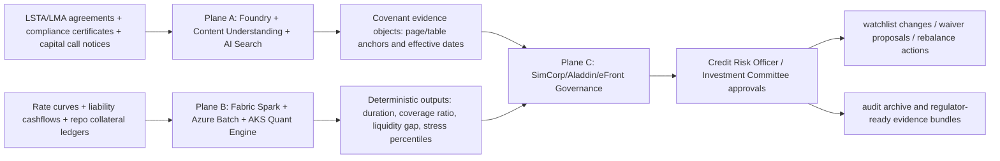
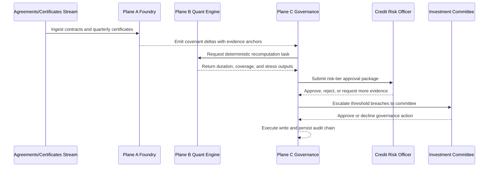

# Public Pension and Sovereign Wealth ALM with Private Credit Covenant Monitoring Agent Selection FAQ: Foundry Evidence Plane vs Fabric/Batch Deterministic Quant Plane vs SimCorp/Aladdin Governance Action Plane
> 🌐 Language / 语言切换: [中文](pension-sovereign-wealth-actuarial-alm-private-credit-covenant-foundry-cu-vs-fabric-monte-carlo-vs-simcorp-selection-faq.md) | **English (Current)** | [EN Catalog](README.en.md) | [中文目录](README.md)
> Audience: public pension investment committees, sovereign wealth risk offices, life-insurer ALM teams, private-credit portfolio monitoring and legal compliance groups
> Updated: 2026-11-19 (UTC+08:00)
> Evidence labels: `measured`, `synthetic`, `anonymized_reported`

---

## 1. Executive summary

1. In pension and sovereign ALM programs, deployment success is determined less by model size and more by strict separation of evidence, calculation, and execution responsibilities.
2. The recommended pattern is a three-plane architecture: Plane A for covenant evidence grounding, Plane B for deterministic ALM stress computation, and Plane C for governed book-of-record actions.
3. Plane A is optimized for 300+ page LSTA/LMA agreements, quarterly borrower compliance certificates, and capital call notices.
4. Plane B must own duration, coverage ratio, VaR, and liquidity-gap arithmetic in replayable Spark/Batch/AKS engines.
5. Plane C must enforce approval state transitions before watchlist reclassification, covenant waiver proposals, or position rebalance writes.
6. Any MNPI-sensitive views require Chinese-Wall isolation through Entra security groups.
7. Generative models should provide interpretation and triage, not source-of-truth arithmetic.
8. Production gates should require all three guarantees: evidence traceability, deterministic recomputation, and auditable execution.

---

## 2. Scope and regulatory boundaries

### 2.1 In-scope

- Private-credit covenant monitoring for EBITDA add-backs, springing covenants, and incurrence tests.
- ALM and LDI computations for key-rate duration matching and liquidity shortfall analysis.
- Solvency II, LICAT, and IFRS 17 stress-test preparation and reporting pipelines.
- Post-investment escalation workflows for watchlist reclassification and waiver recommendation packs.

### 2.2 Control boundaries

- Contract interpretation outputs must include page, paragraph, or table-cell evidence anchors.
- Regulated numeric disclosures must come from deterministic engines with fixed parameter lineage.
- MNPI data visibility must be role-constrained by least privilege.
- Approval trails must capture who approved what action based on which evidence set.

### 2.3 Non-goals

- This guide does not replace actuarial or risk-officer professional sign-off.
- This guide does not redesign the general ledger or core accounting stack.
- This guide does not cover exchange execution microstructure algorithms.

---

## 3. Three-plane end-to-end reference architecture



---

## 4. Plane A: Foundry covenant evidence and semantic plane

### 4.1 Design goals

- Move covenant review from manual reading queues to coordinate-grounded evidence search.
- Compare quarterly borrower certificates directly against governing covenant definitions.
- Emit a shared evidence object usable by legal, risk, and portfolio operations.

### 4.2 Core capabilities

- Content Understanding parses scanned contracts, schedules, and footnotes.
- Hybrid retrieval constrains responses by document version and effective date.
- Foundry agents emit structured fields for threshold, variance, rationale, and evidence anchors.
- Multi-jurisdiction terminology normalization reduces interpretation drift.
- EBITDA add-back deltas are surfaced with explicit change traces.

### 4.3 Sample metrics

- Critical covenant-field extraction accuracy at 94.1% (`measured`).
- Evidence-anchor reproducibility at 99.3% (`measured`).
- Post-investment first-pass review effort reduced by 31% (`anonymized_reported`).

---

## 5. Plane B: Fabric / Batch / AKS deterministic quantitative plane

### 5.1 Design goals

- Replace spreadsheet stitching with replayable ALM computational pipelines.
- Compute LDI fit, liquidity stress, and downside distributions with fixed math definitions.
- Version parameters and model components for regulator-grade reproducibility.

### 5.2 Core capabilities

- Fabric Spark processes large-scale asset-liability time series.
- Azure Batch runs high-volume Monte Carlo paths with deterministic seeds.
- AKS hosts serviceized duration and liquidity calculators with rollback support.
- Parameter snapshots enforce cross-period recomputation consistency.
- Output payloads include confidence metadata and scenario IDs.

### 5.3 Sample metrics

- 100K-path stress run completed in 42 minutes (`measured`).
- Cross-run recomputation deviation below 0.05% (`measured`).
- Monthly ALM production cycle reduced by 28% (`anonymized_reported`).

---

## 6. Plane C: governance and controlled book-of-record action plane

### 6.1 Design goals

- Keep recommendation generation separate from execution authority.
- Enforce state-machine approvals in SimCorp, Aladdin, and eFront workflows.
- Preserve traceable decision evidence across investment, risk, and compliance functions.

### 6.2 Core capabilities

- APIM MCP exposes controlled actions for watchlist update and waiver proposal workflows.
- Logic Apps Standard orchestrates multi-role approvals, retries, and compensation logic.
- Entra security groups apply MNPI Chinese-Wall segmentation by counterparty and portfolio.
- Unapproved actions remain draft artifacts and cannot mutate production records.
- Approved actions trigger regulator-ready evidence packets automatically.

### 6.3 Sample metrics

- Unauthorized execution writes held at zero (`measured`).
- Median escalation-to-committee cycle reduced by 19% (`anonymized_reported`).
- Audit remediation requests reduced by 24% (`anonymized_reported`).

---

## 7. Sequence flow: evidence, recomputation, and approval



---

## 8. 12-dimension selection matrix

| Dimension | Plane A: Foundry Evidence | Plane B: Deterministic Quant | Plane C: Governance Action |
|---|---|---|---|
| 1. Document semantic depth | 5/5 | 2/5 | 2/5 |
| 2. Numerical trustworthiness | 2/5 | 5/5 | 4/5 |
| 3. Approval control strength | 2/5 | 3/5 | 5/5 |
| 4. Regulatory explainability | 4/5 | 4/5 | 5/5 |
| 5. Low-latency interaction | 4/5 | 3/5 | 3/5 |
| 6. Batch throughput | 3/5 | 5/5 | 4/5 |
| 7. Version-governance fidelity | 4/5 | 5/5 | 5/5 |
| 8. Fault isolation | 4/5 | 4/5 | 5/5 |
| 9. Operational complexity | Medium | Medium-High | High |
|10. Cost predictability | 3/5 | 4/5 | 4/5 |
|11. Cross-team collaboration elasticity | 4/5 | 3/5 | 5/5 |
|12. Production risk controllability | 4/5 | 4/5 | 5/5 |

---

## 9. Production snippets (Entra RBAC / APIM / Python)

### 9.1 Bicep sample: MNPI reader group isolation

```bicep
resource mnpiReaderGroup 'Microsoft.Graph/groups@1.0' = {
  name: 'grp-mnpi-private-credit-readers'
  properties: {
    displayName: 'MNPI Private Credit Readers'
    securityEnabled: true
    mailEnabled: false
    mailNickname: 'mnpi-private-credit-readers'
  }
}
```

### 9.2 APIM policy sample: block writes without committee sign-off

```xml
<policies>
  <inbound>
    <base />
    <choose>
      <when condition="@(context.Request.Headers.GetValueOrDefault("x-ic-approved","") != "true")">
        <return-response>
          <set-status code="412" reason="Investment committee approval required" />
        </return-response>
      </when>
    </choose>
  </inbound>
  <backend><base /></backend>
  <outbound><base /></outbound>
</policies>
```

### 9.3 Python sample: hard gate for waiver action dispatch

```python
def ready_for_waiver_action(result: dict) -> bool:
    return (
        result.get("engine_source") == "deterministic_quant"
        and result.get("evidence_bundle_complete") is True
        and result.get("cro_signoff") == "approved"
        and result.get("ic_signoff") == "approved"
    )
```

---

## 10. Scenario A: direct-lending EBITDA add-back breach triage

### 10.1 Background

- Portfolio includes 120+ middle-market direct-lending facilities.
- Quarterly borrower certificates frequently reinterpret add-back categories.
- Investment and legal teams report recurrent disagreement on adjusted EBITDA boundaries.

### 10.2 Objectives

- Complete covenant-delta triage within 4 hours of certificate ingestion.
- Generate legal-review-ready evidence packets for potential breach cases.
- Reduce false escalation volume without missing material risk signals.

### 10.3 Architecture mapping

- Plane A extracts clause deltas and evidence anchors from agreements and certificates.
- Plane B recomputes covenant ratios under deterministic formulas.
- Plane C decides watchlist transitions and waiver escalation readiness.

### 10.4 Quantified outcomes (sample)

- Breach triage cycle reduced from 2.3 days to 6.4 hours (`anonymized_reported`).
- False escalation tickets reduced by 26% (`measured`).
- Median legal evidence loop count reduced from 3 to 1 (`measured`).

---

## 11. Scenario B: gilt/rates repo collateral liquidity stress rebalance

### 11.1 Background

- Long-duration pension books are highly sensitive to curve shocks.
- Margin demand spikes compress repo rollover windows.
- Manual desk workflows cannot sustain intraday multi-scenario recomputation.

### 11.2 Objectives

- Deliver multi-scenario stress recomputation and action proposals within 30 minutes.
- Surface duration gap, cash shortfall, and collateral availability in one governed workspace.
- Ensure committee decisions are based on one canonical data snapshot.

### 11.3 Architecture mapping

- Plane B computes key-rate duration, cashflow stress, and collateral exhaustion points.
- Plane A contributes covenant and mandate constraints that limit allowable actions.
- Plane C packages proposal actions with approval evidence and immutable logs.

### 11.4 Quantified outcomes (sample)

- Stress recomputation throughput improved by 2.1x (`measured`).
- Collateral mismatch incidents reduced by 17% (`anonymized_reported`).
- Committee pre-read preparation effort reduced by 35% (`anonymized_reported`).

---

## 12. Quantitative FAQs (5+ required)

### Q1. Why must LLMs be blocked from direct coverage-ratio arithmetic?

Regulated disclosures require deterministic reproducibility.
Free-form arithmetic generation is difficult to replay across periods.
Use deterministic engines for numbers and LLMs for narrative interpretation.

### Q2. What evidence granularity is minimally acceptable in Plane A?

Document version, page anchor, and paragraph or table-cell coordinates are baseline.
Appendix references should include attachment IDs and effective dates.
This level is necessary for adversarial dispute replay.

### Q3. How should Monte Carlo path counts be selected?

Start from the regulatory minimum requirement and run convergence tests.
Choose the point where error bands stabilize within policy tolerance.
Persist path-count and random-seed metadata for audit replay.

### Q4. How can MNPI Chinese-Wall effectiveness be validated?

Run role-penetration tests and sampled access-log audits.
Prove non-entitled users cannot query sensitive counterparty fields.
Also prove entitled users retain full action traceability.

### Q5. When should Plane C investment outrank additional Plane A expansion?

When evidence quality is already high but approval failures or unauthorized writes persist.
At that stage, governance control is the dominant risk-reduction lever.
Stronger action controls usually produce faster compliance gains.

### Q6. How should ROI be estimated for covenant-monitoring programs?

Quantify labor reduction, avoided dispute loss, and prevented execution errors separately.
Then subtract platform spend plus governance operating cost.
Calibrate assumptions in a rolling 12-month model.

### Q7. How can multi-jurisdiction templates be unified safely?

Use one canonical field dictionary with jurisdiction extensions.
Support Solvency II, LICAT, and IFRS 17 side by side.
Tag each approval with legal-jurisdiction applicability metadata.

---

## 13. Three-year TCO and FinOps model (USD 250B AUM class institution)

> Method note: values are in USD million and represent planning estimates labeled `synthetic`.

| Cost item | Year 1 | Year 2 | Year 3 | 3Y total | Notes |
|---|---:|---:|---:|---:|---|
| Plane A (document parsing and retrieval) | 2.10 | 2.35 | 2.52 | 6.97 | Peak certificate season ingestion and retrieval |
| Plane B (quant compute clusters) | 3.45 | 3.28 | 3.41 | 10.14 | Monte Carlo and ALM batch workloads |
| Plane C (integration and governance workflows) | 2.80 | 2.46 | 2.32 | 7.58 | Integration-heavy first year then flattening |
| Security and compliance audit | 0.95 | 1.02 | 1.10 | 3.07 | Retention, forensics, and replay requirements |
| SRE and model-governance operations | 1.12 | 1.18 | 1.24 | 3.54 | 24x7 coverage and control drills |
| **Total cost** | **10.42** | **10.29** | **10.59** | **31.30** | `synthetic` |

### 13.1 Benefit-side estimates

- Avoided covenant-dispute loss: annualized 4.2 (`anonymized_reported`).
- Reduced liquidity mismatch penalties and opportunity loss: annualized 3.1 (`anonymized_reported`).
- ALM and portfolio-ops productivity gains: annualized 1.6 (`measured`).
- Estimated cumulative 3Y benefit: 26.7 before discount-rate adjustment (`synthetic`).

### 13.2 FinOps governance recommendations

- Meter Plane B by "cost per 10K paths per asset bucket" for transparent scaling control.
- Meter Plane A by both "cost per 1K pages" and "cost per 1K retrievals."
- Tie Plane C spend to approval SLA and compensation-success performance.
- Publish monthly variance reports linking budget, service quality, and risk reduction.

---

## 14. Three high-risk anti-patterns

### 14.1 Anti-pattern 1: treating contract summaries as executable commands

- Symptom: Foundry interpretations are written directly to watchlist state.
- Risk: unreviewed evidence drives production changes and weakens audit defensibility.
- Mitigation: require Plane C role-signature tokens for every state mutation.

### 14.2 Anti-pattern 2: allowing LLM free-form VaR/duration output

- Symptom: reports contain numbers that cannot be recomputed.
- Risk: regulator challenge cannot be answered with deterministic lineage.
- Mitigation: all numeric fields must originate from Plane B deterministic engines.

### 14.3 Anti-pattern 3: implementing MNPI control only in UI masking

- Symptom: backend APIs still return restricted fields to unauthorized identities.
- Risk: exports and logs leak sensitive counterparties through side channels.
- Mitigation: enforce ABAC/RBAC at API and storage layers, not only in frontend views.

---

## 15. Day-0 / Day-1 / Day-2 production checklist

### 15.1 Day-0 (architecture and control baseline)

- Define Plane A/B/C ownership, RACI, and escalation boundaries.
- Standardize evidence-object schema for version, anchor, confidence, and applicability.
- Freeze deterministic parameter repository and rollback process.
- Complete MNPI security-group design and access-matrix review.

### 15.2 Day-1 (pilot and acceptance)

- Replay 20 historical dispute cases through the new evidence pipeline.
- Run at least three stress recomputation drills to validate consistency and latency bounds.
- Inject approval-chain failures to test retry, compensation, and rollback paths.
- Audit sample packages to verify evidence-calculation-action closure.

### 15.3 Day-2 (scale operations)

- Establish quarterly policy/model update governance with signed release notes.
- Introduce quota controls to prevent one desk from consuming shared batch capacity.
- Align KPI incentives to balance speed with compliance quality.
- Institutionalize monthly ROI and risk-parameter recalibration.

### 15.4 Operating principles

- Guarantee recomputability before pursuing additional speed.
- Guarantee approval integrity before expanding automation coverage.
- Guarantee cross-team semantic consistency before cross-region replication.

### 15.5 Suggested SLO thresholds (first 90 days)

- Plane A covenant-field extraction accuracy target: `>= 93%`.
- Plane A evidence-anchor missing-rate target: `<= 1%`.
- Plane B stress-run success after retry target: `>= 99.5%`.
- Plane B recomputation deviation threshold per batch: `<= 0.05%`.
- Plane C unauthorized execution write count threshold: `0`.
- Plane C end-to-end approval latency P95 target: `<= 4h` for major events.
- Audit replay pass-rate target from sampled packets: `>= 98%`.
- MNPI unauthorized-access alert false-positive target: `<= 3%`.

### 15.6 Go-live exit criteria

- At least two quarters of historical replay completed with joint sign-off from risk and legal.
- At least three approval-system outage drills completed with successful compensation validation.
- At least two parameter-version rollback drills completed with expected deterministic outputs.
- Regulator filing fields are fully mapped with named field owners.
- Cross-team runbook, alert severity model, and escalation tree are published.
- Monthly FinOps reporting and governance cadence are operationalized.
- Critical APIs are enforced behind private networking and conditional access.
- Investment committee submission workflow is integration-tested end to end.

### 15.7 Eight standing questions for weekly governance reviews

- Of this week's new breach candidates, how many include complete evidence anchors.
- In rejected waiver proposals, which missing-evidence class appears most frequently.
- Did stress recomputation timeout ratio cross its policy threshold this week.
- Did MNPI access-group changes degrade critical operating collaboration paths.
- Were all approval-chain interruptions closed with compensation and postmortem evidence.
- Did any regulator-filing field mappings introduce unresolved interpretation conflicts.
- Which FinOps variance bucket widened most this week, and is an owner assigned.
- Do any cross-team semantic disagreements remain unresolved at committee level.
- Did any new regulatory-interpretation change require template and engine updates.
