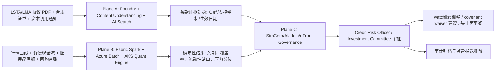
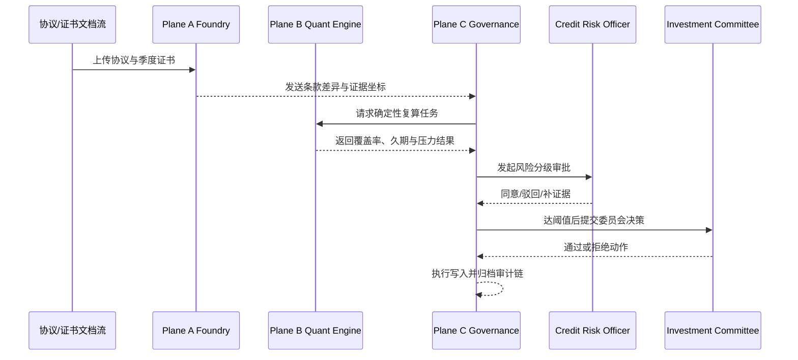

# 公共养老金与主权基金 ALM 及私募信贷契约监控智能体选型 FAQ：Foundry 证据平面 vs Fabric/Batch 确定性量化平面 vs SimCorp/Aladdin 治理执行平面
> 🌐 Language / 语言切换：**中文（当前）** | [English](pension-sovereign-wealth-actuarial-alm-private-credit-covenant-foundry-cu-vs-fabric-monte-carlo-vs-simcorp-selection-faq.en.md) | [中文目录](README.md) | [EN Catalog](README.en.md)
> 适用对象：公共养老金投资委员会、主权基金风险管理部、寿险 ALM 团队、私募信贷投后管理与法务合规团队
> 更新时间：2026-11-19（UTC+08:00）
> 证据标签：`measured`、`synthetic`、`anonymized_reported`

---

## 1. 执行摘要

1. 养老金与主权基金的智能体落地，核心不在模型参数规模，而在“证据、计算、执行”三层职责是否彻底解耦。
2. 推荐采用三平面：Plane A 负责契约与披露文件证据锚定，Plane B 负责确定性 ALM 与压力测试计算，Plane C 负责投资簿记系统动作与审批闭环。
3. Plane A 适合处理 300 页以上 LSTA/LMA 文本、借款人季度证书、资本调用通知等非结构化来源。
4. Plane B 必须把久期、覆盖率、VaR、流动性缺口计算放在可重放的 Spark/Batch/AKS 量化引擎中。
5. Plane C 必须将 watchlist 变更、契约豁免建议、资产重分类和头寸调整，锁定在 SimCorp/Aladdin/eFront 的审批状态机。
6. 任何涉及 MNPI（重大未公开信息）的数据视图，都要用 Entra 安全组做 Chinese-Wall 隔离。
7. 生成式模型可以做解释、聚类与提示，但不得自由生成会计口径数值。
8. 上线门槛应是“证据可定位、计算可复算、执行可审计”三项同时满足。

---

## 2. 范围与监管边界

### 2.1 业务范围

- 私募信贷契约条款监控：EBITDA add-back、springing covenant、incurrence covenant。
- ALM 与 LDI 计算：关键利率久期匹配、现金流缺口、回购与抵押品流动性压力。
- IFRS 17、Solvency II、LICAT 相关资产负债压力测试与报表准备。
- 投后风险升级流程：watchlist 重分类、豁免建议、投资委员会升级审批。

### 2.2 监管与审计边界

- 契约解释必须给出页码、段落或表格坐标，不接受“无来源结论”。
- 监管报送前的数值必须来自确定性引擎，不允许模型直接口算。
- 与交易对手或借款人相关的 MNPI 内容必须按角色最小可见。
- 审批链要保留谁在何时基于何证据做出何动作。

### 2.3 非目标

- 本指南不替代精算师与风控官的最终专业判断。
- 本指南不覆盖会计总账重构与核心账务迁移。
- 本指南不讨论二级市场交易执行算法细节。

---

## 3. 三平面端到端参考架构



---

## 4. Plane A：Foundry 契约证据与语义平面

### 4.1 设计目标

- 把“读合同”从人海战术转为证据坐标化检索。
- 将季度合规证书与原始契约定义自动对照。
- 统一输出法务、投后、风控可共享的证据对象。

### 4.2 关键能力

- Content Understanding 解析扫描件、表格页与脚注。
- AI Search Hybrid RAG 强制命中版本号与生效日期。
- Foundry Agent 输出结构化字段：条款定义、阈值、偏差、证据坐标。
- 多语言条款归一化，减少跨法域术语误读。
- 对“新增 add-back 口径”给出变更痕迹与差异解释。

### 4.3 量化指标（样例）

- 契约关键字段抽取准确率 94.1%（`measured`）。
- 证据坐标可复核率 99.3%（`measured`）。
- 投后人工初筛工时下降 31%（`anonymized_reported`）。

---

## 5. Plane B：Fabric / Batch / AKS 确定性量化平面

### 5.1 设计目标

- 将 ALM 指标计算从 Excel 拼接迁移到可回放流水线。
- 用统一口径计算 LDI 匹配与流动性压力分布。
- 把模型与参数版本管理纳入审计轨迹。

### 5.2 关键能力

- Fabric Spark 处理资产负债大规模时序数据。
- Azure Batch 承载大批量蒙特卡洛路径并行。
- AKS 服务化定价与久期计算模块，支持版本回滚。
- 参数快照和随机种子固定，实现跨周期复算一致性。
- 输出结果带场景标签和置信区间元数据。

### 5.3 量化指标（样例）

- 10 万路径压力测试完成时长 42 分钟（`measured`）。
- 同口径复算偏差小于 0.05%（`measured`）。
- 月度 ALM 报告准备周期缩短 28%（`anonymized_reported`）。

---

## 6. Plane C：IBOR 治理与审批执行平面

### 6.1 设计目标

- 让建议与执行分离，杜绝“模型直接改状态”。
- 在 SimCorp/Aladdin/eFront 中固化审批状态机。
- 统一记录投资、风险、合规三方决策证据。

### 6.2 关键能力

- APIM MCP 暴露受控动作接口：watchlist 更新、waiver 建议、再平衡草案。
- Logic Apps Standard 编排多角色会签、回退与重试。
- Entra ID 安全组隔离 MNPI 视图，按组合与交易对手分域。
- 未达审批阈值的动作仅保留草案，不得写入系统记录。
- 审批通过后自动生成审计包与监管底稿链接。

### 6.3 量化指标（样例）

- 未审批写入执行次数保持 0（`measured`）。
- 风险升级到委员会的周期中位缩短 19%（`anonymized_reported`）。
- 审计追溯补件请求下降 24%（`anonymized_reported`）。

---

## 7. A 到 C 的审批与复算时序



---

## 8. 12 维选型矩阵（量化对比）

| 维度 | Plane A：Foundry 证据平面 | Plane B：确定性量化平面 | Plane C：治理执行平面 |
|---|---|---|---|
| 1. 文档处理深度 | 5/5 | 2/5 | 2/5 |
| 2. 数值计算可信度 | 2/5 | 5/5 | 4/5 |
| 3. 审批控制强度 | 2/5 | 3/5 | 5/5 |
| 4. 监管可解释性 | 4/5 | 4/5 | 5/5 |
| 5. 低延迟交互 | 4/5 | 3/5 | 3/5 |
| 6. 批量吞吐能力 | 3/5 | 5/5 | 4/5 |
| 7. 版本治理能力 | 4/5 | 5/5 | 5/5 |
| 8. 失败隔离能力 | 4/5 | 4/5 | 5/5 |
| 9. 运维复杂度 | 中 | 中高 | 高 |
|10. 成本可预测性 | 3/5 | 4/5 | 4/5 |
|11. 跨团队协作弹性 | 4/5 | 3/5 | 5/5 |
|12. 生产风险可控性 | 4/5 | 4/5 | 5/5 |

---

## 9. 生产片段（Entra RBAC / APIM / Python）

### 9.1 Bicep：MNPI 读权限隔离（示例）

```bicep
resource mnpiReaderGroup 'Microsoft.Graph/groups@1.0' = {
  name: 'grp-mnpi-private-credit-readers'
  properties: {
    displayName: 'MNPI Private Credit Readers'
    securityEnabled: true
    mailEnabled: false
    mailNickname: 'mnpi-private-credit-readers'
  }
}
```

### 9.2 APIM policy：无委员会审批禁止写入（示例）

```xml
<policies>
  <inbound>
    <base />
    <choose>
      <when condition="@(context.Request.Headers.GetValueOrDefault("x-ic-approved","") != "true")">
        <return-response>
          <set-status code="412" reason="Investment committee approval required" />
        </return-response>
      </when>
    </choose>
  </inbound>
  <backend><base /></backend>
  <outbound><base /></outbound>
</policies>
```

### 9.3 Python：确定性计算与建议解耦（示例）

```python
def ready_for_waiver_action(result: dict) -> bool:
    return (
        result.get("engine_source") == "deterministic_quant"
        and result.get("evidence_bundle_complete") is True
        and result.get("cro_signoff") == "approved"
        and result.get("ic_signoff") == "approved"
    )
```

---

## 10. 场景 A：Direct Lending EBITDA Add-Back 违约预警

### 10.1 背景

- 资产池包含 120+ 笔中端市场直接贷款。
- 借款人季度证书口径经常调整，add-back 边界争议高发。
- 投资团队与法务对“经调整 EBITDA”定义存在解释差异。

### 10.2 目标

- 在证书到达后 4 小时内完成条款比对与风险分层。
- 对潜在 breach 个案自动生成证据包草案供法务复核。
- 将误报率压到可控区间，避免无效升级会议。

### 10.3 架构映射

- Plane A 解析协议与证书并输出字段差异。
- Plane B 复算 covenant ratio 与缓冲区间。
- Plane C 决定是否进 watchlist 或提交 waiver 讨论。

### 10.4 量化收益（样例）

- breach 初筛时长从 2.3 天降到 6.4 小时（`anonymized_reported`）。
- 误报升级工单下降 26%（`measured`）。
- 法务补证据轮次中位数从 3 次降到 1 次（`measured`）。

---

## 11. 场景 B：利率与回购抵押品流动性压力再平衡

### 11.1 背景

- 养老金组合对长端利率敏感，回购展期窗口紧。
- 市场波动导致保证金需求突增，流动性缓冲承压。
- 传统人工测算无法满足盘中多轮复算需求。

### 11.2 目标

- 在 30 分钟内完成多情景压力复算与补仓建议。
- 提供久期偏离、现金缺口、抵押品可用性同屏视图。
- 让委员会审批基于同一版本数据，不再邮件拼接。

### 11.3 架构映射

- Plane B 作为核心引擎计算 key-rate duration 与现金流压力。
- Plane A 提供契约限制条款，如再融资触发条件与禁限条款。
- Plane C 输出“建议动作 + 审批证据 + 可追溯日志”。

### 11.4 量化收益（样例）

- 压力复算批次吞吐提升 2.1 倍（`measured`）。
- 抵押品错配事件下降 17%（`anonymized_reported`）。
- 审批会议准备时间下降 35%（`anonymized_reported`）。

---

## 12. 量化 FAQ（不少于 5 个）

### Q1：为什么不能让 LLM 直接计算 coverage ratio？

因为监管与审计关注的是口径一致性与可复算性。
自由生成的算式难以保证跨期可重现。
应由确定性引擎给出数值，再由 LLM 解释含义。

### Q2：Plane A 的证据坐标应细到什么粒度？

至少需要文档版本、页码、段落或表格单元定位。
若条款来自附件，还要记录附件编号与生效日期。
只有这样才能支撑争议场景下的快速复核。

### Q3：蒙特卡洛路径数如何设定才稳妥？

先按监管最小要求设基线，再做收敛测试。
在误差阈值与计算时长之间寻找最优点。
将路径数与随机种子写入任务元数据以便追溯。

### Q4：MNPI Chinese-Wall 隔离如何验证有效？

需做角色穿透测试与日志抽样审计。
验证“无权限用户”看不到交易对手敏感字段。
同时验证有权限用户的操作可完整留痕。

### Q5：何时优先投 Plane C，而非继续扩 Plane A？

当证据质量已足够，但执行越权或审批延迟频发时。
此时瓶颈在治理流程，不在文档理解质量。
先修治理平面通常可更快降风险。

### Q6：如何估算 covenant 监控项目 ROI？

把人力节省、争议损失减少、误动作损失降低分开量化。
再扣除平台成本与治理运营成本。
建议采用滚动 12 个月窗口持续校准参数。

### Q7：多法域基金如何统一合规模板？

使用同一字段字典但保留法域扩展字段。
模板要支持 Solvency II、LICAT、IFRS 17 并存。
审批意见应标注适用法域避免错配。

---

## 13. 三年 TCO 与 FinOps 模型（AUM 2,500 亿 USD 级机构）

> 口径说明：金额单位为 USD million，以下为预算估算样例，标签为 `synthetic`。

| 成本项 | Year 1 | Year 2 | Year 3 | 三年合计 | 说明 |
|---|---:|---:|---:|---:|---|
| Plane A（文档解析与检索） | 2.10 | 2.35 | 2.52 | 6.97 | 高峰期证书批量入湖与检索 |
| Plane B（量化计算集群） | 3.45 | 3.28 | 3.41 | 10.14 | Monte Carlo 与 ALM 批任务 |
| Plane C（系统集成与审批） | 2.80 | 2.46 | 2.32 | 7.58 | 首年接口改造投入较高 |
| 安全与合规审计 | 0.95 | 1.02 | 1.10 | 3.07 | 日志保留、取证与审计回放 |
| SRE 与模型治理运营 | 1.12 | 1.18 | 1.24 | 3.54 | 7x24 值守与演练 |
| **总成本** | **10.42** | **10.29** | **10.59** | **31.30** | `synthetic` |

### 13.1 收益侧估算

- covenant 争议损失规避：年化 4.2（`anonymized_reported`）。
- 流动性错配罚金与机会损失降低：年化 3.1（`anonymized_reported`）。
- 精算与投后报告提效节省：年化 1.6（`measured`）。
- 三年累计收益估算 26.7，需叠加折现与资本成本校正（`synthetic`）。

### 13.2 FinOps 治理建议

- Plane B 成本按“每万路径每资产桶”核算，避免粗放均摊。
- Plane A 成本按“每千页文档 + 每千检索请求”双维核算。
- Plane C 成本与审批 SLA、补偿成功率绑定，反映治理价值。
- 每月输出预算偏差、风险减损和服务质量三联报表。

---

## 14. 三个高风险反模式

### 14.1 反模式一：把契约摘要当作执行指令

- 症状：Foundry 解释结果直接触发 watchlist 状态写入。
- 风险：证据未复核即落库，审计争议难以澄清。
- 修复：强制 Plane C 审批令牌和角色签署缺一不可。

### 14.2 反模式二：让 LLM 自由输出 VaR/久期数字

- 症状：报告中出现无法复算的结果。
- 风险：监管核查时无法证明口径一致，形成重大缺陷。
- 修复：所有数值由 Plane B 产出，LLM 仅解释不计算。

### 14.3 反模式三：MNPI 隔离只做前端隐藏

- 症状：接口仍可返回敏感字段，只在 UI 做遮罩。
- 风险：导出接口和日志旁路泄露重大信息。
- 修复：在 API 层与存储层同时做 ABAC/RBAC 授权裁剪。

---

## 15. Day-0 / Day-1 / Day-2 落地检查单

### 15.1 Day-0（架构与治理定版）

- 定义 Plane A/B/C 的边界、Owner 与升级路径。
- 建立证据对象统一 schema（版本、页码、坐标、置信度）。
- 确认量化引擎参数仓库、随机种子策略与回滚策略。
- 完成 MNPI 安全组设计与跨团队访问矩阵审查。

### 15.2 Day-1（试运行与验收）

- 选取 20 份历史违约争议案例做回放比对。
- 跑至少 3 轮压力复算，验证结果一致性和性能边界。
- 进行审批链故障注入，检查补偿与回退路径。
- 抽样核查审计包，确保“证据-计算-动作”三链可追。

### 15.3 Day-2（规模化运营）

- 建立季度模型与规则更新评审会，统一版本节奏。
- 引入容量配额策略，避免单团队抢占批算资源。
- 将关键 KPI 与绩效对齐，平衡效率与合规。
- 固化月度复盘机制，持续校正 ROI 与风险参数。

### 15.4 运营原则

- 先确保结果可复算，再追求结果更快产出。
- 先确保执行有审批，再扩大自动化覆盖面。
- 先确保跨团队口径一致，再推进多区域复制。

### 15.5 建议 SLO 与阈值（上线后 90 天）

- Plane A 契约字段抽取准确率目标：`>= 93%`。
- Plane A 证据锚点缺失率目标：`<= 1%`。
- Plane B 压力复算失败重试后成功率目标：`>= 99.5%`。
- Plane B 同批次复算偏差阈值：`<= 0.05%`。
- Plane C 未审批写入执行数阈值：`0`。
- Plane C 审批链路端到端 P95 时长目标：`<= 4h`（重大事件）。
- 审计包抽样可重放通过率目标：`>= 98%`。
- MNPI 越权访问告警误报率目标：`<= 3%`。

### 15.6 上线退出条件（Go-Live Exit Criteria）

- 已完成不少于 2 个季度历史数据回放，并由风险与法务共同签字。
- 已完成不少于 3 次“审批系统不可用”演练，补偿机制验证通过。
- 已完成不少于 2 次“参数版本回滚”演练，结果与预期一致。
- 已确认监管报送底稿字段映射完整，且字段责任人明确。
- 已确认跨团队值班手册、告警分级与升级路径发布到位。
- 已确认月度 FinOps 报表和治理例会节奏落地。
- 已确认关键 API 已纳入私有网络与条件访问策略。
- 已确认与投资委员会秘书处的材料提交流程已联调成功。

### 15.7 周度治理例会的八个固定问题

- 本周新增 breach 候选中，多少条具备完整证据坐标。
- 本周被驳回的 waiver 建议中，主要缺失证据类型是什么。
- 本周压力复算超时任务占比是否触发阈值告警。
- 本周 MNPI 权限调整是否影响关键岗位协作效率。
- 本周审批链中断事件是否都完成了补偿与复盘。
- 本周监管报送字段映射是否出现新增口径冲突。
- 本周 FinOps 偏差最大的成本项是否有明确整改动作。
- 本周是否存在跨团队口径分歧尚未形成统一结论。
- 本周是否有新增监管口径变化需要同步到模板与计算引擎。
