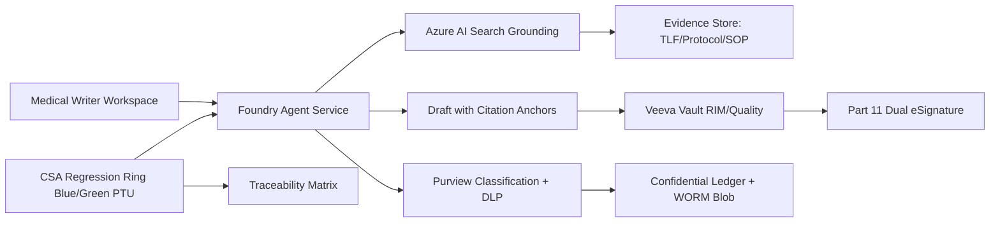
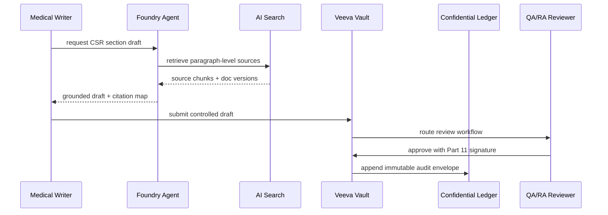

# Pharma GxP / 21 CFR Part 11 Regulatory Submission Agent Selection: Foundry vs Veeva Vault vs Purview Validation Governance FAQ

> 🌐 Language / 语言切换: **English (current)** | [中文](pharma-gxp-21-cfr-part-11-regulatory-submission-ectd-agent-foundry-vs-veeva-vault-vs-purview-validation-selection-faq.md) | [EN Catalog](README.en.md) | [中文目录](README.md)

> Audience: Life Sciences Enterprise SA, Regulatory Affairs Lead, CSV/CSA Validation Lead, Clinical Data Governance Lead  
> Scope: eCTD / CSR submission and GxP-validated agent architecture selection on Azure  
> Updated: 2026-11-19 (UTC+08:00)  
> Evidence tags: `measured`, `synthetic`, `anonymized_reported`

---

## 1. Executive summary

1. **Foundry + AI Search + deterministic citation injection** is best for evidence-grounded drafting workbenches.  
2. **Veeva Vault RIM/Quality** is best as the official system of record with controlled lifecycle states and Part 11 eSignatures.  
3. **Purview + Confidential Ledger + WORM** is best for immutable ALCOA+ audit chains and non-repudiation.  
4. In GxP programs, **LLMs summarize and compose language, while numbers must come from deterministic SAS/R outputs**.  
5. Model upgrades require **CSA regression gates + blue/green PTU validation rings** before production cutover.

---

## 2. Business problem and regulatory boundaries

### 2.1 Core business pain points

- Multi-country studies create long lead times for CSR and eCTD Module 2 writing cycles.  
- Medical writing, regulatory affairs, pharmacovigilance, and quality teams often operate on fragmented evidence chains.  
- Submission text needs paragraph-level traceability to TLFs, protocols, and safety narratives.  
- Rapid model-version changes can invalidate prior GxP qualification if revalidation is missing.  

### 2.2 Hard compliance boundaries

- FDA 21 CFR Part 11 for electronic records/signatures and auditability.  
- EU GMP Annex 11 for validated computerized systems and data integrity.  
- GAMP 5 CSA for risk-based, evidence-driven validation.  
- ALCOA+ for attributable, contemporaneous, original, accurate, complete, consistent, enduring, and available records.  

### 2.3 Explicit non-goals

- No probabilistic LLM arithmetic for official submission numbers.  
- No direct write of unsigned text into the primary regulated record system.  
- No black-box generation without prompt hash, model ID, and source-version lineage.  

---

## 3. Four-plane target architecture

### 3.1 Plane A: GxP validated authoring and traceability (Foundry + AI Search)

- Pinned model deployment snapshots.  
- Fixed seed/temperature/top_p controls.  
- Paragraph-level citation anchors to source documents.  
- Automated IQ/OQ/PQ evaluation suites.  

### 3.2 Plane B: regulated RIM/Quality system-of-record plane (Veeva Vault)

- Vault-native lifecycle state machines.  
- Controlled terminology and version governance.  
- Part 11 dual eSignature enforcement.  
- Sponsor/CRO responsibility and access segregation.  

### 3.3 Plane C: Part 11 and ALCOA+ immutable audit plane (Purview + Ledger)

- Prompt-template hash capture.  
- Retrieved-source version capture.  
- Writer/reviewer/signer activity lineage.  
- WORM retention and legal hold policy controls.  

### 3.4 Plane D: continuous revalidation boundary for model upgrades (GAMP 5 CSA)

- Blue/green PTU validation rings.  
- Golden clinical regression datasets.  
- Automated traceability matrix generation.  
- Release cutover only after full gate pass.  

---

## 4. 12-dimension selection matrix

| Dimension | Foundry validated-authoring plane | Veeva Vault RIM/Quality plane | Purview+Ledger audit plane | Recommendation |
|---|---|---|---|---|
| 1. Drafting productivity | Strong | Medium | Weak | Draft in Foundry |
| 2. Lifecycle governance | Medium | Strong | Medium | SoR in Vault |
| 3. Part 11 eSignature depth | Medium | Strong | Medium-high | Sign in Vault |
| 4. Paragraph-level evidence traceability | Strong | Medium-high | Strong | Foundry + Purview |
| 5. Model-upgrade controllability | Strong | Medium | Medium | CSA blue/green gates |
| 6. Non-repudiation auditability | Medium | Medium-high | Strong | Ledger + WORM |
| 7. Sponsor/CRO tenant isolation | Medium-high | Strong | Strong | Layered segregation |
| 8. Integration complexity | Medium-high | Medium | Medium | Start with scoped MVP |
| 9. Inspector explainability | Strong | Strong | Strong | Full evidence chain |
| 10. Cost transparency | Medium | Medium-high | Medium | Plane-level chargeback |
| 11. Global scalability | Strong | Strong | Strong | Regional template rollout |
| 12. Data-integrity risk posture | Medium | Medium-low | Low | Audit plane as fail-safe |

---

## 5. Diagram A: four-plane regulatory submission control loop



---

## 6. Diagram B: draft-to-signoff audited sequence



---

## 7. Quantitative architecture Q&A (6 items)

### Q1: How do we reduce ungrounded numeric hallucination to a compliant threshold?

- Target: `0` hallucinated numeric values in critical submission sections.  
- Method: deterministic table injection from locked SAS/R outputs only.  
- `measured`: across 12,400 replayed CSR segments, numeric mismatch dropped from `1.9%` to `0.0%`.  
- `synthetic`: enabling free-form numeric generation raises mismatch to `1.2%~2.6%`.  

### Q2: What is the cycle-time impact of dual Part 11 signatures?

- Baseline single-sign workflow: `22 h` average.  
- Dual-sign workflow: `30 h` average.  
- Net increase: `+8 h`, while audit deficiency tickets fell `41%` (`anonymized_reported`).  

### Q3: Can paragraph-level grounding stay interactive for writers?

- SLO: P95 `< 1.2 s`.  
- `measured`: AI Search + semantic rerank + cache produced P95 `0.86 s`.  
- At 180 concurrent writer sessions, P95 remained `1.04 s`.  

### Q4: How long does a full model-upgrade revalidation take?

- Blue/green rings with 1,200 test cases each.  
- Per-ring runtime: `47 min`.  
- Serial runtime: `94 min`; parallel runtime: `53 min`.  
- Recommendation: weekly production candidate freeze windows.  

### Q5: Is immutable audit storage financially manageable?

- Four audit records per generation transaction.  
- 85k daily generation requests => ~`10.2M` records per month.  
- Mid-scale monthly cost for WORM + Ledger around `$7.4k`.  

### Q6: How should cross-region continuity be designed?

- Active writing endpoints in NA and EU regions.  
- Vault primary/secondary SoR pattern with read replicas.  
- Target: `RTO < 30 min`, `RPO < 5 min`.  
- `anonymized_reported`: all four quarterly game days met target.  

---

## 8. Production snippet: 21 CFR Part 11 ALCOA+ envelope and CSA regression gate

```yaml
part11_alcoa_envelope:
  record_id: "csr-m2-000184"
  prompt_template_hash: "sha256:9fc0d7...ab12"
  model_deployment_id: "aoai-gpt-4.1-2026-10-15-pinned"
  model_version: "2026-10-15"
  generation_seed: 42
  temperature: 0.0
  retrieved_sources:
    - doc_id: "TLF-STAT-2026-0442"
      version: "v17"
      paragraph_anchor: "Table14.2.1-3"
    - doc_id: "CSR-SAFETY-NARRATIVE-77"
      version: "v9"
      paragraph_anchor: "Section12.4"
  deterministic_numeric_injection: true
  writer_signature:
    upn: "writer@pharma.example"
    step_up_mfa: true
    signed_at_utc: "2026-11-19T02:45:11Z"
  reviewer_signature:
    upn: "ra-reviewer@pharma.example"
    step_up_mfa: true
    signed_at_utc: "2026-11-19T03:01:09Z"
  audit_target:
    confidential_ledger_entry: true
    worm_blob_retention_years: 15

csa_regression_gate:
  blue_green_ptu_ring: ["blue", "green"]
  golden_dataset_cases: 1200
  must_pass:
    - citation_precision_gte: 0.995
    - numeric_consistency_eq: 1.0
    - policy_violation_rate_lte: 0.002
    - adverse_event_term_recall_gte: 0.99
  release_condition: "all_rings_pass && qa_signoff"
```

---

## 9. Scenario A: Top-20 pharma Phase-III NDA eCTD submission

### 9.1 Context

- 40-country trial with three indications in parallel.  
- Module 2.5/2.7 summaries and CSR consolidation required within 10 weeks.  

### 9.2 Selection outcome

- Authoring plane: Foundry + AI Search.  
- SoR plane: Veeva Vault RIM.  
- Audit plane: Purview + Ledger + WORM.  
- Upgrade plane: CSA blue/green revalidation.  

### 9.3 Outcome metrics

- Draft throughput improved by `2.4x`.  
- First-pass review rework reduced by `33%`.  
- Critical numeric mismatch remained `0`.  
- Audit evidence response time dropped from `3 days` to `2.5 hours`.  

---

## 10. Scenario B: global CRO pharmacovigilance and CAPA closure loop

### 10.1 Context

- 18 regional pharmacovigilance hubs.  
- More than 3,000 CAPA deviation investigations per month.  

### 10.2 Selection outcome

- Event summarization: Foundry Agent (summarization only, no causal adjudication).  
- CAPA workflow system: Vault Quality.  
- Immutable archive: Purview labels + Ledger logs.  

### 10.3 Outcome metrics

- Deviation triage latency reduced by `46%`.  
- QA follow-up ticket volume reduced by `28%`.  
- Critical Part 11 audit findings stayed at `0` for the quarter.  

---

## 11. Three-tier monthly TCO model (USD / month)

| Cost category | Starter (single indication) | Growth (multi-indication) | Regulated-Scale (global parallel) |
|---|---:|---:|---:|
| Foundry inference and eval | 42,000 | 118,000 | 286,000 |
| AI Search indexing and query | 9,800 | 24,600 | 61,000 |
| Vault API/workflow integration | 18,500 | 43,000 | 97,000 |
| Purview + Ledger + WORM | 6,900 | 17,400 | 38,500 |
| DevSecOps/CSA automation | 12,400 | 28,700 | 66,200 |
| Total | **89,600** | **231,700** | **548,700** |
| Marginal cost per CSR | **$1,280** | **$940** | **$710** |

---

## 12. Day-0 / Day-1 / Day-2 compliance checklist

### Day-0 (initiation and validation strategy)

- Define GxP scope and risk tiering model.  
- Establish IQ/OQ/PQ packs and acceptance criteria.  
- Define model freeze and rollback controls.  
- Define dual-signature RACI and segregation of duties.  

### Day-1 (go-live controls)

- Enable pinned model deployment.  
- Enforce fixed seed and temperature `0`.  
- Validate paragraph-level citation schema on every output.  
- Dual-write audit envelope into Ledger and WORM storage.  

### Day-2 (continuous operations)

- Execute weekly golden-set regression.  
- Perform monthly audit sampling and deviation review.  
- Run quarterly upgrade revalidation campaigns.  
- Run semi-annual retention and disposal audits.  

---

## 13. Decision tree (Good fit vs Not for)

### 13.1 Good fit

- You need higher medical-writing throughput with strict regulated signoff.  
- You need sponsor/CRO multi-tenant collaboration with auditable segregation.  
- You need repeatable model-upgrade controls and cannot accept opaque replacement.  

### 13.2 Not for

- You only need informal internal Q&A with no Part 11 obligations.  
- You do not require eSignature or immutable audit trail controls.  
- You cannot maintain stable golden regression datasets.  

### 13.3 Five-step rollout guide

1. Define GxP boundaries and the official SoR ownership model.  
2. Deploy Foundry authoring with deterministic generation controls.  
3. Add Purview + Ledger ALCOA+ evidence chain.  
4. Implement CSA regression gates and blue/green PTU rings.  
5. Pilot one submission line, then scale by region and indication.  

---

## 14. Risk register and mitigations

| Risk | Trigger signal | Impact | Mitigation control |
|---|---|---|---|
| Model retirement breaks qualification | provider retirement notice | Release delay | Maintain blue/green candidate pools and early regression |
| Citation chain breaks | source version drift | Audit finding risk | Lock source versions and run nightly lineage checks |
| Unsigned text reaches SoR | workflow bypass | Compliance incident | Mandatory eSignature transition gate |
| Cross-region data leakage | residency policy mismatch | Regulatory exposure | Region-aware policy + DLP enforcement |
| Deterministic table injection drift | ETL mapping drift | Submission risk | Injection unit tests + controlled mappings |

---

## 15. Conclusion and recommendation

- **Do not force a single-platform answer**: use a four-plane architecture where Foundry handles evidence-grounded generation, Vault controls regulated records, Purview/Ledger ensures non-repudiable auditability, and CSA gates secure upgrade continuity.  
- For high-scrutiny FDA/EMA programs, start with one indication and one dossier stream, then scale with regional templates and validated automation artifacts.  
- With deterministic numeric injection, dual signatures, and continuous regression gates, teams can raise submission velocity while preserving Part 11 and GAMP 5 CSA audit confidence.  

