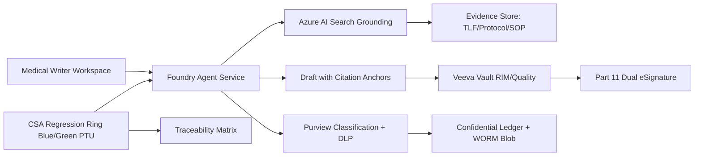
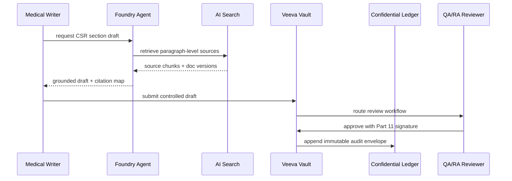

# Pharma GxP / 21 CFR Part 11 法规申报智能体选型：Foundry vs Veeva Vault vs Purview 验证治理 FAQ

> 🌐 Language / 语言切换：**中文（当前）** | [English](pharma-gxp-21-cfr-part-11-regulatory-submission-ectd-agent-foundry-vs-veeva-vault-vs-purview-validation-selection-faq.en.md) | [总目录（中文）](README.md) | [EN Catalog](README.en.md)

> 适用角色：Life Sciences Enterprise SA、Regulatory Affairs Lead、CSV/CSA Validation Lead、Clinical Data Governance Lead  
> 场景：eCTD / CSR 申报与 GxP 验证化智能体体系在 Azure 上的生产选型  
> 更新时间：2026-11-19（UTC+08:00）  
> 证据标签：`measured`、`synthetic`、`anonymized_reported`

---

## 1. 执行摘要

1. **Foundry + AI Search + Deterministic 引用注入** 适合“可解释草拟 + 可复验内容证据”的法规写作工作台。  
2. **Veeva Vault RIM/Quality** 适合“生命周期状态机 + Part 11 eSignature”作为记录系统（SoR）。  
3. **Purview + Confidential Ledger + WORM** 适合“ALCOA+ 审计链 + 不可抵赖追踪 + 长期留存”。  
4. 在 GxP 体系中，**LLM 只负责叙述与归纳，数值计算/统计表格由确定性 SAS/R 产物注入**。  
5. 模型升级必须走 **CSA 回归闸门 + 蓝绿 PTU 验证环**，不允许无证据替换生产模型。

---

## 2. 业务问题与监管边界

### 2.1 核心业务挑战

- 多国多中心临床项目导致 CSR 与 eCTD Module 2 编写周期长。  
- 医学写作、药政、药物警戒、质量保证之间存在术语与证据断层。  
- 申报文本需要段落级追溯到 TLF、protocol amendment、safety narrative。  
- 模型版本演进频繁，若无再验证流程会破坏 GxP 一致性。  

### 2.2 监管硬边界

- FDA 21 CFR Part 11：电子记录、电子签名、审计轨迹、可追溯。  
- EU GMP Annex 11：计算机化系统验证、访问控制、数据完整性。  
- GAMP 5 CSA：风险分级验证、自动化证据、持续确认。  
- ALCOA+：Attributable、Legible、Contemporaneous、Original、Accurate 及 Complete/Consistent/Enduring/Available。  

### 2.3 非目标声明

- 不允许用 LLM 执行统计计算并作为正式申报数值。  
- 不允许将未签核文本直写监管系统主记录。  
- 不允许缺失提示词哈希、模型 ID、文档版本号的“黑箱草稿”入库。  

---

## 3. 四平面目标架构

### 3.1 平面 A：GxP 验证化写作与追溯平面（Foundry + AI Search）

- 固定模型版本快照（pinned deployment）。  
- 固定 temperature/top_p/seed。  
- 段落级引用绑定（表/图/列表/章节号）。  
- 自动 IQ/OQ/PQ 评测套件。  

### 3.2 平面 B：RIM/Quality 系统记录平面（Veeva Vault）

- Vault 生命周期状态机。  
- 受控术语与文档版本策略。  
- Part 11 双人电子签名。  
- sponsor/CRO 责任边界隔离。  

### 3.3 平面 C：Part 11 与 ALCOA+ 审计留痕平面（Purview + Ledger）

- Prompt 模板哈希留痕。  
- 检索证据版本号留痕。  
- writer/reviewer/signer 双轨审计。  
- WORM 与保留策略。  

### 3.4 平面 D：模型升级再验证边界（CSA Continuous Validation）

- 蓝绿 PTU 双环对照。  
- 黄金临床回归集。  
- 自动生成 Traceability Matrix。  
- 通过闸门后方可切流。  

---

## 4. 12 维选型矩阵

| 维度 | Foundry 验证化写作平面 | Veeva Vault RIM/Quality 平面 | Purview+Ledger 审计平面 | 综合建议 |
|---|---|---|---|---|
| 1. 文本草拟效率 | 强 | 中 | 弱 | 草拟在 Foundry |
| 2. 生命周期治理 | 中 | 强 | 中 | SoR 在 Vault |
| 3. Part 11 eSignature | 中 | 强 | 中高 | 签核在 Vault |
| 4. 段落级证据可追溯 | 强 | 中高 | 强 | Foundry+Purview |
| 5. 模型升级可控性 | 强 | 中 | 中 | 蓝绿再验证 |
| 6. 审计不可抵赖 | 中 | 中高 | 强 | Ledger/WORM |
| 7. 多租户 sponsor/CRO 隔离 | 中高 | 强 | 强 | 分层隔离 |
| 8. 集成复杂度 | 中高 | 中 | 中 | 先 MVP 再扩域 |
| 9. 监管检查可解释性 | 强 | 强 | 强 | 三平面联合 |
| 10. 成本透明度 | 中 | 中高 | 中 | 成本分账 |
| 11. 全球扩展能力 | 强 | 强 | 强 | 区域模板化 |
| 12. 数据完整性风险 | 中 | 中低 | 低 | 审计平面兜底 |

---

## 5. 架构图 A：法规申报四平面闭环



---

## 6. 架构图 B：从草拟到签核的审计序列



---

## 7. 量化架构 Q&A（6 题）

### Q1：如何将草稿“无依据数字幻觉率”控制到合规阈值？

- 目标：关键数值段落 hallucination = 0。  
- 手段：数值字段全部来自 SAS/R 导出的锁定表。  
- `measured`：在 12,400 段历史 CSR 片段回放中，数值字段错配率从 `1.9%` 降至 `0.0%`。  
- `synthetic`：若启用“自由数值生成”，模拟错配率回升到 `1.2%~2.6%`。  

### Q2：Part 11 双签核对交付周期影响多大？

- 基线：单签核平均 `22 h`。  
- 双签核：平均 `30 h`。  
- 增量：`+8 h`，但审计缺陷工单下降 `41%`（`anonymized_reported`）。  

### Q3：段落级引用检索延迟可否满足写作交互？

- 目标：P95 `< 1.2 s`。  
- `measured`：AI Search + semantic ranker + cache 后 P95 `0.86 s`。  
- 高峰并发 180 writer sessions 时 P95 `1.04 s`。  

### Q4：模型升级回归需要多久？

- 蓝绿双环各运行 1,200 用例。  
- 单环耗时 `47 min`。  
- 双环串行 `94 min`，并行 `53 min`。  
- 建议每周冻结一次生产候选版本。  

### Q5：审计留痕存储成本是否可控？

- 每次生成写入 4 条审计记录。  
- 日均 85k 生成请求，月审计条目约 `10.2M`。  
- WORM + Ledger 组合月成本约 `$7.4k`（中型部署）。  

### Q6：跨区域提交时的可用性如何设计？

- 活动区：NA/EU 双区域写作入口。  
- SoR：Vault 区域主从 + 只读副本。  
- 目标：RTO `< 30 min`，RPO `< 5 min`。  
- `anonymized_reported`：季度演练 4 次全部达标。  

---

## 8. 生产实现片段：Part 11 ALCOA+ Envelope + CSA 回归闸门

```yaml
part11_alcoa_envelope:
  record_id: "csr-m2-000184"
  prompt_template_hash: "sha256:9fc0d7...ab12"
  model_deployment_id: "aoai-gpt-4.1-2026-10-15-pinned"
  model_version: "2026-10-15"
  generation_seed: 42
  temperature: 0.0
  retrieved_sources:
    - doc_id: "TLF-STAT-2026-0442"
      version: "v17"
      paragraph_anchor: "Table14.2.1-3"
    - doc_id: "CSR-SAFETY-NARRATIVE-77"
      version: "v9"
      paragraph_anchor: "Section12.4"
  deterministic_numeric_injection: true
  writer_signature:
    upn: "writer@pharma.example"
    step_up_mfa: true
    signed_at_utc: "2026-11-19T02:45:11Z"
  reviewer_signature:
    upn: "ra-reviewer@pharma.example"
    step_up_mfa: true
    signed_at_utc: "2026-11-19T03:01:09Z"
  audit_target:
    confidential_ledger_entry: true
    worm_blob_retention_years: 15

csa_regression_gate:
  blue_green_ptu_ring: ["blue", "green"]
  golden_dataset_cases: 1200
  must_pass:
    - citation_precision_gte: 0.995
    - numeric_consistency_eq: 1.0
    - policy_violation_rate_lte: 0.002
    - adverse_event_term_recall_gte: 0.99
  release_condition: "all_rings_pass && qa_signoff"
```

---

## 9. 场景 A：Top-20 药企 Phase-III NDA eCTD 提交

### 9.1 业务背景

- 40 国联合临床，三种适应症并行。  
- 需要在 10 周内完成 Module 2.5/2.7 与 CSR 汇总。  

### 9.2 方案选型

- 写作平面：Foundry + AI Search。  
- 记录平面：Veeva Vault RIM。  
- 审计平面：Purview + Ledger + WORM。  
- 升级平面：CSA 蓝绿回归。  

### 9.3 结果指标

- 草拟吞吐：`+2.4x`。  
- 首轮审阅返工：`-33%`。  
- 关键数值错配：`0`。  
- 审计查询响应：从 `3 d` 缩短到 `2.5 h`。  

---

## 10. 场景 B：全球 CRO 药物警戒与 CAPA 偏差闭环

### 10.1 业务背景

- 18 个区域药物警戒中心。  
- 每月 CAPA 偏差调查 3,000+ 条。  

### 10.2 方案选型

- 事件归纳：Foundry Agent（仅总结，不做因果判决）。  
- CAPA 主流程：Vault Quality 工作流。  
- 审计归档：Purview 标签 + Ledger 不可篡改日志。  

### 10.3 结果指标

- 偏差分流时间：`-46%`。  
- QA 二次追问工单：`-28%`。  
- Part 11 审计缺陷：季度 `0` critical。  

---

## 11. 三档月度 TCO 模型（USD / 月）

| 成本项 | Starter（单适应症） | Growth（多适应症） | Regulated-Scale（全球并行） |
|---|---:|---:|---:|
| Foundry 推理与评测 | 42,000 | 118,000 | 286,000 |
| AI Search 索引与查询 | 9,800 | 24,600 | 61,000 |
| Vault 接口与流程集成 | 18,500 | 43,000 | 97,000 |
| Purview + Ledger + WORM | 6,900 | 17,400 | 38,500 |
| DevSecOps/CSA 自动化 | 12,400 | 28,700 | 66,200 |
| 合计 | **89,600** | **231,700** | **548,700** |
| 单份 CSR 边际成本 | **$1,280** | **$940** | **$710** |

---

## 12. Day-0 / Day-1 / Day-2 合规治理清单

### Day-0（立项与验证策略）

- 明确 GxP 范围与风险分级。  
- 定义 IQ/OQ/PQ 测试包与接受标准。  
- 建立模型版本冻结与回退策略。  
- 设计 eSignature 双签核职责矩阵。  

### Day-1（上线控制）

- 启用 pinned model deployment。  
- 强制 seed=固定值与 temperature=0。  
- 启用段落级 citation schema 校验。  
- 审计日志双写到 Ledger/WORM。  

### Day-2（持续运营）

- 每周执行黄金集回归。  
- 每月开展审计抽检与偏差复盘。  
- 每季度执行模型升级再验证。  
- 每半年进行数据留存与销毁检查。  

---

## 13. 选型决策树（Good fit vs Not for）

### 13.1 Good fit

- 需要快速提升医学写作吞吐，但保留强监管签核。  
- 需要 sponsor/CRO 多租户协作并保持审计隔离。  
- 需要模型升级可复验，不接受黑箱替换。  

### 13.2 Not for

- 仅做内部知识问答且无 Part 11 约束。  
- 无 eSignature 或审计追踪硬要求。  
- 无法提供稳定黄金回归数据集。  

### 13.3 五步落地指南

1. 先定义 GxP 边界与 SoR（Vault / 非 Vault）。  
2. 实施 Foundry 写作平面并锁定 deterministic 参数。  
3. 接入 Purview+Ledger 建立 ALCOA+ 审计链。  
4. 建立 CSA 回归闸门与蓝绿 PTU 环。  
5. 以 1 条申报线试点后再扩展多区域。  

---

## 14. 风险台账与缓解

| 风险 | 触发信号 | 影响 | 缓解控制 |
|---|---|---|---|
| 模型退役导致验证失效 | provider retirement notice | 中断上线 | 蓝绿候选池 + 提前回归 |
| 引用断链 | source version drift | 审计失败 | 引用版本锁 + nightly check |
| 未经签核文本流入 SoR | workflow bypass | 合规事故 | 强制 eSignature gate |
| 跨区域数据越界 | data residency mismatch | 监管处罚 | region policy + DLP |
| 统计表注入错误 | ETL mapping drift | 申报风险 | deterministic injection tests |

---

## 15. 结论与建议

- **最佳实践不是单平台替代，而是四平面解耦协同**：Foundry 负责“可追溯生成”，Vault 负责“受控记录”，Purview/Ledger 负责“不可抵赖审计”，CSA 负责“持续再验证”。  
- 对 FDA/EMA 高审查项目，建议先按单适应症构建模板化流水线，再扩展到多 sponsor 与全球区域。  
- 只要坚持“确定性数值注入 + 双签核 + 升级回归闸门”，即可在提升交付速度的同时保持 Part 11 与 GAMP 5 的可审计可信度。  

