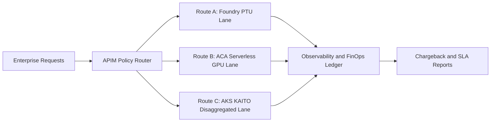
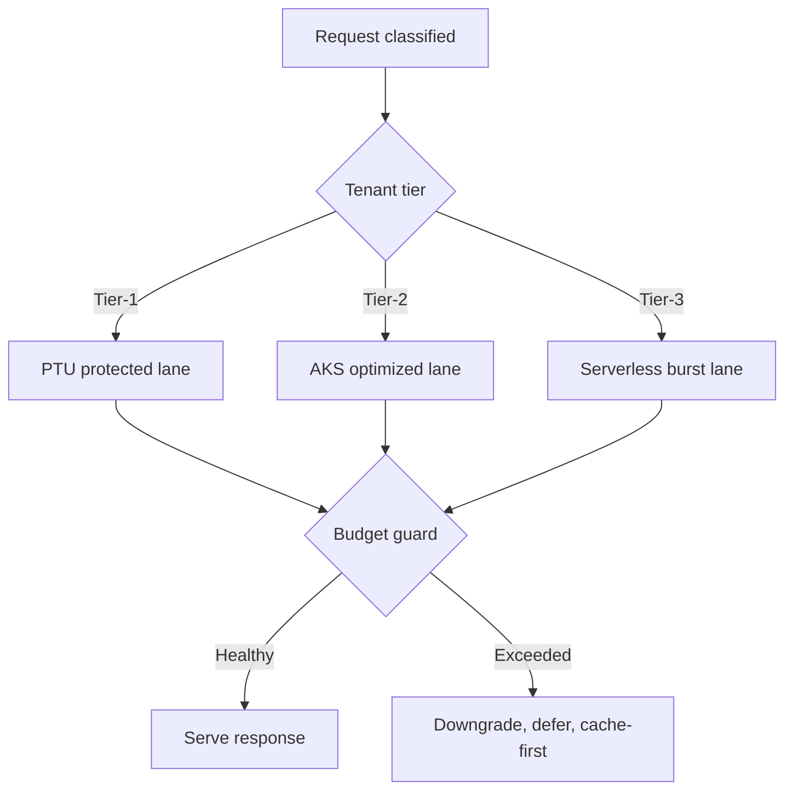

# Enterprise policy-aware tiered model routing selection FAQ (Foundry PTU vs ACA Serverless GPU vs AKS KAITO)

> Audience: Cloud & AI Solution Architects, platform SREs, FinOps owners, and enterprise model platform leads.
>
> Core question: how to build a production model-routing plane that balances SLA, compliance, and cost across premium LLM lanes, burst lanes, and high-throughput self-hosted GPU lanes.

## 1. Executive summary

For multi-tenant enterprise agent platforms, a single-serving path is usually a structural anti-pattern. A policy-aware three-lane strategy is more resilient:

- **Route A (steady-state backbone)**: Foundry/AOAI PTU for predictable, high-value, low-jitter workloads.
- **Route B (elastic overflow)**: ACA Serverless GPU for bursty and intermittent demand with scale-to-zero economics.
- **Route C (high-throughput optimization lane)**: AKS + KAITO + vLLM/SGLang with disaggregated prefill/decode and deeper kernel-level tuning.
- **Route D (anti-pattern baseline)**: one-size-fits-all large-model routing or raw tenant-controlled model strings.

The key decision is not choosing one product. It is codifying policy and governance so routing decisions are deterministic, auditable, and financially accountable.

## 2. Business pressure profile and failure modes

### 2.1 Enterprise pressure profile

- Distinct daytime demand peaks with strong weekly and monthly seasonality.
- Premium tenants require predictable TTFT/P95 with contractual obligations.
- Long-tail tenants still need service continuity at affordable unit economics.
- Regulated workloads require explicit auditability of routing and fallback decisions.

### 2.2 Failure modes

- Single-lane saturation during spikes, followed by idle GPU waste off-peak.
- Average latency dashboards hiding P95/P99 instability.
- Missing policy ownership that allows routing-by-parameter bypasses.
- Cost attribution gaps that prevent tenant-level chargeback and accountability.

## 3. Route definitions

### Route A: Foundry PTU as the controlled backbone

- Best for contractual SLA lanes and steady demand.
- APIM policy gates map tenant tiers to approved model sets.
- Prompt and semantic caching reduce repetitive token burn.

### Route B: ACA Serverless GPU burst lane

- Best for non-continuous demand and event-driven spikes.
- Seconds-based billing and scale-to-zero lower idle burn.
- Requires strict supply-chain controls and egress governance.

### Route C: AKS KAITO disaggregated prefill/decode lane

- Best for extreme concurrency, long context windows, and deep optimization goals.
- Supports prefix-cache affinity, speculative decoding, and queue specialization.
- Requires stronger platform engineering and operational maturity.

### Route D: anti-pattern baseline

- Everything routed to one model lane.
- Raw client-provided model names accepted without policy checks.
- Outcome: unstable SLA, runaway spend, and weak audit defensibility.

## 4. Quantitative engineering model

### 4.1 End-to-end routing cost model

Definitions:

- `N_req`: total request volume
- `pA/pB/pC`: traffic shares for routes A/B/C
- `cA/cB/cC`: unit request cost by route
- `H`: cache hit rate
- `c_cache`: unit cost for cache-hit requests

Approximation:

`Cost_total ≈ N_req * ((pA*cA + pB*cB + pC*cC) * (1-H) + c_cache*H)`

### 4.2 Latency budget guardrail

`TTFT_p95_total = max(T_gateway, T_queue + T_infer + T_post)`

For premium tiers, enforce:

`TTFT_p95_total <= SLO_tenant_tier`

### 4.3 PTU break-even with burst alternatives

`N_breakeven = Fixed_PTU_Cost / (Unit_Burst_Cost - Unit_PTU_Cost)`

If long-run demand is consistently above `N_breakeven`, PTU-backed lanes are usually economically justified.

### 4.4 Prefill/decode disaggregation benefit model

- Prefill pressure scales mostly with context length and prompt complexity.
- Decode pressure scales with output length, sampling policy, and concurrency.
- Decoupling enables independent scaling domains, reducing overprovisioning.

## 5. Twelve-dimension comparison matrix

| Dimension | Route A PTU | Route B Serverless GPU | Route C AKS KAITO | Route D Anti-pattern |
|---|---|---|---|---|
| Steady-state SLA | High | Medium | High | Low |
| Burst elasticity | Medium | High | High | Low |
| Cold-start exposure | Low | Medium | Medium | High |
| Optimization depth | Medium | Medium | High | Low |
| Cost predictability | High | Medium | Medium | Low |
| Auditability | High | Medium-high | High | Low |
| Multi-tenant isolation | High | Medium-high | High | Low |
| Operational complexity | Medium | Medium | High | Low (short-term) |
| Failover flexibility | Medium | High | High | Low |
| Supply-chain control | Medium | Medium | High | Low |
| Throughput optimization headroom | Medium | Medium | High | Low |
| Recommendation | ✅ | ✅ | ✅ | ⛔ |

## 6. Deep quantitative Q&A (Q1-Q8)
### Q1: Why is a single model lane rarely sufficient in enterprise production?
Because tenant value density, latency tolerance, and compliance obligations are not uniform. A single lane creates cross-tenant contention and policy ambiguity.

### Q2: Are Route A and Route C mutually exclusive?
No. Many mature platforms use Route A as the managed SLA backbone and Route C for high-throughput specialized workloads.

### Q3: Does Route B always hurt user experience because of cold starts?
Not always. Route B works well for non-critical and burst workloads when combined with pre-warm controls and guarded fallback policies.

### Q4: Is speculative decoding universally beneficial?
No. Benefits are workload-dependent and strongest for longer outputs and sustained concurrency profiles.

### Q5: How do we stop tenants from bypassing model governance?
Enforce signed tenant claims mapped to approved model sets at the gateway and reject unbound model identifiers.

### Q6: When should long-tail traffic be routed to smaller models?
When quality thresholds are still satisfied and incremental large-model spend is not justified by business value.

### Q7: Is rate limiting enough for budget control?
No. Effective control combines rate limits with model downgrades, output-length caps, cache-first heuristics, and deferred execution.

### Q8: How should this architecture be justified to finance leadership?
Show the counterfactual cost of single-lane overprovisioning and SLA breach risk, then compare against mixed-lane TCO and avoided penalties.

## 7. Architecture diagrams (Mermaid)





## 8. Production snippet: APIM tenant-to-model policy binding

```xml
<policies>
  <inbound>
    <base />
    <set-variable name="tenantId" value="@(context.Request.Headers.GetValueOrDefault("x-tenant-id",""))" />
    <set-variable name="requestedModel" value="@(context.Request.Body.As<JObject>(preserveContent:true)["model"]?.ToString())" />
    <choose>
      <when condition="@((string)context.Variables["tenantId"]=="tier1-finance" && ((string)context.Variables["requestedModel"]).StartsWith("gpt-"))">
        <set-header name="x-route" exists-action="override"><value>route-a-ptu</value></set-header>
      </when>
      <when condition="@((string)context.Variables["tenantId"]=="tier2-saas")">
        <set-header name="x-route" exists-action="override"><value>route-c-kaito</value></set-header>
      </when>
      <otherwise>
        <set-header name="x-route" exists-action="override"><value>route-b-burst</value></set-header>
      </otherwise>
    </choose>
  </inbound>
  <backend><base /></backend>
  <outbound><base /></outbound>
</policies>
```

## 9. Production snippet: AKS scaling threshold for decode lane

```yaml
apiVersion: keda.sh/v1alpha1
kind: ScaledObject
metadata:
  name: decode-lane-scaler
spec:
  scaleTargetRef:
    name: sglang-decode-lane
  minReplicaCount: 2
  maxReplicaCount: 40
  triggers:
  - type: azure-servicebus
    metadata:
      queueName: decode-jobs
      messageCount: "120"
```

## 10. Enterprise scenarios (2+)

### Scenario A: global retail SaaS (5,000 merchants)

- Strong campaign-driven peaks and strict customer response SLAs.
- Tier-1 merchants routed to Route A, mainstream traffic to Route C, long-tail to Route B.
- Budget guardrails prevent runaway spend during promotional spikes.

### Scenario B: regulated financial assistant

- Every route decision must be auditable and explainable.
- During stress events, compliance-heavy tenant lanes remain protected.
- Audit artifacts include model version, policy revision, and budget decisions.

### Scenario C: enterprise internal knowledge hub across multiple BUs

- Distinct quality and latency requirements by business unit.
- SLM-first screening reduces expensive large-model direct hits.
- BU-level showback and chargeback reinforce platform sustainability.

## 11. Three-tier 3-year TCO (USD)

| Scale tier | Route A PTU-first | Route B Serverless-first | Route C AKS-first | Hybrid A+B+C |
|---|---:|---:|---:|---:|
| 50 tenants | 1,850,000 | 1,620,000 | 2,040,000 | 1,540,000 |
| 500 tenants | 9,700,000 | 11,200,000 | 8,900,000 | 8,050,000 |
| 5,000 tenants | 66,500,000 | 81,300,000 | 58,200,000 | 51,900,000 |

Interpretation:

- At small scale, burst lanes can reduce fixed idle costs.
- At mid and large scale, hybrid routing improves both SLA and economics.
- At very large scale, Route C optimization depth yields significant throughput gains.

## 12. Day-0 / Day-1 / Day-2 implementation checklist

### Day-0 (architecture and policy baseline)
- define tenant tiers, SLA boundaries, budget envelopes, and retention periods for route decision logs.

### Day-1 (platform enablement and controlled rollout)
- integrate gateway policy, model registry, autoscaling thresholds, and baseline observability dashboards.

### Day-2 (continuous optimization and governance)
- review route efficiency, budget drift, failure drills, fallback policies, and tenant-tier QoS adherence.

## 13. Good fit vs Not for

### ✅ Good fit

- Large multi-tenant enterprise agent platforms with mixed workload criticality.
- Production services requiring explicit SLA and financial governance.
- Organizations needing strong auditability and tenant-level accountability.

### ⛔ Not for

- Small short-lived proof-of-concepts with one homogeneous workload class.
- Teams without platform operations capacity for policy-driven multi-lane routing.
- Experimental workloads where governance and cost traceability are irrelevant.

## 14. Five-step enterprise rollout guide

1. **Classify business value and risk** by tenant and task family.
2. **Define policy contracts** as `tenant -> route -> model_set -> budget_guard`.
3. **Roll out in stages** (5% -> 25% -> 100%) with rollback gates.
4. **Close the finance loop** by mapping route logs to BU cost centers.
5. **Optimize continuously** through cache, downgrade, and scaling policy iteration.

## 15. Core KPIs and governance thresholds

- `route_a_ratio`, `route_b_ratio`, `route_c_ratio`
- `ttft_p95_by_tenant_tier`
- `token_cost_per_request`
- `cache_hit_ratio`
- `budget_guard_trigger_count`
- `forced_downgrade_rate`

Threshold guidance:

- If `forced_downgrade_rate` stays above threshold, reassess protected-lane capacity and policy segmentation.
- If `token_cost_per_request` trends upward, inspect cache behavior, output-length policy, and prompt inflation.
- If `ttft_p95_by_tenant_tier` degrades for premium tiers, increase route-priority protection and queue isolation.

## 16. Final recommendation

Use **A+B+C hybrid routing** as the default enterprise pattern, and measure success by policy verifiability, not platform branding.

One-line conclusion:

**Long-term model-serving competitiveness comes from a governable routing system that unifies SLA, spend, isolation, and auditability, not from betting on one model lane alone.**
