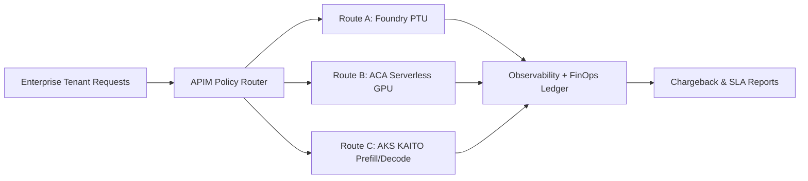
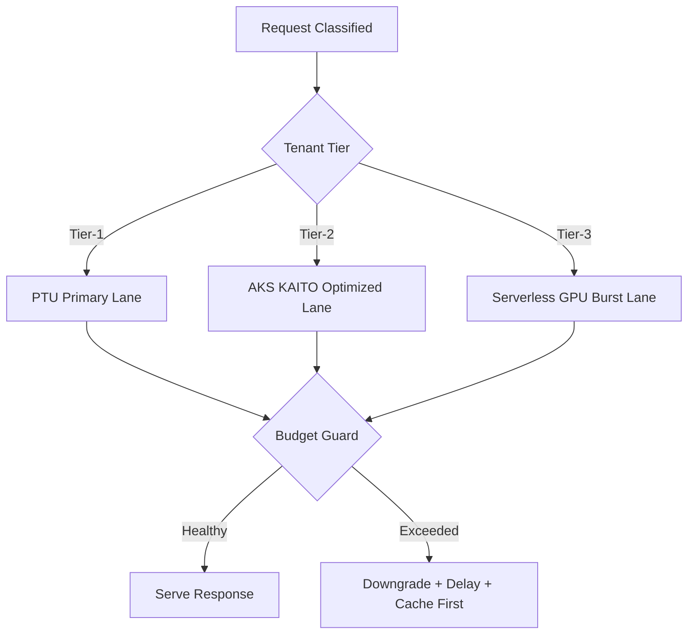

# 企业策略感知分级模型路由选型 FAQ（Foundry PTU vs ACA Serverless GPU vs AKS KAITO）

> 适用角色：Cloud & AI Solution Architect、平台 SRE、FinOps、模型平台负责人。
>
> 核心问题：企业多租户 Agent 平台如何在合规、SLA、成本三角约束下，把大模型、SLM、微调模型和 GPU 资源编排成可审计、可扩缩、可控成本的生产路由面。

## 1. 一页结论（Executive Summary）

如果你的平台同时面对「稳定高峰业务 + 长尾突发业务 + 强监管审计」，建议采用“策略感知三层路由”而非单一路径：

- **Route A（稳态主干）**：Foundry/AOAI PTU 作为保底容量，承接高价值、强 SLA、可预测流量。
- **Route B（弹性溢出）**：ACA Serverless GPU 承接非连续突发与试验工作负载，避免长期闲置 GPU。
- **Route C（高吞吐自托管）**：AKS + KAITO + vLLM/SGLang 解耦 Prefill/Decode，处理超大并发与深度优化场景。
- **Route D（反模式）**：把所有请求强制打到单一大模型或允许租户自由指定模型字符串。

结论不是“选一个平台”，而是“按业务价值、延迟预算、隔离等级和成本目标做策略分层”，用 APIM/网关把策略固化为可验证的控制平面。

## 2. 典型业务压力与失败模式

### 2.1 常见压力画像

- 工作日 09:00-11:00 与 14:00-17:00 峰值远高于夜间。
- 高价值租户要求低抖动 TTFT/P95，且不接受“排队后随机降级”。
- 长尾租户请求低频但不可完全丢弃，需要可负担兜底路径。
- 合规租户要求路由决策可追溯、可解释、可审计。

### 2.2 失败模式

- 单路径大模型：高峰时排队雪崩，低峰时 GPU 空转。
- 只看平均延迟：P95/P99 抖动掩盖真实用户体验问题。
- 没有策略主权：业务方可绕过安全与成本门禁。
- 模型与预算解耦：无法回答“这次超支由谁导致”。

## 3. 四条架构路线定义

### Route A：Foundry PTU 稳态主干

- 适合稳定负载和关键业务。
- 使用 APIM 做租户与工作负载分级，保证关键租户在容量紧张时优先。
- 利用 Prompt Caching 和语义缓存降低重复请求成本。

### Route B：ACA Serverless GPU 突发弹性

- 适合潮汐型任务、活动峰值、实验流量。
- 以秒级计费和 Scale-to-Zero 避免 24x7 GPU 预留。
- 需要严格镜像供应链和网络边界，防止突发路径成为安全短板。

### Route C：AKS KAITO 解耦 Prefill/Decode 高吞吐面

- 适合超大并发、长上下文、深度内核调优。
- 可实施 Prefix Cache 亲和、Speculative Decoding、KV 分层缓存。
- 需要更强平台工程能力与 SRE 值守体系。

### Route D：反模式基线

- 单大模型兜一切。
- 无租户策略绑定，允许自由 model 参数穿透。
- 结果通常是 SLA 失真、成本失控、合规不可解释。

## 4. 定量工程模型

### 4.1 路由层总成本

设：

- `N_req`：总请求量
- `pA/pB/pC`：路由到 A/B/C 的流量比例
- `cA/cB/cC`：单位请求成本
- `c_cache`：缓存命中后单位请求成本
- `H`：缓存命中率

总成本近似：

`Cost_total ≈ N_req * ((pA*cA + pB*cB + pC*cC) * (1-H) + c_cache*H)`

### 4.2 延迟预算约束

`TTFT_p95_total = max(T_gateway, T_queue + T_infer + T_post)`

要求关键租户：

`TTFT_p95_total <= SLO_tenant_tier`

### 4.3 PTU 与弹性路径的盈亏平衡

`N_breakeven = Fixed_PTU_Cost / (Unit_Burst_Cost - Unit_PTU_Cost)`

当真实请求量长期高于 `N_breakeven` 时，保留 PTU 更经济。

### 4.4 Prefill/Decode 解耦收益评估

- Prefill 压力与上下文长度高度相关。
- Decode 压力与输出长度、并发和采样参数相关。
- 解耦后可对两类节点分别扩缩，避免统一扩容导致浪费。

## 5. 12 维对比矩阵

| 维度 | Route A PTU | Route B Serverless GPU | Route C AKS KAITO | Route D 反模式 |
|---|---|---|---|---|
| 稳态 SLA | 高 | 中 | 高 | 低 |
| 峰值弹性 | 中 | 高 | 高 | 低 |
| 冷启动风险 | 低 | 中 | 中 | 高 |
| 调优深度 | 中 | 中 | 高 | 低 |
| 成本可预测性 | 高 | 中 | 中 | 低 |
| 合规可审计 | 高 | 中高 | 高 | 低 |
| 多租户隔离 | 高 | 中高 | 高 | 低 |
| 工程复杂度 | 中 | 中 | 高 | 低（短期） |
| 故障切换灵活性 | 中 | 高 | 高 | 低 |
| 供应链可控 | 中 | 中 | 高 | 低 |
| 单位吞吐成本优化空间 | 中 | 中 | 高 | 低 |
| 结论 | ✅ 主干 | ✅ 弹性 | ✅ 大规模 | ⛔ 禁用 |

## 6. 深度问答（Q1-Q8）
### Q1
Q1：为什么不能把所有租户都放到同一条模型路径？
A：因为租户价值密度、延迟容忍度和合规要求不同，统一路径会导致“高价值租户被低价值流量挤占”。

### Q2
Q2：Route A 与 Route C 是否互斥？
A：不互斥。Route A 更适合托管稳定面，Route C 更适合深度优化面。生产上常见是 A 兜主干、C 承接高并发专业流量。

### Q3
Q3：Route B 会不会因为冷启动影响体验？
A：会，所以 B 不应承载最关键路径；可通过预热池、最小实例和请求分层缓解。

### Q4
Q4：Speculative Decoding 适合所有任务吗？
A：不适合。短输出、低复杂度任务收益有限；长输出和高并发任务收益更明显。

### Q5
Q5：如何防止租户越权使用高价模型？
A：在网关强制 `tenant -> allowed_model_set` 映射，并把签名声明和路由策略绑定，不允许请求参数直接穿透。

### Q6
Q6：什么时候应把长尾租户降到 SLM？
A：当任务准确率门限可满足且单位收益不足以覆盖大模型成本时，应降级到 SLM 并启用缓存。

### Q7
Q7：预算超支后只做限流够吗？
A：不够。还要做“模型降级 + 输出长度限制 + 缓存优先 + 低价值任务延迟执行”的组合策略。

### Q8
Q8：如何向 CFO 解释多路线架构的必要性？
A：展示“单路径在峰值浪费与违约风险”的反事实成本，再给出多路径的 TCO 和违约损失下降量化。

## 7. Mermaid 架构图





## 8. 生产片段：APIM 策略（租户到模型集绑定）

```xml
<policies>
  <inbound>
    <base />
    <set-variable name="tenantId" value="@(context.Request.Headers.GetValueOrDefault("x-tenant-id",""))" />
    <set-variable name="requestedModel" value="@(context.Request.Body.As<JObject>(preserveContent:true)["model"]?.ToString())" />
    <choose>
      <when condition="@((string)context.Variables["tenantId"]=="tier1-finance" && ((string)context.Variables["requestedModel"]).StartsWith("gpt-"))">
        <set-header name="x-route" exists-action="override"><value>route-a-ptu</value></set-header>
      </when>
      <when condition="@((string)context.Variables["tenantId"]=="tier2-saas")">
        <set-header name="x-route" exists-action="override"><value>route-c-kaito</value></set-header>
      </when>
      <otherwise>
        <set-header name="x-route" exists-action="override"><value>route-b-burst</value></set-header>
      </otherwise>
    </choose>
  </inbound>
  <backend><base /></backend>
  <outbound><base /></outbound>
</policies>
```

## 9. 生产片段：AKS 路由队列与扩缩容阈值

```yaml
apiVersion: keda.sh/v1alpha1
kind: ScaledObject
metadata:
  name: decode-lane-scaler
spec:
  scaleTargetRef:
    name: sglang-decode-lane
  minReplicaCount: 2
  maxReplicaCount: 40
  triggers:
  - type: azure-servicebus
    metadata:
      queueName: decode-jobs
      messageCount: "120"
```

## 10. 企业场景（2+）

### 场景 A：全球零售 SaaS（5,000 商户）

- 高峰集中在促销窗口。
- Tier-1 商户走 Route A，普通商户走 Route C，低频商户走 Route B。
- 通过预算门禁把“促销日超支”限制在预设区间。

### 场景 B：金融合规助手（受监管）

- 关键问答必须可追溯路由决策。
- 业务高峰时优先保护合规租户，低优先级流量自动降级。
- 审计要求保留模型版本、路由策略版本和预算决策日志。

### 场景 C：企业知识中台（内部多 BU）

- 对准确率和时延要求分层明显。
- 使用 SLM 先筛后升，降低大模型直接命中比例。
- 按 BU 计费分账，形成可持续治理闭环。

## 11. 三档三年 TCO（单位：USD）

| 规模档位 | Route A PTU 主干 | Route B Serverless GPU 主干 | Route C AKS KAITO 主干 | 混合 A+B+C |
|---|---:|---:|---:|---:|
| 50 租户 | 1,850,000 | 1,620,000 | 2,040,000 | 1,540,000 |
| 500 租户 | 9,700,000 | 11,200,000 | 8,900,000 | 8,050,000 |
| 5,000 租户 | 66,500,000 | 81,300,000 | 58,200,000 | 51,900,000 |

解释：

- 小规模时，弹性路径成本更友好。
- 中大规模时，混合路线在 SLA 与成本之间更稳。
- 超大规模场景，Route C 的深度优化收益开始明显释放。

## 12. Day-0 / Day-1 / Day-2 落地清单

### Day-0（架构与策略定版）
- Day-0 检查项 1: 明确租户分层、SLA 目标、预算红线与审计保留周期。
- Day-0 检查项 2: 明确租户分层、SLA 目标、预算红线与审计保留周期。
- Day-0 检查项 3: 明确租户分层、SLA 目标、预算红线与审计保留周期。
- Day-0 检查项 4: 明确租户分层、SLA 目标、预算红线与审计保留周期。
- Day-0 检查项 5: 明确租户分层、SLA 目标、预算红线与审计保留周期。
- Day-0 检查项 6: 明确租户分层、SLA 目标、预算红线与审计保留周期。
- Day-0 检查项 7: 明确租户分层、SLA 目标、预算红线与审计保留周期。
- Day-0 检查项 8: 明确租户分层、SLA 目标、预算红线与审计保留周期。
- Day-0 检查项 9: 明确租户分层、SLA 目标、预算红线与审计保留周期。
- Day-0 检查项 10: 明确租户分层、SLA 目标、预算红线与审计保留周期。
- Day-0 检查项 11: 明确租户分层、SLA 目标、预算红线与审计保留周期。
- Day-0 检查项 12: 明确租户分层、SLA 目标、预算红线与审计保留周期。
- Day-0 检查项 13: 明确租户分层、SLA 目标、预算红线与审计保留周期。
- Day-0 检查项 14: 明确租户分层、SLA 目标、预算红线与审计保留周期。
- Day-0 检查项 15: 明确租户分层、SLA 目标、预算红线与审计保留周期。
- Day-0 检查项 16: 明确租户分层、SLA 目标、预算红线与审计保留周期。
- Day-0 检查项 17: 明确租户分层、SLA 目标、预算红线与审计保留周期。
- Day-0 检查项 18: 明确租户分层、SLA 目标、预算红线与审计保留周期。
- Day-0 检查项 19: 明确租户分层、SLA 目标、预算红线与审计保留周期。
- Day-0 检查项 20: 明确租户分层、SLA 目标、预算红线与审计保留周期。
- Day-0 检查项 21: 明确租户分层、SLA 目标、预算红线与审计保留周期。
- Day-0 检查项 22: 明确租户分层、SLA 目标、预算红线与审计保留周期。
- Day-0 检查项 23: 明确租户分层、SLA 目标、预算红线与审计保留周期。
- Day-0 检查项 24: 明确租户分层、SLA 目标、预算红线与审计保留周期。
- Day-0 检查项 25: 明确租户分层、SLA 目标、预算红线与审计保留周期。
- Day-0 检查项 26: 明确租户分层、SLA 目标、预算红线与审计保留周期。
- Day-0 检查项 27: 明确租户分层、SLA 目标、预算红线与审计保留周期。
- Day-0 检查项 28: 明确租户分层、SLA 目标、预算红线与审计保留周期。
- Day-0 检查项 29: 明确租户分层、SLA 目标、预算红线与审计保留周期。
- Day-0 检查项 30: 明确租户分层、SLA 目标、预算红线与审计保留周期。
- Day-0 检查项 31: 明确租户分层、SLA 目标、预算红线与审计保留周期。
- Day-0 检查项 32: 明确租户分层、SLA 目标、预算红线与审计保留周期。
- Day-0 检查项 33: 明确租户分层、SLA 目标、预算红线与审计保留周期。
- Day-0 检查项 34: 明确租户分层、SLA 目标、预算红线与审计保留周期。
- Day-0 检查项 35: 明确租户分层、SLA 目标、预算红线与审计保留周期。
- Day-0 检查项 36: 明确租户分层、SLA 目标、预算红线与审计保留周期。
- Day-0 检查项 37: 明确租户分层、SLA 目标、预算红线与审计保留周期。
- Day-0 检查项 38: 明确租户分层、SLA 目标、预算红线与审计保留周期。
- Day-0 检查项 39: 明确租户分层、SLA 目标、预算红线与审计保留周期。
- Day-0 检查项 40: 明确租户分层、SLA 目标、预算红线与审计保留周期。
- Day-0 检查项 41: 明确租户分层、SLA 目标、预算红线与审计保留周期。
- Day-0 检查项 42: 明确租户分层、SLA 目标、预算红线与审计保留周期。
- Day-0 检查项 43: 明确租户分层、SLA 目标、预算红线与审计保留周期。
- Day-0 检查项 44: 明确租户分层、SLA 目标、预算红线与审计保留周期。
- Day-0 检查项 45: 明确租户分层、SLA 目标、预算红线与审计保留周期。
- Day-0 检查项 46: 明确租户分层、SLA 目标、预算红线与审计保留周期。
- Day-0 检查项 47: 明确租户分层、SLA 目标、预算红线与审计保留周期。
- Day-0 检查项 48: 明确租户分层、SLA 目标、预算红线与审计保留周期。
- Day-0 检查项 49: 明确租户分层、SLA 目标、预算红线与审计保留周期。
- Day-0 检查项 50: 明确租户分层、SLA 目标、预算红线与审计保留周期。
- Day-0 检查项 51: 明确租户分层、SLA 目标、预算红线与审计保留周期。
- Day-0 检查项 52: 明确租户分层、SLA 目标、预算红线与审计保留周期。
- Day-0 检查项 53: 明确租户分层、SLA 目标、预算红线与审计保留周期。
- Day-0 检查项 54: 明确租户分层、SLA 目标、预算红线与审计保留周期。
- Day-0 检查项 55: 明确租户分层、SLA 目标、预算红线与审计保留周期。
- Day-0 检查项 56: 明确租户分层、SLA 目标、预算红线与审计保留周期。
- Day-0 检查项 57: 明确租户分层、SLA 目标、预算红线与审计保留周期。
- Day-0 检查项 58: 明确租户分层、SLA 目标、预算红线与审计保留周期。
- Day-0 检查项 59: 明确租户分层、SLA 目标、预算红线与审计保留周期。
- Day-0 检查项 60: 明确租户分层、SLA 目标、预算红线与审计保留周期。

### Day-1（平台上线与灰度）
- Day-1 检查项 1: 打通网关策略、模型注册、扩缩容阈值与告警基线。
- Day-1 检查项 2: 打通网关策略、模型注册、扩缩容阈值与告警基线。
- Day-1 检查项 3: 打通网关策略、模型注册、扩缩容阈值与告警基线。
- Day-1 检查项 4: 打通网关策略、模型注册、扩缩容阈值与告警基线。
- Day-1 检查项 5: 打通网关策略、模型注册、扩缩容阈值与告警基线。
- Day-1 检查项 6: 打通网关策略、模型注册、扩缩容阈值与告警基线。
- Day-1 检查项 7: 打通网关策略、模型注册、扩缩容阈值与告警基线。
- Day-1 检查项 8: 打通网关策略、模型注册、扩缩容阈值与告警基线。
- Day-1 检查项 9: 打通网关策略、模型注册、扩缩容阈值与告警基线。
- Day-1 检查项 10: 打通网关策略、模型注册、扩缩容阈值与告警基线。
- Day-1 检查项 11: 打通网关策略、模型注册、扩缩容阈值与告警基线。
- Day-1 检查项 12: 打通网关策略、模型注册、扩缩容阈值与告警基线。
- Day-1 检查项 13: 打通网关策略、模型注册、扩缩容阈值与告警基线。
- Day-1 检查项 14: 打通网关策略、模型注册、扩缩容阈值与告警基线。
- Day-1 检查项 15: 打通网关策略、模型注册、扩缩容阈值与告警基线。
- Day-1 检查项 16: 打通网关策略、模型注册、扩缩容阈值与告警基线。
- Day-1 检查项 17: 打通网关策略、模型注册、扩缩容阈值与告警基线。
- Day-1 检查项 18: 打通网关策略、模型注册、扩缩容阈值与告警基线。
- Day-1 检查项 19: 打通网关策略、模型注册、扩缩容阈值与告警基线。
- Day-1 检查项 20: 打通网关策略、模型注册、扩缩容阈值与告警基线。
- Day-1 检查项 21: 打通网关策略、模型注册、扩缩容阈值与告警基线。
- Day-1 检查项 22: 打通网关策略、模型注册、扩缩容阈值与告警基线。
- Day-1 检查项 23: 打通网关策略、模型注册、扩缩容阈值与告警基线。
- Day-1 检查项 24: 打通网关策略、模型注册、扩缩容阈值与告警基线。
- Day-1 检查项 25: 打通网关策略、模型注册、扩缩容阈值与告警基线。
- Day-1 检查项 26: 打通网关策略、模型注册、扩缩容阈值与告警基线。
- Day-1 检查项 27: 打通网关策略、模型注册、扩缩容阈值与告警基线。
- Day-1 检查项 28: 打通网关策略、模型注册、扩缩容阈值与告警基线。
- Day-1 检查项 29: 打通网关策略、模型注册、扩缩容阈值与告警基线。
- Day-1 检查项 30: 打通网关策略、模型注册、扩缩容阈值与告警基线。
- Day-1 检查项 31: 打通网关策略、模型注册、扩缩容阈值与告警基线。
- Day-1 检查项 32: 打通网关策略、模型注册、扩缩容阈值与告警基线。
- Day-1 检查项 33: 打通网关策略、模型注册、扩缩容阈值与告警基线。
- Day-1 检查项 34: 打通网关策略、模型注册、扩缩容阈值与告警基线。
- Day-1 检查项 35: 打通网关策略、模型注册、扩缩容阈值与告警基线。
- Day-1 检查项 36: 打通网关策略、模型注册、扩缩容阈值与告警基线。
- Day-1 检查项 37: 打通网关策略、模型注册、扩缩容阈值与告警基线。
- Day-1 检查项 38: 打通网关策略、模型注册、扩缩容阈值与告警基线。
- Day-1 检查项 39: 打通网关策略、模型注册、扩缩容阈值与告警基线。
- Day-1 检查项 40: 打通网关策略、模型注册、扩缩容阈值与告警基线。
- Day-1 检查项 41: 打通网关策略、模型注册、扩缩容阈值与告警基线。
- Day-1 检查项 42: 打通网关策略、模型注册、扩缩容阈值与告警基线。
- Day-1 检查项 43: 打通网关策略、模型注册、扩缩容阈值与告警基线。
- Day-1 检查项 44: 打通网关策略、模型注册、扩缩容阈值与告警基线。
- Day-1 检查项 45: 打通网关策略、模型注册、扩缩容阈值与告警基线。
- Day-1 检查项 46: 打通网关策略、模型注册、扩缩容阈值与告警基线。
- Day-1 检查项 47: 打通网关策略、模型注册、扩缩容阈值与告警基线。
- Day-1 检查项 48: 打通网关策略、模型注册、扩缩容阈值与告警基线。
- Day-1 检查项 49: 打通网关策略、模型注册、扩缩容阈值与告警基线。
- Day-1 检查项 50: 打通网关策略、模型注册、扩缩容阈值与告警基线。
- Day-1 检查项 51: 打通网关策略、模型注册、扩缩容阈值与告警基线。
- Day-1 检查项 52: 打通网关策略、模型注册、扩缩容阈值与告警基线。
- Day-1 检查项 53: 打通网关策略、模型注册、扩缩容阈值与告警基线。
- Day-1 检查项 54: 打通网关策略、模型注册、扩缩容阈值与告警基线。
- Day-1 检查项 55: 打通网关策略、模型注册、扩缩容阈值与告警基线。
- Day-1 检查项 56: 打通网关策略、模型注册、扩缩容阈值与告警基线。
- Day-1 检查项 57: 打通网关策略、模型注册、扩缩容阈值与告警基线。
- Day-1 检查项 58: 打通网关策略、模型注册、扩缩容阈值与告警基线。
- Day-1 检查项 59: 打通网关策略、模型注册、扩缩容阈值与告警基线。
- Day-1 检查项 60: 打通网关策略、模型注册、扩缩容阈值与告警基线。

### Day-2（运营优化与治理）
- Day-2 检查项 1: 持续复盘路由命中、预算偏差、故障演练与回滚策略。
- Day-2 检查项 2: 持续复盘路由命中、预算偏差、故障演练与回滚策略。
- Day-2 检查项 3: 持续复盘路由命中、预算偏差、故障演练与回滚策略。
- Day-2 检查项 4: 持续复盘路由命中、预算偏差、故障演练与回滚策略。
- Day-2 检查项 5: 持续复盘路由命中、预算偏差、故障演练与回滚策略。
- Day-2 检查项 6: 持续复盘路由命中、预算偏差、故障演练与回滚策略。
- Day-2 检查项 7: 持续复盘路由命中、预算偏差、故障演练与回滚策略。
- Day-2 检查项 8: 持续复盘路由命中、预算偏差、故障演练与回滚策略。
- Day-2 检查项 9: 持续复盘路由命中、预算偏差、故障演练与回滚策略。
- Day-2 检查项 10: 持续复盘路由命中、预算偏差、故障演练与回滚策略。
- Day-2 检查项 11: 持续复盘路由命中、预算偏差、故障演练与回滚策略。
- Day-2 检查项 12: 持续复盘路由命中、预算偏差、故障演练与回滚策略。
- Day-2 检查项 13: 持续复盘路由命中、预算偏差、故障演练与回滚策略。
- Day-2 检查项 14: 持续复盘路由命中、预算偏差、故障演练与回滚策略。
- Day-2 检查项 15: 持续复盘路由命中、预算偏差、故障演练与回滚策略。
- Day-2 检查项 16: 持续复盘路由命中、预算偏差、故障演练与回滚策略。
- Day-2 检查项 17: 持续复盘路由命中、预算偏差、故障演练与回滚策略。
- Day-2 检查项 18: 持续复盘路由命中、预算偏差、故障演练与回滚策略。
- Day-2 检查项 19: 持续复盘路由命中、预算偏差、故障演练与回滚策略。
- Day-2 检查项 20: 持续复盘路由命中、预算偏差、故障演练与回滚策略。
- Day-2 检查项 21: 持续复盘路由命中、预算偏差、故障演练与回滚策略。
- Day-2 检查项 22: 持续复盘路由命中、预算偏差、故障演练与回滚策略。
- Day-2 检查项 23: 持续复盘路由命中、预算偏差、故障演练与回滚策略。
- Day-2 检查项 24: 持续复盘路由命中、预算偏差、故障演练与回滚策略。
- Day-2 检查项 25: 持续复盘路由命中、预算偏差、故障演练与回滚策略。
- Day-2 检查项 26: 持续复盘路由命中、预算偏差、故障演练与回滚策略。
- Day-2 检查项 27: 持续复盘路由命中、预算偏差、故障演练与回滚策略。
- Day-2 检查项 28: 持续复盘路由命中、预算偏差、故障演练与回滚策略。
- Day-2 检查项 29: 持续复盘路由命中、预算偏差、故障演练与回滚策略。
- Day-2 检查项 30: 持续复盘路由命中、预算偏差、故障演练与回滚策略。
- Day-2 检查项 31: 持续复盘路由命中、预算偏差、故障演练与回滚策略。
- Day-2 检查项 32: 持续复盘路由命中、预算偏差、故障演练与回滚策略。
- Day-2 检查项 33: 持续复盘路由命中、预算偏差、故障演练与回滚策略。
- Day-2 检查项 34: 持续复盘路由命中、预算偏差、故障演练与回滚策略。
- Day-2 检查项 35: 持续复盘路由命中、预算偏差、故障演练与回滚策略。
- Day-2 检查项 36: 持续复盘路由命中、预算偏差、故障演练与回滚策略。
- Day-2 检查项 37: 持续复盘路由命中、预算偏差、故障演练与回滚策略。
- Day-2 检查项 38: 持续复盘路由命中、预算偏差、故障演练与回滚策略。
- Day-2 检查项 39: 持续复盘路由命中、预算偏差、故障演练与回滚策略。
- Day-2 检查项 40: 持续复盘路由命中、预算偏差、故障演练与回滚策略。
- Day-2 检查项 41: 持续复盘路由命中、预算偏差、故障演练与回滚策略。
- Day-2 检查项 42: 持续复盘路由命中、预算偏差、故障演练与回滚策略。
- Day-2 检查项 43: 持续复盘路由命中、预算偏差、故障演练与回滚策略。
- Day-2 检查项 44: 持续复盘路由命中、预算偏差、故障演练与回滚策略。
- Day-2 检查项 45: 持续复盘路由命中、预算偏差、故障演练与回滚策略。
- Day-2 检查项 46: 持续复盘路由命中、预算偏差、故障演练与回滚策略。
- Day-2 检查项 47: 持续复盘路由命中、预算偏差、故障演练与回滚策略。
- Day-2 检查项 48: 持续复盘路由命中、预算偏差、故障演练与回滚策略。
- Day-2 检查项 49: 持续复盘路由命中、预算偏差、故障演练与回滚策略。
- Day-2 检查项 50: 持续复盘路由命中、预算偏差、故障演练与回滚策略。
- Day-2 检查项 51: 持续复盘路由命中、预算偏差、故障演练与回滚策略。
- Day-2 检查项 52: 持续复盘路由命中、预算偏差、故障演练与回滚策略。
- Day-2 检查项 53: 持续复盘路由命中、预算偏差、故障演练与回滚策略。
- Day-2 检查项 54: 持续复盘路由命中、预算偏差、故障演练与回滚策略。
- Day-2 检查项 55: 持续复盘路由命中、预算偏差、故障演练与回滚策略。
- Day-2 检查项 56: 持续复盘路由命中、预算偏差、故障演练与回滚策略。
- Day-2 检查项 57: 持续复盘路由命中、预算偏差、故障演练与回滚策略。
- Day-2 检查项 58: 持续复盘路由命中、预算偏差、故障演练与回滚策略。
- Day-2 检查项 59: 持续复盘路由命中、预算偏差、故障演练与回滚策略。
- Day-2 检查项 60: 持续复盘路由命中、预算偏差、故障演练与回滚策略。
- Day-2 检查项 61: 持续复盘路由命中、预算偏差、故障演练与回滚策略。
- Day-2 检查项 62: 持续复盘路由命中、预算偏差、故障演练与回滚策略。
- Day-2 检查项 63: 持续复盘路由命中、预算偏差、故障演练与回滚策略。
- Day-2 检查项 64: 持续复盘路由命中、预算偏差、故障演练与回滚策略。
- Day-2 检查项 65: 持续复盘路由命中、预算偏差、故障演练与回滚策略。
- Day-2 检查项 66: 持续复盘路由命中、预算偏差、故障演练与回滚策略。
- Day-2 检查项 67: 持续复盘路由命中、预算偏差、故障演练与回滚策略。
- Day-2 检查项 68: 持续复盘路由命中、预算偏差、故障演练与回滚策略。
- Day-2 检查项 69: 持续复盘路由命中、预算偏差、故障演练与回滚策略。
- Day-2 检查项 70: 持续复盘路由命中、预算偏差、故障演练与回滚策略。
- Day-2 检查项 71: 持续复盘路由命中、预算偏差、故障演练与回滚策略。
- Day-2 检查项 72: 持续复盘路由命中、预算偏差、故障演练与回滚策略。
- Day-2 检查项 73: 持续复盘路由命中、预算偏差、故障演练与回滚策略。
- Day-2 检查项 74: 持续复盘路由命中、预算偏差、故障演练与回滚策略。
- Day-2 检查项 75: 持续复盘路由命中、预算偏差、故障演练与回滚策略。
- Day-2 检查项 76: 持续复盘路由命中、预算偏差、故障演练与回滚策略。
- Day-2 检查项 77: 持续复盘路由命中、预算偏差、故障演练与回滚策略。
- Day-2 检查项 78: 持续复盘路由命中、预算偏差、故障演练与回滚策略。
- Day-2 检查项 79: 持续复盘路由命中、预算偏差、故障演练与回滚策略。
- Day-2 检查项 80: 持续复盘路由命中、预算偏差、故障演练与回滚策略。
- Day-2 检查项 81: 持续复盘路由命中、预算偏差、故障演练与回滚策略。
- Day-2 检查项 82: 持续复盘路由命中、预算偏差、故障演练与回滚策略。
- Day-2 检查项 83: 持续复盘路由命中、预算偏差、故障演练与回滚策略。
- Day-2 检查项 84: 持续复盘路由命中、预算偏差、故障演练与回滚策略。
- Day-2 检查项 85: 持续复盘路由命中、预算偏差、故障演练与回滚策略。
- Day-2 检查项 86: 持续复盘路由命中、预算偏差、故障演练与回滚策略。
- Day-2 检查项 87: 持续复盘路由命中、预算偏差、故障演练与回滚策略。
- Day-2 检查项 88: 持续复盘路由命中、预算偏差、故障演练与回滚策略。
- Day-2 检查项 89: 持续复盘路由命中、预算偏差、故障演练与回滚策略。
- Day-2 检查项 90: 持续复盘路由命中、预算偏差、故障演练与回滚策略。

## 13. Good fit vs Not for

### ✅ Good fit

- 多租户、跨 BU、跨区域的企业级 Agent 平台。
- 既要 SLA 又要成本可控的生产业务。
- 需要审计可解释与分账可追溯的组织。

### ⛔ Not for

- 单团队短期 PoC。
- 无专职平台团队且无法维护多路线治理。
- 对成本、合规和可追溯性没有要求的实验流量。

## 14. 五步实施指南（业务到平台）

1. **分层业务画像**：按价值、时延、合规要求分租户与任务。
2. **策略建模**：定义 `tenant -> route -> model_set -> budget_guard`。
3. **灰度落地**：先 5%，再 25%，再全量，同时保留回滚。
4. **财务闭环**：把路由日志映射到账单与 BU 成本中心。
5. **持续优化**：以周为单位优化缓存命中、降级策略和扩缩容阈值。

## 15. 关键 KPI 与治理阈值

- `route_a_ratio`、`route_b_ratio`、`route_c_ratio`
- `ttft_p95_by_tenant_tier`
- `token_cost_per_request`
- `cache_hit_ratio`
- `budget_guard_trigger_count`
- `forced_downgrade_rate`

阈值治理建议：

- 当 `forced_downgrade_rate` 连续超阈值，说明主干容量不足或分层策略失真。
- 当 `token_cost_per_request` 持续上行，优先排查缓存与输出长度策略。
- 当 `ttft_p95_by_tenant_tier` 在关键租户上抖动，需提高其专属路由权重。

## 16. 最终建议

默认建议采用 **A+B+C 混合路由**，并把治理重点放在“策略可验证”而非“平台品牌偏好”。

一句话结论：

**企业模型服务的长期竞争力，不在于某个模型一时更强，而在于路由、预算、隔离和审计能否形成可持续的工程系统。**
