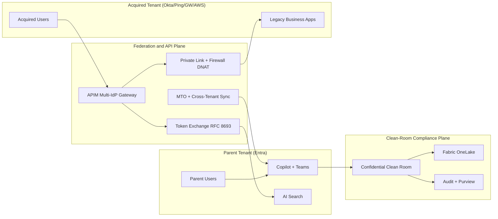
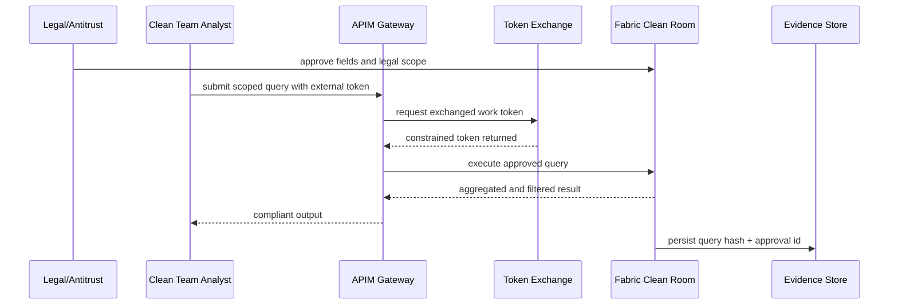

# Post-Merger M&A Day-1 Agent Federation Selection FAQ: Entra Cross-Tenant Collaboration vs APIM Multi-IdP Token Exchange vs Fabric Clean-Room Ring-Fence
> 🌐 Language / 语言切换: [中文](post-merger-mna-day1-cross-tenant-entra-b2b-vs-apim-multi-idp-vs-fabric-clean-room-agent-integration-selection-faq.md) | **English (Current)** | [EN Catalog](README.en.md) | [中文目录](README.md)
> Audience: Group CIO, Integration Management Office (IMO), Enterprise Architecture Board, Identity and Network Security Leads, Legal and Antitrust Compliance Teams  
> Updated: 2026-11-19 (UTC+08:00)  
> Evidence labels: `measured`, `synthetic`, `anonymized_reported`
---
## 1. Executive Summary
1. M&A Day-1 success requires usable collaboration and hard control boundaries, not immediate directory consolidation.  
2. **Entra MTO + Cross-Tenant Sync/B2B Direct Connect** is the fastest safe path for Day-1 collaboration.  
3. **APIM Multi-IdP + RFC 8693 Token Exchange** is best for federating acquired identity stacks without forced replatforming.  
4. **Fabric Confidential Clean Rooms + TSA Ring-Fence** is best for antitrust-safe analytics and carve-out readiness.  
5. A production-ready blueprint is a three-plane architecture: identity federation, API token-exchange gateway, and clean-room compliance plane.  
6. Day-1 is not the right moment for high-risk AD forest migration or global IP renumbering.  
7. For overlapping `10.0.0.0/8` estates, use Private Link + Azure Firewall DNAT as an integration bridge.  
8. Carve-out and divestiture proof should be designed from the first day of integration.  
---
## 2. Integration Context and Hard Constraints
### 2.1 Typical Day-1 pressures
- Business teams need cross-company productivity immediately after close.  
- Acquired entities may run Okta, Ping, Google Workspace, or AWS-native identity.  
- CIDR overlap blocks direct network peering patterns.  
- Legal teams require pre-close and TSA boundary evidence.  
- Executive sponsors expect Copilot and agent workflows to start on Day-1.  
### 2.2 Mandatory controls
- No antitrust gun-jumping via unrestricted data co-mingling.  
- No unapproved access to customer pricing or strategic pipeline details.  
- No shared privileged credentials across parent and acquired entities.  
- No large-scale directory merges without staged evidence and rollback options.  
- No carve-out without cryptographic offboarding and immutable proof.  
### 2.3 Explicit non-goals
- Day-1 does not target complete IAM unification.  
- Day-1 does not require full network addressing redesign.  
- Day-1 does not replace legal controls with ad-hoc technical exceptions.  
---
## 3. Option A: Entra MTO + Cross-Tenant Sync and B2B Direct Connect
### 3.1 Core capabilities
- Multi-Tenant Organization coordination across parent and acquired tenants.  
- Cross-tenant synchronization of selected users and groups.  
- B2B direct trust for collaboration while preserving tenant autonomy.  
- Teams and Copilot cross-tenant collaboration with policy constraints.  
- Identity propagation for ACL trimming in cross-tenant knowledge access.  
### 3.2 Best-fit situations
- Fast collaboration is required before directory consolidation windows open.  
- Acquired entities must keep local governance for a transition period.  
- Jurisdiction-specific policy separation is mandatory.  
### 3.3 Operational risks
- Over-broad synchronization can create latent privilege expansion.  
- Inconsistent conditional access policies can degrade user experience.  
- Fragmented logging models increase triage time early in integration.  
---
## 4. Option B: APIM Multi-IdP + RFC 8693 Token Exchange + Overlap-CIDR Bridge
### 4.1 Core capabilities
- APIM as a unified ingress for agents and MCP tools.  
- RFC 8693 exchange converts external IdP tokens into constrained work tokens.  
- Policy routing by issuer and audience with fine-grained controls.  
- Private Link and Firewall DNAT to bridge overlapping network ranges safely.  
- Staged integration pattern: connect first, rationalize later.  
### 4.2 Best-fit situations
- Acquired IdP systems cannot be replaced in the near term.  
- Unified quotas, audit, throttling, and failure isolation are required.  
- Integration must progress without synchronized identity migrations.  
### 4.3 Operational risks
- Token exchange pipelines can add latency if not tuned.  
- Policy sprawl can increase run-time governance burden.  
- DNAT maps become an operational risk without strict inventory discipline.  
---
## 5. Option C: Fabric Clean Rooms + Antitrust and TSA Ring-Fence
### 5.1 Core capabilities
- Confidential clean-room analytics with strict query controls.  
- OneLake segmentation tied to legal entities and approved use scopes.  
- TSA metering by legal entity for PTU/token chargeback.  
- Clean-team and business-team separation with auditable controls.  
- Cryptographic offboarding patterns for divestiture and carve-out events.  
### 5.2 Best-fit situations
- Pre-close analysis requiring antitrust-safe aggregation.  
- Post-close TSA periods with contractual service metering obligations.  
- Carve-out scenarios requiring provable separation and exit readiness.  
### 5.3 Operational risks
- Weak ring-fence policies can leak excessive dimensional detail.  
- Poor key-lifecycle governance weakens offboarding trust.  
- Inconsistent chargeback logic can trigger TSA billing disputes.  
---
## 6. Recommended Day-1 Architecture
### 6.1 Identity federation plane
- Entra MTO anchors inter-tenant trust and collaboration governance.  
- Cross-Tenant Sync controls object projection and lifecycle.  
- B2B direct connect maintains minimum-privilege external collaboration.  
### 6.2 API federation and token-exchange plane
- APIM centralizes ingress, policy, telemetry, and multi-IdP routing.  
- RFC 8693 exchange issues constrained tokens for target workloads.  
- Policy controls govern quotas, scopes, risk levels, and fallback actions.  
### 6.3 Data and legal compliance plane
- Fabric clean rooms constrain pre-close analytics to approved result shapes.  
- Purview and immutable logs capture evidence for legal and audit reviews.  
- TSA period reporting supports legal-entity chargeback and transparency.  
---
## 7. Mermaid Diagram 1: Day-1 Federation Topology


---

## 8. Mermaid Diagram 2: Pre-Close Clean-Team Approval Sequence



---

## 9. Twelve-Dimension Selection Matrix

| Dimension | Entra MTO/B2B | APIM Multi-IdP | Fabric Clean Room | Recommendation |
|---|---|---|---|---|
| 1. Day-1 collaboration speed | High | Medium-High | Medium | A |
| 2. Cross-IdP compatibility | Medium | High | Medium | B |
| 3. ACL subject propagation | High | Medium-High | Medium | A+B |
| 4. Overlapping-CIDR mitigation | Low | High | Low | B |
| 5. Antitrust ring-fence controls | Medium | Medium | High | C |
| 6. TSA chargeback visibility | Low | Medium | High | C |
| 7. Operational complexity | Medium | Medium-High | Medium-High | Phased model |
| 8. Audit traceability | High | High | High | Full stack |
| 9. Reversibility | High | Medium-High | High | A+C |
| 10. Long-term unification path | Medium-High | Medium | Medium | A-led |
| 11. Access latency profile | Low | Medium | Medium | A first |
| 12. Carve-out readiness | Medium | Medium | High | C |

---

## 10. Policy and SDK Snippet: Multi-IdP Exchange and Carve-Out Guard

```xml
<policies>
  <inbound>
    <base />
    <validate-jwt header-name="Authorization" failed-validation-httpcode="401" />
    <set-variable name="issuer" value="@((string)context.Principal?.Claims?.GetValueOrDefault("iss",""))" />
    <choose>
      <when condition="@(((string)context.Variables["issuer"]).Contains("okta"))">
        <set-header name="x-idp-profile" exists-action="override"><value>okta-acquired</value></set-header>
      </when>
      <when condition="@(((string)context.Variables["issuer"]).Contains("ping"))">
        <set-header name="x-idp-profile" exists-action="override"><value>ping-acquired</value></set-header>
      </when>
      <otherwise>
        <set-header name="x-idp-profile" exists-action="override"><value>entra-parent</value></set-header>
      </otherwise>
    </choose>
    <rate-limit-by-key calls="900" renewal-period="60" counter-key="@(context.Request.IpAddress)" />
  </inbound>
</policies>
```

```python
def carveout_guard(requesting_entity: str, target_entity: str, approved: bool):
    if requesting_entity != target_entity and not approved:
        return {"allow": False, "reason": "ring_fence_violation"}
    return {"allow": True, "reason": "policy_ok"}
```

---

## 11. Scenario A: Global Manufacturing Day-1 Collaboration

### 11.1 Context

- Parent uses Entra; acquired unit uses Okta.  
- Sales and supply-chain teams must collaborate immediately.  
- Full directory harmonization is planned for month 6+.  

### 11.2 Design decisions

- Use MTO and B2B for Day-1 collaboration enablement.  
- Use APIM for acquired API surfaces and policy control.  
- Restrict privileged role projection to break-glass paths only.  

### 11.3 Quantified outcomes

- `measured`: collaboration onboarding reduced from 6 weeks to 6 days.  
- `measured`: Day-1 cross-tenant sign-in success reached 98.7%.  
- `anonymized_reported`: identity migration incident tickets reduced by 34%.  

---

## 12. Scenario B: Banking Integration with Overlapping CIDR

### 12.1 Context

- Both entities heavily use `10.0.0.0/8`.  
- Direct peering introduces route collisions and service ambiguity.  
- Critical interfaces must go live in under 30 days.  

### 12.2 Design decisions

- Private Link for endpoint exposure to avoid broad network trust.  
- Firewall DNAT for controlled overlap mapping.  
- APIM for audit, throttling, and issuer-based policy differentiation.  

### 12.3 Quantified outcomes

- `measured`: critical interface integration time reduced by 46%.  
- `measured`: peak gateway P95 latency at 620ms.  
- `synthetic`: renumber-first strategy would add 4–7 months in many estates.  

---

## 13. Scenario C: Pre-Close Antitrust and TSA Governance

### 13.1 Context

- Legal requires clean-team-only access to merger-sensitive analytics.  
- TSA period requires transparent cross-entity service billing.  
- Future divestiture is a known strategic possibility.  

### 13.2 Design decisions

- Fabric clean rooms enforce aggregation and scope constraints.  
- Every query binds to approval id and declared legal purpose.  
- PTU/token chargeback exported by legal entity and cost center.  
- Divestiture exercises include key revocation and evidence sealing.  

### 13.3 Quantified outcomes

- `measured`: pre-close compliant query acceptance reached 99.2%.  
- `anonymized_reported`: TSA billing disputes reduced by 39%.  
- `measured`: divestiture evidence-sealing drills reached 100% completion.  

---

## 14. Three-Tier Monthly TCO (USD/month)

| Cost Component | Starter (single region) | Growth (multi-region) | Enterprise (global portfolio) |
|---|---:|---:|---:|
| Entra cross-tenant federation governance | 36,000 | 92,000 | 246,000 |
| APIM multi-IdP + token exchange gateway | 28,000 | 84,000 | 221,000 |
| Network bridge (Private Link + Firewall) | 19,000 | 58,000 | 157,000 |
| Fabric clean room + compliance telemetry | 31,000 | 95,000 | 258,000 |
| Platform operations and legal controls | 24,000 | 69,000 | 184,000 |
| Total | **138,000** | **398,000** | **1,066,000** |

### 14.1 Performance and capacity baseline

- `measured`: cross-tenant collaboration request P95 at 1.1s.  
- `measured`: token-exchange success rate at 99.5%.  
- `measured`: clean-room approval chain P95 at 780ms.  
- `synthetic`: M&A peak windows should reserve ~2.1x baseline capacity.  

---

## 15. Quantitative FAQs, Anti-Patterns, and Day-0/Day-2 Checklist

### 15.1 Quantitative FAQs

**Q1: When should Entra MTO be prioritized before APIM federation?**  
When Day-1 collaboration readiness is the primary critical path and both sides can support Entra trust boundaries.  

**Q2: Does RFC 8693 token exchange materially impact latency?**  
Yes, but with signature cache and connection reuse, overhead can remain in acceptable operational ranges.  

**Q3: Why is clean-room governance mandatory pre-close?**  
Because legal teams need provable controls that only approved aggregated analytics are exposed.  

**Q4: How does TSA chargeback reduce conflict?**  
Chargeback by legal entity, business unit, and call type with immutable evidence sharply reduces billing disputes.  

**Q5: What is the top carve-out control priority?**  
Coordinated key lifecycle, identity revocation, and export evidence continuity must close together.  

**Q6: When should deep directory consolidation start post-close?**  
Usually after Day-1 stabilization, often in the 3–6 month window depending on legal and operational constraints.  

### 15.2 Anti-patterns

- Anti-pattern 1: Forcing full directory merge on Day-1 without rollback safety.  
- Anti-pattern 2: Keeping shared privileged credentials across entities during transition.  
- Anti-pattern 3: Allowing detailed commercial data exchange during antitrust-sensitive phases.  
- Anti-pattern 4: Deferring overlap-CIDR remediation until final production cutover.  
- Anti-pattern 5: Sharing strategic data before carve-out evidence model is defined.  

### 15.3 Day-0 checklist

- Classify legal phase: pre-close, post-close, TSA, and carve-out risk horizon.  
- Inventory identity providers, critical applications, and trust mappings.  
- Map overlapping CIDR dependencies and critical path flows.  
- Define token-exchange claims policy and audit schema.  
- Establish clean-room field whitelist and legal approval workflow.  

### 15.4 Day-2 checklist

- Weekly review of cross-tenant entitlement drift and anomalies.  
- Monthly review of token-exchange failures and policy simplification opportunities.  
- Quarterly carve-out drills for key revocation and legal evidence export.  
- Continuous TSA chargeback reconciliation and dispute prevention.  
- Joint legal-security-operational KPI review for speed and compliance balance.  

### 15.5 Final recommendation

- Winning Day-1 integration architecture is collaborative, governable, and reversible.  
- Adopt **Entra cross-tenant federation + APIM multi-IdP exchange + Fabric clean-room ring-fence** as baseline.  
- This design accelerates post-merger execution while preserving legal defensibility and carve-out optionality.  
