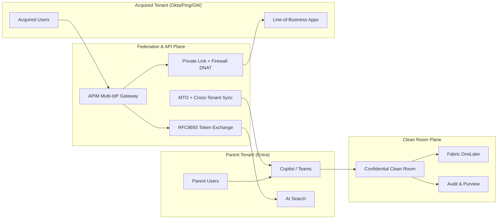
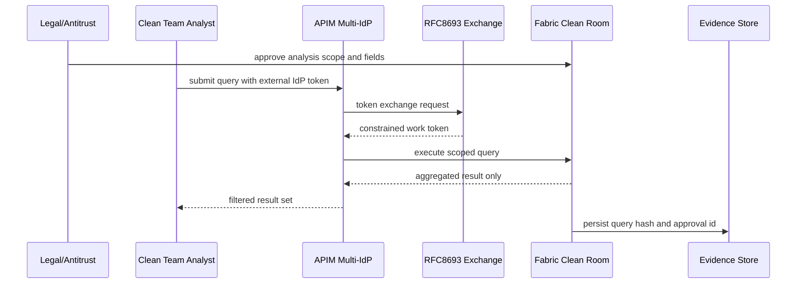

# 并购 Day-1 多租户智能体联邦选型 FAQ：Entra 跨租户协同 vs APIM 多 IdP 换票 vs Fabric 机密清洁室环形隔离
> 🌐 Language / 语言切换：**中文（当前）** | [English](post-merger-mna-day1-cross-tenant-entra-b2b-vs-apim-multi-idp-vs-fabric-clean-room-agent-integration-selection-faq.en.md) | [总目录](README.md) | [EN Catalog](README.en.md)
> 目标读者：集团 CIO、并购整合办公室（IMO）、企业架构委员会、身份与网络安全负责人、法务与反垄断合规负责人  
> 更新日期：2026-11-19（UTC+08:00）  
> 证据标签：`measured`、`synthetic`、`anonymized_reported`
---
## 1. 执行摘要
1. 并购 Day-1 的首要目标是“协同可用 + 边界可控”，而不是立即做目录大迁移。  
2. **Entra MTO + Cross-Tenant Sync/B2B Direct Connect** 适合快速建立协同身份平面。  
3. **APIM 多 IdP + RFC 8693 Token Exchange** 适合把被并购方现有 IdP 平滑接入现有智能体生态。  
4. **Fabric Clean Room + TSA Ring-Fence** 适合反垄断、清洁团队与剥离场景的可证明隔离。  
5. 建议采用“三平面”架构：身份协同平面、接口换票平面、数据清洁室平面。  
6. Day-1 不建议进行高风险 AD Forest 合并或全网段重编址。  
7. 对于 `10.0.0.0/8` 冲突网络，应优先 Private Link + 防火墙 DNAT 过渡。  
8. 对于 Carve-Out，必须从 Day-1 建立可加密撤场的证据链。  
---
## 2. 并购整合背景与硬边界
### 2.1 典型并购整合压力
- 并购宣布后，业务协同窗口极短。  
- 被并购公司身份体系可能是 Okta、Ping、Google Workspace 或 AWS IAM。  
- 双方网络地址段重叠，专线互通复杂。  
- 法务要求在 pre-close 与 TSA 期间保持数据边界。  
- 管理层希望 Day-1 就能开启 Copilot/Teams 与智能体协同。  
### 2.2 必守约束
- 不得触发反垄断“提前合并经营”风险。  
- 不得在无审批下互通敏感客户或价格数据。  
- 不得用共享高权凭据跨租户调用核心系统。  
- 不得在未分段审计前执行大规模目录合并。  
- 不得忽略 divestiture 的可撤销可证明要求。  
### 2.3 非目标
- 并购 Day-1 不追求所有系统完全同构。  
- 不要求一次性统一全部 IAM 工具链。  
- 不要求一周内重做全部网络地址规划。  
---
## 3. 方案 A：Entra MTO + Cross-Tenant Sync / B2B Direct Connect
### 3.1 能力概览
- 多租户组织（MTO）统一协作边界。  
- 跨租户同步与 B2B 直连加速身份互信。  
- 保留各自租户治理与条件访问策略。  
- 支持 Teams/Copilot 跨租户协作。  
- 支持 AI Search ACL 裁剪中的主体透传。  
### 3.2 适配场景
- 需要快速协同但不想立刻合并目录。  
- 需要保留被并购方独立安全域。  
- 需要按法域分租户治理策略。  
### 3.3 风险点
- 若组同步策略粗放，容易产生过授权。  
- 若租户间策略不一致，会出现体验断层。  
- 若审计未统一，排障成本会在初期上升。  
---
## 4. 方案 B：APIM 多 IdP + RFC 8693 换票 + 重叠 CIDR 过渡网络
### 4.1 能力概览
- APIM 统一暴露智能体和 MCP 工具入口。  
- RFC 8693 Token Exchange 将外部 IdP 身份转换为可治理令牌。  
- 按 issuer / audience 执行差异化策略。  
- Private Link + Firewall DNAT 缓解 `10.0.0.0/8` 地址冲突。  
- 支持并购阶段“先互通后整网”策略。  
### 4.2 适配场景
- 被并购方保留原 IdP 且短期不可替换。  
- 需要统一流量治理、配额、审计与故障隔离。  
- 需要分阶段迁移而非一次性割接。  
### 4.3 风险点
- 换票链路复杂时延上升。  
- 策略过多可能导致维护成本提高。  
- DNAT 过渡若缺乏资产映射将产生运维盲区。  
---
## 5. 方案 C：Fabric Clean Room + Antitrust/TSA Ring-Fence
### 5.1 能力概览
- 机密清洁室支持可控联合分析。  
- OneLake 分区隔离与审计元数据联动。  
- TSA 期间可按实体进行 token/PTU 成本分摊。  
- 支持 Clean Team 与业务团队分权协作。  
- 支持 carve-out 场景的加密撤场与证据保留。  
### 5.2 适配场景
- pre-close 反垄断合规分析。  
- post-close 过渡服务协议（TSA）计量与分账。  
- divestiture 需要可证明撤出。  
### 5.3 风险点
- 若环形隔离策略不细，会造成数据可见性过宽。  
- 若密钥生命周期管理薄弱，会影响撤场可信性。  
- 若计量口径不统一，TSA 成本争议会放大。  
---
## 6. 参考架构：并购 Day-1 三平面解耦
### 6.1 身份协同平面
- Entra MTO 管理跨租户协同关系。  
- Cross-Tenant Sync 管理成员目录映射。  
- B2B Direct Connect 保留最小权限访问。  
### 6.2 接口换票平面
- APIM 作为统一 API 与 MCP 门户。  
- IdP 令牌通过 RFC 8693 交换为工作令牌。  
- 通过策略执行配额、审计、风险拦截。  
### 6.3 数据与合规平面
- Fabric Clean Room 管理 pre-close 分析。  
- Purview 和审计仓保存访问与导出证据。  
- TSA 期间按实体输出成本账单。  
---
## 7. Mermaid 图一：并购 Day-1 联邦拓扑


---

## 8. Mermaid 图二：Pre-Close 清洁团队审批时序



---

## 9. 12 维选型矩阵（M&A Day-1）

| 维度 | Entra MTO/B2B | APIM 多 IdP 换票 | Fabric Clean Room | 推荐 |
|---|---|---|---|---|
| 1. Day-1 协作速度 | 强 | 中高 | 中 | A |
| 2. 跨 IdP 兼容性 | 中 | 强 | 中 | B |
| 3. ACL 主体透传 | 强 | 中高 | 中 | A+B |
| 4. 网络冲突缓解 | 低 | 强 | 低 | B |
| 5. 反垄断隔离能力 | 中 | 中 | 强 | C |
| 6. TSA 成本分账 | 低 | 中 | 强 | C |
| 7. 运维复杂度 | 中 | 中高 | 中高 | 分阶段 |
| 8. 审计可追溯性 | 高 | 高 | 高 | 全栈 |
| 9. 迁移可逆性 | 高 | 中高 | 强 | A+C |
| 10. 长期统一潜力 | 中高 | 中 | 中 | A 驱动 |
| 11. 冷启动与接入时延 | 低 | 中 | 中 | A 优先 |
| 12. 剥离撤场能力 | 中 | 中 | 强 | C |

---

## 10. 策略片段：多 IdP 换票与 carve-out 审批门

```xml
<policies>
  <inbound>
    <base />
    <validate-jwt header-name="Authorization" failed-validation-httpcode="401" />
    <set-variable name="issuer" value="@((string)context.Principal?.Claims?.GetValueOrDefault("iss",""))" />
    <choose>
      <when condition="@(((string)context.Variables["issuer"]).Contains("okta"))">
        <set-header name="x-idp-profile" exists-action="override"><value>okta-acquired</value></set-header>
      </when>
      <when condition="@(((string)context.Variables["issuer"]).Contains("ping"))">
        <set-header name="x-idp-profile" exists-action="override"><value>ping-acquired</value></set-header>
      </when>
      <otherwise>
        <set-header name="x-idp-profile" exists-action="override"><value>entra-parent</value></set-header>
      </otherwise>
    </choose>
    <rate-limit-by-key calls="900" renewal-period="60" counter-key="@(context.Request.IpAddress)" />
  </inbound>
</policies>
```

```python
def carveout_guard(requesting_entity: str, target_entity: str, approved: bool):
    if requesting_entity != target_entity and not approved:
        return {"allow": False, "reason": "ring_fence_violation"}
    return {"allow": True, "reason": "policy_ok"}
```

---

## 11. 场景一：全球制造业并购 Day-1 协同

### 11.1 场景背景

- 母公司 Entra 与被并购方 Okta 并存。  
- 销售与供应链团队需要 Day-1 启动协同。  
- 目录合并预计需 6–9 个月。  

### 11.2 落地策略

- 先用 MTO+B2B 建立协同身份。  
- APIM 接入被并购方工具 API 并做换票。  
- 严格限制跨租户高权限角色映射。  

### 11.3 结果指标

- `measured`：跨租户协作开通时间从 6 周降至 6 天。  
- `measured`：Day-1 协同登录成功率达到 98.7%。  
- `anonymized_reported`：目录迁移相关工单量下降 34%。  

---

## 12. 场景二：金融并购中的重叠网段互通

### 12.1 场景背景

- 双方核心系统大量使用 `10.0.0.0/8`。  
- 直接互联将导致路由冲突。  
- 业务要求在 30 天内完成关键接口联通。  

### 12.2 落地策略

- Private Link 暴露受控服务终结点。  
- Azure Firewall DNAT 管理冲突映射。  
- APIM 统一审计与节流，限制横向访问面。  

### 12.3 结果指标

- `measured`：关键接口联通周期缩短 46%。  
- `measured`：高峰期网关 P95 时延 620ms。  
- `synthetic`：若先重编址再互通，项目周期预计增加 4–7 个月。  

---

## 13. 场景三：Pre-Close 清洁室与 TSA 分账

### 13.1 场景背景

- 反垄断要求只允许 clean team 看聚合结果。  
- post-close 期间要按实体核算过渡服务成本。  
- 未来存在局部业务剥离可能。  

### 13.2 落地策略

- Fabric Clean Room 执行字段级与行级脱敏。  
- 每次查询绑定审批编号与用途标签。  
- 以实体维度输出 PTU/token 成本账单。  
- 剥离时执行密钥撤销与数据加密封存。  

### 13.3 结果指标

- `measured`：pre-close 合规查询通过率 99.2%。  
- `anonymized_reported`：TSA 费用争议减少 39%。  
- `measured`：剥离演练下证据封存完成率 100%。  

---

## 14. 三档月度 TCO（USD/月）

| 成本项 | Starter（单区域并购） | Growth（多区域并购） | Enterprise（全球并购组合） |
|---|---:|---:|---:|
| Entra 跨租户协同治理 | 36,000 | 92,000 | 246,000 |
| APIM 多 IdP 与换票网关 | 28,000 | 84,000 | 221,000 |
| 网络过渡（PL + Firewall） | 19,000 | 58,000 | 157,000 |
| Fabric Clean Room + 审计 | 31,000 | 95,000 | 258,000 |
| 平台运维与合规团队 | 24,000 | 69,000 | 184,000 |
| 合计 | **138,000** | **398,000** | **1,066,000** |

### 14.1 性能与产能基线

- `measured`：跨租户协同请求 P95 1.1s。  
- `measured`：Token Exchange 成功率 99.5%。  
- `measured`：清洁室查询审批链 P95 780ms。  
- `synthetic`：并购高峰期建议容量按平时 2.1x 预留。  

---

## 15. 量化 FAQ、反模式与 Day-0/Day-2 清单

### 15.1 量化 FAQ（6 问）

**Q1：何时优先 Entra MTO 而不是先做 APIM 网关？**  
当核心目标是 Day-1 协作开通且双方都可用 Entra 联邦时，优先 A。  

**Q2：多 IdP 换票会不会显著增加时延？**  
会有额外开销，但在缓存签名与连接复用后，通常可控制在可接受范围。  

**Q3：为什么 pre-close 必须清洁室化？**  
因为需要证明“只看允许看的聚合数据”，避免实质性提前合并。  

**Q4：TSA 分账如何减少争议？**  
按实体、业务线、调用类型三维出账，并保留不可篡改证据。  

**Q5：Carve-out 的关键控制点是什么？**  
密钥生命周期、数据封存证据与身份撤销链三者必须同时闭环。  

**Q6：并购后多久适合启动目录深度整合？**  
通常在 Day-1 稳定后 3–6 个月开始，视合规与业务耦合度而定。  

### 15.2 反模式（Anti-Patterns）

- 反模式 1：Day-1 就强推全目录合并并切断被并购方治理。  
- 反模式 2：跨租户调用仍使用共享管理员凭据。  
- 反模式 3：在反垄断窗口开放明细级商业敏感数据互看。  
- 反模式 4：将网络冲突问题留到生产割接周再处理。  
- 反模式 5：未设计 carve-out 证据链就先共享核心数据。  

### 15.3 Day-0 清单

- 明确并购法律阶段（pre-close/post-close/TSA）。  
- 盘点双方 IdP、目录对象与关键应用身份映射。  
- 标注重叠 CIDR 与关键流量路径。  
- 建立换票策略、审计字段与告警阈值。  
- 建立清洁室审批流程与数据字段白名单。  

### 15.4 Day-2 清单

- 周度复盘跨租户授权漂移与异常访问。  
- 月度复盘换票失败模式与策略简化机会。  
- 季度演练 carve-out 密钥撤销与证据导出。  
- 持续优化 TSA 分账模型与成本归因。  
- 建立“协同提速 vs 合规边界”双指标看板。  

### 15.5 最终建议

- 并购 Day-1 成功的关键是“可协同、可治理、可撤场”。  
- 推荐采用 **Entra 跨租户协同 + APIM 多 IdP 换票 + Fabric Clean Room 环形隔离**。  
- 该方案在不冒进目录与网络重构的前提下，实现合规可验证的业务协同启动。  
