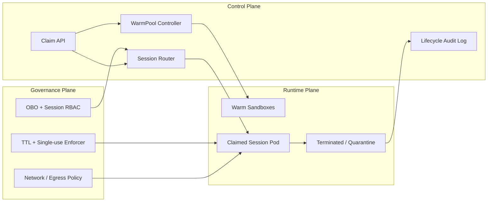
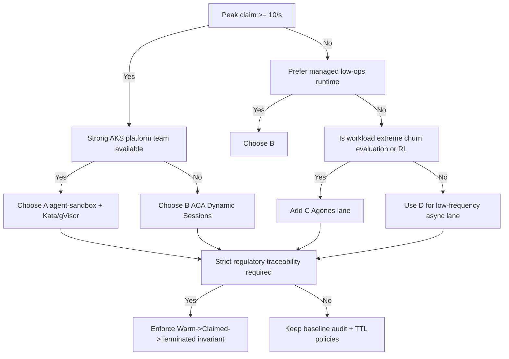

# Enterprise Pre-Warmed Sandbox Pool Watermarking and Atomic `1:1` Session Claim Selection FAQ: AKS `agent-sandbox` CRD + Kata vs ACA Dynamic Sessions vs Agones vs Cold Spawn

> 🌐 **Language Switch**: [中文](./prewarmed-sandbox-pool-claim-lifecycle-aks-k8s-agent-sandbox-crd-kata-vs-aca-ready-sessions-vs-agones-selection-faq.md) | **English (current)**
> **Audience**: Cloud & AI Solution Architects, platform engineering teams, Kubernetes/SRE owners, security/compliance stakeholders, and agent runtime product leads.
> **Scope**: Architecture trade-offs for declarative warm-buffer governance, atomic `1:1` session claim binding, strict single-use tainted-pod destruction, and control-plane churn mitigation across AKS, ACA Dynamic Sessions, Agones, and cold-spawn fallback paths.

## 1. Problem framing: why standard Deployments and Jobs fail for high-churn session isolation
In enterprise agent systems, the core challenge is not whether a pod can be created; it is whether a session can be claimed in sub-second time with deterministic isolation and forensic traceability.  
Standard Deployments are optimized for steady replica management, not one-session-per-claim semantics with strict contamination boundaries and post-use destruction.  
Standard Jobs provide one-shot semantics but at high churn they amplify control-plane writes and cold-start variance, producing latency cliffs and API server pressure spikes.  
When peak claim rates sustain around `20` requests per second or higher, fallback cold-start penalties (`+4s–15s`) quickly consume UX and SLA budgets.  
A robust architecture must therefore solve three dimensions together: pre-warm capacity, atomic claim binding, and irreversible post-claim termination hygiene.  

## 2. Four architecture patterns (A/B/C/D) and their boundary of responsibility
**Architecture A (AKS + `agent-sandbox` CRDs + Kata/gVisor):** explicit lifecycle control with `SandboxTemplate`, `SandboxWarmPool`, `SandboxClaim`, and `SandboxRouter` abstractions.  
**Architecture B (ACA Dynamic Sessions):** managed warm-pool semantics using `readySessionInstances`, `sessionIdentifier` affinity, and low operational overhead.  
**Architecture C (Agones Fleet/Allocator):** high-churn allocation state machine (`Ready -> Allocated -> Shutdown`) designed for massive allocation throughput and reduced etcd write stress.  
**Architecture D (On-demand Job/ACI cold spawn):** zero warm-buffer idle spend, but materially higher startup latency and poor burst behavior at scale.  
Production platforms typically compose these lanes rather than choosing one globally: A or B for core interactive pathways, C for extreme churn lanes, and D for low-frequency asynchronous work.  

## 3. End-to-end reference architecture: warm watermark, atomic claim, sticky routing, and one-way termination

The critical control is a one-way lifecycle invariant: `Warm -> Claimed -> Terminated`, with no legal transition returning claimed sandboxes into the warm pool.  
If previously claimed instances are recycled, contamination risk and cross-session residue become systemic rather than incidental, undermining compliance assertions.  

## 4. Architecture A deep dive: declarative lifecycle control with `agent-sandbox` on AKS
Architecture A models pool lifecycle as first-class API resources, enabling deterministic reconciliation, policy auditability, and controller-driven replenishment behavior.  
`SandboxWarmPool` maintains buffer watermarks, `SandboxClaim` binds a unique `agent_session_id`, and `SandboxRouter` enforces sticky RPC routing to the claimed instance.  
With Kata or gVisor isolation, runtime boundaries can be hardened for untrusted code and multi-tenant threat models requiring stronger kernel or virtualization separation.  
The trade-off is platform complexity: teams must own CRD evolution, reconciliation reliability, upgrade choreography, and rollback safety practices.  
For organizations with mature AKS platform engineering, A usually provides the highest governance fidelity and customization power.  

## 5. Architecture B deep dive: managed warm buffers with ACA Dynamic Sessions
B’s primary advantage is managed lifecycle behavior: teams get warm-buffer semantics through `readySessionInstances` without building custom CRD control loops.  
Session affinity via `sessionIdentifier` supports stateful tool workflows while reducing sticky-routing implementation burden at the application layer.  
Capacity design is driven by warm-buffer target, cooldown period, and regional concurrent-session quotas, all of which must be modeled against burst behavior.  
Pool exhaustion causes fallback cold starts, so production sizing must couple burst rate, refill time, and acceptable miss probability rather than using static defaults.  
B is often the fastest path for enterprises prioritizing operational simplicity with predictable session semantics.  

## 6. Architecture C deep dive: Agones for ultra-high allocation churn
C leverages Agones allocator and fleet state machines that have been battle-tested in high-frequency allocation workloads, including aggressive churn patterns.  
Its `Ready -> Allocated -> Shutdown` model can reduce per-claim control-plane write amplification compared with naive per-claim object-creation patterns.  
This is especially valuable for coding-agent evaluation storms and RL rollout farms where allocation throughput and API server stability are primary constraints.  
Adopting C requires specialized platform knowledge around Agones lifecycle, versioning, and observability integration with existing cluster operations.  
In enterprise patterns, C is commonly introduced as a dedicated high-churn lane rather than replacing the default interactive business lane.  

## 7. Architecture D deep dive: zero warm pool and cold-spawn economics
D appears cost-efficient by eliminating idle warm-buffer spend, which can be rational for sparse asynchronous workloads.  
However, in interactive pathways cold-start penalties are user-visible and can trigger retry cascades that inflate both latency and control-plane load.  
At burst scale, frequent create/destroy cycles can produce API server pressure that negates perceived infrastructure savings.  
The economic profile therefore depends on workload shape: D is efficient at low claim rates and poor for sustained high-frequency session allocation.  
It should be treated as a scoped lane with explicit admission policy, not a universal default.  

## 8. Twelve-dimension comparison matrix: latency, isolation assurance, and platform burden
| Dimension | A: AKS + agent-sandbox | B: ACA Dynamic Sessions | C: Agones Fleet | D: Cold Job/ACI |
|---|---|---|---|---|
| Claim first-response latency | Very low | Very low to low | Low | High |
| Session isolation verifiability | Very high | High | High | Medium |
| One-way taint-destruction enforcement | Very high | High | High | Medium |
| Control-plane write amplification risk | Medium | Low | Low-to-medium | High |
| Warm watermark controllability | Very high | High | High | None |
| Operations complexity | High | Low | Medium-high | Low |
| High-churn stability | High | Medium-high | Very high | Low |
| Policy programmability depth | Very high | Medium-high | High | Medium |
| Per-session marginal cost | Medium | Medium-high | Medium | Low |
| Peak-hour blended cost profile | Medium | Medium-high | Medium | High |
| Team skill threshold | High | Low-to-medium | Medium-high | Low |
| Recommended role | Primary controlled enterprise lane | Managed low-ops lane | Extreme churn specialist lane | Low-frequency async fallback |

A recurring enterprise finding is that D-only strategies look cheap in idle-state math but degrade in peak-state economics and reliability.  

## 9. Quantitative model: warm pool sizing, miss probability, and refill dynamics
### 9.1 Minimum warm-buffer formula
Recommended baseline:  
\[
W_{\min}=\lambda_{peak}\cdot T_{replenish}+z_{\alpha}\sqrt{\lambda_{peak}\cdot T_{replenish}}
\]
where `λpeak` is peak claim rate, `Treplenish` is refill latency, and `zα` is chosen from target miss-probability tolerance.  

### 9.2 Worked sizing example
For `λpeak=20 claims/s`, `Treplenish=6s`, and `zα=2.58` (about `<0.5%` miss), base demand is `120` and variance buffer is approximately `28`.  
This yields a practical minimum near `148`, and production teams often round to `160` to absorb scheduler jitter and node-level perturbations.  

### 9.3 Cost-of-miss dynamics
When warm pools deplete, fallback cold start latency can add `+6s` or more, which increases timeout and retry probability non-linearly under concurrent load.  
Miss events should therefore be treated as multiplicative system risk, not isolated per-request latency variance.  

## 10. Decision tree: peak claim first, governance depth second

This decision order avoids architecture drift driven by tooling preference rather than measured workload and governance constraints.  

## 11. Production snippet #1: `SandboxWarmPool` and `SandboxClaim` YAML
```yaml
apiVersion: sandbox.k8s.io/v1alpha1
kind: SandboxWarmPool
metadata:
  name: coding-agent-kata-pool
  namespace: agent-runtime
spec:
  templateRef: kata-python-template
  targetWarmInstances: 160
  minWarmInstances: 140
  maxWarmInstances: 260
  replenishSeconds: 6
  singleUse: true
  lifecyclePolicy:
    allowRecycleClaimed: false
    terminateOnRelease: true
---
apiVersion: sandbox.k8s.io/v1alpha1
kind: SandboxClaim
metadata:
  name: claim-session-a42f
  namespace: agent-runtime
spec:
  warmPoolRef: coding-agent-kata-pool
  sessionId: "agent_session_id:a42f"
  ttlSeconds: 1800
  routerRef: coding-agent-router
  labels:
    tenant: "contoso-payments"
    workload: "coding-agent"
```
The key governance control is explicit denial of claim-recycle into warm state, making contamination prevention enforceable by policy rather than convention.  

## 12. Production snippet #2: ACA Dynamic Sessions Bicep plus atomic claim/release client (Python)
```bicep
resource sessionPool 'Microsoft.App/sessionPools@2024-10-02-preview' = {
  name: 'agent-coding-session-pool'
  location: resourceGroup().location
  properties: {
    environmentId: appEnv.id
    poolManagementType: 'Dynamic'
    maxConcurrentSessions: 1200
    readySessionInstances: 180
    cooldownPeriodInSeconds: 900
    sessionNetworkAccess: 'Private'
  }
}
```

```python
import time
from typing import Optional


class AtomicClaimClient:
    def __init__(self, api):
        self.api = api

    def claim(self, session_id: str, timeout_s: int = 2) -> Optional[str]:
        start = time.time()
        while time.time() - start < timeout_s:
            resp = self.api.try_claim(session_id=session_id)
            if resp.get("claimed"):
                return resp["instance_id"]
            time.sleep(0.05)
        return None

    def release(self, instance_id: str) -> None:
        self.api.terminate(instance_id=instance_id, reason="single_use_completed")
```
This client enforces claim-then-destroy semantics and avoids hidden reuse behavior that weakens isolation assurances.  

## 13. Enterprise scenario A: multi-tenant coding-agent platform under daytime burst load
A financial technology platform faced daytime spikes around `15–22 claims/s`, with prior cold-start and reuse behavior causing unstable response latency and contamination risk.  
The redesigned lane used A as primary path with warm watermarks sized to `160` and strict one-way lifecycle enforcement.  
Low-priority async jobs were diverted to D so critical interactive sessions retained deterministic warm capacity under pressure.  
After rollout, P95 claim latency stabilized near `120ms`, cross-tenant residue incidents dropped to zero, and forensic replay preparation was reduced from hours to minutes.  

## 14. Enterprise scenario B: large-scale evaluation and RL rollout with extreme churn
An evaluation platform running nightly stress workloads exceeded `500 claims/s`, where naive per-claim object churn drove API server saturation.  
The team introduced C as a dedicated high-churn lane while preserving B for regular business interaction sessions.  
This split prevented benchmark storms from destabilizing daytime customer-facing paths and enabled separate scaling policy for each lane.  
Control-plane alert frequency declined materially, and nightly completion consistency improved without compromising daytime SLOs.  

## 15. Three-year TCO, quantitative Q&A, Day-0/Day-2 checklists, and fit guidance
### 15.1 Three-year TCO (`5/s`, `20/s`, `80/s` peak claim profiles)
| Cost component (3-year) | A | B | A+C | D |
|---|---:|---:|---:|---:|
| Compute and platform infrastructure | `$1.48M` | `$1.76M` | `$1.69M` | `$1.12M` |
| Platform engineering and operations labor | `$1.34M` | `$0.82M` | `$1.52M` | `$0.61M` |
| Security, audit, and governance overhead | `$0.58M` | `$0.54M` | `$0.62M` | `$0.73M` |
| Latency/outage opportunity loss | `$0.69M` | `$0.78M` | `$0.55M` | `$1.66M` |
| Total three-year cost | `$4.09M` | `$3.90M` | `$4.38M` | `$4.12M` |

B can be economically attractive for low-ops organizations, while A is often preferred when strict control and predictable peak behavior outweigh operational simplicity.  

### 15.2 Quantitative Q&A (6)
**Q1: When is a warm pool mandatory?**  
When sustained peak claims exceed roughly `5/s` and interactive SLAs require deterministic response behavior.  

**Q2: What is the main boundary between A and B?**  
A maximizes policy and runtime control depth; B maximizes managed simplicity with lower platform operations burden.  

**Q3: Does C replace A/B?**  
Usually no; C is commonly a specialized lane for extreme churn rather than a universal default.  

**Q4: Why does D underperform at peak despite zero idle buffer cost?**  
Cold-start latency and retry amplification increase opportunity loss and control-plane pressure faster than idle-savings models predict.  

**Q5: What is the practical definition of “tainted single-use”?**  
Any session that executed tenant code cannot return to warm state and must transition directly to termination/quarantine.  

**Q6: What is the minimum production governance baseline?**  
Atomic claims, one-way lifecycle enforcement, session-level audit records, capacity guardrails, failure replay paths, and recurring chaos drills.  

### 15.3 Day-0 checklist
- Size warm-buffer targets from measured peak claim rate and replenish latency using explicit miss-probability assumptions.  
- Define atomic claim contracts (`session_id -> sandbox_instance`) and reject multi-session binding behavior.  
- Enforce `singleUse` and `terminateOnRelease` policies at runtime-controller level, not application convention.  
- Configure sticky routing, bounded TTL, and starvation protections for long-tail session holders.  
- Integrate observability for claim latency, pool-hit ratio, recycle violations, and control-plane error classes.  
- Add elevated approval and trace controls for sensitive execution pathways and mutation-capable tools.  

### 15.4 Day-2 checklist
- Reassess warm-buffer hit/miss behavior weekly and recalibrate watermarks against seasonal traffic patterns.  
- Audit destruction logs weekly to verify no tainted instance re-enters warm state.  
- Review control-plane write amplification and allocator pressure monthly to prevent hidden saturation risks.  
- Run monthly pool-depletion and regional-failover simulations with measured recovery evidence.  
- Recompute TCO and capacity assumptions quarterly with updated pricing and workload envelopes.  
- Perform quarterly cross-tenant isolation audits and replayability checks for compliance assurance.  

### 15.5 Good fit vs Not for
| Decision | Guidance |
|---|---|
| ✅ Good fit | Multi-tenant agent platforms requiring sub-second claims, strict isolation hygiene, and evidence-grade lifecycle governance. |
| ⛔ Not for | Low-frequency async-only workloads with no interactive SLA and no requirement for fine-grained lifecycle controls. |

A practical enterprise baseline is **A or B for primary traffic, C for extreme churn lanes, and D for constrained low-frequency fallback scenarios**.  
When lifecycle governance is explicit and measurable, warm pools become a reliability and security investment rather than perceived idle waste.  

### 15.6 Suggested SLO/SLI envelope for session-pool governance
| Control domain | Suggested SLI | Suggested quarterly SLO | Triggered action |
|---|---|---|---|
| Claim P95 latency | Time to successful claim binding | `<= 180ms` | Raise warm target or reroute allocation path |
| Pool hit ratio | Share of claims served by warm instances | `>= 99.5%` | Tune replenishment and watermark policies |
| Tainted recycle violations | Claimed instances returning to warm state | `0` | Freeze recycle path and incident escalation |
| Termination integrity | Releases that end in verified termination | `>= 99.95%` | Trigger cleanup compensation workflow |
| Control-plane error rate | Allocation API failure ratio | `<= 0.3%` | Switch to fallback allocator lane |
| Audit replay completeness | Sessions with full replayable evidence | `>= 99.9%` | Block high-risk release promotion |

These indicators should be release-gating controls, not passive dashboards.  

### 15.7 Recommended 90-day rollout cadence
Days `1–30`: define lifecycle state model, one-way hygiene policy, and baseline observability before broad rollout.  
Days `31–60`: deploy A or B primary lane and validate claim-latency and miss-probability assumptions under stress tests.  
Days `61–90`: introduce C high-churn lane and D fallback policy, then finalize layered runbooks and governance drills.  
This sequence reduces platform risk by establishing determinism before scale acceleration.  

### 15.8 Minimum audit evidence package (recommended fields)
- `claim_id`, `session_id`, `sandbox_id`, `tenant_id`, `actor_id` for identity and boundary traceability.  
- `state_transition`, `transition_time`, `controller_version` for lifecycle replay and controller accountability.  
- `pool_hit`, `claim_latency_ms`, `replenish_delay_ms` for capacity and depletion diagnostics.  
- `release_reason`, `termination_status`, `ttl_expired` for one-way hygiene verification.  
- `policy_version`, `network_profile`, `egress_decision` for security policy evidence linkage.  
- `cost_estimate`, `cost_actual`, `capacity_snapshot_id` for finance and capacity governance reconciliation.  

### 15.9 Common anti-patterns and mitigation guidance
- Anti-pattern 1: treating session pools as standard Deployment scaling and ignoring atomic claim semantics.  
- Anti-pattern 2: recycling claimed instances into warm pools to save capacity, which breaks contamination boundaries.  
- Anti-pattern 3: optimizing only mean latency while ignoring peak miss probability and control-plane saturation.  
- Anti-pattern 4: mixing extreme churn evaluation traffic with production interaction traffic in one allocator lane.  
- Anti-pattern 5: lacking replay-grade lifecycle evidence, making post-incident governance assertions unverifiable.  

### 15.10 Tiered capacity thresholds and automated governance actions (example)
| Traffic tier | Claim rate (5-min avg) | Recommended primary lane | Warm-watermark policy | Automated action |
|---|---:|---|---|---|
| L1 low load | `< 3/s` | B or D | Minimal warm buffer + slow refill | Cost-first mode, tolerate limited cold starts |
| L2 steady load | `3–12/s` | B or A | Formula baseline + `10%` safety band | Auto-expand pool when hit ratio drops |
| L3 peak load | `12–30/s` | A primary lane | Formula baseline + `20%` safety band | Reserve concurrency and throttle non-critical lanes |
| L4 surge / stress | `> 30/s` | A + C dual lanes | Dynamic uplift + fast refill | Activate C lane and protective degradation controls |

This tiering model should be treated as a governance system, not as an isolated scaling setting.  
Many organizations optimize one metric in isolation and unintentionally destabilize the whole operating envelope at peak contention windows.  
The practical approach is to codify tier thresholds directly into policy automation and release gates so response behavior remains deterministic under pressure.  
When traffic enters L3/L4, increase audit-sampling density and retention depth automatically, enabling post-incident reconstruction of pool misses, fallback triggers, and degradation decisions.  
Coupling traffic tiers with chargeback rules also improves stakeholder alignment on why warm-buffer spend is a resilience investment rather than idle waste.  

### 15.11 Quarterly failure-drill playbook: from pool depletion to regional degradation
Stage 1 (depletion injection) should intentionally exhaust warm capacity and verify that claim routing follows bounded fallback behavior rather than uncontrolled retries.  
Stage 2 (control-plane perturbation) should inject API server latency and measure allocator failure ratio, compensation backlog growth, and circuit-breaker trigger integrity.  
Stage 3 (regional dependency failure) should simulate single-region unavailability and verify cross-region session recovery while preserving tenant boundaries and audit continuity.  
Stage 4 (recovery integrity) should validate `release -> terminate` consistency, tainted-recycle violations, and cost-accounting alignment for the disruption window.  
Stage 5 (governance closure) should produce three concrete outputs: capacity-parameter updates, policy-threshold updates, and drill-script updates linked to the next release cycle.  

A drill is not complete when the system merely recovers; it is complete when recovery does not introduce new isolation or governance regressions.  
If teams temporarily relax identity or network controls to accelerate restoration, the exposure window and compensating controls must be explicitly quantified in postmortem artifacts.  
Enterprises should wire drill completion evidence into release promotion so high-risk platform changes cannot bypass resilience proof.  

### 15.12 Compliance mapping guidance for audit, internal control, and legal review
Regulated enterprises often provide performance telemetry but under-deliver evidence readability for control owners, creating avoidable review loops.  
A stronger model maps technical indicators to control-language outcomes, for example:  
“tainted recycle violations = 0” maps to session-isolation integrity assurance,  
“audit replay completeness >= 99.9%” maps to verifiable control operation, and  
“claim P95 <= 180ms” maps to continuity and service-availability commitment execution.  

Legal and audit stakeholders typically need repeatable structured evidence extraction more than static screenshots.  
Platform teams should predefine retention periods, evidence redaction rules, and cross-region sovereignty handling before incidents occur.  
For multinational deployments, explicitly design where session evidence is retained and which aggregated fields are permitted for cross-border reporting, so global operations and local regulation remain simultaneously satisfiable.  

### 15.13 Tri-party operating dashboard model (platform, business, finance)
Session-pool governance degrades quickly when only platform engineering tracks technical telemetry while business and finance teams remain outside the decision loop.  
A resilient operating model uses a shared dashboard where platform owners track latency, hit ratio, and destruction integrity, business owners track completion quality and escalation impact, and finance owners track per-1,000-session spend and peak-budget variance.  
When these views are reviewed in one recurring cadence, threshold changes become explicit organizational decisions instead of reactive incident-driven debates.  

| Role | Weekly mandatory signals | Monthly decision question | Typical action |
|---|---|---|---|
| Platform engineering | Claim P95, pool-hit ratio, termination integrity, control-plane errors | Should warm watermark targets be seasonally adjusted | Tune watermark/refill/degrade thresholds |
| Business operations | First-response experience, escalation ratio, abandonment trend | Is user experience loss materially affecting KPI outcomes | Rebalance traffic priority and service tiers |
| Finance / FinOps | Cost per 1,000 sessions, budget variance, peak elasticity spend | Should reservation strategy or contracts be re-optimized | Shift budget policy and reservation mix |

The practical rule is to bind every threshold to a predefined action, rather than treating dashboards as passive observability assets.  
For example, if pool-hit ratio remains below `99.2%` for two consecutive weeks, force a capacity review; if per-1,000-session spend exceeds budget by `15%`, trigger workload-tiering and scheduler-priority review.  
This framing converts infrastructure telemetry into business-governable decisions and improves executive support for warm-buffer investments.  
