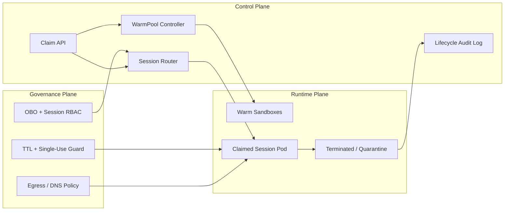
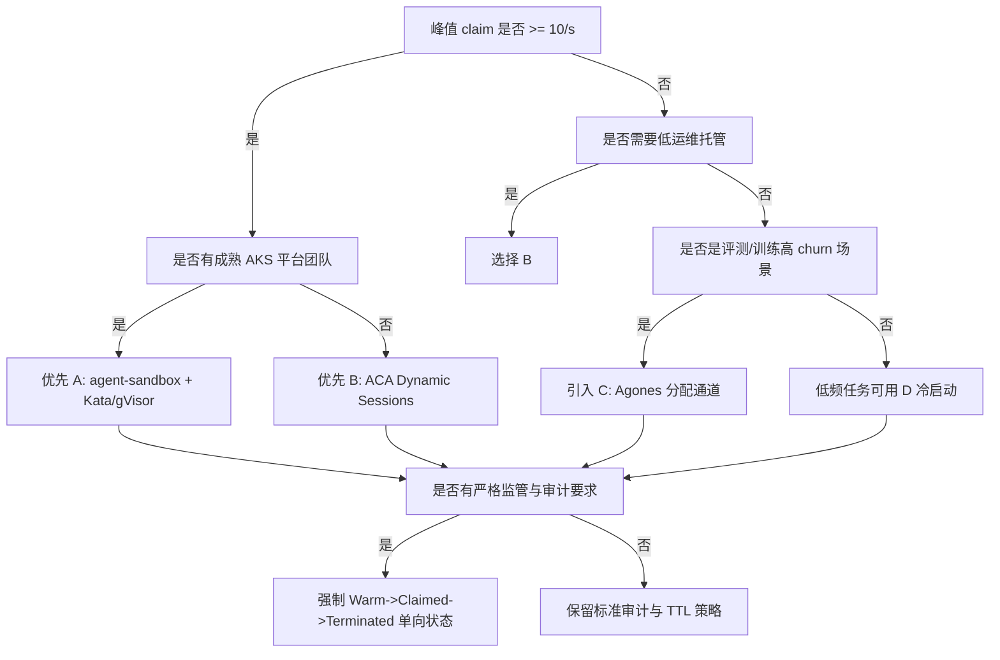

# 企业预热沙箱池声明式水位与原子 `1:1` 绑定选型 FAQ：AKS `agent-sandbox` CRD + Kata vs ACA Dynamic Sessions vs Agones vs 冷启动

> 🌐 **Language Switch**：**中文（当前）** | [English](./prewarmed-sandbox-pool-claim-lifecycle-aks-k8s-agent-sandbox-crd-kata-vs-aca-ready-sessions-vs-agones-selection-faq.en.md)
> **受众**：Cloud & AI Solution Architect、平台工程团队、Kubernetes/SRE 团队、安全合规与内控团队、Agent Runtime 产品负责人。
> **范围**：围绕“预热池水位、原子会话绑定、单次污染后销毁、控制面写放大治理”比较四种路径：AKS `agent-sandbox`、ACA Dynamic Sessions、Agones 分配器与零预热冷启动模式，并给出量化容量公式、生产代码与治理清单。

## 1. 问题定义：为什么普通 Deployment 与普通 Job 都难以满足高并发沙箱会话需求
在企业 Agent 运行时场景中，最难的问题不是“能不能拉起一个 Pod”，而是“能不能在突发并发时以亚秒级完成会话绑定，同时保证会话隔离和污染不可复用”。  
标准 Deployment 天生偏向长生命周期副本维持，它擅长的是副本数稳定，而不是每次请求都需要 `1:1` 独占会话且执行后销毁的瞬态绑定。  
标准 Job 虽然符合“一次性任务”语义，但在高频短任务下会产生明显冷启动与 API Server 写入风暴，最终把延迟抖动和控制面压力放大到不可预测区间。  
当 Coding Agent 或 Browser Agent 的峰值 claim 到达 `20` 次/秒甚至更高时，如果仍依赖冷启动路径，`+4s–15s` 的等待会快速吞噬用户体验与业务 SLA。  
因此该类架构必须同时解三件事：预热缓冲、原子认领、污染销毁，这三者缺一不可。  

## 2. 四种架构模式（A/B/C/D）与责任边界
**Architecture A（AKS + `agent-sandbox` CRD + Kata/gVisor）**：以 `SandboxTemplate`、`SandboxWarmPool`、`SandboxClaim`、`SandboxRouter` 构建声明式生命周期，强调可编排、可观测、可审计。  
**Architecture B（ACA Dynamic Sessions）**：以托管会话池与 `readySessionInstances` 预热缓冲获取低运维体验，利用 `sessionIdentifier` 亲和实现会话粘性。  
**Architecture C（Agones Fleet / Allocator）**：面向高 churn 分配路径的成熟状态机，重点在 `Ready -> Allocated -> Shutdown` 快速分配与控制面写合并。  
**Architecture D（按需冷启动 Job/ACI）**：零预热成本但冷启动明显，适合低频异步任务，不适合高峰交互式会话。  
生产实践通常不是单选，而是按业务等级分层：核心交互链路采用 A 或 B，压测/评测洪峰可用 C，低频后台任务可落 D。  

## 3. 端到端参考架构：预热水位、原子 claim、路由粘性与单向销毁闭环

该架构核心是把生命周期强制成单向状态机：`Warm -> Claimed -> Terminated`，禁止“已污染会话回流预热池”。  
只要存在“已执行过用户代码的容器重新回池”路径，就会在租户隔离、数据残留和审计可解释性上留下系统性漏洞。  

## 4. Architecture A 详解：`agent-sandbox` CRD 的声明式会话生命周期
A 模式把预热、认领、路由与销毁全部显式建模在 Kubernetes 资源中，平台可以通过 CRD 状态获得一致的控制面语义。  
`SandboxWarmPool` 按目标水位维持可认领实例，`SandboxClaim` 绑定 `agent_session_id`，`SandboxRouter` 把后续 RPC 严格路由到绑定实例。  
若使用 Kata/gVisor，隔离边界可在内核或虚拟化层进一步加固，适合高敏代码执行、跨租户并发和强审计场景。  
A 的代价是平台复杂度上升，需要团队具备 CRD 设计、控制器运维、升级策略和故障回滚能力。  
当组织已有成熟 AKS 平台工程团队时，A 能提供最细粒度控制与最强可定制能力。  

## 5. Architecture B 详解：ACA Dynamic Sessions 的托管预热池
B 模式最大优势是“托管化会话池”：平台团队无需自行维护复杂 CRD 控制器，即可获得 `readySessionInstances` 预热缓冲。  
通过 `sessionIdentifier` 亲和，后续请求可以稳定命中同一会话实例，实现多步工具执行与状态延续。  
容量规划重点在三个参数：预热缓冲大小、冷却时间 `cooldownPeriodInSeconds`、区域并发上限 `maxConcurrentSessions`。  
当缓冲耗尽时会回退到冷启动路径，因此生产配置必须将业务峰值、补货时间和容忍 miss 概率联动建模。  
B 适合希望“快速落地 + 低运维 + 托管边界清晰”的企业团队。  

## 6. Architecture C 详解：Agones 高 churn 分配路径
C 模式借助 Agones 的分配器与 Fleet 状态机，把高频分配问题转成成熟的 `Ready/Allocated/Shutdown` 生命周期处理。  
它在高并发分配（如 `500+ claims/sec`）场景下表现稳定，尤其适合大规模评测、RL rollout 或临时批量实验。  
Agones 的优势是分配 API 与状态转换路径经过长期实战打磨，能减少“每次 claim 都创建新 CRD”导致的 `etcd` 压力。  
但 C 对平台团队也提出新的运维要求：需要理解 Agones 生态、版本兼容与与现有观测体系整合。  
在企业中，C 往往是“极高 churn 专用通道”，不一定替代日常业务会话池主路径。  

## 7. Architecture D 详解：零预热冷启动（Job/ACI）成本与风险边界
D 模式在账面上最吸引人的是“零闲置预热成本”，对于低频异步任务确实具备经济性。  
但在交互式场景下，冷启动路径引入的延迟不可忽视，用户会直接感知首轮响应劣化和随机抖动。  
高峰期更大的问题是控制面 churn：大量短命 Job/Pod 创建销毁会把 API Server 与调度链路推向瓶颈。  
当 claim 速率持续升高时，D 可能从“省钱方案”变成“不可预测故障放大器”。  
因此 D 应限定在 `<5 claims/min` 且无严格首响 SLA 的后台流程。  

## 8. 12 维对比矩阵：时延、隔离、控制面压力与运维负担
| 维度 | A：AKS + agent-sandbox | B：ACA Dynamic Sessions | C：Agones Fleet | D：冷启动 Job/ACI |
|---|---|---|---|---|
| Claim 首响时延 | 很低 | 很低到低 | 低 | 高 |
| 会话隔离可验证性 | 很高 | 高 | 高 | 中 |
| 污染后单向销毁控制 | 很高 | 高 | 高 | 中 |
| 控制面写放大风险 | 中 | 低 | 低到中 | 高 |
| 预热池水位可控性 | 很高 | 高 | 高 | 无 |
| 运维复杂度 | 高 | 低 | 中高 | 低 |
| 高 churn 稳定性 | 高 | 中高 | 很高 | 低 |
| 安全策略可编排性 | 很高 | 中高 | 高 | 中 |
| 单会话边际成本 | 中 | 中高 | 中 | 低 |
| 高峰期综合成本 | 中 | 中高 | 中 | 高 |
| 团队技能门槛 | 高 | 低到中 | 中高 | 低 |
| 推荐定位 | 企业主力高控制通道 | 托管低运维主通道 | 大规模高 churn 专用通道 | 低频异步补充通道 |

矩阵结论是：只用 D 追求“零预热”通常在规模上不可持续，A/B/C 的合理分层才是长期稳态。  

## 9. 定量模型：预热池容量、miss 概率与补货时间
### 9.1 预热池最小水位
建议以如下近似公式估算最小预热水位：  
\[
W_{\min}=\lambda_{peak}\cdot T_{replenish}+z_{\alpha}\sqrt{\lambda_{peak}\cdot T_{replenish}}
\]
其中 `λpeak` 为峰值 claim 速率，`Treplenish` 为补货时间，`zα` 对应可接受缺货概率。  

### 9.2 示例计算
若 `λpeak=20 claims/s`、`Treplenish=6s`、`zα=2.58`（约 `0.5%` miss），  
则基础项约 `120`，波动项约 `2.58*sqrt(120)≈28`，建议水位不低于 `148`。  
生产中可向上取整至 `160` 以覆盖区域级抖动和节点重调度延迟。  

### 9.3 冷启动回退成本
当池耗尽后回退冷启动，若平均额外时延 `+6s`，在峰值窗口会直接拉高 P95/P99 并触发超时重试。  
因此“池 miss”不仅是单次等待问题，还会引起重试风暴和额外控制面压力。  

## 10. 选型决策树：先看峰值 claim，再看治理与团队能力

该树强调“峰值与组织能力优先”，避免只凭单次压测结果做长期架构决定。  

## 11. 生产代码片段一：`SandboxWarmPool`/`SandboxClaim` 示例 YAML
```yaml
apiVersion: sandbox.k8s.io/v1alpha1
kind: SandboxWarmPool
metadata:
  name: coding-agent-kata-pool
  namespace: agent-runtime
spec:
  templateRef: kata-python-template
  targetWarmInstances: 160
  minWarmInstances: 140
  maxWarmInstances: 260
  replenishSeconds: 6
  singleUse: true
  lifecyclePolicy:
    allowRecycleClaimed: false
    terminateOnRelease: true
---
apiVersion: sandbox.k8s.io/v1alpha1
kind: SandboxClaim
metadata:
  name: claim-session-a42f
  namespace: agent-runtime
spec:
  warmPoolRef: coding-agent-kata-pool
  sessionId: "agent_session_id:a42f"
  ttlSeconds: 1800
  routerRef: coding-agent-router
  labels:
    tenant: "contoso-payments"
    workload: "coding-agent"
```
该配置关键点是 `allowRecycleClaimed: false`，从策略层禁止污染会话回流。  

## 12. 生产代码片段二：ACA Dynamic Sessions Bicep + Python 原子 claim 客户端
```bicep
resource sessionPool 'Microsoft.App/sessionPools@2024-10-02-preview' = {
  name: 'agent-coding-session-pool'
  location: resourceGroup().location
  properties: {
    environmentId: appEnv.id
    poolManagementType: 'Dynamic'
    maxConcurrentSessions: 1200
    readySessionInstances: 180
    cooldownPeriodInSeconds: 900
    sessionNetworkAccess: 'Private'
  }
}
```

```python
import time
from typing import Optional


class AtomicClaimClient:
    def __init__(self, api):
        self.api = api

    def claim(self, session_id: str, timeout_s: int = 2) -> Optional[str]:
        start = time.time()
        while time.time() - start < timeout_s:
            resp = self.api.try_claim(session_id=session_id)
            if resp.get("claimed"):
                return resp["instance_id"]
            time.sleep(0.05)
        return None

    def release(self, instance_id: str) -> None:
        self.api.terminate(instance_id=instance_id, reason="single_use_completed")
```
该客户端强调“claim 成功即绑定、release 即销毁”，不做二次复用。  

## 13. 企业场景一：多租户 Coding Agent 平台（工作日高峰）
某金融科技平台在工作日白天出现 `15–22 claims/s` 峰值，历史上因冷启动与会话复用污染导致工单回归不稳定。  
改造后采用 A 作为主通道，按照峰值公式把预热水位设为 `160`，并启用 `Warm->Claimed->Terminated` 单向策略。  
同时为低优先级任务保留 D 通道，避免主池被非关键任务挤占，形成“关键路径保性能、次级路径保成本”的分层。  
上线后 P95 claim 延迟下降到 `120ms` 量级，跨租户残留事件降为 `0`，审计回放从小时级缩短到分钟级。  

## 14. 企业场景二：大规模 Agent 评测与 RL rollout（夜间批量）
某团队夜间执行评测与 rollout，峰值分配超过 `500 claims/s`，普通 CRD 创建路径触发显著控制面压力。  
团队引入 C（Agones）作为高 churn 专用分配器，把批量评测流量与日常业务会话池隔离。  
业务面仍由 B（ACA）承载常规会话，避免把单一平台拉到极端工作点，形成双轨稳定结构。  
结果是控制面告警频率显著下降，夜间任务完成率提升，并保持白天业务路径稳定。  

## 15. 三年 TCO、定量 Q&A、Day-0/Day-2 清单与适配结论
### 15.1 三年 TCO（`5/s`、`20/s`、`80/s` 峰值 claim）
| 成本项（3 年） | A | B | A+C | D |
|---|---:|---:|---:|---:|
| 计算与平台基础设施 | `$1.48M` | `$1.76M` | `$1.69M` | `$1.12M` |
| 平台工程与运维人力 | `$1.34M` | `$0.82M` | `$1.52M` | `$0.61M` |
| 安全审计与治理成本 | `$0.58M` | `$0.54M` | `$0.62M` | `$0.73M` |
| 延迟损失与故障机会成本 | `$0.69M` | `$0.78M` | `$0.55M` | `$1.66M` |
| 三年综合成本 | `$4.09M` | `$3.90M` | `$4.38M` | `$4.12M` |

从综合成本看，B 在低运维团队中性价比高，A 在高控制与高峰性能场景更稳，D 虽省闲置成本但在高峰损失上明显吃亏。  

### 15.2 定量 Q&A（6 项）
**Q1：什么时候必须上预热池？**  
当峰值 claim 持续超过 `5/s` 且存在交互式 SLA 时，基本应启用预热池。  

**Q2：A 与 B 的关键分界是什么？**  
A 追求可编排控制和极致定制，B 追求托管效率和低运维门槛。  

**Q3：C 适合替代 A/B 吗？**  
通常不替代，C 更适合作为高 churn 专用分配通道补位。  

**Q4：为什么 D 在高峰不划算？**  
冷启动与重试放大带来的业务损失会吞掉“零预热”节省。  

**Q5：如何定义“污染不可复用”？**  
会话一旦进入 `Claimed` 并执行用户代码，释放后必须终止而非回池。  

**Q6：最小治理基线是什么？**  
原子 claim、单向生命周期、会话级审计、预算护栏、异常回放与定期演练。  

### 15.3 Day-0 上线清单
- 按峰值 claim 与补货时间计算预热水位，形成可审计容量基线。  
- 建立 `session_id -> sandbox_instance` 原子绑定契约，禁止多路复用。  
- 定义 `singleUse` 与 `terminateOnRelease` 强约束，杜绝污染回池。  
- 配置路由粘性与会话 TTL，避免“长尾会话永久占用”导致池饥饿。  
- 打通延迟、池命中率、回收率、失败码和成本看板。  
- 对写操作与高敏工具链路启用额外审批与行为审计。  

### 15.4 Day-2 运营清单
- 每周复核预热池命中率与 miss 事件，按季节性流量修订水位。  
- 每周抽查会话销毁日志，确认无污染实例回流。  
- 每月复盘 API Server 写放大与控制面告警，优化分配策略。  
- 每月执行故障注入演练，验证池耗尽和区域降级策略。  
- 每季度重估 TCO 与容量预测模型，更新预算门槛。  
- 每季度做一次跨租户隔离审计与证据回放检查。  

### 15.5 Good fit vs Not for
| 结论 | 说明 |
|---|---|
| ✅ Good fit | 需要亚秒级 claim、严格隔离和可审计生命周期的多租户 Agent 平台。 |
| ⛔ Not for | 低频异步任务、无实时交互 SLA、且平台团队无法投入会话治理能力的场景。 |

建议采用“**A 或 B 为业务主链 + C 作为高 churn 专线 + D 作为低频补充**”的分层组合。  
当企业把生命周期治理前置后，预热池不再是“成本包袱”，而是稳定性与安全性的可量化投资。  

### 15.6 SLO/SLI 建议（会话池治理）
| 控制面 | 建议 SLI | 建议季度 SLO | 触发动作 |
|---|---|---|---|
| Claim P95 时延 | claim 完成延迟 | `<= 180ms` | 增加预热水位或切换分配通道 |
| 池命中率 | 命中预热实例比例 | `>= 99.5%` | 调整补货速率与目标水位 |
| 污染回池违规数 | Claimed 实例回流次数 | `0` | 立即冻结回收流程并告警 |
| 终止一致率 | release 后成功销毁比例 | `>= 99.95%` | 启动清理补偿任务 |
| 控制面错误率 | 分配 API 失败比例 | `<= 0.3%` | 降级到备用分配路径 |
| 审计可回放率 | 生命周期证据完整比例 | `>= 99.9%` | 阻断高风险发布 |

这些指标应绑定到发布与扩容门禁，不达标时不允许扩大并发范围。  

### 15.7 90 天实施节奏（建议）
第 `1–30` 天先完成生命周期模型与观测基线，明确状态机和销毁策略。  
第 `31–60` 天落地 A 或 B 主通道，并通过压测验证容量公式与降级路径。  
第 `61–90` 天引入 C 的高 churn 专用通道与 D 的低频补位，形成分层运行手册。  
该节奏让团队先建立确定性，再扩展规模，避免“规模先行、治理补课”的反复返工。  

### 15.8 审计最小证据包（建议字段）
- `claim_id`、`session_id`、`sandbox_id`、`tenant_id`、`actor_id`：定位主体与隔离边界。  
- `state_transition`、`transition_time`、`controller_version`：追溯状态机行为。  
- `pool_hit`、`claim_latency_ms`、`replenish_delay_ms`：量化池健康度。  
- `release_reason`、`termination_status`、`ttl_expired`：验证单向销毁与回收策略。  
- `policy_version`、`network_profile`、`egress_decision`：关联安全策略执行证据。  
- `cost_estimate`、`cost_actual`、`capacity_snapshot_id`：支撑财务核算与容量复盘。  

### 15.9 常见反模式与规避建议
- 反模式一：把会话池当普通 Deployment 扩缩容，忽略 claim 原子绑定语义。  
- 反模式二：为省资源把执行后实例回收进 warm pool，留下数据残留与合规风险。  
- 反模式三：只追求低平均时延，不监控高峰 miss 概率与控制面错误。  
- 反模式四：将高 churn 评测流量与生产业务流量混跑，导致互相拖垮。  
- 反模式五：缺乏可回放审计数据，故障后无法证明隔离策略是否真正生效。  

### 15.10 分段容量阈值与自动化治理动作（示例）
| 流量档位 | Claim 速率（5 分钟均值） | 建议主通道 | 建议水位策略 | 自动化动作 |
|---|---:|---|---|---|
| L1 低负载 | `< 3/s` | B 或 D | 最小预热 + 慢补货 | 成本优先，允许轻微冷启动 |
| L2 常态负载 | `3–12/s` | B 或 A | 公式基线 + `10%` 安全垫 | 命中率低于阈值自动扩池 |
| L3 峰值负载 | `12–30/s` | A 主通道 | 公式基线 + `20%` 安全垫 | 预留并发，限制非关键流量 |
| L4 洪峰/演练 | `> 30/s` | A + C 双通道 | 动态上调 + 快补货 | 启用 C 通道并触发保护性降级 |

以上分段并非固定模板，而是把“容量、风险、成本”放进同一个治理闭环。  
企业常见误区是只盯住单项性能指标，忽略分段策略下的跨指标联动关系，最终导致某个局部最优破坏全局稳定。  
建议将分段阈值直接写入平台策略与发布门禁，避免运维同学在事故高压时手工判断。  
当系统进入 L3/L4 档位时，应自动提升审计采样率和异常留存等级，确保事后能还原“为何池 miss、为何发生降级、为何触发回退”。  
把流量分段策略与财务分账绑定后，业务方会更容易理解“为什么需要为预热容量买单”。  

### 15.11 季度故障演练剧本（从池耗尽到区域级降级）
第一阶段（池耗尽注入）应主动制造 `warm pool depleted` 事件，验证 claim 路径是否按设计切入回退逻辑而非无界重试。  
第二阶段（控制面抖动注入）应人为提高 API Server 延迟，观察分配失败率、补偿队列积压和自动化熔断是否在阈值内触发。  
第三阶段（区域依赖失效注入）应模拟单区域不可用，验证跨区会话重建是否保持租户边界与审计链完整。  
第四阶段（恢复一致性验证）应核对 `release -> terminate` 一致率、污染回池违规数、以及计费归因是否与故障窗口一致。  
第五阶段（管理面复盘）应输出“容量参数修正、策略阈值修正、演练脚本修正”三份变更清单并进入下次发布计划。  

演练结果不能只以“恢复成功”作为结束条件，还需要证明恢复期间没有引入新的隔离破口。  
如果恢复过程中为了提速临时放宽鉴权或网络策略，必须在复盘中量化该窗口的风险暴露时间并落实补偿控制。  
建议将演练脚本与生产发布流程打通，使平台升级前必须完成至少一次带证据的预演。  

### 15.12 合规映射建议（审计、内控与法务对齐）
对于受监管行业，技术团队常常只交付性能数据而忽略“证据可读性”，导致合规评审周期被反复拉长。  
建议把技术指标映射到合规语言：例如“污染回池违规数=0”对应“会话隔离完整性证明”，  
“审计可回放率 >= 99.9%”对应“关键控制可验证性”，  
“claim P95 <= 180ms”对应“业务连续性与服务可用性承诺兑现能力”。  

在法务与审计沟通中，最有价值的不是单次截图，而是可重复提取的结构化证据字段和留存流程。  
平台团队应提前定义证据保留期限、证据脱敏规则与跨区域证据主权策略，避免事后临时补齐。  
当架构被要求跨国部署时，还应在设计阶段明确“会话证据驻留地域”和“跨境汇总字段白名单”，  
确保全球运营与本地监管能够同时满足，而不是在上线后被动重构。  

### 15.13 三方共治看板（平台、业务、财务）与运营节奏建议
很多企业在早期只让平台团队看技术指标，业务与财务缺席，结果是容量策略难以持续。  
建议建立三方共治看板：平台侧看“时延、命中率、销毁一致率”，业务侧看“任务完成率、升级率、等待体验”，财务侧看“每千会话成本、峰值预算偏差、预热浪费率”。  
当三类指标被放进同一个周会节奏后，组织会更容易形成一致的阈值决策，而不是在故障后各自解释。  

| 角色 | 每周必看指标 | 月度决策问题 | 典型动作 |
|---|---|---|---|
| 平台工程 | Claim P95、池命中率、销毁一致率、控制面错误率 | 预热水位是否需要按季节性上调 | 调整水位、补货策略、降级阈值 |
| 业务运营 | 首响体验、人工接管率、任务放弃率 | 当前体验损失是否影响营收/留存 | 调整流量优先级与业务分层 |
| 财务/FinOps | 每千会话成本、预算偏差、峰值成本弹性 | 是否需要容量预留或合同优化 | 预算重分配、预留策略谈判 |

实践中最有效的方法是给每个阈值定义“红线动作”，而不是只做可视化展示。  
例如当池命中率连续两周低于 `99.2%`，必须自动进入容量评审；当每千会话成本连续超预算 `15%`，必须复核流量分层与非关键任务调度。  
这样做的价值在于把“技术问题”直接转成“经营可决策的问题”，帮助管理层接受必要的预热与治理投入。  
如果没有这种跨角色共治节奏，平台往往在旺季前临时扩容、旺季后被动削减，长期反复震荡。  
进一步建议在季度经营会上把“会话池可靠性”与“客户体验指标”做并排展示，避免容量治理只停留在基础设施团队内部。  
当业务侧能看到首响时延与转人工率的同步变化，通常会主动支持高峰前置扩容与灰度演练投入。  
当财务侧能看到峰值窗口的机会损失显著高于预热成本时，也更容易接受“可解释冗余”而非“极限削减”的预算策略。  
最终目标不是追求单一最低成本，而是在可审计前提下稳定兑现业务连续性与客户体验承诺。  
这也是企业级会话池治理走向长期稳定运营的关键分水岭。  
