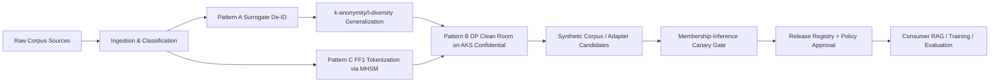
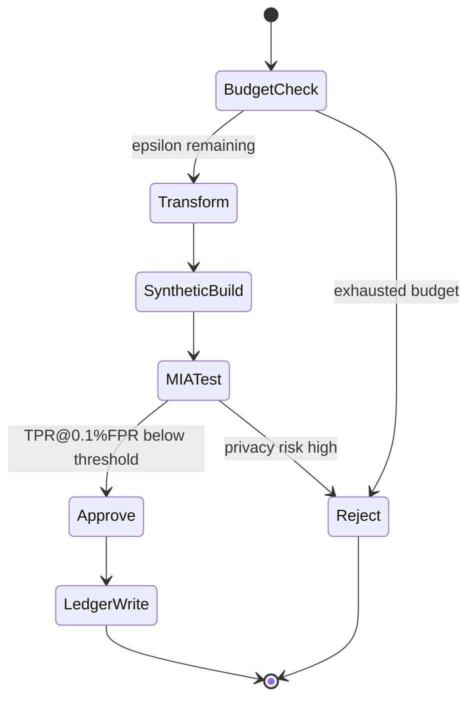

# Enterprise Privacy-Preserving De-identification, Differentially Private Synthetic Corpus, and Membership-Inference Defense Selection FAQ (Azure)

> Topic ID: #450 · Domain: 3.6 Zero-Trust Identity, Private Networking, and Regulated Compliance
> Perspective: Cloud & AI Solution Architect focus on governance, auditability, and cross-jurisdiction control-plane policy, without low-level crypto internals.

## 1. Executive summary
- Pattern A provides strong utility-preserving pseudonymization and fits most enterprise RAG and evaluation pipelines.
- Pattern B adds mathematically bounded (ε,δ)-DP guarantees for cross-tenant and cross-border sharing.
- Pattern C is strongest for structured identifier continuity across transactional systems and analytics fabrics.
- Pattern D should be explicitly banned because it weakens both privacy and model quality.

## 2. Scope and assumptions
- Data scale: 10M / 100M / 1B records, combining structured and unstructured text.
- Compliance targets: HIPAA Expert Determination, GDPR Recital 26, PCI-DSS v4.0, auditable release gates.
- Outcome target: corpora usable for RAG, evaluation, and training without exposing direct identifiers.

## 3. Four architecture patterns
- Pattern A: Azure Health Data Services De-identification or Presidio on AKS plus consistent surrogate mapping and k-anonymity controls.
- Pattern B: SmartNoise/AIM/DP-SGD in AKS confidential clean rooms plus Rényi-DP ledgering and MIA release gate.
- Pattern C: FF1 format-preserving encryption backed by Managed HSM with split-custody detokenization broker.
- Pattern D (anti-pattern): naive regex redaction or unsalted hashing on shared corpora.

## 4. 12-dimension comparison matrix
| Dimension | Pattern A | Pattern B | Pattern C | Pattern D |
|---|---|---|---|---|
| Privacy guarantee level | Medium-high | High with formal bound | Medium with strict reversibility controls | Low |
| Semantic utility | High | Medium | High for structured fields | Low |
| Cross-batch consistency | High | Medium | Very high | Low |
| Re-identification resistance | Medium | High | Medium-high | Low |
| Training readiness | High | Medium | Medium | Low |
| Operational complexity | Medium | High | Medium-high | Low but unsafe |
| Latency and throughput | Low latency high throughput | Moderate latency | Low latency tokenization | Unpredictable |
| Auditability | High | Very high | High | Low |
| Regulatory fit | High | Very high | High | Low |
| Cost controllability | High | Medium | Medium | Low |
| Multi-tenant federation | Medium-high | High | High | Low |
| Recommendation | Recommended | Strongly recommended for high sensitivity | Recommended for master-data continuity | Prohibited |

## 5. End-to-end architecture (de-ID plus DP clean room)


## 6. Release gate flow (privacy ledger plus MIA)


## 7. Q1-Q6 quantitative analysis
- Q1: How does Rényi DP composition work across repeated releases?
 - Track per-release α-order divergence, sum in a tenant ledger, then convert to target (ε,δ); stop release when budget is exhausted.
- Q2: How do k-anonymity and l-diversity impact utility?
 - Higher k/l lowers linkage probability but increases generalization, typically reducing F1 on entity-rich tasks.
- Q3: Which MIA threshold is practical?
 - Use TPR@0.1% FPR plus canary perplexity deltas; block release when threshold breaches.
- Q4: How does Managed HSM FF1 key caching affect latency?
 - Secure key caching can keep tokenization/detokenization in low-millisecond ranges while preserving audit controls.
- Q5: When should Pattern A and B be combined?
 - Use combined flow for high-utility data that still requires mathematically bounded release risk.
- Q6: Why is unsalted hashing unsafe for identifier masking?
 - Finite identifier spaces are brute-forceable and do not protect quasi-identifier linkage attacks.

## 8. Production snippets (Python and YAML)
```python
from dataclasses import dataclass
@dataclass
class PrivacyLedger:
    tenant_id: str
    epsilon_used: float
    delta: float
    alpha: int

def allow_release(epsilon_used: float, epsilon_limit: float, mia_tpr: float) -> bool:
    if epsilon_used > epsilon_limit:
        return False
    if mia_tpr > 0.001:
        return False
    return True
```

```yaml
apiVersion: batch/v1
kind: Job
metadata:
  name: mia-release-gate
spec:
  template:
    spec:
      restartPolicy: Never
      containers:
      - name: gate
        image: mcr.microsoft.com/azurelinux/base:latest
        command: ["python","run_mia_gate.py","--fpr","0.001","--ledger","cosmos://privacy-ledger"]
```

## 9. Scenario 1: multi-hospital oncology trial twin corpus
- Constraint: HIPAA Expert Determination with clinically meaningful time intervals and entity relationships retained.
- Design: Pattern A for longitudinal surrogate consistency, then Pattern B for cross-organization synthetic release gating.
- Outcome: regulated collaboration with high RAG utility and measurable privacy risk bounds.

## 10. Scenario 2: EU retail bank fraud-agent training corpus
- Constraint: GDPR Recital 26 plus PCI-DSS v4.0 for card and account-level data flows.
- Design: Pattern C for format-preserving continuity, with Pattern B release controls across jurisdictions.
- Outcome: join-safe datasets with controlled detokenization access and lower membership-inference exposure.

## 11. Three-year TCO (10M / 100M / 1B records)
| Scale | Pattern A | Pattern B | Pattern C | Compliance-incident exposure reference |
|---|---:|---:|---:|---:|
| 10M | $0.82M | $1.06M | $0.94M | $0.40M |
| 100M | $4.45M | $5.92M | $5.13M | $2.10M |
| 1B | $27.8M | $35.6M | $31.4M | $11.8M |

## 12. Day-0 / Day-1 / Day-2 checklist
### Day-0: governance and classification
1. Complete jurisdiction-aware data classification
2. Define identifier and quasi-identifier taxonomy
3. Standardize audit fields and lineage IDs
4. Set least-privilege approval routes
5. Define release and rollback thresholds
### Day-1: pipeline and release controls
1. Enable consistent surrogate mapping and key rotation
2. Deploy DP budget ledger and threshold alerts
3. Integrate MIA canary gate
4. Implement FF1 detokenization broker with split custody
5. Apply tenant isolation and provenance watermarking
### Day-2: optimization and audit readiness
1. Tune epsilon allocation by business priority
2. Optimize k/l thresholds versus utility drop
3. Run adversarial privacy drills
4. Improve cross-border approval lead time
5. Refresh annual compliance evidence package

## 13. Good fit vs Not for
- Good fit: high-sensitivity regulated data supply chains with cross-organization AI collaboration requirements.
- Not for: one-off low-value experiments without sharing, auditability, or long-term governance goals.

## 14. Risks and mitigations
- Risk: Budget exhaustion blocking releases
 - Mitigation: versioned policy controls, layered thresholds, dual-approval gates, and staged release rollouts.
- Risk: Over-conservative settings reducing utility
- Risk: Inconsistent surrogate keys breaking joins
- Risk: MIA false positives delaying delivery
- Risk: Cross-jurisdiction approval latency

## 15. References and retrieval timestamps
- Source: Azure Health Data Services De-identification · https://learn.microsoft.com/azure/healthcare-apis/ · Retrieved: 2026-11-26 (UTC+8)
- Source: Microsoft Presidio · https://github.com/microsoft/presidio · Retrieved: 2026-11-26 (UTC+8)
- Source: Azure confidential computing on AKS · https://learn.microsoft.com/azure/confidential-computing/ · Retrieved: 2026-11-26 (UTC+8)
- Source: Azure Key Vault Managed HSM · https://learn.microsoft.com/azure/key-vault/managed-hsm/ · Retrieved: 2026-11-26 (UTC+8)
- Source: NIST SP 800-38G FF1 · https://csrc.nist.gov/publications/detail/sp/800-38g/final · Retrieved: 2026-11-26 (UTC+8)

---

### Appendix A: privacy metrics dictionary
- `epsilon_remaining`: track definition, threshold, observation cadence, alert action, and approver.
- `delta_target`: track definition, threshold, observation cadence, alert action, and approver.
- `mia_tpr_at_0p1_fpr`: track definition, threshold, observation cadence, alert action, and approver.
- `quasi_identifier_entropy`: track definition, threshold, observation cadence, alert action, and approver.
- `surrogate_consistency_rate`: track definition, threshold, observation cadence, alert action, and approver.
- `ff1_detokenize_latency_p95`: track definition, threshold, observation cadence, alert action, and approver.

- Audit item 01: retain privacy ledger records, approvals, lineage, model versions, and rollback artifacts.

- validate tenant isolation, jurisdiction tags, least privilege, key rotation, release gates, and FinOps labels.

