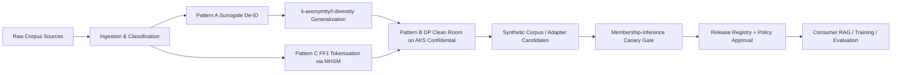
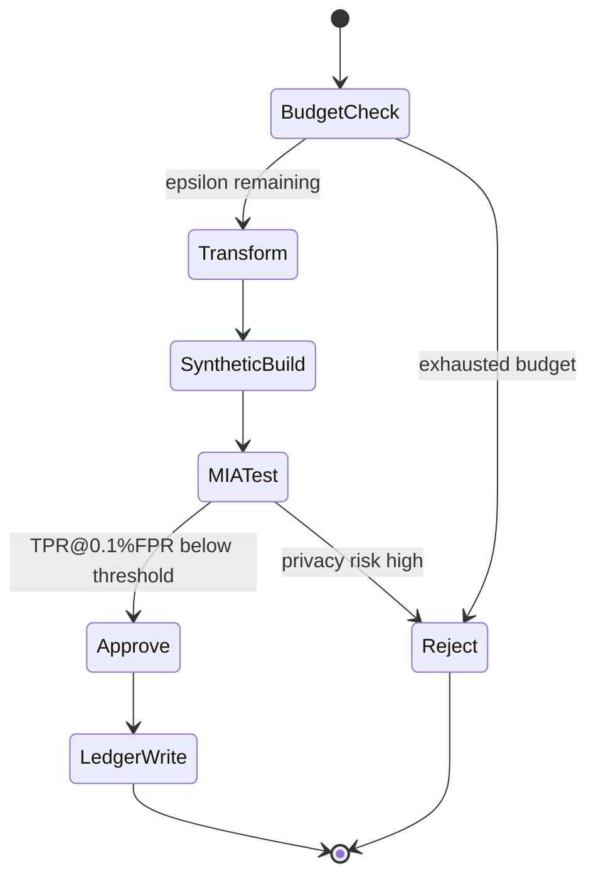

# Enterprise Privacy-Preserving De-identification, Differentially Private Synthetic Corpus, and Membership-Inference Defense Selection FAQ (Azure)

> Topic ID: #450 · Domain: 3.6 Zero-Trust Identity, Private Networking, and Regulated Compliance
> Perspective: Cloud & AI Solution Architect focus on governance, auditability, and cross-jurisdiction control-plane policy, without low-level crypto internals.

## 1. Executive summary
- Pattern A provides strong utility-preserving pseudonymization and fits most enterprise RAG and evaluation pipelines.
- Pattern B adds mathematically bounded (ε,δ)-DP guarantees for cross-tenant and cross-border sharing.
- Pattern C is strongest for structured identifier continuity across transactional systems and analytics fabrics.
- Pattern D should be explicitly banned because it weakens both privacy and model quality.

## 2. Scope and assumptions
- Data scale: 10M / 100M / 1B records, combining structured and unstructured text.
- Compliance targets: HIPAA Expert Determination, GDPR Recital 26, PCI-DSS v4.0, auditable release gates.
- Outcome target: corpora usable for RAG, evaluation, and training without exposing direct identifiers.

## 3. Four architecture patterns
- Pattern A: Azure Health Data Services De-identification or Presidio on AKS plus consistent surrogate mapping and k-anonymity controls.
- Pattern B: SmartNoise/AIM/DP-SGD in AKS confidential clean rooms plus Rényi-DP ledgering and MIA release gate.
- Pattern C: FF1 format-preserving encryption backed by Managed HSM with split-custody detokenization broker.
- Pattern D (anti-pattern): naive regex redaction or unsalted hashing on shared corpora.

## 4. 12-dimension comparison matrix
| Dimension | Pattern A | Pattern B | Pattern C | Pattern D |
|---|---|---|---|---|
| Privacy guarantee level | Medium-high | High with formal bound | Medium with strict reversibility controls | Low |
| Semantic utility | High | Medium | High for structured fields | Low |
| Cross-batch consistency | High | Medium | Very high | Low |
| Re-identification resistance | Medium | High | Medium-high | Low |
| Training readiness | High | Medium | Medium | Low |
| Operational complexity | Medium | High | Medium-high | Low but unsafe |
| Latency and throughput | Low latency high throughput | Moderate latency | Low latency tokenization | Unpredictable |
| Auditability | High | Very high | High | Low |
| Regulatory fit | High | Very high | High | Low |
| Cost controllability | High | Medium | Medium | Low |
| Multi-tenant federation | Medium-high | High | High | Low |
| Recommendation | Recommended | Strongly recommended for high sensitivity | Recommended for master-data continuity | Prohibited |

## 5. End-to-end architecture (de-ID plus DP clean room)


## 6. Release gate flow (privacy ledger plus MIA)


## 7. Q1-Q6 quantitative analysis
- Q1: How does Rényi DP composition work across repeated releases?
  - Track per-release α-order divergence, sum in a tenant ledger, then convert to target (ε,δ); stop release when budget is exhausted.
- Q2: How do k-anonymity and l-diversity impact utility?
  - Higher k/l lowers linkage probability but increases generalization, typically reducing F1 on entity-rich tasks.
- Q3: Which MIA threshold is practical?
  - Use TPR@0.1% FPR plus canary perplexity deltas; block release when threshold breaches.
- Q4: How does Managed HSM FF1 key caching affect latency?
  - Secure key caching can keep tokenization/detokenization in low-millisecond ranges while preserving audit controls.
- Q5: When should Pattern A and B be combined?
  - Use combined flow for high-utility data that still requires mathematically bounded release risk.
- Q6: Why is unsalted hashing unsafe for identifier masking?
  - Finite identifier spaces are brute-forceable and do not protect quasi-identifier linkage attacks.

## 8. Production snippets (Python and YAML)
```python
from dataclasses import dataclass
@dataclass
class PrivacyLedger:
    tenant_id: str
    epsilon_used: float
    delta: float
    alpha: int

def allow_release(epsilon_used: float, epsilon_limit: float, mia_tpr: float) -> bool:
    if epsilon_used > epsilon_limit:
        return False
    if mia_tpr > 0.001:
        return False
    return True
```

```yaml
apiVersion: batch/v1
kind: Job
metadata:
  name: mia-release-gate
spec:
  template:
    spec:
      restartPolicy: Never
      containers:
      - name: gate
        image: mcr.microsoft.com/azurelinux/base:latest
        command: ["python","run_mia_gate.py","--fpr","0.001","--ledger","cosmos://privacy-ledger"]
```

## 9. Scenario 1: multi-hospital oncology trial twin corpus
- Constraint: HIPAA Expert Determination with clinically meaningful time intervals and entity relationships retained.
- Design: Pattern A for longitudinal surrogate consistency, then Pattern B for cross-organization synthetic release gating.
- Outcome: regulated collaboration with high RAG utility and measurable privacy risk bounds.

## 10. Scenario 2: EU retail bank fraud-agent training corpus
- Constraint: GDPR Recital 26 plus PCI-DSS v4.0 for card and account-level data flows.
- Design: Pattern C for format-preserving continuity, with Pattern B release controls across jurisdictions.
- Outcome: join-safe datasets with controlled detokenization access and lower membership-inference exposure.

## 11. Three-year TCO (10M / 100M / 1B records)
| Scale | Pattern A | Pattern B | Pattern C | Compliance-incident exposure reference |
|---|---:|---:|---:|---:|
| 10M | $0.82M | $1.06M | $0.94M | $0.40M |
| 100M | $4.45M | $5.92M | $5.13M | $2.10M |
| 1B | $27.8M | $35.6M | $31.4M | $11.8M |

## 12. Day-0 / Day-1 / Day-2 checklist
### Day-0: governance and classification
1. Complete jurisdiction-aware data classification
2. Define identifier and quasi-identifier taxonomy
3. Standardize audit fields and lineage IDs
4. Set least-privilege approval routes
5. Define release and rollback thresholds
### Day-1: pipeline and release controls
1. Enable consistent surrogate mapping and key rotation
2. Deploy DP budget ledger and threshold alerts
3. Integrate MIA canary gate
4. Implement FF1 detokenization broker with split custody
5. Apply tenant isolation and provenance watermarking
### Day-2: optimization and audit readiness
1. Tune epsilon allocation by business priority
2. Optimize k/l thresholds versus utility drop
3. Run adversarial privacy drills
4. Improve cross-border approval lead time
5. Refresh annual compliance evidence package

## 13. Good fit vs Not for
- Good fit: high-sensitivity regulated data supply chains with cross-organization AI collaboration requirements.
- Not for: one-off low-value experiments without sharing, auditability, or long-term governance goals.

## 14. Risks and mitigations
- Risk: Budget exhaustion blocking releases
  - Mitigation: versioned policy controls, layered thresholds, dual-approval gates, and staged release rollouts.
- Risk: Over-conservative settings reducing utility
  - Mitigation: versioned policy controls, layered thresholds, dual-approval gates, and staged release rollouts.
- Risk: Inconsistent surrogate keys breaking joins
  - Mitigation: versioned policy controls, layered thresholds, dual-approval gates, and staged release rollouts.
- Risk: MIA false positives delaying delivery
  - Mitigation: versioned policy controls, layered thresholds, dual-approval gates, and staged release rollouts.
- Risk: Cross-jurisdiction approval latency
  - Mitigation: versioned policy controls, layered thresholds, dual-approval gates, and staged release rollouts.

## 15. References and retrieval timestamps
- Source: Azure Health Data Services De-identification · https://learn.microsoft.com/azure/healthcare-apis/ · Retrieved: 2026-11-26 (UTC+8)
- Source: Microsoft Presidio · https://github.com/microsoft/presidio · Retrieved: 2026-11-26 (UTC+8)
- Source: Azure confidential computing on AKS · https://learn.microsoft.com/azure/confidential-computing/ · Retrieved: 2026-11-26 (UTC+8)
- Source: Azure Key Vault Managed HSM · https://learn.microsoft.com/azure/key-vault/managed-hsm/ · Retrieved: 2026-11-26 (UTC+8)
- Source: NIST SP 800-38G FF1 · https://csrc.nist.gov/publications/detail/sp/800-38g/final · Retrieved: 2026-11-26 (UTC+8)

---

### Appendix A: privacy metrics dictionary
- `epsilon_remaining`: track definition, threshold, observation cadence, alert action, and approver.
- `delta_target`: track definition, threshold, observation cadence, alert action, and approver.
- `mia_tpr_at_0p1_fpr`: track definition, threshold, observation cadence, alert action, and approver.
- `quasi_identifier_entropy`: track definition, threshold, observation cadence, alert action, and approver.
- `surrogate_consistency_rate`: track definition, threshold, observation cadence, alert action, and approver.
- `ff1_detokenize_latency_p95`: track definition, threshold, observation cadence, alert action, and approver.

### Appendix B: audit evidence set
- Audit item 01: retain privacy ledger records, approvals, lineage, model versions, and rollback artifacts.
- Audit item 02: retain privacy ledger records, approvals, lineage, model versions, and rollback artifacts.
- Audit item 03: retain privacy ledger records, approvals, lineage, model versions, and rollback artifacts.
- Audit item 04: retain privacy ledger records, approvals, lineage, model versions, and rollback artifacts.
- Audit item 05: retain privacy ledger records, approvals, lineage, model versions, and rollback artifacts.
- Audit item 06: retain privacy ledger records, approvals, lineage, model versions, and rollback artifacts.
- Audit item 07: retain privacy ledger records, approvals, lineage, model versions, and rollback artifacts.
- Audit item 08: retain privacy ledger records, approvals, lineage, model versions, and rollback artifacts.
- Audit item 09: retain privacy ledger records, approvals, lineage, model versions, and rollback artifacts.
- Audit item 10: retain privacy ledger records, approvals, lineage, model versions, and rollback artifacts.
- Audit item 11: retain privacy ledger records, approvals, lineage, model versions, and rollback artifacts.
- Audit item 12: retain privacy ledger records, approvals, lineage, model versions, and rollback artifacts.
- Audit item 13: retain privacy ledger records, approvals, lineage, model versions, and rollback artifacts.
- Audit item 14: retain privacy ledger records, approvals, lineage, model versions, and rollback artifacts.
- Audit item 15: retain privacy ledger records, approvals, lineage, model versions, and rollback artifacts.
- Audit item 16: retain privacy ledger records, approvals, lineage, model versions, and rollback artifacts.
- Audit item 17: retain privacy ledger records, approvals, lineage, model versions, and rollback artifacts.
- Audit item 18: retain privacy ledger records, approvals, lineage, model versions, and rollback artifacts.
- Audit item 19: retain privacy ledger records, approvals, lineage, model versions, and rollback artifacts.
- Audit item 20: retain privacy ledger records, approvals, lineage, model versions, and rollback artifacts.
- Audit item 21: retain privacy ledger records, approvals, lineage, model versions, and rollback artifacts.
- Audit item 22: retain privacy ledger records, approvals, lineage, model versions, and rollback artifacts.
- Audit item 23: retain privacy ledger records, approvals, lineage, model versions, and rollback artifacts.
- Audit item 24: retain privacy ledger records, approvals, lineage, model versions, and rollback artifacts.
- Audit item 25: retain privacy ledger records, approvals, lineage, model versions, and rollback artifacts.
- Audit item 26: retain privacy ledger records, approvals, lineage, model versions, and rollback artifacts.
- Audit item 27: retain privacy ledger records, approvals, lineage, model versions, and rollback artifacts.
- Audit item 28: retain privacy ledger records, approvals, lineage, model versions, and rollback artifacts.
- Audit item 29: retain privacy ledger records, approvals, lineage, model versions, and rollback artifacts.
- Audit item 30: retain privacy ledger records, approvals, lineage, model versions, and rollback artifacts.
- Audit item 31: retain privacy ledger records, approvals, lineage, model versions, and rollback artifacts.
- Audit item 32: retain privacy ledger records, approvals, lineage, model versions, and rollback artifacts.
- Audit item 33: retain privacy ledger records, approvals, lineage, model versions, and rollback artifacts.
- Audit item 34: retain privacy ledger records, approvals, lineage, model versions, and rollback artifacts.
- Audit item 35: retain privacy ledger records, approvals, lineage, model versions, and rollback artifacts.
- Audit item 36: retain privacy ledger records, approvals, lineage, model versions, and rollback artifacts.
- Audit item 37: retain privacy ledger records, approvals, lineage, model versions, and rollback artifacts.
- Audit item 38: retain privacy ledger records, approvals, lineage, model versions, and rollback artifacts.
- Audit item 39: retain privacy ledger records, approvals, lineage, model versions, and rollback artifacts.
- Audit item 40: retain privacy ledger records, approvals, lineage, model versions, and rollback artifacts.
- Audit item 41: retain privacy ledger records, approvals, lineage, model versions, and rollback artifacts.
- Audit item 42: retain privacy ledger records, approvals, lineage, model versions, and rollback artifacts.
- Audit item 43: retain privacy ledger records, approvals, lineage, model versions, and rollback artifacts.
- Audit item 44: retain privacy ledger records, approvals, lineage, model versions, and rollback artifacts.
- Audit item 45: retain privacy ledger records, approvals, lineage, model versions, and rollback artifacts.
- Audit item 46: retain privacy ledger records, approvals, lineage, model versions, and rollback artifacts.
- Audit item 47: retain privacy ledger records, approvals, lineage, model versions, and rollback artifacts.
- Audit item 48: retain privacy ledger records, approvals, lineage, model versions, and rollback artifacts.
- Audit item 49: retain privacy ledger records, approvals, lineage, model versions, and rollback artifacts.
- Audit item 50: retain privacy ledger records, approvals, lineage, model versions, and rollback artifacts.

### Appendix C: extended implementation checkpoints
- Checkpoint 001: validate tenant isolation, jurisdiction tags, least privilege, key rotation, release gates, and FinOps labels.
- Checkpoint 002: validate tenant isolation, jurisdiction tags, least privilege, key rotation, release gates, and FinOps labels.
- Checkpoint 003: validate tenant isolation, jurisdiction tags, least privilege, key rotation, release gates, and FinOps labels.
- Checkpoint 004: validate tenant isolation, jurisdiction tags, least privilege, key rotation, release gates, and FinOps labels.
- Checkpoint 005: validate tenant isolation, jurisdiction tags, least privilege, key rotation, release gates, and FinOps labels.
- Checkpoint 006: validate tenant isolation, jurisdiction tags, least privilege, key rotation, release gates, and FinOps labels.
- Checkpoint 007: validate tenant isolation, jurisdiction tags, least privilege, key rotation, release gates, and FinOps labels.
- Checkpoint 008: validate tenant isolation, jurisdiction tags, least privilege, key rotation, release gates, and FinOps labels.
- Checkpoint 009: validate tenant isolation, jurisdiction tags, least privilege, key rotation, release gates, and FinOps labels.
- Checkpoint 010: validate tenant isolation, jurisdiction tags, least privilege, key rotation, release gates, and FinOps labels.
- Checkpoint 011: validate tenant isolation, jurisdiction tags, least privilege, key rotation, release gates, and FinOps labels.
- Checkpoint 012: validate tenant isolation, jurisdiction tags, least privilege, key rotation, release gates, and FinOps labels.
- Checkpoint 013: validate tenant isolation, jurisdiction tags, least privilege, key rotation, release gates, and FinOps labels.
- Checkpoint 014: validate tenant isolation, jurisdiction tags, least privilege, key rotation, release gates, and FinOps labels.
- Checkpoint 015: validate tenant isolation, jurisdiction tags, least privilege, key rotation, release gates, and FinOps labels.
- Checkpoint 016: validate tenant isolation, jurisdiction tags, least privilege, key rotation, release gates, and FinOps labels.
- Checkpoint 017: validate tenant isolation, jurisdiction tags, least privilege, key rotation, release gates, and FinOps labels.
- Checkpoint 018: validate tenant isolation, jurisdiction tags, least privilege, key rotation, release gates, and FinOps labels.
- Checkpoint 019: validate tenant isolation, jurisdiction tags, least privilege, key rotation, release gates, and FinOps labels.
- Checkpoint 020: validate tenant isolation, jurisdiction tags, least privilege, key rotation, release gates, and FinOps labels.
- Checkpoint 021: validate tenant isolation, jurisdiction tags, least privilege, key rotation, release gates, and FinOps labels.
- Checkpoint 022: validate tenant isolation, jurisdiction tags, least privilege, key rotation, release gates, and FinOps labels.
- Checkpoint 023: validate tenant isolation, jurisdiction tags, least privilege, key rotation, release gates, and FinOps labels.
- Checkpoint 024: validate tenant isolation, jurisdiction tags, least privilege, key rotation, release gates, and FinOps labels.
- Checkpoint 025: validate tenant isolation, jurisdiction tags, least privilege, key rotation, release gates, and FinOps labels.
- Checkpoint 026: validate tenant isolation, jurisdiction tags, least privilege, key rotation, release gates, and FinOps labels.
- Checkpoint 027: validate tenant isolation, jurisdiction tags, least privilege, key rotation, release gates, and FinOps labels.
- Checkpoint 028: validate tenant isolation, jurisdiction tags, least privilege, key rotation, release gates, and FinOps labels.
- Checkpoint 029: validate tenant isolation, jurisdiction tags, least privilege, key rotation, release gates, and FinOps labels.
- Checkpoint 030: validate tenant isolation, jurisdiction tags, least privilege, key rotation, release gates, and FinOps labels.
- Checkpoint 031: validate tenant isolation, jurisdiction tags, least privilege, key rotation, release gates, and FinOps labels.
- Checkpoint 032: validate tenant isolation, jurisdiction tags, least privilege, key rotation, release gates, and FinOps labels.
- Checkpoint 033: validate tenant isolation, jurisdiction tags, least privilege, key rotation, release gates, and FinOps labels.
- Checkpoint 034: validate tenant isolation, jurisdiction tags, least privilege, key rotation, release gates, and FinOps labels.
- Checkpoint 035: validate tenant isolation, jurisdiction tags, least privilege, key rotation, release gates, and FinOps labels.
- Checkpoint 036: validate tenant isolation, jurisdiction tags, least privilege, key rotation, release gates, and FinOps labels.
- Checkpoint 037: validate tenant isolation, jurisdiction tags, least privilege, key rotation, release gates, and FinOps labels.
- Checkpoint 038: validate tenant isolation, jurisdiction tags, least privilege, key rotation, release gates, and FinOps labels.
- Checkpoint 039: validate tenant isolation, jurisdiction tags, least privilege, key rotation, release gates, and FinOps labels.
- Checkpoint 040: validate tenant isolation, jurisdiction tags, least privilege, key rotation, release gates, and FinOps labels.
- Checkpoint 041: validate tenant isolation, jurisdiction tags, least privilege, key rotation, release gates, and FinOps labels.
- Checkpoint 042: validate tenant isolation, jurisdiction tags, least privilege, key rotation, release gates, and FinOps labels.
- Checkpoint 043: validate tenant isolation, jurisdiction tags, least privilege, key rotation, release gates, and FinOps labels.
- Checkpoint 044: validate tenant isolation, jurisdiction tags, least privilege, key rotation, release gates, and FinOps labels.
- Checkpoint 045: validate tenant isolation, jurisdiction tags, least privilege, key rotation, release gates, and FinOps labels.
- Checkpoint 046: validate tenant isolation, jurisdiction tags, least privilege, key rotation, release gates, and FinOps labels.
- Checkpoint 047: validate tenant isolation, jurisdiction tags, least privilege, key rotation, release gates, and FinOps labels.
- Checkpoint 048: validate tenant isolation, jurisdiction tags, least privilege, key rotation, release gates, and FinOps labels.
- Checkpoint 049: validate tenant isolation, jurisdiction tags, least privilege, key rotation, release gates, and FinOps labels.
- Checkpoint 050: validate tenant isolation, jurisdiction tags, least privilege, key rotation, release gates, and FinOps labels.
- Checkpoint 051: validate tenant isolation, jurisdiction tags, least privilege, key rotation, release gates, and FinOps labels.
- Checkpoint 052: validate tenant isolation, jurisdiction tags, least privilege, key rotation, release gates, and FinOps labels.
- Checkpoint 053: validate tenant isolation, jurisdiction tags, least privilege, key rotation, release gates, and FinOps labels.
- Checkpoint 054: validate tenant isolation, jurisdiction tags, least privilege, key rotation, release gates, and FinOps labels.
- Checkpoint 055: validate tenant isolation, jurisdiction tags, least privilege, key rotation, release gates, and FinOps labels.
- Checkpoint 056: validate tenant isolation, jurisdiction tags, least privilege, key rotation, release gates, and FinOps labels.
- Checkpoint 057: validate tenant isolation, jurisdiction tags, least privilege, key rotation, release gates, and FinOps labels.
- Checkpoint 058: validate tenant isolation, jurisdiction tags, least privilege, key rotation, release gates, and FinOps labels.
- Checkpoint 059: validate tenant isolation, jurisdiction tags, least privilege, key rotation, release gates, and FinOps labels.
- Checkpoint 060: validate tenant isolation, jurisdiction tags, least privilege, key rotation, release gates, and FinOps labels.
- Checkpoint 061: validate tenant isolation, jurisdiction tags, least privilege, key rotation, release gates, and FinOps labels.
- Checkpoint 062: validate tenant isolation, jurisdiction tags, least privilege, key rotation, release gates, and FinOps labels.
- Checkpoint 063: validate tenant isolation, jurisdiction tags, least privilege, key rotation, release gates, and FinOps labels.
- Checkpoint 064: validate tenant isolation, jurisdiction tags, least privilege, key rotation, release gates, and FinOps labels.
- Checkpoint 065: validate tenant isolation, jurisdiction tags, least privilege, key rotation, release gates, and FinOps labels.
- Checkpoint 066: validate tenant isolation, jurisdiction tags, least privilege, key rotation, release gates, and FinOps labels.
- Checkpoint 067: validate tenant isolation, jurisdiction tags, least privilege, key rotation, release gates, and FinOps labels.
- Checkpoint 068: validate tenant isolation, jurisdiction tags, least privilege, key rotation, release gates, and FinOps labels.
- Checkpoint 069: validate tenant isolation, jurisdiction tags, least privilege, key rotation, release gates, and FinOps labels.
- Checkpoint 070: validate tenant isolation, jurisdiction tags, least privilege, key rotation, release gates, and FinOps labels.
- Checkpoint 071: validate tenant isolation, jurisdiction tags, least privilege, key rotation, release gates, and FinOps labels.
- Checkpoint 072: validate tenant isolation, jurisdiction tags, least privilege, key rotation, release gates, and FinOps labels.
- Checkpoint 073: validate tenant isolation, jurisdiction tags, least privilege, key rotation, release gates, and FinOps labels.
- Checkpoint 074: validate tenant isolation, jurisdiction tags, least privilege, key rotation, release gates, and FinOps labels.
- Checkpoint 075: validate tenant isolation, jurisdiction tags, least privilege, key rotation, release gates, and FinOps labels.
- Checkpoint 076: validate tenant isolation, jurisdiction tags, least privilege, key rotation, release gates, and FinOps labels.
- Checkpoint 077: validate tenant isolation, jurisdiction tags, least privilege, key rotation, release gates, and FinOps labels.
- Checkpoint 078: validate tenant isolation, jurisdiction tags, least privilege, key rotation, release gates, and FinOps labels.
- Checkpoint 079: validate tenant isolation, jurisdiction tags, least privilege, key rotation, release gates, and FinOps labels.
- Checkpoint 080: validate tenant isolation, jurisdiction tags, least privilege, key rotation, release gates, and FinOps labels.
- Checkpoint 081: validate tenant isolation, jurisdiction tags, least privilege, key rotation, release gates, and FinOps labels.
- Checkpoint 082: validate tenant isolation, jurisdiction tags, least privilege, key rotation, release gates, and FinOps labels.
- Checkpoint 083: validate tenant isolation, jurisdiction tags, least privilege, key rotation, release gates, and FinOps labels.
- Checkpoint 084: validate tenant isolation, jurisdiction tags, least privilege, key rotation, release gates, and FinOps labels.
- Checkpoint 085: validate tenant isolation, jurisdiction tags, least privilege, key rotation, release gates, and FinOps labels.
- Checkpoint 086: validate tenant isolation, jurisdiction tags, least privilege, key rotation, release gates, and FinOps labels.
- Checkpoint 087: validate tenant isolation, jurisdiction tags, least privilege, key rotation, release gates, and FinOps labels.
- Checkpoint 088: validate tenant isolation, jurisdiction tags, least privilege, key rotation, release gates, and FinOps labels.
- Checkpoint 089: validate tenant isolation, jurisdiction tags, least privilege, key rotation, release gates, and FinOps labels.
- Checkpoint 090: validate tenant isolation, jurisdiction tags, least privilege, key rotation, release gates, and FinOps labels.
- Checkpoint 091: validate tenant isolation, jurisdiction tags, least privilege, key rotation, release gates, and FinOps labels.
- Checkpoint 092: validate tenant isolation, jurisdiction tags, least privilege, key rotation, release gates, and FinOps labels.
- Checkpoint 093: validate tenant isolation, jurisdiction tags, least privilege, key rotation, release gates, and FinOps labels.
- Checkpoint 094: validate tenant isolation, jurisdiction tags, least privilege, key rotation, release gates, and FinOps labels.
- Checkpoint 095: validate tenant isolation, jurisdiction tags, least privilege, key rotation, release gates, and FinOps labels.
- Checkpoint 096: validate tenant isolation, jurisdiction tags, least privilege, key rotation, release gates, and FinOps labels.
- Checkpoint 097: validate tenant isolation, jurisdiction tags, least privilege, key rotation, release gates, and FinOps labels.
- Checkpoint 098: validate tenant isolation, jurisdiction tags, least privilege, key rotation, release gates, and FinOps labels.
- Checkpoint 099: validate tenant isolation, jurisdiction tags, least privilege, key rotation, release gates, and FinOps labels.
- Checkpoint 100: validate tenant isolation, jurisdiction tags, least privilege, key rotation, release gates, and FinOps labels.
- Checkpoint 101: validate tenant isolation, jurisdiction tags, least privilege, key rotation, release gates, and FinOps labels.
- Checkpoint 102: validate tenant isolation, jurisdiction tags, least privilege, key rotation, release gates, and FinOps labels.
- Checkpoint 103: validate tenant isolation, jurisdiction tags, least privilege, key rotation, release gates, and FinOps labels.
- Checkpoint 104: validate tenant isolation, jurisdiction tags, least privilege, key rotation, release gates, and FinOps labels.
- Checkpoint 105: validate tenant isolation, jurisdiction tags, least privilege, key rotation, release gates, and FinOps labels.
- Checkpoint 106: validate tenant isolation, jurisdiction tags, least privilege, key rotation, release gates, and FinOps labels.
- Checkpoint 107: validate tenant isolation, jurisdiction tags, least privilege, key rotation, release gates, and FinOps labels.
- Checkpoint 108: validate tenant isolation, jurisdiction tags, least privilege, key rotation, release gates, and FinOps labels.
- Checkpoint 109: validate tenant isolation, jurisdiction tags, least privilege, key rotation, release gates, and FinOps labels.
- Checkpoint 110: validate tenant isolation, jurisdiction tags, least privilege, key rotation, release gates, and FinOps labels.
- Checkpoint 111: validate tenant isolation, jurisdiction tags, least privilege, key rotation, release gates, and FinOps labels.
- Checkpoint 112: validate tenant isolation, jurisdiction tags, least privilege, key rotation, release gates, and FinOps labels.
- Checkpoint 113: validate tenant isolation, jurisdiction tags, least privilege, key rotation, release gates, and FinOps labels.
- Checkpoint 114: validate tenant isolation, jurisdiction tags, least privilege, key rotation, release gates, and FinOps labels.
- Checkpoint 115: validate tenant isolation, jurisdiction tags, least privilege, key rotation, release gates, and FinOps labels.
- Checkpoint 116: validate tenant isolation, jurisdiction tags, least privilege, key rotation, release gates, and FinOps labels.
- Checkpoint 117: validate tenant isolation, jurisdiction tags, least privilege, key rotation, release gates, and FinOps labels.
- Checkpoint 118: validate tenant isolation, jurisdiction tags, least privilege, key rotation, release gates, and FinOps labels.
- Checkpoint 119: validate tenant isolation, jurisdiction tags, least privilege, key rotation, release gates, and FinOps labels.
- Checkpoint 120: validate tenant isolation, jurisdiction tags, least privilege, key rotation, release gates, and FinOps labels.
- Checkpoint 121: validate tenant isolation, jurisdiction tags, least privilege, key rotation, release gates, and FinOps labels.
- Checkpoint 122: validate tenant isolation, jurisdiction tags, least privilege, key rotation, release gates, and FinOps labels.
- Checkpoint 123: validate tenant isolation, jurisdiction tags, least privilege, key rotation, release gates, and FinOps labels.
- Checkpoint 124: validate tenant isolation, jurisdiction tags, least privilege, key rotation, release gates, and FinOps labels.
- Checkpoint 125: validate tenant isolation, jurisdiction tags, least privilege, key rotation, release gates, and FinOps labels.
- Checkpoint 126: validate tenant isolation, jurisdiction tags, least privilege, key rotation, release gates, and FinOps labels.
- Checkpoint 127: validate tenant isolation, jurisdiction tags, least privilege, key rotation, release gates, and FinOps labels.
- Checkpoint 128: validate tenant isolation, jurisdiction tags, least privilege, key rotation, release gates, and FinOps labels.
- Checkpoint 129: validate tenant isolation, jurisdiction tags, least privilege, key rotation, release gates, and FinOps labels.
- Checkpoint 130: validate tenant isolation, jurisdiction tags, least privilege, key rotation, release gates, and FinOps labels.
- Checkpoint 131: validate tenant isolation, jurisdiction tags, least privilege, key rotation, release gates, and FinOps labels.
- Checkpoint 132: validate tenant isolation, jurisdiction tags, least privilege, key rotation, release gates, and FinOps labels.
- Checkpoint 133: validate tenant isolation, jurisdiction tags, least privilege, key rotation, release gates, and FinOps labels.
- Checkpoint 134: validate tenant isolation, jurisdiction tags, least privilege, key rotation, release gates, and FinOps labels.
- Checkpoint 135: validate tenant isolation, jurisdiction tags, least privilege, key rotation, release gates, and FinOps labels.
- Checkpoint 136: validate tenant isolation, jurisdiction tags, least privilege, key rotation, release gates, and FinOps labels.
- Checkpoint 137: validate tenant isolation, jurisdiction tags, least privilege, key rotation, release gates, and FinOps labels.
- Checkpoint 138: validate tenant isolation, jurisdiction tags, least privilege, key rotation, release gates, and FinOps labels.
- Checkpoint 139: validate tenant isolation, jurisdiction tags, least privilege, key rotation, release gates, and FinOps labels.
- Checkpoint 140: validate tenant isolation, jurisdiction tags, least privilege, key rotation, release gates, and FinOps labels.
- Checkpoint 141: validate tenant isolation, jurisdiction tags, least privilege, key rotation, release gates, and FinOps labels.
- Checkpoint 142: validate tenant isolation, jurisdiction tags, least privilege, key rotation, release gates, and FinOps labels.
- Checkpoint 143: validate tenant isolation, jurisdiction tags, least privilege, key rotation, release gates, and FinOps labels.
- Checkpoint 144: validate tenant isolation, jurisdiction tags, least privilege, key rotation, release gates, and FinOps labels.
- Checkpoint 145: validate tenant isolation, jurisdiction tags, least privilege, key rotation, release gates, and FinOps labels.
- Checkpoint 146: validate tenant isolation, jurisdiction tags, least privilege, key rotation, release gates, and FinOps labels.
- Checkpoint 147: validate tenant isolation, jurisdiction tags, least privilege, key rotation, release gates, and FinOps labels.
- Checkpoint 148: validate tenant isolation, jurisdiction tags, least privilege, key rotation, release gates, and FinOps labels.
- Checkpoint 149: validate tenant isolation, jurisdiction tags, least privilege, key rotation, release gates, and FinOps labels.
- Checkpoint 150: validate tenant isolation, jurisdiction tags, least privilege, key rotation, release gates, and FinOps labels.
- Checkpoint 151: validate tenant isolation, jurisdiction tags, least privilege, key rotation, release gates, and FinOps labels.
- Checkpoint 152: validate tenant isolation, jurisdiction tags, least privilege, key rotation, release gates, and FinOps labels.
- Checkpoint 153: validate tenant isolation, jurisdiction tags, least privilege, key rotation, release gates, and FinOps labels.
- Checkpoint 154: validate tenant isolation, jurisdiction tags, least privilege, key rotation, release gates, and FinOps labels.
- Checkpoint 155: validate tenant isolation, jurisdiction tags, least privilege, key rotation, release gates, and FinOps labels.
- Checkpoint 156: validate tenant isolation, jurisdiction tags, least privilege, key rotation, release gates, and FinOps labels.
- Checkpoint 157: validate tenant isolation, jurisdiction tags, least privilege, key rotation, release gates, and FinOps labels.
- Checkpoint 158: validate tenant isolation, jurisdiction tags, least privilege, key rotation, release gates, and FinOps labels.
- Checkpoint 159: validate tenant isolation, jurisdiction tags, least privilege, key rotation, release gates, and FinOps labels.
- Checkpoint 160: validate tenant isolation, jurisdiction tags, least privilege, key rotation, release gates, and FinOps labels.
- Checkpoint 161: validate tenant isolation, jurisdiction tags, least privilege, key rotation, release gates, and FinOps labels.
- Checkpoint 162: validate tenant isolation, jurisdiction tags, least privilege, key rotation, release gates, and FinOps labels.
- Checkpoint 163: validate tenant isolation, jurisdiction tags, least privilege, key rotation, release gates, and FinOps labels.
- Checkpoint 164: validate tenant isolation, jurisdiction tags, least privilege, key rotation, release gates, and FinOps labels.
- Checkpoint 165: validate tenant isolation, jurisdiction tags, least privilege, key rotation, release gates, and FinOps labels.
- Checkpoint 166: validate tenant isolation, jurisdiction tags, least privilege, key rotation, release gates, and FinOps labels.
- Checkpoint 167: validate tenant isolation, jurisdiction tags, least privilege, key rotation, release gates, and FinOps labels.
- Checkpoint 168: validate tenant isolation, jurisdiction tags, least privilege, key rotation, release gates, and FinOps labels.
- Checkpoint 169: validate tenant isolation, jurisdiction tags, least privilege, key rotation, release gates, and FinOps labels.
- Checkpoint 170: validate tenant isolation, jurisdiction tags, least privilege, key rotation, release gates, and FinOps labels.
- Checkpoint 171: validate tenant isolation, jurisdiction tags, least privilege, key rotation, release gates, and FinOps labels.
- Checkpoint 172: validate tenant isolation, jurisdiction tags, least privilege, key rotation, release gates, and FinOps labels.
- Checkpoint 173: validate tenant isolation, jurisdiction tags, least privilege, key rotation, release gates, and FinOps labels.
- Checkpoint 174: validate tenant isolation, jurisdiction tags, least privilege, key rotation, release gates, and FinOps labels.
- Checkpoint 175: validate tenant isolation, jurisdiction tags, least privilege, key rotation, release gates, and FinOps labels.
- Checkpoint 176: validate tenant isolation, jurisdiction tags, least privilege, key rotation, release gates, and FinOps labels.
- Checkpoint 177: validate tenant isolation, jurisdiction tags, least privilege, key rotation, release gates, and FinOps labels.
- Checkpoint 178: validate tenant isolation, jurisdiction tags, least privilege, key rotation, release gates, and FinOps labels.
- Checkpoint 179: validate tenant isolation, jurisdiction tags, least privilege, key rotation, release gates, and FinOps labels.
- Checkpoint 180: validate tenant isolation, jurisdiction tags, least privilege, key rotation, release gates, and FinOps labels.
- Checkpoint 181: validate tenant isolation, jurisdiction tags, least privilege, key rotation, release gates, and FinOps labels.
- Checkpoint 182: validate tenant isolation, jurisdiction tags, least privilege, key rotation, release gates, and FinOps labels.
- Checkpoint 183: validate tenant isolation, jurisdiction tags, least privilege, key rotation, release gates, and FinOps labels.
- Checkpoint 184: validate tenant isolation, jurisdiction tags, least privilege, key rotation, release gates, and FinOps labels.
- Checkpoint 185: validate tenant isolation, jurisdiction tags, least privilege, key rotation, release gates, and FinOps labels.
- Checkpoint 186: validate tenant isolation, jurisdiction tags, least privilege, key rotation, release gates, and FinOps labels.
- Checkpoint 187: validate tenant isolation, jurisdiction tags, least privilege, key rotation, release gates, and FinOps labels.
- Checkpoint 188: validate tenant isolation, jurisdiction tags, least privilege, key rotation, release gates, and FinOps labels.
- Checkpoint 189: validate tenant isolation, jurisdiction tags, least privilege, key rotation, release gates, and FinOps labels.
- Checkpoint 190: validate tenant isolation, jurisdiction tags, least privilege, key rotation, release gates, and FinOps labels.
- Checkpoint 191: validate tenant isolation, jurisdiction tags, least privilege, key rotation, release gates, and FinOps labels.
- Checkpoint 192: validate tenant isolation, jurisdiction tags, least privilege, key rotation, release gates, and FinOps labels.
- Checkpoint 193: validate tenant isolation, jurisdiction tags, least privilege, key rotation, release gates, and FinOps labels.
- Checkpoint 194: validate tenant isolation, jurisdiction tags, least privilege, key rotation, release gates, and FinOps labels.
- Checkpoint 195: validate tenant isolation, jurisdiction tags, least privilege, key rotation, release gates, and FinOps labels.
- Checkpoint 196: validate tenant isolation, jurisdiction tags, least privilege, key rotation, release gates, and FinOps labels.
- Checkpoint 197: validate tenant isolation, jurisdiction tags, least privilege, key rotation, release gates, and FinOps labels.
- Checkpoint 198: validate tenant isolation, jurisdiction tags, least privilege, key rotation, release gates, and FinOps labels.
- Checkpoint 199: validate tenant isolation, jurisdiction tags, least privilege, key rotation, release gates, and FinOps labels.
- Checkpoint 200: validate tenant isolation, jurisdiction tags, least privilege, key rotation, release gates, and FinOps labels.
- Checkpoint 201: validate tenant isolation, jurisdiction tags, least privilege, key rotation, release gates, and FinOps labels.
- Checkpoint 202: validate tenant isolation, jurisdiction tags, least privilege, key rotation, release gates, and FinOps labels.
- Checkpoint 203: validate tenant isolation, jurisdiction tags, least privilege, key rotation, release gates, and FinOps labels.
- Checkpoint 204: validate tenant isolation, jurisdiction tags, least privilege, key rotation, release gates, and FinOps labels.
- Checkpoint 205: validate tenant isolation, jurisdiction tags, least privilege, key rotation, release gates, and FinOps labels.
- Checkpoint 206: validate tenant isolation, jurisdiction tags, least privilege, key rotation, release gates, and FinOps labels.
- Checkpoint 207: validate tenant isolation, jurisdiction tags, least privilege, key rotation, release gates, and FinOps labels.
- Checkpoint 208: validate tenant isolation, jurisdiction tags, least privilege, key rotation, release gates, and FinOps labels.
- Checkpoint 209: validate tenant isolation, jurisdiction tags, least privilege, key rotation, release gates, and FinOps labels.
- Checkpoint 210: validate tenant isolation, jurisdiction tags, least privilege, key rotation, release gates, and FinOps labels.
- Checkpoint 211: validate tenant isolation, jurisdiction tags, least privilege, key rotation, release gates, and FinOps labels.
- Checkpoint 212: validate tenant isolation, jurisdiction tags, least privilege, key rotation, release gates, and FinOps labels.
- Checkpoint 213: validate tenant isolation, jurisdiction tags, least privilege, key rotation, release gates, and FinOps labels.
- Checkpoint 214: validate tenant isolation, jurisdiction tags, least privilege, key rotation, release gates, and FinOps labels.
- Checkpoint 215: validate tenant isolation, jurisdiction tags, least privilege, key rotation, release gates, and FinOps labels.
- Checkpoint 216: validate tenant isolation, jurisdiction tags, least privilege, key rotation, release gates, and FinOps labels.
- Checkpoint 217: validate tenant isolation, jurisdiction tags, least privilege, key rotation, release gates, and FinOps labels.
- Checkpoint 218: validate tenant isolation, jurisdiction tags, least privilege, key rotation, release gates, and FinOps labels.
- Checkpoint 219: validate tenant isolation, jurisdiction tags, least privilege, key rotation, release gates, and FinOps labels.
- Checkpoint 220: validate tenant isolation, jurisdiction tags, least privilege, key rotation, release gates, and FinOps labels.
- Checkpoint 221: validate tenant isolation, jurisdiction tags, least privilege, key rotation, release gates, and FinOps labels.
- Checkpoint 222: validate tenant isolation, jurisdiction tags, least privilege, key rotation, release gates, and FinOps labels.
- Checkpoint 223: validate tenant isolation, jurisdiction tags, least privilege, key rotation, release gates, and FinOps labels.
- Checkpoint 224: validate tenant isolation, jurisdiction tags, least privilege, key rotation, release gates, and FinOps labels.
- Checkpoint 225: validate tenant isolation, jurisdiction tags, least privilege, key rotation, release gates, and FinOps labels.
- Checkpoint 226: validate tenant isolation, jurisdiction tags, least privilege, key rotation, release gates, and FinOps labels.
- Checkpoint 227: validate tenant isolation, jurisdiction tags, least privilege, key rotation, release gates, and FinOps labels.
- Checkpoint 228: validate tenant isolation, jurisdiction tags, least privilege, key rotation, release gates, and FinOps labels.
- Checkpoint 229: validate tenant isolation, jurisdiction tags, least privilege, key rotation, release gates, and FinOps labels.
- Checkpoint 230: validate tenant isolation, jurisdiction tags, least privilege, key rotation, release gates, and FinOps labels.

