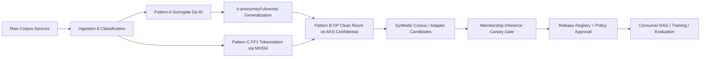
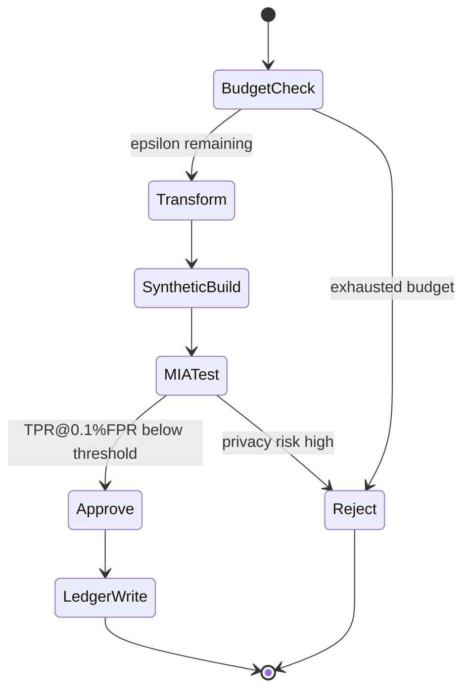

# 企业隐私保护语料去标识化、差分隐私合成与成员推断防护选型 FAQ（Azure）

> 主题编号：#450 · 架构域：3.6 零信任身份、私有网络与合规
> 视角：Cloud & AI Solution Architect；聚焦治理、审计、合规与跨域数据协作，不进入底层密码实现细节。

## 1. 执行摘要
- Pattern A 在高可用与高语义可用性场景中表现均衡，适合大多数企业 RAG 与评测流水线。
- Pattern B 提供可证明的 (ε,δ)-DP 上界，是跨租户/跨法域共享数据或模型的强保障路径。
- Pattern C 强于结构化字段协同与跨系统主键一致性，适配金融与医疗核心账务主数据。
- Pattern D 会同时伤害语义质量与隐私安全，属于应明确禁止的反模式。

## 2. 业务边界与输入假设
- 数据规模：10M / 100M / 1B 记录，结构化 + 非结构化混合。
- 合规目标：HIPAA Expert Determination、GDPR Recital 26、PCI-DSS v4.0、内控审计可追踪。
- 产出目标：用于 RAG、评测、训练与代理工具链，不暴露直接标识符。

## 3. 四种架构模式
- Pattern A：Azure Health Data Services De-identification / Presidio on AKS + 一致性 surrogate + k-匿名。
- Pattern B：AKS 机密计算（SEV-SNP）中的 SmartNoise/AIM/DP-SGD + Rényi DP 账本 + MIA 关卡。
- Pattern C：Managed HSM 驱动 FF1 格式保持加密 + 分权 detokenization broker。
- Pattern D（反模式）：Regex [REDACTED] 或无盐哈希掩码用于共享训练语料。

## 4. 12 维选型矩阵
| 维度 | Pattern A | Pattern B | Pattern C | Pattern D |
|---|---|---|---|---|
| 匿名性保证级别 | 中高（工程化） | 高（数学上界） | 中（可逆控制） | 低 |
| 语义保真度 | 高 | 中 | 高（结构字段） | 低 |
| 跨批次一致性 | 高 | 中 | 很高 | 低 |
| 再识别防护 | 中 | 高 | 中高 | 低 |
| 训练可用性 | 高 | 中 | 中 | 低 |
| 运维复杂度 | 中 | 高 | 中高 | 低（但风险高） |
| 延迟与吞吐 | 低延迟高吞吐 | 中延迟 | 低延迟（字段级） | 不可控 |
| 审计可追溯 | 高 | 很高 | 高 | 低 |
| 合规适配 | 高 | 很高 | 高 | 低 |
| 成本可控 | 高 | 中 | 中 | 低 |
| 多租户共享 | 中高 | 高 | 高 | 低 |
| 推荐结论 | 推荐 | 强推荐（高敏） | 推荐（主数据） | 禁止 |

## 5. 端到端架构图（去标识化 + DP clean room）


## 6. 发布门禁流程图（预算账本 + MIA）


## 7. Q1-Q6 定量问答
- Q1：Rényi DP 多次发布如何做预算合成？
  - 对每次机制计算 α 阶 Rényi divergence 并累加到总账本，再映射到目标 (ε,δ)；达到阈值后停止发布并触发再训练窗口。
- Q2：k-匿名与 l-多样性如何平衡可用性？
  - 提升 k/l 可降低链接风险，但会带来字段泛化导致 F1 下降；建议按任务关键字段分层设置。
- Q3：MIA 指标阈值如何设？
  - 使用 TPR@0.1%FPR 评估记忆泄露，结合 canary perplexity 差值；阈值超标时禁止放行。
- Q4：Managed HSM FF1 缓存对延迟影响？
  - 密钥缓存可将每次 detokenization 延迟降低到毫秒级；需在 TTL 与审计强度间平衡。
- Q5：Pattern A 与 Pattern B 何时组合？
  - 当需要高语义可用并跨域共享时，先做 surrogate 再加 DP 发布，兼顾可用性与可证明隐私。
- Q6：为什么反对无盐哈希？
  - 有限 ID 空间可被彩虹表快速反推，且无法处理准标识符组合泄露风险。

## 8. 生产配置片段（Python/YAML）
```python
from dataclasses import dataclass
@dataclass
class PrivacyLedger:
    tenant_id: str
    epsilon_used: float
    delta: float
    alpha: int

def allow_release(epsilon_used: float, epsilon_limit: float, mia_tpr: float) -> bool:
    if epsilon_used > epsilon_limit:
        return False
    if mia_tpr > 0.001:
        return False
    return True
```

```yaml
apiVersion: batch/v1
kind: Job
metadata:
  name: mia-release-gate
spec:
  template:
    spec:
      restartPolicy: Never
      containers:
      - name: gate
        image: mcr.microsoft.com/azurelinux/base:latest
        command: ["python","run_mia_gate.py","--fpr","0.001","--ledger","cosmos://privacy-ledger"]
```

## 9. 场景 1：多院肿瘤临床试验 RAG 合成孪生
- HIPAA Expert Determination 约束下，需保留疗程时序与实体关系。
- 采用 Pattern A + B：先一致性 surrogate，再差分隐私合成发布。
- 收益：在保护边界内保留临床语义，支持跨院评测协作。

## 10. 场景 2：欧洲零售银行跨境反欺诈语料
- GDPR Recital 26 与 PCI-DSS v4.0 下，卡号/账户号必须可控可审计。
- 采用 Pattern C + B：FF1 tokenization + DP 放行关卡。
- 收益：保持外键可连接性，同时降低成员推断风险。

## 11. 三年 TCO（10M / 100M / 1B）
| 规模 | Pattern A | Pattern B | Pattern C | 合规事故暴露参考 |
|---|---:|---:|---:|---:|
| 10M | $0.82M | $1.06M | $0.94M | $0.40M |
| 100M | $4.45M | $5.92M | $5.13M | $2.10M |
| 1B | $27.8M | $35.6M | $31.4M | $11.8M |

## 12. Day-0 / Day-1 / Day-2 清单
### Day-0：治理与分级
1. 完成数据分类分级与法域映射
2. 定义标识符、准标识符与敏感属性字典
3. 建立统一审计字段与追踪 ID
4. 建立最小权限与审批路径
5. 确定放行与回滚门槛
### Day-1：流水线与门禁
1. 上线 surrogate 一致性策略与密钥轮换
2. 部署 DP 预算账本与配额告警
3. 接入 MIA canary 评估
4. 落地 FF1 detokenization broker
5. 建立租户隔离与数据水印
### Day-2：优化与审计
1. 按业务价值优化 ε 分配
2. 优化 k/l 参数与 F1 损失
3. 开展对抗演练与红队评估
4. 复盘跨境数据共享审批效率
5. 更新年度合规证明材料

## 13. Good fit vs Not for
- Good fit：涉及高敏数据、跨机构协作、监管强约束的 AI 数据供应链。
- Not for：一次性低价值样本、无共享需求、无长期审计要求的实验。

## 14. 风险与缓解
- 风险：预算透支导致发布中断
  - 缓解：版本化策略、分层阈值、双人审批与灰度放行。
- 风险：参数保守导致可用性下降
  - 缓解：版本化策略、分层阈值、双人审批与灰度放行。
- 风险：脱敏一致性冲突导致下游 join 失败
  - 缓解：版本化策略、分层阈值、双人审批与灰度放行。
- 风险：MIA 误报造成流程阻塞
  - 缓解：版本化策略、分层阈值、双人审批与灰度放行。
- 风险：跨法域审批时延
  - 缓解：版本化策略、分层阈值、双人审批与灰度放行。

## 15. 参考来源与抓取时间
- 来源：Azure Health Data Services De-identification · https://learn.microsoft.com/azure/healthcare-apis/ · 抓取时间：2026-11-26（UTC+8）
- 来源：Microsoft Presidio · https://github.com/microsoft/presidio · 抓取时间：2026-11-26（UTC+8）
- 来源：Azure confidential computing on AKS · https://learn.microsoft.com/azure/confidential-computing/ · 抓取时间：2026-11-26（UTC+8）
- 来源：Azure Key Vault Managed HSM · https://learn.microsoft.com/azure/key-vault/managed-hsm/ · 抓取时间：2026-11-26（UTC+8）
- 来源：NIST SP 800-38G FF1 · https://csrc.nist.gov/publications/detail/sp/800-38g/final · 抓取时间：2026-11-26（UTC+8）

---

### 附录 A：隐私指标字典
- `epsilon_remaining`：需记录定义、阈值、观测频率、告警动作与审批人。
- `delta_target`：需记录定义、阈值、观测频率、告警动作与审批人。
- `mia_tpr_at_0p1_fpr`：需记录定义、阈值、观测频率、告警动作与审批人。
- `quasi_identifier_entropy`：需记录定义、阈值、观测频率、告警动作与审批人。
- `surrogate_consistency_rate`：需记录定义、阈值、观测频率、告警动作与审批人。
- `ff1_detokenize_latency_p95`：需记录定义、阈值、观测频率、告警动作与审批人。

### 附录 B：审计证据项
- 审计项 01：留存预算账本、审批记录、数据谱系、模型版本与回滚证据。
- 审计项 02：留存预算账本、审批记录、数据谱系、模型版本与回滚证据。
- 审计项 03：留存预算账本、审批记录、数据谱系、模型版本与回滚证据。
- 审计项 04：留存预算账本、审批记录、数据谱系、模型版本与回滚证据。
- 审计项 05：留存预算账本、审批记录、数据谱系、模型版本与回滚证据。
- 审计项 06：留存预算账本、审批记录、数据谱系、模型版本与回滚证据。
- 审计项 07：留存预算账本、审批记录、数据谱系、模型版本与回滚证据。
- 审计项 08：留存预算账本、审批记录、数据谱系、模型版本与回滚证据。
- 审计项 09：留存预算账本、审批记录、数据谱系、模型版本与回滚证据。
- 审计项 10：留存预算账本、审批记录、数据谱系、模型版本与回滚证据。
- 审计项 11：留存预算账本、审批记录、数据谱系、模型版本与回滚证据。
- 审计项 12：留存预算账本、审批记录、数据谱系、模型版本与回滚证据。
- 审计项 13：留存预算账本、审批记录、数据谱系、模型版本与回滚证据。
- 审计项 14：留存预算账本、审批记录、数据谱系、模型版本与回滚证据。
- 审计项 15：留存预算账本、审批记录、数据谱系、模型版本与回滚证据。
- 审计项 16：留存预算账本、审批记录、数据谱系、模型版本与回滚证据。
- 审计项 17：留存预算账本、审批记录、数据谱系、模型版本与回滚证据。
- 审计项 18：留存预算账本、审批记录、数据谱系、模型版本与回滚证据。
- 审计项 19：留存预算账本、审批记录、数据谱系、模型版本与回滚证据。
- 审计项 20：留存预算账本、审批记录、数据谱系、模型版本与回滚证据。
- 审计项 21：留存预算账本、审批记录、数据谱系、模型版本与回滚证据。
- 审计项 22：留存预算账本、审批记录、数据谱系、模型版本与回滚证据。
- 审计项 23：留存预算账本、审批记录、数据谱系、模型版本与回滚证据。
- 审计项 24：留存预算账本、审批记录、数据谱系、模型版本与回滚证据。
- 审计项 25：留存预算账本、审批记录、数据谱系、模型版本与回滚证据。
- 审计项 26：留存预算账本、审批记录、数据谱系、模型版本与回滚证据。
- 审计项 27：留存预算账本、审批记录、数据谱系、模型版本与回滚证据。
- 审计项 28：留存预算账本、审批记录、数据谱系、模型版本与回滚证据。
- 审计项 29：留存预算账本、审批记录、数据谱系、模型版本与回滚证据。
- 审计项 30：留存预算账本、审批记录、数据谱系、模型版本与回滚证据。
- 审计项 31：留存预算账本、审批记录、数据谱系、模型版本与回滚证据。
- 审计项 32：留存预算账本、审批记录、数据谱系、模型版本与回滚证据。
- 审计项 33：留存预算账本、审批记录、数据谱系、模型版本与回滚证据。
- 审计项 34：留存预算账本、审批记录、数据谱系、模型版本与回滚证据。
- 审计项 35：留存预算账本、审批记录、数据谱系、模型版本与回滚证据。
- 审计项 36：留存预算账本、审批记录、数据谱系、模型版本与回滚证据。
- 审计项 37：留存预算账本、审批记录、数据谱系、模型版本与回滚证据。
- 审计项 38：留存预算账本、审批记录、数据谱系、模型版本与回滚证据。
- 审计项 39：留存预算账本、审批记录、数据谱系、模型版本与回滚证据。
- 审计项 40：留存预算账本、审批记录、数据谱系、模型版本与回滚证据。
- 审计项 41：留存预算账本、审批记录、数据谱系、模型版本与回滚证据。
- 审计项 42：留存预算账本、审批记录、数据谱系、模型版本与回滚证据。
- 审计项 43：留存预算账本、审批记录、数据谱系、模型版本与回滚证据。
- 审计项 44：留存预算账本、审批记录、数据谱系、模型版本与回滚证据。
- 审计项 45：留存预算账本、审批记录、数据谱系、模型版本与回滚证据。
- 审计项 46：留存预算账本、审批记录、数据谱系、模型版本与回滚证据。
- 审计项 47：留存预算账本、审批记录、数据谱系、模型版本与回滚证据。
- 审计项 48：留存预算账本、审批记录、数据谱系、模型版本与回滚证据。
- 审计项 49：留存预算账本、审批记录、数据谱系、模型版本与回滚证据。
- 审计项 50：留存预算账本、审批记录、数据谱系、模型版本与回滚证据。

### 附录 C：实施检查点扩展
- 检查点 001：验证租户边界、法域标签、最小权限、密钥轮换、发布门禁与成本标签。
- 检查点 002：验证租户边界、法域标签、最小权限、密钥轮换、发布门禁与成本标签。
- 检查点 003：验证租户边界、法域标签、最小权限、密钥轮换、发布门禁与成本标签。
- 检查点 004：验证租户边界、法域标签、最小权限、密钥轮换、发布门禁与成本标签。
- 检查点 005：验证租户边界、法域标签、最小权限、密钥轮换、发布门禁与成本标签。
- 检查点 006：验证租户边界、法域标签、最小权限、密钥轮换、发布门禁与成本标签。
- 检查点 007：验证租户边界、法域标签、最小权限、密钥轮换、发布门禁与成本标签。
- 检查点 008：验证租户边界、法域标签、最小权限、密钥轮换、发布门禁与成本标签。
- 检查点 009：验证租户边界、法域标签、最小权限、密钥轮换、发布门禁与成本标签。
- 检查点 010：验证租户边界、法域标签、最小权限、密钥轮换、发布门禁与成本标签。
- 检查点 011：验证租户边界、法域标签、最小权限、密钥轮换、发布门禁与成本标签。
- 检查点 012：验证租户边界、法域标签、最小权限、密钥轮换、发布门禁与成本标签。
- 检查点 013：验证租户边界、法域标签、最小权限、密钥轮换、发布门禁与成本标签。
- 检查点 014：验证租户边界、法域标签、最小权限、密钥轮换、发布门禁与成本标签。
- 检查点 015：验证租户边界、法域标签、最小权限、密钥轮换、发布门禁与成本标签。
- 检查点 016：验证租户边界、法域标签、最小权限、密钥轮换、发布门禁与成本标签。
- 检查点 017：验证租户边界、法域标签、最小权限、密钥轮换、发布门禁与成本标签。
- 检查点 018：验证租户边界、法域标签、最小权限、密钥轮换、发布门禁与成本标签。
- 检查点 019：验证租户边界、法域标签、最小权限、密钥轮换、发布门禁与成本标签。
- 检查点 020：验证租户边界、法域标签、最小权限、密钥轮换、发布门禁与成本标签。
- 检查点 021：验证租户边界、法域标签、最小权限、密钥轮换、发布门禁与成本标签。
- 检查点 022：验证租户边界、法域标签、最小权限、密钥轮换、发布门禁与成本标签。
- 检查点 023：验证租户边界、法域标签、最小权限、密钥轮换、发布门禁与成本标签。
- 检查点 024：验证租户边界、法域标签、最小权限、密钥轮换、发布门禁与成本标签。
- 检查点 025：验证租户边界、法域标签、最小权限、密钥轮换、发布门禁与成本标签。
- 检查点 026：验证租户边界、法域标签、最小权限、密钥轮换、发布门禁与成本标签。
- 检查点 027：验证租户边界、法域标签、最小权限、密钥轮换、发布门禁与成本标签。
- 检查点 028：验证租户边界、法域标签、最小权限、密钥轮换、发布门禁与成本标签。
- 检查点 029：验证租户边界、法域标签、最小权限、密钥轮换、发布门禁与成本标签。
- 检查点 030：验证租户边界、法域标签、最小权限、密钥轮换、发布门禁与成本标签。
- 检查点 031：验证租户边界、法域标签、最小权限、密钥轮换、发布门禁与成本标签。
- 检查点 032：验证租户边界、法域标签、最小权限、密钥轮换、发布门禁与成本标签。
- 检查点 033：验证租户边界、法域标签、最小权限、密钥轮换、发布门禁与成本标签。
- 检查点 034：验证租户边界、法域标签、最小权限、密钥轮换、发布门禁与成本标签。
- 检查点 035：验证租户边界、法域标签、最小权限、密钥轮换、发布门禁与成本标签。
- 检查点 036：验证租户边界、法域标签、最小权限、密钥轮换、发布门禁与成本标签。
- 检查点 037：验证租户边界、法域标签、最小权限、密钥轮换、发布门禁与成本标签。
- 检查点 038：验证租户边界、法域标签、最小权限、密钥轮换、发布门禁与成本标签。
- 检查点 039：验证租户边界、法域标签、最小权限、密钥轮换、发布门禁与成本标签。
- 检查点 040：验证租户边界、法域标签、最小权限、密钥轮换、发布门禁与成本标签。
- 检查点 041：验证租户边界、法域标签、最小权限、密钥轮换、发布门禁与成本标签。
- 检查点 042：验证租户边界、法域标签、最小权限、密钥轮换、发布门禁与成本标签。
- 检查点 043：验证租户边界、法域标签、最小权限、密钥轮换、发布门禁与成本标签。
- 检查点 044：验证租户边界、法域标签、最小权限、密钥轮换、发布门禁与成本标签。
- 检查点 045：验证租户边界、法域标签、最小权限、密钥轮换、发布门禁与成本标签。
- 检查点 046：验证租户边界、法域标签、最小权限、密钥轮换、发布门禁与成本标签。
- 检查点 047：验证租户边界、法域标签、最小权限、密钥轮换、发布门禁与成本标签。
- 检查点 048：验证租户边界、法域标签、最小权限、密钥轮换、发布门禁与成本标签。
- 检查点 049：验证租户边界、法域标签、最小权限、密钥轮换、发布门禁与成本标签。
- 检查点 050：验证租户边界、法域标签、最小权限、密钥轮换、发布门禁与成本标签。
- 检查点 051：验证租户边界、法域标签、最小权限、密钥轮换、发布门禁与成本标签。
- 检查点 052：验证租户边界、法域标签、最小权限、密钥轮换、发布门禁与成本标签。
- 检查点 053：验证租户边界、法域标签、最小权限、密钥轮换、发布门禁与成本标签。
- 检查点 054：验证租户边界、法域标签、最小权限、密钥轮换、发布门禁与成本标签。
- 检查点 055：验证租户边界、法域标签、最小权限、密钥轮换、发布门禁与成本标签。
- 检查点 056：验证租户边界、法域标签、最小权限、密钥轮换、发布门禁与成本标签。
- 检查点 057：验证租户边界、法域标签、最小权限、密钥轮换、发布门禁与成本标签。
- 检查点 058：验证租户边界、法域标签、最小权限、密钥轮换、发布门禁与成本标签。
- 检查点 059：验证租户边界、法域标签、最小权限、密钥轮换、发布门禁与成本标签。
- 检查点 060：验证租户边界、法域标签、最小权限、密钥轮换、发布门禁与成本标签。
- 检查点 061：验证租户边界、法域标签、最小权限、密钥轮换、发布门禁与成本标签。
- 检查点 062：验证租户边界、法域标签、最小权限、密钥轮换、发布门禁与成本标签。
- 检查点 063：验证租户边界、法域标签、最小权限、密钥轮换、发布门禁与成本标签。
- 检查点 064：验证租户边界、法域标签、最小权限、密钥轮换、发布门禁与成本标签。
- 检查点 065：验证租户边界、法域标签、最小权限、密钥轮换、发布门禁与成本标签。
- 检查点 066：验证租户边界、法域标签、最小权限、密钥轮换、发布门禁与成本标签。
- 检查点 067：验证租户边界、法域标签、最小权限、密钥轮换、发布门禁与成本标签。
- 检查点 068：验证租户边界、法域标签、最小权限、密钥轮换、发布门禁与成本标签。
- 检查点 069：验证租户边界、法域标签、最小权限、密钥轮换、发布门禁与成本标签。
- 检查点 070：验证租户边界、法域标签、最小权限、密钥轮换、发布门禁与成本标签。
- 检查点 071：验证租户边界、法域标签、最小权限、密钥轮换、发布门禁与成本标签。
- 检查点 072：验证租户边界、法域标签、最小权限、密钥轮换、发布门禁与成本标签。
- 检查点 073：验证租户边界、法域标签、最小权限、密钥轮换、发布门禁与成本标签。
- 检查点 074：验证租户边界、法域标签、最小权限、密钥轮换、发布门禁与成本标签。
- 检查点 075：验证租户边界、法域标签、最小权限、密钥轮换、发布门禁与成本标签。
- 检查点 076：验证租户边界、法域标签、最小权限、密钥轮换、发布门禁与成本标签。
- 检查点 077：验证租户边界、法域标签、最小权限、密钥轮换、发布门禁与成本标签。
- 检查点 078：验证租户边界、法域标签、最小权限、密钥轮换、发布门禁与成本标签。
- 检查点 079：验证租户边界、法域标签、最小权限、密钥轮换、发布门禁与成本标签。
- 检查点 080：验证租户边界、法域标签、最小权限、密钥轮换、发布门禁与成本标签。
- 检查点 081：验证租户边界、法域标签、最小权限、密钥轮换、发布门禁与成本标签。
- 检查点 082：验证租户边界、法域标签、最小权限、密钥轮换、发布门禁与成本标签。
- 检查点 083：验证租户边界、法域标签、最小权限、密钥轮换、发布门禁与成本标签。
- 检查点 084：验证租户边界、法域标签、最小权限、密钥轮换、发布门禁与成本标签。
- 检查点 085：验证租户边界、法域标签、最小权限、密钥轮换、发布门禁与成本标签。
- 检查点 086：验证租户边界、法域标签、最小权限、密钥轮换、发布门禁与成本标签。
- 检查点 087：验证租户边界、法域标签、最小权限、密钥轮换、发布门禁与成本标签。
- 检查点 088：验证租户边界、法域标签、最小权限、密钥轮换、发布门禁与成本标签。
- 检查点 089：验证租户边界、法域标签、最小权限、密钥轮换、发布门禁与成本标签。
- 检查点 090：验证租户边界、法域标签、最小权限、密钥轮换、发布门禁与成本标签。
- 检查点 091：验证租户边界、法域标签、最小权限、密钥轮换、发布门禁与成本标签。
- 检查点 092：验证租户边界、法域标签、最小权限、密钥轮换、发布门禁与成本标签。
- 检查点 093：验证租户边界、法域标签、最小权限、密钥轮换、发布门禁与成本标签。
- 检查点 094：验证租户边界、法域标签、最小权限、密钥轮换、发布门禁与成本标签。
- 检查点 095：验证租户边界、法域标签、最小权限、密钥轮换、发布门禁与成本标签。
- 检查点 096：验证租户边界、法域标签、最小权限、密钥轮换、发布门禁与成本标签。
- 检查点 097：验证租户边界、法域标签、最小权限、密钥轮换、发布门禁与成本标签。
- 检查点 098：验证租户边界、法域标签、最小权限、密钥轮换、发布门禁与成本标签。
- 检查点 099：验证租户边界、法域标签、最小权限、密钥轮换、发布门禁与成本标签。
- 检查点 100：验证租户边界、法域标签、最小权限、密钥轮换、发布门禁与成本标签。
- 检查点 101：验证租户边界、法域标签、最小权限、密钥轮换、发布门禁与成本标签。
- 检查点 102：验证租户边界、法域标签、最小权限、密钥轮换、发布门禁与成本标签。
- 检查点 103：验证租户边界、法域标签、最小权限、密钥轮换、发布门禁与成本标签。
- 检查点 104：验证租户边界、法域标签、最小权限、密钥轮换、发布门禁与成本标签。
- 检查点 105：验证租户边界、法域标签、最小权限、密钥轮换、发布门禁与成本标签。
- 检查点 106：验证租户边界、法域标签、最小权限、密钥轮换、发布门禁与成本标签。
- 检查点 107：验证租户边界、法域标签、最小权限、密钥轮换、发布门禁与成本标签。
- 检查点 108：验证租户边界、法域标签、最小权限、密钥轮换、发布门禁与成本标签。
- 检查点 109：验证租户边界、法域标签、最小权限、密钥轮换、发布门禁与成本标签。
- 检查点 110：验证租户边界、法域标签、最小权限、密钥轮换、发布门禁与成本标签。
- 检查点 111：验证租户边界、法域标签、最小权限、密钥轮换、发布门禁与成本标签。
- 检查点 112：验证租户边界、法域标签、最小权限、密钥轮换、发布门禁与成本标签。
- 检查点 113：验证租户边界、法域标签、最小权限、密钥轮换、发布门禁与成本标签。
- 检查点 114：验证租户边界、法域标签、最小权限、密钥轮换、发布门禁与成本标签。
- 检查点 115：验证租户边界、法域标签、最小权限、密钥轮换、发布门禁与成本标签。
- 检查点 116：验证租户边界、法域标签、最小权限、密钥轮换、发布门禁与成本标签。
- 检查点 117：验证租户边界、法域标签、最小权限、密钥轮换、发布门禁与成本标签。
- 检查点 118：验证租户边界、法域标签、最小权限、密钥轮换、发布门禁与成本标签。
- 检查点 119：验证租户边界、法域标签、最小权限、密钥轮换、发布门禁与成本标签。
- 检查点 120：验证租户边界、法域标签、最小权限、密钥轮换、发布门禁与成本标签。
- 检查点 121：验证租户边界、法域标签、最小权限、密钥轮换、发布门禁与成本标签。
- 检查点 122：验证租户边界、法域标签、最小权限、密钥轮换、发布门禁与成本标签。
- 检查点 123：验证租户边界、法域标签、最小权限、密钥轮换、发布门禁与成本标签。
- 检查点 124：验证租户边界、法域标签、最小权限、密钥轮换、发布门禁与成本标签。
- 检查点 125：验证租户边界、法域标签、最小权限、密钥轮换、发布门禁与成本标签。
- 检查点 126：验证租户边界、法域标签、最小权限、密钥轮换、发布门禁与成本标签。
- 检查点 127：验证租户边界、法域标签、最小权限、密钥轮换、发布门禁与成本标签。
- 检查点 128：验证租户边界、法域标签、最小权限、密钥轮换、发布门禁与成本标签。
- 检查点 129：验证租户边界、法域标签、最小权限、密钥轮换、发布门禁与成本标签。
- 检查点 130：验证租户边界、法域标签、最小权限、密钥轮换、发布门禁与成本标签。
- 检查点 131：验证租户边界、法域标签、最小权限、密钥轮换、发布门禁与成本标签。
- 检查点 132：验证租户边界、法域标签、最小权限、密钥轮换、发布门禁与成本标签。
- 检查点 133：验证租户边界、法域标签、最小权限、密钥轮换、发布门禁与成本标签。
- 检查点 134：验证租户边界、法域标签、最小权限、密钥轮换、发布门禁与成本标签。
- 检查点 135：验证租户边界、法域标签、最小权限、密钥轮换、发布门禁与成本标签。
- 检查点 136：验证租户边界、法域标签、最小权限、密钥轮换、发布门禁与成本标签。
- 检查点 137：验证租户边界、法域标签、最小权限、密钥轮换、发布门禁与成本标签。
- 检查点 138：验证租户边界、法域标签、最小权限、密钥轮换、发布门禁与成本标签。
- 检查点 139：验证租户边界、法域标签、最小权限、密钥轮换、发布门禁与成本标签。
- 检查点 140：验证租户边界、法域标签、最小权限、密钥轮换、发布门禁与成本标签。
- 检查点 141：验证租户边界、法域标签、最小权限、密钥轮换、发布门禁与成本标签。
- 检查点 142：验证租户边界、法域标签、最小权限、密钥轮换、发布门禁与成本标签。
- 检查点 143：验证租户边界、法域标签、最小权限、密钥轮换、发布门禁与成本标签。
- 检查点 144：验证租户边界、法域标签、最小权限、密钥轮换、发布门禁与成本标签。
- 检查点 145：验证租户边界、法域标签、最小权限、密钥轮换、发布门禁与成本标签。
- 检查点 146：验证租户边界、法域标签、最小权限、密钥轮换、发布门禁与成本标签。
- 检查点 147：验证租户边界、法域标签、最小权限、密钥轮换、发布门禁与成本标签。
- 检查点 148：验证租户边界、法域标签、最小权限、密钥轮换、发布门禁与成本标签。
- 检查点 149：验证租户边界、法域标签、最小权限、密钥轮换、发布门禁与成本标签。
- 检查点 150：验证租户边界、法域标签、最小权限、密钥轮换、发布门禁与成本标签。
- 检查点 151：验证租户边界、法域标签、最小权限、密钥轮换、发布门禁与成本标签。
- 检查点 152：验证租户边界、法域标签、最小权限、密钥轮换、发布门禁与成本标签。
- 检查点 153：验证租户边界、法域标签、最小权限、密钥轮换、发布门禁与成本标签。
- 检查点 154：验证租户边界、法域标签、最小权限、密钥轮换、发布门禁与成本标签。
- 检查点 155：验证租户边界、法域标签、最小权限、密钥轮换、发布门禁与成本标签。
- 检查点 156：验证租户边界、法域标签、最小权限、密钥轮换、发布门禁与成本标签。
- 检查点 157：验证租户边界、法域标签、最小权限、密钥轮换、发布门禁与成本标签。
- 检查点 158：验证租户边界、法域标签、最小权限、密钥轮换、发布门禁与成本标签。
- 检查点 159：验证租户边界、法域标签、最小权限、密钥轮换、发布门禁与成本标签。
- 检查点 160：验证租户边界、法域标签、最小权限、密钥轮换、发布门禁与成本标签。
- 检查点 161：验证租户边界、法域标签、最小权限、密钥轮换、发布门禁与成本标签。
- 检查点 162：验证租户边界、法域标签、最小权限、密钥轮换、发布门禁与成本标签。
- 检查点 163：验证租户边界、法域标签、最小权限、密钥轮换、发布门禁与成本标签。
- 检查点 164：验证租户边界、法域标签、最小权限、密钥轮换、发布门禁与成本标签。
- 检查点 165：验证租户边界、法域标签、最小权限、密钥轮换、发布门禁与成本标签。
- 检查点 166：验证租户边界、法域标签、最小权限、密钥轮换、发布门禁与成本标签。
- 检查点 167：验证租户边界、法域标签、最小权限、密钥轮换、发布门禁与成本标签。
- 检查点 168：验证租户边界、法域标签、最小权限、密钥轮换、发布门禁与成本标签。
- 检查点 169：验证租户边界、法域标签、最小权限、密钥轮换、发布门禁与成本标签。
- 检查点 170：验证租户边界、法域标签、最小权限、密钥轮换、发布门禁与成本标签。
- 检查点 171：验证租户边界、法域标签、最小权限、密钥轮换、发布门禁与成本标签。
- 检查点 172：验证租户边界、法域标签、最小权限、密钥轮换、发布门禁与成本标签。
- 检查点 173：验证租户边界、法域标签、最小权限、密钥轮换、发布门禁与成本标签。
- 检查点 174：验证租户边界、法域标签、最小权限、密钥轮换、发布门禁与成本标签。
- 检查点 175：验证租户边界、法域标签、最小权限、密钥轮换、发布门禁与成本标签。
- 检查点 176：验证租户边界、法域标签、最小权限、密钥轮换、发布门禁与成本标签。
- 检查点 177：验证租户边界、法域标签、最小权限、密钥轮换、发布门禁与成本标签。
- 检查点 178：验证租户边界、法域标签、最小权限、密钥轮换、发布门禁与成本标签。
- 检查点 179：验证租户边界、法域标签、最小权限、密钥轮换、发布门禁与成本标签。
- 检查点 180：验证租户边界、法域标签、最小权限、密钥轮换、发布门禁与成本标签。
- 检查点 181：验证租户边界、法域标签、最小权限、密钥轮换、发布门禁与成本标签。
- 检查点 182：验证租户边界、法域标签、最小权限、密钥轮换、发布门禁与成本标签。
- 检查点 183：验证租户边界、法域标签、最小权限、密钥轮换、发布门禁与成本标签。
- 检查点 184：验证租户边界、法域标签、最小权限、密钥轮换、发布门禁与成本标签。
- 检查点 185：验证租户边界、法域标签、最小权限、密钥轮换、发布门禁与成本标签。
- 检查点 186：验证租户边界、法域标签、最小权限、密钥轮换、发布门禁与成本标签。
- 检查点 187：验证租户边界、法域标签、最小权限、密钥轮换、发布门禁与成本标签。
- 检查点 188：验证租户边界、法域标签、最小权限、密钥轮换、发布门禁与成本标签。
- 检查点 189：验证租户边界、法域标签、最小权限、密钥轮换、发布门禁与成本标签。
- 检查点 190：验证租户边界、法域标签、最小权限、密钥轮换、发布门禁与成本标签。
- 检查点 191：验证租户边界、法域标签、最小权限、密钥轮换、发布门禁与成本标签。
- 检查点 192：验证租户边界、法域标签、最小权限、密钥轮换、发布门禁与成本标签。
- 检查点 193：验证租户边界、法域标签、最小权限、密钥轮换、发布门禁与成本标签。
- 检查点 194：验证租户边界、法域标签、最小权限、密钥轮换、发布门禁与成本标签。
- 检查点 195：验证租户边界、法域标签、最小权限、密钥轮换、发布门禁与成本标签。
- 检查点 196：验证租户边界、法域标签、最小权限、密钥轮换、发布门禁与成本标签。
- 检查点 197：验证租户边界、法域标签、最小权限、密钥轮换、发布门禁与成本标签。
- 检查点 198：验证租户边界、法域标签、最小权限、密钥轮换、发布门禁与成本标签。
- 检查点 199：验证租户边界、法域标签、最小权限、密钥轮换、发布门禁与成本标签。
- 检查点 200：验证租户边界、法域标签、最小权限、密钥轮换、发布门禁与成本标签。
- 检查点 201：验证租户边界、法域标签、最小权限、密钥轮换、发布门禁与成本标签。
- 检查点 202：验证租户边界、法域标签、最小权限、密钥轮换、发布门禁与成本标签。
- 检查点 203：验证租户边界、法域标签、最小权限、密钥轮换、发布门禁与成本标签。
- 检查点 204：验证租户边界、法域标签、最小权限、密钥轮换、发布门禁与成本标签。
- 检查点 205：验证租户边界、法域标签、最小权限、密钥轮换、发布门禁与成本标签。
- 检查点 206：验证租户边界、法域标签、最小权限、密钥轮换、发布门禁与成本标签。
- 检查点 207：验证租户边界、法域标签、最小权限、密钥轮换、发布门禁与成本标签。
- 检查点 208：验证租户边界、法域标签、最小权限、密钥轮换、发布门禁与成本标签。
- 检查点 209：验证租户边界、法域标签、最小权限、密钥轮换、发布门禁与成本标签。
- 检查点 210：验证租户边界、法域标签、最小权限、密钥轮换、发布门禁与成本标签。
- 检查点 211：验证租户边界、法域标签、最小权限、密钥轮换、发布门禁与成本标签。
- 检查点 212：验证租户边界、法域标签、最小权限、密钥轮换、发布门禁与成本标签。
- 检查点 213：验证租户边界、法域标签、最小权限、密钥轮换、发布门禁与成本标签。
- 检查点 214：验证租户边界、法域标签、最小权限、密钥轮换、发布门禁与成本标签。
- 检查点 215：验证租户边界、法域标签、最小权限、密钥轮换、发布门禁与成本标签。
- 检查点 216：验证租户边界、法域标签、最小权限、密钥轮换、发布门禁与成本标签。
- 检查点 217：验证租户边界、法域标签、最小权限、密钥轮换、发布门禁与成本标签。
- 检查点 218：验证租户边界、法域标签、最小权限、密钥轮换、发布门禁与成本标签。
- 检查点 219：验证租户边界、法域标签、最小权限、密钥轮换、发布门禁与成本标签。
- 检查点 220：验证租户边界、法域标签、最小权限、密钥轮换、发布门禁与成本标签。

