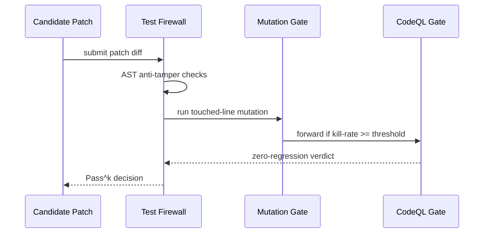

# Private SWE-agent execution benchmark harness selection FAQ: AKS Kata F2P Pass^k vs mutation+CodeQL oracle vs static LLM judge funnel

> 🌐 **Language / 语言切换**: **English (Current)** | **[中文](private-swe-agent-execution-benchmark-harness-aks-kata-f2p-pass-hat-k-vs-mutation-codeql-oracle-vs-static-llm-judge-selection-faq.md)** | **[Back to catalog](README.en.md)**

## 1. Executive summary

- **Pattern A**: private historical PR replay with hermetic `AKS Kata` execution, post-generation hidden gold-test injection, and `Pass^3` release gates is the baseline for production trust.
- **Pattern B**: add mutation and CodeQL differential oracles to reduce reward hacking and security regressions.
- **Pattern C**: run low-cost static rubric pre-filtering before nightly hermetic execution to reduce compute spend by 65-75 percent.
- **Pattern D (forbidden)**: public benchmark scores or mutable in-workspace tests with single-shot pass metrics inflate false confidence.
- **Target outcomes**: robust `Pass^k`, high mutation kill, zero CodeQL regression, deterministic anti-tamper detection.

## 2. Pattern definitions

- **A (hermetic execution)**: F2P/P2P replay with pinned environment snapshots and hidden test injection after patch generation.
- **B (differential oracle)**: touched-line mutation testing plus CodeQL SARIF zero-regression gates.
- **C (two-stage funnel)**: static AST and rubric screening followed by hermetic execution for survivors.
- **D (anti-pattern)**: mutable tests and single-pass metrics driving release decisions.

## 3. Reference architecture (Mermaid 1)


## 4. Release gate sequence (Mermaid 2)



## 5. Quantitative models

1. **Pass@k**: `P(Pass@k)=1-(1-p)^k`.
2. **Pass^k**: `P(Pass^k)=p^k` to enforce repeatability.
3. **sample-size power**: `n >= (Z^2 * p * (1-p)) / e^2`.
4. **snapshot storage**: `Storage = repos * snapshots * base_layer_dedup_factor`.
5. **cost per 1k rollouts**: `C_1k = (compute + storage + orchestration) / runs * 1000`.

### 5.1 Pass@1 vs Pass@k vs Pass^k example

| Metric | p=0.55 | p=0.65 | p=0.75 |
|---|---:|---:|---:|
| Pass@1 | 0.55 | 0.65 | 0.75 |
| Pass@3 | 0.91 | 0.96 | 0.98 |
| Pass^3 | 0.17 | 0.27 | 0.42 |

## 6. Twelve-dimension comparison matrix

| Dimension | Pattern A | Pattern B | Pattern C | Pattern D |
|---|---|---|---|---|
| Reliability gate strength | High | Very high | Medium-high | Low |
| Security regression protection | Medium | Very high | Medium | Low |
| Execution cost | Medium | High | Low-medium | Low surface |
| Anti-gaming resilience | High | Very high | Medium | Low |
| Explainability | High | High | Medium | Low |
| Reproducibility | High | High | Medium | Low |
| Ops complexity | Medium | High | Medium | Low |
| Language stack coverage | Medium | High | Medium | Low |
| Release-risk control | High | Very high | Medium-high | Low |
| Three-year TCO | Medium | Medium-high | Low-medium | High hidden loss |
| Migration friendliness | High | Medium | Very high | Low |
| Anti-pattern exposure | Low | Low | Medium | Critical |

## 7. Deep Q&A (Q1-Q8)

### Q1. Why use Pass^k instead of only Pass@1?
- Pass@1 is highly sensitive to lucky one-off successes.
- Pass^k enforces repeatability and operational confidence.
- Release gates need stability, not isolated wins.
- It reduces accidental green-light incidents.

### Q2. How should mutation thresholds be set?
- Require >=80 percent kill rate on touched control-flow lines.
- Use tiered thresholds by change class when needed.
- Pair with flaky-test quarantine to avoid false alarms.
- Review thresholds against defect escape rates monthly.

### Q3. What is the role of CodeQL here?
- It catches taint and concurrency regressions missed by functional tests.
- It complements F2P/P2P with static risk validation.
- It is crucial for regulated portfolios.
- SARIF outputs map directly to audit evidence.

### Q4. How to prevent test tampering?
- Block patterns like skip injection and assertion deletion via AST rules.
- Protect critical test and CI paths from direct edits.
- Run verification with read-only mounted gold assets.
- Fail fast on any tamper signature.

### Q5. How to choose ACA Jobs vs AKS Kata?
- ACA Jobs fit shorter lower-risk batches.
- AKS Kata fits high-isolation and complex dependency cases.
- Kata on Spot pools can be cost-efficient at scale.
- A risk-tiered hybrid model is often optimal.

### Q6. How to handle flaky tests?
- Maintain quarantine lists and discount them from score weights.
- Do not weaken security gates because of flaky suites.
- Track and remediate flake components with explicit SLAs.
- Use flake trend lines as quality governance input.

### Q7. How to model storage economics?
- Use ACR layer deduplication across snapshot families.
- Separate base-image and dependency-layer cost lines.
- Purge expired snapshots and low-value history.
- Retain hot benchmark slices longer for stability tracking.

### Q8. How to scale rollout organizationally?
- Pilot with two critical migration programs first.
- Integrate gates into release approvals and evidence trails.
- Review false-positive and false-negative outcomes bi-weekly.
- Expand repository coverage only after stable SLOs.

## 8. Sealed F2P/P2P verifier snippet (Python)

```python
def sealed_verify(run, patch):
    assert ast_tamper_check(patch) is True
    env = load_pinned_env(run.base_image)
    apply_patch(env, patch)
    inject_hidden_gold_tests(env)
    return pass_power_k(env, k=3)
```

## 9. AST anti-tamper rules snippet (YAML)

```yaml
forbidden_patterns:
  - "pytest.skip"
  - "@Disabled"
  - "assert True"
protected_paths:
  - "tests/**"
  - "ci/**"
```

## 10. Enterprise scenario A: retail bank Java 8 to 21 migration gate

- Scenario A point 01: apply Pass^3 plus mutation plus CodeQL composite gates on Spring Boot 3 migration patches.
- Scenario A point 02: apply Pass^3 plus mutation plus CodeQL composite gates on Spring Boot 3 migration patches.
- Scenario A point 03: apply Pass^3 plus mutation plus CodeQL composite gates on Spring Boot 3 migration patches.
- Scenario A point 04: apply Pass^3 plus mutation plus CodeQL composite gates on Spring Boot 3 migration patches.
- Scenario A point 05: apply Pass^3 plus mutation plus CodeQL composite gates on Spring Boot 3 migration patches.
- Scenario A point 06: apply Pass^3 plus mutation plus CodeQL composite gates on Spring Boot 3 migration patches.
- Scenario A point 07: apply Pass^3 plus mutation plus CodeQL composite gates on Spring Boot 3 migration patches.
- Scenario A point 08: apply Pass^3 plus mutation plus CodeQL composite gates on Spring Boot 3 migration patches.
- Scenario A point 09: apply Pass^3 plus mutation plus CodeQL composite gates on Spring Boot 3 migration patches.
- Scenario A point 10: apply Pass^3 plus mutation plus CodeQL composite gates on Spring Boot 3 migration patches.
- Scenario A point 11: apply Pass^3 plus mutation plus CodeQL composite gates on Spring Boot 3 migration patches.
- Scenario A point 12: apply Pass^3 plus mutation plus CodeQL composite gates on Spring Boot 3 migration patches.
- Scenario A point 13: apply Pass^3 plus mutation plus CodeQL composite gates on Spring Boot 3 migration patches.
- Scenario A point 14: apply Pass^3 plus mutation plus CodeQL composite gates on Spring Boot 3 migration patches.
- Scenario A point 15: apply Pass^3 plus mutation plus CodeQL composite gates on Spring Boot 3 migration patches.
- Scenario A point 16: apply Pass^3 plus mutation plus CodeQL composite gates on Spring Boot 3 migration patches.
- Scenario A point 17: apply Pass^3 plus mutation plus CodeQL composite gates on Spring Boot 3 migration patches.
- Scenario A point 18: apply Pass^3 plus mutation plus CodeQL composite gates on Spring Boot 3 migration patches.
- Scenario A point 19: apply Pass^3 plus mutation plus CodeQL composite gates on Spring Boot 3 migration patches.
- Scenario A point 20: apply Pass^3 plus mutation plus CodeQL composite gates on Spring Boot 3 migration patches.
- Scenario A point 21: apply Pass^3 plus mutation plus CodeQL composite gates on Spring Boot 3 migration patches.
- Scenario A point 22: apply Pass^3 plus mutation plus CodeQL composite gates on Spring Boot 3 migration patches.
- Scenario A point 23: apply Pass^3 plus mutation plus CodeQL composite gates on Spring Boot 3 migration patches.
- Scenario A point 24: apply Pass^3 plus mutation plus CodeQL composite gates on Spring Boot 3 migration patches.
- Scenario A point 25: apply Pass^3 plus mutation plus CodeQL composite gates on Spring Boot 3 migration patches.
- Scenario A point 26: apply Pass^3 plus mutation plus CodeQL composite gates on Spring Boot 3 migration patches.
- Scenario A point 27: apply Pass^3 plus mutation plus CodeQL composite gates on Spring Boot 3 migration patches.
- Scenario A point 28: apply Pass^3 plus mutation plus CodeQL composite gates on Spring Boot 3 migration patches.
- Scenario A point 29: apply Pass^3 plus mutation plus CodeQL composite gates on Spring Boot 3 migration patches.
- Scenario A point 30: apply Pass^3 plus mutation plus CodeQL composite gates on Spring Boot 3 migration patches.

## 11. Enterprise scenario B: .NET and TypeScript platform upgrade validation

- Scenario B point 01: run multi-service replay with unified metrics for stability, regression risk, and cost per 1k executions.
- Scenario B point 02: run multi-service replay with unified metrics for stability, regression risk, and cost per 1k executions.
- Scenario B point 03: run multi-service replay with unified metrics for stability, regression risk, and cost per 1k executions.
- Scenario B point 04: run multi-service replay with unified metrics for stability, regression risk, and cost per 1k executions.
- Scenario B point 05: run multi-service replay with unified metrics for stability, regression risk, and cost per 1k executions.
- Scenario B point 06: run multi-service replay with unified metrics for stability, regression risk, and cost per 1k executions.
- Scenario B point 07: run multi-service replay with unified metrics for stability, regression risk, and cost per 1k executions.
- Scenario B point 08: run multi-service replay with unified metrics for stability, regression risk, and cost per 1k executions.
- Scenario B point 09: run multi-service replay with unified metrics for stability, regression risk, and cost per 1k executions.
- Scenario B point 10: run multi-service replay with unified metrics for stability, regression risk, and cost per 1k executions.
- Scenario B point 11: run multi-service replay with unified metrics for stability, regression risk, and cost per 1k executions.
- Scenario B point 12: run multi-service replay with unified metrics for stability, regression risk, and cost per 1k executions.
- Scenario B point 13: run multi-service replay with unified metrics for stability, regression risk, and cost per 1k executions.
- Scenario B point 14: run multi-service replay with unified metrics for stability, regression risk, and cost per 1k executions.
- Scenario B point 15: run multi-service replay with unified metrics for stability, regression risk, and cost per 1k executions.
- Scenario B point 16: run multi-service replay with unified metrics for stability, regression risk, and cost per 1k executions.
- Scenario B point 17: run multi-service replay with unified metrics for stability, regression risk, and cost per 1k executions.
- Scenario B point 18: run multi-service replay with unified metrics for stability, regression risk, and cost per 1k executions.
- Scenario B point 19: run multi-service replay with unified metrics for stability, regression risk, and cost per 1k executions.
- Scenario B point 20: run multi-service replay with unified metrics for stability, regression risk, and cost per 1k executions.
- Scenario B point 21: run multi-service replay with unified metrics for stability, regression risk, and cost per 1k executions.
- Scenario B point 22: run multi-service replay with unified metrics for stability, regression risk, and cost per 1k executions.
- Scenario B point 23: run multi-service replay with unified metrics for stability, regression risk, and cost per 1k executions.
- Scenario B point 24: run multi-service replay with unified metrics for stability, regression risk, and cost per 1k executions.
- Scenario B point 25: run multi-service replay with unified metrics for stability, regression risk, and cost per 1k executions.
- Scenario B point 26: run multi-service replay with unified metrics for stability, regression risk, and cost per 1k executions.
- Scenario B point 27: run multi-service replay with unified metrics for stability, regression risk, and cost per 1k executions.
- Scenario B point 28: run multi-service replay with unified metrics for stability, regression risk, and cost per 1k executions.
- Scenario B point 29: run multi-service replay with unified metrics for stability, regression risk, and cost per 1k executions.
- Scenario B point 30: run multi-service replay with unified metrics for stability, regression risk, and cost per 1k executions.

## 12. Three-tier three-year TCO table (USD)

| Tier | Weekly task volume | Pattern A annual | Pattern B annual | Pattern C annual | Anti-pattern loss | Three-year total (recommended path) |
|---|---:|---:|---:|---:|---:|---:|
| Small | 100 | 290,000 | 360,000 | 180,000 | 240,000 | 2,370,000 |
| Medium | 500 | 1,180,000 | 1,620,000 | 820,000 | 1,020,000 | 8,760,000 |
| Large | 2,000 | 4,920,000 | 6,780,000 | 3,350,000 | 4,400,000 | 29,550,000 |

## 13. Day-0 / Day-1 / Day-2 readiness checklist

### Day-0 design phase
- [ ] Day-0 design phase check 01: validate dataset curation, hermetic env, Pass^k gate, oracle gates, alerts, and rollback path.
- [ ] Day-0 design phase check 02: validate dataset curation, hermetic env, Pass^k gate, oracle gates, alerts, and rollback path.
- [ ] Day-0 design phase check 03: validate dataset curation, hermetic env, Pass^k gate, oracle gates, alerts, and rollback path.
- [ ] Day-0 design phase check 04: validate dataset curation, hermetic env, Pass^k gate, oracle gates, alerts, and rollback path.
- [ ] Day-0 design phase check 05: validate dataset curation, hermetic env, Pass^k gate, oracle gates, alerts, and rollback path.
- [ ] Day-0 design phase check 06: validate dataset curation, hermetic env, Pass^k gate, oracle gates, alerts, and rollback path.
- [ ] Day-0 design phase check 07: validate dataset curation, hermetic env, Pass^k gate, oracle gates, alerts, and rollback path.
- [ ] Day-0 design phase check 08: validate dataset curation, hermetic env, Pass^k gate, oracle gates, alerts, and rollback path.
- [ ] Day-0 design phase check 09: validate dataset curation, hermetic env, Pass^k gate, oracle gates, alerts, and rollback path.
- [ ] Day-0 design phase check 10: validate dataset curation, hermetic env, Pass^k gate, oracle gates, alerts, and rollback path.
- [ ] Day-0 design phase check 11: validate dataset curation, hermetic env, Pass^k gate, oracle gates, alerts, and rollback path.
- [ ] Day-0 design phase check 12: validate dataset curation, hermetic env, Pass^k gate, oracle gates, alerts, and rollback path.
- [ ] Day-0 design phase check 13: validate dataset curation, hermetic env, Pass^k gate, oracle gates, alerts, and rollback path.
- [ ] Day-0 design phase check 14: validate dataset curation, hermetic env, Pass^k gate, oracle gates, alerts, and rollback path.
- [ ] Day-0 design phase check 15: validate dataset curation, hermetic env, Pass^k gate, oracle gates, alerts, and rollback path.
- [ ] Day-0 design phase check 16: validate dataset curation, hermetic env, Pass^k gate, oracle gates, alerts, and rollback path.
- [ ] Day-0 design phase check 17: validate dataset curation, hermetic env, Pass^k gate, oracle gates, alerts, and rollback path.
- [ ] Day-0 design phase check 18: validate dataset curation, hermetic env, Pass^k gate, oracle gates, alerts, and rollback path.
- [ ] Day-0 design phase check 19: validate dataset curation, hermetic env, Pass^k gate, oracle gates, alerts, and rollback path.
- [ ] Day-0 design phase check 20: validate dataset curation, hermetic env, Pass^k gate, oracle gates, alerts, and rollback path.
- [ ] Day-0 design phase check 21: validate dataset curation, hermetic env, Pass^k gate, oracle gates, alerts, and rollback path.
- [ ] Day-0 design phase check 22: validate dataset curation, hermetic env, Pass^k gate, oracle gates, alerts, and rollback path.
- [ ] Day-0 design phase check 23: validate dataset curation, hermetic env, Pass^k gate, oracle gates, alerts, and rollback path.
- [ ] Day-0 design phase check 24: validate dataset curation, hermetic env, Pass^k gate, oracle gates, alerts, and rollback path.
- [ ] Day-0 design phase check 25: validate dataset curation, hermetic env, Pass^k gate, oracle gates, alerts, and rollback path.
- [ ] Day-0 design phase check 26: validate dataset curation, hermetic env, Pass^k gate, oracle gates, alerts, and rollback path.
- [ ] Day-0 design phase check 27: validate dataset curation, hermetic env, Pass^k gate, oracle gates, alerts, and rollback path.
- [ ] Day-0 design phase check 28: validate dataset curation, hermetic env, Pass^k gate, oracle gates, alerts, and rollback path.
- [ ] Day-0 design phase check 29: validate dataset curation, hermetic env, Pass^k gate, oracle gates, alerts, and rollback path.
- [ ] Day-0 design phase check 30: validate dataset curation, hermetic env, Pass^k gate, oracle gates, alerts, and rollback path.
- [ ] Day-0 design phase check 31: validate dataset curation, hermetic env, Pass^k gate, oracle gates, alerts, and rollback path.
- [ ] Day-0 design phase check 32: validate dataset curation, hermetic env, Pass^k gate, oracle gates, alerts, and rollback path.
- [ ] Day-0 design phase check 33: validate dataset curation, hermetic env, Pass^k gate, oracle gates, alerts, and rollback path.
- [ ] Day-0 design phase check 34: validate dataset curation, hermetic env, Pass^k gate, oracle gates, alerts, and rollback path.
- [ ] Day-0 design phase check 35: validate dataset curation, hermetic env, Pass^k gate, oracle gates, alerts, and rollback path.

### Day-1 rollout phase
- [ ] Day-1 rollout phase check 01: validate dataset curation, hermetic env, Pass^k gate, oracle gates, alerts, and rollback path.
- [ ] Day-1 rollout phase check 02: validate dataset curation, hermetic env, Pass^k gate, oracle gates, alerts, and rollback path.
- [ ] Day-1 rollout phase check 03: validate dataset curation, hermetic env, Pass^k gate, oracle gates, alerts, and rollback path.
- [ ] Day-1 rollout phase check 04: validate dataset curation, hermetic env, Pass^k gate, oracle gates, alerts, and rollback path.
- [ ] Day-1 rollout phase check 05: validate dataset curation, hermetic env, Pass^k gate, oracle gates, alerts, and rollback path.
- [ ] Day-1 rollout phase check 06: validate dataset curation, hermetic env, Pass^k gate, oracle gates, alerts, and rollback path.
- [ ] Day-1 rollout phase check 07: validate dataset curation, hermetic env, Pass^k gate, oracle gates, alerts, and rollback path.
- [ ] Day-1 rollout phase check 08: validate dataset curation, hermetic env, Pass^k gate, oracle gates, alerts, and rollback path.
- [ ] Day-1 rollout phase check 09: validate dataset curation, hermetic env, Pass^k gate, oracle gates, alerts, and rollback path.
- [ ] Day-1 rollout phase check 10: validate dataset curation, hermetic env, Pass^k gate, oracle gates, alerts, and rollback path.
- [ ] Day-1 rollout phase check 11: validate dataset curation, hermetic env, Pass^k gate, oracle gates, alerts, and rollback path.
- [ ] Day-1 rollout phase check 12: validate dataset curation, hermetic env, Pass^k gate, oracle gates, alerts, and rollback path.
- [ ] Day-1 rollout phase check 13: validate dataset curation, hermetic env, Pass^k gate, oracle gates, alerts, and rollback path.
- [ ] Day-1 rollout phase check 14: validate dataset curation, hermetic env, Pass^k gate, oracle gates, alerts, and rollback path.
- [ ] Day-1 rollout phase check 15: validate dataset curation, hermetic env, Pass^k gate, oracle gates, alerts, and rollback path.
- [ ] Day-1 rollout phase check 16: validate dataset curation, hermetic env, Pass^k gate, oracle gates, alerts, and rollback path.
- [ ] Day-1 rollout phase check 17: validate dataset curation, hermetic env, Pass^k gate, oracle gates, alerts, and rollback path.
- [ ] Day-1 rollout phase check 18: validate dataset curation, hermetic env, Pass^k gate, oracle gates, alerts, and rollback path.
- [ ] Day-1 rollout phase check 19: validate dataset curation, hermetic env, Pass^k gate, oracle gates, alerts, and rollback path.
- [ ] Day-1 rollout phase check 20: validate dataset curation, hermetic env, Pass^k gate, oracle gates, alerts, and rollback path.
- [ ] Day-1 rollout phase check 21: validate dataset curation, hermetic env, Pass^k gate, oracle gates, alerts, and rollback path.
- [ ] Day-1 rollout phase check 22: validate dataset curation, hermetic env, Pass^k gate, oracle gates, alerts, and rollback path.
- [ ] Day-1 rollout phase check 23: validate dataset curation, hermetic env, Pass^k gate, oracle gates, alerts, and rollback path.
- [ ] Day-1 rollout phase check 24: validate dataset curation, hermetic env, Pass^k gate, oracle gates, alerts, and rollback path.
- [ ] Day-1 rollout phase check 25: validate dataset curation, hermetic env, Pass^k gate, oracle gates, alerts, and rollback path.
- [ ] Day-1 rollout phase check 26: validate dataset curation, hermetic env, Pass^k gate, oracle gates, alerts, and rollback path.
- [ ] Day-1 rollout phase check 27: validate dataset curation, hermetic env, Pass^k gate, oracle gates, alerts, and rollback path.
- [ ] Day-1 rollout phase check 28: validate dataset curation, hermetic env, Pass^k gate, oracle gates, alerts, and rollback path.
- [ ] Day-1 rollout phase check 29: validate dataset curation, hermetic env, Pass^k gate, oracle gates, alerts, and rollback path.
- [ ] Day-1 rollout phase check 30: validate dataset curation, hermetic env, Pass^k gate, oracle gates, alerts, and rollback path.
- [ ] Day-1 rollout phase check 31: validate dataset curation, hermetic env, Pass^k gate, oracle gates, alerts, and rollback path.
- [ ] Day-1 rollout phase check 32: validate dataset curation, hermetic env, Pass^k gate, oracle gates, alerts, and rollback path.
- [ ] Day-1 rollout phase check 33: validate dataset curation, hermetic env, Pass^k gate, oracle gates, alerts, and rollback path.
- [ ] Day-1 rollout phase check 34: validate dataset curation, hermetic env, Pass^k gate, oracle gates, alerts, and rollback path.
- [ ] Day-1 rollout phase check 35: validate dataset curation, hermetic env, Pass^k gate, oracle gates, alerts, and rollback path.

### Day-2 operations phase
- [ ] Day-2 operations phase check 01: validate dataset curation, hermetic env, Pass^k gate, oracle gates, alerts, and rollback path.
- [ ] Day-2 operations phase check 02: validate dataset curation, hermetic env, Pass^k gate, oracle gates, alerts, and rollback path.
- [ ] Day-2 operations phase check 03: validate dataset curation, hermetic env, Pass^k gate, oracle gates, alerts, and rollback path.
- [ ] Day-2 operations phase check 04: validate dataset curation, hermetic env, Pass^k gate, oracle gates, alerts, and rollback path.
- [ ] Day-2 operations phase check 05: validate dataset curation, hermetic env, Pass^k gate, oracle gates, alerts, and rollback path.
- [ ] Day-2 operations phase check 06: validate dataset curation, hermetic env, Pass^k gate, oracle gates, alerts, and rollback path.
- [ ] Day-2 operations phase check 07: validate dataset curation, hermetic env, Pass^k gate, oracle gates, alerts, and rollback path.
- [ ] Day-2 operations phase check 08: validate dataset curation, hermetic env, Pass^k gate, oracle gates, alerts, and rollback path.
- [ ] Day-2 operations phase check 09: validate dataset curation, hermetic env, Pass^k gate, oracle gates, alerts, and rollback path.
- [ ] Day-2 operations phase check 10: validate dataset curation, hermetic env, Pass^k gate, oracle gates, alerts, and rollback path.
- [ ] Day-2 operations phase check 11: validate dataset curation, hermetic env, Pass^k gate, oracle gates, alerts, and rollback path.
- [ ] Day-2 operations phase check 12: validate dataset curation, hermetic env, Pass^k gate, oracle gates, alerts, and rollback path.
- [ ] Day-2 operations phase check 13: validate dataset curation, hermetic env, Pass^k gate, oracle gates, alerts, and rollback path.
- [ ] Day-2 operations phase check 14: validate dataset curation, hermetic env, Pass^k gate, oracle gates, alerts, and rollback path.
- [ ] Day-2 operations phase check 15: validate dataset curation, hermetic env, Pass^k gate, oracle gates, alerts, and rollback path.
- [ ] Day-2 operations phase check 16: validate dataset curation, hermetic env, Pass^k gate, oracle gates, alerts, and rollback path.
- [ ] Day-2 operations phase check 17: validate dataset curation, hermetic env, Pass^k gate, oracle gates, alerts, and rollback path.
- [ ] Day-2 operations phase check 18: validate dataset curation, hermetic env, Pass^k gate, oracle gates, alerts, and rollback path.
- [ ] Day-2 operations phase check 19: validate dataset curation, hermetic env, Pass^k gate, oracle gates, alerts, and rollback path.
- [ ] Day-2 operations phase check 20: validate dataset curation, hermetic env, Pass^k gate, oracle gates, alerts, and rollback path.
- [ ] Day-2 operations phase check 21: validate dataset curation, hermetic env, Pass^k gate, oracle gates, alerts, and rollback path.
- [ ] Day-2 operations phase check 22: validate dataset curation, hermetic env, Pass^k gate, oracle gates, alerts, and rollback path.
- [ ] Day-2 operations phase check 23: validate dataset curation, hermetic env, Pass^k gate, oracle gates, alerts, and rollback path.
- [ ] Day-2 operations phase check 24: validate dataset curation, hermetic env, Pass^k gate, oracle gates, alerts, and rollback path.
- [ ] Day-2 operations phase check 25: validate dataset curation, hermetic env, Pass^k gate, oracle gates, alerts, and rollback path.
- [ ] Day-2 operations phase check 26: validate dataset curation, hermetic env, Pass^k gate, oracle gates, alerts, and rollback path.
- [ ] Day-2 operations phase check 27: validate dataset curation, hermetic env, Pass^k gate, oracle gates, alerts, and rollback path.
- [ ] Day-2 operations phase check 28: validate dataset curation, hermetic env, Pass^k gate, oracle gates, alerts, and rollback path.
- [ ] Day-2 operations phase check 29: validate dataset curation, hermetic env, Pass^k gate, oracle gates, alerts, and rollback path.
- [ ] Day-2 operations phase check 30: validate dataset curation, hermetic env, Pass^k gate, oracle gates, alerts, and rollback path.
- [ ] Day-2 operations phase check 31: validate dataset curation, hermetic env, Pass^k gate, oracle gates, alerts, and rollback path.
- [ ] Day-2 operations phase check 32: validate dataset curation, hermetic env, Pass^k gate, oracle gates, alerts, and rollback path.
- [ ] Day-2 operations phase check 33: validate dataset curation, hermetic env, Pass^k gate, oracle gates, alerts, and rollback path.
- [ ] Day-2 operations phase check 34: validate dataset curation, hermetic env, Pass^k gate, oracle gates, alerts, and rollback path.
- [ ] Day-2 operations phase check 35: validate dataset curation, hermetic env, Pass^k gate, oracle gates, alerts, and rollback path.

## 14. Anti-pattern breakdown and remediation

- Remediation 01: never map public leaderboard scores directly to private-repo release gate thresholds.
- Remediation 02: never map public leaderboard scores directly to private-repo release gate thresholds.
- Remediation 03: never map public leaderboard scores directly to private-repo release gate thresholds.
- Remediation 04: never map public leaderboard scores directly to private-repo release gate thresholds.
- Remediation 05: never map public leaderboard scores directly to private-repo release gate thresholds.
- Remediation 06: never map public leaderboard scores directly to private-repo release gate thresholds.
- Remediation 07: never map public leaderboard scores directly to private-repo release gate thresholds.
- Remediation 08: never map public leaderboard scores directly to private-repo release gate thresholds.
- Remediation 09: never map public leaderboard scores directly to private-repo release gate thresholds.
- Remediation 10: never map public leaderboard scores directly to private-repo release gate thresholds.
- Remediation 11: never map public leaderboard scores directly to private-repo release gate thresholds.
- Remediation 12: never map public leaderboard scores directly to private-repo release gate thresholds.
- Remediation 13: never map public leaderboard scores directly to private-repo release gate thresholds.
- Remediation 14: never map public leaderboard scores directly to private-repo release gate thresholds.
- Remediation 15: never map public leaderboard scores directly to private-repo release gate thresholds.
- Remediation 16: never map public leaderboard scores directly to private-repo release gate thresholds.
- Remediation 17: never map public leaderboard scores directly to private-repo release gate thresholds.
- Remediation 18: never map public leaderboard scores directly to private-repo release gate thresholds.
- Remediation 19: never map public leaderboard scores directly to private-repo release gate thresholds.
- Remediation 20: never map public leaderboard scores directly to private-repo release gate thresholds.
- Remediation 21: never map public leaderboard scores directly to private-repo release gate thresholds.
- Remediation 22: never map public leaderboard scores directly to private-repo release gate thresholds.
- Remediation 23: never map public leaderboard scores directly to private-repo release gate thresholds.
- Remediation 24: never map public leaderboard scores directly to private-repo release gate thresholds.
- Remediation 25: never map public leaderboard scores directly to private-repo release gate thresholds.
- Remediation 26: never map public leaderboard scores directly to private-repo release gate thresholds.
- Remediation 27: never map public leaderboard scores directly to private-repo release gate thresholds.
- Remediation 28: never map public leaderboard scores directly to private-repo release gate thresholds.
- Remediation 29: never map public leaderboard scores directly to private-repo release gate thresholds.
- Remediation 30: never map public leaderboard scores directly to private-repo release gate thresholds.
- Remediation 31: never map public leaderboard scores directly to private-repo release gate thresholds.
- Remediation 32: never map public leaderboard scores directly to private-repo release gate thresholds.
- Remediation 33: never map public leaderboard scores directly to private-repo release gate thresholds.
- Remediation 34: never map public leaderboard scores directly to private-repo release gate thresholds.
- Remediation 35: never map public leaderboard scores directly to private-repo release gate thresholds.
- Remediation 36: never map public leaderboard scores directly to private-repo release gate thresholds.
- Remediation 37: never map public leaderboard scores directly to private-repo release gate thresholds.
- Remediation 38: never map public leaderboard scores directly to private-repo release gate thresholds.
- Remediation 39: never map public leaderboard scores directly to private-repo release gate thresholds.
- Remediation 40: never map public leaderboard scores directly to private-repo release gate thresholds.

## 15. Appendix: parameter and governance control catalog

- Control 001: track `pass_hat_1`, `pass_power_k`, `mutation_kill`, `codeql_regression`, `tamper_hit`, and `cost_per_1k` continuously.
- Control 002: track `pass_hat_1`, `pass_power_k`, `mutation_kill`, `codeql_regression`, `tamper_hit`, and `cost_per_1k` continuously.
- Control 003: track `pass_hat_1`, `pass_power_k`, `mutation_kill`, `codeql_regression`, `tamper_hit`, and `cost_per_1k` continuously.
- Control 004: track `pass_hat_1`, `pass_power_k`, `mutation_kill`, `codeql_regression`, `tamper_hit`, and `cost_per_1k` continuously.
- Control 005: track `pass_hat_1`, `pass_power_k`, `mutation_kill`, `codeql_regression`, `tamper_hit`, and `cost_per_1k` continuously.
- Control 006: track `pass_hat_1`, `pass_power_k`, `mutation_kill`, `codeql_regression`, `tamper_hit`, and `cost_per_1k` continuously.
- Control 007: track `pass_hat_1`, `pass_power_k`, `mutation_kill`, `codeql_regression`, `tamper_hit`, and `cost_per_1k` continuously.
- Control 008: track `pass_hat_1`, `pass_power_k`, `mutation_kill`, `codeql_regression`, `tamper_hit`, and `cost_per_1k` continuously.
- Control 009: track `pass_hat_1`, `pass_power_k`, `mutation_kill`, `codeql_regression`, `tamper_hit`, and `cost_per_1k` continuously.
- Control 010: track `pass_hat_1`, `pass_power_k`, `mutation_kill`, `codeql_regression`, `tamper_hit`, and `cost_per_1k` continuously.
- Control 011: track `pass_hat_1`, `pass_power_k`, `mutation_kill`, `codeql_regression`, `tamper_hit`, and `cost_per_1k` continuously.
- Control 012: track `pass_hat_1`, `pass_power_k`, `mutation_kill`, `codeql_regression`, `tamper_hit`, and `cost_per_1k` continuously.
- Control 013: track `pass_hat_1`, `pass_power_k`, `mutation_kill`, `codeql_regression`, `tamper_hit`, and `cost_per_1k` continuously.
- Control 014: track `pass_hat_1`, `pass_power_k`, `mutation_kill`, `codeql_regression`, `tamper_hit`, and `cost_per_1k` continuously.
- Control 015: track `pass_hat_1`, `pass_power_k`, `mutation_kill`, `codeql_regression`, `tamper_hit`, and `cost_per_1k` continuously.
- Control 016: track `pass_hat_1`, `pass_power_k`, `mutation_kill`, `codeql_regression`, `tamper_hit`, and `cost_per_1k` continuously.
- Control 017: track `pass_hat_1`, `pass_power_k`, `mutation_kill`, `codeql_regression`, `tamper_hit`, and `cost_per_1k` continuously.
- Control 018: track `pass_hat_1`, `pass_power_k`, `mutation_kill`, `codeql_regression`, `tamper_hit`, and `cost_per_1k` continuously.
- Control 019: track `pass_hat_1`, `pass_power_k`, `mutation_kill`, `codeql_regression`, `tamper_hit`, and `cost_per_1k` continuously.
- Control 020: track `pass_hat_1`, `pass_power_k`, `mutation_kill`, `codeql_regression`, `tamper_hit`, and `cost_per_1k` continuously.
- Control 021: track `pass_hat_1`, `pass_power_k`, `mutation_kill`, `codeql_regression`, `tamper_hit`, and `cost_per_1k` continuously.
- Control 022: track `pass_hat_1`, `pass_power_k`, `mutation_kill`, `codeql_regression`, `tamper_hit`, and `cost_per_1k` continuously.
- Control 023: track `pass_hat_1`, `pass_power_k`, `mutation_kill`, `codeql_regression`, `tamper_hit`, and `cost_per_1k` continuously.
- Control 024: track `pass_hat_1`, `pass_power_k`, `mutation_kill`, `codeql_regression`, `tamper_hit`, and `cost_per_1k` continuously.
- Control 025: track `pass_hat_1`, `pass_power_k`, `mutation_kill`, `codeql_regression`, `tamper_hit`, and `cost_per_1k` continuously.
- Control 026: track `pass_hat_1`, `pass_power_k`, `mutation_kill`, `codeql_regression`, `tamper_hit`, and `cost_per_1k` continuously.
- Control 027: track `pass_hat_1`, `pass_power_k`, `mutation_kill`, `codeql_regression`, `tamper_hit`, and `cost_per_1k` continuously.
- Control 028: track `pass_hat_1`, `pass_power_k`, `mutation_kill`, `codeql_regression`, `tamper_hit`, and `cost_per_1k` continuously.
- Control 029: track `pass_hat_1`, `pass_power_k`, `mutation_kill`, `codeql_regression`, `tamper_hit`, and `cost_per_1k` continuously.
- Control 030: track `pass_hat_1`, `pass_power_k`, `mutation_kill`, `codeql_regression`, `tamper_hit`, and `cost_per_1k` continuously.
- Control 031: track `pass_hat_1`, `pass_power_k`, `mutation_kill`, `codeql_regression`, `tamper_hit`, and `cost_per_1k` continuously.
- Control 032: track `pass_hat_1`, `pass_power_k`, `mutation_kill`, `codeql_regression`, `tamper_hit`, and `cost_per_1k` continuously.
- Control 033: track `pass_hat_1`, `pass_power_k`, `mutation_kill`, `codeql_regression`, `tamper_hit`, and `cost_per_1k` continuously.
- Control 034: track `pass_hat_1`, `pass_power_k`, `mutation_kill`, `codeql_regression`, `tamper_hit`, and `cost_per_1k` continuously.
- Control 035: track `pass_hat_1`, `pass_power_k`, `mutation_kill`, `codeql_regression`, `tamper_hit`, and `cost_per_1k` continuously.
- Control 036: track `pass_hat_1`, `pass_power_k`, `mutation_kill`, `codeql_regression`, `tamper_hit`, and `cost_per_1k` continuously.
- Control 037: track `pass_hat_1`, `pass_power_k`, `mutation_kill`, `codeql_regression`, `tamper_hit`, and `cost_per_1k` continuously.
- Control 038: track `pass_hat_1`, `pass_power_k`, `mutation_kill`, `codeql_regression`, `tamper_hit`, and `cost_per_1k` continuously.
- Control 039: track `pass_hat_1`, `pass_power_k`, `mutation_kill`, `codeql_regression`, `tamper_hit`, and `cost_per_1k` continuously.
- Control 040: track `pass_hat_1`, `pass_power_k`, `mutation_kill`, `codeql_regression`, `tamper_hit`, and `cost_per_1k` continuously.
- Control 041: track `pass_hat_1`, `pass_power_k`, `mutation_kill`, `codeql_regression`, `tamper_hit`, and `cost_per_1k` continuously.
- Control 042: track `pass_hat_1`, `pass_power_k`, `mutation_kill`, `codeql_regression`, `tamper_hit`, and `cost_per_1k` continuously.
- Control 043: track `pass_hat_1`, `pass_power_k`, `mutation_kill`, `codeql_regression`, `tamper_hit`, and `cost_per_1k` continuously.
- Control 044: track `pass_hat_1`, `pass_power_k`, `mutation_kill`, `codeql_regression`, `tamper_hit`, and `cost_per_1k` continuously.
- Control 045: track `pass_hat_1`, `pass_power_k`, `mutation_kill`, `codeql_regression`, `tamper_hit`, and `cost_per_1k` continuously.
- Control 046: track `pass_hat_1`, `pass_power_k`, `mutation_kill`, `codeql_regression`, `tamper_hit`, and `cost_per_1k` continuously.
- Control 047: track `pass_hat_1`, `pass_power_k`, `mutation_kill`, `codeql_regression`, `tamper_hit`, and `cost_per_1k` continuously.
- Control 048: track `pass_hat_1`, `pass_power_k`, `mutation_kill`, `codeql_regression`, `tamper_hit`, and `cost_per_1k` continuously.
- Control 049: track `pass_hat_1`, `pass_power_k`, `mutation_kill`, `codeql_regression`, `tamper_hit`, and `cost_per_1k` continuously.
- Control 050: track `pass_hat_1`, `pass_power_k`, `mutation_kill`, `codeql_regression`, `tamper_hit`, and `cost_per_1k` continuously.
- Control 051: track `pass_hat_1`, `pass_power_k`, `mutation_kill`, `codeql_regression`, `tamper_hit`, and `cost_per_1k` continuously.
- Control 052: track `pass_hat_1`, `pass_power_k`, `mutation_kill`, `codeql_regression`, `tamper_hit`, and `cost_per_1k` continuously.
- Control 053: track `pass_hat_1`, `pass_power_k`, `mutation_kill`, `codeql_regression`, `tamper_hit`, and `cost_per_1k` continuously.
- Control 054: track `pass_hat_1`, `pass_power_k`, `mutation_kill`, `codeql_regression`, `tamper_hit`, and `cost_per_1k` continuously.
- Control 055: track `pass_hat_1`, `pass_power_k`, `mutation_kill`, `codeql_regression`, `tamper_hit`, and `cost_per_1k` continuously.
- Control 056: track `pass_hat_1`, `pass_power_k`, `mutation_kill`, `codeql_regression`, `tamper_hit`, and `cost_per_1k` continuously.
- Control 057: track `pass_hat_1`, `pass_power_k`, `mutation_kill`, `codeql_regression`, `tamper_hit`, and `cost_per_1k` continuously.
- Control 058: track `pass_hat_1`, `pass_power_k`, `mutation_kill`, `codeql_regression`, `tamper_hit`, and `cost_per_1k` continuously.
- Control 059: track `pass_hat_1`, `pass_power_k`, `mutation_kill`, `codeql_regression`, `tamper_hit`, and `cost_per_1k` continuously.
- Control 060: track `pass_hat_1`, `pass_power_k`, `mutation_kill`, `codeql_regression`, `tamper_hit`, and `cost_per_1k` continuously.
- Control 061: track `pass_hat_1`, `pass_power_k`, `mutation_kill`, `codeql_regression`, `tamper_hit`, and `cost_per_1k` continuously.
- Control 062: track `pass_hat_1`, `pass_power_k`, `mutation_kill`, `codeql_regression`, `tamper_hit`, and `cost_per_1k` continuously.
- Control 063: track `pass_hat_1`, `pass_power_k`, `mutation_kill`, `codeql_regression`, `tamper_hit`, and `cost_per_1k` continuously.
- Control 064: track `pass_hat_1`, `pass_power_k`, `mutation_kill`, `codeql_regression`, `tamper_hit`, and `cost_per_1k` continuously.
- Control 065: track `pass_hat_1`, `pass_power_k`, `mutation_kill`, `codeql_regression`, `tamper_hit`, and `cost_per_1k` continuously.
- Control 066: track `pass_hat_1`, `pass_power_k`, `mutation_kill`, `codeql_regression`, `tamper_hit`, and `cost_per_1k` continuously.
- Control 067: track `pass_hat_1`, `pass_power_k`, `mutation_kill`, `codeql_regression`, `tamper_hit`, and `cost_per_1k` continuously.
- Control 068: track `pass_hat_1`, `pass_power_k`, `mutation_kill`, `codeql_regression`, `tamper_hit`, and `cost_per_1k` continuously.
- Control 069: track `pass_hat_1`, `pass_power_k`, `mutation_kill`, `codeql_regression`, `tamper_hit`, and `cost_per_1k` continuously.
- Control 070: track `pass_hat_1`, `pass_power_k`, `mutation_kill`, `codeql_regression`, `tamper_hit`, and `cost_per_1k` continuously.
- Control 071: track `pass_hat_1`, `pass_power_k`, `mutation_kill`, `codeql_regression`, `tamper_hit`, and `cost_per_1k` continuously.
- Control 072: track `pass_hat_1`, `pass_power_k`, `mutation_kill`, `codeql_regression`, `tamper_hit`, and `cost_per_1k` continuously.
- Control 073: track `pass_hat_1`, `pass_power_k`, `mutation_kill`, `codeql_regression`, `tamper_hit`, and `cost_per_1k` continuously.
- Control 074: track `pass_hat_1`, `pass_power_k`, `mutation_kill`, `codeql_regression`, `tamper_hit`, and `cost_per_1k` continuously.
- Control 075: track `pass_hat_1`, `pass_power_k`, `mutation_kill`, `codeql_regression`, `tamper_hit`, and `cost_per_1k` continuously.
- Control 076: track `pass_hat_1`, `pass_power_k`, `mutation_kill`, `codeql_regression`, `tamper_hit`, and `cost_per_1k` continuously.
- Control 077: track `pass_hat_1`, `pass_power_k`, `mutation_kill`, `codeql_regression`, `tamper_hit`, and `cost_per_1k` continuously.
- Control 078: track `pass_hat_1`, `pass_power_k`, `mutation_kill`, `codeql_regression`, `tamper_hit`, and `cost_per_1k` continuously.
- Control 079: track `pass_hat_1`, `pass_power_k`, `mutation_kill`, `codeql_regression`, `tamper_hit`, and `cost_per_1k` continuously.
- Control 080: track `pass_hat_1`, `pass_power_k`, `mutation_kill`, `codeql_regression`, `tamper_hit`, and `cost_per_1k` continuously.
- Control 081: track `pass_hat_1`, `pass_power_k`, `mutation_kill`, `codeql_regression`, `tamper_hit`, and `cost_per_1k` continuously.
- Control 082: track `pass_hat_1`, `pass_power_k`, `mutation_kill`, `codeql_regression`, `tamper_hit`, and `cost_per_1k` continuously.
- Control 083: track `pass_hat_1`, `pass_power_k`, `mutation_kill`, `codeql_regression`, `tamper_hit`, and `cost_per_1k` continuously.
- Control 084: track `pass_hat_1`, `pass_power_k`, `mutation_kill`, `codeql_regression`, `tamper_hit`, and `cost_per_1k` continuously.
- Control 085: track `pass_hat_1`, `pass_power_k`, `mutation_kill`, `codeql_regression`, `tamper_hit`, and `cost_per_1k` continuously.
- Control 086: track `pass_hat_1`, `pass_power_k`, `mutation_kill`, `codeql_regression`, `tamper_hit`, and `cost_per_1k` continuously.
- Control 087: track `pass_hat_1`, `pass_power_k`, `mutation_kill`, `codeql_regression`, `tamper_hit`, and `cost_per_1k` continuously.
- Control 088: track `pass_hat_1`, `pass_power_k`, `mutation_kill`, `codeql_regression`, `tamper_hit`, and `cost_per_1k` continuously.
- Control 089: track `pass_hat_1`, `pass_power_k`, `mutation_kill`, `codeql_regression`, `tamper_hit`, and `cost_per_1k` continuously.
- Control 090: track `pass_hat_1`, `pass_power_k`, `mutation_kill`, `codeql_regression`, `tamper_hit`, and `cost_per_1k` continuously.
- Control 091: track `pass_hat_1`, `pass_power_k`, `mutation_kill`, `codeql_regression`, `tamper_hit`, and `cost_per_1k` continuously.
- Control 092: track `pass_hat_1`, `pass_power_k`, `mutation_kill`, `codeql_regression`, `tamper_hit`, and `cost_per_1k` continuously.
- Control 093: track `pass_hat_1`, `pass_power_k`, `mutation_kill`, `codeql_regression`, `tamper_hit`, and `cost_per_1k` continuously.
- Control 094: track `pass_hat_1`, `pass_power_k`, `mutation_kill`, `codeql_regression`, `tamper_hit`, and `cost_per_1k` continuously.
- Control 095: track `pass_hat_1`, `pass_power_k`, `mutation_kill`, `codeql_regression`, `tamper_hit`, and `cost_per_1k` continuously.
- Control 096: track `pass_hat_1`, `pass_power_k`, `mutation_kill`, `codeql_regression`, `tamper_hit`, and `cost_per_1k` continuously.
- Control 097: track `pass_hat_1`, `pass_power_k`, `mutation_kill`, `codeql_regression`, `tamper_hit`, and `cost_per_1k` continuously.
- Control 098: track `pass_hat_1`, `pass_power_k`, `mutation_kill`, `codeql_regression`, `tamper_hit`, and `cost_per_1k` continuously.
- Control 099: track `pass_hat_1`, `pass_power_k`, `mutation_kill`, `codeql_regression`, `tamper_hit`, and `cost_per_1k` continuously.
- Control 100: track `pass_hat_1`, `pass_power_k`, `mutation_kill`, `codeql_regression`, `tamper_hit`, and `cost_per_1k` continuously.
- Control 101: track `pass_hat_1`, `pass_power_k`, `mutation_kill`, `codeql_regression`, `tamper_hit`, and `cost_per_1k` continuously.
- Control 102: track `pass_hat_1`, `pass_power_k`, `mutation_kill`, `codeql_regression`, `tamper_hit`, and `cost_per_1k` continuously.
- Control 103: track `pass_hat_1`, `pass_power_k`, `mutation_kill`, `codeql_regression`, `tamper_hit`, and `cost_per_1k` continuously.
- Control 104: track `pass_hat_1`, `pass_power_k`, `mutation_kill`, `codeql_regression`, `tamper_hit`, and `cost_per_1k` continuously.
- Control 105: track `pass_hat_1`, `pass_power_k`, `mutation_kill`, `codeql_regression`, `tamper_hit`, and `cost_per_1k` continuously.
- Control 106: track `pass_hat_1`, `pass_power_k`, `mutation_kill`, `codeql_regression`, `tamper_hit`, and `cost_per_1k` continuously.
- Control 107: track `pass_hat_1`, `pass_power_k`, `mutation_kill`, `codeql_regression`, `tamper_hit`, and `cost_per_1k` continuously.
- Control 108: track `pass_hat_1`, `pass_power_k`, `mutation_kill`, `codeql_regression`, `tamper_hit`, and `cost_per_1k` continuously.
- Control 109: track `pass_hat_1`, `pass_power_k`, `mutation_kill`, `codeql_regression`, `tamper_hit`, and `cost_per_1k` continuously.
- Control 110: track `pass_hat_1`, `pass_power_k`, `mutation_kill`, `codeql_regression`, `tamper_hit`, and `cost_per_1k` continuously.
- Control 111: track `pass_hat_1`, `pass_power_k`, `mutation_kill`, `codeql_regression`, `tamper_hit`, and `cost_per_1k` continuously.
- Control 112: track `pass_hat_1`, `pass_power_k`, `mutation_kill`, `codeql_regression`, `tamper_hit`, and `cost_per_1k` continuously.
- Control 113: track `pass_hat_1`, `pass_power_k`, `mutation_kill`, `codeql_regression`, `tamper_hit`, and `cost_per_1k` continuously.
- Control 114: track `pass_hat_1`, `pass_power_k`, `mutation_kill`, `codeql_regression`, `tamper_hit`, and `cost_per_1k` continuously.
- Control 115: track `pass_hat_1`, `pass_power_k`, `mutation_kill`, `codeql_regression`, `tamper_hit`, and `cost_per_1k` continuously.
- Control 116: track `pass_hat_1`, `pass_power_k`, `mutation_kill`, `codeql_regression`, `tamper_hit`, and `cost_per_1k` continuously.
- Control 117: track `pass_hat_1`, `pass_power_k`, `mutation_kill`, `codeql_regression`, `tamper_hit`, and `cost_per_1k` continuously.
- Control 118: track `pass_hat_1`, `pass_power_k`, `mutation_kill`, `codeql_regression`, `tamper_hit`, and `cost_per_1k` continuously.
- Control 119: track `pass_hat_1`, `pass_power_k`, `mutation_kill`, `codeql_regression`, `tamper_hit`, and `cost_per_1k` continuously.
- Control 120: track `pass_hat_1`, `pass_power_k`, `mutation_kill`, `codeql_regression`, `tamper_hit`, and `cost_per_1k` continuously.
- Control 121: track `pass_hat_1`, `pass_power_k`, `mutation_kill`, `codeql_regression`, `tamper_hit`, and `cost_per_1k` continuously.
- Control 122: track `pass_hat_1`, `pass_power_k`, `mutation_kill`, `codeql_regression`, `tamper_hit`, and `cost_per_1k` continuously.
- Control 123: track `pass_hat_1`, `pass_power_k`, `mutation_kill`, `codeql_regression`, `tamper_hit`, and `cost_per_1k` continuously.
- Control 124: track `pass_hat_1`, `pass_power_k`, `mutation_kill`, `codeql_regression`, `tamper_hit`, and `cost_per_1k` continuously.
- Control 125: track `pass_hat_1`, `pass_power_k`, `mutation_kill`, `codeql_regression`, `tamper_hit`, and `cost_per_1k` continuously.
- Control 126: track `pass_hat_1`, `pass_power_k`, `mutation_kill`, `codeql_regression`, `tamper_hit`, and `cost_per_1k` continuously.
- Control 127: track `pass_hat_1`, `pass_power_k`, `mutation_kill`, `codeql_regression`, `tamper_hit`, and `cost_per_1k` continuously.
- Control 128: track `pass_hat_1`, `pass_power_k`, `mutation_kill`, `codeql_regression`, `tamper_hit`, and `cost_per_1k` continuously.
- Control 129: track `pass_hat_1`, `pass_power_k`, `mutation_kill`, `codeql_regression`, `tamper_hit`, and `cost_per_1k` continuously.
- Control 130: track `pass_hat_1`, `pass_power_k`, `mutation_kill`, `codeql_regression`, `tamper_hit`, and `cost_per_1k` continuously.
- Control 131: track `pass_hat_1`, `pass_power_k`, `mutation_kill`, `codeql_regression`, `tamper_hit`, and `cost_per_1k` continuously.
- Control 132: track `pass_hat_1`, `pass_power_k`, `mutation_kill`, `codeql_regression`, `tamper_hit`, and `cost_per_1k` continuously.
- Control 133: track `pass_hat_1`, `pass_power_k`, `mutation_kill`, `codeql_regression`, `tamper_hit`, and `cost_per_1k` continuously.
- Control 134: track `pass_hat_1`, `pass_power_k`, `mutation_kill`, `codeql_regression`, `tamper_hit`, and `cost_per_1k` continuously.
- Control 135: track `pass_hat_1`, `pass_power_k`, `mutation_kill`, `codeql_regression`, `tamper_hit`, and `cost_per_1k` continuously.
- Control 136: track `pass_hat_1`, `pass_power_k`, `mutation_kill`, `codeql_regression`, `tamper_hit`, and `cost_per_1k` continuously.
- Control 137: track `pass_hat_1`, `pass_power_k`, `mutation_kill`, `codeql_regression`, `tamper_hit`, and `cost_per_1k` continuously.
- Control 138: track `pass_hat_1`, `pass_power_k`, `mutation_kill`, `codeql_regression`, `tamper_hit`, and `cost_per_1k` continuously.
- Control 139: track `pass_hat_1`, `pass_power_k`, `mutation_kill`, `codeql_regression`, `tamper_hit`, and `cost_per_1k` continuously.
- Control 140: track `pass_hat_1`, `pass_power_k`, `mutation_kill`, `codeql_regression`, `tamper_hit`, and `cost_per_1k` continuously.
- Control 141: track `pass_hat_1`, `pass_power_k`, `mutation_kill`, `codeql_regression`, `tamper_hit`, and `cost_per_1k` continuously.
- Control 142: track `pass_hat_1`, `pass_power_k`, `mutation_kill`, `codeql_regression`, `tamper_hit`, and `cost_per_1k` continuously.
- Control 143: track `pass_hat_1`, `pass_power_k`, `mutation_kill`, `codeql_regression`, `tamper_hit`, and `cost_per_1k` continuously.
- Control 144: track `pass_hat_1`, `pass_power_k`, `mutation_kill`, `codeql_regression`, `tamper_hit`, and `cost_per_1k` continuously.
- Control 145: track `pass_hat_1`, `pass_power_k`, `mutation_kill`, `codeql_regression`, `tamper_hit`, and `cost_per_1k` continuously.
- Control 146: track `pass_hat_1`, `pass_power_k`, `mutation_kill`, `codeql_regression`, `tamper_hit`, and `cost_per_1k` continuously.
- Control 147: track `pass_hat_1`, `pass_power_k`, `mutation_kill`, `codeql_regression`, `tamper_hit`, and `cost_per_1k` continuously.
- Control 148: track `pass_hat_1`, `pass_power_k`, `mutation_kill`, `codeql_regression`, `tamper_hit`, and `cost_per_1k` continuously.
- Control 149: track `pass_hat_1`, `pass_power_k`, `mutation_kill`, `codeql_regression`, `tamper_hit`, and `cost_per_1k` continuously.
- Control 150: track `pass_hat_1`, `pass_power_k`, `mutation_kill`, `codeql_regression`, `tamper_hit`, and `cost_per_1k` continuously.
- Control 151: track `pass_hat_1`, `pass_power_k`, `mutation_kill`, `codeql_regression`, `tamper_hit`, and `cost_per_1k` continuously.
- Control 152: track `pass_hat_1`, `pass_power_k`, `mutation_kill`, `codeql_regression`, `tamper_hit`, and `cost_per_1k` continuously.
- Control 153: track `pass_hat_1`, `pass_power_k`, `mutation_kill`, `codeql_regression`, `tamper_hit`, and `cost_per_1k` continuously.
- Control 154: track `pass_hat_1`, `pass_power_k`, `mutation_kill`, `codeql_regression`, `tamper_hit`, and `cost_per_1k` continuously.
- Control 155: track `pass_hat_1`, `pass_power_k`, `mutation_kill`, `codeql_regression`, `tamper_hit`, and `cost_per_1k` continuously.
- Control 156: track `pass_hat_1`, `pass_power_k`, `mutation_kill`, `codeql_regression`, `tamper_hit`, and `cost_per_1k` continuously.
- Control 157: track `pass_hat_1`, `pass_power_k`, `mutation_kill`, `codeql_regression`, `tamper_hit`, and `cost_per_1k` continuously.
- Control 158: track `pass_hat_1`, `pass_power_k`, `mutation_kill`, `codeql_regression`, `tamper_hit`, and `cost_per_1k` continuously.
- Control 159: track `pass_hat_1`, `pass_power_k`, `mutation_kill`, `codeql_regression`, `tamper_hit`, and `cost_per_1k` continuously.
- Control 160: track `pass_hat_1`, `pass_power_k`, `mutation_kill`, `codeql_regression`, `tamper_hit`, and `cost_per_1k` continuously.
