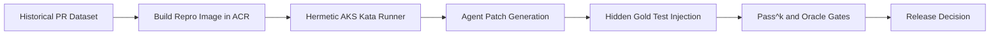
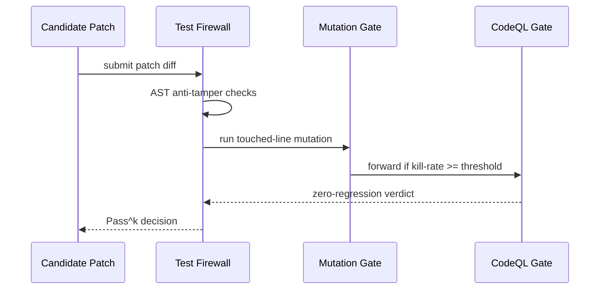

# Private SWE-agent execution benchmark harness selection FAQ: AKS Kata F2P Pass^k vs mutation+CodeQL oracle vs static LLM judge funnel

> 🌐 **Language / 语言切换**: **English (Current)** | **[中文](private-swe-agent-execution-benchmark-harness-aks-kata-f2p-pass-hat-k-vs-mutation-codeql-oracle-vs-static-llm-judge-selection-faq.md)** | **[Back to catalog](README.en.md)**

## 1. Executive summary

- **Pattern A**: private historical PR replay with hermetic `AKS Kata` execution, post-generation hidden gold-test injection, and `Pass^3` release gates is the baseline for production trust.
- **Pattern B**: add mutation and CodeQL differential oracles to reduce reward hacking and security regressions.
- **Pattern C**: run low-cost static rubric pre-filtering before nightly hermetic execution to reduce compute spend by 65-75 percent.
- **Pattern D (forbidden)**: public benchmark scores or mutable in-workspace tests with single-shot pass metrics inflate false confidence.
- **Target outcomes**: robust `Pass^k`, high mutation kill, zero CodeQL regression, deterministic anti-tamper detection.

## 2. Pattern definitions

- **A (hermetic execution)**: F2P/P2P replay with pinned environment snapshots and hidden test injection after patch generation.
- **B (differential oracle)**: touched-line mutation testing plus CodeQL SARIF zero-regression gates.
- **C (two-stage funnel)**: static AST and rubric screening followed by hermetic execution for survivors.
- **D (anti-pattern)**: mutable tests and single-pass metrics driving release decisions.

## 3. Reference architecture (Mermaid 1)



## 4. Release gate sequence (Mermaid 2)



## 5. Quantitative models

1. **Pass@k**: `P(Pass@k)=1-(1-p)^k`.
2. **Pass^k**: `P(Pass^k)=p^k` to enforce repeatability.
3. **sample-size power**: `n >= (Z^2 * p * (1-p)) / e^2`.
4. **snapshot storage**: `Storage = repos * snapshots * base_layer_dedup_factor`.
5. **cost per 1k rollouts**: `C_1k = (compute + storage + orchestration) / runs * 1000`.

### 5.1 Pass@1 vs Pass@k vs Pass^k example

| Metric | p=0.55 | p=0.65 | p=0.75 |
|---|---:|---:|---:|
| Pass@1 | 0.55 | 0.65 | 0.75 |
| Pass@3 | 0.91 | 0.96 | 0.98 |
| Pass^3 | 0.17 | 0.27 | 0.42 |

## 6. Twelve-dimension comparison matrix

| Dimension | Pattern A | Pattern B | Pattern C | Pattern D |
|---|---|---|---|---|
| Reliability gate strength | High | Very high | Medium-high | Low |
| Security regression protection | Medium | Very high | Medium | Low |
| Execution cost | Medium | High | Low-medium | Low surface |
| Anti-gaming resilience | High | Very high | Medium | Low |
| Explainability | High | High | Medium | Low |
| Reproducibility | High | High | Medium | Low |
| Ops complexity | Medium | High | Medium | Low |
| Language stack coverage | Medium | High | Medium | Low |
| Release-risk control | High | Very high | Medium-high | Low |
| Three-year TCO | Medium | Medium-high | Low-medium | High hidden loss |
| Migration friendliness | High | Medium | Very high | Low |
| Anti-pattern exposure | Low | Low | Medium | Critical |

## 7. Deep Q&A (Q1-Q8)

### Q1. Why use Pass^k instead of only Pass@1?
- Pass@1 is highly sensitive to lucky one-off successes.
- Pass^k enforces repeatability and operational confidence.
- Release gates need stability, not isolated wins.
- It reduces accidental green-light incidents.

### Q2. How should mutation thresholds be set?
- Require >=80 percent kill rate on touched control-flow lines.
- Use tiered thresholds by change class when needed.
- Pair with flaky-test quarantine to avoid false alarms.
- Review thresholds against defect escape rates monthly.

### Q3. What is the role of CodeQL here?
- It catches taint and concurrency regressions missed by functional tests.
- It complements F2P/P2P with static risk validation.
- It is crucial for regulated portfolios.
- SARIF outputs map directly to audit evidence.

### Q4. How to prevent test tampering?
- Block patterns like skip injection and assertion deletion via AST rules.
- Protect critical test and CI paths from direct edits.
- Run verification with read-only mounted gold assets.
- Fail fast on any tamper signature.

### Q5. How to choose ACA Jobs vs AKS Kata?
- ACA Jobs fit shorter lower-risk batches.
- AKS Kata fits high-isolation and complex dependency cases.
- Kata on Spot pools can be cost-efficient at scale.
- A risk-tiered hybrid model is often optimal.

### Q6. How to handle flaky tests?
- Maintain quarantine lists and discount them from score weights.
- Do not weaken security gates because of flaky suites.
- Track and remediate flake components with explicit SLAs.
- Use flake trend lines as quality governance input.

### Q7. How to model storage economics?
- Use ACR layer deduplication across snapshot families.
- Separate base-image and dependency-layer cost lines.
- Purge expired snapshots and low-value history.
- Retain hot benchmark slices longer for stability tracking.

### Q8. How to scale rollout organizationally?
- Pilot with two critical migration programs first.
- Integrate gates into release approvals and evidence trails.
- Review false-positive and false-negative outcomes bi-weekly.
- Expand repository coverage only after stable SLOs.

## 8. Sealed F2P/P2P verifier snippet (Python)

```python
def sealed_verify(run, patch):
    assert ast_tamper_check(patch) is True
    env = load_pinned_env(run.base_image)
    apply_patch(env, patch)
    inject_hidden_gold_tests(env)
    return pass_power_k(env, k=3)
```

## 9. AST anti-tamper rules snippet (YAML)

```yaml
forbidden_patterns:
  - "pytest.skip"
  - "@Disabled"
  - "assert True"
protected_paths:
  - "tests/**"
  - "ci/**"
```

## 10. Enterprise scenario A: retail bank Java 8 to 21 migration gate

- Scenario A point 01: apply Pass^3 plus mutation plus CodeQL composite gates on Spring Boot 3 migration patches.

## 11. Enterprise scenario B: .NET and TypeScript platform upgrade validation

- Scenario B point 01: run multi-service replay with unified metrics for stability, regression risk, and cost per 1k executions.

## 12. Three-tier three-year TCO table (USD)

| Tier | Weekly task volume | Pattern A annual | Pattern B annual | Pattern C annual | Anti-pattern loss | Three-year total (recommended path) |
|---|---:|---:|---:|---:|---:|---:|
| Small | 100 | 290,000 | 360,000 | 180,000 | 240,000 | 2,370,000 |
| Medium | 500 | 1,180,000 | 1,620,000 | 820,000 | 1,020,000 | 8,760,000 |
| Large | 2,000 | 4,920,000 | 6,780,000 | 3,350,000 | 4,400,000 | 29,550,000 |

## 13. Day-0 / Day-1 / Day-2 readiness checklist

### Day-0 design phase
- [ ] Day-0 design phase check 01: validate dataset curation, hermetic env, Pass^k gate, oracle gates, alerts, and rollback path.

### Day-1 rollout phase
- [ ] Day-1 rollout phase check 01: validate dataset curation, hermetic env, Pass^k gate, oracle gates, alerts, and rollback path.

### Day-2 operations phase
- [ ] Day-2 operations phase check 01: validate dataset curation, hermetic env, Pass^k gate, oracle gates, alerts, and rollback path.

## 14. Anti-pattern breakdown and remediation

- Remediation 01: never map public leaderboard scores directly to private-repo release gate thresholds.

## 15. Appendix: parameter and governance control catalog

- track `pass_hat_1`, `pass_power_k`, `mutation_kill`, `codeql_regression`, `tamper_hit`, and `cost_per_1k` continuously.
