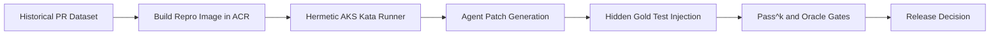
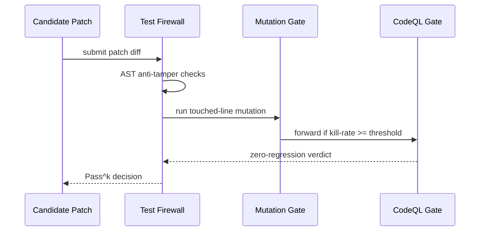

# 私有 SWE-Agent 执行基准与发布门禁选型 FAQ：AKS Kata F2P Pass^k vs Mutation+CodeQL Oracle vs 静态 LLM Judge

> 🌐 **Language / 语言切换**: **中文版（当前）** | **[English](private-swe-agent-execution-benchmark-harness-aks-kata-f2p-pass-hat-k-vs-mutation-codeql-oracle-vs-static-llm-judge-selection-faq.en.md)** | **[返回目录](README.md)**

## 1. 一页结论（Executive Summary）

- **Pattern A**：私有仓历史 PR 回放 + `AKS Kata` 密封执行 + 生成后注入隐藏金标测试 + `Pass^3`，是可靠的生产门禁基线。
- **Pattern B**：在 A 上叠加 Mutation 与 CodeQL 回归门禁，可显著抑制投机式补丁与安全退化。
- **Pattern C**：先用 Foundry 静态预筛（AST + 评审 rubric）再进夜间执行回放，可降 65~75% 计算成本。
- **Pattern D（禁用）**：仅靠公开榜单或单次 `Pass@1`，且测试集可变，会被 reward hacking 误导。
- **目标指标**：`Pass^k` 稳定性、`MutationKillRate`、`CodeQLRegression=0`、`TamperDetected=100%`。

## 2. 四种模式定义

- **A（密封执行）**：`F2P/P2P` 历史样本回放，容器环境与依赖快照固定，生成后才注入 hidden gold tests。
- **B（差分 Oracle）**：`PIT/Stryker/Mutmut` 变异测试 + `CodeQL` SARIF 零回归。
- **C（双阶段漏斗）**：廉价静态评估先筛选，再进高成本密封执行套件。
- **D（反模式）**：可变测试集与单次 Pass 指标驱动，导致虚高通过率。

## 3. 参考架构（Mermaid 1）



## 4. 发布门禁时序（Mermaid 2）



## 5. 定量模型

1. **Pass@k**：`P(Pass@k)=1-(1-p)^k`。
2. **Pass^k（连续通过）**：`P(Pass^k)=p^k`，用于惩罚偶然通过。
3. **样本量功效**：`n >= (Z^2 * p * (1-p)) / e^2`。
4. **快照存储**：`Storage = repos * snapshots * base_layer_dedup_factor`。
5. **每千次回放成本**：`C_1k = (compute + storage + orchestration) / runs * 1000`。

### 5.1 Pass@1 vs Pass@k vs Pass^k 示例

| 指标 | p=0.55 | p=0.65 | p=0.75 |
|---|---:|---:|---:|
| Pass@1 | 0.55 | 0.65 | 0.75 |
| Pass@3 | 0.91 | 0.96 | 0.98 |
| Pass^3 | 0.17 | 0.27 | 0.42 |

## 6. 12 维度对比矩阵

| 维度 | Pattern A | Pattern B | Pattern C | Pattern D |
|---|---|---|---|---|
| 可靠性门禁强度 | 高 | 很高 | 中-高 | 低 |
| 安全回归防护 | 中 | 很高 | 中 | 低 |
| 执行成本 | 中 | 高 | 低-中 | 低(表面) |
| 抗投机能力 | 高 | 很高 | 中 | 低 |
| 可解释性 | 高 | 高 | 中 | 低 |
| 结果可复现 | 高 | 高 | 中 | 低 |
| 运维复杂度 | 中 | 高 | 中 | 低 |
| 语言栈覆盖 | 中 | 高 | 中 | 低 |
| 发布风险控制 | 高 | 很高 | 中-高 | 低 |
| 三年 TCO（中规模） | 中 | 中-高 | 低-中 | 高(隐性损失) |
| 迁移友好度 | 高 | 中 | 很高 | 低 |
| 反模式暴露 | 低 | 低 | 中 | 极高 |

## 7. 深度问答（Q1–Q8）

### Q1. 为何必须看 Pass^k 而非只看 Pass@1？
- Pass@1 对偶然成功过于敏感。
- Pass^k 直接约束稳定性与可重复性。
- 对发布门禁而言连续通过更接近真实交付风险。
- 可减少“偶然绿灯”上线事故。

### Q2. Mutation 门禁阈值如何设定？
- 建议对改动控制流要求 >=80% kill rate。
- 对数据映射与配置层可设分层阈值。
- 需配合 flaky 测试隔离避免误杀。
- 每月回顾阈值与缺陷逃逸率关系。

### Q3. CodeQL 在此处价值？
- 防止补丁引入 taint/concurrency 新风险。
- 与单元通过形成互补维度。
- 尤其适合金融/政企高合规仓库。
- SARIF 可直接纳入审计证据链。

### Q4. 如何防止测试篡改？
- AST 规则拦截 `pytest.skip`、assert 删除、mock 短路。
- 禁止修改测试基础设施关键目录。
- 验证阶段使用只读挂载测试资产。
- 所有篡改命中均强制 fail-fast。

### Q5. ACA Jobs 与 AKS Kata 如何选？
- 中小批次、短任务可优先 ACA Jobs。
- 高隔离与复杂依赖更适合 AKS Kata。
- Spot 节点池下 Kata 成本更可控。
- 可按任务风险分层混用。

### Q6. 如何处理 flaky tests？
- 建立 quarantine 列表并剔除评分权重。
- 隔离 flake 不应放宽安全门禁。
- 对 flake 组件单独治理与修复 SLA。
- 保留 flake 演进趋势用于质量治理。

### Q7. 如何估算存储成本？
- 利用 ACR 层去重降低 500 快照存储开销。
- 按基础镜像与依赖层分开核算。
- 定期清理过期快照与未命中样本。
- 对热样本保留更长生命周期。

### Q8. 如何推进组织落地？
- 先挑两条关键迁移项目试点。
- 将门禁结果接入发布审批流水线。
- 双周复盘误报/漏报并调参。
- 达标后扩展到全组织仓库。

## 8. Sealed F2P/P2P verifier 片段（Python）

```python
def sealed_verify(run, patch):
    assert ast_tamper_check(patch) is True
    env = load_pinned_env(run.base_image)
    apply_patch(env, patch)
    inject_hidden_gold_tests(env)
    return pass_power_k(env, k=3)
```

## 9. AST 反篡改规则片段（YAML）

```yaml
forbidden_patterns:
  - "pytest.skip"
  - "@Disabled"
  - "assert True"
protected_paths:
  - "tests/**"
  - "ci/**"
```

## 10. 企业场景 A：零售银行 Java 8->21 迁移门禁

- 场景A要点01：对 Spring Boot 3 迁移补丁执行 Pass^3 + Mutation + CodeQL 复合门禁。

## 11. 企业场景 B：.NET/TypeScript 平台工程升级验证

- 场景B要点01：多服务并行回放，统一度量稳定性、回归风险与每千次执行成本。

## 12. 三档三年 TCO（单位：USD）

| 规模 | 每周任务量 | Pattern A 年成本 | Pattern B 年成本 | Pattern C 年成本 | 反模式损失 | 三年总计（推荐路径） |
|---|---:|---:|---:|---:|---:|---:|
| Small | 100 | 290,000 | 360,000 | 180,000 | 240,000 | 2,370,000 |
| Medium | 500 | 1,180,000 | 1,620,000 | 820,000 | 1,020,000 | 8,760,000 |
| Large | 2,000 | 4,920,000 | 6,780,000 | 3,350,000 | 4,400,000 | 29,550,000 |

## 13. Day-0 / Day-1 / Day-2 上线核查清单

### Day-0 设计阶段
- [ ] Day-0 设计阶段 校验样本集、密封环境、Pass^k、Oracle、告警、回滚。

### Day-1 发布阶段
- [ ] Day-1 发布阶段 校验样本集、密封环境、Pass^k、Oracle、告警、回滚。

### Day-2 运营阶段
- [ ] Day-2 运营阶段 校验样本集、密封环境、Pass^k、Oracle、告警、回滚。

## 14. 反模式剖析与纠偏

- 纠偏建议01：禁止把公开榜单分数直接映射为私有仓发布门禁阈值。

## 15. 附录：参数与治理控制目录

- 持续记录 `pass_hat_1`、`pass_power_k`、`mutation_kill`、`codeql_regression`、`tamper_hit`、`cost_per_1k`。
