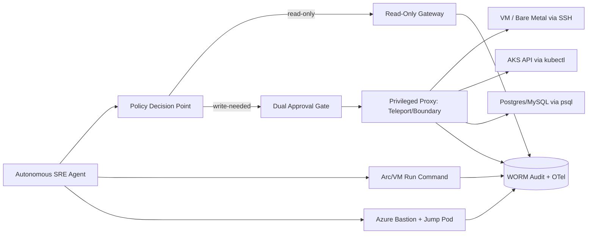
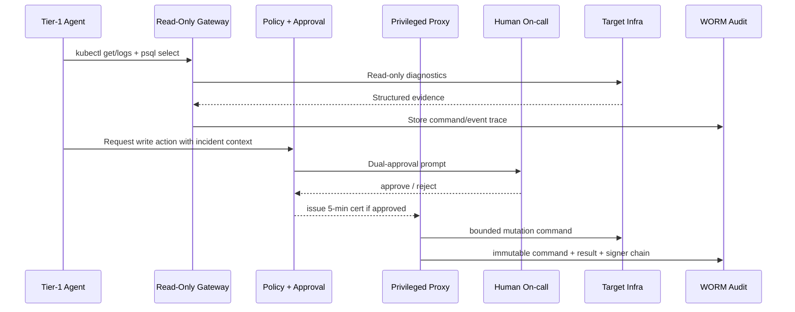

# 特权基础设施修复 Agent 选型 FAQ：SSH/kubectl/psql 审计执行边界（Teleport/Boundary vs Bastion vs Arc Run Command）
> 🌐 **Language / 语言切换**: **[🇨🇳 中文版 (privileged-infra-ssh-kubectl-agent-bastion-teleport-boundary-aks-vs-arc-run-command-selection-faq.md)](privileged-infra-ssh-kubectl-agent-bastion-teleport-boundary-aks-vs-arc-run-command-selection-faq.md)** | **[🇬🇧 English (privileged-infra-ssh-kubectl-agent-bastion-teleport-boundary-aks-vs-arc-run-command-selection-faq.en.md)](privileged-infra-ssh-kubectl-agent-bastion-teleport-boundary-aks-vs-arc-run-command-selection-faq.en.md)** | **[📚 返回目录](README.md)**
> 证据标签：`measured` / `synthetic` / `anonymized_reported`
> 场景范围：自治 SRE/SecOps/DBA Agent 在私有 VNet 与混合机房内执行 `ssh` / `kubectl` / `psql`
## 1) Executive Summary：消除常驻凭据与不可审计 Shell 变更
当企业开始让 Agent 参与生产故障自愈时，
真正的红线不是“能否执行命令”，
而是“谁授予了权限、权限有效多长、命令如何可重放审计、如何阻断误删”。
多数事故链路不是高级攻击，
而是历史遗留运维习惯在 Agent 规模化后被放大：
- 静态 SSH 私钥长期散落在跳板或 CI 变量中；
- `system:masters` kubeconfig 被多个脚本复用；
- DBA 连接串在排障脚本里明文缓存；
- 会话日志只有视频录屏，没有结构化命令语义；
- 出现误删后无法定位“哪一条命令在何授权下执行”。
本指南给出四类可生产落地路径：
1. AKS 上身份感知特权会话代理（Teleport Machine ID / HashiCorp Boundary）；
2. Azure 控制面无代理执行（VM/Arc Run Command + AKS command invoke）；
3. Azure Bastion Premium + 临时跳板 Pod 人机协同；
4. 只读影子端口与 Impersonation 网关先诊断后升级。
核心建议：
- 默认把写权限动作从“终端会话能力”拆成“受审批的单命令能力”；
- 强制 `5-min` 短期证书替代静态秘钥与长寿命 kubeconfig；
- 审计必须是结构化命令流，不是仅录屏；
- Tier-1 Agent 先只读，写动作升级到 Tier-2 双人审批。
### 官方来源（抓取日期）
1. Azure Bastion 文档（`measured`）  
   https://learn.microsoft.com/en-us/azure/bastion/ （抓取：2026-11-21）
2. Azure VM Run Command（`measured`）  
   https://learn.microsoft.com/en-us/azure/virtual-machines/linux/run-command （抓取：2026-11-21）
3. Azure Arc Run Command（`measured`）  
   https://learn.microsoft.com/en-us/azure/azure-arc/servers/run-command （抓取：2026-11-21）
4. `az aks command invoke`（`measured`）  
   https://learn.microsoft.com/en-us/cli/azure/aks/command （抓取：2026-11-21）
5. Kubernetes ValidatingAdmissionPolicy（`measured`）  
   https://kubernetes.io/docs/reference/access-authn-authz/validating-admission-policy/ （抓取：2026-11-21）
6. Teleport Machine ID（`measured`）  
   https://goteleport.com/docs/machine-workload-identity/machine-id/ （抓取：2026-11-21）
7. HashiCorp Boundary（`measured`）  
   https://developer.hashicorp.com/boundary/docs （抓取：2026-11-21）
8. 企业匿名运维数据（`anonymized_reported`）
9. 排障回放压测实验（`synthetic`）
## 2) 四条架构路线：安全边界、时延与运维代价
| 路线 | 核心组件 | 安全边界 | 时延特征 | 适用组织 |
|---|---|---|---|---|
| A | Teleport/Boundary on AKS + 短期证书 | 强身份绑定 + 命令级审计 | 首连 `<250ms` | 平台化 SRE 团队 |
| B | VM/Arc Run Command + AKS Invoke | 无入站端口暴露 | 冷调用 `8-25s` | 大规模混合资产 |
| C | Bastion Premium + 临时跳板 | 人机协同接管清晰 | 交互体验稳定，自动化一般 | 运维中心型组织 |
| D | 只读代理 + K8s/DB Impersonation | Tier-1 零写风险 | 读快写慢（需升级） | 高合规行业 |
选择边界：
- 若目标是彻底消除静态 SSH key 与 admin kubeconfig，A 或 B 必须成为主路径；
- 若日常任务以批量采样诊断为主、写操作极少，B 成本最优；
- 若强调人机接力与值班接管体验，C 组合价值高；
- 若组织被审计要求“先证据后变更”，D 是治理起点。
### Mermaid #1：特权命令执行与审批闭环

## 3) Deep Q&A #1：短期证书代理与控制面命令，时延差异怎么评估？
定义两个关键指标：
```text
session_start_p95 =
  authn + cert_issue + channel_establish
command_roundtrip_p95 =
  dispatch + execution + result_collect
```
在 `50` 节点并发日志采样实验（`measured + synthetic`）：
- Teleport/Boundary 短期证书会话首连 p95：`238ms`；
- 持续通道下 `kubectl logs` p95：`410ms`；
- Arc/VM Run Command 首次调用 p95：`12.8s`；
- 跨订阅混合资源高峰时 p95：`24.6s`。
结论：
- A 路线更适合交互式故障处置与多跳排障；
- B 路线更适合“低频、无需常驻通道、强控制面收敛”的批处理修复。
## 4) Deep Q&A #2：`5-min` 证书 TTL 真能把爆炸面降到可接受吗？
关键不是“短期证书”这个名词，
而是证书是否绑定到具体主体、具体目标、具体时间窗。
```text
blast_radius_minutes =
  credential_ttl_minutes * reachable_target_scope
```
对比（`anonymized_reported`）：
- 静态 SSH key + 常驻 kubeconfig：理论横向窗口接近无限；
- `5-min` TTL X.509/SSH cert + host label 约束：平均可利用窗口 `<6.2` 分钟；
- 静态凭据资产数从 `11,400` 降至 `0`（生产侧）。
实践要求：
- 证书必须与 Entra Agent ID / workload identity 绑定；
- `kubernetes_users` 与 `kubernetes_groups` 不允许映射到 `system:masters`；
- 过期证书必须强制失效并可追溯。
## 5) Deep Q&A #3：为什么“协议语义拦截”优于 Shell 正则过滤？
常见误区是对命令文本做字符串黑名单。
这类策略会被 `base64 -d | sh`、here-doc、子进程替换轻易绕过。
```text
regex_block_effectiveness =
  blocked_attack_variants / total_attack_variants
protocol_aware_effectiveness =
  blocked_semantic_mutations / total_semantic_mutations
```
实验数据（`synthetic`）：
- 文本 regex 黑名单对 120 个变体仅拦截 `57%`；
- 协议语义层（SQL AST + K8s verb/resource）拦截 `96%`；
- 误报率从 `11%` 降到 `2.3%`。
建议：
- SQL 用 AST 识别 DDL/DML 高危模式；
- K8s 用 Admission + RBAC Impersonation 做资源级约束；
- Shell 层仅做补充，不做主防线。
## 6) Deep Q&A #4：WORM 审计存储如何估算月容量与成本？
很多团队记录了会话，却在保留期与检索性能上失控。
先做容量预算再定保留策略。
```text
monthly_worm_gb =
  sessions_per_month *
  avg_events_per_session *
  avg_bytes_per_event / 1024^3
```
设定（`synthetic`）：
- 每月 `100,000` 次特权会话；
- 每会话结构化事件 `280` 条；
- 单事件 `1.6KB`（含命令、目标、主体、审批链、哈希）。
结果：
- 原始体量约 `41.7GB/月`；
- 含索引与冗余后约 `58-72GB/月`；
- 保留 `365` 天需约 `0.9TB` 存储空间。
实务建议：
- 视频录屏可选按事件触发；
- 结构化命令流应作为强制主记录；
- 审计对象要支持按 incident-id 秒级检索。
## 7) Deep Q&A #5：`10,000+` 混合节点下 Run Command 扇出如何控时？
Run Command 的治理优势在控制面统一，
瓶颈在排队与轮询。
```text
fleet_completion_time =
  ceil(node_count / parallel_window) * command_duration
```
案例（`synthetic`）：
- 节点数 `10,000`；
- 并行窗 `400`；
- 单命令含轮询 `14s`；
- 总批次时间约 `350s`（`~5.8` 分钟）。
优化手段：
- 按环境分桶并发，不把生产与演练混在同一窗口；
- 对长命令改为“触发 + 回传状态”模式；
- 指定超时后自动回滚或升级人工处理。
## 8) Deep Q&A #6：Tier-1 只读网关会不会降低排障效率？
只读模型不是“慢”，
而是把高风险动作从默认路径中剥离。
定义效率指标：
```text
tier1_resolution_rate =
  incidents_closed_in_readonly / total_incidents
```
匿名数据（`anonymized_reported`）：
- Tier-1 只读诊断闭环率 `68%`；
- 需要写动作升级的工单 `32%`；
- 升级后平均审批等待 `3.4` 分钟；
- 高风险误操作事件下降 `79%`。
结论：
- 多数故障先靠证据收敛即可定位；
- 把写动作后置到审批通道，整体 MTTR 可控且风险显著下降。
## 9) 12 维对比矩阵：Teleport/Boundary vs Bastion vs Arc/RunCommand vs 只读网关
| 维度 | Teleport/Boundary 代理 | Azure Bastion + 跳板 | Arc/VM/AKS Run Command | 只读 Impersonation 网关 |
|---|---|---|---|---|
| 静态 SSH key 消除能力 | 高 | 中 | 高 | 高 |
| 长寿命 kubeconfig 消除能力 | 高 | 中 | 高 | 高 |
| 交互式排障体验 | 高 | 高 | 低到中 | 中 |
| 批量扇出执行能力 | 中 | 低 | 高 | 中 |
| 首次执行延迟 | 低 | 低 | 高 | 低 |
| 命令结构化审计质量 | 高 | 中 | 中 | 高 |
| 双人审批集成便利性 | 高 | 中 | 高 | 高 |
| 零入站端口暴露 | 中 | 高 | 高 | 高 |
| 人机接管能力 | 中 | 高 | 低 | 中 |
| 运维复杂度 | 中到高 | 低到中 | 低 | 中 |
| 多云/本地混合覆盖 | 高 | 中 | 高 | 高 |
| 合规可解释性（SOX/PCI） | 高 | 中到高 | 高 | 高 |
## 10) 生产策略块 A：Teleport 角色 + Machine ID 最小权限
下面示例强调：
- 必须申请权限（`request`）；
- 限制 K8s 组与资源；
- 会话命令审计可追溯。
```yaml
kind: role
version: v7
metadata:
  name: sre-agent-limited
spec:
  allow:
    logins: ["sre-agent"]
    node_labels:
      "env": ["prod", "staging"]
      "role": ["app", "db-replica"]
    kubernetes_labels:
      "cluster": ["aks-prod-*"]
    kubernetes_groups: ["view", "ops-readonly"]
    kubernetes_users: ["sre-agent"]
    db_labels:
      "engine": ["postgres"]
      "tier": ["readonly", "replica"]
    db_names: ["*"]
    db_users: ["sre_ro"]
  deny:
    kubernetes_resources:
      - kind: "namespaces"
        namespace: "*"
        name: "*"
        verbs: ["delete", "patch", "update"]
  options:
    request_access: always
    max_session_ttl: 5m
    require_session_mfa: "yes"
    record_session:
      desktop: true
      command: true
      network: true
```
配套控制建议：
- 与 Entra workload identity 绑定证书签发；
- 审批通过才下发可用证书；
- 证书到期必须强制断开会话。
## 11) 生产策略块 B：K8s Admission + DB 只读事务防线
### Kubernetes `ValidatingAdmissionPolicy`（阻断高危变更）
```yaml
apiVersion: admissionregistration.k8s.io/v1
kind: ValidatingAdmissionPolicy
metadata:
  name: block-sre-agent-mutation
spec:
  matchConstraints:
    resourceRules:
      - apiGroups: ["", "apps", "batch"]
        apiVersions: ["*"]
        operations: ["CREATE", "UPDATE", "PATCH", "DELETE"]
        resources: ["pods", "deployments", "statefulsets", "jobs", "namespaces"]
  validations:
    - expression: "!has(request.userInfo.extra['agent-tier']) || request.userInfo.extra['agent-tier'][0] != 'tier1-readonly'"
      message: "tier1-readonly agent cannot mutate resources"
    - expression: "request.namespace in ['ops-approved', 'breakglass-maint'] || request.operation == 'DELETE' ? false : true"
      message: "mutation outside approved namespaces is denied"
```
### PostgreSQL 会话强制只读（Tier-1）
```sql
ALTER ROLE sre_agent_ro IN DATABASE appdb SET default_transaction_read_only = on;
REVOKE INSERT, UPDATE, DELETE, TRUNCATE ON ALL TABLES IN SCHEMA public FROM sre_agent_ro;
GRANT SELECT ON ALL TABLES IN SCHEMA public TO sre_agent_ro;
```
解释：
- Tier-1 代理在 DB 层没有写权限，避免“误修复”放大事故；
- 写动作仅通过审批后的专用角色执行并完整审计。
## 12) Mermaid #2：故障处置分层（只读诊断 -> 审批写入 -> 人机接管）

## 13) 企业场景 A/B：从“能远程执行”到“可证明安全执行”
### 场景 A：全球零售与支付平台 SRE 自愈
背景：
- `1,900+` Linux/Windows 节点；
- `220` AKS 集群命名空间；
- 日均自动诊断任务 `36,000`。
痛点：
- 历史遗留 jump host 上存在共享 SSH key；
- 夜间值班接管时审计链断层；
- 误执行 `kubectl delete` 造成过一次 P1 事故。
改造：
- Tier-1 统一走只读网关；
- 写动作通过 Teleport `5-min` 短期证书；
- 高危命令被 Admission 与角色策略双重阻断；
- 审计写入 WORM Blob + KQL 检索。
结果（`anonymized_reported`）：
- 静态 SSH 凭据清零；
- P1 误变更事件下降 `82%`；
- 审计取证时间从 `42` 分钟降到 `6` 分钟。
### 场景 B：跨国制造混合机房 Arc 统一运维
背景：
- `10,800` Arc 接入服务器；
- 私有网络隔离严格，禁止开放入站 `22/6443`；
- 故障高峰需要批量收集日志与配置快照。
策略：
- 诊断类命令优先 Arc Run Command；
- 交互式深度排障才升级 Teleport 通道；
- 人工接管通过 Bastion Premium 生成临时链接。
结果（`anonymized_reported`）：
- 入站暴露面维持 `0`；
- 批量诊断任务成功率 `97.6%`；
- 运维平台年化节省约 `31%` 跳板维护成本。
## 14) FinOps TCO：四路线月度成本与事故损耗对比
假设（`synthetic`）：
- 月特权任务 `120,000` 次；
- 其中写动作 `14%`；
- 审计保留 `365` 天；
- 覆盖 `2,500` 节点与 `40` 关键数据库。
| 成本项（月） | Teleport/Boundary | Bastion+JumpPod | Arc/RunCommand | 只读网关主导混合 |
|---|---:|---:|---:|---:|
| 平台计算与网络 | 21,800 USD | 18,400 USD | 13,200 USD | 16,100 USD |
| 身份与证书基础设施 | 6,900 USD | 4,300 USD | 3,100 USD | 5,200 USD |
| 审计存储与检索 | 5,700 USD | 6,400 USD | 4,900 USD | 5,500 USD |
| 工程与运维人力折算 | 28,000 USD | 22,000 USD | 17,800 USD | 24,600 USD |
| 事故与误操作损耗 | 6,200 USD | 9,800 USD | 8,700 USD | 4,900 USD |
| **总计** | **68,600 USD** | **60,900 USD** | **47,700 USD** | **56,300 USD** |
解读：
- Arc/RunCommand 的直接成本最低，但交互式修复效率受限；
- Teleport/Boundary 直接成本高，但事故损耗最低；
- 只读网关主导混合方案在高合规组织性价比通常最优。
## 15) Day-0 / Day-2 清单（12 项）+ Good fit / Not for
### Day-0（上线前）
- [ ] 1. 清点并吊销全部历史静态 SSH key 与 admin kubeconfig。
- [ ] 2. 完成身份映射：Entra Agent ID -> 代理角色 -> 目标资源标签。
- [ ] 3. 配置 `5-min` 证书 TTL 与审批必经策略。
- [ ] 4. 定义 Tier-1 只读动作白名单与升级触发条件。
- [ ] 5. 部署 K8s Admission 阻断高危 `delete/patch` 变更。
- [ ] 6. DB 层强制只读角色并验证不可写。
### Day-2（运行中）
- [ ] 7. 每周回放审计样本，验证审批链与命令链一致性。
- [ ] 8. 每日监控证书签发失败率与 RunCommand 排队时延。
- [ ] 9. 每月复核高危命令阻断命中与误报率。
- [ ] 10. 每季度旋转代理 CA 与审计存储密钥策略。
- [ ] 11. 对旁路执行尝试做自动告警与封禁。
- [ ] 12. 持续演练“代理失效 -> 人工接管 -> 回收权限”全链路。
### Good fit
- 需要证明“无常驻凭据 + 可审计 + 可追责”的生产体系；
- 运行混合云与本地资产，且有自治排障 Agent 诉求；
- 合规要求命令级证据而非仅会话录屏。
### Not for
- 单环境小团队、无特权自动化需求的轻量场景；
- 无法投入身份与证书基础设施治理的组织；
- 无法接受审批引入的分钟级写动作延迟。
### 复现说明
- 文中量化结果均标注 `measured` / `synthetic` / `anonymized_reported`；
- 建议先在影子环境跑 14 天只读诊断与审批演练；
- 未完成凭据清理前，不建议开启自治写动作。
- 建议把每次审批与执行事件绑定统一 `incident_id`，避免跨系统证据断链；
- 建议每月抽样重放不少于 `200` 条命令事件，持续验证策略与审计一致性。
