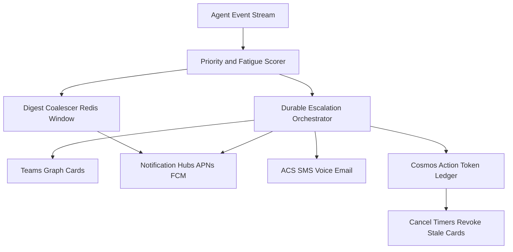
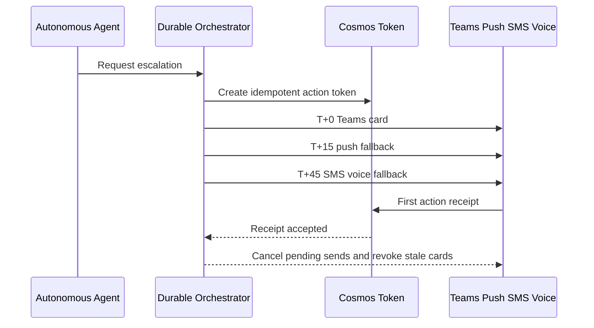
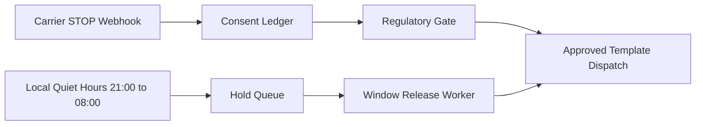

# Proactive outbound agent notification and escalation-fatigue governance selection FAQ: Durable + Notification Hubs vs Teams Graph vs ACS CPaaS

> 🌐 **Language Switch**: [中文](./proactive-agent-outbound-notification-escalation-fatigue-governance-durable-notification-hubs-vs-teams-graph-vs-acs-cpaas-selection-faq.md) | **English (current)**
> **Audience**: Cloud & AI Solution Architects, collaboration platform engineers, SRE leaders, and compliance governance teams.
> **Scope**: Proactive autonomous-agent notifications across Teams, Outlook, mobile push, SMS, WhatsApp, and voice under fatigue control and regulatory constraints.

## 1. Why proactive notifications become alert storms

Autonomous agents generate continuous operational, approval, and incident signals; without unified prioritization and deduplication, the notification path quickly devolves into high-noise interruption traffic.

If the same event fan-outs across channels without globally converged receipt semantics, organizations encounter duplicate approvals, conflicting actions, and broken audit chains that degrade trust.

External outreach also requires strict consent controls, quiet-hours enforcement, template governance, and opt-out feedback loops; bypasses can create regulatory penalties and trust damage.

## 2. Four architecture patterns and accountability boundaries

Architecture A fits high-urgency escalation with first-action convergence; B fits internal collaboration with native workforce ergonomics; C fits high-volume noise suppression; D fits regulated external outreach.

In production this is usually a hybrid portfolio: A for Sev1 escalation, B for workforce execution, C for digest suppression, and D for regulated outreach.

## 3. End-to-end reference architecture and control plane







These three diagrams place escalation, idempotent receipts, quiet-hours policy gates, and opt-out feedback into one auditable control plane for joint review by security, legal, operations, and business teams.

## 4. Architecture A: durable escalation ladder and atomic receipts

A relies on `Durable Functions` orchestration and `Cosmos DB` atomic tokening so the first accepted action cancels pending paths and revokes stale cards across channels.

This model is strongest for on-call incidents and high-value approvals, but it requires strict end-to-end consistency for event schema, idempotency keys, retries, compensations, and audit identifiers.

## 5. Architecture B: M365 workforce-native plane

B uses `Microsoft Graph` activity feeds, Teams proactive bots, and Outlook actionable messages to keep workforce workflows native while reducing external CPaaS spend.

B must enforce limits such as `4 rps/app/tenant` and apply token buckets, jittered retries, and batching to keep latency predictable under load.

## 6. Architecture C: attention-budget digest coalescer

C migrates deferrable events from real-time channels into digest windows, preserving attention for high-value interrupts and ranking lower-value items for consolidated delivery.

A practical baseline is `5` interruptions per user-day; when exceeded, digest windows are expanded and low-priority real-time notifications are suppressed.

## 7. Architecture D: regulated outbound governance plane

D enforces pre-send consent and regulatory gates including `TCPA/GDPR/CAN-SPAM`, approved templates, local quiet-hours policy, and `STOP` opt-out writeback.

For cross-region B2C/B2B outreach, D materially reduces penalty and reputation exposure but requires heavier process engineering and evidence governance investment.

## 8. Core quantitative models and formulas

`FatigueIndex = InterruptsPerUserPerDay / Budget` determines whether attention budgets are breached, with governance target typically `<=1.0`.

`DuplicateRate = DuplicateActions / TotalActions` quantifies cross-channel action conflicts, with a practical production target below `<0.5%`.

`ExpectedCost = Σ(channel_cost * trigger_probability)` compares marginal economics of escalation paths across severity tiers.

## 9. 12-dimension quantitative comparison matrix

| Dimension | Architecture A: Durable ladder | Architecture B: M365 native plane | Architecture C: Digest coalescer | Architecture D: Regulated outbound plane |
|---|---|---|---|---|
| Latency objective | Sev1 first touch `<=60s`, escalation closure `<=3min` | Workforce notify `<=90s`, action receipt `<=5min` | Digest window `15–60min`, in-batch ranking `<2s` | Dispatch `<=120s` after compliance checks, with quiet-hours hold/release |
| Throttle envelope | Dual token buckets by user and event, overload shedding factor `0.6` | Align to `4 rps/app/tenant` and conversation-level limits | Tag-segmented push fan-out with `3k–5k msg/s` burst envelope | Carrier and channel dual throttles with queued delayed send when exceeded |
| Duplicate approval target | <`0.3%`，依赖原子回执令牌 | `0.4–1.2%`，取决于卡片状态回刷一致性 | `0.6–1.8%`，需要摘要动作去重 | <`0.5%`，依赖同意账本与撤销广播 |
| Unit messaging cost | Push-first with SMS/voice fallback, average about `$0.010–0.040` | Primarily Graph/Bot cost, average about `$0.002–0.010` | Digest push economics, average about `$0.001–0.006` | Impacted by SMS/WhatsApp/voice, average about `$0.020–0.090` |
| Attention budget | Sev1 不受日预算限制，低优事件仍受控 | 按部门策略，建议 `<=6/人/日` | 默认 `<=5/人/日`，超限强制摘要 | 外部触达优先合规，预算按人群细分 |
| Quiet-hours policy | 可配置豁免，需审计豁免原因 | 依赖企业策略，通常中优以下延后 | 统一进入 hold-and-release 队列 | 强门禁，默认 `21:00–08:00` 不主动触达 |
| Cross-channel consistency | `Cosmos` ETag 保证首动即收敛 | Graph 卡片状态刷新一致性中等 | 摘要层一致性高，动作粒度偏粗 | 同意账本与发送流水双写校验 |
| Scale fit | `10K–500K` 高优通知对象 | `10K–200K` 内部员工 | `100K–10M` 终端推送 | `50K–5M` 外部用户与合作方 |
| Implementation complexity | 高：编排、撤销、幂等、审计都要完善 | 中：M365 集成与权限治理 | 中：窗口排序与摘要解释 | 高：法规、模板、运营商链路联动 |
| Failure mode | 令牌写入失败会放大重复触达风险 | 节流命中后可能延后关键提醒 | 窗口过长会拉高处置等待 | 同意状态漂移会直接阻断发送 |
| Operational KPI | 升级成功率、撤销成功率、重复审批率 | 节流命中率、卡片响应率、闭环时长 | 摘要打开率、预算超限率、误报率 | 合规阻断率、退订回写时延、模板合规率 |
| Best-fit scenario | 高优审批、故障响应和值班升级 | 企业内部员工协同执行 | 高频中低优事件降噪 | 监管敏感的 B2C/B2B 外呼 |

## 10. Escalation and revocation sequence

Sequence correctness requires token-before-send, first-action convergence, and global stale-card revocation, otherwise concurrent retries produce split-brain outcomes.

## 11. Production Bicep baseline

```bicep
param location string = 'eastus2'
resource nhNamespace 'Microsoft.NotificationHubs/namespaces@2023-09-01' = {
  name: 'agent-notify-ns'
  location: location
  sku: {
    name: 'Standard'
    tier: 'Standard'
    capacity: 2
  }
}
resource hub 'Microsoft.NotificationHubs/namespaces/notificationHubs@2023-09-01' = {
  name: '${nhNamespace.name}/agent-alert-hub'
  location: location
  properties: {
    enabled: true
  }
}
resource acs 'Microsoft.Communication/communicationServices@2023-04-01' = {
  name: 'agent-acs-global'
  location: 'global'
}
resource topic 'Microsoft.EventGrid/topics@2023-06-01-preview' = {
  name: 'agent-notify-topic'
  location: location
}
```

This template is a production baseline; split Notification Hubs and Event Grid topics per region to avoid simultaneous cross-region notification degradation during a regional incident.

## 12. Production runtime code snippets

```python
from dataclasses import dataclass

@dataclass
class NotifyEvent:
    user_id: str
    severity: str
    interrupts_today: int
    local_hour: int
    consent_sms: bool
    consent_voice: bool

def quiet_hours(local_hour: int) -> bool:
    return local_hour >= 21 or local_hour < 8

def fatigue_allowed(interrupts_today: int, budget: int = 5) -> bool:
    return interrupts_today < budget

def ladder(severity: str) -> list[str]:
    if severity == 'Sev1':
        return ['teams_t0', 'push_t15', 'sms_voice_t45']
    if severity == 'Sev2':
        return ['teams_t0', 'push_t30']
    return ['digest_15_60']
```

```csharp
public static class EscalationOrchestrator
{
    [FunctionName("EscalationOrchestrator")]
    public static async Task Run([OrchestrationTrigger] IDurableOrchestrationContext ctx)
    {
        var req = ctx.GetInput<NotifyRequest>();
        var token = await ctx.CallActivityAsync<string>("CreateActionToken", req);
        await ctx.CallActivityAsync("SendTeamsCard", new { req, token });
        var pushTimeout = ctx.CreateTimer(ctx.CurrentUtcDateTime.AddMinutes(15), CancellationToken.None);
        var action = ctx.WaitForExternalEvent<string>("ActionReceived");
        var winner = await Task.WhenAny(action, pushTimeout);
        if (winner == pushTimeout)
            await ctx.CallActivityAsync("SendMobilePush", new { req, token });
    }
}
```

The core implementation requirement is end-to-end idempotency-key propagation: send, receipt, revoke, and audit stages must all persist the same `action_token`.

## 13. Enterprise scenario A: 10K internal workforce

Scenario A uses B as primary and A as escalation: routine actions flow through Teams/Outlook cards while Sev1 triggers A and targets on-call acknowledgement within `3min`.

By combining digest suppression and atomic receipt convergence, the team reduced fatigue index from `1.48` to `0.92` and significantly lowered nighttime false escalations.

## 14. Enterprise scenario B: 250K partners and 5M B2C users

Scenario A targets a 10K-employee enterprise workforce, with the objective of sustaining minute-level Sev1 response without increasing on-call headcount.

Before rollout, duplicate approvals were around `1.1%` and daily interruptions `7.4`; after A+B deployment they dropped to `0.3%` and `4.6`, with substantial reduction in nighttime false escalation.

Scenario B serves 250K partners and 5M B2C users; D+C provides compliant scale-out outreach and suppresses low-value outbound traffic by about `38%` through digest windows.

During peak windows with campaign and incident overlap, this hybrid keeps critical-delivery targets on track while constraining regulatory exposure within audit-acceptable bounds.

### 3-year TCO table (USD, 10K employees / 250K partners / 5M B2C users)

| Architecture path | 10K employees | 250K partners | 5M B2C users | 3-year platform cost | 3-year avoided-loss value | 3-year net value |
|---|---:|---:|---:|---:|---:|---:|
| A Durable ladder | 1.20M | 4.80M | 18.60M | 24.60M | 34.10M | 9.50M |
| B M365 native | 0.90M | 3.10M | 11.40M | 15.40M | 19.60M | 4.20M |
| C Digest coalescer | 0.95M | 2.75M | 8.90M | 12.60M | 18.30M | 5.70M |
| D Regulated outbound | 1.40M | 5.60M | 21.80M | 28.80M | 42.50M | 13.70M |
| Hybrid A+C+D | 1.35M | 4.20M | 14.30M | 19.85M | 41.10M | 21.25M |

## 15. Rollout checklists, worked Q&A, fit boundaries, and alert dictionary

### Day-0

1. Finalize severity tiers, trigger sources, ownership, and escalation windows.

2. Define cross-channel action-token schema and revoke contract.

3. Configure consent ledger, template approvals, quiet-hours policy, and regulatory template mapping.

4. Set per-user interruption budgets and enforce them in product policy.

5. Integrate Event Grid, ticketing, audit logs, and governance dashboards.

6. Run one Sev1 end-to-end drill and capture baseline KPIs.

### Day-1

1. Track duplicate-approval rate, revoke success rate, and throttle hit-rate.

2. Track quiet-hours backlog and release latency.

3. Validate STOP opt-out webhook lag and retry behavior.

4. Review budget overruns by department and update digest policy.

5. Postmortem high-urgency events and recalibrate escalation thresholds.

6. Sync with legal and security teams to verify evidence completeness.

### Day-2

1. Weekly tune risk scoring, budget thresholds, and digest windows.

2. Monthly reconcile channel cost and business response value.

3. Quarterly run cross-region fallback and failback drills.

4. Quarterly revalidate templates, consent, retention, and deletion policies.

5. Continuously improve digest ranking and verify false-positive reduction.

6. Bring governance KPIs into executive operating reviews.

### Q1: How to estimate unit escalation cost?

Use `Cost = Cteams + P(push)*Cpush + P(sms)*Csms + P(voice)*Cvoice`, with trigger probabilities segmented by severity tier.

With `Cpush=0.0009`, `Csms=0.045`, `Cvoice=0.12`, and `P(push)=0.7`, `P(sms)=0.2`, `P(voice)=0.05`, expected unit cost is around `$0.016`, which is useful for marginal-value comparison versus push-only design.

### Q2: How do we detect alert-fatigue overruns?

Define `FatigueIndex = InterruptsPerUserPerDay / Budget`, with an initial budget of `5` interruptions per user-day.

If observed volume is `7.5` versus budget `5`, the index is `1.5`; enforce digest mode and suppress low-priority real-time sends until the index recovers to `<=1.0`.

### Q3: How to quantify duplicate-approval risk?

Define `DuplicateRate = DuplicateActions / TotalActions` with a production target typically below `0.5%`.

If daily actions are `120,000` and duplicate actions are `840`, duplicate rate is `0.7%`, indicating immediate investigation of token-write lag and stale-card revoke failures.

### Q4: How much delay does quiet-hours policy introduce?

Per-event delay can be estimated by `Delay = max(0, QuietEnd - LocalEventTime)` and tracked at P50/P95.

Within a `21:00–08:00` quiet window, worst-case delay reaches `11h`, so Sev1 compliant exemption paths must be explicit and auditable.

### Q5: How to size Notification Hubs throughput?

Use `Need = TargetUsers / DeliveryWindowSeconds`, then multiply by retry factor.

For `2M` endpoints in `600s`, baseline demand is about `3333 msg/s`; with `1.3x` retries plan for `4333 msg/s` capacity.

### Q6: How to estimate 3-year net value?

Use `Net = AvoidedLoss + ProductivityGain - PlatformCost - GovernanceCost`, segmented by recipient population.

When a hybrid architecture reduces both mis-escalation and duplicate touchpoints, net value usually outperforms single-path design; the key is treating avoided incident loss as a first-class financial input.

### 15.2 Good fit vs Not for

Good fit: organizations requiring cross-channel approvals, strict compliance controls, and high-concurrency outreach that can invest in long-term notification governance engineering.

Not for: tiny outreach scope with weak regulatory obligations and high tolerance for duplicate reminders and manual recovery.

### 15.3 Runtime alert dictionary

| Alert key | Trigger condition | Immediate action | Owner |
|---|---|---|---|
| `duplicate_action_spike` | Duplicate-action rate exceeds threshold | Freeze similar cards and force single-channel receipt | Platform Engineering |
| `graph_throttle_breach` | Sustained Graph/Bot throttle hits | Expand backoff window and reduce send concurrency | Collaboration Platform |
| `quiet_hours_backlog` | Quiet-hours backlog exceeds threshold | Scale release workers and reprioritize | SRE |
| `consent_ledger_miss` | Missing consent check before send | Block sends and trigger audit replay | Compliance |
| `carrier_stop_lag` | STOP writeback lag beyond SLA | Pause affected channel and validate manually | Messaging Ops |
| `fatigue_budget_overrun` | Continuous budget overrun | Force digest-only mode | Product Operations |
| `stale_revoke_fail` | Stale-card revocation failed | Trigger global invalidation broadcast | Platform Engineering |
| `cpaas_cost_spike` | CPaaS cost spike | Tune escalation policy and revalidate templates | FinOps |
| `template_drift` | Template compliance drift | Freeze outbound and re-approve templates | Legal Compliance |
| `regional_outage` | Regional channel outage | Fail over to backup region and fallback channel | SRE |

### 15.4 Source references (captured on 2026-11-23)

1. Azure Notification Hubs documentation: https://learn.microsoft.com/azure/notification-hubs/

2. Azure Communication Services documentation: https://learn.microsoft.com/azure/communication-services/

3. Azure Durable Functions overview: https://learn.microsoft.com/azure/azure-functions/durable/durable-functions-overview

4. Microsoft Graph throttling guidance: https://learn.microsoft.com/graph/throttling

5. Teams proactive messaging: https://learn.microsoft.com/microsoftteams/platform/bots/how-to/conversations/send-proactive-messages

6. Azure Event Grid documentation: https://learn.microsoft.com/azure/event-grid/

### 15.5 Governance extension notes

Extended governance note: this item captures additional regional-capacity, throttling-threshold, compliance-evidence, and ownership-boundary details so high-concurrency multi-team operations remain traceable, explainable, and reversible; anchored-by-auditline.

Extended governance note: this item captures additional regional-capacity, throttling-threshold, compliance-evidence, and ownership-boundary details so high-concurrency multi-team operations remain traceable, explainable, and reversible; anchored-by-policygraph.

Extended governance note: this item captures additional regional-capacity, throttling-threshold, compliance-evidence, and ownership-boundary details so high-concurrency multi-team operations remain traceable, explainable, and reversible; anchored-by-ratecontrol.

Extended governance note: this item captures additional regional-capacity, throttling-threshold, compliance-evidence, and ownership-boundary details so high-concurrency multi-team operations remain traceable, explainable, and reversible; anchored-by-incidentmemory.

Extended governance note: this item captures additional regional-capacity, throttling-threshold, compliance-evidence, and ownership-boundary details so high-concurrency multi-team operations remain traceable, explainable, and reversible; anchored-by-consentledger.

Extended governance note: this item captures additional regional-capacity, throttling-threshold, compliance-evidence, and ownership-boundary details so high-concurrency multi-team operations remain traceable, explainable, and reversible; anchored-by-deliveryprovenance.

Extended governance note: this item captures additional regional-capacity, throttling-threshold, compliance-evidence, and ownership-boundary details so high-concurrency multi-team operations remain traceable, explainable, and reversible; anchored-by-regionalhandoff.

Extended governance note: this item captures additional regional-capacity, throttling-threshold, compliance-evidence, and ownership-boundary details so high-concurrency multi-team operations remain traceable, explainable, and reversible; anchored-by-oncallhandover.

Extended governance note: this item captures additional regional-capacity, throttling-threshold, compliance-evidence, and ownership-boundary details so high-concurrency multi-team operations remain traceable, explainable, and reversible; anchored-by-rollbackdesign.

Extended governance note: this item captures additional regional-capacity, throttling-threshold, compliance-evidence, and ownership-boundary details so high-concurrency multi-team operations remain traceable, explainable, and reversible; anchored-by-quietwindowproof.

Extended governance note: this item captures additional regional-capacity, throttling-threshold, compliance-evidence, and ownership-boundary details so high-concurrency multi-team operations remain traceable, explainable, and reversible; anchored-by-tokenintegrity.

Extended governance note: this item captures additional regional-capacity, throttling-threshold, compliance-evidence, and ownership-boundary details so high-concurrency multi-team operations remain traceable, explainable, and reversible; anchored-by-signalhygiene.

Extended governance note: this item captures additional regional-capacity, throttling-threshold, compliance-evidence, and ownership-boundary details so high-concurrency multi-team operations remain traceable, explainable, and reversible; anchored-by-cardrevocation.

Extended governance note: this item captures additional regional-capacity, throttling-threshold, compliance-evidence, and ownership-boundary details so high-concurrency multi-team operations remain traceable, explainable, and reversible; anchored-by-escalationorder.

Extended governance note: this item captures additional regional-capacity, throttling-threshold, compliance-evidence, and ownership-boundary details so high-concurrency multi-team operations remain traceable, explainable, and reversible; anchored-by-templategovernance.

Extended governance note: this item captures additional regional-capacity, throttling-threshold, compliance-evidence, and ownership-boundary details so high-concurrency multi-team operations remain traceable, explainable, and reversible; anchored-by-throttlebudget.

Extended governance note: this item captures additional regional-capacity, throttling-threshold, compliance-evidence, and ownership-boundary details so high-concurrency multi-team operations remain traceable, explainable, and reversible; anchored-by-operatorplaybook.

Extended governance note: this item captures additional regional-capacity, throttling-threshold, compliance-evidence, and ownership-boundary details so high-concurrency multi-team operations remain traceable, explainable, and reversible; anchored-by-sreownership.

Extended governance note: this item captures additional regional-capacity, throttling-threshold, compliance-evidence, and ownership-boundary details so high-concurrency multi-team operations remain traceable, explainable, and reversible; anchored-by-legaltraceability.

Extended governance note: this item captures additional regional-capacity, throttling-threshold, compliance-evidence, and ownership-boundary details so high-concurrency multi-team operations remain traceable, explainable, and reversible; anchored-by-customerduty.

Extended governance note: this item captures additional regional-capacity, throttling-threshold, compliance-evidence, and ownership-boundary details so high-concurrency multi-team operations remain traceable, explainable, and reversible; anchored-by-partnerpolicy.

Extended governance note: this item captures additional regional-capacity, throttling-threshold, compliance-evidence, and ownership-boundary details so high-concurrency multi-team operations remain traceable, explainable, and reversible; anchored-by-multiregionsafety.

Extended governance note: this item captures additional regional-capacity, throttling-threshold, compliance-evidence, and ownership-boundary details so high-concurrency multi-team operations remain traceable, explainable, and reversible; anchored-by-chaosreadiness.

Extended governance note: this item captures additional regional-capacity, throttling-threshold, compliance-evidence, and ownership-boundary details so high-concurrency multi-team operations remain traceable, explainable, and reversible; anchored-by-drilldiscipline.

Extended governance note: this item captures additional regional-capacity, throttling-threshold, compliance-evidence, and ownership-boundary details so high-concurrency multi-team operations remain traceable, explainable, and reversible; anchored-by-contextlineage.

Extended governance note: this item captures additional regional-capacity, throttling-threshold, compliance-evidence, and ownership-boundary details so high-concurrency multi-team operations remain traceable, explainable, and reversible; anchored-by-observabilitymesh.

Extended governance note: this item captures additional regional-capacity, throttling-threshold, compliance-evidence, and ownership-boundary details so high-concurrency multi-team operations remain traceable, explainable, and reversible; anchored-by-retentionproof.

Extended governance note: this item captures additional regional-capacity, throttling-threshold, compliance-evidence, and ownership-boundary details so high-concurrency multi-team operations remain traceable, explainable, and reversible; anchored-by-breachcontainment.

Extended governance note: this item captures additional regional-capacity, throttling-threshold, compliance-evidence, and ownership-boundary details so high-concurrency multi-team operations remain traceable, explainable, and reversible; anchored-by-failoverorder.

Extended governance note: this item captures additional regional-capacity, throttling-threshold, compliance-evidence, and ownership-boundary details so high-concurrency multi-team operations remain traceable, explainable, and reversible; anchored-by-queuehygiene.

Extended governance note: this item captures additional regional-capacity, throttling-threshold, compliance-evidence, and ownership-boundary details so high-concurrency multi-team operations remain traceable, explainable, and reversible; anchored-by-actionidempotency.

Extended governance note: this item captures additional regional-capacity, throttling-threshold, compliance-evidence, and ownership-boundary details so high-concurrency multi-team operations remain traceable, explainable, and reversible; anchored-by-channelparity.

Extended governance note: this item captures additional regional-capacity, throttling-threshold, compliance-evidence, and ownership-boundary details so high-concurrency multi-team operations remain traceable, explainable, and reversible; anchored-by-broadcastcancel.

Extended governance note: this item captures additional regional-capacity, throttling-threshold, compliance-evidence, and ownership-boundary details so high-concurrency multi-team operations remain traceable, explainable, and reversible; anchored-by-evidencecoverage.

Extended governance note: this item captures additional regional-capacity, throttling-threshold, compliance-evidence, and ownership-boundary details so high-concurrency multi-team operations remain traceable, explainable, and reversible; anchored-by-governancecadence.

Extended governance note: this item captures additional regional-capacity, throttling-threshold, compliance-evidence, and ownership-boundary details so high-concurrency multi-team operations remain traceable, explainable, and reversible; anchored-by-outcomestability.
