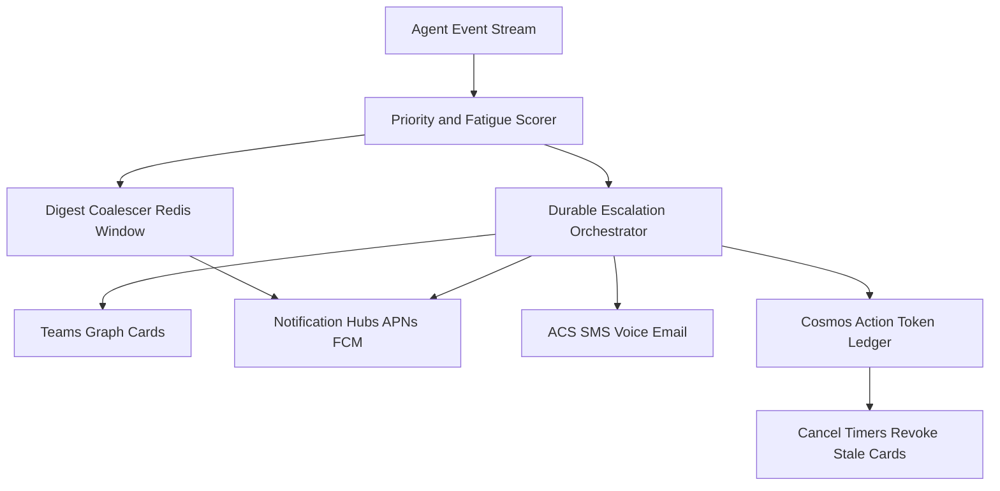
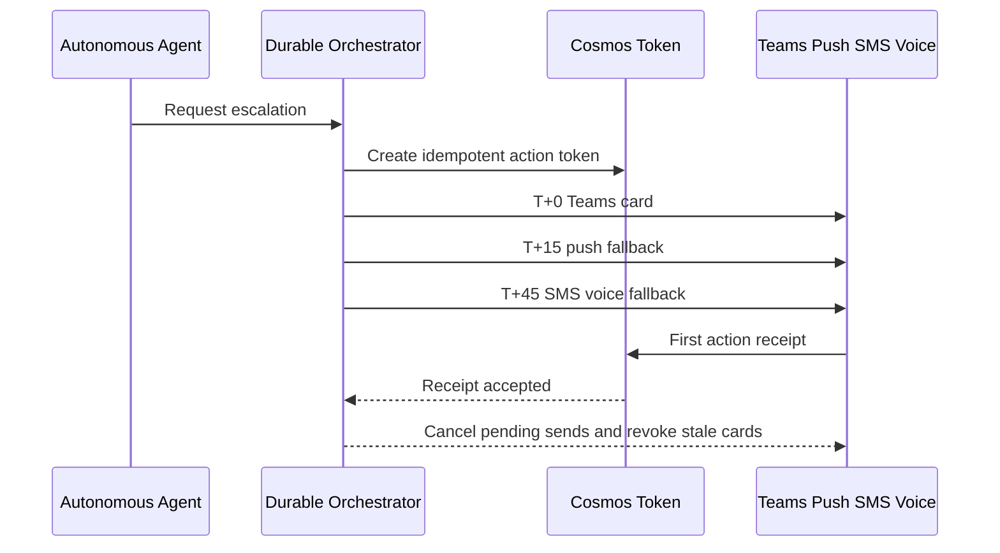
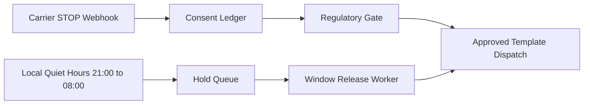

# 企业主动外呼通知升级与疲劳治理选型 FAQ：Durable + Notification Hubs vs Teams Graph vs ACS CPaaS

> 🌐 **Language Switch**：**中文（当前）** | [English](./proactive-agent-outbound-notification-escalation-fatigue-governance-durable-notification-hubs-vs-teams-graph-vs-acs-cpaas-selection-faq.en.md)
> **适用对象**：Cloud & AI Solution Architect、协同平台团队、SRE 与合规治理团队。
> **讨论边界**：聚焦自治后台 Agent 在 Teams、Outlook、Mobile Push、SMS、WhatsApp、Voice 的主动通知与监管约束。

## 1. 为什么主动通知会演变为告警风暴

自治 Agent 在生产环境中会持续产生日志、异常、审批和运营信号，如果缺少统一优先级和去重控制，通知链路很快会演化为高噪声中断系统。

同一事件若被多渠道并发触达却没有全局回执收敛，容易出现多终端重复审批、执行冲突和审计断链，最终损害处置效率与治理可信度。

同时，外部触达场景还要满足同意管理、静默时段、模板备案和退订回写等法规约束，任何绕过都可能触发罚款与品牌损失。

## 2. 四种架构与职责边界

架构 A 适合高优事件，强调分层升级和首动收敛；架构 B 适合内网员工协同，强调原生体验与组织权限一致；架构 C 用于中低优高频事件降噪；架构 D 则用于强监管外呼。

在企业实践中通常不是单选，而是按对象与严重级别做组合：A 处理 Sev1，B 处理内网执行，C 处理摘要，D 处理合规外呼。

## 3. 端到端参考架构与控制平面







该三图组合把升级链路、回执幂等、静默时段门禁和退订闭环放在同一可审计控制平面中，可用于与安全、法务、运维和业务联合评审。

## 4. 架构 A：Durable 升级阶梯与原子回执

A 的关键机制是 `Durable Functions` 编排 + `Cosmos DB` 原子令牌，确保任何渠道的首个动作都能取消其余待发链路并撤销旧卡。

该模式对值班故障和高价值审批最有效，但要求事件模型、幂等键、重试策略、补偿动作和审计主键全链路一致。

## 5. 架构 B：M365 内网通知平面

B 通过 `Microsoft Graph` Activity Feed、Teams Proactive Bot 与 Outlook Actionable Messages 建立员工工作流内闭环，减少外部 CPaaS 成本。

B 必须显式管理 `4 rps/app/tenant` 等节流边界，并通过令牌桶、抖动重试和批次合并维持可预测延迟。

## 6. 架构 C：注意力预算摘要合并器

C 的目标是把“可延迟处理”的事件从实时通道迁移到摘要窗口，优先保留高价值中断，把低价值提醒合并后按权重排序。

默认每用户每日预算可从 `5` 次起步，若预算超限则自动延长摘要窗口并冻结低优实时触达。

## 7. 架构 D：受监管外呼治理平面

D 在发送前必须通过同意与法规门禁，包括 `TCPA/GDPR/CAN-SPAM`、模板审批、本地时区静默时段以及 `STOP` 退订回写。

在跨区域 B2C/B2B 触达中，D 能显著降低罚款和声誉风险，但需要更高的流程工程与审计证据建设投入。

## 8. 核心定量模型与公式

`FatigueIndex = InterruptsPerUserPerDay / Budget` 用于判断注意力预算是否超标，建议把治理阈值定义在 `<=1.0`。

`DuplicateRate = DuplicateActions / TotalActions` 用于度量跨渠道并发冲突，生产目标应压到 `<0.5%`。

`ExpectedCost = Σ(channel_cost * trigger_probability)` 可用于比较不同升级链路在不同严重级别下的边际收益。

## 9. 12 维定量对比矩阵

| 维度 | 架构 A：Durable 升级阶梯 | 架构 B：M365 内网平面 | 架构 C：摘要合并器 | 架构 D：受监管外呼平面 |
|---|---|---|---|---|
| 核心延迟目标 | Sev1 首触达 `<=60s`，升级闭环 `<=3min` | 员工通知 `<=90s`，动作回执 `<=5min` | 摘要窗口 `15–60min`，批次内排序延迟 `<2s` | 合规校验后触达 `<=120s`，quiet-hours 延后释放 |
| 节流上限 | 按用户和事件双桶限速，峰值降载系数 `0.6` | 遵循 `4 rps/app/tenant` 与会话级限制 | 批量推送吞吐按 tag 分片，峰值 `3k–5k msg/s` | 通道与运营商双限流，超限自动排队与延迟发送 |
| 重复审批率目标 | <`0.3%`，依赖原子回执令牌 | `0.4–1.2%`，取决于卡片状态回刷一致性 | `0.6–1.8%`，需要摘要动作去重 | <`0.5%`，依赖同意账本与撤销广播 |
| 单位消息成本 | Push 为主、SMS/Voice 兜底，均值约 `$0.010–0.040` | 主要为 Graph/Bot 成本，均值约 `$0.002–0.010` | Push 摘要成本低，均值约 `$0.001–0.006` | 受 SMS/WhatsApp/Voice 影响，均值约 `$0.020–0.090` |
| 注意力预算 | Sev1 不受日预算限制，低优事件仍受控 | 按部门策略，建议 `<=6/人/日` | 默认 `<=5/人/日`，超限强制摘要 | 外部触达优先合规，预算按人群细分 |
| quiet hours 处理 | 可配置豁免，需审计豁免原因 | 依赖企业策略，通常中优以下延后 | 统一进入 hold-and-release 队列 | 强门禁，默认 `21:00–08:00` 不主动触达 |
| 跨渠道一致性 | `Cosmos` ETag 保证首动即收敛 | Graph 卡片状态刷新一致性中等 | 摘要层一致性高，动作粒度偏粗 | 同意账本与发送流水双写校验 |
| 适配规模 | `10K–500K` 高优通知对象 | `10K–200K` 内部员工 | `100K–10M` 终端推送 | `50K–5M` 外部用户与合作方 |
| 实现复杂度 | 高：编排、撤销、幂等、审计都要完善 | 中：M365 集成与权限治理 | 中：窗口排序与摘要解释 | 高：法规、模板、运营商链路联动 |
| 失败模式 | 令牌写入失败会放大重复触达风险 | 节流命中后可能延后关键提醒 | 窗口过长会拉高处置等待 | 同意状态漂移会直接阻断发送 |
| 运维指标 | 升级成功率、撤销成功率、重复审批率 | 节流命中率、卡片响应率、闭环时长 | 摘要打开率、预算超限率、误报率 | 合规阻断率、退订回写时延、模板合规率 |
| 推荐场景 | 高优审批、故障响应和值班升级 | 企业内部员工协同执行 | 高频中低优事件降噪 | 监管敏感的 B2C/B2B 外呼 |

## 10. 升级与撤销时序

时序上必须满足“先令牌、后触达、首动收敛、全域撤销”四个约束，否则在并发重试下会出现 split-brain 决策。

## 11. 生产级 Bicep 基线

```bicep
param location string = 'eastus2'
resource nhNamespace 'Microsoft.NotificationHubs/namespaces@2023-09-01' = {
  name: 'agent-notify-ns'
  location: location
  sku: {
    name: 'Standard'
    tier: 'Standard'
    capacity: 2
  }
}
resource hub 'Microsoft.NotificationHubs/namespaces/notificationHubs@2023-09-01' = {
  name: '${nhNamespace.name}/agent-alert-hub'
  location: location
  properties: {
    enabled: true
  }
}
resource acs 'Microsoft.Communication/communicationServices@2023-04-01' = {
  name: 'agent-acs-global'
  location: 'global'
}
resource topic 'Microsoft.EventGrid/topics@2023-06-01-preview' = {
  name: 'agent-notify-topic'
  location: location
}
```

该模板可作为生产基线，后续按区域拆分 Notification Hubs 与 Event Grid 主题，避免单区域故障导致跨区域通知同时退化。

## 12. 生产级运行代码片段

```python
from dataclasses import dataclass

@dataclass
class NotifyEvent:
    user_id: str
    severity: str
    interrupts_today: int
    local_hour: int
    consent_sms: bool
    consent_voice: bool

def quiet_hours(local_hour: int) -> bool:
    return local_hour >= 21 or local_hour < 8

def fatigue_allowed(interrupts_today: int, budget: int = 5) -> bool:
    return interrupts_today < budget

def ladder(severity: str) -> list[str]:
    if severity == 'Sev1':
        return ['teams_t0', 'push_t15', 'sms_voice_t45']
    if severity == 'Sev2':
        return ['teams_t0', 'push_t30']
    return ['digest_15_60']
```

```csharp
public static class EscalationOrchestrator
{
    [FunctionName("EscalationOrchestrator")]
    public static async Task Run([OrchestrationTrigger] IDurableOrchestrationContext ctx)
    {
        var req = ctx.GetInput<NotifyRequest>();
        var token = await ctx.CallActivityAsync<string>("CreateActionToken", req);
        await ctx.CallActivityAsync("SendTeamsCard", new { req, token });
        var pushTimeout = ctx.CreateTimer(ctx.CurrentUtcDateTime.AddMinutes(15), CancellationToken.None);
        var action = ctx.WaitForExternalEvent<string>("ActionReceived");
        var winner = await Task.WhenAny(action, pushTimeout);
        if (winner == pushTimeout)
            await ctx.CallActivityAsync("SendMobilePush", new { req, token });
    }
}
```

核心实现要求是幂等键全链路透传：发送、回执、撤销、审计四段都必须写入同一 `action_token`。

## 13. 企业场景 A：10K 员工内网协同

场景 A 选择 B 为主、A 为辅：日常任务通过 Teams/Outlook 卡片执行，Sev1 触发 A 升级链路并在 `3min` 内完成值班确认。

通过摘要策略与原子回执结合，团队把告警疲劳指数从 `1.48` 降到 `0.92`，且夜间误升级工单显著下降。

## 14. 企业场景 B：250K 伙伴与 5M B2C 用户

场景 A 面向 10K 员工的企业内网协同，目标是在不增加值班编制前提下把 Sev1 事件处置稳定拉入分钟级。

上线前重复审批率约 `1.1%`、日均中断 `7.4` 次；上线后通过 A+B 组合降至 `0.3%` 与 `4.6` 次，并显著降低夜间误升级。

场景 B 面向 250K 合作伙伴与 5M B2C 用户，采用 D+C 组合在合规门禁下做规模化触达，并通过摘要窗口把低价值外呼压降约 `38%`。

在促销叠加故障的峰值窗口，该组合保持关键事件触达达标，同时把法规风险暴露控制在审计可接受区间。

### 3-year TCO table (USD, 10K employees / 250K partners / 5M B2C users)

| 架构路径 | 10K 员工 | 250K 合作伙伴 | 5M B2C 用户 | 三年平台成本 | 三年风险损失避免收益 | 三年净收益 |
|---|---:|---:|---:|---:|---:|---:|
| A Durable ladder | 1.20M | 4.80M | 18.60M | 24.60M | 34.10M | 9.50M |
| B M365 native | 0.90M | 3.10M | 11.40M | 15.40M | 19.60M | 4.20M |
| C Digest coalescer | 0.95M | 2.75M | 8.90M | 12.60M | 18.30M | 5.70M |
| D Regulated outbound | 1.40M | 5.60M | 21.80M | 28.80M | 42.50M | 13.70M |
| Hybrid A+C+D | 1.35M | 4.20M | 14.30M | 19.85M | 41.10M | 21.25M |

## 15. 落地检查、问答、边界与告警字典

### Day-0

1. 完成通知等级、触发源、责任团队与升级窗口设计。

2. 定义跨渠道 Action Token 数据模型与撤销协议。

3. 配置同意账本、模板审批、quiet hours 与法规模板映射。

4. 建立每用户中断预算并在产品策略中落地。

5. 打通 Event Grid、工单系统、审计日志与告警治理看板。

6. 完成一次 Sev1 全链路演练并记录基线指标。

### Day-1

1. 监控重复审批率、撤销成功率、节流命中率。

2. 监控 quiet-hours 队列积压与窗口释放时延。

3. 核对 STOP/退订 webhook 回写时延与失败重试。

4. 按部门观察中断预算超限并回写摘要策略。

5. 对高优事件执行复盘并校准升级门槛。

6. 同步法务与安全团队确认合规证据完整性。

### Day-2

1. 每周校准风险评分、预算阈值与摘要窗口。

2. 每月复核渠道成本与业务响应收益。

3. 每季度演练跨区域通道降级与回切。

4. 每季度复核模板、同意、留存与删除策略。

5. 持续优化摘要排序模型并验证误报率下降。

6. 将关键指标纳入管理层治理例会。

### Q1: 如何估算升级阶梯单位成本？

使用 `Cost = Cteams + P(push)*Cpush + P(sms)*Csms + P(voice)*Cvoice`，并按严重级别分层估计触发概率。

当 `Cpush=0.0009`、`Csms=0.045`、`Cvoice=0.12` 且 `P(push)=0.7`、`P(sms)=0.2`、`P(voice)=0.05` 时，单次期望成本约 `$0.016`，可用于与纯 Push 模式做边际收益对比。

### Q2: 如何判断告警疲劳是否超标？

定义 `FatigueIndex = InterruptsPerUserPerDay / Budget`，建议预算初值设为 `5`。

若团队实测 `7.5` 次且预算 `5`，则指数 `1.5`，应立即启用摘要合并并暂停低优实时触达，直至指数回落到 `<=1.0`。

### Q3: 如何量化重复审批风险？

定义 `DuplicateRate = DuplicateActions / TotalActions`，目标通常小于 `0.5%`。

若每日动作量 `120,000` 且重复动作 `840`，则重复率 `0.7%`，说明需要优先排查令牌回写延迟与跨渠道旧卡撤销失败。

### Q4: 静默时段会带来多大响应延迟？

单条延迟可按 `Delay = max(0, QuietEnd - LocalEventTime)` 计算，再观察 P50/P95。

在 `21:00–08:00` 窗口内最坏可达 `11h`，因此必须明确 Sev1 合规豁免路径并保留审计证据。

### Q5: 如何做 Notification Hubs 吞吐容量估算？

采用 `Need = TargetUsers / DeliveryWindowSeconds`，再乘重试系数。

例如 `2M` 终端在 `600s` 内触达，基础需求约 `3333 msg/s`，按 `1.3x` 重试后需 `4333 msg/s` 预算。

### Q6: 如何估算三年净收益？

使用 `Net = AvoidedLoss + ProductivityGain - PlatformCost - GovernanceCost`，并按人群分层。

当混合架构把误升级和重复触达同时压降时，净收益通常高于单一路径；关键在于把损失避免收益纳入财务口径。

### 15.2 Good fit vs Not for

Good fit：有跨渠道审批、严格合规和高并发触达需求，且愿意将通知治理纳入长期平台工程能力建设。

Not for：触达规模很小、合规约束很低、且业务可接受重复提醒和人工补救的轻量场景。

### 15.3 Runtime alert dictionary

| 告警键 | 触发条件 | 立即动作 | 责任团队 |
|---|---|---|---|
| `duplicate_action_spike` | 重复动作率超过阈值 | 冻结同类卡片并强制单通道回执 | 平台工程 |
| `graph_throttle_breach` | Graph/Bot 节流连续命中 | 扩大退避窗口并降低并发发送 | 协同平台 |
| `quiet_hours_backlog` | 静默时段队列积压超限 | 扩容释放工作器并调整优先级 | SRE |
| `consent_ledger_miss` | 发送前缺少同意校验 | 阻断发送并触发审计回放 | 合规治理 |
| `carrier_stop_lag` | STOP 回写延迟超 SLA | 暂停对应通道并人工核验 | 消息运营 |
| `fatigue_budget_overrun` | 中断预算连续超限 | 强制切换摘要模式 | 产品运营 |
| `stale_revoke_fail` | 旧卡撤销失败 | 触发全渠道失效广播 | 平台工程 |
| `cpaas_cost_spike` | CPaaS 成本异常上涨 | 下调升级策略并复核模板 | FinOps |
| `template_drift` | 模板合规状态漂移 | 冻结外呼并重新审批模板 | 法务合规 |
| `regional_outage` | 区域通道故障 | 切换备用区域与替代通道 | SRE |

### 15.4 参考来源（抓取日期：2026-11-23）

1. Azure Notification Hubs documentation: https://learn.microsoft.com/azure/notification-hubs/

2. Azure Communication Services documentation: https://learn.microsoft.com/azure/communication-services/

3. Azure Durable Functions overview: https://learn.microsoft.com/azure/azure-functions/durable/durable-functions-overview

4. Microsoft Graph throttling guidance: https://learn.microsoft.com/graph/throttling

5. Teams proactive messaging: https://learn.microsoft.com/microsoftteams/platform/bots/how-to/conversations/send-proactive-messages

6. Azure Event Grid documentation: https://learn.microsoft.com/azure/event-grid/

### 15.5 Governance extension notes


在企业级长期运营中，通知治理不能只盯住“是否送达”，还必须把“是否该送、是否该现在送、是否该由该渠道送、是否具备审计证据、是否满足本地监管窗口、是否会触发用户疲劳”纳入统一决策回路；当平台能够持续把这些维度转化为可观测指标并周期性回写策略时，主动外呼体系才能真正从战术告警工具升级为可持续、可审计、可复盘的治理基础设施。


上述指标建议以周报与月报双节奏持续复盘并固化阈值变更依据。
