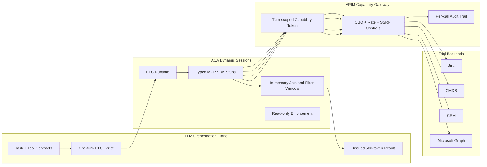
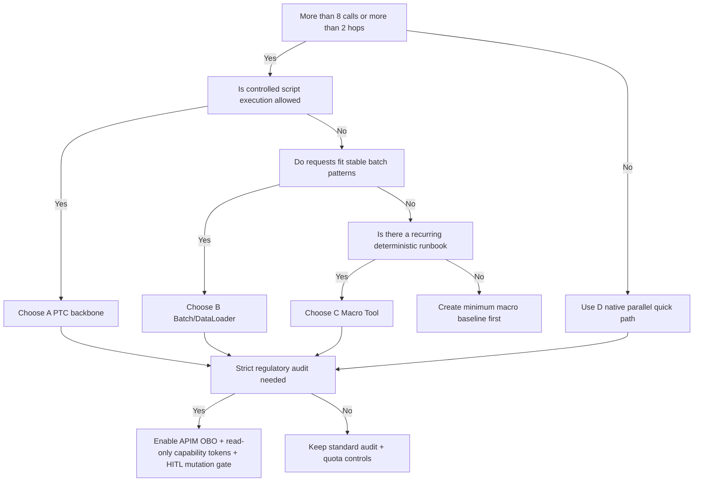

# Enterprise Programmatic Tool Calling (Code Mode) Selection FAQ to Eliminate MCP `N+1` Tool-Call Storms: PTC vs Batch/DataLoader vs Macro Tools vs Native Parallel Calls

> 🌐 **Language Switch**: [中文](./programmatic-tool-calling-code-mode-mcp-n-plus-one-aca-sessions-apim-vs-batch-dataloader-vs-macro-tool-selection-faq.md) | **English (current)**
> **Audience**: Cloud & AI Solution Architects, enterprise agent platform leads, APIM platform teams, MCP governance owners, security and SRE stakeholders.
> **Scope**: Production architecture choices for suppressing multi-hop `N+1` tool-call storms and intermediate context pollution across Jira/CMDB/CRM/Graph integrations, with quantitative cost-latency formulas, policy boundaries, and implementation checklists.

## 1. Problem framing: why conversational tool calls collapse under enterprise `N+1` workloads
In real enterprise operations, agents rarely invoke one tool once; they often iterate across `100` incidents, assets, or accounts while joining ownership, deployment, and compliance metadata from multiple systems.  
If this is implemented as pure conversational JSON tool calling, each intermediate payload is repeatedly fed back into the model context, creating cumulative token rebilling and unstable latency under load.  
The core failure is not only cost: intermediate raw JSON floods the reasoning window, which increases answer drift and makes final summaries less reliable despite seemingly complete retrieval activity.  
In observed war-room style traces, this pattern commonly reaches around `820K` total tokens and roughly `94s` end-to-end latency, while a PTC script path can reduce the same logical task to around `19K` tokens and `6.8s`.  
The architecture objective is therefore to migrate loops from model context into governed runtime memory, while preserving strict authorization and replayable evidence.  

## 2. Four patterns (A/B/C/D) and their operational boundaries
**Pattern A (Programmatic Tool Calling / Code Mode + ACA Dynamic Sessions + APIM capability gateway):** the model emits one short orchestration script per turn, and the script performs pagination, joins, deduplication, and filtering in sandbox RAM.  
**Pattern B (Batch MCP façade + DataLoader coalescing):** tool contracts are redesigned as bulk endpoints (`get_entities_batch(ids[])`) and requests are merged in a `10–25ms` window before backend `$batch` dispatch.  
**Pattern C (Server-side Macro Tools):** deterministic multi-system workflows are pre-compiled into audited composite tools with fixed contracts and platform-governed SLA behavior.  
**Pattern D (Native `parallel_tool_calls` fan-out):** direct parallel dispatch remains effective for shallow workloads (`<= 8` calls, `1–2` dependency hops) where deeper orchestration is unnecessary.  
Most enterprises do not choose one pattern globally; they layer A for dynamic long chains, B/C for stable high-frequency paths, and D for low-overhead quick queries.  

## 3. End-to-end reference architecture: one-turn script generation, governed execution, and distilled output

This architecture removes repetitive model-loop payload recycling and converts it into governed runtime processing where each outbound RPC still traverses APIM policy controls.  
The practical invariant is that script flexibility must never bypass gateway-enforced least privilege, observability, and mutation controls.  

## 4. Pattern A deep dive: PTC/Code Mode with strict capability-scoped governance
Pattern A suppresses `N+1` behavior by moving iterative logic out of conversational turns: the model plans once, the sandbox executes many calls, and only compact findings flow back to the model.  
Security depends on policy layering: turn-scoped capability tokens, per-tool OBO RBAC, read-only claims for PTC sessions, explicit mutation blocks, and bounded runtime budgets.  
A robust implementation should include semaphore-controlled concurrency, max pagination depth, per-turn call ceilings, and deterministic timeout behavior to prevent runaway loops.  
When tasks involve broad cross-system joins and dynamic filters, A typically provides the highest combined improvement in latency, token cost, and reasoning stability.  
The operational caveat is governance maturity: without policy rigor, programmable execution can amplify mistakes faster than conversational mode.  

## 5. Pattern B deep dive: Batch façade design with DataLoader request coalescing
Pattern B is often preferred when policy disallows arbitrary LLM-generated scripts but still requires high throughput for repetitive retrieval patterns.  
A DataLoader proxy merges key-based requests in short windows (`10–25ms`), translating them into Graph/OData batch calls to reduce backend fan-out and connection churn.  
This design improves queue stability and backend efficiency while keeping API surfaces more deterministic for audit and change management.  
The trade-off is adaptation speed: rapidly changing business logic may cause façade sprawl, requiring frequent contract updates and compatibility management.  
Pattern B is therefore strongest in stable, repeated query families with predictable schema evolution.  

## 6. Pattern C deep dive: audited server-side macro tools for deterministic workflows
Pattern C compiles recurring operational workflows into single, governed tool contracts, for example: `resolve_incident_owner_and_recent_change(incidentId)`.  
The key gain is repeatability: policy checks, retries, fallback logic, and evidence capture are centralized and versioned once rather than reimplemented by every agent.  
This is highly effective for regulated runbooks where deterministic behavior and forensic replay are more important than ad hoc query flexibility.  
Macro tools can also enforce quality gates such as required fields, policy preconditions, and explicit reason codes before outputs are accepted downstream.  
The limitation is agility for long-tail exploratory tasks, which may still require Pattern A or human-assisted investigation paths.  

## 7. Pattern D deep dive: native parallel calls for shallow workloads
Pattern D remains the lowest-overhead option for simple fan-out tasks with short dependency chains and limited intermediate state.  
It should be constrained by explicit limits on total parallel calls, per-tool timeout budgets, and retry caps to avoid accidental amplification under partial backend degradation.  
Once tasks require deep pagination, conditional branching, or cross-tool reconciliation, D quickly reintroduces context bloat and cost variance.  
A practical guardrail is automatic escalation to A/B/C when calls exceed `8` or dependency depth exceeds `2` hops.  
Used this way, D is a fast path, not a universal orchestration model.  

## 8. Twelve-dimension comparison matrix: performance, governance, and operational burden
| Dimension | A: PTC / Code Mode | B: Batch/DataLoader | C: Macro Tool | D: Native Parallel |
|---|---|---|---|---|
| `N+1` suppression strength | Very high | High | Very high | Low-to-medium |
| Intermediate-context pollution control | Very high | High | Very high | Low |
| End-to-end latency predictability | High | High | Very high | Medium |
| Token-cost efficiency | Very high | High | Very high | Medium-low |
| Logic flexibility | Very high | Medium | Medium-low | Medium |
| Audit and governance depth | High | High | Very high | Medium |
| Least-privilege implementation effort | Medium-high | Medium | Medium | Medium |
| SSRF/egress risk exposure | Medium (controllable) | Low-to-medium | Low | Medium |
| Platform maintenance complexity | Medium-high | Medium-high | Medium | Low |
| Backend adaptation overhead | Low-to-medium | Medium | Medium-high | Low |
| High-concurrency stability | High | Very high | Very high | Medium |
| Recommended role | Dynamic long-chain backbone | Bulk acceleration layer | Deterministic critical workflows | Lightweight quick path |

In regulated enterprise environments, a layered strategy (A + B/C, with D as a bounded fast lane) usually delivers the best balance of agility and control.  

## 9. Quantitative formulas: token rebilling, latency compression, and concurrency budgets
### 9.1 Conversational `N+1` cumulative token model
For conversational tool-call loops, cumulative token usage can be approximated as:  
\[
T_{conv}=\sum_{i=1}^{N}(P_0+i\cdot R)
\]
where `P0` is base prompt size and `R` is per-step intermediate payload growth.  
As `N` increases, the quadratic component dominates and cost volatility rises sharply.  

### 9.2 PTC one-turn orchestration model
For PTC, the token profile is closer to:  
\[
T_{ptc}=P_0 + C_{code} + R_{distilled}
\]
where `Ccode` is single-turn code generation and `Rdistilled` is compact final output.  
In practical traces, this often explains transitions like `820K` tokens / `94s` to around `19K` / `6.8s` for equivalent business intent.  

### 9.3 Concurrency and backpressure governance
Define admission keys as `tenant × actor × tool` and enforce per-key budgets for max concurrency, calls per interval, queue wait ceilings, and circuit-breaker thresholds.  
Separate per-turn global call budgets from per-tool budgets to prevent one degraded backend from consuming all orchestration capacity.  
When call budgets are exceeded, fail safely with partial evidence and explicit next-step guidance instead of continuing hidden retries.  

## 10. Decision tree: choose by topology first, governance depth second

This ordering prevents “tool preference bias” and aligns architecture decisions with workload shape and governance obligations.  

## 11. Production snippet #1: typed MCP stub generator for PTC runtime (Python)
```python
from __future__ import annotations
from dataclasses import dataclass
from typing import Any, Dict, List
import json
import textwrap


@dataclass
class ToolSpec:
    name: str
    description: str
    input_schema: Dict[str, Any]
    read_only: bool


def py_type(field: Dict[str, Any]) -> str:
    t = field.get("type", "string")
    if isinstance(t, list):
        t = next((x for x in t if x != "null"), "string")
    return {
        "string": "str",
        "integer": "int",
        "number": "float",
        "boolean": "bool",
        "array": "list",
        "object": "dict",
    }.get(t, "Any")


def build_stub(tool: ToolSpec) -> str:
    props = tool.input_schema.get("properties", {})
    required = set(tool.input_schema.get("required", []))
    args: List[str] = []
    payload: List[str] = []
    for k, schema in props.items():
        t = py_type(schema)
        optional = "" if k in required else " | None"
        default = "" if k in required else " = None"
        args.append(f"{k}: {t}{optional}{default}")
        payload.append(f'        "{k}": {k},')
    ro_line = "True" if tool.read_only else "False"
    fn = f"""
async def {tool.name}(self, {", ".join(args)}) -> dict:
    if not self.allow_mutation and {ro_line} is False:
        raise PermissionError("mutating tool blocked in PTC session")
    payload = {{
{chr(10).join(payload)}
    }}
    payload = {{k: v for k, v in payload.items() if v is not None}}
    return await self._call("{tool.name}", payload)
"""
    return textwrap.dedent(fn).strip()


def generate_client(specs: List[ToolSpec]) -> str:
    methods = "\n\n".join(build_stub(s) for s in specs)
    return f'''class McpTypedClient:
    def __init__(self, transport, allow_mutation: bool = False):
        self.transport = transport
        self.allow_mutation = allow_mutation

    async def _call(self, tool: str, payload: dict) -> dict:
        body = {{"tool": tool, "input": payload}}
        return await self.transport.invoke(body)

{methods}
'''


def load_specs(path: str) -> List[ToolSpec]:
    raw = json.loads(open(path, "r", encoding="utf-8").read())
    result: List[ToolSpec] = []
    for t in raw["tools"]:
        result.append(
            ToolSpec(
                name=t["name"].replace("-", "_"),
                description=t.get("description", ""),
                input_schema=t.get("inputSchema", {"type": "object", "properties": {}}),
                read_only=bool(t.get("annotations", {}).get("readOnlyHint", False)),
            )
        )
    return result
```
This generator produces typed SDK stubs from MCP contracts and enforces runtime mutation blocking by default for PTC sessions.  

## 12. Production snippet #2: APIM sandbox-callback policy XML (read-only, OBO, and guardrails)
```xml
<policies>
  <inbound>
    <base />
    <validate-jwt header-name="Authorization" failed-validation-httpcode="401">
      <openid-config url="https://login.microsoftonline.com/{tenant-id}/v2.0/.well-known/openid-configuration" />
      <audiences>
        <audience>api://agent-tool-gateway</audience>
      </audiences>
      <required-claims>
        <claim name="scp" match="any">
          <value>tools.read</value>
        </claim>
        <claim name="act_as" match="any">
          <value>turn-scoped</value>
        </claim>
      </required-claims>
    </validate-jwt>

    <set-variable name="isMutatingTool"
      value="@(!((string)context.Request.Headers.GetValueOrDefault("x-tool-readonly","true")).Equals("true", StringComparison.OrdinalIgnoreCase))" />
    <choose>
      <when condition="@(context.Variables.GetValueOrDefault<bool>("isMutatingTool"))">
        <return-response>
          <set-status code="403" reason="Mutating tool blocked in PTC session" />
        </return-response>
      </when>
    </choose>

    <check-header name="x-ptc-session-id" failed-check-httpcode="400" failed-check-error-message="Missing session id" />
    <rate-limit-by-key calls="80" renewal-period="60" counter-key="@(context.Subscription.Id + ":" + context.Request.Headers.GetValueOrDefault("x-ptc-session-id","na"))" />
    <set-backend-service backend-id="mcp-tool-backend" />
  </inbound>

  <backend>
    <base />
    <forward-request timeout="45" />
  </backend>

  <outbound>
    <base />
    <set-header name="x-policy-enforced" exists-action="override">
      <value>ptc-readonly-guard</value>
    </set-header>
  </outbound>

  <on-error>
    <base />
    <set-header name="x-apim-error-source" exists-action="override">
      <value>tool-governance-policy</value>
    </set-header>
  </on-error>
</policies>
```
This policy binds turn-scoped identity, read-only enforcement, and per-session quotas at the gateway so script flexibility never translates to unchecked backend mutation.  

## 13. Enterprise scenario A: cross-team Sev1 war-room (Incident + CMDB + deployment lineage)
A global SRE team needed to correlate incident records, CMDB ownership, and recent deployment history under tight incident-response windows.  
Their conversational tool-loop implementation regularly exceeded `40` calls per task and produced volatile latency because each step reintroduced growing JSON payloads into context.  
After introducing A+C, the system generated one governed script for dynamic correlation, then passed standardized outputs through a macro tool for war-room card rendering and escalation routing.  
Within three weeks, average response time dropped from `92s` to `11s`, high-load token usage declined by roughly `76%`, and audit replay preparation time fell from `25` minutes to `4` minutes.  

## 14. Enterprise scenario B: multi-tenant financial operations control plane
A regulated SaaS finance platform had to reconcile CRM, ledger, and compliance datasets nightly, with mandatory human approval for any state-changing action.  
The platform used B for large-scale retrieval, C for deterministic discrepancy-ticket workflows, and kept mutation actions outside PTC sessions behind explicit approval gateways.  
APIM policies enforced actor-bound OBO, turn-scoped capability tokens, and per-tool budgets, while telemetry linked each answer to policy version and evidence references.  
Automation coverage increased to `68%` without introducing unauthorized write incidents, and quarterly internal audit sampling passed with complete replayability.  

## 15. Three-year TCO, quantitative Q&A, Day-0/Day-2 checklists, and fit guidance
### 15.1 Three-year TCO (`20 / 80 / 240` concurrent task profiles)
| Cost component (3-year) | A | A+B | A+C | A+B+C+D |
|---|---:|---:|---:|---:|
| Gateway and execution infrastructure | `$0.74M` | `$0.88M` | `$0.92M` | `$1.08M` |
| Platform engineering and operations labor | `$1.26M` | `$1.21M` | `$1.18M` | `$1.32M` |
| Security and audit governance overhead | `$0.49M` | `$0.46M` | `$0.42M` | `$0.40M` |
| Outage/timeout opportunity loss | `$1.31M` | `$0.92M` | `$0.77M` | `$0.71M` |
| Total three-year cost | `$3.80M` | `$3.47M` | `$3.29M` | `$3.51M` |

For high-complexity and high-governance workloads, A+C is often the strongest total-cost profile; B is added when bulk retrieval dominates.  

### 15.2 Quantitative Q&A (6)
**Q1: When should D be promoted to A?**  
When a task exceeds `8` calls or crosses `2` dependency hops and starts showing material context growth.  

**Q2: Does A inherently create higher risk?**  
A introduces programmability risk, but with turn-scoped read-only tokens, APIM policy enforcement, egress allowlists, and hard call budgets, risk can remain controlled.  

**Q3: Where does B deliver its highest ROI?**  
On repetitive key-based retrieval workloads, `10–25ms` coalescing windows often reduce backend request pressure by `30%–70%`.  

**Q4: Why is C favored in regulated operations?**  
C centralizes policy and evidence generation in deterministic contracts, making audit replay and control verification materially easier.  

**Q5: How should teams interpret `820K -> 19K` token reduction?**  
It reflects shifting iterative work from model context loops to runtime memory loops, with the model handling plan generation and final distillation only.  

**Q6: What is the minimum production governance baseline?**  
Read/write separation, actor-bound OBO, turn-scoped capability tokens, per-tool budgets, replayable audit records, and explicit HITL gates for mutating actions.  

### 15.3 Day-0 checklist
- Define admission rules per task class: max calls, max hops, and whether controlled script execution is permitted.  
- Implement APIM default-deny posture with read-only capability scopes, actor-bound OBO, egress allowlists, and quota policies.  
- Set PTC runtime guardrails: per-turn call cap, per-tool cap, pagination-depth cap, and strict execution timeout.  
- Establish contract/version governance for batch façades and macro tools, including compatibility and deprecation windows.  
- Build unified telemetry for token cost, latency percentiles, policy hits, rejection reasons, and backend error classes.  
- Enforce mutation isolation: mutating tools must be routed through top-level approval workflows, not directly from PTC sessions.  

### 15.4 Day-2 checklist
- Review weekly `N+1` regressions and migrate recurring offenders from D into A/B/C pathways.  
- Audit capability-token scope drift and expired-token replay risk with policy conformance checks.  
- Tune coalescing windows and concurrency budgets monthly against peak-hour latency and quota pressure.  
- Replay policy-denied samples monthly to ensure denials are both correct and operationally explainable.  
- Recalculate quarterly TCO assumptions, especially governance labor and replay support overhead.  
- Run quarterly failure-mode drills validating degraded-path behavior across sandbox execution and gateway policy planes.  

### 15.5 Good fit vs Not for
| Decision | Guidance |
|---|---|
| ✅ Good fit | Enterprises needing predictable token/latency reduction on long multi-system chains while preserving strict auditability and least-privilege controls. |
| ⛔ Not for | Small, shallow query scenarios with low governance burden where full layered orchestration would create unnecessary complexity. |

Recommended composition is **A for dynamic long chains, B for bulk acceleration, C for deterministic critical runbooks, and D for shallow quick paths**.  
This composition keeps optimization and governance aligned instead of treating them as competing goals.  

### 15.6 Suggested SLO/SLI envelope for tool-governance operations
| Control domain | Suggested SLI | Suggested quarterly SLO | Triggered action |
|---|---|---|---|
| `N+1` suppression rate | Share of over-threshold tasks successfully converged | `>= 98.5%` | Auto-upgrade routing to A/B/C |
| Read-only enforcement precision | Correctly blocked mutating calls inside PTC | `>= 99.9%` | Policy regression suite + emergency denylist |
| End-to-end P95 latency | Task start to distilled output completion | `<= 8s` for core workflows | Degrade to macro/batch route |
| Token cost per task | Total token consumption per completed task | Keep within target band (for example `<25K`) | Stronger distillation and payload truncation |
| Audit replay completeness | Sampled runs with full replay evidence | `>= 99.8%` | Block high-risk automation tier |
| Cross-tenant isolation violations | Unauthorized cross-tenant calls | `0` | Freeze offending policy revision |

Tie these SLOs to release gates so non-compliant builds cannot become default production routes.  

### 15.7 Recommended 90-day rollout cadence
Days `1–30`: implement quick wins with D/B to remove immediate `N+1` hotspots and establish baseline observability.  
Days `31–60`: introduce A (PTC) with read/write policy separation, turn-scoped tokens, execution budgets, and replay pipelines.  
Days `61–90`: codify recurring high-value flows as C macro tools, then align SLO gates, runbooks, and incident drills across teams.  
This phased approach separates fast ROI from heavy governance rollout and reduces migration risk in production environments.  

### 15.8 Minimum audit evidence package (recommended fields)
- `task_id`, `actor_id`, `tenant_id`, `tool_name`, and `tool_call_id` for accountability and tenant-boundary traceability.  
- `policy_version`, `capability_scope`, and `token_expiry` to prove least-privilege enforcement at execution time.  
- `request_hash`, `response_hash`, and `redaction_profile` to support integrity checks and data-handling verification.  
- `retry_count`, `timeout_ms`, and `circuit_breaker_state` for performance and resilience root-cause analysis.  
- `distilled_output_ref` and `raw_evidence_ref` to preserve linkage between business summary and original evidence.  
- `approval_ticket` and `change_request_id` for any state-changing operation requiring governance sign-off.  

### 15.9 Common anti-patterns and mitigation guidance
- Anti-pattern 1: forcing all tasks into A, which inflates platform complexity; mitigate by topology-based routing thresholds.  
- Anti-pattern 2: batching without privilege tightening, which only relocates blast radius; mitigate with capability-scoped token policies.  
- Anti-pattern 3: uncontrolled macro-tool growth without lifecycle governance; mitigate with portfolio ownership and retirement criteria.  
- Anti-pattern 4: optimizing token spend while ignoring replayability; mitigate by treating audit completeness as a first-class SLO.  
- Anti-pattern 5: allowing direct mutation from programmable sessions; mitigate by mandatory top-level HITL gates for all write paths.  
