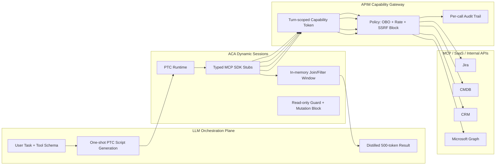
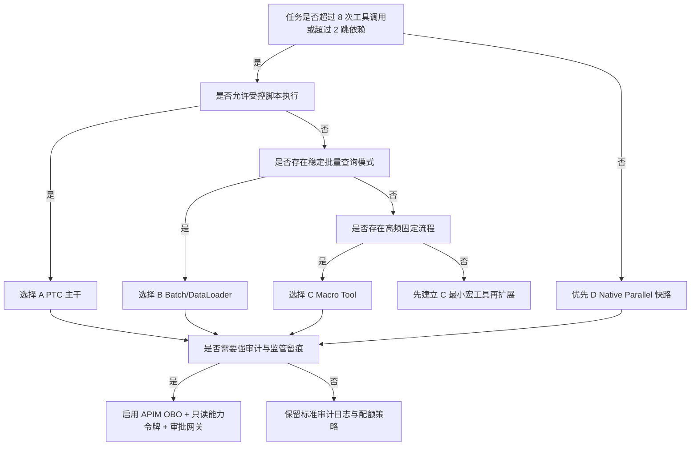

# 企业 Programmatic Tool Calling（Code Mode）消除 MCP `N+1` 工具调用风暴选型 FAQ：PTC vs Batch/DataLoader vs Macro-Tool vs Native Parallel Tool Calls

> 🌐 **Language Switch**：**中文（当前）** | [English](./programmatic-tool-calling-code-mode-mcp-n-plus-one-aca-sessions-apim-vs-batch-dataloader-vs-macro-tool-selection-faq.en.md)
> **受众**：Cloud & AI Solution Architect、企业 Agent 平台负责人、APIM 平台团队、MCP 工具治理团队、SRE 与安全合规团队。
> **范围**：针对企业多系统联动（Jira/CMDB/CRM/Graph）中的 `N+1` 工具调用风暴与中间上下文污染，比较 Programmatic Tool Calling（PTC/Code Mode）、Batch/DataLoader MCP 门面、Server-Side Macro-Tool 与 Native Parallel Tool Calls，给出可生产落地的治理架构、量化公式与实施清单。

## 1. 问题定义：为什么 conversational tool calls 在企业多系统场景会触发 `N+1` 风暴
在企业真实环境里，Agent 经常不是调用一次工具就结束，而是要在 `100` 条工单或资产记录上做循环查询、关联补全、权限筛选与状态聚合。  
若完全采用对话式 JSON 工具调用，模型会在每一跳都把前文和中间返回重新喂回上下文，导致 token 账单近似按二次曲线增长，并在长链路上放大延迟抖动。  
更关键的问题不只是成本和时延，而是中间上下文污染：大量原始 JSON 会挤占有效推理预算，让模型在最终归纳阶段更容易遗漏关键约束或错误引用过期字段。  
在 `N=100` 的联表场景中，传统模式常见观测是总 token 约 `820K`、端到端时延约 `94s`，而采用 PTC 脚本内循环后可降到约 `19K` token 与 `6.8s`，并显著降低中间态泄露面。  

## 2. 四种模式（A/B/C/D）与职责边界
**Pattern A（PTC / Code Mode + ACA Dynamic Sessions + APIM capability gateway）**：让模型一次推理输出短脚本，脚本在受控沙箱里执行循环、分页、join、过滤，只返回蒸馏结论给模型。  
**Pattern B（Batch MCP + DataLoader Coalescing）**：在工具层提供 `get_entities_batch(ids[])`、`get_incidents_with_owner_batch()` 等粗粒度门面，用 `10–25ms` 聚合窗口把离散请求合并后再打后端 `$batch`。  
**Pattern C（Server-Side Macro Tools）**：把高频固定流程（如 Incident + CMDB Owner + 最近部署）封装成可审计宏工具，统一 SLA、审计日志与权限策略。  
**Pattern D（Native parallel_tool_calls + Subagent Map-Reduce）**：适合浅链路（`<= 8` 调用、`1–2` hop）和低治理负担场景，避免引入额外平台复杂度。  
企业落地通常不是四选一，而是按任务拓扑与合规强度混合：A 处理长链推理，B/C 处理稳定批处理路径，D 保留低开销快路。  

## 3. 端到端参考架构：脚本内聚合执行、APIM 最小能力令牌与证据化输出

该架构把“对话上下文循环”改造成“沙箱内存循环”，让模型只看输入与最终蒸馏输出，不再反复吞吐中间原始载荷。  
所有对外 RPC 仍经 APIM，避免把“脚本能力”错误放大为“网络任意访问能力”，并可在策略层统一做 OBO、配额、公平性与可审计性。  

## 4. Pattern A 详解：PTC/Code Mode 在 ACA Dynamic Sessions 的生产边界
Pattern A 的核心价值是把 `N+1` 循环挪出模型 token 回路：模型只负责生成一次脚本，剩余分页、重试、join、去重、排序在沙箱内存中完成。  
为防止“脚本可编程”变成“脚本可滥权”，必须把调用能力收敛到回合级 capability token，并在 APIM 按工具级 claim 与 read-only hint 做强制策略。  
建议将 mutating tool 全部从 PTC 默认工具集中剔除，除非显式进入顶层审批路径，且每次写操作必须带 preview diff 与双确认工单。  
对于高并发场景，PTC 运行时应配置并发信号量、最大分页深度、单任务总调用上限与单回合执行时限，避免脚本陷入无限重试或超配额风暴。  
在实践中，A 最适合“跨系统聚合 + 逻辑过滤重”的任务，如跨 `100` 资产查找 SLA 风险与责任人映射。  

## 5. Pattern B 详解：Batch MCP 门面与 DataLoader 合并窗口
当企业安全策略禁止 LLM 生成可执行脚本时，B 是最可控的替代路径：把多次细粒度请求前移成单次粗粒度调用。  
典型做法是在 APIM 或 AKS 中间层实现 `DataLoader` 合并器，用 `10–25ms` 时间窗聚集同类 key 请求，再转译成 Graph `$batch` 或 OData `$batch`。  
这种模式可以显著降低后端 QPS 与连接抖动，对“高并发小请求”有明显收益，同时保留较强的治理可观测性。  
代价是灵活性下降：一旦业务联动逻辑频繁变化，批门面版本会快速膨胀，平台团队需投入额外维护成本。  
因此 B 更适合规则稳定、字段结构相对收敛的组织级标准查询。  

## 6. Pattern C 详解：Server-Side Macro Tool 的可审计复用
Pattern C 把“高频确定性多步流程”固化为单工具，例如 `resolve_incident_owner_and_recent_change(incidentId)`，并在服务端编排所有分支。  
其优势在于可预测性和审计一致性：输入输出契约固定，SLA 可衡量，责任边界清晰，适合运维 runbook、金融风控流程和监管报送前置校验。  
宏工具还可以内建缓存与熔断策略，避免每个 Agent 团队重复造轮子，并通过平台统一发版实现快速修复。  
不足在于“编排刚性”：长尾问题或临时探索需求常超出预定义宏接口，导致业务团队转回人工旁路。  
因此 C 更像“高价值标准流程的高速公路”，而不是所有任务的唯一入口。  

## 7. Pattern D 详解：Native parallel_tool_calls 的适用边界
Pattern D 适合浅层 fan-out 任务，例如一次并行查 `5–8` 个系统状态并做简单汇总，这时额外引入沙箱或批门面可能得不偿失。  
在该模式下，应限制总并行度、单工具超时与最大重试次数，避免把“并行”误用成“无上限放大器”。  
若任务开始出现多跳依赖、跨页聚合、复杂过滤和策略回写，D 的稳定性会快速下降，且对话上下文膨胀会重新出现。  
实践建议是给 D 设明确退出阈值：超过 `8` 调用或出现 `>2` hop 时，自动升级到 A 或 C。  
D 的价值在于快，不在于深。  

## 8. 12 维对比矩阵：性能、治理、安全与运维复杂度
| 维度 | A：PTC/Code Mode | B：Batch/DataLoader | C：Macro Tool | D：Native Parallel |
|---|---|---|---|---|
| `N+1` 抑制能力 | 很高 | 高 | 很高 | 低到中 |
| 中间上下文污染控制 | 很高 | 高 | 很高 | 低 |
| 端到端时延可控性 | 高 | 高 | 很高 | 中 |
| token 成本效率 | 很高 | 高 | 很高 | 中低 |
| 逻辑灵活性 | 很高 | 中 | 中低 | 中 |
| 合规可审计性 | 高 | 高 | 很高 | 中 |
| 权限最小化落地难度 | 中高 | 中 | 中 | 中 |
| SSRF/出网风险面 | 中（可控） | 低到中 | 低 | 中 |
| 平台维护复杂度 | 中高 | 中高 | 中 | 低 |
| 对后端系统侵入度 | 低到中 | 中 | 中高 | 低 |
| 高并发稳定性 | 高 | 很高 | 很高 | 中 |
| 推荐定位 | 长链动态编排主干 | 批量门面加速层 | 标准化关键流程层 | 轻量浅链快路 |

矩阵结论是：企业若要同时压降成本、时延与风险，通常采用 A+B/C 分层组合，并保留 D 作为简单任务快通道。  

## 9. 定量公式：`N+1` 代价、PTC 收敛收益与并发预算
### 9.1 对话式 `N+1` 累计 token 公式
对话式多轮调用可近似为：  
\[
T_{conv}=\sum_{i=1}^{N}(P_0+i\cdot R)
\]
其中 `P0` 为基础提示 token，`R` 为每轮附加中间载荷。  
当 `N=100` 且中间载荷持续增长时，`Tconv` 会呈明显二次增长。  

### 9.2 PTC 单轮脚本模式
PTC 近似为：  
\[
T_{ptc}=P_0 + C_{code}+R_{distilled}
\]
其中 `Ccode` 是一次脚本生成成本，`Rdistilled` 为蒸馏结果载荷，通常远小于原始中间 JSON 总量。  
在企业 war-room 样例中，观测可从 `820K` token / `94s` 收敛到 `19K` token / `6.8s`。  

### 9.3 并发与背压预算
建议以 `tenant × tool × actor` 作为三维限流键，定义：最大并发、单位时间调用上限、排队超时与熔断阈值。  
若单回合调用数超过设定上限（例如 `<= 120`），应立即触发早停并返回“部分结果 + 缺失说明 + 重试建议”。  
对 PTC 任务，建议把“每回合总请求预算”与“每工具预算”分开治理，以防单个工具吃掉全部额度。  

## 10. 选型决策树：先判任务拓扑，再判治理强度与组织成熟度

该树的关键是先看任务复杂度，再看组织治理边界，避免以“单一偏好技术”覆盖所有场景。  

## 11. 生产代码片段一：PTC Typed MCP Stub 生成器（Python）
```python
from __future__ import annotations
from dataclasses import dataclass
from typing import Any, Dict, List, Optional
import json
import textwrap


@dataclass
class ToolSpec:
    name: str
    description: str
    input_schema: Dict[str, Any]
    read_only: bool


def py_type(field: Dict[str, Any]) -> str:
    t = field.get("type", "string")
    if isinstance(t, list):
        t = next((x for x in t if x != "null"), "string")
    return {
        "string": "str",
        "integer": "int",
        "number": "float",
        "boolean": "bool",
        "array": "list",
        "object": "dict",
    }.get(t, "Any")


def build_stub(tool: ToolSpec) -> str:
    props = tool.input_schema.get("properties", {})
    required = set(tool.input_schema.get("required", []))
    args: List[str] = []
    payload: List[str] = []
    for k, schema in props.items():
        t = py_type(schema)
        optional = "" if k in required else " | None"
        default = "" if k in required else " = None"
        args.append(f"{k}: {t}{optional}{default}")
        payload.append(f'        "{k}": {k},')
    ro_line = "True" if tool.read_only else "False"
    fn = f"""
async def {tool.name}(self, {", ".join(args)}) -> dict:
    if not self.allow_mutation and {ro_line} is False:
        raise PermissionError("mutating tool blocked in PTC session")
    payload = {{
{chr(10).join(payload)}
    }}
    payload = {{k: v for k, v in payload.items() if v is not None}}
    return await self._call("{tool.name}", payload)
"""
    return textwrap.dedent(fn).strip()


def generate_client(specs: List[ToolSpec]) -> str:
    methods = "\n\n".join(build_stub(s) for s in specs)
    return f'''class McpTypedClient:
    def __init__(self, transport, allow_mutation: bool = False):
        self.transport = transport
        self.allow_mutation = allow_mutation

    async def _call(self, tool: str, payload: dict) -> dict:
        body = {{"tool": tool, "input": payload}}
        return await self.transport.invoke(body)

{methods}
'''


def load_specs(path: str) -> List[ToolSpec]:
    raw = json.loads(open(path, "r", encoding="utf-8").read())
    tools = []
    for t in raw["tools"]:
        tools.append(
            ToolSpec(
                name=t["name"].replace("-", "_"),
                description=t.get("description", ""),
                input_schema=t.get("inputSchema", {"type": "object", "properties": {}}),
                read_only=bool(t.get("annotations", {}).get("readOnlyHint", False)),
            )
        )
    return tools
```
该生成器把 MCP 声明式 schema 映射为强类型 stub，并在运行时强制 mutating tool 默认封禁，确保 PTC 脚本只能走只读路径。  

## 12. 生产代码片段二：APIM Sandbox Callback Policy（读写隔离 + SSRF 防护）
```xml
<policies>
  <inbound>
    <base />
    <validate-jwt header-name="Authorization" failed-validation-httpcode="401">
      <openid-config url="https://login.microsoftonline.com/{tenant-id}/v2.0/.well-known/openid-configuration" />
      <audiences>
        <audience>api://agent-tool-gateway</audience>
      </audiences>
      <required-claims>
        <claim name="scp" match="any">
          <value>tools.read</value>
        </claim>
        <claim name="act_as" match="any">
          <value>turn-scoped</value>
        </claim>
      </required-claims>
    </validate-jwt>

    <set-variable name="isMutatingTool"
      value="@(!((string)context.Request.Headers.GetValueOrDefault("x-tool-readonly","true")).Equals("true", StringComparison.OrdinalIgnoreCase))" />
    <choose>
      <when condition="@(context.Variables.GetValueOrDefault<bool>("isMutatingTool"))">
        <return-response>
          <set-status code="403" reason="Mutating tool blocked in PTC session" />
        </return-response>
      </when>
    </choose>

    <check-header name="x-ptc-session-id" failed-check-httpcode="400" failed-check-error-message="Missing session id" />
    <rate-limit-by-key calls="80" renewal-period="60" counter-key="@(context.Subscription.Id + ":" + context.Request.Headers.GetValueOrDefault("x-ptc-session-id","na"))" />
    <set-backend-service backend-id="mcp-tool-backend" />
  </inbound>

  <backend>
    <base />
    <forward-request timeout="45" />
  </backend>

  <outbound>
    <base />
    <set-header name="x-policy-enforced" exists-action="override">
      <value>ptc-readonly-guard</value>
    </set-header>
  </outbound>

  <on-error>
    <base />
    <set-header name="x-apim-error-source" exists-action="override">
      <value>tool-governance-policy</value>
    </set-header>
  </on-error>
</policies>
```
该策略示例把回合级 token、只读能力声明、速率限制与异常标记聚合到网关层，避免脚本能力越界到任意写操作或未授权出网。  

## 13. 企业场景一：跨团队 Sev1 War-Room（Incident + CMDB + Deployment）
某跨区域 SRE 团队在 `#sev1-warroom` 中需要在 `3` 分钟内完成“故障资产、最近变更、责任人”三路证据对齐。  
旧流程使用对话式工具串联，常出现 `40+` 次工具调用与多轮上下文回放，导致响应时间和账单同时飙升，且值班员很难复盘每一步筛选逻辑。  
改造后采用 A+C：先由 PTC 生成受控脚本做批量关联，再调用宏工具输出标准化战情卡，最终仅把 `500` token 结论回传频道。  
上线三周后，平均端到端响应时间由 `92s` 降到 `11s`，高峰期 token 费用下降约 `76%`，并把审计回放时间从 `25` 分钟降到 `4` 分钟。  

## 14. 企业场景二：金融运营控制台（多租户 SaaS + 强合规审批）
某金融 SaaS 平台在日终核对中需要跨 CRM、交易台账与合规模块执行批量比对，且任何写操作都必须经过审批链。  
平台采用 B 处理批量拉取，采用 C 固化“差异工单生成”流程，写回动作由顶层审批代理触发，不允许 PTC 直接调用 mutating tool。  
网关侧启用 actor 绑定 OBO、回合级 capability token、工具配额和异常快照，确保每次结果都可追溯到具体操作者与策略版本。  
该设计将“自动化覆盖率”提升到 `68%`，同时保持 `0` 起越权写回事件，并在季度内审中通过全部抽样回放。  

## 15. 三年 TCO、定量 Q&A、Day-0/Day-2 清单与适配结论
### 15.1 三年 TCO（`20/80/240` 并发任务规模）
| 成本项（3 年） | A | A+B | A+C | A+B+C+D |
|---|---:|---:|---:|---:|
| 网关与执行基础设施 | `$0.74M` | `$0.88M` | `$0.92M` | `$1.08M` |
| 平台工程与运维人力 | `$1.26M` | `$1.21M` | `$1.18M` | `$1.32M` |
| 安全与审计治理成本 | `$0.49M` | `$0.46M` | `$0.42M` | `$0.40M` |
| 故障机会损失与超时损失 | `$1.31M` | `$0.92M` | `$0.77M` | `$0.71M` |
| 三年综合成本 | `$3.80M` | `$3.47M` | `$3.29M` | `$3.51M` |

当任务复杂度高、合规强度高时，`A+C` 常是综合成本最优路径；若存在大量可批处理查询，再叠加 B。  

### 15.2 定量 Q&A（6 项）
**Q1：什么时候必须从 D 升级到 A？**  
当单任务调用数超过 `8` 或依赖链超过 `2` hop，且出现明显中间 JSON 膨胀时，应升级到 A。  

**Q2：A 是否意味着更高安全风险？**  
A 的风险来自可编程性，但通过回合级只读 token、APIM 策略、出网白名单和调用预算可把风险压到可控区间。  

**Q3：B 的核心收益区间在哪里？**  
在同类 key 密集请求下，`10–25ms` 聚合窗口通常可带来 `30%–70%` 的后端请求压降。  

**Q4：C 为什么常被监管行业优先采用？**  
C 把复杂流程收敛为可审计单入口，证据链和责任边界更稳定，适合内审与外部监管抽样。  

**Q5：如何解释 `820K -> 19K` 的 token 收益？**  
本质是把“模型回合内循环”转成“脚本内存循环”，模型只承担一次生成与一次总结，不再搬运全部中间态。  

**Q6：如何定义可上线的最小治理基线？**  
至少包括：读写分离策略、OBO actor 绑定、回合级 token、每工具预算、异常审计日志与人工审批回写门禁。  

### 15.3 Day-0 上线清单
- 为每类任务定义“最大调用数、最大 hop、是否允许脚本执行”的准入标准，避免一开始就把所有任务都导入 A。  
- 在 APIM 配置只读能力令牌、actor 绑定 OBO、出网白名单与速率限制策略，先实现默认拒绝再开放白名单。  
- 建立 PTC 运行时预算：单回合调用上限、单工具上限、分页深度上限、执行超时上限。  
- 对 B/C 路径建立统一契约与版本策略，明确批工具与宏工具的兼容期和弃用窗口。  
- 把调用日志、策略命中、拒绝原因、token 成本与延迟分位打通到统一观测看板。  
- 对 mutating tool 启用强制顶层审批网关，禁止在 PTC 会话内直接执行写操作。  

### 15.4 Day-2 运营清单
- 每周复盘 `N+1` 回退事件，识别哪些任务仍在 D 路径发生上下文膨胀并迁移到 A/B/C。  
- 每周审计 capability token 使用范围，排查是否存在 scope 漂移或超期会话重放风险。  
- 每月校准聚合窗口与并发预算，平衡高峰时段延迟、吞吐与后端配额消耗。  
- 每月回放拒绝样本，验证“拒绝是否正确且可解释”，防止策略误伤业务主链。  
- 每季度重估三年 TCO 参数，尤其是平台运维人力与审计回放成本变化。  
- 每季度做一次故障演练，验证脚本执行面与网关策略面在降级模式下的可恢复性。  

### 15.5 Good fit vs Not for
| 结论 | 说明 |
|---|---|
| ✅ Good fit | 需要在高并发、多系统、多跳依赖场景下稳定压降 token/时延，并满足强审计与最小权限治理的企业。 |
| ⛔ Not for | 仅有少量浅层查询、调用链短且治理要求低的小型场景，不必引入完整 PTC+B/C 分层架构。 |

推荐组合是“**A 作为长链主干，B 作为批量加速，C 作为关键流程固化，D 作为浅链快路**”。  
该组合可以在不牺牲可审计性的前提下，把性能优化与安全治理同时前置到平台层。  

### 15.6 生产 SLO/SLI 建议（工具治理视角）
| 控制面 | 建议 SLI | 建议季度 SLO | 触发动作 |
|---|---|---|---|
| `N+1` 压制率 | 单任务调用数超过阈值后被成功收敛比例 | `>= 98.5%` | 自动把任务升级到 A/B/C 路径 |
| 只读策略命中准确率 | PTC 会话下 mutating 调用拦截准确率 | `>= 99.9%` | 触发策略回归测试与临时封禁 |
| 端到端 P95 延迟 | 任务开始到蒸馏输出完成时延 | `<= 8s`（核心任务） | 自动降级到宏工具或批门面 |
| 每任务 token 成本 | 单任务总 token 消耗 | 控制在预算带（如 `<25K`） | 启用更强蒸馏与中间态截断 |
| 审计可回放率 | 样本任务可完整回放比例 | `>= 99.8%` | 阻断高风险自动化并告警 |
| 跨租户隔离违规数 | 越权跨租户调用事件 | `0` | 立即冻结相关策略版本 |

建议把这些 SLI 与发布门禁绑定，未达标版本不得进入生产默认路由。  

### 15.7 90 天实施节奏（建议）
第 `1–30` 天先落地 D/B 的低风险快路与批门面，快速消除最明显的 `N+1` 热点并建立观测基线。  
第 `31–60` 天引入 A（PTC）并完成网关读写分离、回合令牌、预算控制、异常回放链路。  
第 `61–90` 天把高频关键流程固化为 C 宏工具，并完成跨团队 runbook、SLO 门禁与季度演练。  
该节奏能把“收益最快的优化”与“治理最重的能力”解耦推进，降低一次性改造风险。  

### 15.8 审计最小证据包（建议字段）
- `task_id`、`actor_id`、`tenant_id`、`tool_name`、`tool_call_id`，确保每次调用可定位到责任主体与租户边界。  
- `policy_version`、`capability_scope`、`token_expiry`，用于证明调用当时权限是否最小且在有效期内。  
- `request_hash`、`response_hash`、`redaction_profile`，支持数据完整性验证与脱敏策略追溯。  
- `retry_count`、`timeout_ms`、`circuit_breaker_state`，用于排查高延迟和失败放大根因。  
- `distilled_output_ref` 与 `raw_evidence_ref`，保证业务摘要与原始证据可双向追溯。  
- `approval_ticket` 与 `change_request_id`（若涉及写操作），满足内控与监管抽样。  

### 15.9 常见反模式与规避建议
- 反模式一：把所有任务都升级为 A，导致平台复杂度过高且治理开销失控；应按拓扑阈值分流。  
- 反模式二：只做批量合并不做权限收敛，结果把请求放大风险从 LLM 层转移到网关层；应同步最小权限治理。  
- 反模式三：把宏工具当万能胶，长期堆叠后难以维护；应按业务价值做生命周期管理与退场策略。  
- 反模式四：只关注 token 成本不关注证据链，短期省钱长期高风险；应把审计可回放率纳入核心 SLO。  
- 反模式五：默认允许脚本写操作并依赖“人工抽检”，这是最危险配置；应强制写操作走显式审批门。  
