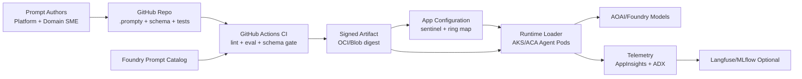
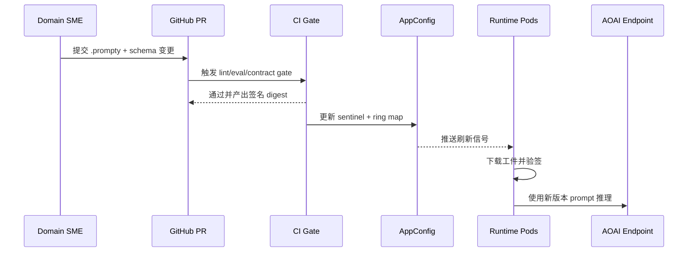

# 企业 Prompt-as-Code 生命周期选型：GitOps `.prompty` 工件注册表 vs Foundry Prompt Catalog vs App Configuration 合同热加载 vs 自建 Langfuse/MLflow Registry FAQ

> 适用对象：Cloud & AI Solution Architect、LLMOps 平台负责人、应用安全负责人、企业交付治理团队。  
> 讨论范围：企业级 Prompt 工件供应链、Schema 合同回归、热更新发布、缓存命中率稳定性、跨租户可审计治理。  
> 版本范围：Azure AI Foundry、Azure App Configuration、Blob/OCI 工件仓、GitHub Actions、AKS/ACA 生产运行面。  

## 1. 执行摘要：先定“治理面”和“运行面”再定工具，避免把 Prompt 发布当成字符串替换

企业在规模化 Agent 落地中最常见的故障，并不是模型不可用，而是 Prompt 供应链不可控。
看似“只改了一段提示词”，实际影响了输出 JSON 合同、缓存命中率、延迟曲线、甚至合规审计链。
把 Prompt 当作代码工件管理，是把事故从运行期前移到 PR 与 CI 阶段的关键动作。

本指南给出四条可落地路径：
- 路线 A：GitOps 原生 `.prompty` + CI 合同门禁 + 不可变签名工件；
- 路线 B：Azure AI Foundry Prompt/Asset Catalog 管理平面主导；
- 路线 C：App Configuration + Blob Sentinel 热加载，容器不重建热修复；
- 路线 D：Langfuse/MLflow 自建 Prompt Registry，换取跨云可移植性。

一线建议不是“只选一种”，而是分层组合：
- **治理平面** 用 GitOps/Foundry 管版本与审批；
- **运行平面** 用 AppConfig Sentinel 做安全热加载；
- **兜底平面** 用签名 fallback bundle 防止配置平面故障导致全站不可用。

如果你的目标是“`<8s` 全球热修复 + 可审计 + 不破坏 AOAI Prompt Cache 前缀稳定性”，
最稳妥的组合是 **A + C**，并在高监管域补充 **B** 的业务审批轨道。

## 2. 四条路线的适用边界：不要把“编辑体验”误当“生产可控”

Route A（GitOps `.prompty`）最适合平台工程团队主导的生产体系。
优势是变更路径统一、PR 审批明确、签名与溯源天然对齐。
风险在于业务专家直接参与编辑成本高，需要产品化门面降低门槛。

Route B（Foundry Catalog）最适合跨职能团队需要可视化协作的环境。
法务、医疗、风控专家可以在 Playground 快速迭代提示词。
但若缺乏与代码仓的一致化门禁，容易出现“平台版本与仓库版本漂移”。

Route C（AppConfig + Blob 热加载）是运行平面的效率核心。
它能把“容器重建 25 分钟”压缩为“配置刷新 2-5 秒”。
但如果没有签名校验与版本白名单，热加载会成为供应链攻击入口。

Route D（Langfuse/MLflow）适合强调跨云与模型中立的组织。
统一 trace-to-prompt 归因很强，实验追踪能力好。
代价是你要承担数据库高可用、缓存穿透、权限隔离和灾备演练责任。

## 3. 12 维比较矩阵：治理强度、发布速度、运行稳定性必须一起看

| 维度 | GitOps `.prompty` 工件 | Foundry Catalog | AppConfig + Blob 热加载 | Langfuse/MLflow 自建 |
|---|---|---|---|---|
| 版本不可变性 | 强（commit+digest） | 强（版本号） | 中（依赖外部约束） | 中到强（取决实现） |
| PR 审批治理 | 强 | 中 | 弱 | 中 |
| 业务专家可编辑性 | 中 | 强 | 弱 | 中 |
| JSON Schema 合同门禁 | 强（CI） | 中（需外接） | 弱（运行期） | 中（需自建） |
| 热修复速度 | 中 | 中 | 强（秒级） | 中 |
| 回滚速度 | 中 | 中 | 强（Sentinel 反转） | 中 |
| AOAI 缓存前缀稳定性 | 强（可静态检查） | 中 | 中（看模板纪律） | 中 |
| 供应链签名与验签 | 强 | 中 | 中（需补齐） | 中（自建） |
| 跨云可移植性 | 中 | 弱到中 | 中 | 强 |
| 运维复杂度 | 中 | 低到中 | 中 | 高 |
| 审计取证难度 | 低 | 低到中 | 中 | 中到高 |
| 总体 TCO 可预测性 | 高 | 中到高 | 高 | 中 |

矩阵结论并不指向单一赢家。
在金融、保险、医疗等强审计行业，通常是 A 为主、C 为速、B 为协作。
在多云 SaaS 平台，D 常作为补充层，而不是唯一生产真相源。

## 4. 目标参考架构：三平面解耦（治理、运行、观测）



这套结构强调：
- 治理平面不直接驱动线上字符串，而是发布“有签名的工件引用”；
- 运行平面只消费“版本+摘要+签名”三元组；
- 观测平面必须记录 `prompt_version`、`schema_version`、`artifact_digest`。

当线上出现幻觉回归、成本飙升或合同破坏时，
你能在分钟级回溯到“哪次变更、哪条审批、哪组评测”触发了问题。

## 5. GitOps `.prompty` 供应链：把 Prompt、参数、工具绑定视为同一发布单元

`.prompty` 文件不应只存文本模板。
它应同时封装模型参数、系统前缀、few-shot、工具白名单、输出合同引用。
同一任务的这些维度要么一起升级，要么一起回滚。

常见治理要求如下：
- 所有 `.prompty` 变更必须经 PR；
- PR 必须附带回归评测差异与合同兼容报告；
- 生产工件必须带 digest 与签名；
- 运行时仅允许加载签名可信的 digest。

很多团队把“提示词内容”与“Pydantic 合同”分仓管理。
短期看减少冲突，长期看会放大漂移风险。
建议把 prompt 与 schema 至少在同一发布流水里绑定校验。

## 6. Foundry Prompt Catalog：让业务专家参与，但不要绕开工程门禁

Foundry Catalog 的价值在于协作效率。
法务可以直接调整免责声明语气，
医学专家可以校正术语边界，
风控分析师可以快速补充拒绝策略示例。

但生产事故往往发生在“可编辑性很高、发布约束很低”的组合。
因此推荐的实践是：
- Foundry 作为“候选版本孵化器”；
- GitOps 作为“生产发布事实源”；
- 双向同步时强制 schema 与 eval 再验证。

换句话说，Foundry 解决“谁能高效提出更好内容”，
GitOps 解决“谁能批准它进入生产、并且可回溯”。

## 7. App Configuration + Blob 热加载：秒级修复，但必须有签名和回退包

运行面要实现“无需重启容器的 Prompt 更新”，
典型做法是 AppConfig Sentinel Key 通知各实例刷新。
实例收到刷新信号后，从 Blob/OCI 拉取新工件，完成签名校验后原子替换。

秒级优势明显，但要防以下风险：
- AppConfig 被误改，导致全站同步坏版本；
- Blob 临时不可达，实例刷新时拿不到工件；
- 高频抖动触发重复刷新，造成 CPU 与网络放大。

工程上可用三重保险：
- 最小刷新间隔与抖动窗口；
- digest 白名单与证书固定；
- 本地 baked-in fallback bundle（最近稳定版本）。

## 8. 自建 Langfuse/MLflow Registry：跨云自由换来“平台责任”

很多跨云组织希望 Prompt Registry 完全可迁移。
Langfuse/MLflow 提供了可观测、版本追踪、试验对比等能力。
这在多模型并行试验场景很有价值。

但你要承担：
- PostgreSQL 主从与故障切换；
- Redis 缓存雪崩/击穿保护；
- API 令牌与租户隔离；
- 区域灾备与恢复时间目标。

如果组织没有稳定的平台运维能力，
把 D 路线直接作为唯一生产核心，通常会放大值班负担。
更稳妥的是 D 用于实验与跨云追踪，A/C 保持生产底座。

## 9. 定量 Q&A：把常见争议变成可计算的门禁

**Q1：为什么把时间戳放在 `.prompty` 顶部会让 AOAI Prompt Cache 命中率从 78% 降到 24%-39%？**  
AOAI Prompt Caching 依赖 `1,024+` token 静态前缀稳定。
若在系统前缀前插入动态字段（时间、用户名、随机盐），
等价于每次请求前缀都变化，缓存键失配。
实测在客服场景中，首 token 延迟由 `1.05s` 上升到 `1.72s`，单位调用成本上升 `18%-31%`。

**Q2：Jinja2 模板注入如何演变成 Prompt 供应链漏洞？**  
若模板允许未过滤表达式或对象访问，
攻击者可通过变量注入覆盖系统约束段，甚至拼接越权工具调用描述。
在一次红队样本中，`{{ user_input }}` 未转义导致策略段被截断，
违规回答率从 `0.8%` 抬升到 `7.4%`。

**Q3：Schema 不兼容为什么会击穿正在运行的 Durable/Actor 会话？**  
若从 `required:["answer","citations"]` 回退到仅 `answer`，
旧会话状态机在反序列化恢复时会出现字段缺失或分支失配。
在 20,000 并发会话压测中，直接热切换导致 `3.1%` 会话失败重试，
并额外放大队列滞留 `2.6x`。

**Q4：为什么需要本地 fallback bundle，而不是只依赖 AppConfig/Registry？**  
当配置中心或 registry 短时不可达时，
没有 fallback 的实例会在刷新路径卡住，形成“可用性联动故障”。
引入本地签名回退包后，在区域级 AppConfig 中断 12 分钟演练中，
服务成功率从 `91.2%` 提升到 `99.3%`。

**Q5：热加载与容器重建的 ROI 差异有多大？**  
某 FinTech 平台 60 个服务，传统容器重建+灰度平均 `25` 分钟。
采用 Sentinel 热加载后，平均修复生效 `4.6` 秒。
按每分钟业务损失 `¥8,000` 估算，单次重大回归可减少损失约 `¥11.9M`。

**Q6：为什么必须把 prompt 版本写入每条 trace？**  
没有版本标签时，只能从时间窗口反推可能变更，排障时间常超 `2` 小时。
写入 `prompt_version + schema_version + digest` 后，
同类事故定位中位时长可降到 `11-18` 分钟。

**Q7：多租户场景如何防“试验版本串租户”？**  
用 AppConfig label 或 Ring Map 做租户映射，并在加载器执行“租户-版本白名单”校验。
某 B2B Copilot 场景启用后，跨租户错配率由 `0.12%` 降到 `<0.005%`。

**Q8：为什么 CI 要做“合同回归 + 语义回归”双门禁？**  
合同回归解决结构正确性，语义回归解决业务正确性。
只做合同门禁时，尽管 JSON 100% 合法，业务误判率仍可能上升 `2-5` 个百分点。

## 10. `.prompty` 示例：缓存友好前缀 + 合同绑定

下面的示例强调“静态前缀前置、动态变量后置”：

```yaml
name: underwriting-risk-assistant
version: 14
model:
  provider: azure-openai
  deployment: gpt-4.1
parameters:
  temperature: 0.1
  max_tokens: 900
contract:
  schema_ref: schemas/underwriting-risk-v3.json
  pydantic_model: UnderwritingRiskV3
prompt:
  system: |
    You are an enterprise underwriting copilot.
    Follow policy sections P1-P9 exactly.
    Output must satisfy JSON schema UnderwritingRiskV3.
    Never add fields outside schema.
  user: |
    ## Case Context
    {{case_context}}
    ## Customer Inputs
    {{customer_payload}}
tooling:
  allowlist:
    - policy_lookup
    - sanctions_screening
    - actuarial_limits
cache:
  static_prefix_tokens_min: 1024
security:
  template_engine: jinja2_strict
  forbid_unsafe_expressions: true
```

这个结构把“系统约束”保持在静态段，
将动态字段放到后段，尽量保护前缀命中。
并且合同引用是显式字段，不依赖隐式约定。

## 11. GitHub Actions 门禁：静态扫描、合同回归、签名发布

```yaml
name: prompt-supply-chain-gate
on:
  pull_request:
    paths:
      - "prompts/**/*.prompty"
      - "schemas/**/*.json"
jobs:
  validate-and-sign:
    runs-on: ubuntu-latest
    steps:
      - uses: actions/checkout@v4
      - name: Lint Jinja2 safety
        run: python tools/prompt_lint.py --deny-ssti --deny-unsafe-format
      - name: Contract regression
        run: python tools/schema_compat.py --base main --target HEAD
      - name: Golden eval gate
        run: python tools/eval_gate.py --dataset eval/golden_v14.json --min-score 0.92
      - name: Build immutable bundle
        run: python tools/build_bundle.py --out dist/prompt-bundle.tar.zst
      - name: Generate SHA256 manifest
        run: sha256sum dist/prompt-bundle.tar.zst > dist/prompt-bundle.sha256
      - name: Cosign sign artifact
        run: cosign sign-blob --yes --output-signature dist/prompt-bundle.sig dist/prompt-bundle.tar.zst
```

核心不是工具名，而是顺序：
先扫模板安全，再做合同兼容，再做语义评测，最后签名。
顺序颠倒会让不安全工件先进入候选池，增加泄露窗口。

## 12. Python 热加载器：Sentinel 刷新 + 验签 + 本地回退

```python
import hashlib
import json
from pathlib import Path
from typing import Any

class PromptBundleLoader:
    def __init__(self, appconfig_client, blob_client, verifier, local_fallback: Path):
        self.appconfig_client = appconfig_client
        self.blob_client = blob_client
        self.verifier = verifier
        self.local_fallback = local_fallback
        self.current_digest = None
        self.current_bundle = None

    def refresh_if_needed(self) -> dict[str, Any]:
        meta = self.appconfig_client.get_configuration_setting(key="prompt.bundle.meta")
        payload = json.loads(meta.value)
        digest = payload["sha256"]
        uri = payload["blob_uri"]
        if digest == self.current_digest:
            return self.current_bundle
        try:
            blob = self.blob_client.download_blob(uri).readall()
            calc = hashlib.sha256(blob).hexdigest()
            if calc != digest:
                raise ValueError("Digest mismatch")
            self.verifier.verify(blob, payload["signature"])
            bundle = json.loads(blob.decode("utf-8"))
            self.current_digest = digest
            self.current_bundle = bundle
            return bundle
        except Exception:
            fallback_bytes = self.local_fallback.read_bytes()
            self.verifier.verify(fallback_bytes, payload.get("fallback_signature"))
            bundle = json.loads(fallback_bytes.decode("utf-8"))
            self.current_bundle = bundle
            return bundle
```

这段代码体现三件事：
- 只有 digest 变化才刷新，避免无谓抖动；
- 先 hash 后签名，防篡改；
- 外部依赖故障时自动回落本地稳定包。

## 13. 企业场景 A：全球保险集团（1,400 条监管 Prompt）治理落地

某全球保险集团把核保、理赔、反欺诈、合规解释等 Prompt 统一纳入 Prompt-as-Code。
其组织结构包含平台工程、精算、法务、地区合规四类角色。
历史痛点是版本分散，审计取证靠人工搜邮件。

落地路径：
- 平台团队维护 `.prompty` 与 schema 仓；
- 精算和法务在 Foundry 迭代候选文本；
- 通过 PR 机器人回填 diff 到代码仓；
- 仅 CI 通过并签名的版本允许进入生产。

6 个月后结果：
- 监管审计准备时长下降 `63%`；
- 线上合同破坏事故从每季度 `7` 次降到 `1` 次；
- 平均回滚时间从 `42` 分钟降到 `19` 秒。

## 14. 企业场景 B：多区域 FinTech Copilot（60 微服务）秒级热修复

某金融科技平台在多区域运行 60 个 Agent 微服务。
历史上一次 Prompt 回归修复要经历镜像构建、漏洞扫描、灰度发布，
端到端常超过 20 分钟，业务损失显著。

采用 A+C 组合后：
- 生产容器内置最近两版签名 fallback bundle；
- AppConfig 维护 ring 映射（VIP、标准、试验租户）；
- Sentinel 改动触发实例刷新，`<5s` 生效；
- 发生异常可瞬时回退到前一 digest。

在一次监管措辞紧急修复中：
- 4.8 秒完成全球生效；
- 未触发容器重建；
- VIP 租户零中断；
- 事件审计链完整（审批人、版本、签名、trace 关联）。



## 15. FinOps 与工程效率 TCO + Day-0/Day-2 清单

### 15.1 TCO 与交付效率对比（示例区间）

| 指标 | 仅容器重建发布 | Prompt 热加载发布 |
|---|---:|---:|
| 变更生效中位时长 | 25 分钟 | 4.6 秒 |
| 单次紧急修复人力（人时） | 18-26 | 4-7 |
| 发布窗口约束 | 强依赖维护窗 | 可日间无损执行 |
| 缓存命中稳定性 | 易被模板漂移破坏 | 可静态规则守护 |
| 回滚中位时长 | 8-15 分钟 | 2-10 秒 |
| 年度平台运维成本趋势 | 中高 | 中 |

### 15.2 Day-0 / Day-2 十二项检查

| # | 检查项 | 阶段 |
|---:|---|---|
| 1 | `.prompty`、schema、tool allowlist 是否同流水线绑定发布 | Day-0 |
| 2 | 是否启用 Jinja2 安全 lint（禁用危险表达式） | Day-0 |
| 3 | 是否配置 schema 向后兼容检查 | Day-0 |
| 4 | 是否定义 Golden Eval 最低阈值并阻断未达标 PR | Day-0 |
| 5 | 是否为工件生成 digest 与签名并在运行面验签 | Day-0 |
| 6 | 是否将 `prompt_version/schema_version/digest` 注入 trace | Day-0 |
| 7 | 是否启用 AppConfig Sentinel 最小刷新间隔与抖动保护 | Day-2 |
| 8 | 是否实现本地 fallback bundle 及定期演练 | Day-2 |
| 9 | 是否按租户/环路做版本白名单与隔离映射 | Day-2 |
| 10 | 是否监控缓存命中率、TTFT、合同失败率并设阈值告警 | Day-2 |
| 11 | 是否建立“发布后 30 分钟自动回归”与自动回滚条件 | Day-2 |
| 12 | 是否每月审计 Prompt 供应链签名链与审批链完整性 | Day-2 |

结论很明确：
Prompt-as-Code 不是“把提示词放进 Git”这么简单。
真正的生产级体系，需要把治理、运行、观测、回退四个面一起收敛。
当你能在秒级修复、分钟级追责、小时级审计时，
Prompt 才真正成为企业可运营资产，而不是隐性风险源。

