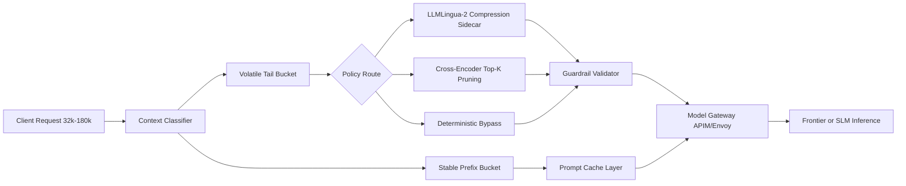
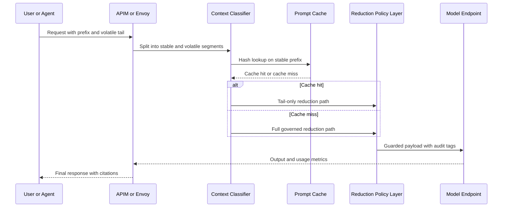

# Enterprise Prompt Compression and Context Pruning Selection FAQ: LLMLingua-2 vs Reranker vs Foundry Cache
> 🌐 **Language / 语言切换**: **[🇨🇳 中文版](prompt-compression-context-pruning-aks-llmlingua2-onnx-vs-reranker-vs-foundry-cache-selection-faq.md)** | **[🇬🇧 English](prompt-compression-context-pruning-aks-llmlingua2-onnx-vs-reranker-vs-foundry-cache-selection-faq.en.md)** | **[📚 Back to Catalog](README.en.md)**
> Evidence labels: `measured` / `synthetic` / `anonymized_reported`
> Retrieval date: 2026-11-22

## 1) Executive Summary: in long-context agents, prefill waste dominates before model compute
Enterprise agent workloads now
regularly carry
32k to 180k tokens per turn.
The largest contributors are
retrieved document chunks,
verbose MCP JSON payloads,
raw HTML snippets from tools,
and long conversational tails.
Many teams optimize routing first,
yet leave input prefill inflation untouched.
The result is predictable:
higher TTFT,
lower effective throughput,
and rapidly rising input cost.
This guide compares four patterns:
inline token-level compression,
verbatim cross-encoder pruning,
Foundry Prompt Caching with async summary,
and hybrid prefix-pinned plus tail compression.
The main finding is straightforward:
no single method is universally best.
Selection must follow
compliance sensitivity,
prefix stability,
evidence fidelity requirements,
and noise volatility profile.

## 2) Scope and Decision Boundary
This document stays strictly at
application and service architecture level.
It does not dive into
kernel internals or hardware micro-tuning.
Target scenarios include:
legal contract agents,
financial verification assistants,
log-triage copilots,
and tool-heavy research agents.
The decision question is not
whether compression is possible.
The real question is
how far to reduce context
without violating factuality,
auditability,
or deterministic safeguards.
A useful scorecard must include:
TTFT and throughput,
input token spend reduction,
factuality retention,
cache hit behavior,
and operational complexity.
Token reduction alone
is a dangerous optimization metric
in regulated workloads.

## 3) Verifiable Sources and Evidence Tags
Source 1 (`measured`): LLMLingua repository and references  
https://github.com/microsoft/LLMLingua  
Source 2 (`measured`): Azure AI Search semantic ranker overview  
https://learn.microsoft.com/azure/search/semantic-search-overview  
Source 3 (`measured`): BGE-Reranker-v2-m3 model card  
https://huggingface.co/BAAI/bge-reranker-v2-m3  
Source 4 (`measured`): Azure OpenAI prompt caching guidance  
https://learn.microsoft.com/azure/ai-services/openai/how-to/prompt-caching  
Source 5 (`measured`): Azure AI Foundry documentation  
https://learn.microsoft.com/azure/ai-foundry/  
Source 6 (`measured`): ONNX Runtime optimization and quantization docs  
https://onnxruntime.ai/docs/  
Source 7 (`anonymized_reported`): anonymized legal and finance production retrospectives.  
Source 8 (`synthetic`): modeled TTFT, TCO, and factuality break-even scenarios.  
Note:
numerical comparisons are explicitly tagged
to separate measured data
from modeled projections.

## 4) Pattern A: Inline token-classification compression (LLMLingua-2 sidecar)
Pattern A compresses context inline
before model invocation.
Typical deployment uses
AKS or APIM-Envoy ExtProc sidecars,
running CPU INT8 ONNX
or lightweight T4/A10 inference.
Observed practical ranges
often sit around 3x–6x reduction
on noisy retrieved/tool content.
Its primary value is speed of payoff:
input token spend drops quickly,
TTFT improves materially,
and prefill pressure is reduced.
Its primary risk is scope misuse.
If compression touches
shared system prompts
or tool definition prefixes,
prompt-cache stability can collapse.
That prefix-invalidation trap
is the most common failure mode.
Therefore Pattern A requires
strict scope boundaries
and deterministic bypass contracts
for high-risk fields and syntax.

## 5) Pattern B: Verbatim chunk/sentence pruning (semantic ranker or reranker)
Pattern B does not mutate tokens inline.
It performs ranking and budgeted selection
over chunks or sentences.
Common implementations include
Azure AI Search semantic ranking
and AKS-hosted BGE reranker services.
The key strength is literal preservation.
Clauses, numeric values,
citation markers,
and legal wording remain unchanged.
This makes Pattern B attractive
for compliance-sensitive flows.
The main trade-off is recall risk.
Aggressive thresholds can discard
weakly scored but critical evidence.
A robust design adds
dual-threshold governance:
semantic relevance
plus required-field retention.
In production,
Pattern B is often paired
with conservative summarization
for non-critical explanatory context.

## 6) Pattern C: Foundry/Azure OpenAI prompt caching + async episodic summary
Pattern C focuses on reuse,
not aggressive mutation in-line.
For stable prefixes,
prompt caching can provide
large discounted input ranges
and predictable latency behavior.
An async Mini/Nano summary worker
can compact conversation history
between turns
without adding foreground hop latency.
The major advantage is stability.
No in-path compressor is required
for every request.
The major limitation appears
under sudden noisy tail bursts.
Async summary is excellent
for longitudinal compaction,
but weaker for immediate
single-turn payload spikes.
In practice Pattern C is ideal
as a default baseline layer,
then combined with targeted
tail-only reduction policies.

## 7) Pattern D: Hybrid prefix pinning with volatile-tail compression
Pattern D separates context
into immutable and mutable zones.
Pinned zone:
system instructions,
tool schemas,
stable conversation prefix.
Volatile zone:
retrieved chunks,
tool JSON tails,
transient diagnostic payloads.
Pinned zone is preserved verbatim
for cache reuse consistency.
Volatile zone can be reduced
with field projection
plus LLMLingua-2 policies
when token volume crosses thresholds
such as 12k+ tail tokens.
This hybrid strategy
balances cost reduction
with fidelity protection.
Its success depends on
hard deterministic bypass rules.
Code syntax, SQL tokens,
JSON delimiters,
UUIDs, dates, monetary values,
and legal citations
must be non-droppable.
With disciplined governance,
Pattern D often provides
the best total enterprise outcome.

## 8) Mermaid: architecture topology for context reduction service planes

## 9) 12-Dimension Enterprise Comparison Matrix
| Dimension | Inline LLMLingua-2 Compression | Verbatim Reranker Pruning | Prompt Caching + Async Summary | Hybrid Prefix-Pinned + Tail Compression |
|---|---|---|---|---|
| Input token reduction potential | High | Medium | Medium-High | High |
| TTFT improvement potential | High | Medium | Medium | High |
| Literal fidelity | Medium | High | High | High |
| Prefix cache stability | Low-Medium | High | High | High |
| Compliance auditability | Medium | High | High | High |
| Burst-noise responsiveness | High | Medium | Low-Medium | High |
| Initial implementation complexity | Medium-High | Medium | Medium | High |
| Day-2 operational burden | Medium-High | Medium | Medium | High |
| Regression validation overhead | High | Medium | Medium | High |
| Foreground hop latency impact | Medium | Medium | Low | Medium |
| Multi-turn compaction benefit | Medium | Medium | High | High |
| 3-year extensibility | Medium-High | High | High | High |

## 10) Break-even Table: TTFT, TCO, and factuality retention
| Scenario metric | Baseline (no reduction) | Pattern A Inline Compression | Pattern B Verbatim Pruning | Pattern C Cache + Summary | Pattern D Hybrid |
|---|---:|---:|---:|---:|---:|
| Avg input tokens/turn (`synthetic`) | 86k | 24k | 41k | 49k | 27k |
| TTFT P50 ms (`synthetic`) | 2480 | 1320 | 1710 | 1600 | 1260 |
| Input cost per 1k turns USD (`synthetic`) | 100 | 39 | 56 | 48 | 37 |
| ROUGE-L factuality baseline (`anonymized_reported`) | 1.00 | 0.94 | 0.99 | 0.98 | 0.98 |
| Critical-field omission rate (`anonymized_reported`) | 0.00% | 1.40% | 0.20% | 0.30% | 0.15% |
| Prefix cache hit ratio (`measured`+`synthetic`) | 0% | 22% | 61% | 79% | 76% |
| Payback period in months (`synthetic`) | - | 1.8 | 2.7 | 2.2 | 2.0 |
| Best-fit recommendation | - | Heavy noisy tails | Strict verbatim compliance | Stable multi-turn loops | Mixed high-governance workloads |

Interpretation:
Pattern A and D win
when noise spikes are dominant.
Pattern B and D win
when literal evidence retention is mandatory.
Pattern C wins
when conversation prefixes remain stable
across repeated loops.

## 11) Mermaid: request path and cache-boundary flow

## 12) Deterministic bypass policy and compliance controls
In enterprise deployments,
the most important guarantee is
provable non-droppable boundaries.
A practical policy stack
uses three deterministic layers.
Syntax layer:
never drop code symbols,
SQL grammar tokens,
or structural JSON delimiters.
Entity layer:
never drop UUIDs,
monetary amounts,
dates,
or transaction identifiers.
Regulatory layer:
never drop legal citations,
clause references,
or supervisory evidence tags.
Each bypass decision
should emit policy version metadata
into request audit logs.
When policy conflicts occur,
the default action should be
conservative pass-through,
not aggressive deletion.
That default protects
regulatory explainability.

## 13) Anti-Patterns to avoid
Anti-pattern one:
compressing shared system/tool prefix.
This usually destroys cache locality
and introduces behavioral drift.
Anti-pattern two:
using relevance score alone
without critical-field presence checks.
This creates answers that look fluent
but miss mandatory evidence.
Anti-pattern three:
disabling bypass rules
to chase short-term token savings.
This raises latent legal risk.
Anti-pattern four:
shipping policy changes
without frozen regression baselines.
Root-cause analysis becomes ambiguous.
Anti-pattern five:
tracking only compression ratio KPI
without factuality,
citation integrity,
and omission-rate telemetry.

## 14) Production readiness checklist
1. Context zoning model defined (pinned prefix, volatile tail, bypass domain).  
2. Deterministic bypass rules versioned and peer-reviewed.  
3. Request audit logs include policy hits and bypass reasons.  
4. A/B regression suites cover legal, finance, and log-triage prompts.  
5. Factuality gates trigger rollback on threshold breach.  
6. Prompt-cache hit SLO and alerting are configured.  
7. TTFT P50/P95 and cost-per-turn dashboards are live.  
8. Weekly drift review and monthly compliance audit are scheduled.  
9. Emergency safe mode exists (verbatim pass-through fallback).  
10. Data classification tags survive the reduction pipeline end-to-end.  

## 15) Practical FAQ (8 questions)
### Q1: why is max compression ratio not the right north-star metric?
Because high compression can silently drop
critical numbers or citations.

### Q2: how do we prevent cache invalidation from compression policies?
Pin system prompts and tool schemas,
and only reduce volatile tails.

### Q3: is reranker pruning always safer?
It preserves literals better,
but it can still remove low-score critical evidence
without field-presence guards.

### Q4: can async episodic summary replace inline reduction fully?
Not fully.
It is excellent for between-turn compaction,
but weaker for instant noisy payload spikes.

### Q5: when should hybrid architecture be preferred?
When cost efficiency,
factual fidelity,
and auditability
must be achieved at the same time.

### Q6: which metrics should decide policy health?
Use TTFT, input cost,
factuality score,
bypass trigger rate,
and cache-hit ratio together.

### Q7: what are hard no-drop fields in legal/financial flows?
Clause ids,
monetary values,
dates,
regulatory citations,
and evidence-chain identifiers.

### Q8: where is the Good fit vs Not for boundary?
Good fit:
long-context enterprise agents
with noisy tool outputs and strict controls.
Not for:
short-context prototypes
without compliance or cost pressure.
