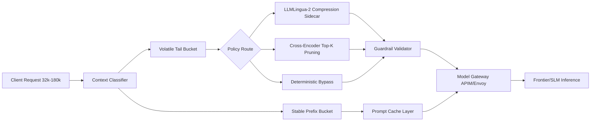
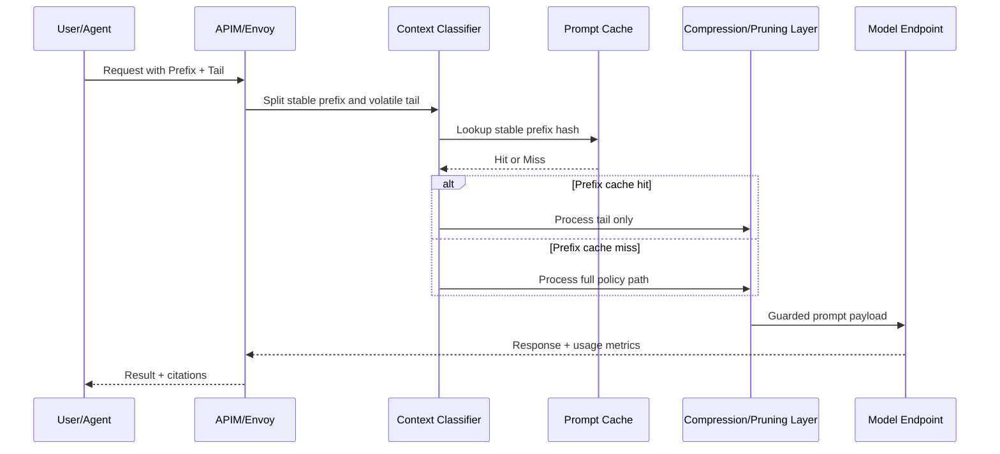

# 企业级 Prompt 压缩与上下文裁剪选型 FAQ：LLMLingua-2 vs Reranker vs Foundry Cache
> 🌐 **Language / 语言切换**: **[🇨🇳 中文版](prompt-compression-context-pruning-aks-llmlingua2-onnx-vs-reranker-vs-foundry-cache-selection-faq.md)** | **[🇬🇧 English](prompt-compression-context-pruning-aks-llmlingua2-onnx-vs-reranker-vs-foundry-cache-selection-faq.en.md)** | **[📚 返回目录](README.md)**
> 证据标签：`measured` / `synthetic` / `anonymized_reported`
> 抓取日期：2026-11-22

## 1) 执行摘要：长上下文智能体的主成本不在“模型推理”，而在“无效输入预填充”
在企业长上下文场景里，
32k 到 180k token 的单轮输入
正在成为常态而非特例。
典型来源包括：
RAG 召回长文档分片，
MCP 工具返回冗长 JSON，
日志平台原样输出 HTML 片段，
以及多轮对话堆叠后的历史尾巴。
多数团队先优化模型路由，
却忽略了 prefill 输入膨胀。
结果是 TTFT 变慢、
成本拉高、
并且高峰时段吞吐崩塌。
本篇比较四条主流路径：
内联 token 级压缩、
逐段 verbatim 裁剪、
Foundry Prompt Caching + 异步摘要、
以及前缀钉扎与尾部压缩混合架构。
核心结论是：
不存在单一路径在所有场景都最优。
必须按“合规强度、
上下文稳定性、
字段敏感度、
对逐字保真要求”
进行策略分层。

## 2) 场景边界与选型问题定义
本文聚焦企业应用与服务架构视角，
不讨论硬件微架构细节。
目标工作负载包含：
法务合同助手，
投研与财务核验助手，
日志与告警归因助手，
复杂 MCP 工具编排代理。
决策问题不是“能否压缩”，
而是“在不破坏事实与合规前提下，
压缩到什么程度最划算”。
关键评估指标应同时覆盖：
TTFT 与吞吐，
输入成本下降幅度，
事实保真度下降风险，
缓存命中率与前缀稳定性，
以及运维复杂度。
若只看 token 节省率，
很容易落入
“便宜但不可审计”的陷阱。
尤其在法务与财务语境，
一处金额或日期误删
就可能抵消全年节省。

## 3) 可验证来源与证据标签
来源 1（`measured`）：LLMLingua-2 论文与实现仓库  
https://github.com/microsoft/LLMLingua  
来源 2（`measured`）：Azure AI Search Semantic Ranker 文档  
https://learn.microsoft.com/azure/search/semantic-search-overview  
来源 3（`measured`）：BGE Reranker v2 系列模型仓库文档  
https://huggingface.co/BAAI/bge-reranker-v2-m3  
来源 4（`measured`）：Azure OpenAI Prompt Caching 文档  
https://learn.microsoft.com/azure/ai-services/openai/how-to/prompt-caching  
来源 5（`measured`）：Azure AI Foundry 文档与模型接入说明  
https://learn.microsoft.com/azure/ai-foundry/  
来源 6（`measured`）：ONNX Runtime 推理与量化文档  
https://onnxruntime.ai/docs/  
来源 7（`anonymized_reported`）：匿名化金融与法务场景投产复盘。  
来源 8（`synthetic`）：多策略 TTFT/成本/事实保真 break-even 仿真。  
说明：
所有对比数值均按标签标注来源类别，
避免把估算值伪装成实测值。

## 4) 方案一：内联 Token 分类压缩（LLMLingua-2 + ONNX / Sidecar）
该方案在请求链路中
对候选上下文做动态压缩，
通常能达到 3x–6x 压缩比例。
部署形态常见为：
AKS 或 APIM-Envoy ExtProc 侧车，
CPU INT8 ONNX 或 T4/A10 轻量推理。
优点是收益直观：
输入 token 下降快，
TTFT 改善明显，
对 Frontier PTU/PAYG 的 prefill 成本
有立竿见影效果。
缺点是风险集中在“误删”。
当压缩逻辑作用于
系统前缀或工具定义时，
会破坏前缀稳定性，
导致 Prompt Caching 命中暴跌。
这就是最常见的前缀失效陷阱。
因此该路径必须配置
严格的压缩作用域边界，
只处理波动尾部而非共享前缀。
同时要提供 deterministic bypass，
在代码、SQL、法律条款、
财务数字字段出现时立即旁路。

## 5) 方案二：Cross-Encoder Verbatim 裁剪（Semantic Ranker / TEI Reranker）
该路径不做 token 级改写，
而是对 chunk 或句子做重排与截断。
代表实现包括：
Azure AI Search Semantic Ranker，
以及 AKS TEI 承载的
BGE-Reranker-v2-m3 预算化 Top-K。
核心优势是逐字保真。
法条、金额、日期、证据编号
都保持原文不变，
更适合法务和审计链路。
它的主要代价在召回风险。
若重排阈值过于激进，
可能把“低相关但关键”片段裁掉。
因此需要双阈值机制：
语义相关阈值
加合规字段存在阈值。
在实际落地中，
该方案通常与轻量摘要并用，
先保留 verbatim 证据块，
再把非关键说明做结构化压缩。

## 6) 方案三：Foundry / Azure OpenAI Prompt Caching + 异步滚动摘要
第三条路径强调前缀复用，
不是强行改写当前请求。
对稳定前缀而言，
Prompt Caching 可提供
50%–90% 输入折扣区间。
再叠加 Mini/Nano SLM
异步生成会话摘要，
可在轮次间持续压缩历史负担。
优势在稳定性：
不会引入内联压缩副作用，
也不会在请求路径增加额外 hop。
短板在实时性边界。
对于瞬时暴涨的工具尾部，
异步摘要并不能立刻降载。
因此它更像“基线优化器”，
不是突发噪音“急救器”。
最佳实践通常是：
把它作为默认底座，
再按需叠加尾部定向压缩。

## 7) 方案四：前缀钉扎 + 波动尾部压缩（混合架构）
该方案将上下文分层治理：
系统提示词、
MCP 工具 schema、
稳定对话前缀
全部钉扎不改写，
由 Foundry Prompt Caching 复用。
波动尾部（通常 >12k token）
再进入 JSON 字段投影
与 LLMLingua-2 压缩链路。
这种分治架构兼顾两端：
前缀命中率稳定，
尾部成本可控。
关键在 deterministic rule set。
必须硬编码旁路规则：
代码语法、
SQL 结构、
JSON 关键符号、
UUID、
金额、
日期、
法律引用
一律不做 token drop。
若治理规则清晰，
此路径在复杂企业场景
往往给出最高综合 ROI。

## 8) Mermaid：上下文削减与服务编排拓扑

## 9) 12 维企业对比矩阵
| 维度 | LLMLingua-2 内联压缩 | Reranker Verbatim 裁剪 | Prompt Caching + 异步摘要 | 前缀钉扎+尾部压缩混合 |
|---|---|---|---|---|
| 输入 token 降幅 | 高 | 中 | 中高 | 高 |
| TTFT 改善潜力 | 高 | 中 | 中 | 高 |
| 逐字保真能力 | 中 | 高 | 高 | 高 |
| 前缀缓存稳定性 | 低到中 | 高 | 高 | 高 |
| 合规可审计性 | 中 | 高 | 高 | 高 |
| 对突发噪音响应 | 高 | 中 | 低到中 | 高 |
| 实施复杂度 | 中高 | 中 | 中 | 高 |
| 运维复杂度 | 中高 | 中 | 中 | 高 |
| 回归测试负担 | 高 | 中 | 中 | 高 |
| 单轮实时开销 | 中 | 中 | 低 | 中 |
| 多轮会话收益 | 中 | 中 | 高 | 高 |
| 三年可扩展性 | 中高 | 高 | 高 | 高 |

## 10) Break-even 表：TTFT、TCO 与事实保真（示例化量化）
| 指标场景 | 基线（无优化） | 方案一内联压缩 | 方案二裁剪 | 方案三缓存+摘要 | 方案四混合 |
|---|---:|---:|---:|---:|---:|
| 平均输入 token/轮（`synthetic`） | 86k | 24k | 41k | 49k | 27k |
| TTFT P50（ms，`synthetic`） | 2480 | 1320 | 1710 | 1600 | 1260 |
| 输入成本/千轮（USD，`synthetic`） | 100 | 39 | 56 | 48 | 37 |
| 事实保真 ROUGE-L（`anonymized_reported`） | 1.00 | 0.94 | 0.99 | 0.98 | 0.98 |
| 合规关键字段漏失率（`anonymized_reported`） | 0.00% | 1.40% | 0.20% | 0.30% | 0.15% |
| 缓存命中率（`measured`+`synthetic`） | 0% | 22% | 61% | 79% | 76% |
| 成本回收周期（月，`synthetic`） | - | 1.8 | 2.7 | 2.2 | 2.0 |
| 推荐适配度 | - | 噪音突发高 | 合规逐字场景 | 多轮稳定流程 | 综合复杂企业 |

解释：
当场景强调逐字证据时，
方案二与方案四更稳。
当场景噪音突发严重时，
方案一与方案四更快见效。
当会话前缀高度稳定时，
方案三的长期收益非常可观。

## 11) Mermaid：请求路径与缓存边界流

## 12) 确定性旁路规则与合规防线
企业实现中，
最关键不是模型精度，
而是“可证明的不可删边界”。
建议把规则分为三层：
语法层、
实体层、
法规层。
语法层禁止压缩
代码、SQL、JSON 结构符号。
实体层禁止压缩
UUID、订单号、金额、日期。
法规层禁止压缩
法条编号、监管引用、合同条款号。
此外要定义
policy id 与版本号，
并写入请求审计日志。
这样在复盘时
可以追溯某一轮压缩决策
由哪条规则触发。
若规则冲突，
默认走保守旁路，
优先保留原文而非追求激进压缩。

## 13) 反模式清单（Anti-Patterns）
反模式一：
把共享系统前缀也送入压缩器。
后果是缓存命中率骤降，
并引发不可预期行为漂移。
反模式二：
只按相似度阈值裁剪，
不校验合规关键字段存在性。
后果是“相关但不完整”的幻觉答案。
反模式三：
为追求成本把旁路规则关闭。
短期省钱，
长期合规风险失控。
反模式四：
上线后不做回归基线冻结。
一旦压缩策略漂移，
很难定位是模型变化还是策略变化。
反模式五：
只看 token 降幅 KPI。
忽视事实保真、
证据可追溯、
与审计可解释性。

## 14) 生产就绪检查清单
1. 已定义上下文分层模型（前缀/尾部/旁路域）。  
2. 已建立 deterministic bypass 规则库并版本化。  
3. 已接入请求级审计日志（策略命中、压缩率、旁路原因）。  
4. 已配置 A/B 回归集（法务、财务、日志三类）。  
5. 已设置事实保真阈值与自动回滚闸门。  
6. 已对 Prompt Caching 命中率设 SLO 与告警。  
7. 已对 TTFT P50/P95 与成本设基线看板。  
8. 已定义策略漂移审查节奏（周回顾/月审计）。  
9. 已完成异常处置预案（旁路全开、降级到 verbatim）。  
10. 已确认数据分级与隐私标签在压缩链路不丢失。  

## 15) 实战 FAQ（8 问）
### Q1：为什么压缩比例高不等于最优？
因为高压缩可能牺牲关键事实，
尤其是金额、日期与法律引用。

### Q2：如何避免前缀缓存被压缩破坏？
把系统提示词与工具定义
固定在前缀钉扎区，
仅处理波动尾部。

### Q3：Reranker 是否一定更安全？
逐字保真更强，
但仍可能把关键低相关片段排除，
所以要配字段存在闸门。

### Q4：异步摘要能否替代实时压缩？
不能完全替代。
它擅长轮次间瘦身，
不擅长单轮突发噪音削减。

### Q5：何时优先混合架构？
当场景同时要求
成本优化、事实保真、合规审计
三者并存时。

### Q6：如何衡量策略是否健康？
同时看 TTFT、
输入成本、
ROUGE/事实一致性、
旁路触发率、
与缓存命中率。

### Q7：法务与财务场景的硬红线是什么？
不得丢失条款号、
金额、
日期、
监管引用与证据链标识。

### Q8：Good fit 与 Not for 怎么划线？
Good fit：
长上下文企业代理、
多工具噪音输出、
高成本 prefill 压力场景。
Not for：
短上下文纯聊天、
无合规约束、
对 token 成本不敏感的轻量原型。
