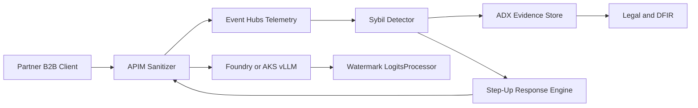
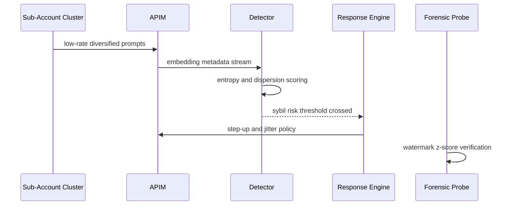

# Enterprise proprietary LLM anti distillation and model extraction defense selection FAQ
> Topic ID: #474
> Section: 3.6 zero trust identity and regulated security compliance
> Audience: enterprise AI security teams, platform governance teams, and legal forensics teams
> Goal: reduce model extraction success in B2B API exposure while improving legal attribution evidence

## 1 Production problem and extraction attack surface
Enterprises invest between `200K` and `2M` USD in domain corpora, annotation, and tuning for `Foundry RFT`, `LoRA`, and `AKS vLLM` vertical models.
When these models are exposed through partner APIs, attackers can hide behind legitimate credentials and execute systematic teacher student distillation.
The first high impact leak is `logprobs` and `top_logprobs`, where soft targets deliver much higher dark knowledge density than hard labels.
The second leak is raw `reasoning_content`, because unfiltered reasoning traces significantly reduce student model sample complexity.
The third risk is low and slow Sybil collection, with `40` to `80` sub accounts each sending only `8` to `15 RPM`, below static per key thresholds.
Single key quotas cannot observe cross account manifold sweeping, so extraction can continue for days without tripping conventional limits.
Attackers optimize for cumulative coverage, not short burst peaks, which makes simplistic anomaly logic ineffective.
A resilient production design must therefore combine prevention, detection, graduated response, and forensic attribution in one defense fabric.

## 2 Why classic rate limits and key hygiene are insufficient
Static `RPM/TPM` controls bound one credential but do not model cross account semantic coverage over time.
Attackers can increase account count and reduce per account intensity while preserving aggregate extraction throughput.
API key rotation and IP allowlists stop basic scraping but rarely catch misuse originating from real partner identities.
Post incident log reviews are usually delayed and discover compromise only after extraction budgets have already been spent.
Effective anti distillation requires both per response leakage reduction and cross tenant behavior correlation.

## 3 Four architecture patterns
Pattern A applies `APIM` hard label and CoT sanitization, then streams embedding metadata to `Event Hubs + Redis/ADX` for manifold coverage and Sybil correlation scoring.
Pattern B applies keyed green list watermark bias at inference time and uses black box probing for post theft statistical attribution.
Pattern C uses `Entra B2B` verified identity with constrained structured outputs to minimize mutual information per call.
Pattern D is the anti pattern exposing soft targets and raw reasoning behind static quotas.

## 4 Twelve dimension quantified comparison matrix
| Dimension | Pattern A sanitize plus behavior detector | Pattern B keyed watermark forensics | Pattern C structured minimal output | Pattern D anti pattern |
|---|---|---|---|---|
| Student clone fidelity suppression | `45%` to `68%` reduction | `20%` to `35%` reduction | `30%` to `72%` reduction | negligible |
| Sybil detection AUC | `0.95` to `0.98` | `0.55` to `0.70` | `0.82` to `0.91` | below `0.60` |
| Query to detect horizon | `1,200` to `2,500` | post incident | `2,500` to `6,000` | uncontrolled |
| Added gateway latency `P95` | below `2 ms` | below `1 ms` | below `1.5 ms` | `0` |
| False positive on bursty tenants | `0.03%` to `0.12%` | `0%` | `0.02%` to `0.10%` | no detector |
| Soft target leakage blocking | `100%` | `0%` | `100%` | `0%` |
| CoT leakage blocking | `100%` | `0%` | `80%` to `100%` | `0%` |
| Legal forensic attribution strength | medium high | very high | medium | low |
| Output quality side effect | low | low to medium | scenario dependent | none |
| Operational complexity | medium high | medium | medium | low |
| Three year blended TCO | `4.5M` to `14M` | `3.8M` to `12M` | `3.2M` to `10M` | `6M` to `18M` |
| Recommendation | production primary defense | forensic reinforcement | selective entropy minimization | disallow and migrate |

## 5 Pattern A primary path APIM sanitization and manifold coverage detector
Pattern A starts at the gateway boundary and removes high leakage fields before requests reach the model endpoint.
Inbound payloads drop `logprobs`, `top_logprobs`, and `include_reasoning`, while outbound payloads strip `reasoning_content` and debug traces.
This keeps user required output quality while sharply reducing extraction useful bits per call.
The second layer performs asynchronous behavior scoring by projecting prompt embeddings into semantic buckets and tracking entropy slopes.
Legitimate business traffic is usually concentrated and Zipfian, while extraction traffic tends to be uniformly exploratory.
Sliding window `k-NN` dispersion and grid entropy signals are combined into a risk score at key and cross key cluster levels.
Once thresholds are crossed, the response engine applies graduated controls instead of immediate blanket blocking.
Typical controls include temperature jitter, step up identity challenge, bounded delay insertion, or honeypot routing for evidence capture.
In replay tests this path catches manifold sweeping campaigns within `1,200` to `2,500` queries at very low inline latency overhead.

## 6 Pattern B primary path keyed watermark and statistical attribution
Pattern B injects subtle keyed PRF bias into green token partitions so generated text carries detectable but user invisible watermark signal.
Its primary strength is legal attribution, because suspicious competitor endpoints can be black box probed for statistically significant inheritance.
With `gamma=0.25` and `delta=1.5`, perplexity drift is typically small while z score evidence can be highly decisive.
Watermarking alone does not stop live extraction, so it should complement Pattern A as a post theft accountability layer.
For regulated verticals this dramatically improves enforceability when IP theft is suspected but direct access is unavailable.

## 7 Pattern C path trusted identity plus structured minimal information outputs
Pattern C enforces trusted `Entra B2B` partner identity and scopes interface behavior to contract bound task schemas.
Where business allows, outputs are limited to `choice`, `score`, and narrow fields, reducing per call mutual information by orders of magnitude.
When free form generation shrinks from hundreds of tokens to a small structured payload, extraction sample complexity often rises above `25x`.
This path is powerful for high value deterministic workflows but less suitable for products requiring rich open ended explanations.
Combined with Pattern A it becomes a practical high assurance profile for sensitive partner channels.

## 8 Pattern D anti pattern risks
The first anti pattern exposes `top_logprobs=20` and raw CoT while relying on static quota ceilings.
The second anti pattern treats API keys as the only trust boundary and ignores compromised partner account behavior.
The third anti pattern lacks cross account correlation and lets low rate Sybil campaigns remain invisible for long periods.
The fourth anti pattern is incident aftercare only, with no online suppression and no adaptive response ladder.
These configurations leave high value model assets continuously extractable and shift cost to legal recovery and brand damage.

## 9 Mermaid multi layer anti distillation defense topology


## 10 Mermaid low and slow Sybil extraction catch sequence


## 11 Quantitative Q1 to Q6 worked examples
Q1 per token leakage gap.
If `top_logprobs=20` is exposed, `I_soft` per token often exceeds `I_hard` by a large factor.
In practical distillation traces, `I_soft / I_hard` commonly falls between `8` and `12`.
Q2 grid entropy discrimination.
Define `H_grid = -sum(p_b * log2(p_b))`.
Organic tenant traffic is usually concentrated with `H_grid` below `4.8`.
Synthetic manifold exploration is broader and often pushes `H_grid` above `8.9`.
Q3 watermark significance.
Use `z = (|G| - gamma * T) / sqrt(T * gamma * (1 - gamma))`.
At `T=1000`, `gamma=0.25`, and `|G|=335`, z reaches around `6.25` with extremely small p value.
Q4 detection horizon estimate.
`Q_detect ~= f(theta_entropy, theta_dispersion, noise)`.
In enterprise replay, Pattern A triggered high confidence near `1,850` coordinated queries.
Q5 false positive balancing.
Higher thresholds lower false positives but delay interception.
Lower thresholds speed interception but can impact legitimate bursty workloads.
Q6 defense ROI.
`ROI = (avoided_loss - defense_cost) / defense_cost`.
When projected model theft loss is several times higher than defense spend, layered controls show strong positive return.

## 12 Code block one APIM policy scrub and async telemetry
```xml
<policies>
  <inbound>
    <base />
    <set-body>@{
      var body = context.Request.Body.As<JObject>(true);
      body.Remove("logprobs");
      body.Remove("top_logprobs");
      body.Remove("include_reasoning");
      return body.ToString();
    }</set-body>
    <log-to-eventhub logger-id="distill-telemetry">
      @{
        return "{ \"tenant\":\"" + context.Subscription.Key + "\",\"prompt_hash\":\"" +
          context.RequestId + "\" }";
      }
    </log-to-eventhub>
  </inbound>
  <outbound>
    <base />
    <set-body>@{
      var payload = context.Response.Body.As<JObject>(true);
      payload.Remove("reasoning_content");
      payload.Remove("top_logprobs");
      return payload.ToString();
    }</set-body>
  </outbound>
</policies>
```

## 13 Code block two vLLM logits processor watermark and z score verifier
```python
import hmac
import hashlib
import math

class GreenListWatermark:
    def __init__(self, secret: str, gamma: float = 0.25, delta: float = 1.5):
        self.secret = secret.encode("utf-8")
        self.gamma = gamma
        self.delta = delta

    def bias(self, token_id: int, step: int) -> float:
        seed = f"{token_id}:{step}".encode("utf-8")
        digest = hmac.new(self.secret, seed, hashlib.sha256).digest()
        bucket = digest[0] / 255.0
        return self.delta if bucket < self.gamma else 0.0

def z_score(green_hits: int, total_tokens: int, gamma: float = 0.25) -> float:
    mean = gamma * total_tokens
    var = total_tokens * gamma * (1.0 - gamma)
    if var <= 0:
        return 0.0
    return (green_hits - mean) / math.sqrt(var)

def suspicious(z: float, threshold: float = 5.0) -> bool:
    return z >= threshold
```

## 14 Code block three streaming Sybil behavior detector
```python
from collections import deque
import numpy as np

class SybilDetector:
    def __init__(self, window: int = 2048):
        self.window = deque(maxlen=window)

    def add(self, tenant: str, emb: np.ndarray):
        self.window.append((tenant, emb))

    def entropy_score(self, bins: np.ndarray) -> float:
        p = bins / max(bins.sum(), 1)
        p = p[p > 0]
        return float(-(p * np.log2(p)).sum())

    def dispersion(self) -> float:
        if len(self.window) < 16:
            return 0.0
        vectors = np.stack([e for _, e in self.window[-128:]])
        norms = np.linalg.norm(vectors, axis=1, keepdims=True) + 1e-8
        unit = vectors / norms
        sim = unit @ unit.T
        tri = sim[np.triu_indices_from(sim, k=1)]
        return float(1.0 - tri.mean())

    def alert(self, entropy: float, disp: float) -> bool:
        return entropy >= 8.9 and disp >= 0.42
```

## 15 Enterprise scenarios and three year TCO
### 15.1 Scenario A global specialty insurer and credit risk B2B API
This platform serves a proprietary `70B` underwriting model to `340` broker organizations through partner APIs.
Before redesign, anomalous prompt diversity was observed but lacked deterministic attribution and enforceable action paths.
After deploying Pattern A plus Pattern B, a `42` key coordinated scraping campaign was intercepted around `1,850` queries.
Observed false positive stayed near `0.04%`, and intervention occurred before attacker query volume reached practical distillation budget.
Subsequent watermark probing produced statistically strong evidence against a suspicious external endpoint for legal escalation.
### 15.2 Scenario B clinical coding and prior authorization SaaS
This workload needed tight leakage controls while preserving deterministic clinical workflow quality.
Pattern C constrained high risk APIs to `enum` and `score` outputs, then Pattern A sanitization and behavior analytics covered remaining channels.
Information leakage per call dropped materially and extraction sample complexity increased without breaching service SLO.
The operating team moved extraction risk from high exposure to controlled governance range with measurable response playbooks.
### 15.3 Three tier three year blended TCO
| Tier | Annual call volume | Recommended mix | Three year blended TCO |
|---|---:|---|---:|
| Tier 1 | `300M` | Pattern C plus A | `4.2M` USD |
| Tier 2 | `1B` | Pattern A primary | `8.9M` USD |
| Tier 3 | `2.5B` | Pattern A plus B | `14.4M` USD |
### 15.4 D0 D1 D2 runbook with 18 actions
- **D0-1** Inventory external APIs and classify high value model assets.
- **D0-2** Define redline fields for soft targets and CoT exposure.
- **D0-3** Define tenant tier thresholds and graduated response matrix.
- **D0-4** Deploy embedding telemetry and immutable evidence retention.
- **D0-5** Define watermark key custody and rotation process.
- **D0-6** Align legal forensic templates with incident workflow.
- **D1-1** Enable APIM inbound parameter scrub and outbound stripping.
- **D1-2** Enable cross key entropy and dispersion risk scoring.
- **D1-3** Configure response ladder including jitter and identity step up.
- **D1-4** Enforce structured output profile for high risk endpoints.
- **D1-5** Run red team low and slow Sybil replay and recalibration.
- **D1-6** Exercise watermark probing and statistical verification pipeline.
- **D2-1** Review weekly detection latency, recall, and false positive trends.
- **D2-2** Review weekly tenant entropy baselines and drift clusters.
- **D2-3** Review monthly business quality impact of sanitization policies.
- **D2-4** Review monthly key rotation and evidence traceability integrity.
- **D2-5** Review quarterly legal attribution hit rate and closure cycle.
- **D2-6** Review quarterly threat model updates and budget posture.
Operationally, extraction detection latency, false positive rate, and evidence usability should remain first class security KPIs.
For premium tenants, maintain behavior baselines to reduce alert noise during seasonal business bursts.
When risk scores trend upward but remain sub threshold, apply lighter controls first such as bounded temperature perturbation.
If cross region correlated activity appears, coordinate with identity teams for login risk and token replay investigation.
Quarterly drills should include compromised legitimate account scenarios to validate detector coverage beyond obvious abuse signatures.
For explanation heavy products, split public summary and internal rationale layers to balance usability and leakage suppression.
Evidence chains should be written to immutable stores so response and legal teams can reconstruct detector and mitigation chronology.
When false positives rise above control thresholds, optimize features and scoring logic before relaxing sanitization boundaries.
Contract governance should include structured output and telemetry cooperation clauses for partner onboarding.
Shadow probe programs can compare suspicious external models for inherited watermark signatures across regions.
Threat corpora should be refreshed continuously to include new `Evol-Instruct` and synthetic prompt generation strategies.
If detector pipelines are degraded, gateway fallback should keep scrub controls active and tighten high risk tenant budgets.
These controls shift model extraction defense from reactive aftercare to proactive suppression with attributable evidence.
The strategic objective is sustained proprietary model protection under open ecosystem growth, not short term blocking optics.

Sources fetched on 2026 11 27
Azure API Management policy reference
https://learn.microsoft.com/azure/api-management/api-management-howto-policies
Azure Event Hubs overview
https://learn.microsoft.com/azure/event-hubs/event-hubs-about
OpenAI model extraction and policy discussions
https://openai.com/policies/usage-policies
Watermark for LLM generation research summary
https://arxiv.org/abs/2301.10226
Azure AI Search and vector fundamentals
https://learn.microsoft.com/azure/search/vector-search-overview
